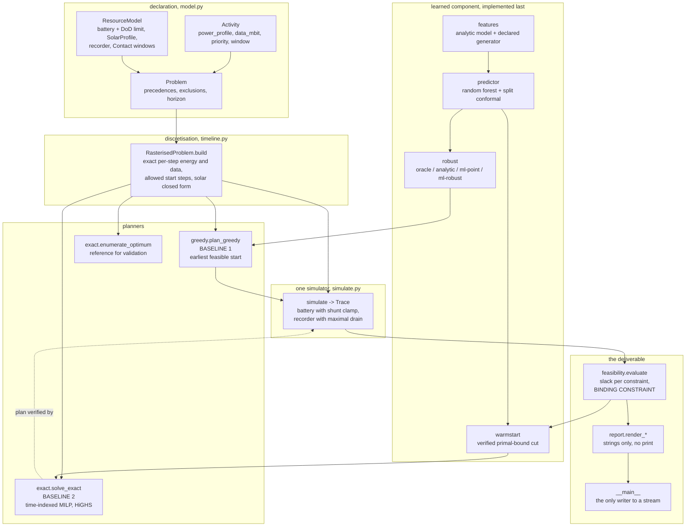
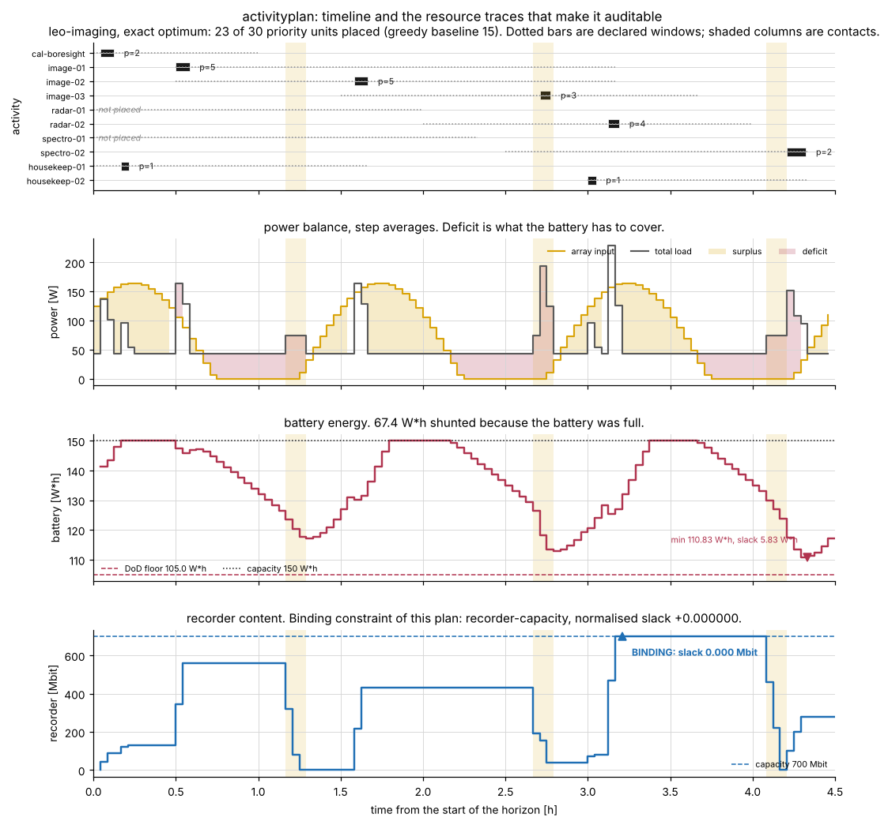
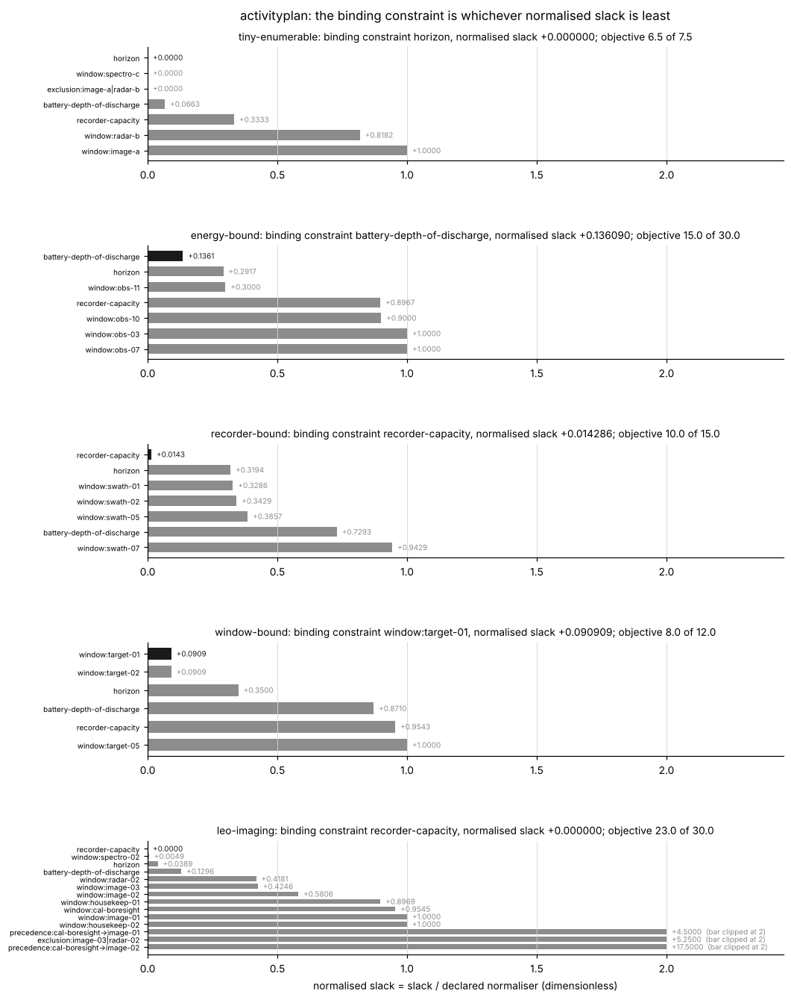
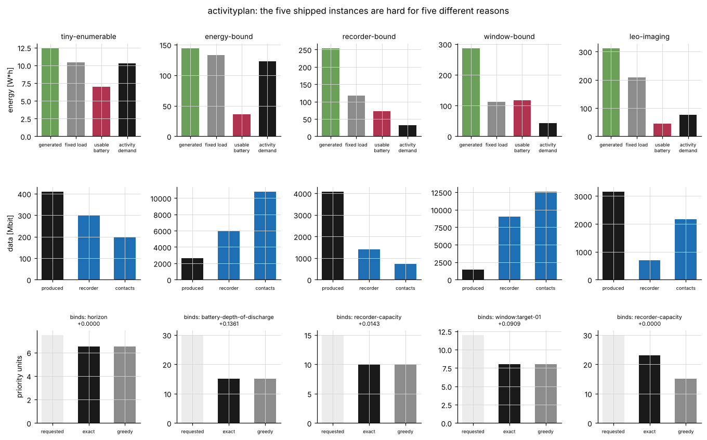
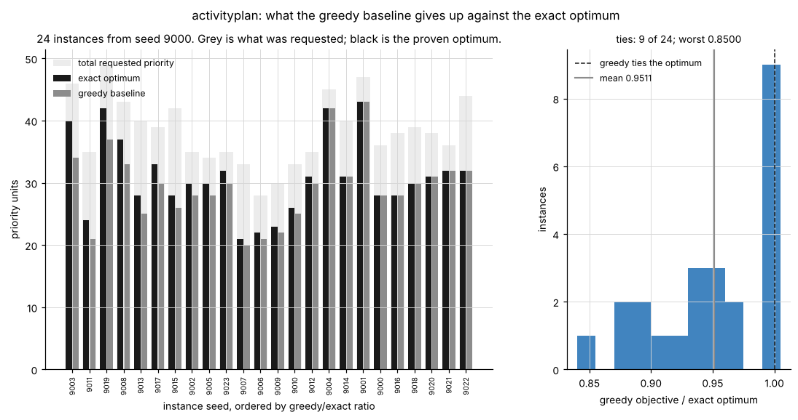
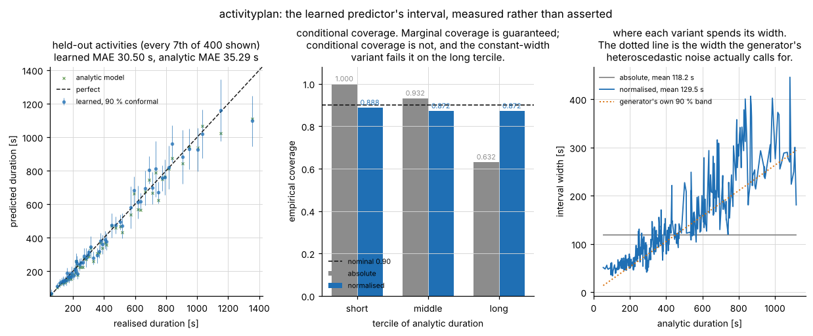
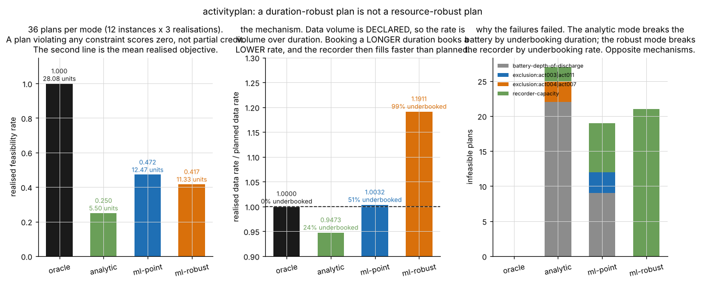
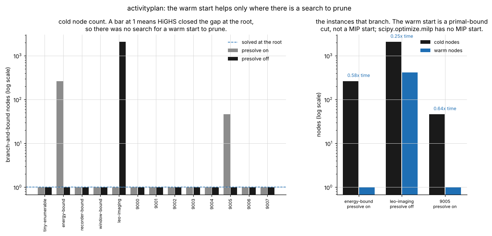

# ActivityPlan

An onboard activity planner whose output is a feasibility report, not just a timeline.


**Status: TESTING** · Class: flagship · Validation level 3 (research grade) ·
Learned component present and benchmarked against the baseline it has to beat ·
Apache-2.0 · © 2026 OPTIMA Organisation

This software is research-grade. It is **not flight-qualified, not certified,
and not approved for operational aerospace use.**

> **A plan this tool calls feasible is feasible with respect to the declaration
> you supplied, on the discretised timeline you chose.** Every constant in every
> shipped instance is a declared input of a synthetic benchmark and none was
> identified from any spacecraft. Change the grid step and you change the answer.

## The problem

You have a list of activities someone wants flown, a battery with a
depth-of-discharge limit, an array that stops producing in eclipse, a recorder
that fills up and a handful of ground contacts. Somebody asks whether the week's
plan fits. The timeline is the easy part: what the review actually needs is
**which constraint is the one stopping you, how much margin is left on it, and
how much is left on everything else** — and the answer has to survive someone
recomputing it.

## What this does

- **Produces a feasibility report that names the binding constraint and gives
  the slack on every other one**, in its physical unit and normalised by a
  declared scale, sorted tightest first. On the shipped `leo-imaging` instance
  that is `recorder-capacity` with **0.0000 Mbit** of slack, followed by
  `window:spectro-02` at **30 s** and `horizon` at **630 s**, with the battery
  still holding **5.83362 W\*h** above its floor
  (`validation/worked_example_output.txt`).
- **Two planners, one simulator.** A greedy baseline that places activities at
  the earliest feasible start, and an exact MILP over a discretised timeline that
  gives the proven optimum. Over 24 seeded instances the greedy baseline reaches
  **95.11 %** of the optimum on average and **85.00 %** at worst, ties it on
  **9 of 24**, and costs **2.94×** less wall clock
  (`validation/validate_gap_output.txt`).
- **An exactness check that is not self-referential.** The MILP optimum is
  cross-checked against exhaustive enumeration of every assignment on 9 small
  instances — 2401 to 24336 candidates each, every candidate tested through the
  resource *simulator* rather than the linear model. **0 disagreements, worst
  objective difference 0.000e+00** (`validation/validate_exact_output.txt`).
  This check found a real defect during the build; see below.
- **Energy accounting checked against a closed-form integral.** The battery
  balance closes to **2.274e-13 W\*h** over 21 traces, and the closed-form solar
  integral agrees with adaptive quadrature to **4.743e-10** relative
  (`validation/validate_energy_output.txt`).
- **A learned duration and energy predictor with a calibrated interval**, which
  beats the analytic model (MAE ratio **0.9249** on duration, **0.4116** on
  energy) and whose split-conformal interval attains its marginal coverage on
  **12 of 12** level/mode/target combinations — and **fails conditional coverage
  badly**, covering the longest third of activities **0.6782** of the time
  against a nominal 0.90 (`validation/validate_predictor_output.txt`).

## Who it is for

- Anyone who has to defend an onboard plan at a review and wants a number on
  every constraint rather than a green tick.
- Anyone sizing a battery, a recorder or a contact schedule who wants to know
  which of the three is the one that is actually limiting the science.
- Anyone about to put a learned duration model in front of a scheduler and who
  would like to see the downstream effect measured, including the case where it
  makes the plan worse.
- Anyone who wants a small, readable, exactly-specified time-indexed scheduling
  model to read before writing a bigger one.

## Who it is not for

- Anyone who needs a good scheduler. **OR-Tools CP-SAT is a better scheduler
  than this, by a wide margin**, and the search here is a commodity. See the
  alternatives table.
- Anyone who needs continuous-time start decisions. Start times here are
  restricted to grid points; the optimum reported is the optimum of the
  *discretised* problem and is a lower bound on the continuous one.
- Anyone who needs a power-system model. There is no voltage, no internal
  resistance, no temperature, no self-discharge and no ageing. The battery is one
  reservoir of watt-hours.
- Anyone who needs a link budget. Contact rates are declared, not computed, and
  elevation-dependent rate variation is not modelled, which overstates a
  low-elevation pass.
- Anyone who wants a spacecraft model. **No constant in this repository was
  identified from any vehicle, instrument or mission**, and the activity
  duration generator is a declared synthetic process.
- Anyone who needs a peak-power constraint. Energy is exact; instantaneous power
  in the final partially occupied step of an off-grid activity is understated by
  construction, so a peak constraint would be wrong there.

## Alternatives, honestly

Every package below was checked for existence in the build container on
2026-10-15; `pulp` is installed at **4.0.1** and was imported, and the others are
named from their published documentation rather than claimed to have been run
here.

| Alternative | What it does better | When to use this instead |
|---|---|---|
| **OR-Tools CP-SAT** (Google, Apache-2.0) | **It is the better scheduler and that is not close.** Interval variables, `NoOverlap`, `Cumulative`, optional intervals, reservoir constraints, LNS, parallel portfolio search, a decision strategy API, and years of competition results behind it. Everything the search in this repository does, CP-SAT does faster and at a scale this time-indexed model cannot reach. | Only if you want the spacecraft resource accounting and the feasibility report. CP-SAT has no battery, no depth-of-discharge limit, no eclipse-aware array model and no concept of a binding constraint with a normalised slack. |
| **PuLP 4.0.1** (COIN-OR) | A cleaner modelling layer than hand-assembling sparse matrices for `scipy.optimize.milp`, and it can drive CBC, GLPK, Gurobi, CPLEX and HiGHS from one API. | If you want the resource model and the report rather than the modelling layer. This package builds its matrices directly against `scipy.optimize.milp` to keep the dependency set to numpy, scipy and scikit-learn. |
| **`python-mip`** (COIN-OR / N. Maculan et al.) | Lazy constraints, cut callbacks and a solution pool, none of which `scipy.optimize.milp` exposes; a proper MIP-start facility, which `scipy.optimize.milp` also does not have. | If you are happy to assemble the model yourself and want the accounting. The absence of a MIP start in `scipy.optimize.milp` is the reason the warm start here is a primal-bound cut, and that limitation is documented and measured rather than hidden. |
| **`simpy`** (MIT) | Discrete-event simulation with processes, resources, pre-emption and interrupts. If what you need is to *simulate* an operations concept with queueing and contention, it is the right tool. | This package does not simulate events; it integrates a declared resource model on a fixed grid so that a planner and a report can agree about it exactly. |
| **ASPEN / CASPER** (NASA JPL) | The real thing: deployed mission planning with iterative repair, used on EO-1 and others. Decades of operational experience. | Not open source and not installable. This is a readable reference implementation of the same framing with the accounting written down. |

**What this does that none of them does:** it computes the spacecraft resource
balance — battery against a declared depth-of-discharge limit under an analytic
eclipse-aware array profile, a recorder against declared contact windows — and
reports **which constraint is binding and the slack on every other one**, with
the energy balance checked against a closed-form integral and the optimum checked
against exhaustive enumeration. **The search is not the contribution. CP-SAT
should do the search.**

## Install and first run

```bash
git clone https://github.com/OmAcharya-avtr/activityplan.git
cd activityplan
python -m venv .venv && source .venv/bin/activate
pip install -e ".[dev]"
python -m pytest tests/ -q
python examples/timeline_plot.py
```

The test run ends with:

```
217 passed in 48.00s
```

and the example prints:

```
wrote screenshots/timeline_plot.png

exact objective     : 23.0 of 30.0
greedy objective    : 15.0
binding constraint  : recorder-capacity
                      slack 0 Mbit, normalised +0.000000
activities placed   : 8 of 10
not placed          : radar-01, spectro-01
battery minimum     : 110.8336 W*h against a floor of 105.0000 W*h
recorder maximum    : 700.0000 Mbit of 700.0 Mbit
energy shunted      : 67.4198 W*h
data downlinked     : 1980.0 Mbit of 2260.0 Mbit produced
energy residual     : -1.847e-13 W*h
```

A first look from the command line:

```bash
python -m activityplan instances
python -m activityplan compare --instance leo-imaging
```

```
planner  objective  placed  cost              binding constraint          normalised slack
-------  ---------  ------  ----------------  --------------------------  ----------------
greedy   15.0       6       247 simulations   battery-depth-of-discharge  +0.016848
exact    23.0       8       1 nodes, 0.875 s  recorder-capacity           +0.000000

instance            : leo-imaging
total priority      : 30.0
exact dual bound    : 23.000000, gap 2.780e-15
greedy shortfall    : 34.78 % below the exact optimum

the exact optimum is the optimum of the DISCRETISED problem at this step,
not of the continuous-time problem. A finer step can only help it.
```

That is the committed output of invocation 9 in
`validation/validate_cli_output.txt`. Note that the two planners leave
*different* constraints binding: the greedy plan is energy-limited, the optimal
plan is recorder-limited, and a report that only said "feasible" would have
hidden that.

## A worked example

This is `validation/worked_example.py`, and the output beneath it is that
script's committed output.

```python
import numpy as np
from activityplan import (
    DurationEnergyPredictor, evaluate, feature_matrix, named_instance,
    plan_greedy, realise, render_feasibility, sample_requests, solve_exact,
)
from activityplan.timeline import RasterisedProblem

# Declare the problem and project it onto a 150 s grid.
problem = named_instance("leo-imaging")
rasterised = RasterisedProblem.build(problem, 150.0)

# Baseline 1: priority-ordered earliest-feasible-start insertion.
greedy = plan_greedy(rasterised)

# Baseline 2: the exact optimum of the discretised problem.
exact = solve_exact(rasterised, time_limit_s=150.0)

# The deliverable: the binding constraint and the slack on everything else.
report = evaluate(rasterised, exact.plan)
print(render_feasibility(report, rasterised))

# The learned predictor, with a calibrated interval on each activity.
rng = np.random.default_rng(61)
requests = sample_requests(1000, rng)
realised = [realise(request, rng) for request in requests]
predictor = DurationEnergyPredictor(alpha=0.10, mode="normalised", random_state=61).fit(
    feature_matrix(list(requests)),
    np.array([item.duration_s for item in realised]),
    np.array([item.energy_wh for item in realised]),
)
duration_interval, energy_interval = predictor.predict_requests(
    sample_requests(5, np.random.default_rng(99), name_prefix="new")
)
```

```
instance            : leo-imaging
activities          : 10, total priority 30.0
grid                : 108 steps of 150 s
greedy objective    : 15.0 in 247 simulations
exact objective     : 23.0, 1 nodes, 0.840 s, proven optimal True
greedy shortfall    : 34.78 %

verdict             : FEASIBLE
objective           : 23.0 of 30.0 priority units placed (8 of 10 activities)
forgone             : 7.0 priority units on 2 activities: radar-01, spectro-01
BINDING CONSTRAINT  : recorder-capacity
                      slack 0 Mbit = +0.000000 of 700 Mbit
                      at step 76 ending t=11550.0 s, S=700.0000 Mbit of 700.0000 Mbit

constraint                          slack    unit  normaliser  normalised  status
----------------------------------  -------  ----  ----------  ----------  ------
recorder-capacity                   0        Mbit  700         +0.000000   ok
window:spectro-02                   30       s     6180        +0.004854   ok
horizon                             630      s     16200       +0.038889   ok
battery-depth-of-discharge          5.83362  W*h   45          +0.129636   ok
window:radar-02                     2910     s     6960        +0.418103   ok
window:image-03                     3210     s     7560        +0.424603   ok
window:image-02                     5400     s     9300        +0.580645   ok
window:housekeep-01                 5220     s     5820        +0.896907   ok
window:cal-boresight                3150     s     3300        +0.954545   ok
window:image-01                     9300     s     9300        +1.000000   ok
window:housekeep-02                 4620     s     4620        +1.000000   ok
precedence:cal-boresight->image-01  1350     s     300         +4.500000   ok
exclusion:image-03|radar-02         1260     s     240         +5.250000   ok
precedence:cal-boresight->image-02  5250     s     300         +17.500000  ok

energy audit, W*h
generated_closed_form  311.975519
generated_steps        311.975519
activity_energy        56.0908333
consumed_steps         265.340833
shunted                67.4197915
battery_delta          -20.7851054
residual               -1.84741111e-13

learned duration and energy predictions with 90 % conformal intervals
activity   type          duration/s     lower     upper  energy/Wh    lower    upper
new000     calibration       740.05    590.12    889.97     4.7509   3.7047   5.7970
new001     spectro           555.93    495.23    616.64     6.3645   5.1523   7.5767
new002     spectro           332.79    274.31    391.28     4.8202   3.8597   5.7807
new003     calibration       578.47    513.59    643.34     4.4672   3.2675   5.6669
new004     image             264.11    217.49    310.72     2.7315   2.1635   3.2994
```

The full report is in `validation/worked_example_output.txt`; the table above is
abridged by two columns to fit the page.

## Architecture



## Screenshots



The headline deliverable. Notice that the recorder panel touches its capacity
line exactly once, at step 76, and that is the binding constraint; the battery
panel never comes close to its floor, and the power panel shows why — the array
covers the load for most of each orbit and the red deficit regions are short.
Two activities could not be placed at all.



The same report for all five shipped instances. Notice that a different
constraint is binding on each: a window on `window-bound`, the battery on
`energy-bound`, the recorder on `recorder-bound` and `leo-imaging`. The black bar
is the binding one and it is always the shortest.



Why each instance is hard, in declared quantities. Notice `energy-bound`, where
the activity demand bar towers over generated-minus-fixed plus the usable
battery, and `recorder-bound`, where produced data is three times the recorder
and nearly six times the total contact capacity.



The optimality gap. Notice that the greedy baseline ties the optimum on 9 of 24
instances — the right-hand histogram's bar at 1.0 — and that the loss is
concentrated in a few instances rather than spread evenly, which is what a mean
of 0.9511 on its own would hide.



What the learned component's uncertainty output is worth. The middle panel is
the one that matters: the constant-width interval covers the **short** tercile
1.000 of the time and the **long** tercile 0.632, against a nominal 0.90. The
right panel shows why — the normalised variant's width tracks the generator's
own heteroscedastic band (dotted) and the constant-width variant's does not.



The negative result, with its mechanism. Left: planning against the conformal
upper bound is **worse** than planning against the point prediction, on both
feasibility and realised objective. Middle: why — the robust plan underbooks the
data production rate on 99 % of activities. Right: the failures confirm it; the
robust plan fails on `recorder-capacity` and nothing else.



The warm start, measured. Left: 23 of 26 cold solves sit on the line at 1 node,
which means HiGHS closed the gap at the root and there was no search to prune.
Right: on the three that branch, the primal-bound cut takes 263 nodes to 1, 2064
to 420 and 46 to 1.

## Validation evidence

Full table, with every tolerance, in
[`validation/VALIDATION.md`](validation/VALIDATION.md). Selected rows,
**including the ones the baseline won**:

| Check | Reference | Result | Criterion | Script |
|---|---|---|---|---|
| Closed-form solar integral | `scipy.integrate.quad` | worst relative difference **4.743e-10** | < 1e-8 | `validate_energy.py` |
| **Battery energy balance over the timeline** | `generated - consumed - shunted` | worst residual **2.274e-13 W\*h** over 21 traces | < 1e-9 W\*h | `validate_energy.py` |
| Midpoint sampling across the eclipse kink | the closed form | ratios **5.593, 6.848, 1.544**, not the second-order 4 | reported, not bounded | `validate_energy.py` |
| **MILP optimum against exhaustive enumeration** | every assignment, tested through the simulator | **9 instances, 0 disagreements**, worst difference **0.000e+00** | ≤ 1e-9 | `validate_exact.py` |
| **Greedy against the exact optimum** | the proven optimum, 24 seeded instances | mean **0.9511**, worst **0.8500**, ties on **9 of 24**, pooled shortfall **4.97 %** | reported | `validate_gap.py` |
| Dominance lemma: MILP plans re-simulated | the simulator's fixed shunt and drain policies | **0 of 24** rejected | all zero | `validate_gap.py` |
| Learned duration against the analytic model | the analytic model, held out, 5 seeds | MAE ratio **0.9249**, closing **51.1 %** of the gap to the noise floor | ratio < 1 | `validate_predictor.py` |
| Learned energy against the analytic model | as above | MAE ratio **0.4116**, closing **86.1 %** of the gap | ratio < 1 | `validate_predictor.py` |
| Noise floor, closed form against Monte Carlo | each other | **26.74746 s** against **26.83000 s** | must agree | `validate_predictor.py` |
| **Prediction-interval marginal coverage** | nominal 0.95 / 0.90 / 0.80 | **0 of 12** rows below nominal beyond the binomial band | 3 standard errors | `validate_predictor.py` |
| **Conditional coverage, long tercile, constant-width interval** | nominal 0.90 | **0.6782**, a shortfall of **0.2218** | reported, no criterion | `validate_predictor.py` |
| **Is there a search for the warm start to prune** | HiGHS node count | **31 of 34** solves have a node count of 1 | reported | `validate_warmstart.py` |
| Warm start where the solver branches | the cold solve | nodes **263 → 1**, **2064 → 420**, **46 → 1**; time ratios 0.65, 0.24, 0.68 | optimum preserved | `validate_warmstart.py` |
| **Learned warm start against the analytic one** | each other | node count **unchanged** on every verified case; learned candidate verifies 8/8, analytic 5/8 | 0 optima lost | `validate_warmstart.py` |
| **Robust plan against the point plan** | realised durations, 36 plans each | **0.4167 feasible against 0.4722** — the robust plan is worse | reported | `validate_robust.py` |
| Why: realised against planned data rate | each other | ml-robust underbooks on **99.40 % (0.9940)** of activities, mean ratio **1.1911** | reported | `validate_robust.py` |
| CLI exit statuses and vocabulary | 14 invocations plus `--help` | **0 failures**, 0 forbidden words | 0 | `validate_cli.py` |

### Three results that do not flatter this package

**1. The learned warm start does not help the solver.** On 31 of 34 cold solves
HiGHS closes the gap at the root node, so there is no branch-and-bound tree for a
primal bound to prune, and the node count is 1 whether the bound is applied or
not. On the one sampled instance that does branch, `family-9003`, the cut reduced
nodes from 613 to 510 and *increased* the wall clock from 3.460 s to 4.380 s.
What the learned predictor does buy is that its candidate plan verifies as
feasible on the target problem **8 times out of 8**, where a plan built from the
analytic model fails verification **3 times out of 8**. The safety comes from the
verification gate, not from the model, and that is what the measurement says.

**2. The robust plan is worse than the point plan, and the reason is structural.**
Planning against the conformal upper bound on duration gives **0.4167**
feasibility against the point plan's **0.4722**, and **11.333** against **12.472**
realised priority units. The mechanism is measured: an activity's data volume is
*declared*, so its production rate is volume over duration. Booking a longer
duration books a **lower** rate; the realised duration is shorter, the real rate
is higher, and the recorder overflows. The robust plan underbooks the rate on
**99.40 % (0.9940)** of activities and every one of its 21 failures is
`recorder-capacity`. **Planning against an upper bound on duration is
conservative for time and energy and anti-conservative for the recorder.**

**3. The conformal interval is calibrated marginally and not conditionally.**
The constant-width variant covers the longest third of activities **0.6782** of
the time against a nominal 0.90. The normalised variant reduces the shortfall to
**0.0323** and does not remove it. Neither should be reported as a per-activity
confidence statement.

### The defect the validation found

An earlier draft of `activityplan.feasibility` treated aggregate downlink volume
as a hard constraint. The MILP never had it. On a four-activity instance the MILP
returned **6.5** priority units and exhaustive enumeration **5.0**. The MILP was
right: data left on the recorder at the horizon is not an infeasibility unless
you declare that it is. The constraint is now a diagnostic, the declared option
`require_empty_recorder` provides the strictly stronger end-of-horizon version,
and both readings are pinned in `tests/test_regressions.py`.

A second defect was found the same way: the first draft of the `energy-bound`
instance did not admit **the empty plan** — its fixed loads alone broke the
depth-of-discharge floor by 1.44 W\*h. `solve_exact` now names the empty-plan
binding constraint when a model is infeasible, and the condition is a test for
every shipped and sampled instance.

## API reference

<details>
<summary>Public surface, one line each, with units</summary>

**Declaration** — `activityplan.model`

| Name | Meaning |
|---|---|
| `PowerSegment(duration_s, power_w)` | One constant-power segment. `duration_s` [s] > 0, `power_w` [W] ≥ 0. `.energy_wh`. |
| `Activity(name, power_profile, data_mbit, priority, earliest_start_s, latest_finish_s)` | Duration is *derived* from the profile, so the two cannot disagree. |
| `Activity.uniform(name, duration_s, power_w, ...)` | Single-segment convenience constructor. |
| `Activity.duration_s / .energy_wh / .mean_power_w / .peak_power_w / .data_rate_mbit_per_s` | [s], [W\*h], [W], [W], [Mbit/s]. |
| `Activity.power_at(offset_s)` / `.energy_between_wh(t0_s, t1_s)` | [W] at an offset; exact closed-form energy over an interval [W\*h]. |
| `SolarProfile(peak_power_w, orbit_period_s, eclipse_fraction, phase_s)` | Sine arc over the sunlit portion, zero in eclipse. A declared input, not an ephemeris. |
| `SolarProfile.power_at(t_s)` / `.energy_wh(t0_s, t1_s)` / `.sunlit_s` | [W]; exact closed-form integral [W\*h]; [s]. |
| `Contact(start_s, end_s, rate_mbit_per_s, power_w, name)` | A declared pass. `.duration_s`, `.capacity_mbit`. |
| `ResourceModel(battery_capacity_wh, max_depth_of_discharge, solar, recorder_capacity_mbit, ...)` | `.floor_wh`, `.usable_wh`, `.initial_energy_wh`, `.total_contact_capacity_mbit` all [W\*h] or [Mbit]. |
| `Problem(activities, resources, horizon_s, precedences, exclusions, require_empty_recorder, name)` | `.total_priority`, `.total_data_mbit`, `.total_activity_energy_wh`, `.baseline_energy_balance_wh()`. |

**Discretisation** — `activityplan.timeline`

| Name | Meaning |
|---|---|
| `Grid.for_horizon(horizon_s, step_s)` | Refuses an off-grid horizon rather than rounding it. |
| `Grid.steps_for(duration_s)` | Occupancy in steps, rounded **up**. |
| `RasterisedProblem.build(problem, step_s)` | Exact per-step energies and data volumes, admissible starts, closed-form solar. |
| `RasterisedProblem.window_tightening_s()` | Window float lost to grid snapping, per activity [s]. |
| `RasterisedProblem.solar_step_wh_midpoint()` | The sampled alternative, for validation only. Never used by a planner. |
| `Plan(starts, grid)` | `.placed`, `.n_placed`, `.start_s(name)`, `.value(problem)`, `.with_activity`, `.without_activity`. |

**Simulation and the report** — `activityplan.simulate`, `activityplan.feasibility`

| Name | Meaning |
|---|---|
| `simulate(rasterised, plan) -> Trace` | Battery with a shunt clamp, recorder with maximal drain. No constraint is evaluated. |
| `Trace.min_battery_wh / .max_recorder_mbit / .shunted_wh / .total_downlinked_mbit` | [W\*h], [Mbit], [W\*h], [Mbit]. |
| `Trace.energy_residual_wh()` | Closure of the battery recursion [W\*h]. Returned, not asserted. |
| `evaluate(rasterised, plan) -> FeasibilityReport` | **The deliverable.** |
| `FeasibilityReport.binding` | The candidate constraint with the least normalised slack. |
| `FeasibilityReport.binding_resource` | The tightest among `RESOURCE_CONSTRAINTS`, reported separately. |
| `FeasibilityReport.feasible / .violations / .slack(name) / .energy_audit()` | Verdict within a 1e-9-of-scale tolerance; violations tightest first; one constraint; the energy audit. |
| `ConstraintSlack.slack / .unit / .scale / .normalised / .satisfied / .where` | Slack in its unit; the declared normaliser; the ratio; the tolerance test; where it is tightest. |

**Planners** — `activityplan.greedy`, `activityplan.exact`

| Name | Meaning |
|---|---|
| `plan_greedy(rasterised) -> GreedyResult` | **Baseline 1.** `.plan`, `.order`, `.simulations`, `.rejections`, `.value`. |
| `topological_order(rasterised)` | Precedence-respecting, priority-descending activity order. |
| `RejectionRecord.dominant_reason` | Why an activity was dropped, from the binding constraint of every refused start. |
| `build_model(rasterised, primal_bound=None) -> MilpModel` | The assembled MILP, inspectable without solving. |
| `solve_exact(rasterised, primal_bound, time_limit_s, mip_rel_gap, presolve) -> ExactResult` | **Baseline 2.** `.value`, `.dual_bound`, `.gap`, `.node_count`, `.solve_s`, `.proven_optimal`. |
| `enumerate_optimum(rasterised, max_candidates)` | Exhaustive reference. `(plan, value, candidates)`. |

**Instances** — `activityplan.instances`

| Name | Meaning |
|---|---|
| `named_instance(name)` / `INSTANCE_ORDER` / `RECOMMENDED_STEP_S` | The five hand-declared instances and the steps they are documented at. |
| `sample_instance_spec(seed, ...)` / `instance_family(count, base_seed)` | The seeded family, sized against the sampled demand and the computed worst drawdown. |
| `InstanceSpec.problem_from(durations_s, energies_wh)` / `.analytic_problem()` | The same instance under any duration/energy estimate. |

**Learned component** — `activityplan.features`, `.predictor`, `.warmstart`, `.robust`

| Name | Meaning |
|---|---|
| `ActivityRequest(...)` / `sample_requests(n, rng, ...)` | A request described by features; the declared sampler. |
| `analytic_duration_s / analytic_mean_power_w / analytic_energy_wh` | **The baseline**, in [s], [W], [W\*h]. |
| `realise(request, rng, ...)` | The declared generator. Adds the two terms the analytic model omits, plus heteroscedastic noise. |
| `feature_vector` / `feature_matrix` / `FEATURE_NAMES` | The 10-column design matrix, including the analytic prediction as a feature. |
| `ConformalRegressor(alpha, mode, ...)` | Random forest plus split conformal. `.fit(x_train, y_train, x_cal, y_cal)`, `.predict -> Interval`, `.quantile_`, `.level_attainable`. |
| `DurationEnergyPredictor(alpha, mode, calibration_fraction, random_state)` | Both targets, one split. `.fit`, `.predict_requests`. |
| `coverage(y, interval)` / `mean_interval_width(interval)` | Empirical coverage; mean width in the target's unit. |
| `warm_start_from_plan(target, plan, source) -> WarmStart` | **Verifies the candidate against the target before returning a bound.** |
| `compare_warm_start(target, warm_start, presolve, time_limit_s)` | Cold then warm, with node counts and wall clocks. |
| `estimate_for_mode(spec, mode, predictor, truth)` / `compare_modes(...)` / `PLANNING_MODES` | `oracle`, `analytic`, `ml-point`, `ml-robust` on identical instances. |
| `score_realisation(spec, plan, truth, mode) -> RealisationOutcome` | Zero credit for a plan that violates any constraint. |

</details>

## AI model details

The learned component is a **random-forest regression of activity duration [s]
and energy [W\*h] on ten declared features**, wrapped in **split conformal
prediction** for the interval. Full card: [`MODEL_CARD.md`](MODEL_CARD.md).
Data: [`DATASET_CARD.md`](DATASET_CARD.md).

- **Baseline, implemented first**: the analytic duration and power model in
  `activityplan/features.py`. The comparison is given in full above, including
  where it wins.
- **Uncertainty output**: a split-conformal interval, which has a
  distribution-free finite-sample **marginal** coverage guarantee under
  exchangeability (Papadopoulos et al. 2002; Lei et al. 2018). Measured marginal
  coverage is within the binomial band of nominal on all 12 level/mode/target
  combinations. **Conditional coverage is not guaranteed and is not attained**:
  0.6782 on the long duration tercile against a nominal 0.90 for the
  constant-width variant.
- **Test split**: 1000 activities are used for fitting, of which a seeded
  permutation puts 650 in the proper-training set and 350 in the calibration set;
  400 further activities drawn from the same declared sampler at the same seed
  are held out and never seen.
- **Failure cases**: the two intervals are not jointly calibrated, so the
  probability that duration and energy are both covered is bounded below only by
  the union bound `1 - 2α`; conditional coverage fails on long activities; and
  planning against the upper bound makes plans *worse*, for the measured reason
  above.
- **This model is not certified for operational flight use.**

## Hardware requirements

None beyond a CPU. Everything runs in one process with no parallelism; both
forests are fitted and queried with `n_jobs = 1`. The figures in this repository
were produced on a container reporting **2 available CPU cores**
(`os.sched_getaffinity`) with about 7.8 GiB of RAM. **There is no
hardware-pending measurement here and nothing in this repository should be read
as a hardware characteristic.**

## Compute budget

| run | wall clock |
|---|---:|
| `python -m pytest tests/ -q` | 48.7 s |
| `validate_energy.py` | 3.8 s |
| `validate_exact.py` | 19.4 s |
| `validate_gap.py` | 23.7 s |
| `validate_predictor.py` | 73.8 s |
| `validate_warmstart.py` | 95.1 s |
| `validate_robust.py` | 38.6 s |
| `validate_cli.py` | 18.6 s |
| `worked_example.py` | 5.5 s |
| all seven examples | 165 s |

Every run finishes inside three minutes. The single slowest operation anywhere is
one MILP solve of `leo-imaging` with HiGHS presolve disabled, at **23.1 s**;
with presolve enabled the same solve takes **0.728 s**. **These are wall clocks on
a shared 2-core container and they move by tens of percent between runs.** The
primary metrics — objective values, node counts, coverage fractions — do not move
at all at a fixed seed.

## Limitations

1. **Start times are restricted to grid points.** The reported optimum is the
   optimum of the discretised problem and is a lower bound on the continuous-time
   optimum. Change the step and you change the answer; every committed number
   uses the step in `RECOMMENDED_STEP_S`.
2. **Occupancy is rounded up and windows are tightened inward.** Both are
   conservative, and both make some legal continuous plans unreachable. The
   window float lost to snapping is reported by
   `RasterisedProblem.window_tightening_s`; on `recorder-bound` it is up to 100 s
   per activity.
3. **The final partially occupied step of an off-grid activity carries a reduced
   average power.** Energy is exact; peak power in that step is understated by up
   to `(1 - frac)·p_last`. There is no peak-power constraint for exactly this
   reason.
4. **The MILP refuses `charge_efficiency < 1`.** The efficiency kink at zero
   surplus is piecewise linear and is not represented. The greedy planner and the
   simulator handle any efficiency; the exact solver raises rather than silently
   solving a different problem.
5. **`scipy.optimize.milp` has no MIP start.** The warm start is a primal-bound
   cut, which prunes but supplies no integer assignment to repair. `python-mip`
   and PuLP both expose a real MIP start if you need one.
6. **On 31 of 34 measured solves there is no search to warm-start.** HiGHS closes
   the gap at the root. Any claim of a warm-start speed-up on this family would
   be measuring presolve.
7. **The robust planning mode is worse than the point mode** on this instance
   family, for the structural reason measured above. It is shipped because the
   measurement is the result, not because it is recommended.
8. **The conformal interval has no conditional coverage guarantee** and does not
   attain conditional coverage here. It must not be reported as a per-activity
   confidence statement.
9. **The learned model beats the analytic model because the analytic model is
   misspecified by construction**, and it is handed the analytic prediction as a
   feature. Neither fact transfers to a duration model fitted to real hardware.
10. **Every dependency is pinned to the minor version actually executed**, and
    for all but `ruff` **no other version was installed or tested**. That is a
    real cost: the product cannot take a future security release of numpy, scipy
    or scikit-learn without a port. The alternative — a floor with no ceiling —
    is what broke five of fifty products in this mission's own 2026-10-13
    cold-clone audit, so the tension is recorded rather than resolved by removing
    the ceiling.
11. **The instance family is a declared experimental design.** Resources are
    sized relative to sampled demand with factors drawn from declared ranges. The
    measured optimality gap, feasibility rates and node counts are statements
    about *that* population and transfer to no other.
12. **A realised plan that violates any constraint scores zero.** The alternative
    — crediting the activities that completed before the violation — needs a
    model of what the spacecraft does mid-plan, which this package does not have.
    The rule is applied identically to all four modes, so the comparison between
    them is unaffected; the absolute levels are not.
13. **No value anywhere was identified from a spacecraft.** The solar profile is
    a declared sine arc, the battery is one reservoir of watt-hours with no
    voltage or temperature model, the contact rates are declared, and the
    duration generator is synthetic.

## Reproducing every number

See [`validation/VALIDATION.md`](validation/VALIDATION.md) for the full list and
every seed. In short, from the repository root:

```bash
pip install -e ".[dev]"
python -m pytest tests/ -q --junitxml=junit.xml
ruff check src/ tests/ examples/ validation/
python -m activityplan --help

python validation/validate_energy.py
python validation/validate_exact.py
python validation/validate_gap.py
python validation/validate_predictor.py
python validation/validate_warmstart.py
python validation/validate_robust.py
python validation/validate_cli.py
python validation/worked_example.py

MPLBACKEND=Agg python examples/timeline_plot.py
MPLBACKEND=Agg python examples/feasibility_slack.py
MPLBACKEND=Agg python examples/instance_portraits.py
MPLBACKEND=Agg python examples/greedy_vs_exact.py
MPLBACKEND=Agg python examples/prediction_intervals.py
MPLBACKEND=Agg python examples/robust_tradeoff.py
MPLBACKEND=Agg python examples/warmstart_nodes.py
```

Each validation script writes its raw output to
`validation/<script>_output.txt`, which is committed. Every number in this file
appears in one of those.

## Safety statement

This software is research-grade. It is **not flight-qualified, not certified,
and not approved for operational aerospace use.** It plans against a declaration
you supply, on a timeline you discretise, under a resource model whose
assumptions are listed in full in the module docstrings. **A feasibility verdict
from this package is a statement about that declaration and nothing else.**

## Roadmap

- A CP-SAT backend, so the search is done by a solver built for it and this
  package keeps only the accounting and the report.
- A peak-power constraint, which needs the off-grid final step handled more
  carefully than energy-conserving averaging.
- A rate-aware robust mode, since the measurement above shows that bounding the
  duration from above is the wrong conservatism for a declared data volume.
- Elevation-dependent contact rates, which would make the downlink numbers mean
  something beyond the declaration.

## License

Apache-2.0. © 2026 OPTIMA Organisation. See [LICENSE](LICENSE).

## Credits

This is under reserved rights obtained by OPTIMA Organisation.

## Citation

See [CITATION.cff](CITATION.cff). The principal references for the methods used
are Pritsker, Watters & Wolfe (1969) for the time-indexed zero-one scheduling
formulation, Chien et al. (2000) for the oversubscribed-activity framing,
Huangfu & Hall (2018) for HiGHS, Breiman (2001) for the random forest,
Papadopoulos et al. (2002) and Lei et al. (2018) for split conformal prediction,
Wertz & Larson (1999) and Patel (2004) for the structure of the spacecraft power
and energy budget, Kahn (1962) for the topological ordering and Bentley (1984)
for the maximum-subarray algorithm used to size the instance family.
