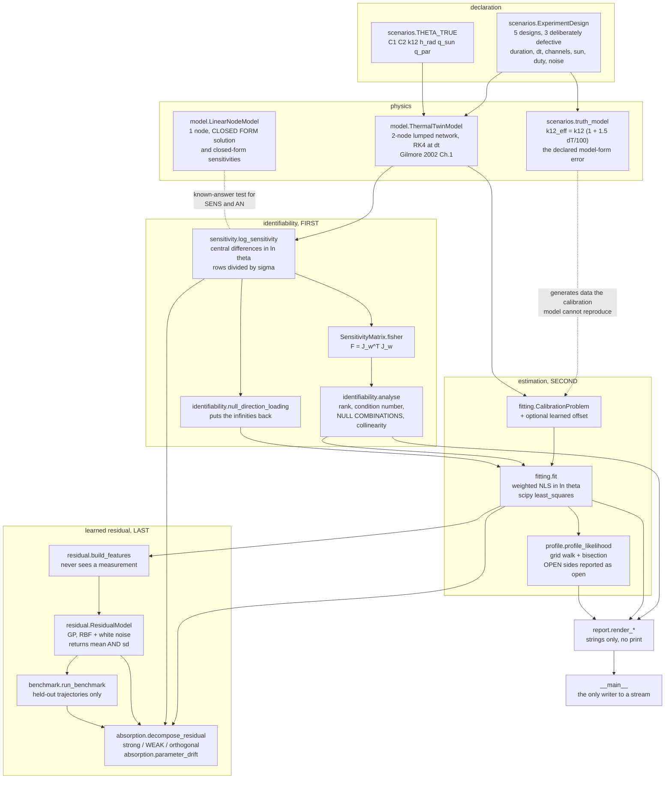
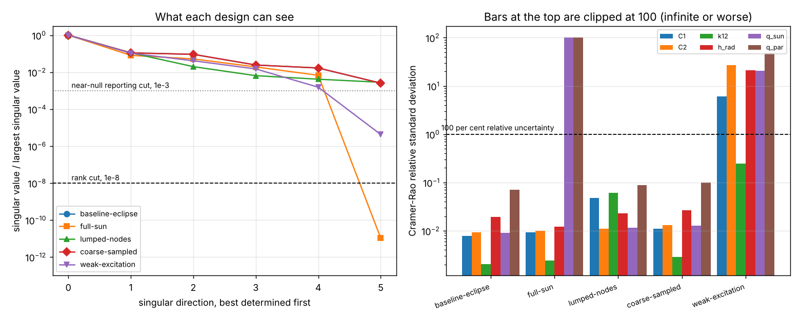
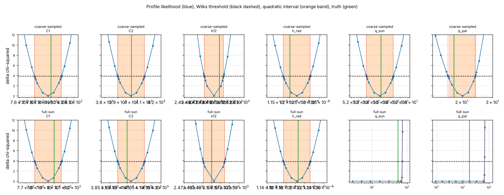
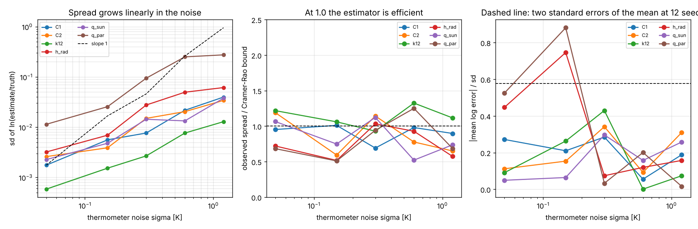
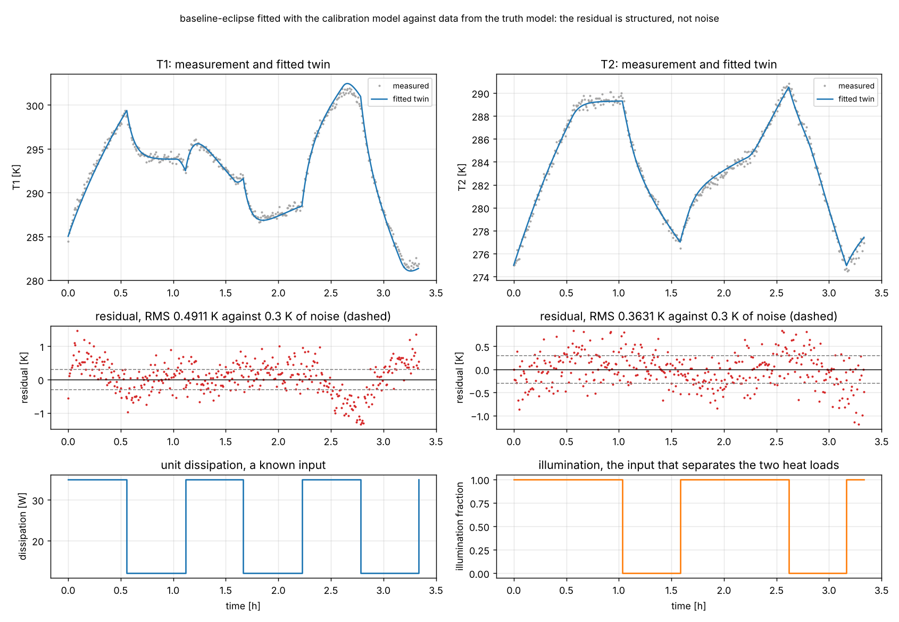
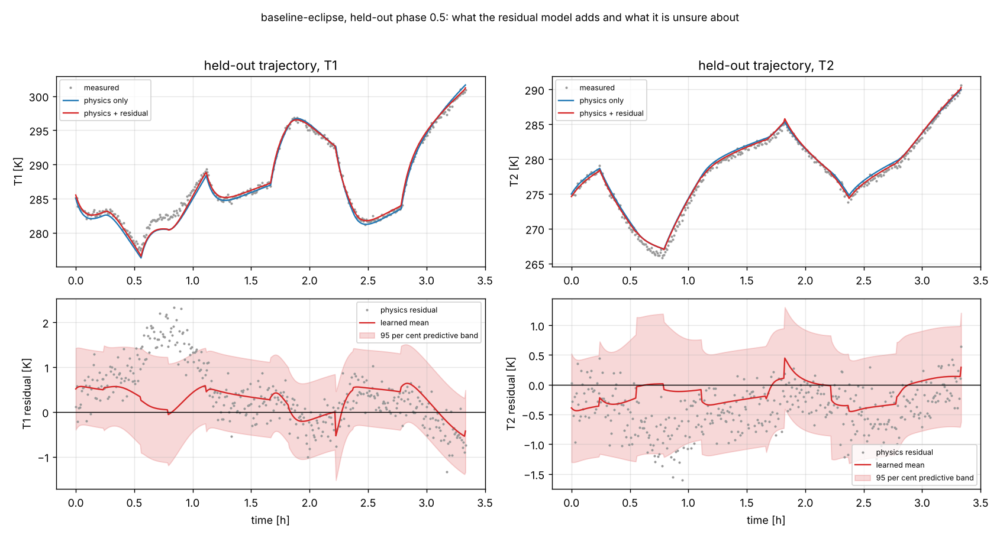
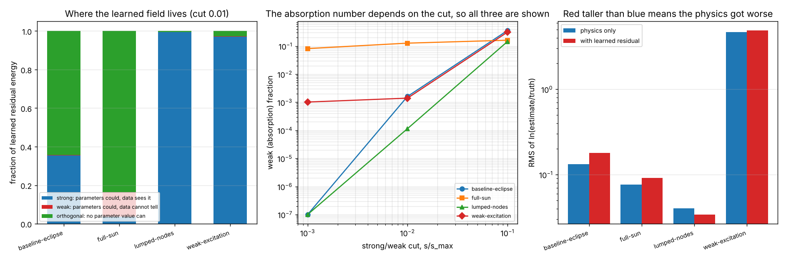

# twincalib

Fit a digital twin, and say which parameters the data can actually pin down.


**Status: TESTING** · Class: flagship · Validation level 3 (research grade) ·
Learned component present, benchmarked against the physics-only baseline, and
measured for how much of its gain is absorbing an identifiability failure ·
Apache-2.0 · © 2026 OPTIMA Organisation

This software is research-grade. It is **not flight-qualified, not certified,
and not approved for operational aerospace use.**

> **A fitted parameter is not a measured parameter.** Every estimate this
> package prints is accompanied by the identifiability verdict for the design it
> came from, because on one of the five shipped designs a covariance matrix
> reports a 1.9 per cent relative standard deviation for a parameter the data
> cannot constrain at all. The command-line tool is built so that it cannot
> print a tidy parameter table on its own.

## The problem

You have a thermal twin of a spacecraft unit, a few days of housekeeping
telemetry, and six parameters to fit. The optimiser converges, the covariance
matrix comes back with tight-looking standard deviations, and you put the heat
capacities in a report. The question nobody asked is whether that telemetry
could have distinguished those six parameters in the first place — and when it
could not, a least-squares fit does not fail, it returns a confident number.

## What this does

- **Reports the parameter combinations the data does not constrain, written
  out as combinations.** On the `full-sun` design it prints
  `+0.950 d ln q_par -0.311 d ln q_sun`, which is the analytic null direction
  `(q_par, -q_sun)/|.|` to **1.341e-09** per component
  (`validation/validate_identifiability.py`).
- **Puts the infinities back into a rank-deficient covariance.** A
  pseudo-inverse reports **0.0187905** relative standard deviation for `q_sun`
  on that design; this package reports `inf`, because the parameter loads on a
  null direction (`validation/validate_profile.py`).
- **Profile-likelihood intervals, with the open sides reported as open.** On the
  sound design they agree with the quadratic interval to **0.0025** in width
  ratio, so they tell you nothing new; on the degenerate design two of six are
  open below while the sum `q_sun + q_par` is identified to **+0.6 per cent**.
- **Pooled interval coverage of 0.9306, exact interval [0.8453, 0.9771]**, over
  12 seeds and 6 parameters — and **0.3750, [0.2636, 0.4970]** once the declared
  model-form discrepancy is present (`validation/validate_coverage.py`).
- **A learned residual model that improves held-out prediction by 39 per cent
  and makes the physical parameters 35 per cent worse**, both measured on the
  same experiment, with a subspace decomposition that says how much of the gain
  is absorbing an identifiability failure
  (`validation/validate_residual.py`).

## Who it is for

- Anyone about to report a fitted physical parameter from telemetry and who
  would like to know first whether the telemetry determines it.
- Anyone who has been handed a covariance matrix from a nonlinear fit and
  suspects the standard deviations are too good.
- Anyone considering a learned residual or discrepancy term on top of a physics
  model, who needs a number for the risk that it is compensating for parameter
  error rather than finding real structure.
- Anyone teaching the difference between structural and practical
  non-identifiability who wants two worked cases with exactly known answers.

## Who it is not for

- Anyone who needs a general-purpose fitting library. **Use `lmfit`.** Its
  parameter handling, its model composition and its reporting are all better
  than anything here, and it wraps far more minimisers.
- Anyone who needs the posterior rather than a confidence interval. **Use
  `emcee`.** A profile likelihood is not a posterior and does not pretend to be.
- Anyone who needs global sensitivity analysis over a wide parameter box.
  **Use `SALib`.** Everything here is local, at one parameter point.
- Anyone who needs to *discover* the model form rather than fit a declared one.
  **Use `pysindy`.**
- Anyone wanting a spacecraft thermal model. The two-node network here is a
  declared teaching model, **no parameter value in it was identified from any
  flight hardware**, and it has no heaters, thermostats, louvres, heat pipes or
  phase-change material.
- Anyone whose twin is not a parameterised ODE. Nothing here applies to a
  finite-element model or a surrogate without parameters.

## Alternatives, honestly

Every version below was probed with `pip index versions` against the live index
in the build container on 2026-10-15.

| Alternative | What it does better | When to use this instead |
|---|---|---|
| **`lmfit` 1.3.4** (BSD) | **A better fitting library in every respect that is not identifiability.** Named parameters with bounds, ties and algebraic constraints; composable models; many minimisers behind one interface; a full fit report; and it already computes a covariance, correlations and — through `conf_interval` — F-test-based confidence intervals that are a close relative of the profile intervals here. If you need to fit something, start there. | If you need the *unconstrained parameter combinations* written out as combinations, the pseudo-inverse infinities put back, and the absorption measurement on a residual model. `lmfit` reports per-parameter intervals; it does not report the null directions of the sensitivity matrix. |
| **`scipy.optimize.least_squares` 1.18.1** | It *is* the minimiser underneath this package, and the right primitive for a plain weighted nonlinear least squares. Better maintained, better tested and more flexible than any wrapper. | If you want the identifiability analysis around the fit. `least_squares` hands you a Jacobian and nothing else; everything in this repository is what you would otherwise have to write around it. |
| **`emcee` 3.1.6** (MIT) | Gives you the actual posterior, which is the right answer to "what does the data say about this parameter". Its chains make a structurally non-identifiable direction visible as a ridge that never mixes, which is more informative than a flat profile. | If you cannot afford the chains. The six-parameter problem here needs tens of thousands of simulations for a usable posterior against the ~1500 a full profile costs, and if the answer you need is "which combination is unconstrained" the sensitivity SVD gives it in one Jacobian. |
| **`SALib` 1.6.0** (MIT) | Global sensitivity analysis — Sobol, Morris, FAST, delta — over a declared parameter box. It answers which parameters matter across the whole box, which this package never asks. | Sensitivity and identifiability are different questions. `SALib` tells you a parameter matters; this tells you whether two parameters that both matter can be told apart. Use both. |
| **`pysindy` 2.1.0** (MIT) | Discovers the governing equations from data rather than fitting a declared model. If you do not trust the model form at all, that is the tool. | If you have a declared model and need to defend its parameters. `pysindy` finds a model; it does not report whether the model it found is identifiable from your design. |
| `scipy.optimize.curve_fit` | Simpler for a one-line fit with a covariance. | Its covariance is the same local quadratic approximation this package spends most of its code warning about. |

**What this does that none of them does:** it reports the *parameter
combinations* a given experiment design cannot constrain, before any value is
printed; it refuses to print a quadratic standard deviation for a parameter that
loads on a null direction; and it measures, as a number on held-out data, how
much of a learned residual model's improvement lies in directions the data
cannot constrain. The fitting is commodity and `lmfit` does it better.

## Install and first run

```bash
git clone https://github.com/OmAcharya-avtr/twincalib.git
cd twincalib
python -m venv .venv && source .venv/bin/activate
pip install -e ".[dev]"
python -m pytest tests/ -q
python -m twincalib identify --design full-sun --exact
```

The test run ends with:

```
219 passed in 109.44s (0:01:49)
```

and the first look at a design, before any parameter is fitted, ends with:

```
VERDICT: NOT IDENTIFIABLE: rank 5 of 6, 1 unconstrained parameter combination at this design

rank              : 5 of 6 at s/s_max >= 1e-08
condition number  : 9.46773e+10
collinearity index: 2.17598e+10  (Brun et al. 2001; above 10-15 is their non-identifiable range)

singular spectrum of the weighted log-sensitivity matrix
    i    singular value     s_i/s_max
    0            5904.4             1
    1            477.17      0.080816
    2            306.03      0.051831
    3            112.41      0.019039
    4            39.598     0.0067066
    5        6.2363e-08    1.0562e-11

1 unconstrained or near-unconstrained parameter combination(s), written out:
  direction 5  s/s_max = 1.0562e-11  [UNCONSTRAINED]
    +0.950 d ln q_par -0.311 d ln q_sun
    moving the parameters along this combination leaves the predictions
    unchanged to within 6.2363e-08 noise units per unit log step
```

That command exits with status **1**, which is a result and not an error: the
design is not identifiable. The committed output of all thirteen CLI invocations
and their exit statuses is in `validation/validate_cli_output.txt`.

## A worked example

This is `validation/worked_example.py`, and the output beneath it is that
script's committed output.

```python
from twincalib import (
    CalibrationProblem, analyse, calibration_model, decompose_residual, design,
    fit, log_sensitivity, make_dataset, profile_likelihood, run_benchmark,
)

# 1. Ask what the design can determine, BEFORE fitting anything.
d = design("full-sun")
model = calibration_model()
data = make_dataset(d, seed=11, model=model)
sens = log_sensitivity(
    model, d.theta_true, data.inputs, d.initial_state, d.channels, data.sigma
)
report = analyse(sens)
print(report.verdict())
for combo in report.null_combinations:
    print(combo.as_text())

# 2. Fit the physics anyway, and see what the covariance claims.
problem = CalibrationProblem(
    model=model, inputs=data.inputs, initial_state=d.initial_state,
    channels=d.channels, sample_stride=d.sample_stride, y=data.y, sigma=data.sigma,
)
result = fit(problem, d.theta_true)
print(result.theta[4], result.relative_sd[4])

# 3. Profile it, which is the answer the covariance could not give.
curve = profile_likelihood(problem, result, 4, n_points=2, refine_steps=8)
print(curve.lower, curve.upper)

# 4. Only now, the learned residual, and the absorption measurement with it.
bench = run_benchmark(design("baseline-eclipse"), n_train=3, n_test=2)
print(bench.improvement_pooled, bench.winner)
print(bench.splits[1e-2].weak_fraction, bench.splits[1e-2].orthogonal_fraction)
print(bench.drift.parameters_got_worse)
```

```
NOT IDENTIFIABLE: rank 5 of 6, 1 unconstrained parameter combination at this design
unconstrained: +0.950 d ln q_par -0.311 d ln q_sun

q_sun estimate 54.8284 W, relative sd inf
q_sun + q_par  72.7921 W (true 73.0000 W)

q_sun profile interval: lower None, upper 72.6404 W
searched [2.7297, 1101.2585] W

held-out RMSE physics 0.6636 K, with residual 0.4097 K
improvement +0.3826, winner physics+residual
absorption (weak) fraction 0.02441, genuine model-form fraction 0.58550
physics parameters got worse: True

raw held-out residual field: strong 0.17968, weak 0.02177, orthogonal 0.79855
```

`lower None` is the point: the profile never crossed the Wilks threshold on the
way down, inside a search range of a factor of 20 either side, so the lower
boundary is reported as open rather than extrapolated. The relative standard
deviation is `inf` for the same reason. The sum of the two heat loads *is*
determined, to 0.3 per cent.

This worked example uses a 3-trajectory benchmark, which is a different
configuration from the headline numbers below; its absorption fraction differs
accordingly and `validation/validate_absorption.py` measures how much that
varies.

## Architecture



## Screenshots



Left: the singular spectrum of each design's weighted sensitivity matrix, with
the rank cut and the near-null reporting cut drawn on. Notice that `full-sun`
drops off the bottom of the plot — its last singular value is 1.06e-11 of the
first — and that `weak-excitation` has a point at 4.2e-06, between the two cuts,
which is the design that passes a rank test and is still worthless. Right: the
Cramer-Rao relative standard deviations, clipped at 100; the clipped bars are
the ones you must not report.



Top row, a sound design: the orange quadratic band and the red profile
boundaries sit on top of each other, so the profile bought nothing. Bottom row,
the degenerate design: the last two panels show a profile that is flat all the
way to the left edge of the search range, with no orange band at all because the
package refuses to offer a quadratic interval for those two parameters. Green is
the truth.



Left: the spread of `ln(estimate/truth)` grows linearly in the thermometer
noise, as a maximum-likelihood estimator should. Middle: the same spread divided
by the Cramer-Rao bound, which should be 1 — it sits between 0.52 and 1.33 at
12 seeds, and the sampling error of a standard deviation from 12 samples is
21 per cent, so that band is what efficiency looks like at this repeat count.
Right: the bias, in standard errors of its own mean.



The fitted twin against data from the truth model. The residual panels are the
point: the residual is not noise, it has visible structure locked to the eclipse
and duty cycles, and its root-mean-square exceeds the dashed thermometer-noise
lines. That structure is what the residual model below learns, and it is also
what biased the parameters.



A held-out trajectory. Top: physics-only in blue, physics-plus-residual in red,
measurements in grey. Bottom: the physics residual as points, the learned mean
as a line, and the 95 per cent predictive band. The band is visibly wider than
the scatter, which is the measured over-coverage — 0.9709 against a nominal
0.9500 on this design.



The headline measurement. Left: where the learned residual's energy goes on each
design. Red is the absorption term — directions the parameters could have
produced and the data cannot constrain — and it is 79 times larger on
`full-sun` than on `baseline-eclipse` at this configuration. Middle: the same
quantity against the strong/weak cut, showing that the ordering inverts at the
loosest cut and why that cut is not usable. Right: the physical parameters
before and after the residual model; red taller than blue means they got worse,
on three of four designs.

## Validation evidence

Full tables, every tolerance and every seed in
[`validation/VALIDATION.md`](validation/VALIDATION.md). Selected rows,
**including the ones that undercut this package**:

| Check | Reference | Result | Criterion | Script |
|---|---|---|---|---|
| Single-node null direction | analytic `(1,1,1)/sqrt(3)` | worst component error **8.783e-09**, rank 2 of 3 | 1e-6 | `validation/validate_identifiability.py` |
| `full-sun` null direction | analytic `(q_par, -q_sun)` normalised | worst component error **1.341e-09**, rank 5 of 6 | 1e-5 | `validation/validate_identifiability.py` |
| Invariance along the null direction | moving 1-17 W between the loads | **0.000e+00 K** change | 1e-9 K | `validation/validate_identifiability.py` |
| Rank verdict against the tolerance | 1e-6 to 1e-10 | stable; **flips at 1e-12 and 1e-5**, and the output says why | reported | `validation/validate_identifiability.py` |
| Central differences vs closed form | hand-derived sensitivity | **2.476e-07** relative at the default step | 1e-6 | `validation/validate_sensitivity.py` |
| RK4 convergence order | Butcher 2016 §23, ratio 16 | **17.765 / 16.857 / 16.423 / 16.210** | (10, 24) | `validation/validate_model.py` |
| Two-node integrator, 30 s vs 3.75 s | same inputs | **4.76e-06 K** | < 1 per cent of 0.3 K | `validation/validate_model.py` |
| **The input grid, 30 s vs 3.75 s** | refined input hold | **0.626 K**, 2.09 times the noise | REPORTED, not bounded | `validation/validate_model.py` |
| Estimator efficiency | Cramer-Rao bound, 30 cells | spread/bound **0.787 to 1.493** | (0.4, 2.0) | `validation/validate_recovery.py` |
| **Bias under model error** | truth model, 5 noise levels | `q_par` biased **+0.214 to +0.249** in log units, and it does **not** shrink with the noise | reported | `validation/validate_recovery.py` |
| Profile vs quadratic, sound design | — | width ratios **0.9975 to 1.0016** | (0.85, 1.20) | `validation/validate_profile.py` |
| **Pseudo-inverse trap** | raw `pinv` diagonal | would print **0.0187905** for a parameter with no information; package prints `inf` | must print inf | `validation/validate_profile.py` |
| Degenerate design reported as such | — | `q_sun`, `q_par` **open below**; the other four closed | exactly those two | `validation/validate_profile.py` |
| Sum identified where parts are not | `q_sun + q_par = 73 W` | relative error **+0.006373**, worst over 8 further seeds **0.020842** | 5 per cent | `validation/validate_profile.py` |
| Interval coverage, no model error | nominal 0.95 | pooled **0.9306**, exact **[0.8453, 0.9771]** | 0.95 inside | `validation/validate_coverage.py` |
| **Interval coverage under model error** | nominal 0.95 | pooled **0.3750**, exact **[0.2636, 0.4970]** | REPORTED AS MEASURED | `validation/validate_coverage.py` |
| Residual model, held-out gain | physics-only | **+0.3899** on `baseline-eclipse`, **+0.0189 (tie)** on `lumped-nodes` | reported | `validation/validate_residual.py` |
| **Residual model uncertainty** | nominal 0.9500 / 0.6827 | **0.9709 to 0.9933 / 0.7573 to 0.8437** — conservative, **not calibrated** | reported as measured | `validation/validate_residual.py` |
| **Absorption fraction** | cut 1e-2 | **0.00161** sound vs **0.12715** degenerate | reported | `validation/validate_residual.py` |
| **Absorption stability** | 6 configurations | ranges **[0.00161, 0.02441]** vs **[0.08144, 0.15605]**, disjoint; ratio swings **3.34 to 96.74** | ranges disjoint | `validation/validate_absorption.py` |
| **Parameter drift under the residual model** | truth | RMS log error **0.132553 to 0.178772**; worse on **3 of 4** designs | reported | `validation/validate_residual.py` |
| Decomposition identities | constructed fields | parameter perturbation **0.000e+00** orthogonal; orthogonal field **1.000000000** | 1e-10 | `validation/validate_residual.py` |
| Features never see a measurement | two seeds, same design | feature difference **0.000e+00** while measurements differ by 1.489 K | exactly 0 | `validation/validate_residual.py` |
| CLI exit statuses and ordering | — | **13 of 13**, verdict before estimate on both fits | 0 mismatches | `validation/validate_cli.py` |
| Negative controls | — | **19 of 19** rejected across three scripts | 0 escapes | `validate_model`, `validate_sensitivity`, `validate_identifiability` |

### Where the physics-only baseline wins, in full

The residual model is the only learned component here, and it does not win
everywhere.

| design | held-out improvement | verdict | what it did to the parameters |
|---|---:|---|---|
| `baseline-eclipse` | +0.3899 | residual wins | **made them worse**, 0.1326 → 0.1788 |
| `full-sun` | +0.3382 | residual wins | **made them worse**, 0.0767 → 0.0911 |
| `lumped-nodes` | +0.0189 | **tie** | made them better, 0.0404 → 0.0340 |
| `weak-excitation` | +0.0485 | residual wins | **made them worse**, 4.6843 → 4.8639 |

On `lumped-nodes` the declared discrepancy is 0.13 K against 0.30 K of noise, so
there is nothing real to learn; the fitted kernel amplitude collapses to
**7.64e-05** and the model correctly finds nothing. That is the control that
makes the other three rows readable. **The residual model never improves the
physical parameters on a design where it improves the predictions** — the one
design where the parameters got better is the one where the predictions did not.

## API reference

<details>
<summary>Public surface, one line each, with units</summary>

**Models** — `twincalib.model`

| Name | Meaning |
|---|---|
| `Inputs(times, dissipation, sun)` | Exogenous inputs on a uniform grid. `times` [s], `dissipation` [W], `sun` dimensionless in [0, 1], zero-order hold. |
| `Inputs.dt` / `.n_steps` | Integration step [s]; number of steps. |
| `rk4_steps(rhs, y0, times)` | Classical fourth-order Runge-Kutta on a uniform grid. |
| `TwinModel.check_parameters(theta)` | Validate; raises on a wrong length, a non-finite entry or a non-positive parameter. |
| `TwinModel.observe(theta, inputs, x0, channels, stride)` | Prediction of the observation vector [K], channel-major. |
| `LinearNodeModel(t_sink)` | One node, `C dT/dt = q - k (T - T_sink)`. Parameters `(C, k, q)` in `(J/K, W/K, W)`. |
| `LinearNodeModel.analytic_solution(theta, times, t0)` | Closed-form `T(t)` [K]. |
| `LinearNodeModel.analytic_sensitivity(theta, times, t0)` | Closed-form `dT/dtheta`, shape `(n, 3)`. |
| `ThermalTwinModel(t_space, conductance_slope, t_reference)` | Two nodes; `conductance_slope` non-zero makes it the truth model. |
| `ThermalTwinModel.steady_state(theta, dissipation, sun)` | Algebraic equilibrium `(T1, T2)` [K]. |
| `ThermalTwinModel.time_constants(theta, t2_about)` | Linearised `(tau_fast, tau_slow)` [s]. |

**Designs and data** — `twincalib.scenarios`

| Name | Meaning |
|---|---|
| `THETA_TRUE` | `(C1, C2, k12, h_rad, q_sun, q_par)` in `(J/K, J/K, W/K, W/K^4, W, W)`. |
| `TRUTH_CONDUCTANCE_SLOPE` | 1.5, dimensionless: the declared model-form discrepancy. |
| `DEFAULT_SIGMA_K` | 0.3 K thermometer noise, declared. |
| `ExperimentDesign` | Duration, step, stride, channels, orbit and duty profiles, noise, parameter overrides. |
| `designs()` / `design(name)` / `DESIGN_NAMES` | The five shipped designs. |
| `build_inputs(design, phase)` | Inputs on the integration grid; `phase` in [0, 1) shifts both profiles. |
| `make_dataset(design, seed, phase, theta, model)` | One synthetic record; `model=None` uses the truth model. |
| `Dataset.channel_view(i)` | Observations of the i-th measured channel [K]. |
| `calibration_model()` / `truth_model()` | Without and with the discrepancy term. |
| `linear_model()` / `linear_design(n, dt)` | The single-node reference model and its inputs. |

**Sensitivity** — `twincalib.sensitivity`

| Name | Meaning |
|---|---|
| `log_sensitivity(...)` | Central-difference `dy/d(ln theta)` [K per log unit], weighted by sigma. |
| `SensitivityMatrix.fisher()` | `J_w^T J_w`, the Fisher information in log coordinates. |
| `SensitivityMatrix.delta_msqr()` | Brun et al. (2001) sensitivity measure, noise units per log unit. |
| `DEFAULT_LOG_STEP` | 1e-4, chosen by the step study in `validation/validate_sensitivity.py`. |

**Identifiability** — `twincalib.identifiability`

| Name | Meaning |
|---|---|
| `analyse(sens, rank_tol, weak_ratio)` | Rank, condition number, collinearity, the combinations, Cramer-Rao relative sd. |
| `IdentifiabilityReport.verdict()` | One line; never says "identifiable" without qualification. |
| `.null_combinations` / `.weak_combinations` | Directions below the rank cut / the reporting cut. |
| `Combination.as_text(min_weight)` | The combination as a signed sum of `d ln` terms. |
| `collinearity_index(sens, subset)` | `1/s_min` of the column-normalised submatrix, dimensionless. |
| `worst_subsets(sens, size, top)` | The most collinear parameter subsets. |
| `null_direction_loading(sens, rank_tol)` | Per-parameter loading on the unconstrained directions, in [0, 1]. |

**Fitting** — `twincalib.fitting`

| Name | Meaning |
|---|---|
| `CalibrationProblem(model, inputs, x0, channels, stride, y, sigma, offset)` | `y` and `sigma` in K; `offset` is the learned-discrepancy hook. |
| `fit(problem, theta0, ...)` | Weighted nonlinear least squares in `ln theta`. |
| `FitResult.relative_sd` | Quadratic relative standard deviation; `inf` where the parameter loads on a null direction. |
| `FitResult.reduced_chi2` | About 1 if the model is right; far above 1 means model error. |
| `FitResult.caveats()` | The warnings that must travel with any reported value. |
| `FitResult.relative_error(truth)` / `.z_score(truth)` | Synthetic-data diagnostics. |
| `GuardedResidual` | Weighted residuals with a divergence guard; counts rejected parameter vectors. |

**Profile likelihood** — `twincalib.profile`

| Name | Meaning |
|---|---|
| `chi2_threshold(level)` | Wilks threshold, one degree of freedom; 3.8415 at 0.95. |
| `profile_likelihood(problem, result, index, ...)` | Grid walk plus bisection; returns the whole curve. |
| `ProfileCurve.lower` / `.upper` | Interval boundary, or `None` for an open side. |
| `.search_lower` / `.search_upper` | The range actually covered, so "open" always means "open within a range". |
| `.width_ratio` | Profile width over quadratic width; `inf` or `nan` when one is unavailable. |
| `profile_all(problem, result, indices, **kw)` | Several parameters at once. |

**Learned residual** — `twincalib.residual`, `twincalib.benchmark`

| Name | Meaning |
|---|---|
| `build_features(model, theta, inputs, x0, channels, stride)` | Features and physics prediction; **does not take the measurements**. |
| `FEATURE_NAMES` | The six features, units in the module docstring. |
| `ResidualModel(length_scale, noise_level, n_restarts, random_state, max_training_points)` | Gaussian process, RBF plus white noise. |
| `.fit(features, residual)` / `.predict(features)` | Target and prediction in K; `predict` returns mean **and** standard deviation. |
| `ResidualPrediction.interval(z)` | `mean +- z std` [K]. |
| `run_benchmark(design, n_train, n_test, ...)` | The whole held-out comparison plus both absorption measurements. |
| `BenchmarkResult.winner` | `"physics-only"`, `"physics+residual"` or `"tie"` inside the decision margin. |
| `coverage_fraction(error, std, z)` | Empirical coverage, dimensionless. |

**Absorption** — `twincalib.absorption`

| Name | Meaning |
|---|---|
| `decompose_residual(sens, residual, strong_cut)` | Splits a residual field [K] into strong / weak / orthogonal energy. |
| `SubspaceSplit.weak_fraction` | **The absorption number.** |
| `SubspaceSplit.orthogonal_fraction` | Genuine model-form error, which no parameter value can produce. |
| `parameter_drift(problem, fit, offset, truth, ...)` | Refits with the discrepancy present and reports the movement. |
| `DriftReport.parameters_got_worse` | `True`, `False`, or `None` when the truth is unknown — which is the normal case. |

**Reporting** — `twincalib.report`. `render_design`, `render_sensitivity`,
`render_identifiability`, `render_correlation`, `render_fit`, `render_profiles`.
All return strings; none prints.

</details>

## AI model details

The learned component is a **Gaussian-process regression of the physics residual
on six features computed from the physics run alone**, with an RBF kernel plus a
white-noise term, hyperparameters by marginal likelihood. Full card:
[`MODEL_CARD.md`](MODEL_CARD.md). Data: [`DATASET_CARD.md`](DATASET_CARD.md).

- **Baseline, implemented and measured first**: weighted nonlinear least squares
  on the physics alone. The comparison is above in full, including the design
  where the result is a tie.
- **Uncertainty output**: `predict` returns `(mean, std)`. Measured coverage of
  the predictive interval is **0.9709 to 0.9933** against a nominal 0.9500 and
  **0.7573 to 0.8437** against 0.6827. It is **conservative and therefore not
  calibrated**, and must not be quoted as a 95 per cent interval.
- **Test split**: whole trajectories, held out by input phase **and** by noise
  seed. Training phases are evenly spaced over [0, 0.5) and test phases over
  [0.5, 1); training seeds are `base + i` and test seeds `base + 1000 + i`. The
  physics is fitted on one training trajectory only.
- **Failure cases**: it makes the physical parameters worse on three of the four
  designs; its uncertainty is not calibrated; and on the structurally
  non-identifiable design 12.7 per cent of its learned field lies in directions
  the data cannot constrain, against 0.16 per cent on the sound design.
- **This model is not certified for operational flight use.**

## Hardware requirements

None beyond a CPU. Everything runs in one process. The figures here were
produced on a container reporting **2 available CPU cores**
(`os.sched_getaffinity`) with about 7.8 GiB of RAM, contended with sibling
agents. **There is no hardware-pending measurement in this repository and
nothing here should be read as a hardware characteristic.**

## Limitations

1. **The zero-order-hold input grid is part of the model.** Refining the
   integration step from 30 s to 3.75 s moves the trajectory by **0.626 K**,
   2.09 times the thermometer noise, because the eclipse edge at 3705 s is not a
   multiple of 30 s. The integrator's own error at the same comparison is
   **4.76e-06 K**. Every number here is internally consistent because the data
   generator and the fitter share the grid, so the quantisation cancels exactly;
   a calibration against real telemetry would not have that cancellation.
   Measured in `validation/validate_model.py` checks 5a and 5b.
2. **Local, at one parameter point.** A full-rank sensitivity matrix at
   `theta_hat` does not rule out a second distant optimum, and nothing here
   searches for one. `emcee` would.
3. **Profile intervals assume the model is right.** Under the declared model
   discrepancy their coverage of the true parameters falls from **0.9306** to
   **0.3750**. That is not a bug in the intervals; it is what a confidence
   interval means when the model is wrong, and no amount of profiling repairs
   it.
4. **The absorption measure depends on a reporting threshold.** At the default
   cut 1e-2 and at 1e-3 the ordering between designs is stable; at 1e-1 it
   **inverts**, because at that cut only one of six parameter directions counts
   as strong. The measure is meaningful only for cuts below the sensitivity
   spectrum's own second value, which is 6 to 9 per cent of the first here.
5. **The absorption *ratio* is not a stable number.** Across six configurations
   it swings from **3.34 to 96.74**. What is stable is the separation: the two
   designs' absorption ranges are disjoint. Cite the ranges, not the ratio.
6. **The profiles are box-constrained.** Nuisance parameters are confined to
   plus or minus two natural log units around the unconstrained estimate, so
   that a degenerate direction cannot walk until the fixed-step integrator
   becomes unstable. On `weak-excitation` that box is active, so those profiles
   are narrower than true profiles would be, and five of six come out
   **narrower** than the quadratic interval. Neither fact is a success.
7. **Open always means open within a stated range.** The search covers a factor
   of `e**3 = 20.1` either side at most. A parameter whose profile would close
   at a factor of 30 is reported as open.
8. **A hard boundary is resolved only to the bisection bracket.** Where the
   profile rises almost vertically — as it does when a partner heat load
   approaches zero — the reported limit is accurate to the final bracket width,
   about 0.2 per cent at eight bisections, not better.
9. **The residual model's uncertainty is not calibrated.** It over-covers on
   every design measured. Use it as a conservative bound and as a ranking
   signal, never as a stated confidence level.
10. **12 seeds is a small coverage study.** The Clopper-Pearson intervals in
    `validation/VALIDATION.md` section 6 are wide for that reason, and one
    per-parameter cell (`k12` at 0.7500, exact interval [0.4281, 0.9451]) does
    not contain 0.95. The repeat count is limited by the three-minute compute
    budget, not by choice.
11. **The dependency ranges are one minor version wide, and that is a real
    cost.** A security release in NumPy, SciPy or scikit-learn outside
    `>=2.5,<2.6`, `>=1.18,<1.19`, `>=1.9,<1.10` cannot be taken without
    re-running this whole validation directory, because at
    scikit-learn 1.8.0 / SciPy 1.16.0 the suite still passes and the absorption
    fraction moves from **0.12715 to 0.04621**. The measurement is in
    `validation/VALIDATION.md`, "Dependency range measurement". The tension is
    recorded rather than resolved by removing the ceiling.
12. **Two nodes, no heaters.** The model has no thermostat, louvre, heat pipe,
    phase-change material or radiative coupling between nodes, and it sees only
    deep space — no Earth infrared and no albedo. In a real fit `q_par` would
    absorb all three and would not be a parasitic load at all.
13. **No parameter value here was identified from flight hardware.** The
    magnitudes are justified against cited material properties and the solar
    constant, which is not the same as being measured.
14. **The fixed-step explicit scheme has a stability limit.** At
    `k12 = 400 W/K` and `dt = 30 s` it diverges; the model raises a `ValueError`
    naming the limit rather than returning nonsense, and the fitter scores such
    parameter vectors with a divergence penalty and counts them.
15. **Timings move.** Every wall clock in this repository was measured on two
    contended cores and varies by 10-30 per cent between runs. The accuracy
    figures are seeded and do not vary.

## Reproducing every number

Every figure in this README and in `validation/VALIDATION.md` comes from a
script below, run from the repository root.

```bash
pip install -e ".[dev]"
python -m pytest tests/ -q --junitxml=junit.xml
ruff check src/ tests/ examples/ validation/
python -m twincalib --help

python validation/validate_model.py
python validation/validate_sensitivity.py
python validation/validate_identifiability.py
python validation/validate_recovery.py
python validation/validate_profile.py
python validation/validate_coverage.py
python validation/validate_residual.py
python validation/validate_absorption.py
python validation/validate_cli.py
python validation/worked_example.py

MPLBACKEND=Agg python examples/identifiability_spectrum.py
MPLBACKEND=Agg python examples/profile_likelihood.py
MPLBACKEND=Agg python examples/parameter_recovery.py
MPLBACKEND=Agg python examples/twin_fit_overview.py
MPLBACKEND=Agg python examples/residual_benchmark.py
MPLBACKEND=Agg python examples/absorption_subspaces.py
```

Test counts are parsed from `junit.xml`, never from pytest stdout, because a
configuration that collects zero tests prints success. The committed run:

```
testsuite: tests=219 failures=0 errors=0 skipped=0 time=109.439
testcase elements counted: 219
cross-check: 219 == 219 -> True
```

Compute budget on two contended cores:

| run | wall clock |
|---|---:|
| `python -m pytest tests/ -q` | 109.4 s |
| `validate_model.py` | 0.2 s |
| `validate_sensitivity.py` | 0.7 s |
| `validate_identifiability.py` | 0.5 s |
| `validate_recovery.py` | 65.1 s |
| `validate_profile.py` | 72.7 s |
| `validate_coverage.py` | 128.2 s |
| `validate_residual.py` | 44.5 s |
| `validate_absorption.py` | 46.0 s |
| `validate_cli.py` | 43.1 s |
| `worked_example.py` | 7.7 s |
| all six examples | 152.6 s |

## Licence

Apache-2.0. See [`LICENSE`](LICENSE). Copyright © 2026 OPTIMA Organisation.

## Citation

See [`CITATION.cff`](CITATION.cff).

## Credits

Built as product P062 of the OPTIMA aerospace software portfolio.

This is under reserved rights obtained by OPTIMA Organisation.
