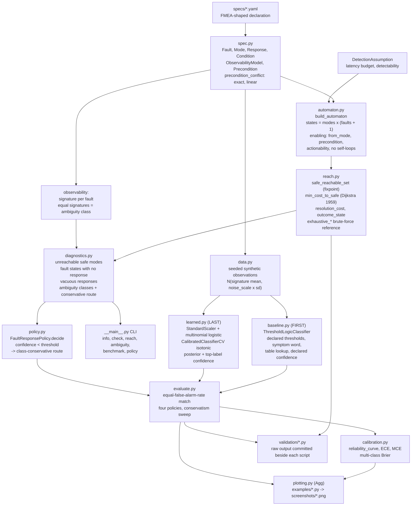
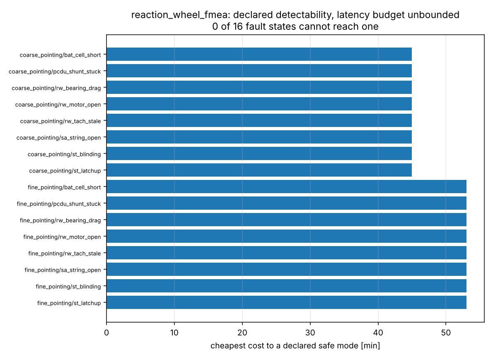
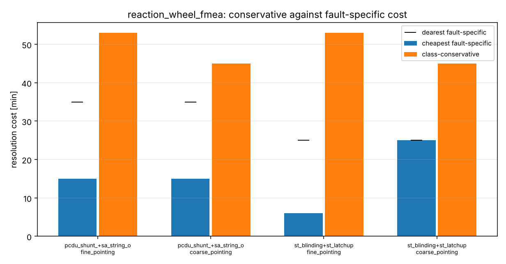
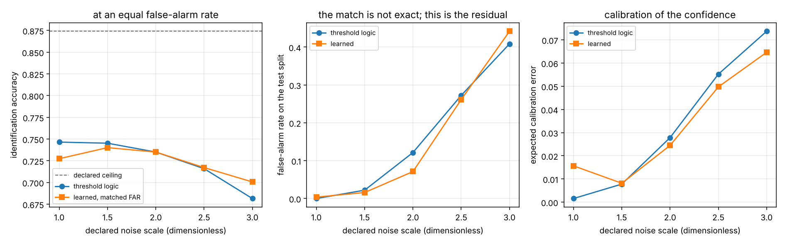
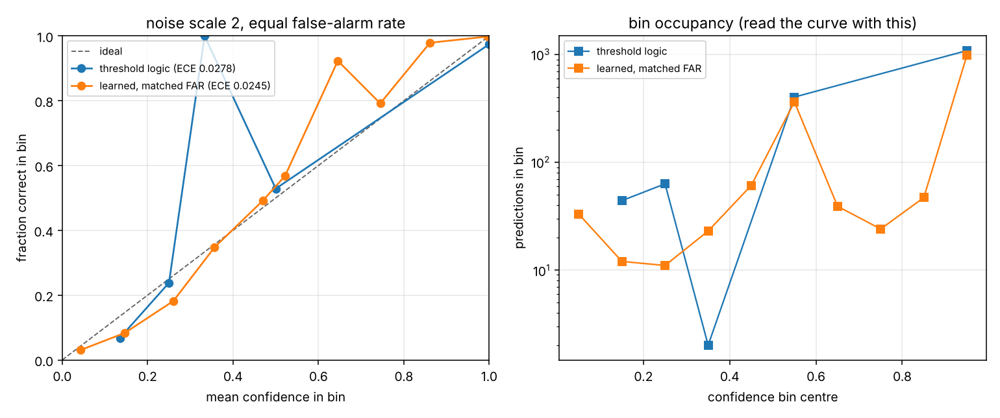
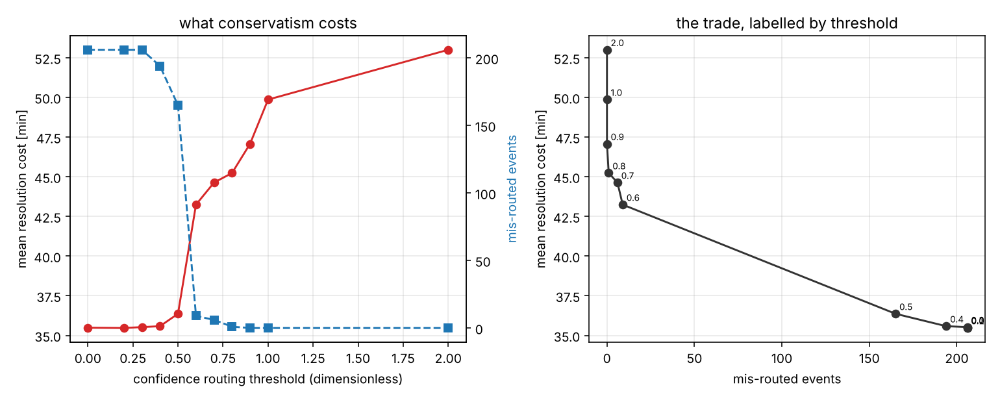
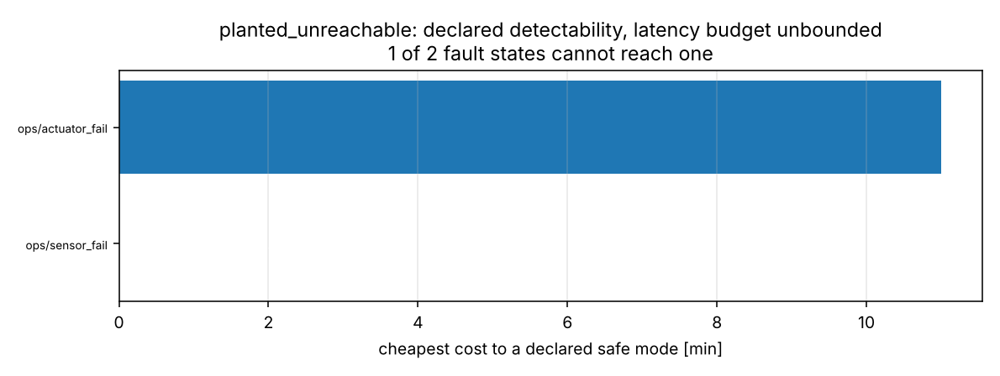

# safemodetree

From an FMEA table to a fault-response policy, with a safe-mode reachability check.


**Status: TESTING** · Class: medium · Validation level 3 · AI: yes ·
Apache-2.0 · © 2026 OPTIMA Organisation

This software is research-grade. It is **not flight-qualified, not certified,
and not approved for operational aerospace use.** It checks a declaration you
wrote against itself. It cannot tell you that your declaration describes your
spacecraft, and every result it prints is conditional on declared numbers it has
no way to verify.

**If you need to verify reachability on a system of any real size, use a model
checker — nuXmv or NuSMV.** They are mature, symbolic, and will answer
reachability questions this package cannot express, let alone decide. This
package exists for two things a model checker does not give you: the FMEA-shaped
input language, and the ambiguity-class analysis that finds the pairs of faults
your observability model cannot tell apart but your response table treats
differently. See "Alternatives, honestly".

## The problem

Your FMEA has eighty rows, your mode ladder has five modes, and your FDIR table
says what to do about each failure mode. Somewhere in there are two failure
modes that look identical to every monitor you have and that your table handles
differently, and a recovery action whose precondition can never hold in the
mode it is declared for. Nobody finds either by reading the spreadsheet, and the
first time you find out is when the wrong response fires.

## What this does

- **Checks that a declared safe mode is reachable from every fault state**, under
  a declared detection assumption, and prints the cheapest witness path with its
  cost. On the shipped 8-fault declaration: 16 of 16 fault states reach one,
  worst case **53.0 min** of declared outage by `coarse_downmode` then
  `safe_mode_entry` (`validation/validate_reachability.py`,
  `examples/reachability_map.py`).
- **Finds the ambiguity classes.** On the shipped declaration, **4 conflicting
  classes**: two pairs of faults with identical declared signatures, each in two
  operational modes, where the members prefer different responses. For each, the
  class-conservative route and what it costs — up to **+37.5 min** over the mean
  fault-specific route (`python -m safemodetree ambiguity`).
- **Finds the dead responses.** **2 of 13** declared responses in the shipped
  declaration have a precondition that can never hold: one requires a spare
  wheel declared absent, one requires the star tracker powered in a mode where
  it is declared unpowered. Precondition emptiness is decided exactly over the
  declared fragment, in time linear in the literal count.
- **Cross-checks itself against brute force.** The reachability fixpoint and the
  Dijkstra cost were compared against exhaustive simple-path enumeration on
  **2000 random declarations**, 32 000 states, 32 581 transitions: **0
  disagreements**, worst cost deviation **0.000e+00 min**
  (`validation/validate_reachability.py`).
- **Routes on a calibrated confidence and measures what that costs.** With the
  learned classifier in `fine_pointing`, routing identifications below 0.70
  confidence to the class-conservative response eliminates **200 of 206**
  mis-routed responses at **+9.1456 min** of declared outage per commanded fault
  event. With the declared threshold logic in `coarse_pointing` the same routing
  is **-2.3278 min**: cheaper and safer (`validation/validate_conservatism.py`).

## What the learned classifier does not do

**It does not beat the declared threshold logic.** Scored at an equal
false-alarm rate over five noise scales, the learned classifier wins on
identification accuracy **twice**, loses **twice** and ties **once**; the
baseline's best margin is -0.019 at the quietest setting and the learned
model's best is +0.019 at the noisiest. The generator makes each class an
isotropic Gaussian with a shared covariance, so the declared per-channel
thresholds are close to the Bayes boundary and the baseline was always going to
be hard to beat. This is the measured result, it is in
[validation/VALIDATION.md](validation/VALIDATION.md) section 6 and in
[MODEL_CARD.md](MODEL_CARD.md), and it is not softened anywhere.

What the learned model does give, and the baseline cannot: a **calibrated
posterior over every declared fault**, lower ECE at **3 of 5** noise scales
(0.02448 against 0.02783 at the headline scale), and a confidence that degrades
gracefully as the noise grows (ECE 0.01567 to 0.06463) where the baseline's
declared confidence goes from very well calibrated to overconfident (0.00156 to
0.07371). The policy consumes that posterior. If all you want is a fault label,
use the thresholds.

## Who it's for

- Someone with an FMEA and a mode ladder who needs a machine-checkable answer to
  "does every fault reach a safe mode, and under what detection assumption".
- Someone who suspects their observability model cannot distinguish two failure
  modes their response table distinguishes, and wants the pairs enumerated
  rather than argued about.
- Someone deciding where to set a confidence threshold in a fault-response
  policy, who wants the cost of each additional avoided mis-route in declared
  units.

## Who it's not for

- Anyone verifying a real system. The automaton here is `modes x (faults + 1)`
  states with one active fault at a time. A real FDIR design needs a model
  checker; **use nuXmv.**
- Anyone needing temporal properties. This decides reachability of a declared
  safe mode. No LTL, no CTL, no fairness, no liveness beyond reachability.
- Anyone needing simultaneous faults, continuous time, timed automata, or
  probabilistic model checking. None is here.
- Anyone needing a state-machine runtime. This analyses a declaration; it does
  not execute one. Use `transitions` or `python-statemachine`.
- Anyone who wants a fault classifier for real telemetry. The classifier here is
  trained on a synthetic generator defined by the declaration itself. See
  [DATASET_CARD.md](DATASET_CARD.md).
- Anyone wanting a certification artefact. Level 3 here means numerically
  cross-checked against brute force. There is no physical validation of any
  kind.

## Alternatives, honestly

Checked 2026-10-15 against the live PyPI index and, for the two installable
ones, by unpacking the wheel and reading the source. Method and raw results in
[validation/VALIDATION.md](validation/VALIDATION.md) section 11. None of these
is a runtime dependency; `validation/validate_environment.py` asserts that none
is installed in the container every number here was measured in.

| Alternative | What it does better | When to use this instead |
|---|---|---|
| **nuXmv** (Cavada et al., CAV 2014) and **NuSMV 2** (Cimatti et al., CAV 2002) — **recommended for any real reachability problem** | Symbolic model checking with BDDs and SAT/SMT, LTL and CTL, invariants, bounded and unbounded verification, counterexample traces, infinite-state systems in nuXmv. State spaces larger than anything this package can enumerate. This is the right tool and it is not close. | You want the FMEA-shaped input language and the ambiguity-class analysis as the output. Nothing here is a verification capability nuXmv lacks; what it lacks is the FMEA worksheet as an input format and the notion of two faults being indistinguishable to a declared monitor set. Encode this package's output as an SMV model if the problem outgrows it. |
| **`pyNuSMV` 1.0rc8** (Busard and Pecheur, NFM 2013) | Python bindings to NuSMV's own BDD engine, so you get real model checking from Python with programmatic access to the transition relation. | It ships CPython 3.4 to 3.6 wheels only and `pip index versions pynusmv` reports no matching distribution on Python 3.13, so it is not installable in a current environment without building NuSMV yourself. That is a packaging statement, not a capability one. |
| **`python-statemachine` 3.2.2** (MIT) | **It does check reachability.** `statemachine/graph.py` provides `disconnected_states` and `states_without_path_to_final_states`, and `factory.py` raises `InvalidDefinition` at class-definition time for unreachable states and for states with no path to a final state. It is also a full runtime with SCXML and YAML loading, guards, async, and diagram rendering. **This is a genuine overlap and it is the closest thing to this package on PyPI.** | Its traversal follows every transition regardless of guards, so it cannot answer "reachable using only responses whose preconditions can hold, for faults the declared monitors can detect within the latency budget". It also has no observability model, so it cannot report an ambiguity class. If your question is only "is any final state reachable ignoring guards", it already answers it and you do not need this. |
| **`transitions` 0.9.3** (MIT) | The most used Python state-machine library: hierarchical and parallel states, conditions, callbacks, locking, asyncio, graphviz and mermaid diagrams, markup serialisation. | It has no reachability check at all — `grep -niE "reachab\|unreachable\|bfs\|dijkstra"` over its source returns nothing. It executes machines; it does not analyse them. |
| **A spreadsheet**, which is what most FMEA and FDIR work actually lives in | Everyone can read it, everyone can edit it, it needs no install and no review. | It cannot tell you that two rows have the same symptom signature and different recovery actions, and it will not notice that a precondition can never hold. That is the whole of this package's contribution. |

**The honest summary.** A model checker is the right tool for reachability.
`python-statemachine` already does unconditional reachability. What is not
available anywhere named above is the pairing of an FMEA-shaped declaration
with a declared observability model and the ambiguity-class analysis over it,
plus the cost accounting that says what acting conservatively on an ambiguous
identification is worth. That is what this is for, and it is a narrow claim.

## Install and first run

```bash
git clone https://github.com/OmAcharya-avtr/safemodetree.git
cd safemodetree
python -m venv .venv && source .venv/bin/activate
pip install -e ".[test,plot]"
python -m pytest tests/ -q
python -m safemodetree check
```

Expected output of the test run. The count is fixed; the time moved between
11.24 s and 27.57 s over four runs of the same command on two contended cores
(18.50 s of those at the dependency floor), so do not expect the seconds to
match:

```
........................................................................ [ 27%]
........................................................................ [ 54%]
........................................................................ [ 82%]
..............................................                           [100%]
262 passed in 27.57s
```

Raw output of the run this block was copied from: `validation/pytest_output.txt`.

Expected output of `python -m safemodetree check`, which needs no data and no
model and is exact arithmetic over the shipped declaration:

```
declaration: reaction_wheel_fmea
assumption:  declared detectability, latency budget unbounded

findings
--------
  fault_states_without_safe_mode             0
  unreachable_safe_modes                     0
  fault_states_without_response              0
  faults_without_response                    0
  vacuous_responses                          2
  conflicting_ambiguity_classes              4
  classes_without_conservative_response      0

responses whose precondition can never hold:
  rw_swap_to_spare: in coarse_pointing: requires redundant_wheel_available, declared always_false; in fine_pointing: requires redundant_wheel_available, declared always_false; in sun_safe: requires redundant_wheel_available, declared always_false
  st_power_cycle_in_safe: in sun_safe: requires tracker_powered, which is only available in fine_pointing, coarse_pointing, not in sun_safe
ambiguity classes:
  [pcdu_shunt_stuck, sa_string_open] in fine_pointing: CONFLICTING; conservative=coarse_downmode (53 min)
  [pcdu_shunt_stuck, sa_string_open] in coarse_pointing: CONFLICTING; conservative=safe_mode_entry (45 min)
  [st_blinding, st_latchup] in fine_pointing: CONFLICTING; conservative=coarse_downmode (53 min)
  [st_blinding, st_latchup] in coarse_pointing: CONFLICTING; conservative=safe_mode_entry (45 min)

total findings: 6
```

Then run an example, which also writes a PNG:

```bash
python examples/reachability_map.py
```

## The input language

A declaration is one YAML file. The shipped one is
`src/safemodetree/specs/reaction_wheel_fmea.yaml`; this is an abridged shape of
it.

```yaml
name: reaction_wheel_fmea
initial_mode: fine_pointing

modes:
  - id: fine_pointing
  - id: coarse_pointing
  - id: sun_safe
    safe: true                  # safe-mode reachability is checked against these
  - id: survival
    safe: true
    absorbing: true             # nothing leaves it

conditions:
  - id: tracker_powered
    available_in_modes: [fine_pointing, coarse_pointing]   # can only be true here
  - id: redundant_wheel_available
    always_false: true          # the spare slot is not populated on this build

faults:                         # one FMEA row each
  - id: st_latchup
    effect: Star tracker electronics single-event latch-up; attitude knowledge lost.
    severity: "II"              # MIL-STD-1629A Task 101, ORDINAL, no arithmetic
    detectable: true
    detection_latency_s: 60.0   # seconds
    occurs_in_modes: [fine_pointing, coarse_pointing]

responses:
  - id: safe_mode_entry         # no `fault:` means fault-agnostic
    from_mode: coarse_pointing
    to_mode: sun_safe
    cost_min: 45.0              # minutes of mission outage, declared
  - id: st_power_cycle
    fault: st_latchup
    to_mode: coarse_pointing
    cost_min: 25.0
    clears_fault: true
    precondition: [tracker_powered]    # a conjunction of literals

channels:                       # the observation vector, in this order
  - id: tracker_valid_fraction
    unit: dimensionless
    nominal: 0.98
    threshold: 0.80
    faulted: 0.35
    direction: below            # the symptom asserts strictly below the threshold
    noise_sd: 0.05

signatures:                     # which faults look like what
  st_latchup:
    attitude_residual: 1
    tracker_valid_fraction: 1
  st_blinding:                  # SAME signature -> an ambiguity class
    attitude_residual: 1
    tracker_valid_fraction: 1
```

An unknown key is an error, not a silently dropped field. A declaration with no
safe mode is refused, because safe-mode reachability would be undefined.

## A worked example

`validation/worked_example.py`, run verbatim:

```python
from safemodetree import (
    DetectionAssumption,
    FaultResponsePolicy,
    analyse,
    load_spec,
    packaged_spec_path,
    reachability_report,
)

spec = load_spec(packaged_spec_path("reaction_wheel_fmea"))
assumption = DetectionAssumption(latency_budget_s=90.0)

report = analyse(spec, assumption)
print(spec.summary())
print(f"assumption: {assumption.describe()}")
print(f"findings: {report.total_findings}  ok: {report.ok}")

reach = reachability_report(spec, assumption)
print(f"every fault state reaches a safe mode: {reach.all_reachable}")
print(f"worst cheapest route: {reach.worst_cost_min:.1f} min")
for item in report.conflicting_ambiguity:
    print(
        f"ambiguous in {item.mode}: {' vs '.join(item.faults)} -> "
        f"{item.preferred[item.faults[0]]} vs {item.preferred[item.faults[1]]}; "
        f"conservative {item.conservative_response} at "
        f"{item.conservative_cost_min:.1f} min "
        f"(+{item.conservatism_cost_min:.1f} min over the mean specific route)"
    )

policy = FaultResponsePolicy(spec, assumption, confidence_threshold=0.7)
for confidence in (0.96, 0.48):
    decision = policy.decide("fine_pointing", "st_latchup", confidence)
    print(
        f"conf {confidence:.2f} -> {decision.response_id}"
        f"{' (conservative)' if decision.routed_conservative else ''}; "
        f"cost if the fault really is st_latchup "
        f"{policy.cost_of(decision, 'st_latchup'):.1f} min, "
        f"if it is st_blinding {policy.cost_of(decision, 'st_blinding'):.1f} min"
    )
```

Its actual output:

```
reaction_wheel_fmea: 4 modes (2 safe), 8 faults, 13 responses, 7 channels, 2 declared ambiguity class(es)
assumption: declared detectability, latency budget 90 s
findings: 4  ok: False
every fault state reaches a safe mode: True
worst cheapest route: 53.0 min
ambiguous in fine_pointing: st_blinding vs st_latchup -> st_wait_and_reacquire vs st_power_cycle; conservative coarse_downmode at 53.0 min (+37.5 min over the mean specific route)
ambiguous in coarse_pointing: st_blinding vs st_latchup -> None vs st_power_cycle; conservative safe_mode_entry at 45.0 min (+20.0 min over the mean specific route)
conf 0.96 -> st_power_cycle; cost if the fault really is st_latchup 25.0 min, if it is st_blinding 70.0 min
conf 0.48 -> coarse_downmode (conservative); cost if the fault really is st_latchup 53.0 min, if it is st_blinding 53.0 min
```

The last two lines are the whole argument for the AI component. At 0.96
confidence the policy commands the star-tracker power cycle, which costs 25.0
min if the identification is right and 70.0 min if the fault was really a
blinding. At 0.48 it abandons the identification and takes the conservative
route, which costs 53.0 min whichever of the two it is. Note also that with a
90 s latency budget the findings drop from 6 to 4: the two 120 s power faults
lose their fault-specific responses, so their ambiguity class stops being a
conflict because neither member can be acted on specifically any more.

## Architecture



## Screenshots



Cheapest cost to a declared safe mode for all 16 fault states. Notice the two
bands: eight states in `coarse_pointing` at 45.0 min in one hop, eight in
`fine_pointing` at 53.0 min in two, because `safe_mode_entry` is declared only
out of `coarse_pointing` and the mode ladder has to be walked.



For each of the four conflicting ambiguity classes, the cheapest fault-specific
route (left bar), the dearest one (the black tick), and the class-conservative
route (right bar). Notice that the conservative bar is higher than both
specific bars in every class: that gap is what conservatism costs, before any
classifier is involved.



Left: identification accuracy against declared noise scale, at an equal
false-alarm rate, with the declared ceiling as the dashed line. Notice that the
two curves cross and that neither dominates — this is the honest negative,
plotted. Middle: the residual mismatch in false-alarm rate that the matching
leaves. Right: expected calibration error, where the learned curve is below the
baseline from scale 2.0 upward.



Left: reliability curves at the headline noise scale. The baseline's curve has
five points because its confidence takes five distinct values; the learned
curve is continuous. Right: bin occupancy on a log scale, which is the panel
that stops a reader taking the baseline's 0.667 maximum calibration error
seriously — the bin it comes from holds two predictions.



Left: mean resolution cost and mis-route count against the routing threshold.
Notice the knee between 0.50 and 0.60, where almost all of the mis-route
reduction happens for 6.88 min per event. Right: the same data as a trade
curve, each point labelled with its threshold, so the price of the last avoided
mis-route can be read directly.



The planted broken declaration. `(ops, sensor_fail)` is red because its only
declared response enters an absorbing non-safe mode, so no declared safe mode is
reachable from it.

## Validation evidence

Full tables, derivations and raw output in
[validation/VALIDATION.md](validation/VALIDATION.md). **The rows that went
against this package are marked and are the ones worth reading.**

| Check | Reference / method | Result | Tolerance |
|---|---|---|---|
| Reachability fixpoint against brute force | exhaustive simple-path enumeration, 2000 random declarations | 2000 of 2000 agree, 0 disagreements over 32 000 states | exact (sets of discrete states) |
| Cheapest-path cost against brute force | same | worst deviation **0.000e+00 min** | 1e-9 rel, 1e-9 abs |
| Witness-path cost against its declared responses | sum of `cost_min` along the reported path | worst deviation **0.000e+00 min** | 1e-9 rel, 1e-9 abs |
| Planted unreachable safe mode | `specs/planted_unreachable.yaml` | detected and localised to `(ops, sensor_fail)`; `orphan_safe` reported unreachable | — |
| Planted case 2: `safe_mode_entry` removed | shipped declaration, in memory | worst route rises 53.0 → **480.0 min**; **no** safe mode becomes unreachable | — |
| **This script's first draft predicted the wrong answer for planted case 2** | it asserted `sun_safe` would be stranded; `bat_cell_bypass` still targets it | corrected to the measured answer, recorded in VALIDATION.md section 3.2 | — |
| Mode-ladder arithmetic | `min(8.0 + 45.0, 480.0)` by hand | **53.000000000000 min**, 2 hops | 1e-12 |
| Mis-route cost arithmetic | `6.0 + 53.0` and `25.0 + 45.0` by hand | **59.000000000000** and **70.000000000000 min** | 1e-12 |
| Cost of conservatism, star-tracker class | `53.0 - (6.0 + 25.0)/2` by hand | **37.500000000000 min** | 1e-12 |
| Declared threshold-logic confidence, Hamming-1 tie of three | `1/(3 x (1+1))` by hand | **0.166666666667** | 1e-12 |
| ECE and MCE on a 4-prediction hand case | Guo et al. 2017 eq. 3 binning | **0.350000000000** and **0.400000000000** | 1e-12 |
| Multi-class Brier on a hand case | Brier 1950 | **0.380000000000** | 1e-12 |
| Latency-budget boundary is inclusive | `latency <= budget` | 30.0 s admits a 30.0 s latency, 29.9 s refuses | exact |
| Accuracy ceiling from the declared observability model | `(800 + 400 + 200)/1600` by hand | **0.874062** measured, no detector exceeded it | — |
| **The declared threshold baseline is not beaten** | equal false-alarm rate, 5 noise scales, 1600-row test split | learned wins **2**, loses **2**, ties **1**; best margin ±0.019 | — |
| **The baseline is better calibrated at low noise** | ECE at 10 bins, scale 1.0 | baseline **0.00156** against learned **0.01567** | — |
| The learned model is better calibrated at high noise | ECE at 10 bins | lower at **3 of 5** scales; 0.06463 against 0.07371 at scale 3.0 | — |
| ECE reported at three bin counts | binned ECE is a biased estimator | 5 / 10 / 20 bins, worst spread **0.00574** (learned, scale 1.5) | — |
| **A maximum calibration error from a 2-prediction bin** | baseline MCE at scale 2.0 | **0.66667** from 2 predictions; bin occupancy published beside it | — |
| **Matching a zero false-alarm rate leaves a residual** | scale 1.0, target FAR exactly 0 | matched rate **0.00368** against the baseline's 0.00000; at that scale the match is NOT closer than the argmax | recorded, not tuned |
| Cost of conservatism, learned detector, `fine_pointing` | 783 commanded events | **+9.1456 min** per event, **200 of 206** mis-routes avoided, 35.81 min per avoided mis-route | — |
| **Cost of conservatism is NEGATIVE in one configuration** | threshold logic, `coarse_pointing` | **-2.3278 min** per event: cheaper and safer | — |
| Always-conservative cost equals the declared route | `8.0 + 45.0` by hand | **53.0000 min**, conservative fraction 1.0000 | 1e-9 |
| **A declared fault-specific response is dearer than the conservative route** | `bat_cell_bypass` 60.0 min against the 53.0 min ladder | the oracle takes the conservative route | 1e-12 |
| Suite at both ends of every dependency range | floor and ceiling virtual environments | **262 passed** at both; every committed validation output byte-identical | — |
| Hypothesis falsifying examples found | 19 property tests, 40 to 120 examples each | **none this session**; 4 boundary cases pinned as literal regression tests anyway | — |
| **No citation verified against a publisher page** | egress reached `pypi.org` only | the PyPI checks were executed; the academic references are pointers to look up | — |

## API reference

<details>
<summary><code>safemodetree.spec</code> — the declaration</summary>

| Member | Returns | Notes |
|---|---|---|
| `load_spec(path)` | `SafeModeSpec` | YAML file |
| `load_spec_text(text)` | `SafeModeSpec` | YAML text; unknown keys are errors |
| `packaged_spec_names()` | tuple[str, ...] | shipped declarations |
| `packaged_spec_path(name)` | `Path` | raises `KeyError` on an unknown name |
| `SEVERITY_CATEGORIES` | tuple[str, ...] | `("I", "II", "III", "IV")`, MIL-STD-1629A Task 101, ordinal |
| `Fault(id, effect, severity, detectable, detection_latency_s, occurs_in_modes)` | — | latency in s |
| `.severity_rank` | int | 0 for Category I; ordering only |
| `Mode(id, description, safe, absorbing)` | — | — |
| `Response(id, to_mode, fault, from_mode, cost_min, precondition, clears_fault)` | — | cost in min of mission outage |
| `.is_fault_agnostic` | bool | `fault is None` |
| `Condition(id, description, available_in_modes, always_false)` | — | — |
| `.can_hold_in(mode_id)` | bool | — |
| `Literal(condition, positive)`, `.parse(text)` | — | `cond`, `!cond`, `not cond` |
| `Precondition(literals)`, `.parse(items)`, `.is_trivial` | — | a conjunction |
| `ObservationChannel(id, unit, nominal, threshold, faulted, direction, noise_sd)` | — | `direction` is `"above"` or `"below"` |
| `.asserted(value)` | bool | STRICT threshold comparison; see Limitations |
| `.margin(value)` | float | signed distance from the threshold in `noise_sd`, dimensionless |
| `ObservabilityModel(channels, signatures)` | — | one binary signature per fault |
| `.indistinguishable_groups()` | tuple[tuple[str, ...], ...] | groups of size >= 2 |
| `.expected_vector(signature)`, `.nominal_vector()` | tuple[float, ...] | declared noiseless means |
| `SafeModeSpec(...)` | — | `.mode_ids`, `.fault_ids`, `.safe_mode_ids`, `.mode()`, `.fault()`, `.response()`, `.condition()`, `.summary()` |
| `.fault_occurs_in(fault_id, mode_id)` | bool | False in an absorbing mode |
| `.precondition_conflict(precondition, mode_id)` | str or None | the first conflict, or None; exact, linear in literals |
| `.precondition_can_hold(precondition, mode_id)` | bool | — |

</details>

<details>
<summary><code>safemodetree.automaton</code>, <code>.reach</code>, <code>.diagnostics</code></summary>

| Member | Returns | Notes |
|---|---|---|
| `DetectionAssumption(latency_budget_s=inf, require_detection=True)` | — | `.describe()`, `.is_actionable(spec, fault_id)` |
| `AutomatonState(mode, fault=None)` | — | totally ordered by `(mode, fault or "")` |
| `build_automaton(spec, assumption=None)` | `Automaton` | `modes x (faults + 1)` states |
| `Automaton.states`, `.transitions`, `.safe_states`, `.fault_states` | tuples | — |
| `.outgoing(state)`, `.incoming(state)` | tuple[`Transition`, ...] | `KeyError` on an unknown state |
| `.is_safe(state)`, `.summary()` | bool, str | — |
| `safe_reachable_set(automaton)` | frozenset | backward BFS fixpoint |
| `min_cost_to_safe(automaton)` | dict state -> (cost_min, path, hops) | Dijkstra 1959; deterministic ties |
| `exhaustive_safe_reachable(automaton, max_depth=None)` | frozenset | brute force, for cross-checking |
| `exhaustive_min_cost_to_safe(automaton, max_depth=None)` | dict state -> cost_min | brute force |
| `reachability_report(spec, assumption=None, automaton=None)` | `ReachabilityReport` | `.rows`, `.all_reachable`, `.unreachable_rows`, `.unreachable_safe_modes`, `.worst_cost_min`, `.table()` |
| `outcome_state(response, mode_id, true_fault)` | `AutomatonState` | clears only a matching or agnostic fault |
| `resolution_cost(automaton, costs, mode_id, true_fault, response)` | float [min] | response cost plus the onward path |
| `preferred_specific_response(automaton, costs, mode_id, fault_id)` | (str or None, float) | cheapest response naming the fault |
| `analyse(spec, assumption=None)` | `DiagnosticsReport` | `.finding_counts`, `.total_findings`, `.ok`, `.report()` |
| `vacuous_responses(spec)` | tuple[`VacuousResponse`, ...] | with a reason per candidate mode |
| `ambiguity_classes(spec, assumption=None, automaton=None)` | tuple[`AmbiguityClass`, ...] | one per class per analysed mode |
| `AmbiguityClass.conflicting`, `.conservative_response`, `.conservative_cost_min`, `.best_specific_cost_min`, `.conservatism_cost_min` | — | costs in min |
| `conservative_response(spec, automaton, costs, group, mode_id)` | (str or None, float) | cheapest fault-agnostic route valid for the whole class |

</details>

<details>
<summary><code>safemodetree.policy</code>, <code>.data</code>, <code>.baseline</code>, <code>.learned</code>, <code>.calibration</code>, <code>.evaluate</code>, <code>.synth</code></summary>

| Member | Returns | Notes |
|---|---|---|
| `FaultResponsePolicy(spec, assumption=None, confidence_threshold=0.5)` | — | threshold >= 0; above 1 always routes |
| `.decide(mode_id, believed_fault, confidence)` | `Decision` | `.response_id`, `.routed_conservative`, `.ambiguity_class`, `.reason` |
| `.cost_of(decision, true_fault)` | float [min] | 0.0 when nothing is commanded |
| `.oracle_cost(mode_id, true_fault)` | float [min] | cheaper of specific and conservative |
| `.is_misrouted(decision, true_fault)` | bool | a specific response for the wrong fault |
| `.reaches_safe(decision, true_fault)` | bool | — |
| `.specific_route(fault_id, mode_id)`, `.conservative_route(fault_id, mode_id)` | (str or None, float) | — |
| `make_observations(spec, *, n_per_fault=400, nominal_fraction=0.5, noise_scale=1.0, seed=0)` | `ObservationSet` | `.features`, `.labels`, `.counts()` |
| `NOMINAL_LABEL` | str | `"nominal"` |
| `symptom_word(spec, observation, margin_sd=0.0)` | tuple[int, ...] | latched symptom bits |
| `ThresholdLogicClassifier(spec, margin_sd=0.0)` | — | `.predict`, `.confidence`, `.predict_with_confidence`, `.classify_word` |
| `LearnedFaultClassifier(calibration="isotonic", regularisation=1.0, cv=5, random_state=0)` | — | `.fit`, `.predict_proba`, `.predict`, `.confidence`, `.fault_probability` |
| `accuracy_ceiling(spec, observations)` | float | upper bound from the declared observability model |
| `reliability_curve(confidence, correct, n_bins=10)` | `CalibrationResult` | `.ece`, `.mce`, `.accuracy`, `.overconfidence`, `.table()` |
| `expected_calibration_error(confidence, correct, n_bins=10)` | float | Guo et al. 2017 eq. 3 |
| `brier_score(probabilities, labels, classes)` | float | Brier 1950, multi-class, in [0, 2] |
| `split_observations(observations, *, train_fraction=0.5, calibration_fraction=0.25, seed=0)` | `Split` | — |
| `false_alarm_rate(predicted, truth)`, `identification_accuracy(predicted, truth)` | float | dimensionless |
| `learned_decisions(model, features, tau)` | (labels, confidence) | the detector's rule at threshold `tau` |
| `compare_detectors(spec, ...)` | dict | equal-false-alarm-rate comparison |
| `noise_sweep(spec, noise_scales=..., ...)` | tuple[dict, ...] | the same at several scales |
| `compare_policies(spec, comparison, ...)` | dict | four policies, cost of conservatism |
| `conservatism_sweep(spec, comparison, thresholds=..., ...)` | tuple[`PolicyScore`, ...] | the trade curve |
| `random_declaration(seed, ...)` | `SafeModeSpec` | structurally valid, meaningless content; for cross-checking |

</details>

<details>
<summary>CLI</summary>

```
python -m safemodetree info      [--spec S] [--json]
python -m safemodetree check     [--spec S] [--json] [--latency-budget SECONDS]
                                 [--assume-perfect-detection] [--fail-on-findings]
python -m safemodetree reach     [--spec S] [--json] [--latency-budget SECONDS]
                                 [--assume-perfect-detection] [--fail-on-findings]
python -m safemodetree ambiguity [--spec S] [--json] [--latency-budget SECONDS]
python -m safemodetree benchmark [--spec S] [--json] [--noise-scale X]
                                 [--n-per-fault N] [--seed N]
                                 [--calibration none|isotonic|sigmoid]
python -m safemodetree policy    [--spec S] [--json] [--noise-scale X]
                                 [--n-per-fault N] [--seed N] [--mode MODE]
                                 [--confidence-threshold X]
                                 [--detector learned|baseline] [--sweep]
```

Exit **0** on success, **1** when a check produced a finding and
`--fail-on-findings` was given, **2** on a refused request (an unreadable or
invalid declaration, an unknown mode, an argument outside its range). All three
paths are asserted in `tests/test_cli.py` and re-executed as 23 subprocess
invocations by `validation/validate_cli.py`; the transcript is in
`validation/validate_cli_output.txt`.

</details>

## Limitations

1. **No physical validation. Level 3 means cross-checked against brute force,
   not validated against hardware.** The shipped declaration is illustrative:
   its failure modes, latencies, costs and channel numbers are chosen to
   exercise every check, and are not a measurement of any vehicle or a copy of
   any programme's FMECA.
2. **The ambiguity relation is the static special case of diagnosability.** Two
   faults are declared indistinguishable when their declared observation
   vectors are equal. Sampath et al. 1995 decides diagnosability over event
   traces of a discrete-event system, which is strictly stronger: a pair this
   package calls indistinguishable may be separable by the order in which
   symptoms appear over time. Nothing here looks at time.
3. **Preconditions are conjunctions of literals, deliberately.** Emptiness over
   that fragment plus per-mode availability and an always-false flag is
   decidable in time linear in the literal count, so the vacuous-response check
   is exact rather than a heuristic. A general Boolean precondition would need a
   SAT solver and this package does not ship one. A declaration with a
   disjunctive precondition cannot be expressed.
4. **Declared costs are assumed additive along a path and independent of order.**
   Nothing checks that, and nothing can. If entering `sun_safe` after a
   `coarse_downmode` costs less than entering it directly, this package will not
   know.
5. **Cost is outage minutes and credits nothing else.** A response that keeps
   the vehicle operational with a persistent fault scores worse than safe-mode
   entry under this metric, because retained mission capability is not in the
   unit. `bat_cell_bypass` in the shipped declaration is the visible case: at
   60.0 min it is dearer than the 53.0 min conservative ladder, so the oracle
   prefers the ladder, which is the metric talking and not an engineering
   recommendation.
6. **One fault at a time.** Simultaneous independent faults are out of scope and
   the state space has no room for them.
7. **`ObservationChannel.asserted` is a strict floating-point threshold
   comparison.** A measurement exactly on the threshold does not assert, and the
   resulting boolean is NOT invariant under an algebraically equivalent
   rescaling of the channel: the comparison is of rounded quantities and can
   flip within one ulp of the threshold. Nothing in the suite asserts equality
   of that boolean under a transformation; the one monotonicity property that
   involves it varies the margin for a fixed value, which holds exactly.
8. **The classifier cannot beat the declaration's own ceiling and neither can
   anything else.** Four of eight faults are in declared ambiguity classes of
   size two with identical observation distributions, so 0.874062 is the most
   any rule can reach on the shipped test split. That is a property of the
   declaration, not of the model.
9. **The learned model loses to the threshold baseline as often as it wins.** See
   "What the learned classifier does not do". The generator is a Gaussian
   mixture with a shared covariance, which is the case the declared thresholds
   are already near-optimal for. On a declaration whose channels were
   correlated, heavy-tailed or nonlinearly coupled the comparison could go the
   other way, and this package provides no evidence that it would.
10. **The synthetic generator is independent Gaussian noise per channel.** Real
    symptom channels are correlated and often heavy-tailed, and a real monitor
    latches with a persistence filter rather than on a single sample. None of
    that is modelled. See [DATASET_CARD.md](DATASET_CARD.md).
11. **Binned ECE is a biased estimator and its value depends on the bin count.**
    It is reported at 5, 10 and 20 bins with the bin occupancy printed beside
    it, because a maximum calibration error of 0.667 that comes from a
    two-prediction bin is not a result.
12. **Matching a zero false-alarm rate on a finite calibration split leaves a
    residual.** At noise scale 1.0 the match gives a test-split rate of 0.00368
    against the baseline's 0.00000. Recorded in VALIDATION.md section 6 rather
    than tuned away.
13. **Missed detections are counted, never costed.** When the policy believes
    there is no fault and one is active, nothing is commanded and no cost is
    assigned, because any number put there would be invented. Read the
    `missed` column beside every cost.
14. **The dependency pins are narrow and that is a real cost.**
    `hypothesis>=6.112.1,<6.170` and `pyyaml>=6.0.2,<6.1` in particular cannot
    take a future release without re-running the suite, including a future
    security release. Both ends of every range were installed and measured
    (VALIDATION.md section 9); the ceilings are the measured versions and were
    not widened by reasoning about an API.
15. **Compute budget: two contended CPU cores, no GPU, no PyTorch.** The whole
    validation set runs in about 80 s; the slowest script is
    `validate_calibration.py` at 11.32 s. Timings move between runs on
    contended cores, so quote counts and ratios rather than seconds.
16. **No citation in this repository was verified against a publisher page in
    this session.** The container's egress proxy reached `pypi.org` only, so the
    PyPI checks in the alternatives table were executed and the academic and
    standards references are pointers to look up.
17. **No comparison against nuXmv, NuSMV, `pyNuSMV`, `transitions` or
    `python-statemachine` output.** None is installed here, by design, so the
    alternatives table describes the unpacked source of the two installable ones
    and the published papers of the rest, and claims no measured numerical
    agreement with any of them.

## Hardware requirements

Any machine that runs CPython 3.11 or later with NumPy and scikit-learn.
Everything in this repository was produced on **two shared, contended CPU
cores** with well under 1 GiB of resident memory. There is no GPU path, no
compiled extension, no PyTorch and no hardware-in-the-loop component.

## Reproducing every number

See [validation/VALIDATION.md](validation/VALIDATION.md) section 13 for the full
list with seeds. In short, from the repository root:

```bash
python -m pytest tests/ -q --junitxml=junit.xml
ruff check src/ tests/ examples/ validation/
PYTHONPATH=src python validation/validate_environment.py
PYTHONPATH=src python validation/validate_known_answers.py
PYTHONPATH=src python validation/validate_reachability.py
PYTHONPATH=src python validation/validate_planted_case.py
PYTHONPATH=src python validation/validate_calibration.py
PYTHONPATH=src python validation/validate_conservatism.py
PYTHONPATH=src python validation/validate_cli.py
PYTHONPATH=src python validation/worked_example.py
PYTHONPATH=src MPLBACKEND=Agg python examples/reachability_map.py
PYTHONPATH=src MPLBACKEND=Agg python examples/ambiguity_costs.py
PYTHONPATH=src MPLBACKEND=Agg python examples/detector_vs_threshold.py
PYTHONPATH=src MPLBACKEND=Agg python examples/calibration_reliability.py
PYTHONPATH=src MPLBACKEND=Agg python examples/conservatism_tradeoff.py
PYTHONPATH=src MPLBACKEND=Agg python examples/planted_case.py
```

## Roadmap

No dates are promised. In rough order of usefulness: an SMV exporter, so a
declaration that outgrows the enumerable automaton can be handed to nuXmv with
the FMEA accounting preserved; disjunctive preconditions behind a real SAT
solver, which would make the vacuous-response check general rather than exact
over a fragment; a trace-based ambiguity relation closer to Sampath et al. 1995,
so a pair separable by symptom ordering is no longer called indistinguishable;
and a generator with correlated, heavy-tailed channels, which is the case where
the learned classifier might actually earn its place.

## Safety statement

This software is research-grade. It is **not flight-qualified, not certified,
and not approved for operational aerospace use.** It checks a declaration
against itself: every reachability result, every cost and every ambiguity class
is a consequence of numbers you declared, and a declaration that does not
describe your spacecraft will produce confident, wrong answers. A clean report
from this package is not evidence that a fault-response design is safe, is not a
substitute for a hazard analysis, and is not an input to a safety case. Using
the learned classifier to identify a fault on a real vehicle is a decision this
package does not support and provides no evidence for; it is trained on
synthetic data generated by its own declaration.

## Licence

Apache-2.0. Copyright © 2026 OPTIMA Organisation. See [LICENSE](LICENSE).

## Credits

This is under reserved rights obtained by OPTIMA Organisation.

## Citation

```bibtex
@software{safemodetree2026,
  title   = {safemodetree: from an FMEA table to a checked fault-response
             policy, with safe-mode reachability and ambiguity-class analysis},
  author  = {Acharya, Om},
  year    = {2026},
  version = {0.1.0},
  license = {Apache-2.0},
  url     = {https://github.com/OmAcharya-avtr/safemodetree}
}
```

See `CITATION.cff`. The methods this implements are due to the authors cited in
[validation/VALIDATION.md](validation/VALIDATION.md) section 12, not to this
package.
