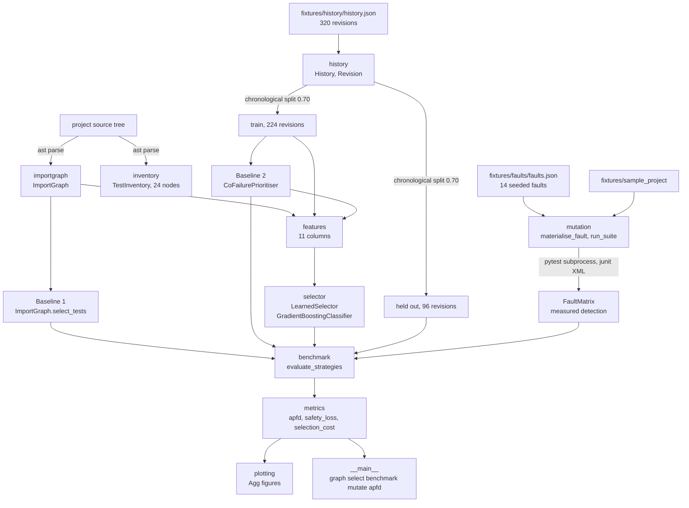
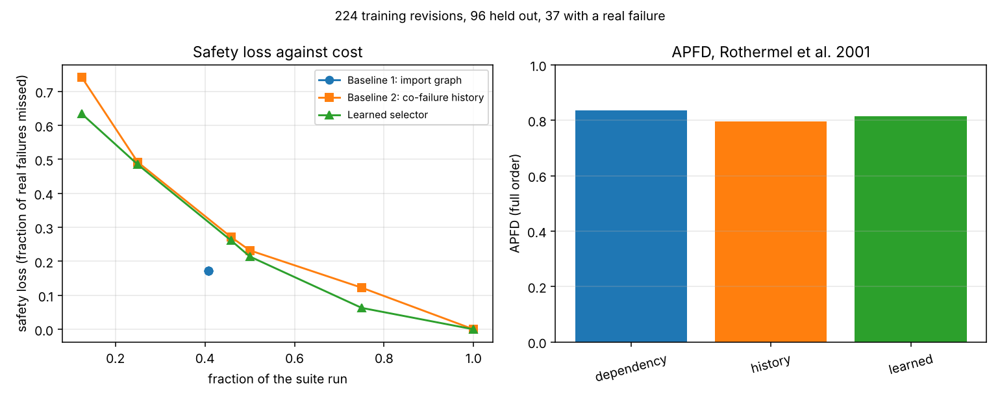
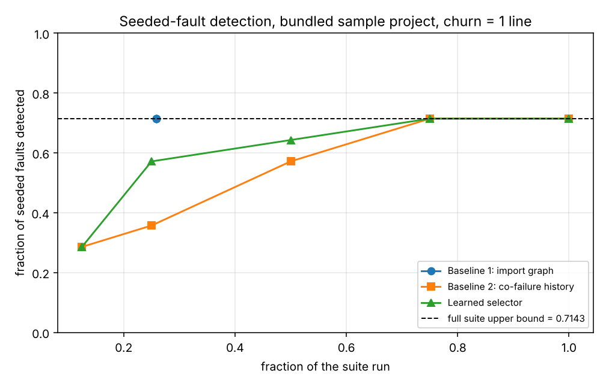
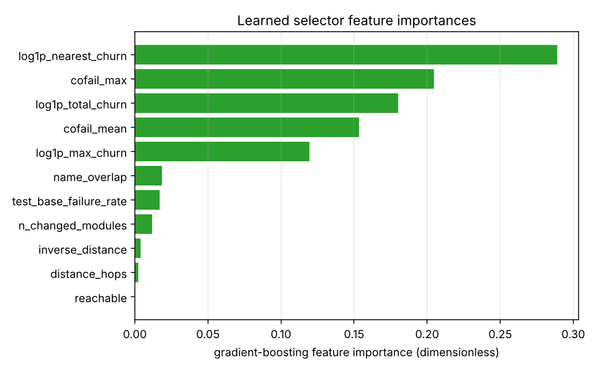

# regressselect

Regression test selection scored on what skipping the tests actually cost.


## The problem

A numerical test suite takes forty minutes and almost none of it is touched by
the three-line change you are about to push. Every tool that will select a
subset for you tells you how much time it saved and none of them tells you what
the selection missed. The number that decides whether you can use a selector is
the one nobody reports: the fraction of real failures it would have skipped.

## What this does

- **Baseline 1, dependency-based selection.** Import-graph reachability from
  changed modules to tests, computed from an `ast` parse. Safe with respect to
  the declared import graph, and the cost of that safety is that it selects
  most or all of the suite as soon as the change touches something widely
  depended on: a change to the fixture project's package `__init__` selects
  7 of 7 test modules, 14 of the 320 fixture revisions select the whole suite,
  and on this repository 6 of 12 source modules reach every test module once
  pytest's `conftest.py` dependency is counted. Measured means: 0.4015 of the
  test modules per single-module change from the import text alone and 0.6364
  with the conftest coupling
  (`validation/validate_self_selection_output.txt`), 0.3214 on the fixture
  project (`validation/validate_importgraph_output.txt`).
- **Baseline 2, history-based prioritisation.** Smoothed conditional failure
  rate `P(test fails | module changed)`, measured with APFD exactly as defined
  by Rothermel et al. 2001. APFD 0.795608 on the held-out revisions
  (`validation/validate_benchmark_output.txt`).
- **A learned selector.** Gradient-boosted trees over eleven change features,
  producing a ranked order with a per-test probability. APFD 0.814752, held-out
  Brier score 0.061151 (`validation/validate_benchmark_output.txt`).
- **Safety loss, for all three.** The fraction of real failures a selection
  would have missed: 0.172072 for the dependency baseline, 0.282883 for the
  learned selector and 0.299399 for the history baseline, at a matched cost of
  roughly 0.41 of the suite.
- **Mutation-style evaluation with the upper bound shown.** 14 seeded
  single-line faults executed against a bundled sample project. The full suite
  detects 10 of them, so the upper bound is 0.714286, and no strategy is
  allowed to read above it (`validation/validate_mutation_output.txt`).

## The result, stated first because it decides whether you want this

**On the bundled fixtures the safe dependency baseline wins, and the learned
selector should not be used in its place.**

| strategy | APFD | cost | safety loss | seeded faults found at that cost |
|---|---|---|---|---|
| **Baseline 1, dependency** | **0.836149** | 0.4077 | **0.172072** | **10 of 10 detectable, at cost 0.2589** |
| learned selector | 0.814752 | 0.4167 | 0.282883 | 8 of 10 detectable at cost 0.25 |
| Baseline 2, history | 0.795608 | 0.4167 | 0.299399 | 5 of 10 detectable at cost 0.25 |
| lexical control, no information | 0.703266 | - | - | - |

The learned selector beats the history baseline on APFD and on safety loss at
every budget, so it is not a no-op. It does not beat the baseline that uses
nothing but the import graph. Two measurements explain why: the fitted model
gives import distance and reachability a combined feature importance of
**0.0061**, and its detection on the seeded faults moves from 0.8000 to 1.0000
of detectable faults when the same one-line mutations are presented as 20-line
changes. It is a churn-and-co-failure model, and a one-line fix is exactly the
case where selection is worth doing.

That result is in `README.md`, `validation/VALIDATION.md` and `MODEL_CARD.md`
in the same terms, and it is pinned as an assertion in
`tests/test_benchmark.py` so that a change which reverses it has to say so.

## Who it is for

- Anyone who already runs a selection tool and has never measured what it
  skipped.
- Anyone deciding whether to adopt one, who needs the safety-loss number before
  the time-saved number.
- Anyone comparing a learned selector against a dependency baseline and wanting
  the comparison at matched cost rather than at matched budget.

## Who it is not for

- Anyone who wants selection to just work in CI today. Use `pytest-testmon`.
  It does coverage-based selection well, it is mature, and it needs no history
  fixture.
- Anyone whose suite is slow but parallelisable. Use `pytest-xdist`. Running
  everything on eight cores beats selecting carefully on one.
- Anyone who needs a selector that is sound for a pytest suite. This one is
  not: see Limitations.
- Anyone who needs results on their own repository's history. Everything
  measured here is on a synthetic 320-revision fixture.

## Alternatives, honestly

| alternative | what it does better | when to use this instead |
|---|---|---|
| [`pytest-testmon`](https://pypi.org/project/pytest-testmon/) (2.2.0) | **Coverage-based selection, done well.** It records which lines each test executes and reruns exactly the tests a change can reach. That is a better selection than anything in this package, it needs no commit history, and it is the right default. | When you want to *measure* what a selection strategy costs you in missed failures, compare strategies at matched cost, or score them against seeded faults with the full-suite bound shown. testmon selects; it does not report safety loss. |
| [`pytest-picked`](https://pypi.org/project/pytest-picked/) (0.5.1) | Runs the tests in files your working tree has changed. One flag, no state, no model. | When the tests that matter are not in the files you changed, which is the case this package's import graph and co-failure history exist to handle. |
| [`coverage.py`](https://pypi.org/project/coverage/) (7.16.2) | The authoritative line and branch coverage measurement, and the data source a serious selector should be built on. | When you want change-to-test attribution and a measured safety loss rather than a coverage percentage. This package does not read coverage data at all; that is a real gap, not a design choice. |
| [`pytest-xdist`](https://pypi.org/project/pytest-xdist/) (3.8.0) | Runs the whole suite in parallel. Zero safety loss, because nothing is skipped. | When you have one or two cores and the suite is genuinely too slow to run in full. Otherwise parallelism is the better answer and this package will tell you so. |

**The honest summary.** `pytest-testmon` already does coverage-based selection
well. This package's contribution is the **measured safety-loss accounting**
around a selection -- APFD, safety loss, seeded-fault detection against tests
run with the full-suite upper bound, and an equal-cost comparison between a
dependency baseline, a history baseline and a learned model -- not the
selection itself. If you only want to skip tests, use testmon.

## Install and first run

```bash
git clone https://github.com/OmAcharya-avtr/regressselect.git
cd regressselect
python -m venv .venv && source .venv/bin/activate
pip install -e ".[test]"
python -m pytest tests/ -q
python examples/strategy_comparison.py
```

The test run prints:

```
140 passed in 18.71s
```

The count is the invariant and is pinned in `validation/pytest_output.txt`
together with the same numbers parsed back out of the junit XML; the wall clock
varies with the machine.

and `examples/strategy_comparison.py` prints:

```
train=224 test=96 evaluation revisions with a failure=37
strategy         APFD   budget     cost     loss
dependency     0.8361   0.1000   0.4077   0.1721
dependency     0.8361   0.2500   0.4077   0.1721
dependency     0.8361   0.4167   0.4077   0.1721
dependency     0.8361   0.5000   0.4077   0.1721
dependency     0.8361   0.7500   0.4077   0.1721
dependency     0.8361   1.0000   0.4077   0.1721
history        0.7956   0.1000   0.1250   0.7410
history        0.7956   0.2500   0.2500   0.4915
history        0.7956   0.4167   0.4583   0.2714
history        0.7956   0.5000   0.5000   0.2323
history        0.7956   0.7500   0.7500   0.1225
history        0.7956   1.0000   1.0000   0.0000
learned        0.8148   0.1000   0.1250   0.6336
learned        0.8148   0.2500   0.2500   0.4846
learned        0.8148   0.4167   0.4583   0.2614
learned        0.8148   0.5000   0.5000   0.2143
learned        0.8148   0.7500   0.7500   0.0631
learned        0.8148   1.0000   1.0000   0.0000
wrote screenshots/strategy_comparison.png
```

The dependency baseline's row is identical at every budget because it is a
selection, not a ranking: the import graph decides how much it runs.

## A worked example

```python
from regressselect import (
    CoFailurePrioritiser,
    LearnedSelector,
    Revision,
    build_import_graph,
    dependency_order,
    load_history,
)

graph = build_import_graph("fixtures/sample_project")
history = load_history("fixtures/history/history.json")
train, _ = history.split_chronological(0.70)
nodes = list(history.test_ids)

change = Revision(
    revision="working-tree",
    changed_modules=("sampleproj.quat",),
    churn={"sampleproj.quat": 31},   # lines added plus deleted
)

_, selected = dependency_order(graph, change, nodes)
print(f"Baseline 1 selects {len(selected)}/{len(nodes)} nodes")

for item in LearnedSelector().fit(train, graph).rank(change, nodes)[:3]:
    print(f"{item.score:.6f}  {item.node_id}")

for item in CoFailurePrioritiser().fit(train).rank(change.changed_modules, nodes)[:3]:
    print(f"{item.score:.6f}  {item.node_id}")
```

Output of exactly that snippet, run from the product root:

```
Baseline 1 selects 8/24 nodes
0.072772  tests/test_kinematics.py::test_propagate_keeps_unit_norm
0.072772  tests/test_kinematics.py::test_propagate_zero_rate_is_identity
0.063925  tests/test_kinematics.py::test_propagate_small_angle_about_x
0.290123  tests/test_kinematics.py::test_propagate_keeps_unit_norm
0.290123  tests/test_kinematics.py::test_propagate_zero_rate_is_identity
0.253086  tests/test_kinematics.py::test_propagate_small_angle_about_x
```

On this change all three strategies land on the same two test files, so the
only difference is cost: Baseline 1 runs 8 nodes, the ranked strategies run 6
each at a 0.25 budget, and the two they drop are the safety-loss question. Note
that the two score columns are on different scales and are never compared
numerically, only by the order they induce. The fuller version of this example,
including the whole Baseline 1 selection, is
`validation/worked_example_output.txt`.

## Command line

```bash
python -m regressselect graph fixtures/sample_project --changed sampleproj.stats
python -m regressselect select fixtures/sample_project \
    --history fixtures/history/history.json \
    --changed sampleproj.quat --churn sampleproj.quat=31 \
    --budget 0.25 --strategy learned
python -m regressselect benchmark fixtures/sample_project \
    --history fixtures/history/history.json
python -m regressselect mutate fixtures/sample_project \
    --faults fixtures/faults/faults.json \
    --history fixtures/history/history.json
python -m regressselect apfd --order order.json --detecting detecting.json
```

## Architecture



## Screenshots



Left panel: safety loss against realised cost. The dependency baseline is a
single point because its cost is fixed by the import graph, and it sits below
both ranked curves at its own cost. Right panel: APFD over the full order,
where the dependency baseline is also highest.



Faults detected against tests run, with the full-suite upper bound as the
dashed line at 0.7143. The dependency baseline reaches the bound at a cost of
0.2589; the ranked strategies need 0.75 of the suite to get there. Nothing can
go above the dashed line, because four of the fourteen seeded faults are
detected by no test in the suite.



What the learned selector keys on. `reachable`, `distance_hops` and
`inverse_distance` are at the bottom with a combined 0.0061, which is the
mechanical reason it is less safe than the baseline built from nothing else.

## Validation evidence

Full detail in `validation/VALIDATION.md`. 88 checks, 0 failures in the final
run. The checks the baseline won are included, because they are the credible
ones.

| check | reference | result | tolerance |
|---|---|---|---|
| APFD, 8 hand-worked cases | Rothermel et al. 2001, eq. for APFD | all 8 match | 1e-12 |
| APFD rejects undefined input | the formula has no value for an undetected fault | 4 of 4 rejected | exact |
| Baseline 1 selection and distances | hand-written reachability table | 19 of 19 match | exact |
| Baseline 1 on this repo, imports only | measured | mean 0.4015, max 0.6364, 0 of 12 select all | - |
| Baseline 1 on this repo, with conftest | measured | mean 0.6364, 6 of 12 select all | - |
| import-only selection misses, `features` | measured | 0.5455 of dependent test modules | - |
| APFD, dependency / learned / history | committed fixture history, 37 revisions | 0.836149 / 0.814752 / 0.795608 | - |
| APFD, no-information control | lexical order | 0.703266, all three beat it | - |
| safety loss at matched cost ~0.41 | committed fixture history | 0.172072 / 0.282883 / 0.299399 | - |
| **the learned selector loses to Baseline 1** | both metrics, matched cost | **confirmed** | - |
| seeded-fault detection, full suite | 14 executed mutations | 0.714286, 4 undetected | - |
| seeded faults, dependency baseline | measured | 10 of 10 detectable at cost 0.2589 | - |
| seeded faults, learned at 0.25 budget | churn 1 line / 20 lines | 0.8000 / 1.0000 of detectable | - |
| Brier score, train / held out | measured | 0.025500 / 0.061151 | - |
| committed fault matrix reproduces | re-executed in the same session | PASS | exact |
| every shipped fixture not ignored | `git check-ignore -v` plus `git ls-files` | 29 of 29 PASS | exact |
| suite counts from junit XML | `testsuite` attribute vs `testcase` elements | 140 = 140 | exact |

## API reference

<details>
<summary>Public surface</summary>

| callable | returns | units |
|---|---|---|
| `build_import_graph(root, test_dir_names=("tests",))` | `ImportGraph` | - |
| `ImportGraph.imports_of(module)` | direct in-project imports | - |
| `ImportGraph.distance(source, target)` | hops, or `None` when unreachable | import-graph hops |
| `ImportGraph.reachable_targets(source)` | `{module: hops}` | hops |
| `ImportGraph.select_tests(changed_modules)` | Baseline 1 selection of test modules | - |
| `ImportGraph.min_distance_to_change(test, changed)` | hops to the nearest changed module | hops |
| `ImportGraph.with_conftest_coupling()` | copy with pytest's fixture edges added | - |
| `collect_tests(root, test_dir="tests")` | `TestInventory` of pytest node ids | - |
| `module_of_node(node_id)` | dotted module owning a node id | - |
| `load_history(path)` / `save_history(h, path)` | `History` / `None` | - |
| `History.split_chronological(train_fraction)` | `(earlier, later)` | fraction in (0, 1) |
| `Revision.total_churn()` / `.max_churn()` | churn | lines |
| `CoFailurePrioritiser().fit(history)` | `self` | - |
| `CoFailurePrioritiser.conditional_rate(module, test)` | `P(test fails \| module changed)` | probability |
| `CoFailurePrioritiser.rank(changed_modules, tests=None)` | `list[RankedTest]`, best first | - |
| `LearnedSelector().fit(history, graph)` | `self` | - |
| `LearnedSelector.probabilities(revision, nodes=None)` | per-node failure probability | probability |
| `LearnedSelector.rank(revision, nodes=None)` | `list[RankedTest]`, best first | - |
| `LearnedSelector.feature_importances()` | `{feature: importance}`, sums to 1 | dimensionless |
| `LearnedSelector.brier_score(history)` | mean squared probability error | dimensionless |
| `apfd(order, detecting)` | APFD; raises on an undetected fault | dimensionless |
| `apfd_single_fault(order, failing)` | the `m = 1` case | dimensionless |
| `safety_loss(selected, failing)` | fraction of real failures missed | dimensionless |
| `selection_cost(selected, universe)` | fraction of the suite run | dimensionless |
| `detection_curve(order, detecting)` | `[(k, fraction detected in first k)]` | (tests, fraction) |
| `load_faults(path)` | `tuple[SeededFault, ...]` | - |
| `materialise_fault(root, fault, dest)` | path to the patched copy | - |
| `run_suite(root, node_ids=None, junit_path=None)` | `SuiteResult` with a junit cross-check | counts |
| `run_mutation_evaluation(root, faults)` | `FaultMatrix` | - |
| `FaultMatrix.full_suite_detection()` | fraction of seeded faults the suite finds | dimensionless |
| `dependency_order(graph, revision, nodes)` | `(order, selected)` | - |
| `evaluate_strategies(train, test, graph, budgets, selector=None)` | `{name: StrategyScore}` | - |
| `evaluate_on_fault_matrix(matrix, graph, prioritiser, selector, budgets, churn_lines=1)` | `{name: tuple[MutationPoint, ...]}` | - |
| `fault_matrix_apfd(matrix, graph, prioritiser, selector, churn_lines=1)` | `{name: APFD}` | dimensionless |

</details>

## Limitations

1. **The selector built from imports alone is not safe for a pytest suite.**
   pytest imports every `conftest.py` in a test's directory and its ancestors,
   and that dependency does not appear in the source text. On this repository's
   own suite the import-only selection for `regressselect.features` misses
   0.5455 of the test modules that actually depend on it.
   `ImportGraph.with_conftest_coupling()` adds those edges, but monkeypatching,
   plugin entry points, string-named imports, data files and subprocesses
   remain invisible and there is no method here for any of them.
2. **Everything is measured on a synthetic 320-revision history.** It is
   generated from the bundled sample project's real import graph plus a
   declared fault-proneness, churn, flakiness and out-of-closure coupling model
   at seed 20261015; the parameters are committed in
   `fixtures/history/generation_parameters.json`. No real repository history was
   mined. Nothing here establishes how any strategy behaves on your history.
3. **The sample project has 24 test nodes.** Rank-based metrics on a 24-element
   order are coarse: one position is 1/24 of the order. The seeded-fault set is
   14 hand-written mutations, not an exhaustive mutant set, so the detection
   rates are properties of that set on that project.
4. **The learned selector is churn-driven and that is its worst property.**
   Combined feature importance of distance and reachability is 0.0061. Its
   detection on the seeded faults rises from 0.8000 to 1.0000 of detectable
   faults when the same one-line mutations are relabelled as 20-line changes, so
   it is weakest on small changes, which is the case worth selecting for.
5. **The probabilities are over-confident out of sample.** Held-out Brier score
   0.061151 against 0.025500 on the training slice. Read the output as a
   ranking score, not as a probability to threshold. `calibrate=True` exists
   and is tested but no number in this repository was measured with it, and no
   calibration improvement is claimed.
6. **No coverage data is used.** A selector with line-level coverage
   attribution, which is what `pytest-testmon` has, would be strictly better
   informed than the import graph. Not reading coverage is a gap in this
   package, not a considered design position.
7. **Dependency ranges were executed at one point each: their floor.** Every
   range in `pyproject.toml` is bounded on both sides, and the floor is the
   version in `validation/validate_environment_output.txt`, which is the only
   version this environment allows. The ceiling excludes the next minor release
   by declaration, not by execution. The cost of that is real: this product
   cannot take a scikit-learn 1.10 security release without re-running the
   benchmark and republishing the numbers, because
   `GradientBoostingClassifier` output is not contractually stable across
   minors and the learned APFD and Brier figures would move. The tension is
   recorded here rather than resolved by removing the ceiling.
8. **Selection granularity is the pytest node, resolved through the test
   module.** Parametrised tests are collected by `ast` as their single defining
   function, not one node per parameter, so a suite that leans on
   `parametrize` is under-resolved here.
9. **Flakiness is unaddressed.** The fixture history declares a flake rate of
   0.003 per test per revision and no strategy can be safe against a failure
   the change did not cause. There is no flake detection or quarantine in this
   package.
10. **Compute budget.** Every run in this repository completes in under 30
    seconds on 2 CPU cores. The mutation harness starts one pytest process per
    seeded fault, so a project whose suite takes minutes costs that per fault,
    and this harness is the wrong shape for it.

## Static analysis, and one accepted risk

`bandit -r src/ -x '*/tests/*'` reports **0 HIGH**. One MEDIUM is accepted
rather than fixed, and this is the rationale.

`B314` — `src/regressselect/mutation.py:177` calls
`xml.etree.ElementTree.parse` on a junit XML report. bandit's advice is to
substitute `defusedxml`. That is declined for two measured reasons and one
structural one.

The input is **the junit XML that this package's own harness just produced** by
running `pytest --junitxml` as a subprocess on the operator's machine. It is not
network input and it is not attacker-supplied in any deployment this package
documents.

Measured on CPython 3.13.16, against the parser as called here:

| attack | result |
|---|---|
| external entity, `file:///etc/passwd` in an attribute | **refused** — `ParseError: reference to external entity in attribute` |
| entity expansion, 10^4 and 10^6 characters | expands; peak RSS 18-24 MiB across runs, allocation-dependent and not a stable figure |
| entity expansion, 10^8 characters | **refused** — `ParseError: limit on input amplification factor (from DTD and entities) breached` |

So file disclosure is not reachable through this call on this interpreter, and
the expansion that is reachable is capped by the interpreter itself.

**The residual risk, stated plainly:** an operator who points this harness at a
junit file from an untrusted source can be made to spend bounded memory and time
on entity expansion, up to the interpreter's amplification limit. On an older
interpreter without that limit the bound does not exist. If you intend to parse
junit XML you did not generate, install `defusedxml` and call
`defusedxml.defuse_stdlib()` before importing this package; nothing here
prevents that and it is the right choice for that use.

`B608` at `validation/validate_self_selection.py:89` is a string containing the
word `SELECT` in a comment about test selection. There is no database in this
package and no SQL is executed anywhere in it.

## Reproducing every number

```bash
python validation/validate_environment.py    > validation/validate_environment_output.txt
python validation/validate_importgraph.py    > validation/validate_importgraph_output.txt
python validation/validate_apfd.py           > validation/validate_apfd_output.txt
python validation/validate_benchmark.py      > validation/validate_benchmark_output.txt
python validation/validate_mutation.py       > validation/validate_mutation_output.txt
python validation/validate_self_selection.py > validation/validate_self_selection_output.txt
python validation/validate_fixtures.py       > validation/validate_fixtures_output.txt
python validation/validate_cli.py            > validation/validate_cli_output.txt
python validation/worked_example.py          > validation/worked_example_output.txt
python -m pytest tests/ -q --junitxml=junit.xml
```

To regenerate the fixtures themselves, deterministically at seed 20261015:

```bash
python fixtures/regenerate_fixtures.py
```

which prints:

```
sample project junit: tests=24 failures=0 errors=0 skipped=0 testcase_elements=24
fault matrix: 14 faults, 10 detected by the full suite (0.7143)
history: 320 revisions, 116 with at least one failing test, 24 test nodes
```

## Safety statement

This software is **research-grade**. It is **not flight-qualified**, **not
certified**, and **not approved for operational aerospace use**. It decides
which software tests to run; it does not touch flight software, flight data or
any operational system. Skipping a test on this package's advice can let a
regression through, and the safety-loss figures above are the measured rate at
which that happens on the bundled fixture. The learned component is not
certified for operational flight use.

## Licence

Apache-2.0. Copyright (c) 2026 OPTIMA Organisation. See `LICENSE`.

## Citation

See `CITATION.cff`. The metrics and the safe-selection terminology come from:

- G. Rothermel, R. H. Untch, C. Chu and M. J. Harrold, "Prioritizing Test Cases
  For Regression Testing", *IEEE Transactions on Software Engineering*, 27(10),
  929-948, October 2001. doi:10.1109/32.962562 -- the APFD definition used
  verbatim in `regressselect.metrics`.
- G. Rothermel and M. J. Harrold, "Analyzing Regression Test Selection
  Techniques", *IEEE Transactions on Software Engineering*, 22(8), August 1996
  -- the definition of a *safe* regression test selection technique.
- S. Yoo and M. Harman, "Regression testing minimization, selection and
  prioritization: a survey", *Software Testing, Verification and Reliability*,
  22(2), 67-120, 2012 -- the survey that places all three strategies here.
- R. A. DeMillo, R. J. Lipton and F. G. Sayward, "Hints on Test Data Selection:
  Help for the Practicing Programmer", *Computer*, 11(4), 34-41, April 1978 --
  mutation analysis as a measure of fault detection.

## Credits

This is under reserved rights obtained by OPTIMA Organisation.
