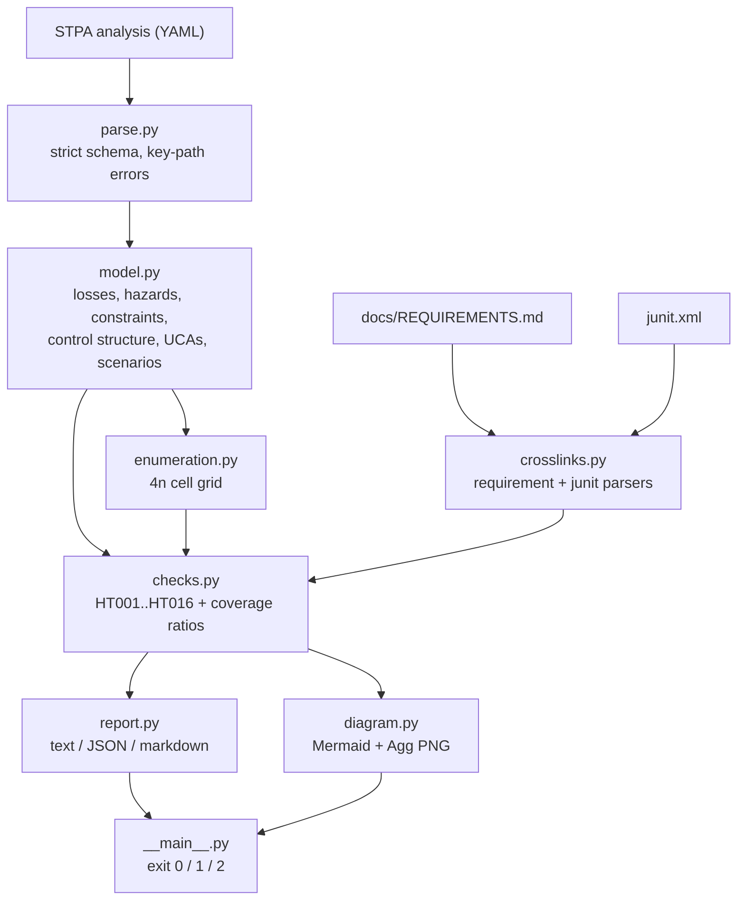
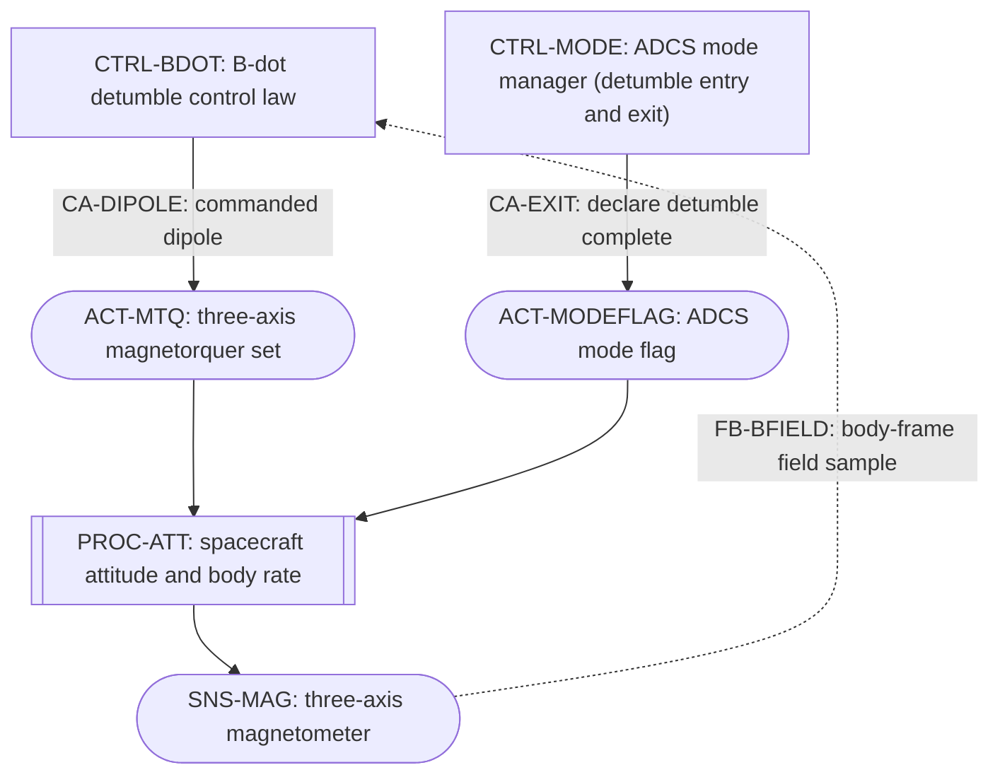
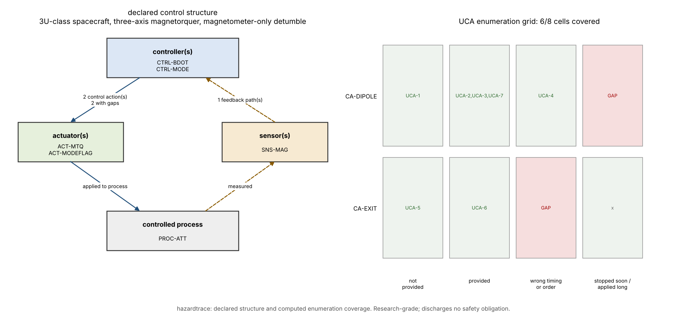
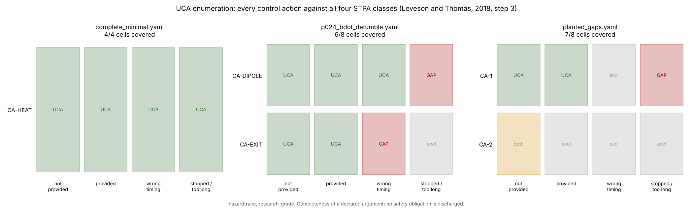
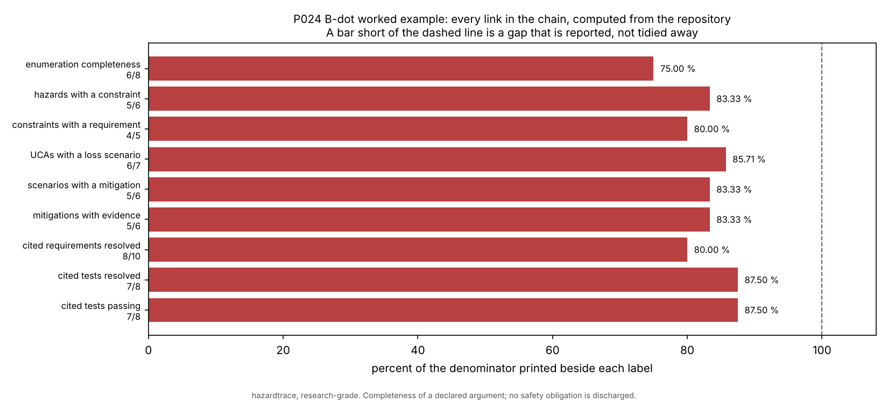
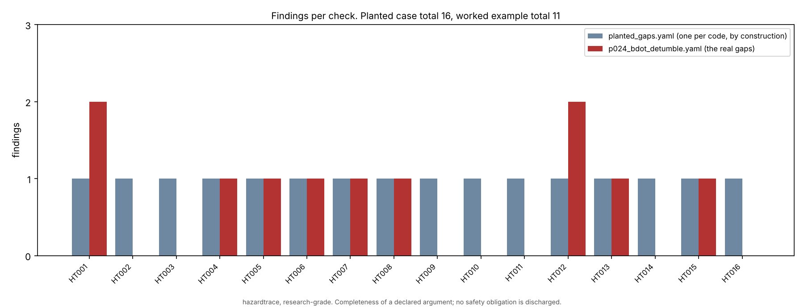

# hazardtrace

An STPA hazard analysis as a machine-checkable artifact: YAML in, gap list out.


**Status: TESTING** · Class: medium · Validation level 2 (research grade) ·
No AI, by design · Apache-2.0 · © 2026 OPTIMA Organisation

> ## Scope, before anything else
>
> **A complete hazard analysis is not a safe system, and a clean exit code from
> this tool is not a complete hazard analysis.**
>
> hazardtrace checks the **structure** of a declared System-Theoretic Process
> Analysis: that every control action was considered in all four STPA classes,
> that every hazard has a constraint, that every mitigation has evidence, and
> that the requirement and test identifiers it cites resolve against the
> repository. It reads **no content**. A UCA whose description is the word
> "bad" is indistinguishable, to this tool, from one somebody thought about.
>
> It is **not a DO-178C, ARP4754A, ARP4761 or ISO 26262 compliance tool**, it
> produces no certification artifact, and **it discharges no safety obligation
> of any kind.** If an exit code from this program is ever offered as evidence
> that a hazard analysis was done properly, it is being misused.
>
> This software is research-grade. It is **not flight-qualified, not certified,
> and not approved for operational aerospace use.**

## The problem

Your STPA lives in a spreadsheet with a tab per step, and the question in
review is not "how many UCAs do you have" but "which control actions did you
never consider in the stopped-too-soon class, and which of your mitigations has
nothing behind it". Both are computable: the UCA grid is `4 x` the number of
control actions and its size is known before anybody writes a row, and a
mitigation either cites an artifact that exists or it does not. In a
spreadsheet both questions are a morning's reading that has to be redone every
time the control structure changes.

## What this does

- **Computes UCA enumeration completeness against a denominator fixed by the
  control structure.** Every control action against all four classes (STPA
  Handbook, Leveson and Thomas, 2018, step 3), each cell either holding a UCA
  or an explicit justified exclusion. Cross-checked against exhaustive
  enumeration over **6642** cases at n = 1 and n = 2 with **0** mismatches, and
  over **2000** seeded random cases with 0 to 8 control actions, also **0**
  (`validation/validate_enumeration.py`).
- **Raises sixteen checks and names the offending object in each.** On the
  shipped known-answer case, built to contain exactly one instance of each:
  **16** findings, **14** error and **2** warning, enumeration **7/8**, exit
  code **1**. On the shipped clean case: **0** findings, enumeration **4/4**,
  exit code **0** (`validation/validate_known_answers.py`).
- **Computes requirement and test coverage from the repository, not from the
  analysis.** A markdown requirements document and a junit XML report are
  parsed independently; four pytest identifier forms are accepted and all five
  outcomes classified. On the worked example: **8/10** cited requirements
  resolve, **7/8** cited tests resolve and **7/8** passed. With no sources
  supplied the three ratios are reported **undefined**, not 100 %
  (`validation/validate_crosslinks.py`).
- **Rejects a malformed analysis by key path rather than guessing.** **49**
  schema rejection paths and **3** I/O paths; **49/49** raise
  `AnalysisFormatError`, **49/49** name the offending YAML key, **0** malformed
  documents accepted (`validation/validate_parser_rejections.py`).
- **Exits non-zero on an incomplete analysis, as a measured contract.** **28**
  real `python -m hazardtrace` subprocesses, **0** exit-code mismatches against
  the documented contract (`validation/validate_cli.py`).
- **Renders the declared control structure** as Mermaid for review in a pull
  request and as a PNG beside the enumeration grid, both deterministic.

## No AI in this one, deliberately

**There is no model in this package and none is planned.**

The thing being checked is a **declared argument**. A learned component asked
to help here would do one of two things: generate UCA text, or score an
analysis for quality. The first produces sentences that look like hazard
analysis and carry no accountable author — and a UCA nobody thought about is
worse than a gap, because a gap is visible and a plausible sentence is not. The
second would put a number on a safety argument from a model with no causal
access to the system.

Everything hazardtrace does is counting, set difference and identifier
resolution: operations a machine can do without pretending to have an opinion.
The judgement — is this the right hazard, is this UCA real, does this evidence
support anything — stays with the person whose name is on the review. That is a
design decision, not a missing feature and not a roadmap item, which is why
there is no `MODEL_CARD.md` in this repository.

## Who it is for

- Anyone maintaining an STPA who wants the unconsidered control-action classes
  listed by a command rather than found in review.
- Anyone who wants a hazard analysis reviewable as a diff: YAML in the
  repository, Mermaid out, a non-zero exit in continuous integration.
- Anyone who has to defend a coverage number and needs its denominator and its
  definition printed in the same breath.
- Anyone who wants mitigations checked against requirement identifiers and test
  identifiers that actually exist in the repository.

## Who it is not for

- Anyone who needs an STPA **editor**. There is no graphical editor and there
  will not be one; see the alternatives below.
- Anyone who needs **context tables** in the sense of Thomas (2013) — the
  enumeration of process-model variable combinations per control action. Not
  implemented. Cell coverage here is coarser than a full STPA requires, and the
  Limitations section says what that costs.
- Anyone who needs CAST (accident analysis), STPA-Sec or STPA-Priv. Only the
  four STPA steps are modelled.
- **Anyone who needs certification or compliance support.** Nothing here has
  any relationship to DO-178C, ARP4754A, ARP4761 or ISO 26262.
- Anyone who wants to know whether their hazard analysis is any good. That is
  the one question this tool refuses, and it refuses it on purpose.

## Alternatives, honestly

Every entry below was verified to exist on 2026-10-15, at the source given.
**If you want to author an STPA, use XSTAMPP or a spreadsheet. This is a
linter, not a tool for doing the analysis.**

| Alternative | What it does better | When to use this instead |
|---|---|---|
| **Spreadsheets** — and this is what most teams actually use. The MIT Partnership for Systems Approaches to Safety and Security lists the **STPA Automation Tool** (Andrew Miller, Motional) among its STAMP tools, and it is distributed as a Google Sheets document you copy. | Everything about doing the work: no install, no schema, no syntax, every reviewer already has one, arbitrary columns, comments, colour. A spreadsheet never tells you your YAML is malformed, because there is no YAML. | You want "which cells did nobody fill in" and "which mitigation has no evidence" answered by a command that exits non-zero in CI, over a file that diffs. A spreadsheet cannot compute enumeration completeness against a denominator, and nobody re-reads 400 rows after every control-structure change. |
| **XSTAMPP** (Institute of Software Technology, University of Stuttgart; open source and free; `github.com/SE-Stuttgart/XSTAMPP`, and a separate `xstampp-4.0` repository) — **the closest real alternative**, an Eclipse platform for the STAMP methods with plug-ins for STPA, extended STPA, STPA-Sec, STPA-Priv and CAST. | Being an actual STPA tool: a control-structure editor, the step tables, the extended method, security and privacy variants, CAST accident analysis, and a published research programme behind it. It does the analysis; this package only inspects one. | You want the analysis to live in the repository as text, next to the code and the tests it cites, and to be checked by the same build that runs the tests. XSTAMPP has no notion of your junit report. |
| **STAMP Workbench** (Information-technology Promotion Agency, Japan; free; a commercial version exists as **astah System Safety**) | A maintained, documented STPA and CAST desktop tool in English and Japanese, with a vendor behind the commercial edition. | Same answer as XSTAMPP: author there, check here. |
| **PASTA** (Jette Petzold, Kiel University; open source; a Visual Studio Code extension, `github.com/kieler/stpa`) | STPA inside an editor with a textual DSL and generated diagrams — closer in spirit to this package than anything else listed, and further along as an authoring environment. | You want a plain YAML schema with no editor extension, and the specific checks here: enumeration completeness with its denominator, and resolution of requirement and test identifiers against files in the repository. |
| **Safety Architect** (ALL4TEC; commercial; Eclipse Marketplace entry, development status "Production/Stable", last updated 5 April 2018) | Model-based safety analysis over a SysML or UML architecture: local FMECA and automatic fault-tree generation for identified feared events. | **Always, for STPA — because it is not an STPA tool.** Its Marketplace entry names FTA and FMECA and does not mention STPA at all. It is listed here because the batch specification asked for it by name; the honest finding is that it solves a different problem with a different accident model. |
| **P055 AssureGraph** (this portfolio) | Checks an assurance case — a GSN goal structure — for unsupported claims, stale evidence and undischarged assumptions. | The assurance case argues that hazards are controlled. This package checks the hazard analysis that argument rests on. They compose; neither does the other's job, and neither imports the other. |
| **P060 TraceAudit** (this portfolio) | Links numbered requirements to junit test cases and reports untraced requirements, undeclared claims and requirements traced only to skipped tests. Better at that than the two cross-link checks here, which are deliberately narrow. | You want the hazard analysis itself checked. TraceAudit knows nothing about hazards, UCAs or control structures; this package reuses its identifier conventions so that a repository already carrying them needs no new bookkeeping. |

**There is no established STPA package on PyPI.** Probed on 2026-10-15 with
`pip index versions`: `stpa`, `pystpa`, `stamp-stpa`, `xstampp` and
`safety-architect` all returned "No matching distribution found".

**One name was dropped rather than guessed.** The batch specification asked for
"STPA-Tool". The only thing verifiable under that name is "An STPA Tool" by
Dajiang Suo and John Thomas, listed by MIT PSAS as **not publicly available**,
with the methods and results published instead. It is named here as that and
nothing more, because describing a tool nobody can obtain would be inventing a
comparison.

## Install and first run

```bash
git clone https://github.com/OmAcharya-avtr/hazardtrace.git
cd hazardtrace
python -m venv .venv && source .venv/bin/activate
pip install -e ".[test]"
python -m pytest tests/ -q
python -m hazardtrace check examples/cases/complete_minimal.yaml
python examples/control_structure_diagram.py
```

Expected output of the test run:

```
215 passed in 15.56s
```

The wall-clock figure moves between runs on two contended cores. **The count
does not, and the count is the number to read** — it is parsed from junit XML,
not from that line; see Limitations.

Expected tail of `check examples/cases/complete_minimal.yaml` (**exit code 0**):

```
findings
  none

verdict
  0 error, 0 warning, 0 info finding(s)
  structural verdict: COMPLETE. Exit code 0.

  A complete verdict means the analysis is fully drawn and the identifiers it cites resolve. It is not a statement that the system is safe, not a statement that the hazard analysis is correct or adequate, and it discharges no safety obligation.
```

Expected output of the first example (it writes
`screenshots/bdot_control_structure.png` and `.mmd`):

```
analysis            : B-dot magnetorquer detumble loop (P024 DetumbleSim)
components          : 6
control actions     : 2
feedback paths      : 1
enumeration cells   : 6/8 covered, 2 gap(s)
  gap: CA-DIPOLE x stopped_too_soon_or_applied_too_long
  gap: CA-EXIT x wrong_timing_or_order
wrote screenshots/bdot_control_structure.mmd
wrote screenshots/bdot_control_structure.png
```

## The worked example, and its gaps

The Level 2 worked example is an STPA of the **B-dot magnetorquer detumble
loop implemented in P024 DetumbleSim** of this portfolio. Every statement in it
was read out of P024's own source: the B-dot law `m = -k dB/dt` and the
identically-perpendicular torque `L = m x B` from `control.py`, the
backward-difference derivative estimate, the zero-order hold over one control
interval, the zero command on the first step and the interpolated threshold
crossing from `simulate.py`, and the per-axis dipole clipping from
`spacecraft.py`.

**It is incomplete and it is published incomplete.** Eight of its eleven
findings correspond to functions P024 does not have. They are the deliverable.

```python
from hazardtrace import (
    format_coverage_table, format_grid, load_analysis, load_junit,
    load_requirements, run_checks,
)

analysis = load_analysis("examples/cases/p024_bdot_detumble.yaml")
requirements = load_requirements("fixtures/p024_bdot/docs/REQUIREMENTS.md")
tests = load_junit("fixtures/p024_bdot/junit.xml")
report = run_checks(analysis, requirements=requirements, tests=tests)

print(f"control actions   : {len(analysis.structure.control_actions)}")
print(f"feedback paths     : {len(analysis.structure.feedback)}")
print(f"UCAs / exclusions  : {len(analysis.ucas)} / {len(analysis.exclusions)}")
print(f"enumeration        : {report.coverage.enumeration}")
print(f"complete           : {report.is_complete}   exit code: {report.exit_code}")
print()
print(format_grid(report).rstrip("\n"))
print()
print(format_coverage_table(report.coverage).rstrip("\n"))
print()
for finding in report.findings:
    print(f"  {finding.code}  {finding.severity.value:<7} {finding.message}")
```

Its actual output. This is `validation/worked_example.py` with the emitter
replaced by `print`; the committed run is
`validation/worked_example_output.txt`.

```
control actions   : 2
feedback paths     : 1
UCAs / exclusions  : 7 / 1
enumeration        : 6/8 = 75.0000 %
complete           : False   exit code: 1

UCA enumeration grid  (U declared, x excluded, ! both, . gap)
  control action  not_provided          provided              wrong_timing_or_orde  stopped_too_soon_or_
  CA-DIPOLE       U UCA-1               U UCA-2,UCA-3,UCA-7   U UCA-4               .
  CA-EXIT         U UCA-5               U UCA-6               .                     x
  cells covered: 6/8; gaps: 2

coverage, with denominators stated
  enumeration completeness        6/8 = 75.0000 %
      definition: cells with a UCA or a justified exclusion, of 4 per action
  hazards with a constraint       5/6 = 83.3333 %
      definition: hazards named by >=1 system-level constraint
  constraints with a requirement  4/5 = 80.0000 %
      definition: constraints citing >=1 requirement identifier
  UCAs with a loss scenario       6/7 = 85.7143 %
      definition: UCAs named by >=1 loss scenario
  scenarios with a mitigation     5/6 = 83.3333 %
      definition: loss scenarios citing >=1 mitigation
  mitigations with evidence       5/6 = 83.3333 %
      definition: mitigations citing >=1 evidence artifact
  cited requirements resolved     8/10 = 80.0000 %
      definition: cited requirement identifiers found in the requirements document
  cited tests resolved            7/8 = 87.5000 %
      definition: cited test identifiers found in the junit report
  cited tests passing             7/8 = 87.5000 %
      definition: cited test identifiers whose every matching case passed

  HT001  error   control action CA-DIPOLE (commanded magnetorquer dipole vector) has no UCA and no justified exclusion for class 'stopped too soon / applied too long'
  HT001  error   control action CA-EXIT (declare detumble complete and leave detumble mode) has no UCA and no justified exclusion for class 'wrong timing or order'
  HT004  error   hazard H-4 has no system-level constraint
  HT005  error   constraint SC-5 cites no requirement identifier
  HT006  error   UCA UCA-3 has no loss scenario
  HT007  error   loss scenario LS-5 has no mitigation
  HT008  error   mitigation M-4 cites no evidence artifact
  HT012  error   requirement REQ-021 is cited by this analysis but is not declared in fixtures/p024_bdot/docs/REQUIREMENTS.md
  HT012  error   requirement REQ-022 is cited by this analysis but is not declared in fixtures/p024_bdot/docs/REQUIREMENTS.md
  HT013  error   test tests/test_divergence_monitor.py::test_rate_increase_commands_safe_mode is cited as evidence but is not present in fixtures/p024_bdot/junit.xml
  HT015  error   controller CTRL-MODE (ADCS mode manager (detumble entry and exit)) has no feedback path: it is declared open loop
```

The sharpest of the eleven is **HT015**. B-dot is a magnetometer-only law;
P024 carries no rate estimator; and the detumble completion criterion is a
threshold on the **true** body rate, evaluated in post-processing. The
controller that decides detumble is finished has no measurement of the quantity
it decides on, and the analysis says so because the control structure as
declared has no feedback path into it. The full list, with the source fact
behind each, is in
[validation/VALIDATION.md](validation/VALIDATION.md) section 6.

## Architecture



The control structure of the worked example, rendered by the package from the
same YAML the checks read:



CTRL-MODE has no dashed arrow back into it. That is HT015, and it is the
genuine state of the loop.

## Screenshots



The declared control structure beside the computed enumeration grid. Notice
that the two red cells are the only two of eight nobody considered, and that
the sensor feeds only one of the two controllers.



The same grid for all three shipped cases. Notice the amber cell in
`planted_gaps.yaml`: a cell holding both a UCA and an exclusion, which counts
as covered and is also reported as a contradiction.



Every coverage figure for the worked example with its numerator and denominator
on the label. Notice that no bar reaches the dashed line, and that the two
rightmost figures come from files in the repository rather than from the
analysis.



Findings per check on the two incomplete cases. Notice that the planted case is
flat at one by construction, and that the worked example is silent on eight
codes — those are checks it passes, not checks that did not run.

## Validation evidence

Level 2. Full detail in [validation/VALIDATION.md](validation/VALIDATION.md).
Every number below came from a script in `validation/`, run on 2026-10-15, with
its raw output committed beside it.

| check | reference | result | tolerance |
|---|---|---|---|
| Enumeration completeness vs exhaustive enumeration, n = 1, 2 | brute force over every filled-cell pattern, 6642 cases | 0 mismatches | exact, integer counts |
| HT001 count equals the uncovered-cell count | same 6642 cases | 0 mismatches | exact |
| Grid identities over seeded random cases | 2000 trials, seed 20261015, n = 0 to 8 | 0 wrong totals, 0 wrong covered counts, 0 broken partitions | exact |
| Known answers, planted case | one planted instance per check, hand-written expected mapping | 16/16 codes, 16/16 subjects, 14 error + 2 warning, exit 1 | exact |
| Known answers, clean case | every link closed by construction | 0 findings, 4/4 enumeration, exit 0 | exact |
| Malformed-document rejection | 49 schema paths + 3 I/O paths | 49/49 raised, 49/49 named the key path, 0 accepted | exact |
| Requirement declaration forms | hand count on a 4-declaration document | 4 declarations, 3 unique ids | exact |
| junit outcome classification | all five outcomes pytest writes | 5/5 classified | exact |
| Identifier alias forms | 4 accepted forms for one case | 4/4 resolve, 0 false matches | exact |
| Worked example cross-links | P024 fixtures | 8/10 requirements, 7/8 tests resolved, 7/8 passed | exact |
| Grid and finding identities | 1500 seeded random analyses | 13 identities, each holding in every applicable trial | 1e-12 on the one ratio identity |
| **Monotonicity of the finding count** | the claim that filling a gap never raises the total | **FALSIFIED in 1110 of 1110 applicable trials** | — |
| CLI exit-code contract | 28 real subprocesses | 0 mismatches | exact |
| Dependency range, floor vs ceiling | suite + all 8 validation scripts at both ends | 215 passed at both; **only the recorded version numbers differ** in the committed output | byte diff |

The falsified row is the credible one. Filling an enumeration gap removes one
HT001 and adds an HT006 and an HT010 whenever the new UCA has no loss scenario
and no hazard yet, which is exactly the state a freshly written UCA is in. The
finding **count** is not a progress measure; the enumeration **ratio** is. The
counterexample is pinned with literal inputs in `tests/test_regression.py`.

## API reference

<details>
<summary>Public surface, one line each</summary>

| callable | returns | notes |
|---|---|---|
| `parse_analysis(text, source="<string>")` | `Analysis` | Strict YAML parse; raises `AnalysisFormatError` naming the key path. |
| `load_analysis(path)` | `Analysis` | As above, from a UTF-8 file. |
| `parse_requirements(text, source, pattern)` | `RequirementIndex` | Line-oriented markdown; `pattern` defaults to `REQ-\d{3,}`. |
| `load_requirements(path, pattern)` | `RequirementIndex` | As above, from a file. |
| `parse_junit(text, source)` | `TestIndex` | Accepts a `<testsuites>` or `<testsuite>` root. |
| `load_junit(path)` | `TestIndex` | As above, from a file. |
| `build_grid(analysis)` | `EnumerationGrid` | Exactly `4 x len(control_actions)` cells. |
| `run_checks(analysis, requirements=None, tests=None)` | `Report` | All sixteen checks; omitted sources disable HT012–HT014 and leave their ratios undefined. |
| `check_spec(code)` | `CheckSpec` | Static description of one check; raises `KeyError` on an unknown code. |
| `format_report(report)` | `str` | Text report: header, grid, coverage, findings, verdict. |
| `format_grid(report)` | `str` | The enumeration grid alone. |
| `format_coverage_table(coverage)` | `str` | Every ratio with its numerator, denominator and definition. |
| `format_findings(report)` | `str` | Findings in check order plus the per-code summary. |
| `format_json(report)` / `report_to_dict(report)` | `str` / `dict` | Indented, sorted-key JSON. |
| `format_markdown(report)` | `str` | Markdown tables for a review comment. |
| `format_codes()` | `str` | The check catalogue. |
| `render_mermaid(analysis, report=None, max_label_chars=44)` | `str` | `flowchart TD` source; marks gap-carrying control actions when given a report. |
| `render_control_structure_png(report, path, dpi=150)` | `Path` | Agg only. Creates parent directories. |

Units: every quantity this package computes is a **count** or a dimensionless
**ratio**. There are no physical units anywhere in it, by construction.

`Ratio` carries `numerator`, `denominator`, `definition`, `defined`, `fraction`
(NaN when the denominator is zero) and `percent`. `Report` carries `findings`,
`coverage`, `grid`, `exit_code`, `is_complete`, `count_by_code()` and
`count_by_severity()`.

</details>

<details>
<summary>The sixteen checks</summary>

| code | severity | check |
|---|---|---|
| HT001 | error | UCA enumeration gap: cell has no UCA and no exclusion |
| HT002 | error | exclusion justification missing or too short |
| HT003 | error | exclusion contradicted by a UCA in the same cell |
| HT004 | error | hazard with no system-level constraint |
| HT005 | error | constraint with no requirement identifier |
| HT006 | error | UCA with no loss scenario |
| HT007 | error | loss scenario with no mitigation |
| HT008 | error | mitigation with no evidence artifact |
| HT009 | error | hazard linked to no loss |
| HT010 | error | UCA linked to no hazard |
| HT011 | warning | loss reached by no hazard |
| HT012 | error | requirement identifier not declared in the document |
| HT013 | error | test identifier not present in the test report |
| HT014 | error | cited test did not pass |
| HT015 | error | controller with no feedback path |
| HT016 | warning | control-structure component referenced by nothing |

`--strict` makes warnings blocking as well as errors.

</details>

## Limitations

- **Structure only, never content.** The single most important limit. A UCA
  whose description is one meaningless word covers its cell exactly as well as
  a considered one, and a justification of twenty arbitrary characters passes
  HT002. The twenty-character policy rejects "n/a" and nothing cleverer.
- **No context tables.** Thomas (2013) enumerates the combinations of
  process-model variables under which a control action is unsafe, which is what
  makes STPA step 3 rigorous. This release has a single cell per control action
  and class, so **the denominator it reports is smaller than a full STPA's**,
  and 100 % enumeration here is weaker than 100 % there. This is the biggest
  gap in the product and it is the first thing a 0.2.0 would address.
- **The finding count is not monotone.** Filling an enumeration gap removes one
  HT001 and can add two downstream findings; measured as failing in 1110 of
  1110 applicable trials. Track the enumeration ratio, not the finding total.
- **The twenty-character justification policy is declared, not measured.** It
  is a number chosen to reject "not applicable". No study supports it.
- **An xpassed test is indistinguishable from a passing one** in junit XML,
  because pytest writes both without a child element. A mitigation whose only
  evidence is an xpassing test is reported as fully evidenced.
- **The requirements parser is line-oriented.** An identifier that does not
  start a line is not a declaration, and an unclosed code fence hides every
  declaration after it — which makes HT012 fire more, not less, so the error is
  in the safe direction.
- **Reference resolution is not provenance.** The tool checks that a cited test
  exists in the junit report it was handed and passed there. It cannot tell
  whether that report came from the code under analysis, or from anywhere.
- **`fixtures/p024_bdot/docs/REQUIREMENTS.md` is hand-written** for the worked
  example. P024 DetumbleSim ships no requirements document; the file exists so
  the cross-link checks have something to resolve against, and its own header
  says so. The junit fixture beside it, by contrast, is a real 305-test run.
- **Dependency ceilings are a real cost.** `pyyaml<6.1` and `matplotlib<3.12`
  mean this package cannot take a future security release of either without a
  port and a re-measurement. The ceilings are there because a floor with no
  ceiling broke five published products in this portfolio on 2026-10-13, and
  the tension is recorded here rather than resolved by deleting them.
- **The matplotlib floor is 3.11.0 and that is narrow.** matplotlib 3.9.2 and
  3.10.0 both fail this suite at collection time, because they call pyparsing's
  deprecated `oneOf` and this repository turns `DeprecationWarning` into an
  error. Measured, not chosen.
- **PyYAML 6.0 is excluded** because it has no cp313 wheel and fails to build
  against Cython 3 on Python 3.13, so it could not be measured here.
- **Test counts come from junit XML, not from pytest's summary line.** A suite
  that collects nothing prints success and exits 0; the badge above is parsed
  from the `testsuite` element and cross-checked against a count of `testcase`
  elements.
- **Compute budget.** Everything in this repository is counting over tens of
  records plus one 305-case XML parse. The whole validation set runs in under
  20 seconds on 2 cores and the test suite in about 14; there is no numerical
  pipeline here to be slow.

## Reproducing every number

```bash
pip install -e ".[test]"
python -m pytest tests/ -q --junitxml=junit.xml
ruff check src/ tests/ examples/ validation/ fixtures/

cd validation
python validate_environment.py
python validate_known_answers.py
python validate_enumeration.py
python validate_parser_rejections.py
python validate_crosslinks.py
python validate_cli.py
python validate_properties.py
cd ..
python validation/worked_example.py

cd examples
python control_structure_diagram.py
python enumeration_matrix.py
python trace_chain.py
python findings_by_code.py
```

Each validation script exits 0 when every check in it passed and 1 otherwise,
and writes `validation/<script-name>_output.txt`. The example scripts write
PNGs into `screenshots/`.

## Licence

Apache-2.0. Copyright © 2026 OPTIMA Organisation. See [LICENSE](LICENSE).

## Citation

See [CITATION.cff](CITATION.cff). The method is not this package's: it is

- Leveson, N. G. and Thomas, J. P., *STPA Handbook*, March 2018.
- Leveson, N. G., *Engineering a Safer World: Systems Thinking Applied to
  Safety*, MIT Press, 2011. ISBN 978-0-262-01662-9.
- Leveson, N. G., "A new accident model for engineering safer systems",
  *Safety Science*, vol. 42, no. 4, 2004, pp. 237–270.
  doi:10.1016/S0925-7535(03)00047-X
- Thomas, J., "Extending and automating a systems-theoretic hazard analysis for
  requirements generation and analysis", PhD thesis, Massachusetts Institute of
  Technology, 2013.

## Credits

This is under reserved rights obtained by OPTIMA Organisation.
