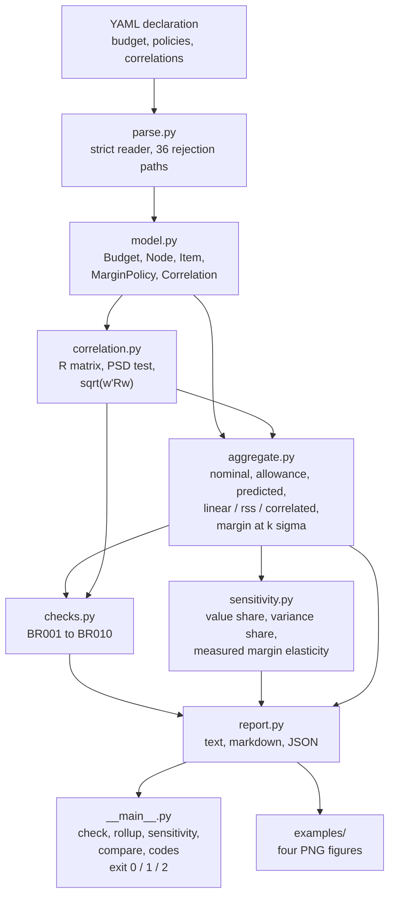
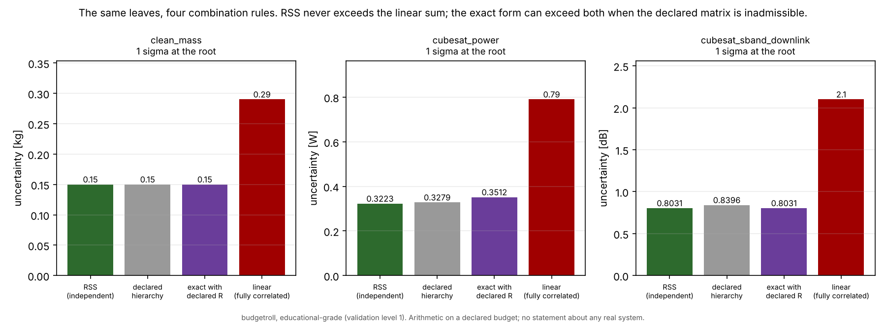
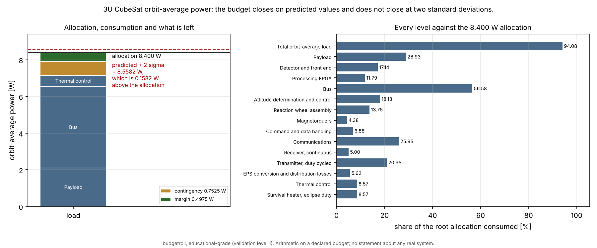
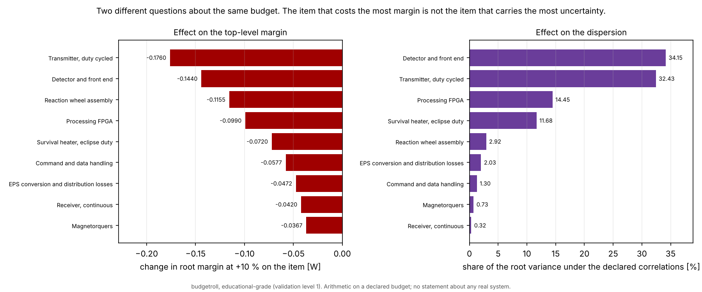
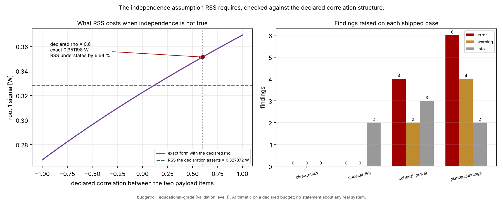

# budgetroll

Hierarchical margin and budget rollup that is explicit about how uncertainties combine.


**Status: TESTING** · Class: compact · **Validation level 1 (educational
grade)** · No AI, by design · Apache-2.0 · © 2026 OPTIMA Organisation

> ## Scope, before anything else
>
> **Level 1 is the educational level of this portfolio, and it was chosen for
> this product on purpose.** The subject is arithmetic that everyone does in
> a spreadsheet and gets subtly wrong. There is nothing novel here and no
> claim that there is.
>
> budgetroll checks that a declared budget is **arithmetically consistent
> with its own stated assumptions**. It does not know whether any estimate is
> good, whether any margin is adequate, or whether any system works. No input
> number in any example shipped with it is measured, and it ships **no margin
> policy of its own**: the contingency schedule is something you declare, and
> the tool reproduces it in the report with the source you gave it.
>
> This software is **educational-grade. It is not flight-qualified, not
> certified, and not approved for operational aerospace use.**

## The problem

The mass budget is a spreadsheet, and so are the power budget and the link
budget. Somewhere in each of them a column of per-item contingencies has been
root-sum-squared, because the uncertainties above it were, and a 20 per cent
growth allowance on a new design is not a random variable. Somewhere else a
subtotal is root-sum-squared across items that share a converter, a supplier
or a thermal environment, which asserts an independence nobody wrote down and
nobody checked.

## What this does

- **Keeps deterministic contingency and random uncertainty apart, and sums
  the first.** On the shipped CubeSat power budget: nominal **7.1500 W**,
  contingency allowance **0.7525 W**, predicted **7.9025 W** against an
  **8.4000 W** allocation, leaving **0.4975 W** of margin
  (`validation/validate_power_budget.py`).
- **Reports four combination rules side by side at every node.** On the same
  budget: linear **0.790000 W**, root-sum-square **0.322335 W**, the
  hierarchy the declaration actually specifies **0.327872 W**, and the exact
  form with the declared correlations **0.351198 W**. The declared RSS
  **understates the exact form by 6.6418 per cent**
  (`validation/validate_power_budget.py`).
- **Checks the independence assumption RSS requires against the declared
  correlation structure.** Ten checks, BR001 to BR010, each naming the
  objects it is about. The planted case raises all ten: **6 error, 4 warning,
  2 info**; the clean case raises **0** (`validation/validate_checks.py`).
- **Ranks the leaves three different ways, because they are three different
  questions.** On the power budget the transmitter costs the most margin
  (**-0.1760 W** at +10 per cent) while the detector carries the most
  dispersion (**34.15 per cent** of the root variance)
  (`validation/validate_power_budget.py`).
- **Reproduces the published constants of a link budget rather than asserting
  them.** The free-space path loss constant to **-0.002217 dB** of the
  published 92.45 dB, the Boltzmann constant to **+0.000833 dB** of -228.6
  dBW/K/Hz, the 55 per cent aperture gain constant to **+0.010210 dB** of
  17.8 dB, and the uncoded coherent BPSK requirement at BER 1e-5 to
  **-0.012142 dB** of the tabulated 9.6 dB
  (`validation/validate_link_budget.py`).

## No AI in this one, deliberately

**There is no model in this package and none is planned**, which is why there
is no `MODEL_CARD.md` in this repository. The absence is a decision, not an
omission.

Everything budgetroll does is addition, a square root and an eigenvalue test.
A learned component asked to help here would have to do one of two things:
guess a contingency a user did not declare, or score a budget for plausibility.
The first replaces an accountable declaration with an unaccountable one, and
a growth allowance nobody can defend in review is worse than no allowance,
because an absent one is visible. The second would put a number on an
engineering judgement from a model with no access to the hardware.

## Who it is for

- Anyone who wants the linear-against-RSS choice made explicitly at each node
  of a budget instead of implicitly by whoever wrote the formula.
- Anyone who has a correlation they know about — two boxes on one converter,
  two parts from one supplier — and wants the tool to object when a subtotal
  above them is root-sum-squared anyway.
- Anyone who wants a budget reviewable as a diff: YAML in the repository,
  JSON or markdown out, a non-zero exit in continuous integration.
- Anyone teaching or learning why contingency and uncertainty are different
  things.

## Who it is not for

- **Anyone who needs general uncertainty propagation.** Use `uncertainties`.
  See the table below; it does the thing it does better than this.
- **Anyone who needs units enforced.** This package does no unit conversion
  and no dimensional analysis. Use `pint`.
- **Anyone doing multidisciplinary design optimisation.** Use `openmdao`.
- Anyone who needs a Monte Carlo over a non-Gaussian budget. Not implemented;
  no distribution is assumed anywhere here, so there is nothing to sample.
- **Anyone who needs certification or compliance support.** Nothing here has
  any relationship to any standard's compliance process, and no output of
  this program discharges any engineering obligation.

## Alternatives, honestly

| alternative | what it does better | when to use this instead |
|---|---|---|
| **A spreadsheet** | Everything about entry, sharing and ad-hoc edits. It is the right tool for a budget and that is why every budget lives in one. | When you want the combination rule stated per node, the independence assumption checked against a declared correlation structure, and the whole thing reviewable as a diff. |
| **`uncertainties`** | **Linear error propagation, properly.** It tracks correlations automatically through arbitrary expressions, handles non-unit sensitivity coefficients, and is mature. For propagating uncertainty through a calculation it is strictly better than this package. | When the thing you need is not propagation but the **margin policy and the assumption checking**: maturity-keyed contingency kept separate from dispersion, an allocation and a margin at each level, and a report that objects when a node's declared rule contradicts the declared correlations. |
| **`pint`** | Units and dimensional analysis, which this package does not attempt at all. | Together, not instead. budgetroll treats the unit as a label; if mixing kg and lb is a risk in your workflow, carry `pint` quantities up to the point where you build the declaration. |
| **`openmdao`** | Multidisciplinary analysis and optimisation, derivatives, coupled solvers. A budget rollup is a trivial special case of what it does. | When you want a 250-line answer to a budget question rather than a framework, and when the output you need is a findings list rather than a converged design point. |

The honest summary: `uncertainties` does the propagation better, `pint` does
the units, `openmdao` does the optimisation, and a spreadsheet does the
entry. What is here is the bookkeeping around them — the policy, the
allocation, the margin at each level, and the ten things that are wrong with
the declaration.

## Install and first run

```bash
git clone https://github.com/OmAcharya-avtr/budgetroll.git
cd budgetroll
python -m venv .venv && source .venv/bin/activate
pip install -e ".[test]"
python -m pytest tests/ -q
python examples/combination_comparison.py
```

Expected output of the test run. The count is fixed; the wall clock is not,
and it ranged from 7.98 s to 17.28 s across the runs made while preparing
this release on two contended cores, so expect a different number of
seconds. One of those runs printed:

```
264 passed in 14.41s
```

Expected output of the example:

```
wrote /path/to/budgetroll/screenshots/combination_comparison.png
```

Then the shortest useful thing the CLI does:

```bash
python -m budgetroll compare examples/cases/cubesat_power.yaml
```

```
budgetroll checks the arithmetic of a declared budget and the consistency of the assumptions declared with it. It does not know whether any estimate is good, whether any margin is adequate, or whether any system works. Educational-grade (validation level 1): not flight-qualified, not certified, not approved for operational aerospace use.

Combination of the 9 leaf uncertainties of cubesat_power, in W:
  linear (fully correlated upper bound)  0.790000
  root-sum-square (independent)          0.322335
  declared hierarchy at the root         0.327872
  exact form with declared correlations  0.351198
```

That command exits **1**, because the budget declares `rss` at two nodes
whose descendants carry a declared correlation of 0.6.

## A worked example

This is `validation/worked_example.py`, run from the repository root. Its
committed output is `validation/worked_example_output.txt`.

```python
from budgetroll import load, rollup, run_checks, sensitivity

budget = load("examples/cases/cubesat_power.yaml")
roll = rollup(budget)
root = roll.root

print(f"{budget.name}  [{budget.unit}]")
print(f"  nominal              {root.nominal:8.4f}")
print(f"  contingency          {root.allowance:8.4f}")
print(f"  predicted            {root.predicted:8.4f}")
print(f"  allocation           {root.allocation:8.4f}")
print(f"  margin               {root.margin_absolute:8.4f}"
      f"   ({100 * root.margin_fraction:.2f} %)")
print(f"  1 sigma, declared    {root.uncertainty:8.4f}   (rule: {root.combination})")
print(f"  1 sigma, exact       {root.exact_uncertainty:8.4f}   (declared correlations)")
print(f"  margin at {budget.k_sigma:g} sigma    {root.margin_at_k:8.4f}")
print()
print("worst three leaves by effect on the top-level margin:")
for row in sensitivity(budget, step=0.10)[:3]:
    print(f"  {row.name:<30s}{row.margin_delta:+8.4f} {budget.unit} at +10 %"
          f"   variance share {100 * row.variance_share:5.2f} %")
print()
print("blocking findings:")
for finding in run_checks(budget):
    if finding.severity == "error":
        print(f"  {finding.code} {finding.subject}")
```

```
3U CubeSat orbit-average power budget  [W]
  nominal                7.1500
  contingency            0.7525
  predicted              7.9025
  allocation             8.4000
  margin                 0.4975   (5.92 %)
  1 sigma, declared      0.3279   (rule: rss)
  1 sigma, exact         0.3512   (declared correlations)
  margin at 2 sigma     -0.1582

worst three leaves by effect on the top-level margin:
  Transmitter, duty cycled       -0.1760 W at +10 %   variance share 32.43 %
  Detector and front end         -0.1440 W at +10 %   variance share 34.15 %
  Reaction wheel assembly        -0.1155 W at +10 %   variance share  2.92 %

blocking findings:
  BR001 payload
  BR001 total_load
  BR002 payload
  BR002 total_load
```

The budget closes on predicted values and does not close at two standard
deviations, and the declaration asserts an independence it also denies. Both
are in the output; neither is in the spreadsheet it came from.

## Architecture



## Screenshots



The same leaves under four rules. Notice that on `clean_mass` the first three
bars are identical — the declaration is consistent — while on `cubesat_power`
the exact form stands above the declared hierarchy, which is the declaration
contradicting itself.



Notice that the solid allocation line is above the stack and the dashed
two-sigma line is above the allocation. The budget closes and then does not.



Notice that the top bar differs between the two panels: the transmitter costs
the most margin, the detector carries the most variance. A single
"sensitivity" column in a spreadsheet answers only one of these and does not
say which.



Notice where the dashed line crosses the curve on the left: RSS is only
correct at one point, and the declaration says that point is not where this
budget sits.

## Validation evidence

Full detail, with the hand arithmetic, in
[`validation/VALIDATION.md`](validation/VALIDATION.md). Every number below
comes from a committed `validation/*_output.txt`.

| check | reference | result | tolerance |
|---|---|---|---|
| Test suite counted from junit XML | `testsuite/@tests` cross-checked against `testcase` elements | 264 / 264, MATCH; 0 failures, 0 errors, 0 skips | exact match required |
| `clean_mass` 1 sigma | hand: sqrt(0.0100+0.0064+0.0025+0.0036) = sqrt(0.0225) | 0.150000000000 kg | 1e-9 absolute |
| `cubesat_power` predicted | hand: 7.1500 + 0.7525 | 7.902500000000 W | 1e-9 absolute |
| Free-space path loss constant | published 92.45 dB (d in km, f in GHz) | 92.447783 dB, difference -0.002217 dB | 0.005 dB |
| Boltzmann constant in dB | published -228.6 dBW/K/Hz | -228.599167, difference +0.000833 dB | 0.005 dB |
| Aperture gain constant at 55 % | published 17.8 dB | 17.810210 dB, difference +0.010210 dB | 0.02 dB |
| Uncoded coherent BPSK at BER 1e-5 | published 9.6 dB; solved from 0.5 erfc(sqrt(Eb/N0)) | 9.587858 dB, difference -0.012142 dB | 0.02 dB |
| Path loss computed two independent ways | 1000 km, 2.2 GHz | 159.296236838 dB both ways, difference +2.842e-14 dB | 1e-9 dB |
| RSS ≤ linear | 5258 cases (258 exhaustive, 5000 random, seed 20261016) | 0 violations | — |
| Associativity of independent aggregation | same 5258 cases, every split point | worst 3.076e-16 relative | 1e-12 relative |
| Variance shares sum to 1 | same cases with a declared rho | worst 4.441e-16 absolute | 1e-9 absolute |
| **`sqrt(w'Jw)` against the linear sum at DBL_MIN weights** | **FOUND BROKEN.** Relative disagreement **1.0**: the form returns 0.0 against 8.900295434028806e-308. Pinned in `tests/test_regression.py::test_regression_quadratic_form_underflows_at_subnormal_weights` | recorded under Limitations as the floating-point range of this package | no tolerance rescues it |
| **Margin sign at the rounding boundary** | **FOUND BROKEN.** 0.1+0.1+0.1 is 0.30000000000000004, so against an allocation of 0.3 the margin is -5.551115123125783e-17 and a strict test called it an overrun. Pinned in `tests/test_regression.py::test_regression_margin_sign_at_the_rounding_boundary` | the implementation was changed, not the test; BR003 now carries a rounding band | 1e-12 × max(abs(allocation), 1) |
| Parser rejections | 36 schema paths, 3 I/O paths | 36/36 rejected, 0 malformed accepted, 36/36 messages name the offending key or object | — |
| CLI exit status | the documented 0 / 1 / 2 contract | 32 real subprocesses, 0 mismatches | — |
| Dependency range ends | suite and all validation scripts at both ends of every range | 264/264 at both; all 8 validation output files byte-identical | byte-identical required |

The two rows in bold are the ones worth reading. Both are genuine failures
found while building this release; one is a documented limitation of double
precision and one changed the implementation.

## API reference

<details>
<summary>Public surface, with units</summary>

| function | returns | units |
|---|---|---|
| `load(path)` / `loads(text)` | `Budget` | — |
| `rollup(budget)` | `Rollup`; `.root`, `.by_id(id)`, `.leaf_results()` | budget unit |
| `NodeResult.nominal` | sum of the nominal values below this node | budget unit |
| `NodeResult.allowance` | sum of the contingency allowances below this node | budget unit |
| `NodeResult.predicted` | nominal + allowance | budget unit |
| `NodeResult.uncertainty` | 1 sigma by the node's declared rule | budget unit |
| `NodeResult.exact_uncertainty` | 1 sigma from the declared correlation matrix over this node's descendant leaves | budget unit |
| `NodeResult.margin_absolute` / `.margin_fraction` / `.margin_at_k` | allocation - predicted; the same over the allocation; allocation - (predicted + k·sigma) | budget unit; dimensionless; budget unit |
| `linear_rollup_uncertainty(budget)` | sum of every leaf 1 sigma | budget unit |
| `rss_rollup_uncertainty(budget)` | sqrt of the sum of squares of every leaf 1 sigma | budget unit |
| `combine(rule, children)` | `linear` or `rss` over a list of child 1 sigma values | budget unit |
| `correlation_matrix(leaf_ids, correlations)` | symmetric `(n, n)` array, unit diagonal | dimensionless |
| `is_positive_semidefinite(matrix)` | `(verdict, smallest_eigenvalue)` | dimensionless |
| `quadratic_form(weights, matrix)` | `sqrt(w^T R w)` | unit of `weights` |
| `value_shares(rollup)` | leaf id to share of the predicted root value | dimensionless |
| `variance_shares(budget)` | leaf id to share of the root variance; may be negative under a negative correlation | dimensionless |
| `margin_elasticity(budget, step)` | leaf id to the change in root margin at `+step` relative on that leaf | budget unit |
| `sensitivity(budget, step)` | ranked `list[LeafSensitivity]` | mixed; see above |
| `run_checks(budget, rollup=None)` | `list[Finding]` sorted by severity then code | — |
| `severity_counts(findings)` / `has_blocking(findings)` | counts per severity; True when any `error` | — |
| `text_report` / `markdown_report` / `json_report` / `to_dict` | the full report in four forms | — |

CLI: `python -m budgetroll {check,rollup,sensitivity,compare,codes}`.
Exit 0 with no `error` finding, 1 with at least one, 2 when the command could
not run.

</details>

<details>
<summary>The ten checks</summary>

| code | meaning | severity |
|---|---|---|
| BR001 | A node declares `rss`, which asserts mutual independence, while the budget declares a non-zero correlation among its descendant leaves. | error |
| BR002 | The hierarchical uncertainty diverges from the exact correlated form over the node's descendant leaves. Graded by direction: **understating** it is an error, **overstating** it is information, because a deliberately conservative `linear` node inside an `rss` tree is a legitimate choice. | error or info |
| BR003 | The predicted value exceeds the declared allocation. Inside a rounding band of `1e-12 × max(abs(allocation), 1)` the finding is graded a warning and worded as closed exactly. | error or warning |
| BR004 | The margin is non-negative on predicted values and negative at k sigma. | warning |
| BR005 | An explicit contingency on an item diverges from the policy value for its declared maturity. The override is applied and the policy is not. | warning |
| BR006 | An item declares zero uncertainty at a maturity that is not the policy's most mature level. A zero contributes nothing to any root-sum-square above it. | warning |
| BR007 | A combination rule other than `linear` is declared on a node with one child, where every rule gives the same answer. | info |
| BR008 | The declared correlation matrix has a negative eigenvalue and is therefore the correlation matrix of no joint distribution. | error |
| BR009 | A node declares `correlated` while no correlation applies to its descendants, so the rule silently evaluates to root-sum-square. | error |
| BR010 | Two items declare the same `common_driver` tag and no correlation is declared between them. | warning |

</details>

## Limitations

- **Validation level 1 is educational.** The arithmetic is checked against
  hand calculation and the link-budget constants against published values.
  Nothing here is checked against a flight programme, a test campaign or an
  independently maintained tool.
- **No units.** The unit is a label reproduced in reports. There is no
  conversion and no dimensional analysis, so a budget mixing kg and lb is
  summed without complaint. Use `pint` upstream if that matters.
- **Additive model only.** The aggregation is exact for quantities that
  combine additively in the declared unit: kg, W, Mbit, and the log-domain
  terms of a link budget in dB. It is **not valid** for quantities that
  combine multiplicatively in the declared unit, such as efficiencies or
  linear-unit ratios. Convert to a log domain first, or use a general
  propagation library.
- **A k-sigma figure is not a confidence level.** No distribution is assumed
  anywhere. `margin_at_k` is `allocation - (predicted + k × sigma)` and
  nothing more. Reading 2 sigma as 95 per cent requires a normality
  assumption this package neither makes nor checks.
- **Floating-point range.** A 1 sigma below about **1.49e-154** in the
  budget's unit has a subnormal square and starts losing bits; below about
  **2.22e-162** its square underflows to zero and the term disappears from
  every root-sum-square and every quadratic form. Above about **1.34e154**
  the square overflows to infinity. Both ends are pinned in
  `tests/test_regression.py` and `tests/test_edge_cases.py`.
- **The sign of a very small margin is not a fact about the budget.** BR003
  and BR004 carry a rounding band because 0.1 + 0.1 + 0.1 is
  0.30000000000000004. Inside the band the finding says the budget closes
  exactly rather than that it is exceeded.
- **No margin policy is supplied.** The three policies in `examples/cases/`
  are declared by the author of those files and are not reproduced from
  ANSI/AIAA S-120A-2015, NASA/SP-2016-6105 Rev 2 or any other document. Those
  standards are cited as where real schedules come from, and this package
  asserts nothing about any schedule declared through it.
- **Correlations are declared between leaves only.** There is no way to
  declare a correlation between two subtotals directly; express it between
  their leaves.
- **A mixed-rule hierarchy is not equal to a flat computation.** That is a
  property of the declaration rather than a defect, and BR002 reports the
  divergence and its direction at every node rather than hiding it.
- **The link equation is cited by chapter title only.** *Space Mission
  Analysis and Design*, 3rd edition, chapter 13, was not available in the
  container this was validated in, so **no equation number and no page
  number appears anywhere in this repository**. Every constant the equation
  uses is reproduced from first principles instead. If you need the citation
  to a page, get the edition and add it.
- **Dependency ceilings are a real cost.** Every range is bounded on both
  sides at versions the suite was actually run at, so this package cannot
  take NumPy 2.6, PyYAML 6.1, matplotlib 3.12, pytest 9.2 or hypothesis 6.171
  without a port and a re-measurement. That is the price of not repeating the
  five silent breakages this portfolio found in published products with
  unbounded floors, and it is not resolved by removing the ceiling.
- **The example figures are not byte-reproducible across matplotlib minor
  versions.** They were regenerated at matplotlib 3.10.0 and 3.11.2 and the
  PNG bytes differ; the numbers plotted are identical.
- **Compute budget.** The whole suite ran in between 7.98 s and 17.28 s
  across the runs made while preparing this release, and the slowest
  validation script (`validate_identities.py`, 5258 cases) in about 7 s, on
  2 contended cores. There is no training, no sampling and no optimisation
  anywhere in this package.

## Reproducing every number

```bash
pip install -e ".[test]"
python -m pytest tests/ -q --junitxml=junit.xml
cd validation
python validate_environment.py
python validate_known_answers.py
python validate_identities.py
python validate_link_budget.py
python validate_power_budget.py
python validate_checks.py
python validate_parser_rejections.py
python validate_cli.py
cd ..
python validation/worked_example.py
cd examples
python combination_comparison.py
python margin_waterfall.py
python sensitivity_tornado.py
python assumption_check.py
```

Each validation script exits 0 when every check in it passed and 1 otherwise,
and writes its raw output to `validation/<script-name>_output.txt` beside
itself. Every figure is deterministic apart from the matplotlib rendering
noted under Limitations; `validate_identities.py` seeds its random sweep with
20261016.

## Licence

Apache-2.0. Copyright © 2026 OPTIMA Organisation. See [LICENSE](LICENSE).

## Citation

See [CITATION.cff](CITATION.cff). The method references are JCGM 100:2008 (the
GUM) sections 5.1.2 and 5.2.2 for the combination rules, and Friis 1946 for
the transmission formula reproduced in the link-budget validation.

## Credits

This is under reserved rights obtained by OPTIMA Organisation.
