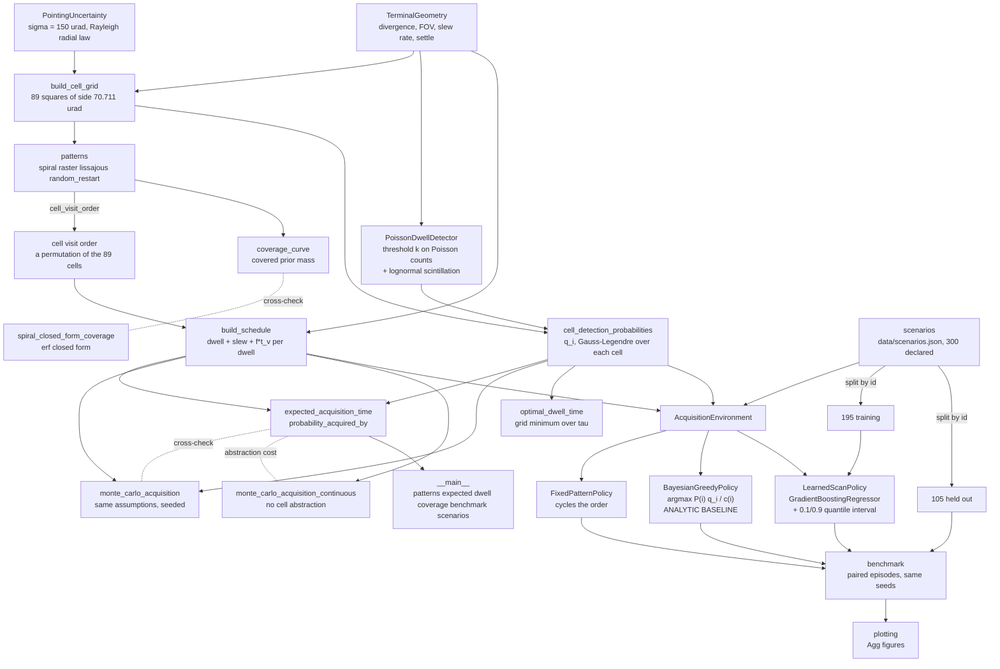
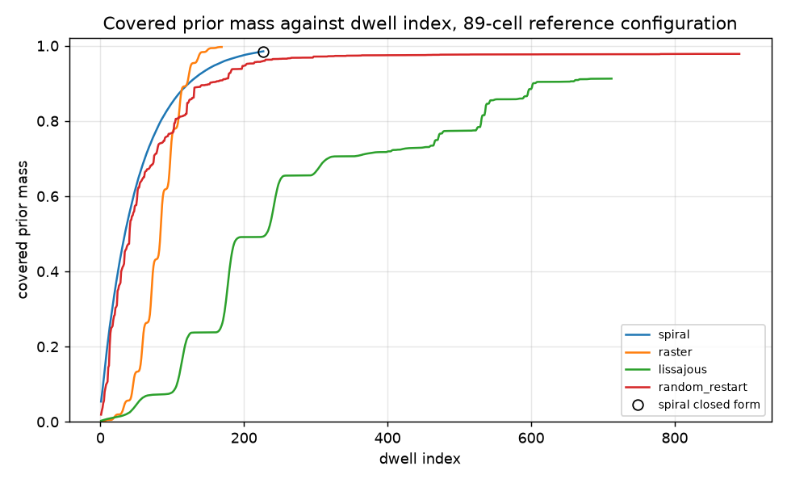
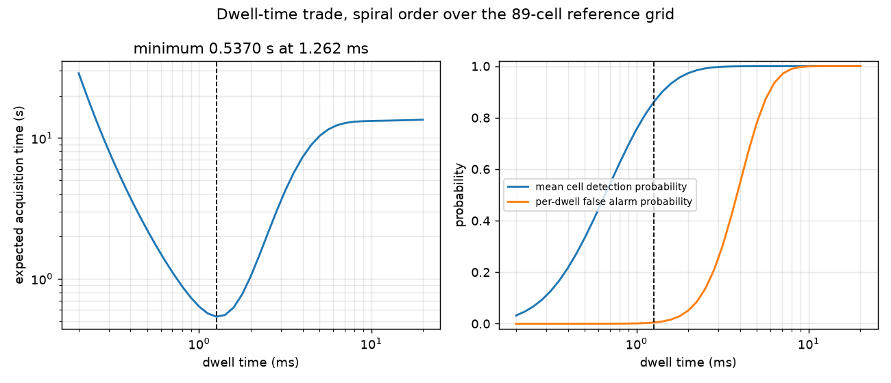
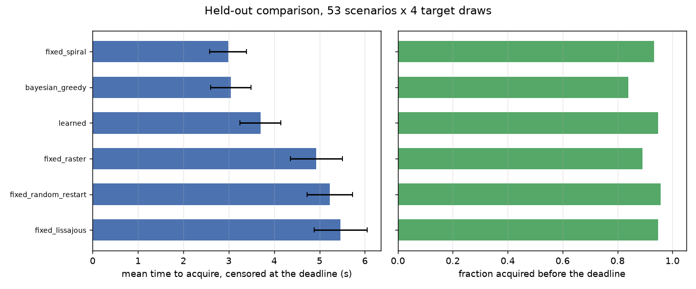

# acqsearch

Spatial acquisition search for an optical terminal: how long acquisition takes, and which scan pattern wins.


## The problem

Your optical terminal knows where the other end should be to within a few
hundred microradians and its beam is a hundred microradians wide, so before
anything can be tracked it has to be found. The scan pattern, the dwell time
and the detection threshold are chosen in a design review from three
plausible-sounding arguments and nobody writes down the expected time to
acquire or the probability of making the contact window. This package writes
those two numbers down, for a declared geometry and a declared detector, and
says which of four scan patterns is actually fastest.

## What this does

- **Coverage against dwell index for four scan patterns** (spiral, raster,
  Lissajous, random restart) as covered prior mass, not covered area. After
  its full pass the spiral has covered 0.985133 of the prior and the Lissajous
  0.912617 (`validation/validate_spiral_coverage_output.txt`).
- **Expected acquisition time, analytically and by Monte Carlo, cross-checked.**
  At the reference configuration the spiral order gives 0.548183 s
  analytically and 0.548423 +/- 0.000567 s over five Monte Carlo seeds of
  200000 trials each, a disagreement of 0.42 standard errors. The worst
  disagreement over the four patterns is 0.75 standard errors
  (`validation/validate_analytic_vs_mc_output.txt`).
- **The optimal dwell time from the detection / false-alarm trade.** Grid
  minimum 0.537002 s at 1.2619 ms. At 0.2 ms the same scan takes 28.886553 s
  because the dwell is too short to detect; at 20 ms it takes 13.487604 s
  because every dwell false-alarms. The spread over the sweep is a factor of
  53.79 (`validation/validate_dwell_optimum_output.txt`).
- **Probability of acquisition within a declared deadline**, analytically and
  by Monte Carlo: 0.944505 against 0.944690 +/- 0.000512 at a deadline of two
  pass periods, and the effect of drawing the false-alarm penalty rather than
  charging its expectation is -0.002235
  (`validation/validate_analytic_vs_mc_output.txt`).
- **An adaptive scan-order benchmark that the learned policy loses**, over 105
  held-out scenarios and 840 paired episodes per policy
  (`validation/validate_policies_output.txt`).

## The result, stated first because it decides whether you want this

**On the held-out scenarios the fixed spiral pattern and the Bayesian-greedy
baseline are statistically indistinguishable from each other, and both beat
the learned policy by a wide and significant margin.**

| policy | mean time to acquire, censored at the deadline (s) | s.e. (s) | median (s) | acquired before deadline |
|---|---|---|---|---|
| **fixed spiral** | **2.1673** | 0.1437 | 0.7936 | 0.9881 |
| **Bayesian-greedy** | **2.1769** | 0.1492 | **0.7467** | 0.9893 |
| learned policy | 2.5128 | 0.1600 | 1.0970 | 0.9810 |
| fixed raster | 3.9036 | 0.2311 | 1.5647 | 0.9821 |
| fixed Lissajous | 4.5186 | 0.2908 | 1.9007 | 0.9702 |
| fixed random restart | 5.1877 | 0.2712 | 2.9111 | 0.8798 |

Paired on identical episodes, which is the comparison that matters because the
scenario-to-scenario spread is larger than every gap in the table:

| comparison | mean paired difference (s) | s.e. (s) | z |
|---|---|---|---|
| learned - Bayesian-greedy | +0.3359 | 0.0446 | +7.53 |
| learned - fixed spiral | +0.3455 | 0.0531 | +6.51 |
| Bayesian-greedy - fixed spiral | +0.0097 | 0.0244 | +0.40 |
| fixed spiral - fixed raster | -1.7363 | 0.1699 | -10.22 |
| fixed spiral - fixed random restart | -3.0204 | 0.2496 | -12.10 |

The learned policy re-ranks the top-k cells of the Bayesian-greedy score. Its
performance degrades monotonically as k grows, which is to say: the more
freedom it is given to disagree with the baseline, the worse it does. At k = 1
it has no freedom at all and reproduces the baseline.

| shortlist k | mean (s) | s.e. (s) | median (s) | acquired |
|---|---|---|---|---|
| 1 (the baseline, by construction) | 1.9532 | 0.2585 | 0.6164 | 0.9938 |
| 4 | 2.0719 | 0.2568 | 0.6622 | 0.9906 |
| 8 | 2.2143 | 0.2747 | 0.8727 | 0.9875 |
| 12 (the shipped setting) | 2.3858 | 0.2943 | 1.0028 | 0.9875 |
| 24 | 2.8390 | 0.2861 | 1.2624 | 0.8906 |
| 89 (the whole grid, unconstrained) | 7.1102 | 0.8039 | 3.4508 | 0.6094 |
| Bayesian-greedy, same subset | 1.9560 | 0.2591 | 0.5967 | 0.9938 |
| fixed spiral, same subset | 1.9036 | 0.2432 | 0.6679 | 0.9906 |

This table is on the first 40 held-out scenarios rather than all 105, because
the full ablation does not fit the compute budget; both the 40-scenario and
the 105-scenario numbers are in `validation/validate_policies_output.txt` and
neither is substituted for the other.

**The baseline wins. That result is not softened anywhere in this repository.**
It appears in `README.md`, `MODEL_CARD.md` and `validation/VALIDATION.md` in
the same terms and it is pinned as an assertion in `tests/test_benchmark.py`,
so a change that reverses it has to say so out loud.

## Who it is for

- Anyone choosing a scan pattern for an optical acquisition sequence who wants
  the expected time rather than an argument about shapes.
- Anyone sizing a dwell time against a count threshold and a background rate,
  who needs to see the false-alarm side of the trade on the same axes.
- Anyone who has been told an adaptive or learned scan policy will speed up
  acquisition and wants the measurement before the integration.

## Who it is not for

- Anyone who needs closed-loop tracking after acquisition. This package stops
  at the first detection. For tracking, use a Kalman-filter library such as
  [`filterpy`](https://pypi.org/project/filterpy/) (1.4.5).
- Anyone who needs the link budget that produces the photon rates. The signal
  and background rates are inputs here and they are the hardest numbers in the
  problem.
- Anyone who needs a validated model of their own terminal. Every number in
  this repository comes from declared parameters and synthetic scenarios; no
  hardware was measured and none of these ranges were taken from a datasheet.
- Anyone who needs mechanism dynamics. The slew model is a constant rate plus
  a fixed settle time, which is not what a fine-steering mirror does.

## Alternatives, honestly

**There is no direct open-source equivalent of this package.** That is a
statement about what exists, not a claim of superiority: the pieces below are
each mature and each does something this package does not, and what is missing
from all of them is the acquisition-time accounting, which is the whole of the
contribution here. If an equivalent exists and this table misses it, the table
is wrong and should be corrected.

| alternative | what it does better | when to use this instead |
|---|---|---|
| [`numpy`](https://pypi.org/project/numpy/) (2.5.4) | The geometry. Generating a spiral or a raster over a plane and testing disc membership is ten lines of `numpy` and will be faster than anything here. | When you want the prior-weighted coverage, the expected acquisition time under a stated detection model, and a closed form to check the Monte Carlo against. `numpy` gives you the points; it has no opinion about how long acquisition takes. |
| [`poliastro`](https://pypi.org/project/poliastro/) (0.17.0), and its successor [`hapsira`](https://pypi.org/project/hapsira/) (0.18.0) | Orbital mechanics, from which the line-of-sight geometry and therefore the open-loop pointing estimate are derived. Far better at that than anything here, which simply takes the pointing uncertainty as a declared input. | When you already have the pointing uncertainty and the question is what to do about it. These libraries produce the sigma; this one spends it. |
| [`scikit-learn`](https://pypi.org/project/scikit-learn/) (1.9.1) | The gradient-boosted regression. It is the learned policy's engine and this package adds nothing to it. | When the question is which policy to run, not how to fit a regressor. The contribution is the paired held-out protocol and the baseline it is measured against. |
| [`astropy`](https://pypi.org/project/astropy/) (8.0.2) | Angular units, frames and coordinate conversions, done properly. This package uses bare radians and a tangent-plane approximation. | When the angles are small and local and the question is about search time rather than about frames. |
| A spreadsheet | Nothing is faster for a single configuration, and that is how most of these numbers are produced today. | When you need the Monte Carlo cross-check, the deadline probability, the dwell optimum and the pattern comparison to stay consistent with each other as the inputs change. |

## Install and first run

```bash
git clone https://github.com/OmAcharya-avtr/acqsearch.git
cd acqsearch
python -m venv .venv && source .venv/bin/activate
pip install -e ".[test]"
python -m pytest tests/ -q
python examples/coverage_curves.py
```

The test run prints:

```
242 passed in 16.97s
```

The count is the invariant; the wall clock varies with the machine and with
the run (15.75 s to 17.47 s across the runs of this build session). The count
is taken from the junit XML and cross-checked against a count of `testcase`
elements, because a configuration that collects nothing also prints success:
see `validation/validate_suite_output.txt`.

`python examples/coverage_curves.py` prints:

```
spiral           dwells  227  final covered mass 0.985133
raster           dwells  169  final covered mass 0.996717
lissajous        dwells  712  final covered mass 0.912617
random_restart   dwells  890  final covered mass 0.978300
spiral closed form after 6 turns (227 dwells): 0.985193, applies: True
wrote screenshots/coverage_curves.png
```

## A worked example

```python
from acqsearch import (
    PointingUncertainty, PoissonDwellDetector, TerminalGeometry,
    build_cell_grid, build_schedule, cell_detection_probabilities,
    cell_visit_order, expected_acquisition_time, probability_acquired_by,
    standard_paths,
)

uncertainty = PointingUncertainty(sigma_rad=150e-6)
geometry = TerminalGeometry(beam_divergence_rad=100e-6, detector_fov_rad=200e-6,
                            slew_rate_rad_s=10e-3, settle_time_s=2e-3)
detector = PoissonDwellDetector(signal_rate_hz=2.0e4, background_rate_hz=2.0e3,
                                threshold_counts=8, rytov_variance=0.2)

grid = build_cell_grid(uncertainty, geometry, extent_sigma=2.5)
dwell_s = 1.4e-3
q = cell_detection_probabilities(grid, geometry, detector, dwell_s, uncertainty)
f = detector.false_alarm_probability(dwell_s)

for name, path in standard_paths(grid).items():
    order = cell_visit_order(path, grid)
    schedule = build_schedule(grid, order, geometry, dwell_s, f, 0.5)
    estimate = expected_acquisition_time(grid, schedule, q)
    by_deadline = probability_acquired_by(grid, schedule, q, 2.0)
    print(f"{name:<16} period {schedule.period_s:7.4f} s   "
          f"E[T] {estimate.expected_time_s:7.4f} s   P(acquire by 2 s) {by_deadline:.4f}")
```

Output of exactly that snippet, run from the product root:

```
spiral           period  1.4165 s   E[T]  0.5482 s   P(acquire by 2 s) 0.9234
raster           period  1.4204 s   E[T]  0.9293 s   P(acquire by 2 s) 0.8790
lissajous        period  1.6815 s   E[T]  1.0847 s   P(acquire by 2 s) 0.8637
random_restart   period  3.8804 s   E[T]  2.4094 s   P(acquire by 2 s) 0.4323
```

The spiral and the raster take almost the same time to complete one pass
(1.4165 s against 1.4204 s) and differ by a factor of 1.69 in expected
acquisition time. The difference is entirely the order: the spiral spends its
first dwells where the prior mass is. The fuller version of this example,
including the Monte Carlo cross-check, is `validation/worked_example.py` and
its output is `validation/worked_example_output.txt`.

## Command line

```bash
python -m acqsearch patterns
python -m acqsearch expected --pattern spiral --trials 40000
python -m acqsearch dwell --points 25 --dwell-min-ms 0.2 --dwell-max-ms 8.0
python -m acqsearch coverage --turns 6 --samples 100000
python -m acqsearch benchmark --scenarios 120 --targets 4
python -m acqsearch scenarios --scenarios 300 --output data/scenarios.json
```

`python -m acqsearch patterns` prints:

```
cells 89  prior mass in grid 0.954498
mean cell detection probability 0.897684  per-dwell false alarm probability 8.130742e-03
pattern             period_s      E[T]_s    slew_rad    P(by 3T)
spiral              1.416526    0.548183    0.007521    0.953455
raster              1.420374    0.929262    0.007560    0.953475
lissajous           1.681476    1.084705    0.010171    0.953475
random_restart      3.880439    2.409379    0.032160    0.953475
```

## Architecture



## Screenshots



Covered prior mass against dwell index. Notice that the spiral is above every
other pattern for the whole of the first hundred dwells and that the raster,
which ends highest, starts in a corner and is worth nothing for its first
forty. The open circle is the geometric closed form at six turns, 0.985193,
against the Monte Carlo 0.985133.



Left: expected acquisition time against dwell time, both axes logarithmic, with
the grid minimum at 1.2619 ms marked. Notice that the curve is steeper on the
short-dwell side than on the long-dwell side, so erring long costs less than
erring short. Right: the two probabilities that produce it. The detection
probability saturates near 2 ms and the false-alarm probability is still
climbing, which is what turns the curve back up.



Mean censored acquisition time with standard-error bars, and the fraction
acquired before the deadline. Notice that the learned policy is third, behind
both references, and that the random-restart pattern loses on the right-hand
panel as well as the left: it is not merely slow, it fails to acquire at all in
12 percent of episodes. This figure is produced by
`examples/policy_benchmark.py`, which runs a reduced 150-scenario version of
the benchmark; the numbers quoted in the tables above are the full 300-scenario
run in `validation/`.

## Validation evidence

Full detail in `validation/VALIDATION.md`. Every number below was produced by a
script in `validation/` in the build session, and the checks the baseline won
are included because they are the credible ones.

| check | reference | result | tolerance |
|---|---|---|---|
| Poisson tail against closed forms, 5 cases | Abramowitz & Stegun 1964 eq. 26.4 | 5 of 5 exact to 0.00e+00 | 1e-15 |
| Gaussian beam shape factor, 5 offsets | Siegman 1986 Ch. 17 | 5 of 5 exact to 0.00e+00 | 1e-14 |
| Lognormal irradiance quadrature, E[I] = 1 | Andrews & Phillips 2005 Ch. 9 | error <= 2.22e-16 at every Rytov variance tested | 1e-6 |
| P_d quadrature convergence, 24 vs 96 nodes | internal | 1.316e-09 | - |
| Spiral coverage, closed form vs Monte Carlo, 16 cases | geometric closed form derived in `coverage.py` | worst residual +0.003884 at 3.53 s.e.; 0 of 16 outside tolerance | 3 s.e. + 2e-3 |
| Analytic E[T] vs Monte Carlo, 4 patterns, 5 seeds, 200000 trials each | internal cross-check | worst 0.75 s.e. (random restart, +0.001102 s) | 4 s.e. |
| Analytic P(acquired by deadline) vs Monte Carlo | internal cross-check | 0.944505 vs 0.944690, 0.36 s.e. | 4 s.e. |
| Cost of the cell abstraction | continuous-geometry Monte Carlo, 38125 in-grid trials | the cell model is **pessimistic by 37.74 percent** (0.548183 s vs 0.341280 s) | reported, not bounded |
| Effect of drawing the false-alarm penalty instead of charging its expectation | internal | P(by deadline) -0.002235 | reported |
| Dwell optimum | internal sweep, 41 points | 0.537002 s at 1.2619 ms, 53.79x worst/best over the sweep | grid optimum |
| **Learned policy vs Bayesian-greedy, 840 paired episodes** | held-out scenarios | **learned loses by +0.3359 s, z = +7.53** | - |
| **Learned policy vs fixed spiral, 840 paired episodes** | held-out scenarios | **learned loses by +0.3455 s, z = +6.51** | - |
| Bayesian-greedy vs fixed spiral | held-out scenarios | +0.0097 s, z = +0.40: no detectable difference | - |
| Learned policy interval calibration | 2006 held-out decisions | **0.7353 empirical coverage against 0.8000 nominal: under-covered** | - |
| Suite counted from junit XML | `testsuite` attribute vs `testcase` elements | 242 = 242, 0 failures, 0 errors, 0 skipped | exact |
| Dependency ranges, both ends executed | 6 packages, 12 installs | suite identical; numeric fingerprint byte-identical | exact |
| scikit-learn 1.8.0, below the declared floor | executed deliberately | suite passes, **fingerprint moves by up to 17.7 percent**; this is why the floor is 1.9.0 | - |

## API reference

<details>
<summary>Public surface</summary>

| callable | returns | units |
|---|---|---|
| `PointingUncertainty(sigma_rad)` | isotropic 2-D Gaussian prior | rad |
| `PointingUncertainty.radial_cdf(r)` | Rayleigh CDF | dimensionless |
| `PointingUncertainty.rectangle_mass(x0, x1, y0, y1)` | exact rectangle probability | dimensionless |
| `PointingUncertainty.sample(n, rng)` | `(n, 2)` draws | rad |
| `TerminalGeometry(beam_divergence_rad, detector_fov_rad, slew_rate_rad_s, settle_time_s)` | declared geometry | rad, rad/s, s |
| `TerminalGeometry.beam_half_angle_rad` | 1/e^2 half-width | rad |
| `TerminalGeometry.footprint_radius_rad` | `min(beam half, FOV half)` | rad |
| `TerminalGeometry.slew_time_s(distance)` | repoint time | s |
| `build_cell_grid(uncertainty, geometry, extent_sigma=2.5)` | `CellGrid` | - |
| `CellGrid.n_cells` / `.radii_rad` / `.prior_mass` / `.mass_outside` | partition properties | -, rad, dimensionless |
| `CellGrid.nearest_cell(points)` | cell index per point | - |
| `spiral_path(pitch_rad, turns, along_track_spacing_rad)` | `ScanPath` | rad |
| `raster_path(extent_rad, spacing_rad)` | `ScanPath` | rad |
| `lissajous_path(extent_rad, n_points, freq_x, freq_y, phase_rad)` | `ScanPath` | rad |
| `random_restart_path(extent_rad, n_points, seed)` | `ScanPath` | rad |
| `standard_paths(grid, seed=20261016)` | the four comparison paths | - |
| `cell_visit_order(path, grid)` | permutation of cell indices | - |
| `tail_fraction(path, grid)` | cells reached only by the nearest-neighbour tail | dimensionless |
| `poisson_upper_tail(threshold, mean_counts)` | `P(N >= k)` | dimensionless |
| `PoissonDwellDetector(signal_rate_hz, background_rate_hz, threshold_counts, rytov_variance)` | dwell detector | 1/s, counts |
| `PoissonDwellDetector.false_alarm_probability(dwell_s)` | `P_fa` | dimensionless |
| `PoissonDwellDetector.detection_probability(dwell_s, offset_rad, beam_half_angle_rad)` | `P_d` | dimensionless |
| `PoissonDwellDetector.detection_probability_table(...)` | `(offsets, probabilities)` | rad, dimensionless |
| `PoissonDwellDetector.irradiance_nodes()` | Gauss-Hermite nodes and weights | dimensionless |
| `coverage_curve(path, uncertainty, footprint_radius_rad, n_samples, seed)` | `CoverageCurve` | dimensionless |
| `spiral_closed_form_coverage(pitch_rad, turns, footprint_radius_rad, uncertainty)` | covered prior mass | dimensionless |
| `spiral_closed_form_valid(pitch, spacing, footprint_radius)` | whether the closed form is an equality | - |
| `disc_coverage(radius_rad, uncertainty)` | covered mass of one disc | dimensionless |
| `cell_detection_probabilities(grid, geometry, detector, dwell_s, uncertainty, nodes=8)` | `q_i` per cell | dimensionless |
| `build_schedule(grid, order, geometry, dwell_s, f, t_v, start_rad=None)` | `DwellSchedule` | s |
| `DwellSchedule.period_s` / `.cumulative_time_s` / `.total_slew_rad(grid)` | pass timing | s, s, rad |
| `expected_acquisition_time(grid, schedule, q)` | `AcquisitionEstimate` | s |
| `probability_acquired_by(grid, schedule, q, deadline_s)` | unconditional probability | dimensionless |
| `monte_carlo_acquisition(grid, schedule, q, ...)` | `MonteCarloResult` | s |
| `monte_carlo_acquisition_continuous(...)` | `MonteCarloResult` without the cell abstraction | s |
| `optimal_dwell_time(grid, order, geometry, detector, uncertainty, dwell_grid_s, t_v)` | `DwellOptimum` | s |
| `AcquisitionEnvironment.build(grid, geometry, detector, uncertainty, dwell_s, t_v, deadline_s)` | environment | s |
| `initial_posterior(grid)` / `update_posterior(posterior, cell, q)` | cell posterior | dimensionless |
| `greedy_scores(environment, posterior, current_rad)` | `P(i) q_i / c(i)` | 1/s |
| `shortlist_indices(environment, posterior, current_rad, size)` | top-k cells, best first | - |
| `build_features(environment, posterior, current_rad, visits, dwells, elapsed)` | `(n_cells, 14)` matrix | mixed, see MODEL_CARD |
| `FixedPatternPolicy(order)` / `BayesianGreedyPolicy(epsilon=0.0)` | policies | - |
| `LearnedScanPolicy(n_estimators, max_depth, learning_rate, random_state, shortlist)` | learned policy | - |
| `LearnedScanPolicy.fit(features, remaining_time_s)` | `self` | s |
| `LearnedScanPolicy.predict_with_uncertainty(features)` | `(point, q10, q90)` | periods |
| `LearnedScanPolicy.decide(...)` | `PolicyDecision` with interval and confidence | s |
| `run_episode(environment, policy, target_cell, rng, max_dwells=None, record=None)` | `EpisodeResult` | s |
| `sample_target_cells(grid, n, rng)` | target cells from the prior | - |
| `collect_training_rows(environment, behaviour, targets, rng)` | `(features, remaining / period)` | dimensionless |
| `generate_scenarios(n, seed)` / `load_scenarios` / `save_scenarios` / `split_scenarios` | scenario handling | - |
| `build_environment(scenario, extent_sigma=2.5, deadline_periods=3.0)` | `(environment, orders)` | - |
| `build_training_set(scenarios, ...)` | `(features, target)` | dimensionless |
| `evaluate_policies(scenarios, learned, ...)` | `{policy: [EpisodeResult]}` | s |
| `summarise(results)` / `score_policy(name, results)` | `{name: PolicyScore}` | s |
| `paired_difference(a, results_a, b, results_b)` | `PairedDifference` | s |
| `winner(scores)` | name of the fastest policy | - |
| `mean_censored_time` / `median_time` / `acquisition_rate` | episode statistics | s, s, dimensionless |

</details>

## Limitations

1. **The cell abstraction is pessimistic by 37.74 percent at the reference
   configuration.** The analytic model partitions the search region into
   squares and allows a dwell to acquire only a target in its own cell. The
   continuous-geometry Monte Carlo, which lets a dwell acquire a target
   anywhere in its beam, gives 0.341280 s against the analytic 0.548183 s on
   the same scan. The bias has a known sign, so the analytic number is an
   upper bound rather than an estimate, but it is a large bias and the size
   depends on the dwell time. Use `monte_carlo_acquisition_continuous` when
   the number has to be close rather than conservative.
2. **The learned policy loses, and under-reports its own uncertainty.** Its
   (0.1, 0.9) interval covers the realised remaining time 0.7353 of the time
   against a nominal 0.8000, measured over 2006 held-out decisions. Neither
   the point prediction nor the interval is calibrated and neither should be
   thresholded.
3. **The regression target is censored and the censoring is not modelled.** An
   episode that does not acquire before the deadline contributes
   `deadline - t` as its remaining time, which under-states the truth. The
   alternative, discarding those episodes, biases the fit the other way. No
   survival-analysis treatment is implemented.
4. **No hardware was measured.** Every parameter range in
   `data/scenarios.json` is declared, not taken from a datasheet, and the
   independent uniform sampling of those ranges produces terminals that could
   not be built. See DATASET_CARD.md.
5. **The slew model is a constant rate plus a fixed settle time.** A real
   fine-steering mirror has an acceleration limit, a settling transient that
   depends on step size, and hysteresis. None of that is here, and the
   pattern comparison is sensitive to slew cost: the random-restart pattern
   loses mostly on slew.
6. **The pointing prior is isotropic, zero-mean and stationary.** A real
   open-loop pointing error is usually anisotropic (cross-elevation and
   elevation differ), often biased, and drifts during the search. None of
   those is modelled and all three would change the answer.
7. **Scintillation is averaged per dwell and assumed independent between
   dwells.** That is right only if the dwell separation exceeds the
   atmospheric coherence time, which for a millisecond-scale scan it usually
   does not. Correlated fading would make a repeated dwell on the same cell
   less informative than this model says, which flatters every adaptive
   policy including the baseline.
8. **The lognormal irradiance model is cited for Rytov variance up to about 1
   and the library does not enforce it.** `rytov_variance` above 1 is accepted
   and returns a number that is outside the validity range of Andrews &
   Phillips 2005 Ch. 9.
9. **The spiral coverage closed form loses significance at a vanishing pitch.**
   At `pitch / sigma = 1.28e-10` it returns a value 5.40e-7 below the
   geometric bound it can never be below. The counterexample was found by
   Hypothesis and is pinned in `tests/test_regressions.py`. Any realistic
   pitch is unaffected.
10. **The dependency ceilings are a real cost, not free safety.** The
    scikit-learn floor is 1.9.0 because 1.8.0 was executed and moves the
    learned-policy numbers by up to 17.7 percent on a single scenario while
    the suite still passes; that is the failure mode no test catches. The
    consequence is that this package cannot take a scikit-learn 1.10 release
    without re-running the benchmark and republishing every learned-policy
    number. The tension is recorded rather than resolved by removing the
    ceiling.
11. **The Lissajous curve does not enter every cell.** 4.49 percent of the 89
    cells are reached only by the nearest-neighbour tail that completes the
    order, so that pattern's result is partly a property of the tail.
    `tail_fraction` reports it.
12. **Everything is single-terminal and non-cooperative.** A real acquisition
    sequence has two terminals scanning, often in a beacon / scan-and-stare
    asymmetry, and the joint problem is not this one.

## Reproducing every number

From the product root, in a virtual environment created as in "Install and
first run":

```bash
python -m pytest tests/ -q --junitxml=junit.xml
python validation/validate_suite.py          > validation/validate_suite_output.txt
python validation/validate_environment.py    > validation/validate_environment_output.txt
python validation/validate_detection_model.py > validation/validate_detection_model_output.txt
python validation/validate_spiral_coverage.py > validation/validate_spiral_coverage_output.txt
python validation/validate_analytic_vs_mc.py > validation/validate_analytic_vs_mc_output.txt
python validation/validate_dwell_optimum.py  > validation/validate_dwell_optimum_output.txt
python validation/validate_policies.py       > validation/validate_policies_output.txt
python validation/worked_example.py          > validation/worked_example_output.txt
python validation/dependency_range_check.py  > validation/dependency_range_check_output.txt
python data/regenerate_data.py
python examples/coverage_curves.py
python examples/dwell_tradeoff.py
python examples/policy_benchmark.py
ruff check src/ tests/
```

`validation/validate_policies.py` is the long one: 103.3 s on two cores. Every
other script is under 40 s. Nothing in this repository is trained once and
stored: the learned policy is refitted from `data/scenarios.json` and the
committed seeds every time, so there is no serialised artifact and no
serialisation-format dependency.

## Safety

This software is research-grade. It is not flight-qualified, it is not
certified, and it is not approved for operational aerospace use. The models in
it are simplified in ways that are listed under Limitations, and the numbers it
produces come from declared parameters and synthetic scenarios rather than from
any measured terminal.

## Licence

Apache-2.0. Copyright (c) 2026 OPTIMA Organisation. See `LICENSE`.

## Citation

See `CITATION.cff`.

## Credits

Built by Om Acharya for the OPTIMA Organisation aerospace software portfolio.
This is under reserved rights obtained by OPTIMA Organisation.
