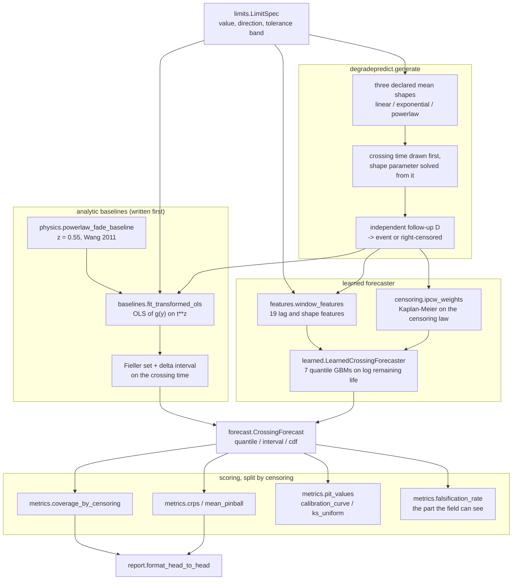
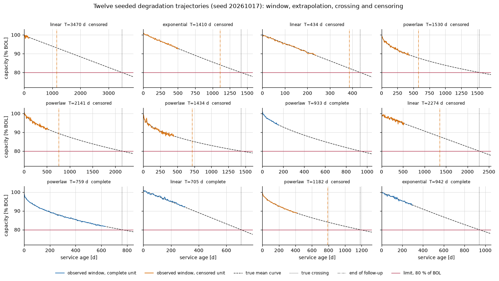
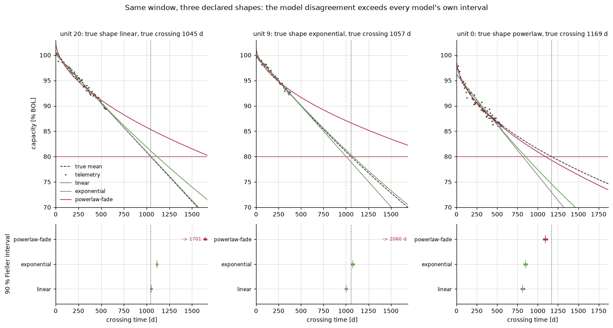
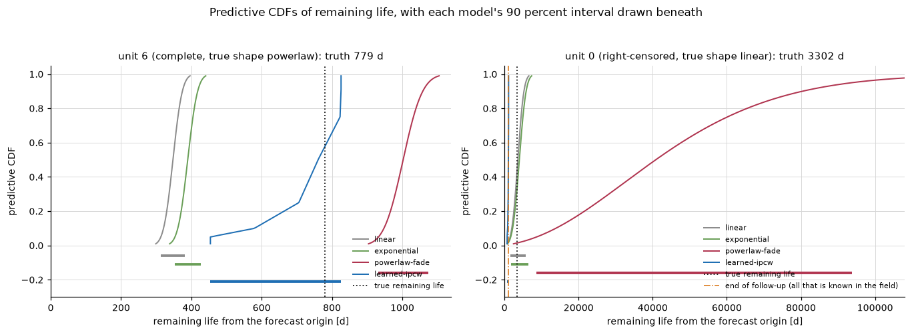
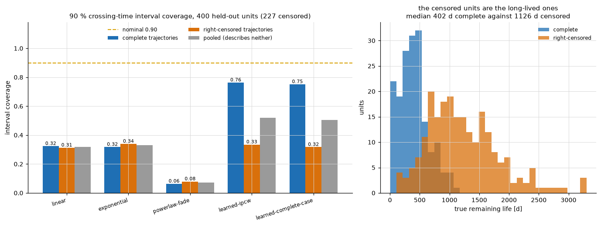
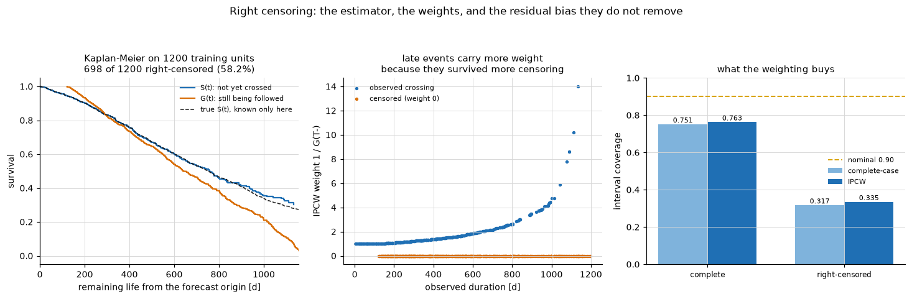
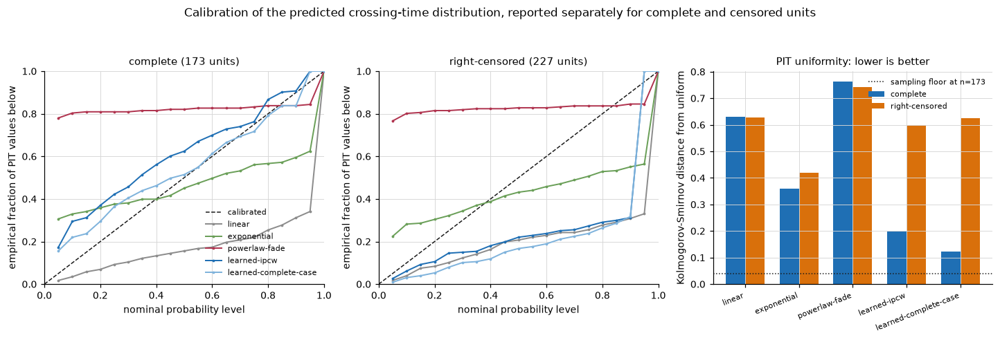
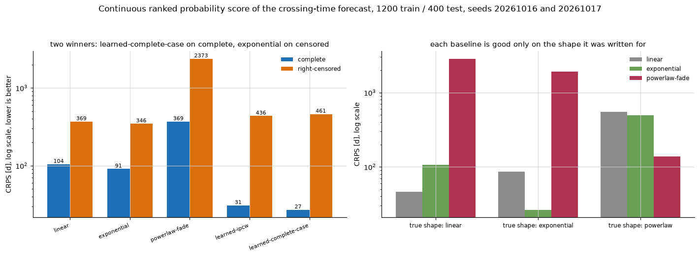

# DegradePredict

Forecasts when a degrading subsystem crosses its limit, and measures whether the interval is calibrated.


**Status: TESTING** · Class: compact · Validation level 2 (research grade) ·
Learned component present and benchmarked against three analytic baselines ·
Apache-2.0 · © 2026 OPTIMA Organisation

This software is research-grade. It is **not flight-qualified, not certified,
and not approved for operational aerospace use.**

> **Every number in this repository is a statement about the declared synthetic
> generator in `degradepredict.generate`, not about any spacecraft.** No
> constant here was identified from any vehicle, battery or mission, and the
> headline result is that none of the five forecasters — including the learned
> one — produces a calibrated interval on the units that have not crossed yet.

## The problem

A housekeeping channel is drifting toward a limit and somebody asks when it
will get there. The portfolio already has P058 TelemDrift, which says something
changed, and P035 TelemetryOOL, which says it is out of limits now; neither
forecasts the crossing. And the moment you try to check whether your forecast
interval is any good, you hit the thing that makes this problem different from
ordinary regression: **most of your units have not crossed yet**, so the only
ones you can score are the fast ones, and scoring those is survivorship bias.

## What this does

- **Forecasts a distribution over the crossing time**, not a date. Three
  analytic baselines carry a normal law on the transformed crossing time plus
  the exact Fieller confidence set; the learned forecaster carries seven fitted
  quantiles. On correctly specified data the Fieller interval attains between
  **0.8835 and 0.9405** coverage over eight configurations against a nominal
  0.90, while the delta-method interval drops to **0.8565** in the one
  configuration where the exact set is unbounded 26 % of the time
  (`validation/validate_baselines_output.txt`).
- **Reports coverage and score separately for complete and right-censored
  trajectories, always.** For the learned forecaster that is **0.7630** on the
  173 complete test units and **0.3348** on the 227 censored ones, against a
  nominal 0.90. The pooled figure is **0.5200** and describes neither
  (`validation/validate_headtohead_output.txt`).
- **Handles right censoring rather than dropping it.** Inverse probability of
  censoring weighting moves censored CRPS from **461.05 d to 435.56 d** and
  censored coverage from **0.3172 to 0.3348**, at a cost of **3.74 d** of CRPS
  on the complete units. It does not close the gap, and the README says so.
- **Benchmarks the learned model against all three baselines and reports the
  comparison it loses.** CRPS on complete trajectories: learned **30.80 d**
  against **90.74 d** for the best baseline. CRPS on right-censored
  trajectories: **exponential baseline 346.37 d against the learned model's
  435.56 d**, on all three independent seed pairs measured.
- **Quantifies what a declared physical form costs when it is slightly wrong.**
  Holding the cited power-law fade exponent at 0.55 when the truth is 0.45
  biases the crossing estimate by **-180.93 d** on a 1200 d crossing while the
  reported interval is **62 d** wide, for a measured coverage of **0.0000**
  (`validation/validate_physics_output.txt`).

## Who it is for

- Anyone who has to put a date and an interval on a limit crossing and defend
  the interval at a review.
- Anyone about to score a remaining-life model on the units that already
  failed, who would like to see what that does before they publish the number.
- Anyone who wants a small, readable implementation of inverse regression with
  a correct Fieller set, including the unbounded case most implementations
  quietly skip.
- Anyone who wants a worked demonstration that a pooled metric over a censored
  population can be an average of two different answers.

## Who it is not for

- Anyone who needs survival analysis. **`lifelines` is the better survival
  library and it is not close.** See the alternatives table.
- Anyone who needs a battery model. There is no temperature, no depth of
  discharge, no cycle count, no state of charge and no electrochemistry. The
  power-law fade form is cited, and it is cited against charge throughput while
  being used here against calendar time.
- Anyone who needs a calibrated forecaster. **No model in this repository is
  calibrated on this population.** The best Kolmogorov-Smirnov distance of the
  probability integral transform from uniform is 0.1970 on complete
  trajectories, against a sampling floor of 0.0398.
- Anyone with real telemetry who wants these numbers to transfer. The generator
  has independent Gaussian noise, a fixed cadence, no gaps, no outliers and
  censoring that is independent of the degradation state by construction.
- Anyone who needs an upward-degrading metric end to end. The `direction`
  parameter exists and is unit tested; the generator and the benchmark only
  exercise the downward case.

## Alternatives, honestly

Every package below was checked on PyPI on 2026-10-16 and the version shown is
the one PyPI reported. `lifelines` and `scikit-survival` are **not installed in
this build container** and are not dependencies of this package; they are named
because they are the right tools for most of what this problem looks like.

| Alternative | What it does better | When to use this instead |
|---|---|---|
| **`lifelines` 0.30.3** (MIT) | **The better survival library, and that is not close.** Kaplan-Meier, Nelson-Aalen, Cox proportional hazards with time-varying covariates, Aalen additive models, parametric accelerated failure time models, competing risks, proper standard errors, concordance, and a decade of use. Everything this package does with censoring, `lifelines` does better and more generally. | Only if your question is specifically *when does this metric cross this threshold* and you want the interval around that date measured separately on complete and censored units. `lifelines` models time to an event you observed; it has no concept of a declared limit on a continuous metric, no degradation shape to extrapolate, and no limit-crossing formulation. |
| **`scikit-survival` 0.28.0** | Random survival forests, gradient-boosted Cox models, survival SVMs, and IPCW-based concordance and Brier scores, all with a scikit-learn API. The learned component here is a hand-rolled, weaker version of what this library already provides properly. | If you want the accounting rather than the estimator. This package deliberately keeps its dependency set to numpy, scipy and scikit-learn. |
| **`statsmodels` 0.15.0** | A real regression library: weighted and robust least squares, proper inference, `wls_prediction_std`, diagnostics, and a mature survival module. The OLS fits here are three lines of numpy each. | If you want the inverse-regression step. `statsmodels` gives you the forward prediction interval; it does not invert the fit for the time at which the mean reaches a declared level, and it does not compute Fieller's set for that. |
| **`prophet` 1.5.0** (MIT) | Time-series forecasting with trend changepoints, seasonality and holiday effects, and well-engineered uncertainty intervals from a Bayesian fit. If your degradation has seasonality or regime changes, it will model them and nothing here will. | If the question is the crossing time rather than the series. `prophet` forecasts the series and leaves you to work out when it crosses your threshold and what the interval around that crossing is; it also has no censoring concept at all. |

**What this does that none of them does:** it states the limit-crossing problem
as an inverse regression with an exact Fieller set, and it measures
prediction-interval coverage **separately on complete and on right-censored
trajectories** against known ground truth, which is only possible because the
trajectories are generated. The estimator is not the contribution and is
deliberately the weakest part. `lifelines` should do the survival modelling.

## Install and first run

```bash
git clone https://github.com/OmAcharya-avtr/degradepredict.git
cd degradepredict
python -m venv .venv && source .venv/bin/activate
pip install -e ".[dev]"
python -m pytest tests/ -q
python examples/trajectory_gallery.py
```

Expected output:

```
........................................................................ [ 77%]
..........................................                               [100%]
186 passed in 17.75s
```

```
wrote /.../degradepredict/screenshots/trajectory_gallery.png
```

The test count and the figure path are fixed; the wall clock is whatever your
machine does.

A one-trajectory sanity check from the CLI:

```bash
python -m degradepredict fit --index 0 --seed 20261017
```

```
trajectory 0: generated family linear, true crossing 3469.55 d, origin 168.00 d, remaining 3301.55 d, right-censored
limit: 80.0 percent of BOL capacity (below)

model              : linear  (metric link identity, time link t**1)
samples            : 25
slope              : -0.00516797 percent of BOL capacity per day**1
residual sd        : 0.455869 percent of BOL capacity
crossing estimate  : 3765.29 d
Fieller 90% interval : [2386.03, 9264.55] d  bounded
delta  90% interval : [1559.98, 5970.60] d
Fieller g          : 0.358804
```

Note the Fieller interval is more than twice the width of the delta-method one
here, because `g = 0.36` is large enough for the two to separate.

## A worked example

This is `validation/worked_example.py` verbatim, between its two markers,
so the code here and the output beneath it cannot drift apart.

```python
import numpy as np

from degradepredict import (
    DEFAULT_LIMIT,
    LearnedCrossingForecaster,
    coverage_by_censoring,
    exponential_baseline,
    generate_population,
    linear_baseline,
    powerlaw_fade_baseline,
)

train = generate_population(1200, seed=20261016)
test = generate_population(400, seed=20261017)
unit = test[0]

lines = [
    f"unit {unit.traj_id}: {len(unit.times_days)} samples to day "
    f"{unit.origin_days:.0f}, true crossing {unit.crossing_time_days:.0f} d "
    f"({'complete' if unit.event else 'right-censored'})",
    f"{'model':<22}{'median d':>10}{'90% interval d':>22}",
]
for fitter in (linear_baseline, exponential_baseline, powerlaw_fade_baseline):
    fit = fitter(unit.times_days, unit.values_percent, DEFAULT_LIMIT)
    lo, hi = fit.forecast.interval(0.90)
    lines.append(f"{fit.model:<22}{fit.forecast.median():>10.1f}"
                 f"{f'[{lo:.1f}, {hi:.1f}]':>22}")

model = LearnedCrossingForecaster(limit=DEFAULT_LIMIT).fit(train)
lo, hi = model.predict(unit).interval(0.90)
lines.append(f"{'learned-ipcw':<22}{model.predict(unit).median():>10.1f}"
             f"{f'[{lo:.1f}, {hi:.1f}]':>22}")
lines.append(f"{'truth':<22}{unit.remaining_true_days:>10.1f}{'':>22}")

truth = np.array([tr.remaining_true_days for tr in test])
event = np.array([tr.event for tr in test])
cov = coverage_by_censoring(model.predict_many(test), truth, event, level=0.90)
lines.append("")
lines.append(f"90% interval coverage over {int(cov['n'])} held-out units:")
lines.append(f"  complete ({int(cov['n_complete'])})  : {cov['coverage_complete']:.4f}")
lines.append(f"  censored ({int(cov['n_censored'])})  : {cov['coverage_censored']:.4f}")
lines.append(f"  pooled                : {cov['coverage_pooled']:.4f}  "
             f"<- matches neither")
print("\n".join(lines))
```

Running it with `python validation/worked_example.py` prints:

```
unit 0: 25 samples to day 168, true crossing 3470 d (right-censored)
model                   median d        90% interval d
linear                    3601.5      [1510.9, 5715.4]
exponential               4008.4      [1684.3, 6358.2]
powerlaw-fade            40798.6     [8682.6, 93723.4]
learned-ipcw              1057.4       [706.0, 1102.3]
truth                     3301.5                      

90% interval coverage over 400 held-out units:
  complete (173)  : 0.7630
  censored (227)  : 0.3348
  pooled                : 0.5200  <- matches neither
```

This single unit is the whole product in one block. It is right-censored and
long-lived. The linear baseline overshoots the truth by 300 d with an interval
that contains it. The learned forecaster, which was trained on units whose
crossing was observed and therefore on the fast ones, predicts **1057 d
against a truth of 3302 d**, and its 90 % interval of [706, 1102] misses by a
factor of three while looking the most confident of the four.

## Architecture



## Screenshots

All seven figures are produced by the scripts in `examples/`.



Twelve seeded units. Notice how short the solid observed window is against the
dashed extrapolation to the crossing, and how many units reach the end of
follow-up (dash-dot) before the crossing (dotted).



One unit per true shape family, the same window fitted by all three baselines.
Inside the window the three fits are indistinguishable; the lower panels show
their 90 % Fieller intervals not overlapping. The model disagreement is larger
than any one model's stated uncertainty.



Predictive CDFs for one complete and one censored unit. On the right-hand panel
every curve has reached 1 well to the left of the dotted truth line: all four
models have placed essentially no probability on what actually happened.



The headline. The grey pooled bar sits between the blue and orange bars and
describes neither. The right panel shows why: the censored units are the
long-lived ones, median 1126 d against 402 d.



The Kaplan-Meier curves for crossing and for censoring, the IPCW weight each
observed unit carries, and what the reweighting is worth in coverage. It moves
the censored bar by 0.018 and leaves it at a third of nominal.



Calibration of the crossing-time distribution. The learned forecaster is
closest to the diagonal on complete trajectories and among the furthest from it
on censored ones, which is what a complete-case fit does.



Two winners. The learned forecaster takes CRPS on complete trajectories, the
exponential baseline takes it on censored ones. The right panel shows each
baseline is good only on the shape it was written for.

## Validation evidence

Full detail and the raw output files are in
[`validation/VALIDATION.md`](validation/VALIDATION.md). Every figure below came
from a script in `validation/`, run in this repository.

| check | reference | result | tolerance / nominal | script |
|---|---|---|---|---|
| Crossing of three closed-form mean shapes | analytic crossing of each shape | worst relative error **0.000e+00** | 1e-6 | `validate_crossing.py` |
| Generated labels are the crossing of their own mean curve, 450 units | numerical location on a 60001-point grid | worst relative error **1.311e-15** | 1e-5 | `validate_crossing.py` |
| Fieller interval coverage on correctly specified data, 8 configurations × 2000 trials | Fieller (1954) | **0.8835 to 0.9405** | nominal 0.90 | `validate_baselines.py` |
| Delta-method coverage in the same 8 configurations | Draper and Smith (1998) §3.2 | **0.8565 to 0.9105**, worst where 26 % of exact sets are unbounded | nominal 0.90 | `validate_baselines.py` |
| Fieller and delta agreement for `g < 1e-3` | the delta interval is the `g -> 0` limit | median width ratio **1.000388** | — | `validate_baselines.py` |
| Randomly drawn windows with an unbounded exact set | `g >= 1` | **0.1759** of 3696 | — | `validate_baselines.py` |
| Power-law fade recovery with the correct exponent | closed form | worst relative error **1.076e-07** | 1e-4 | `validate_physics.py` |
| **FAILS:** power-law interval coverage when `z_true = 0.45` and `z` is held at 0.55 | nominal 0.90 | **0.0000**, bias **-180.93 d** on a 1200 d crossing, interval 62 d wide | nominal 0.90 | `validate_physics.py` |
| **Learned forecaster interval coverage, complete** | nominal 0.90 | **0.7630** | nominal 0.90 | `validate_headtohead.py` |
| **Learned forecaster interval coverage, right-censored** | nominal 0.90 | **0.3348** | nominal 0.90 | `validate_headtohead.py` |
| **BASELINE WINS:** CRPS on right-censored trajectories | learned-ipcw 435.56 d | **exponential baseline 346.37 d**, on 3 of 3 seed pairs | lower is better | `validate_headtohead.py` |
| Learned forecaster CRPS on complete trajectories | best baseline 90.74 d | **30.80 d** | lower is better | `validate_headtohead.py` |
| What IPCW buys on censored CRPS | complete-case 461.05 d | **435.56 d**, a 25.49 d improvement that costs 3.74 d on complete units | — | `validate_headtohead.py` |
| Field-measurable falsification against true non-coverage, learned-ipcw | — | **0.0396 against 0.6652** | — | `validate_headtohead.py` |
| **FAILS:** PIT uniformity, every model | sampling floor KS 0.0398 at n = 173 | best **0.1970** (complete), worst 0.7638 | — | `validate_calibration.py` |
| CRPS quadrature, 199-point against 999-point grid | — | largest relative difference **1.056e-04**, no ranking changes | — | `validate_headtohead.py` |
| Documented CLI invocations | — | 4 run, **0 non-zero exits**, generation byte-identical on a repeat | — | `validate_cli.py` |
| Suite at both ends of every dependency range | numpy 2.5.0/2.5.4, scipy 1.18.0/1.18.1, scikit-learn 1.9.0/1.9.1, pytest 9.1.0/9.1.1, hypothesis 6.169.0/6.170.0, matplotlib 3.11.0/3.11.2 | **186 tests pass at both ends; every validation output byte-identical** apart from wall-clock timings; all seven examples regenerate at both matplotlib versions | — | see VALIDATION.md |

## API reference

<details>
<summary>Public surface, one line each, with units</summary>

**Limits** (`degradepredict.limits`)

- `LimitSpec(value, direction, unit, name, atol)` — a declared scalar limit;
  `direction` is `"below"` or `"above"`, `atol` is the tolerance band in metric
  units inside which the crossing boolean is not claimed.
- `margin(values, limit) -> ndarray` — signed distance to the limit in metric
  units, positive while still inside.
- `crossing_status(value, limit) -> "crossed" | "not_crossed" | "within_tolerance"`
  — three-valued crossing test.
- `has_crossed(value, limit) -> bool` — the bare strict comparison; only
  meaningful outside the tolerance band.
- `first_crossing_time(times_days, values, limit) -> float | None` —
  linearly interpolated first crossing in days, `None` if never observed.

**Generation** (`degradepredict.generate`)

- `GeneratorConfig(...)` — the declared fleet parameters; every field an input.
- `Trajectory` — one unit: window, true crossing in days, follow-up, event flag.
- `generate_population(n, seed, config, limit) -> list[Trajectory]` —
  deterministic seeded population.
- `mean_curve(times_days, family, params) -> ndarray` — noise-free mean curve
  in metric units.
- `DEFAULT_LIMIT` — 80 percent of BOL capacity, direction `"below"`.

**Baselines** (`degradepredict.baselines`, `degradepredict.physics`)

- `fit_transformed_ols(times_days, values, limit, z, log_metric, level, model, origin_days) -> BaselineFit`
  — OLS of `g(y)` on `t**z`, inverted for the crossing in days.
- `linear_baseline(...)`, `exponential_baseline(...)` — the two shape-free fits.
- `powerlaw_fade_baseline(..., z=0.55)` — the cited physics-shaped fit; `z=None`
  profiles over `FADE_EXPONENT_GRID`.
- `BaselineFit` — `crossing_days`, `se_w`, `fieller_g`,
  `fieller_interval_days`, `delta_interval_days`, `forecast`.
- `DegradationFitError` — raised when the window shows no decline, so there is
  no crossing to report.

**Forecasts** (`degradepredict.forecast`)

- `CrossingForecast.quantile(p) -> float | ndarray` — remaining life in days.
- `CrossingForecast.interval(level) -> (lo, hi)` — equal-tailed central
  interval in days.
- `CrossingForecast.cdf(remaining_days) -> float | ndarray` — predictive CDF.
- `TransformedNormalForecast(mu_w, sd_w, z, origin_days, fieller_g, model)`.
- `QuantileForecast(levels, values_days, model)` — rearranged on construction.

**Censoring** (`degradepredict.censoring`)

- `kaplan_meier(durations, events) -> KaplanMeier` — product-limit estimate.
- `KaplanMeier.evaluate(t, left_limit) -> float | ndarray`.
- `ipcw_weights(durations, events, weight_cap, normalise) -> ndarray` — zero on
  censored rows, `1/G(T-)` elsewhere.
- `censoring_summary(durations, events) -> dict[str, float]`.

**Learned model** (`degradepredict.features`, `degradepredict.learned`)

- `window_features(times_days, values, limit) -> ndarray` — 19 features;
  `FEATURE_NAMES` and `FEATURE_UNITS` declare each one.
- `LearnedCrossingForecaster(limit, levels, weighting, ...)` — `.fit(trajectories)`,
  `.predict(trajectory) -> QuantileForecast`, `.predict_many(...)`,
  `.feature_importance()`.

**Scoring** (`degradepredict.metrics`, `degradepredict.benchmark`, `degradepredict.report`)

- `pinball_loss(y_true, q_pred, level) -> ndarray` — days.
- `mean_pinball(forecasts, y_true, levels) -> ndarray` — days per unit.
- `crps(forecasts, y_true, grid) -> ndarray` — days per unit.
- `coverage_by_censoring(forecasts, remaining_true_days, event, level) -> dict`
  — the split coverage; the pooled key is present only to show the gap.
- `falsification_rate(forecasts, censoring_time_days, event, level) -> dict`.
- `pit_values`, `calibration_curve`, `ks_uniform`.
- `baseline_forecasts(trajectories, limit, model, level) -> ModelRun`.
- `run_head_to_head(train, test, limit, ...) -> dict`.
- `format_head_to_head(results, level) -> str`, `format_fit(fit, unit) -> str`.

**CLI** — `python -m degradepredict {generate,fit,benchmark}`.

</details>

## Limitations

1. **No model here is calibrated.** At a nominal 0.90, the best censored
   coverage measured is 0.3392 (exponential baseline) and the learned model
   gets 0.3348. The product measures this; it does not fix it.
2. **A baseline wins half the comparison.** The exponential baseline beats the
   learned forecaster on CRPS and pinball loss on right-censored trajectories,
   which are 56.75 % of the test set, on every seed pair tested. That result is
   research evidence and is not removed.
3. **The oracle censored coverage is not measurable in the field.** It is
   available here only because the generator knows the true crossing time of
   every unit. The field-measurable lower bound, the falsification rate, is
   0.0396 for the learned model against a true non-coverage of 0.6652 — a
   deployment checking what it can check would see about six per cent of its
   own failure.
4. **The physics-shaped baseline's interval does not include the exponent.**
   `z` is declared at the cited 0.55, and a true `z` of 0.45 produces a 181 d
   bias on a 1200 d crossing inside a 62 d interval. Profiling `z` over a grid
   reduces that bias and the resulting interval is then conditional on the
   selected `z` and still too narrow.
5. **IPCW assumes censoring is independent of the degradation state.** True by
   construction in the generator, usually false in a real fleet where units are
   removed because they are degrading. The resulting bias cannot be measured
   with this generator.
6. **Everything is synthetic.** Independent Gaussian noise, a fixed 7-day
   cadence with no gaps, three mean shapes with no regime changes, one metric,
   one limit, no covariates. See `DATASET_CARD.md`.
7. **Compute budget.** `validate_headtohead.py` fits nine learned models and
   takes 77.3 s of the declared 180 s budget on two cores, as measured by the
   script itself; a single fit is 6.44 s on 1200 training units. The model is
   sized for that budget, 300 trees at depth 3, and no hyperparameter search
   was run.
8. **The learned CDF saturates at its outer fitted levels.** A realisation
   beyond the 0.95 quantile returns a PIT of exactly 0.95, so the CRPS of a
   tail miss is understated. This is a property of carrying seven quantiles.
9. **Dependencies are pinned on both sides**, `numpy>=2.5.0,<2.6`,
   `scipy>=1.18.0,<1.19`, `scikit-learn>=1.9.0,<1.10`. A ceiling is a real
   cost: this package cannot take a security release outside those ranges
   without a port and a re-measurement. The ranges are what was actually
   measured, at both ends, and removing the ceiling would not make the package
   safer, only untested.
10. **`direction="above"` is unit tested and nothing more.** No generator, no
    benchmark and no validation script exercises an upward-degrading metric end
    to end.

## Reproducing every number

From a cold clone, Python 3.11 or later:

```bash
pip install -e ".[dev]"
ruff check src/ tests/ examples/ validation/
python -m pytest tests/ -q --junitxml=junit.xml

python validation/validate_crossing.py       #  1.4 s
python validation/validate_baselines.py      #  3.6 s
python validation/validate_physics.py        #  4.0 s
python validation/validate_headtohead.py     # 78.6 s -- the headline table
python validation/validate_calibration.py    # 20.4 s
python validation/validate_cli.py            # 12.6 s
python validation/worked_example.py          #  7.8 s

MPLBACKEND=Agg python examples/trajectory_gallery.py
MPLBACKEND=Agg python examples/baseline_intervals.py
MPLBACKEND=Agg python examples/forecast_distribution.py
MPLBACKEND=Agg python examples/coverage_split.py
MPLBACKEND=Agg python examples/censoring_effect.py
MPLBACKEND=Agg python examples/calibration_curves.py
MPLBACKEND=Agg python examples/score_comparison.py
```

Seeds, all fixed in the scripts: training population 20261016, test population
20261017, stability seed pairs 20261116/20261117 and 20261216/20261217,
gradient boosting `random_state=0`. Timings are the wall clock measured on the
2-core build machine with numpy 2.5.4, scipy 1.18.1 and scikit-learn 1.9.1.

## Licence

Apache-2.0. See [LICENSE](LICENSE). Copyright © 2026 OPTIMA Organisation.

## Citation

See [CITATION.cff](CITATION.cff). The sixteen references there are the sources
for every equation, exponent and scoring rule used in this repository.

## Credits

This is under reserved rights obtained by OPTIMA Organisation.
