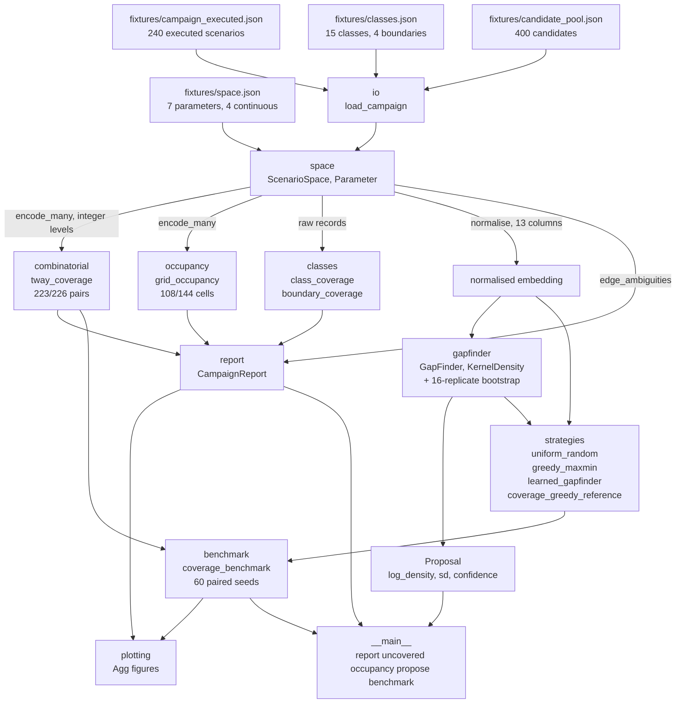
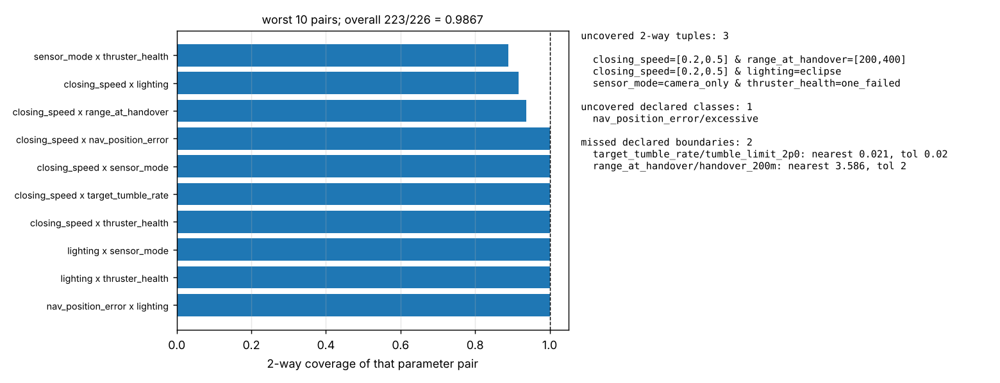
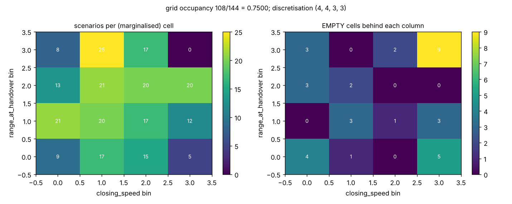
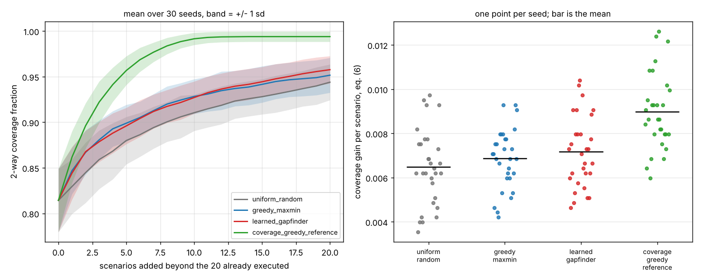

# scenariocov

Which regions of the scenario space a finished verification campaign never touched.


## The problem

The campaign has run. Two thousand scenarios went through the simulator over
six weeks, every one of them passed, and the review board asks which parts of
the scenario space were never exercised. The tools that generate test inputs
answer the opposite question, and the campaign log is a list of scenarios, not
a statement about the space they were drawn from.

## What this does

- **t-way combinatorial coverage with every uncovered tuple listed, not a
  percentage.** On the bundled 240-scenario campaign: 223 of 226 pairs covered
  = 0.986726, and the three uncovered pairs are printed by name
  (`validation/validate_planted_gaps_output.txt`).
- **Equivalence-class and boundary coverage against classes you declare.** 14
  of 15 declared classes reached; the missed class is named. Every boundary
  reports the nearest approach next to the hit flag, in the parameter's units,
  because the flag is a floating-point comparison and one of the four
  boundaries here misses by 0.001 deg/s out of a 0.020 deg/s tolerance.
- **Grid occupancy with the discretisation stated as the assumption it is.**
  108 of 144 cells = 0.750000, against an equiprobable-cell reference of
  0.812219, with the largest empty connected block (11 cells) located
  (`validation/validate_occupancy_output.txt`).
- **A learned gap finder that proposes the next batch**, with a bootstrap
  confidence on every proposal, benchmarked against uniform random and greedy
  max-min distance over 60 seeds
  (`validation/validate_benchmark_output.txt`).
- **Cross-checked against exhaustive enumeration.** 160 comparisons on five
  small spaces against an independent brute-force implementation, 0
  disagreements (`validation/validate_tway_exhaustive_output.txt`).

## The result that decides whether you want the model

**A deterministic coverage-greedy chooser beats all three strategies under
test, on every one of 60 seeds. The learned gap finder is not separated from
the greedy max-min baseline, and on the occupancy metric it is behind uniform
random.**

2-way coverage reached after adding 20 scenarios to a 20-scenario campaign,
60 paired seeds, from `validation/validate_benchmark_output.txt`:

| strategy | final mean | sd | min | max | gain per scenario | seconds |
|---|---|---|---|---|---|---|
| uniform random | 0.943215 | 0.018598 | 0.898230 | 0.977876 | 0.006549 | 0.00 |
| greedy max-min | 0.951254 | 0.018781 | 0.898230 | 0.982301 | 0.006951 | 0.03 |
| learned gap finder | 0.955457 | 0.015815 | 0.920354 | 0.982301 | 0.007161 | 1.33 |
| **coverage-greedy reference** | **0.993584** | 0.006010 | 0.977876 | 1.000000 | **0.009067** | 0.67 |

| paired comparison | mean | sd | W/T/L over 60 seeds | separated |
|---|---|---|---|---|
| learned - greedy max-min | +0.004204 | 0.015119 | 30/10/20 | **no** |
| learned - uniform random | +0.012242 | 0.019199 | 41/6/13 | no |
| coverage-greedy reference - learned | +0.038127 | 0.014868 | 60/0/0 | **yes** |

The learned model leads greedy max-min by 0.28 of the standard deviation of
the paired difference and loses on 20 of 60 seeds, at 40 times the compute
cost (1.33 s against 0.03 s; wall clock varies with the machine). On the
grid-occupancy metric, which is the one closest to what the density model
sees, it is behind uniform random by -0.001273 and loses on 30 of 60 seeds. The coverage-greedy reference is not a competitor: it optimises
the benchmark metric directly, which is the point -- if you want 2-way
coverage, greedily maximise 2-way coverage and skip the model.

That result is stated in the same terms in `MODEL_CARD.md` and
`validation/VALIDATION.md`, and it is pinned as an assertion in
`tests/test_benchmark.py`, so a change that reverses it has to say so.

## Who it is for

- Anyone who has to report, after a campaign, which parts of the scenario
  space were never exercised, with the gaps named rather than summarised.
- Anyone who has declared equivalence classes and boundary values in a
  verification plan and wants to know which of them the campaign actually
  reached.
- Anyone deciding whether a learned sampler is worth adding to a test
  pipeline, who would rather read a measured negative result than a claim.

## Who it is not for

- Anyone who wants to *find bugs* in an input space. Use `hypothesis`. It
  searches input spaces far better than anything here, it shrinks
  counterexamples, and it is the right tool for that job.
- Anyone who needs a covering array generated. Use `allpairspy` or Microsoft
  PICT. This package measures coverage and does not construct covering arrays.
- Anyone working in OpenSCENARIO who needs scenarios written out in the
  standard format. Use `scenariogeneration`.
- Anyone who needs coverage over a space this package cannot discretise. Every
  number here is a number about the bins you declared.

## Alternatives, honestly

| alternative | what it does better | when to use this instead |
|---|---|---|
| [`hypothesis`](https://pypi.org/project/hypothesis/) (6.170.0) | **Searches input spaces far better than anything here.** Property-based generation, adaptive search, counterexample shrinking, a stateful testing model. If your question is "does any input break this", hypothesis is the answer and this package is not. | When the campaign has already run, under its own harness, and the question is which regions of a *declared* scenario space it never reached. Hypothesis does not report that, and its own coverage guidance is explicitly that coverage is a poor target for it. |
| [`allpairspy`](https://pypi.org/project/allpairspy/) (2.5.1) | Generates a pairwise covering array for you, with constraint filtering, in a few lines. | When you are not generating anything: you have a finished campaign log and need its t-way coverage measured and its uncovered tuples enumerated. |
| Microsoft PICT (github.com/microsoft/pict) | The mature combinatorial generator: mixed strength, seeding, constraints, weights, negative testing. It is the reference implementation of the generation side. | Same as above. PICT builds a test set; this reports on one that already exists, and adds equivalence-class, boundary and occupancy accounting that PICT has no reason to carry. |
| [`scenariogeneration`](https://pypi.org/project/scenariogeneration/) (0.16.7) | Writes OpenSCENARIO and OpenDRIVE files, with parameter sweeps, for a driving-simulation toolchain that consumes the standard. | When you need coverage measured over scenario parameters rather than scenario files written. This package has no OpenSCENARIO reader or writer. |

**The honest summary.** The contribution here is the *reporting* of what a
finished campaign missed -- enumerated uncovered t-tuples, declared classes and
boundaries that were never reached, cell occupancy with the discretisation
named -- not the generation of scenarios, and not the search for faults. If you
want a better campaign, use `hypothesis` or PICT. Use this afterwards.

## Install and first run

```bash
git clone https://github.com/OmAcharya-avtr/scenariocov.git
cd scenariocov
python -m venv .venv && source .venv/bin/activate
pip install -e ".[test]"
python -m pytest tests/ -q
python examples/coverage_report.py
```

The test run prints:

```
255 passed in 7.49s
```

The count is the invariant; the wall clock varies with the machine. The same
count parsed back out of the junit XML is in
`validation/validate_suite_output.txt`, which is where the number in the badge
comes from.

`python examples/coverage_report.py` ends with:

```
Grid occupancy over (closing_speed, range_at_handover, target_tumble_rate, nav_position_error): 108/144 = 0.750000
  uniform-random reference, Feller eq. (3): 0.812219
  largest empty connected block: 11 cells

Equivalence-class coverage 14/15 = 0.933333
  UNCOVERED CLASS  nav_position_error/excessive

Boundary coverage (nearest distance shown; the hit test is a
floating-point comparison, so read the margin, not just the flag):
  hit  closing_speed/speed_limit_0p20   n=4    nearest=0.0003 tol=0.005 margin=+0.0047
  hit  nav_position_error/nav_limit_0p50     n=4    nearest=0.005 tol=0.01 margin=+0.005
  MISS target_tumble_rate/tumble_limit_2p0   n=0    nearest=0.021 tol=0.02 margin=-0.001
  MISS range_at_handover/handover_200m      n=0    nearest=3.586 tol=2 margin=-1.586

1 record(s) sit within tolerance of a bin edge; their bin assignment is not guaranteed.

wrote screenshots/coverage_report.png
```

## A worked example

```python
from scenariocov import (
    GapFinder,
    build_report,
    load_campaign,
    load_class_document,
    load_space,
)

space = load_space("fixtures/space.json")
campaign = load_campaign("fixtures/campaign_executed.json")
classes, boundaries = load_class_document("fixtures/classes.json")

report = build_report(space, campaign, strength=2, classes=classes, boundaries=boundaries)
print(f"{report.tway.covered}/{report.tway.total} 2-way tuples covered")
for tup in report.tway.uncovered:
    print(f"  uncovered: {tup.as_text()}")
for cls in report.classes.uncovered:
    print(f"  uncovered class: {cls.parameter}/{cls.name}")
for hit in report.boundaries:
    if not hit.covered:
        print(
            f"  missed boundary: {hit.spec.name}, nearest "
            f"{hit.nearest_distance:.4g} against tolerance {hit.spec.tolerance:g}"
        )

pool = load_campaign("fixtures/candidate_pool.json")
finder = GapFinder(n_bootstrap=16, random_state=0).fit(space.normalise(campaign))
for proposal in finder.propose(space.normalise(pool), 3):
    record = pool[proposal.candidate_index]
    print(
        f"  propose log_density={proposal.log_density:.3f} "
        f"sd={proposal.log_density_sd:.3f} "
        f"confidence={proposal.sparsity_agreement:.2f} "
        f"closing_speed={record['closing_speed']} lighting={record['lighting']}"
    )
```

Output of exactly that snippet, run from the product root
(`validation/worked_example_output.txt`):

```
223/226 2-way tuples covered
  uncovered: closing_speed=[0.2,0.5] & range_at_handover=[200,400]
  uncovered: closing_speed=[0.2,0.5] & lighting=eclipse
  uncovered: sensor_mode=camera_only & thruster_health=one_failed
  uncovered class: nav_position_error/excessive
  missed boundary: tumble_limit_2p0, nearest 0.021 against tolerance 0.02
  missed boundary: handover_200m, nearest 3.586 against tolerance 2
  propose log_density=-10.978 sd=0.064 confidence=1.00 closing_speed=0.4052 lighting=full_sun
  propose log_density=-10.956 sd=0.080 confidence=1.00 closing_speed=0.4949 lighting=eclipse
  propose log_density=-10.892 sd=0.076 confidence=1.00 closing_speed=0.4306 lighting=eclipse
```

The three uncovered pairs are the three gaps deliberately planted in the
fixture campaign, and the gap finder's first three proposals all land in them.

## Command line

```bash
python -m scenariocov report --space fixtures/space.json \
    --campaign fixtures/campaign_executed.json --classes fixtures/classes.json
python -m scenariocov uncovered --space fixtures/space.json \
    --campaign fixtures/campaign_executed.json --strength 3
python -m scenariocov occupancy --space fixtures/space.json \
    --campaign fixtures/campaign_executed.json --blocks 3
python -m scenariocov propose --space fixtures/space.json \
    --campaign fixtures/campaign_executed.json \
    --pool fixtures/candidate_pool.json --count 3 --bootstrap 16
python -m scenariocov benchmark --space fixtures/space.json \
    --campaign fixtures/campaign_executed.json \
    --pool fixtures/candidate_pool.json --seeds 12 --with-reference
```

Every one of these is executed by `validation/validate_cli.py` and its output
is committed in `validation/validate_cli_output.txt`.

## Architecture



## Screenshots



Left: 2-way coverage per parameter pair, worst first. Only three pairs are
below 1.0 and the dashed line is complete coverage. Right: the gaps named --
three uncovered tuples, one uncovered declared class, two missed boundaries,
one of which misses by 0.001 deg/s.



Scenario counts over the `closing_speed  x  range_at_handover` grid, with the
other two continuous parameters marginalised. The top-right cell of the left
panel is 0 and the matching cell of the right panel is 9, which is the planted
gap: nine grid cells with no scenario in any of them.



Coverage against scenarios executed, shaded by plus and minus one standard
deviation across seeds. The three strategies under test overlap throughout;
the coverage-greedy reference in green is clear of all of them from the second
scenario onwards. The right panel is one point per seed, which is what "not
separated" looks like.

## Validation evidence

Full detail in `validation/VALIDATION.md`. Level 2. The checks the learned
component lost are included, because those are the credible ones.

| check | reference | result | tolerance |
|---|---|---|---|
| `\|T_t\|` closed form vs enumeration | NIST SP 800-142 section 2, eq. (1) | 16 of 16 agree | exact integers |
| coverage count vs brute-force reference | independent implementation | 128 of 128 agree | exact integers |
| exhaustive campaign gives complete coverage | set identity | 16 of 16 | exact integers |
| planted 2-way gaps G1, G2, G3 detected | `fixtures/generation_parameters.json` | 3 of 3, zero false positives | exact |
| planted class gap G4 detected | declared classes | 1 of 1, zero false positives | exact |
| planted boundary gap G5 detected | declared boundaries | nearest 3.586 m vs 2.0 m tolerance | units: m |
| planted empty-cell region all empty | 9 cells of the 4 x 4 x 3 x 3 grid | 9 of 9 empty | exact integers |
| occupancy eq. (3) vs Monte Carlo | Feller 1968 Vol. I Ch. II | 5 of 5 agree | within 4 s.e., 4000 replicates |
| unequal-cell generalisation vs Monte Carlo | per-cell probabilities | 3 of 3 agree | within 4 s.e. |
| **learned gap finder vs greedy max-min** | 60 paired seeds | **+0.004204, sd 0.015119, not separated** | - |
| **learned gap finder vs uniform random, occupancy metric** | 60 paired seeds | **-0.001273, loses on 30 of 60** | - |
| coverage-greedy reference vs learned | 60 paired seeds | +0.038127, wins 60 of 60 | - |
| bootstrap spread falls with more data | 20 to 240 scenarios | 0.144124 down to 0.063551 nats | - |
| confidence separates empty from occupied cells | grid ground truth | 0.181100 vs 0.049764 | - |
| validation numbers at both dependency ends | floor vs ceiling installs | 0 of 16 quantities moved | 1e-9 |
| shipped files not gitignored | `git check-ignore -v` | 71 of 71 pass | exact |
| suite counted from junit XML | `testsuite` attr vs `testcase` count | 255 = 255 | exact |

## API reference

<details>
<summary>Public surface</summary>

| callable | returns | units |
|---|---|---|
| `Parameter.categorical(name, levels)` | `Parameter` | - |
| `Parameter.continuous(name, edges, units, labels=None)` | `Parameter` | edges in the parameter's units |
| `Parameter.level_index(value)` | level index | - |
| `ScenarioSpace(parameters)` | `ScenarioSpace` | - |
| `ScenarioSpace.level_counts` / `.n_combinations` | counts | dimensionless |
| `ScenarioSpace.encode(record)` / `.encode_many(records)` | level indices | - |
| `ScenarioSpace.decode(levels)` | `{parameter: label}` | - |
| `ScenarioSpace.normalise(records)` | `(n, d)` embedding | dimensionless |
| `ScenarioSpace.edge_ambiguities(records, rtol)` | records within `rtol` of a bin edge | parameter units |
| `count_tway_tuples(level_counts, t)` | `\|T_t\|` | exact count |
| `tway_coverage(space, encoded, t, max_tuples)` | `TwayCoverage` | counts and a ratio |
| `TwayCoverage.fraction` / `.uncovered` / `.worst_combinations(n)` | coverage, every gap, worst pairs | dimensionless |
| `EquivalenceClass(parameter, name, lower, upper, closed_upper, labels, expected)` | a declared class | parameter units |
| `BoundarySpec(parameter, name, value, tolerance)` | a declared boundary | parameter units |
| `class_coverage(classes, records)` | `ClassCoverage` | counts |
| `boundary_coverage(boundaries, records)` | `tuple[BoundaryHit, ...]` with `nearest_distance` | parameter units |
| `grid_occupancy(space, encoded, parameters, max_cells)` | `CellOccupancy` | cells |
| `CellOccupancy.fraction` / `.empty_blocks()` / `.largest_empty_block()` | occupancy, components | cells |
| `expected_occupied_cells(n, c)` | Feller eq. (3) | cells |
| `build_report(space, records, strength, classes, boundaries, ...)` | `CampaignReport` | - |
| `CampaignReport.to_text(max_uncovered)` | the rendered report | - |
| `GapFinder(bandwidth, n_bootstrap, sparsity_quantile, min_separation, random_state)` | the model | bandwidth in embedding units |
| `GapFinder.fit(executed)` / `.fitted_bandwidth` | `self` / bandwidth | dimensionless |
| `GapFinder.score_candidates(candidates)` | `GapScores` | nats, nats, fraction |
| `GapFinder.propose(candidates, n, sequential, refit)` | `tuple[Proposal, ...]` | - |
| `UniformRandomStrategy()` / `GreedyMaxMinStrategy()` | `Strategy` | - |
| `LearnedGapFinderStrategy(...)` / `CoverageGreedyReference(t)` | `Strategy` | - |
| `coverage_benchmark(space, executed, pool, strategies, ...)` | `BenchmarkResult` | - |
| `BenchmarkResult.paired_difference(left, right)` | mean, sd, W/T/L | dimensionless |
| `StrategyCurves.mean` / `.sd` / `.minimum` / `.maximum` / `.gain_per_scenario` | curves and spread | dimensionless |
| `incremental_coverage_curve(...)` / `incremental_occupancy_curve(...)` | `(m+1,)` curve | dimensionless |
| `load_space` / `load_campaign` / `load_class_document` / `save_space` / `save_campaign` | JSON I/O | - |

</details>

## Limitations

1. **Every number is a number about the bins you declared.** The
   discretisation of a continuous parameter is an assumption this package
   imposes, not a property of the campaign. Doubling the bins per parameter in
   a d-dimensional grid multiplies the cell count by 2^d and can only lower the
   occupancy of a fixed campaign. The report prints the discretisation beside
   every figure; there is no method here for choosing it.
2. **The bin assignment of a value on a bin edge is not guaranteed.** It is
   decided by a strict comparison on floating-point numbers.
   `ScenarioSpace.edge_ambiguities` reports every such record -- the bundled
   campaign has one, record 191 with `nav_position_error` exactly 0.1 -- and
   nothing in this package asserts a bin for them. The same caveat applies to
   boundary hits, which is why `nearest_distance` is reported beside every hit
   flag.
3. **The learned gap finder is not worth its compute on this evidence.** It is
   not separated from greedy max-min on the headline metric, it is behind
   uniform random on the occupancy metric, and it costs about 40 times greedy
   max-min's wall clock. It is shipped because the measurement is the
   contribution, not because the model is recommended.
4. **Kernel density estimation on a 13-column mixed embedding is a
   compromise.** Three of the seven parameters are categorical and are one-hot
   encoded, so a single global Gaussian bandwidth is applied to columns that
   are not continuous. No consistency claim is made for the density estimate on
   that space.
5. **The confidence output is not a calibrated probability.** It is the
   fraction of bootstrap resamples that place a candidate in the sparsest
   declared quantile. It quantifies sensitivity to the executed sample and
   nothing else -- not the binning, not the embedding, not the kernel.
6. **Combinatorial enumeration blows up and this package refuses rather than
   hangs.** `|T_t|` for 20 parameters at 4 levels is 3040 at t=2 and
   158,760,960 at t=6; the default `max_tuples` of 2,000,000 refuses the
   second. Enumerating the uncovered set is what costs -- a percentage alone
   would be far cheaper and is not what this package is for.
7. **Occupancy's uniform-random reference assumes equiprobable cells.** Drawing
   a continuous parameter uniformly over its declared interval does not make
   unequal-width bins equiprobable: on the fixture grid the equiprobable
   formula is high by 3.7 cells of 16 at n = 40. The reference is reported
   anyway because it is the only one computable without a model of how the
   campaign was sampled, and `validation/validate_occupancy_output.txt`
   measures the error.
8. **Everything is measured on a synthetic 240-scenario campaign.** It is
   generated at seed 20261016 by `fixtures/regenerate_fixtures.py` with five
   deliberate holes. No real verification campaign was used, and nothing here
   establishes how any of this behaves on one.
9. **Dependency ceilings have a real cost.** Every range in `pyproject.toml` is
   bounded on both sides and both ends were installed and executed, but the
   ceilings exclude the next minor release of numpy, scikit-learn and
   matplotlib. This product cannot take a scikit-learn 1.10 security release
   without re-running the benchmark and republishing the numbers, because
   `KernelDensity` bandwidth selection and `score_samples` are not
   contractually stable across minor versions. The tension is recorded rather
   than resolved by removing the ceiling.
10. **Compute budget.** Every script in this repository runs on 2 CPU cores:
    the suite in 7.5 s, all eleven validation scripts in 49 s, the longest
    single script (`validate_benchmark.py`, 60 seeds, four strategies, two
    metrics, plus a three-way ablation) in 7.4 s. Wall clock varies with the
    machine; the counts do not.
11. **No covering-array generation, no OpenSCENARIO, no constraint language.**
    A real scenario space usually has forbidden combinations, and this package
    has no way to declare them: an uncovered tuple that is physically
    impossible will be reported as a gap and has to be recognised by the
    reader.

## Reproducing every number

```bash
python validation/validate_environment.py      > validation/validate_environment_output.txt
python validation/validate_tway_exhaustive.py  > validation/validate_tway_exhaustive_output.txt
python validation/validate_planted_gaps.py     > validation/validate_planted_gaps_output.txt
python validation/validate_occupancy.py        > validation/validate_occupancy_output.txt
python validation/validate_uncertainty.py      > validation/validate_uncertainty_output.txt
python validation/validate_benchmark.py        > validation/validate_benchmark_output.txt
python validation/validate_dependency_ends.py  > validation/validate_dependency_ends_output.txt
python validation/validate_fixtures.py         > validation/validate_fixtures_output.txt
python validation/validate_cli.py              > validation/validate_cli_output.txt
python validation/validate_suite.py            > validation/validate_suite_output.txt
python validation/worked_example.py            > validation/worked_example_output.txt
python examples/coverage_report.py
python examples/occupancy_map.py
python examples/strategy_comparison.py
```

To regenerate the fixtures deterministically at seed 20261016:

```bash
python fixtures/regenerate_fixtures.py
```

which prints:

```
space: 7 parameters, level counts (4, 4, 3, 3, 3, 3, 3), 3888 combinations
campaign: 240 scenarios, pool: 400 scenarios
2-way coverage: 223/226 = 0.986726
uncovered 2-way tuples (3):
  closing_speed=[0.2,0.5] & range_at_handover=[200,400]
  closing_speed=[0.2,0.5] & lighting=eclipse
  sensor_mode=camera_only & thruster_health=one_failed
grid occupancy over ('closing_speed', 'range_at_handover', 'target_tumble_rate', 'nav_position_error'): 108/144 = 0.750000, largest empty block 11 cells
```

## Safety statement

This software is **research-grade**. It is **not flight-qualified**, **not
certified**, and **not approved for operational aerospace use**. It reports on
test campaigns; it does not touch flight software, flight data or any
operational system. A coverage figure from this package is a statement about a
declared discretisation of a declared scenario space, and complete coverage of
that space is not evidence that a system is correct. The learned component is
not certified for operational flight use.

## Licence

Apache-2.0. Copyright (c) 2026 OPTIMA Organisation. See `LICENSE`.

## Citation

See `CITATION.cff`. The methods implemented here come from:

- D. R. Kuhn, R. N. Kacker and Y. Lei, *Practical Combinatorial Testing*, NIST
  Special Publication 800-142, National Institute of Standards and Technology,
  October 2010, doi:10.6028/NIST.SP.800-142 -- the definition of t-way
  combination coverage used in `scenariocov.combinatorial`.
- D. R. Kuhn, D. R. Wallace and A. M. Gallo, "Software Fault Interactions and
  Implications for Software Testing", *IEEE Transactions on Software
  Engineering*, 30(6), 418-421, June 2004, doi:10.1109/TSE.2004.24 -- the
  empirical interaction-strength results that motivate measuring t-way
  coverage at all.
- G. J. Myers, *The Art of Software Testing*, Wiley, 1979, chapter 4 --
  equivalence partitioning and boundary value analysis, implemented in
  `scenariocov.classes`.
- W. Feller, *An Introduction to Probability Theory and Its Applications*,
  Volume I, 3rd edition, Wiley, 1968, chapter II -- the classical occupancy
  result used as the uniform-random reference in `scenariocov.occupancy`.
- T. F. Gonzalez, "Clustering to minimize the maximum intercluster distance",
  *Theoretical Computer Science*, 38, 293-306, 1985,
  doi:10.1016/0304-3975(85)90224-5 -- the greedy farthest-point rule used by
  `GreedyMaxMinStrategy`.
- M. E. Johnson, L. M. Moore and D. Ylvisaker, "Minimax and maximin distance
  designs", *Journal of Statistical Planning and Inference*, 26(2), 131-148,
  1990, doi:10.1016/0378-3758(90)90122-B -- the design-of-experiments form of
  the same criterion.
- B. W. Silverman, *Density Estimation for Statistics and Data Analysis*,
  Chapman and Hall, 1986, chapter 4 -- multivariate kernel density estimation.
- D. W. Scott, *Multivariate Density Estimation: Theory, Practice, and
  Visualization*, Wiley, 1992, chapter 6 -- the bandwidth rule scikit-learn
  implements as `bandwidth="scott"`.
- B. Efron, "Bootstrap Methods: Another Look at the Jackknife", *Annals of
  Statistics*, 7(1), 1-26, 1979, doi:10.1214/aos/1176344552 -- the resampling
  behind the confidence output.

## Credits

This is under reserved rights obtained by OPTIMA Organisation.
