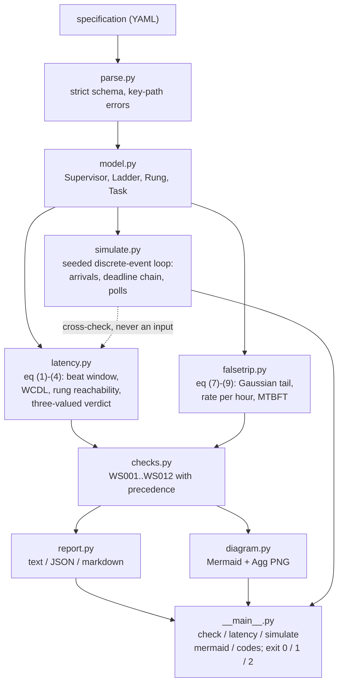
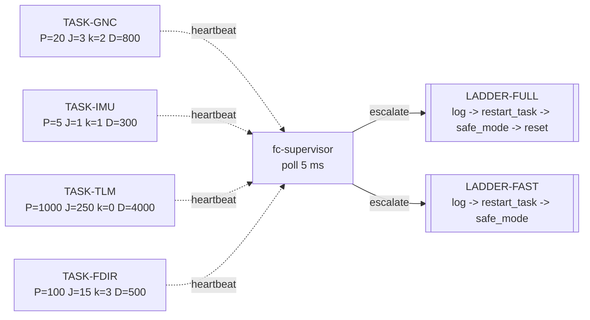
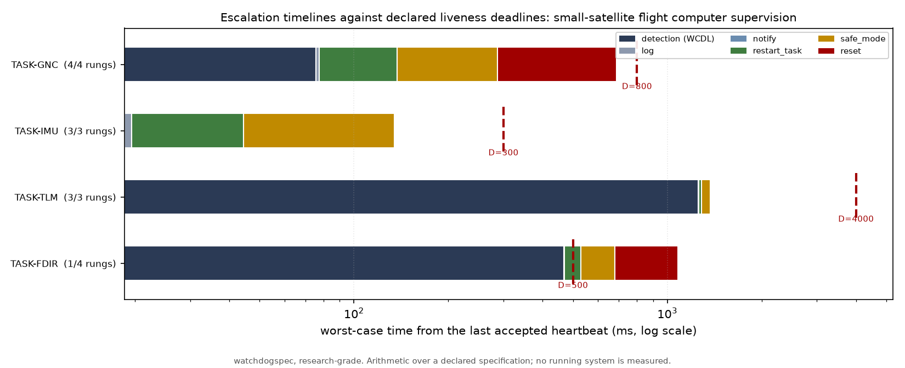
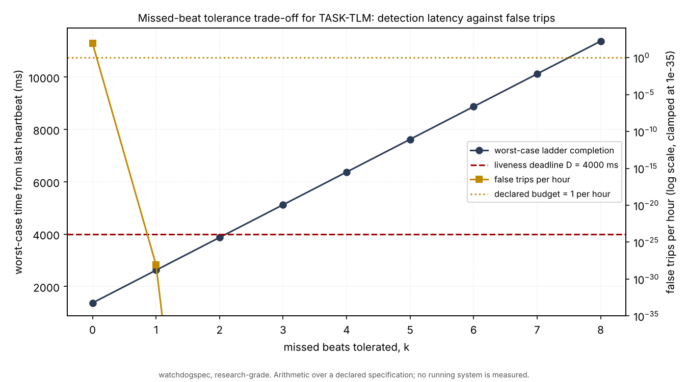
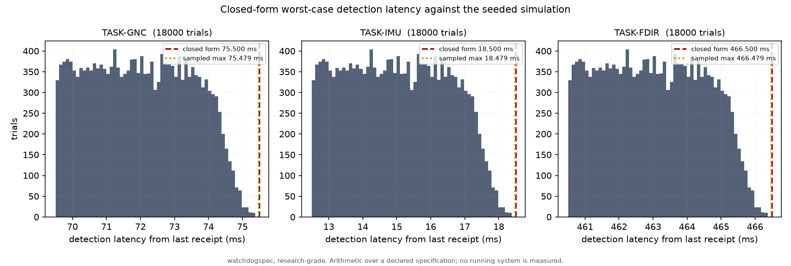
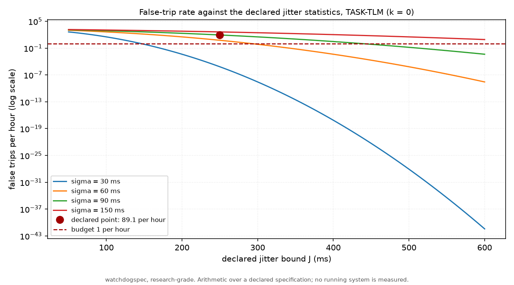

# watchdogspec

Declare your heartbeats, tolerances and escalation ladders, then check whether the watchdog could have caught it in time.


**Status: TESTING** · Class: compact · Validation level 2 (research grade) ·
No AI, by design · Apache-2.0 · © 2026 OPTIMA Organisation

> ## Scope, before anything else
>
> **This tool checks a declaration against itself. It never observes a running
> system.**
>
> watchdogspec reads a YAML file in which somebody has written down heartbeat
> periods, jitter bounds, missed-beat tolerances, liveness deadlines and
> escalation ladders, and computes what those numbers imply: the worst-case
> detection latency, which rung of each ladder is reachable before the
> deadline, and how often the supervisor would trip on a healthy task. It does
> not instrument a supervisor, it does not read a heartbeat, and it has no way
> to know whether the declared numbers describe the system they are about.
>
> A `CONSISTENT` verdict means the declared numbers do not contradict each
> other. It is **not** a measurement, **not** evidence that a watchdog works,
> and **not** a safety argument. This is a product about the supervision of
> safety-relevant systems, which makes overclaiming both easy and unusually
> damaging, so it is said here in full: if an exit code from this program is
> ever offered as evidence that a watchdog is adequate, it is being misused.
>
> This software is research-grade. It is **not flight-qualified, not
> certified, and not approved for operational aerospace use.**

## The problem

The watchdog parameters on a flight computer are usually three numbers per
task in a header file and a paragraph in a design note: heartbeat every 20 ms,
tolerate two missed beats, enter safe mode if it does not come back. Whether
those numbers are consistent with the 500 ms deadline the watchdog exists to
protect is arithmetic nobody does, because it is spread across three
documents and changes every time somebody retunes a period. The result is a
supervisor that is declared to protect a deadline it provably cannot reach in
time, and the usual way of finding out is an anomaly report.

## What this does

- **Computes the worst-case detection latency from the spec arithmetic and
  cross-checks it against a seeded discrete-event simulation.** Over **400**
  synthetic configurations and **320000** stochastic trials the closed form
  was never exceeded, **0** violations, and the adversarial trial attains it
  to between **8 and 16 units in the last place**
  (`validation/validate_latency_vs_simulation.py`).
- **Computes the false-trip rate implied by the declared jitter statistics.**
  Checked against an event-driven count over **7.3 million** simulated
  heartbeat gaps spanning three decades of rate: the closed form fell inside
  the 95 % Wilson interval in **21 of 21** comparisons
  (`validation/validate_false_trip.py`).
- **Finds the rung of each escalation ladder that is actually reachable
  before the deadline.** On the shipped worked example, `TASK-FDIR` has
  **33.5 ms** of slack after detection and reaches **1 of its 4 rungs**: the
  restart alone overruns the deadline by 28.5 ms
  (`validation/worked_example.py`).
- **Raises twelve named consistency checks, including the one that costs
  nothing**: a task whose missed-beat tolerance permits a silence of
  **220 ms** against a deadline of **200 ms** that the tolerance is declared
  to protect. Planted in `examples/specs/planted_defects.yaml` and detected
  (`validation/validate_known_answers.py`).
- **Refuses to answer a deadline comparison that floating point cannot
  decide.** Over **8100** parameter sets, the two-valued "is there slack left"
  boolean flips under a re-association of the same sum in **137** of them; the
  three-valued verdict this package returns flips in **0**. At latencies above
  4.5e6 ms an absolute tolerance alone is no longer enough either, flipping in
  **14 of 135** cases, which is why the band carries a relative part
  (`validation/validate_properties.py`).

## No model in this one, deliberately

**There is no machine-learning component in this package and none is planned.
That is a design decision, not a missing feature, which is why there is no
`MODEL_CARD.md` in this repository.**

Everything here is arithmetic over numbers somebody wrote down. `(k+1)(P+J)`
is not a quantity that can be learned better than it can be added, and the
false-trip rate is the tail of a distribution the specification itself
declares. A learned component asked to help would have to do one of two
things: predict the detection latency, or score a specification for quality.
The first replaces an exact sum with an estimate, which is strictly worse and
cannot be bounded. The second would put a number on the adequacy of a safety
supervisor from a model with no causal access to the system being supervised,
which is the single worst place in this portfolio to put a learned opinion.

The judgement — is this the right deadline, is this tolerance defensible, does
the declaration describe the real system — stays with the engineer whose name
is on the review. The arithmetic is the part a machine can do without
pretending to have an opinion, and it is all this package does.

## Who it is for

- Anyone who has heartbeat periods, missed-beat tolerances and a liveness
  deadline written down in three different places and wants the arithmetic
  done by a command that exits non-zero in continuous integration.
- Anyone who needs to say, in a review, which rung of an escalation ladder is
  actually reachable before a deadline, and show the sum.
- Anyone choosing a missed-beat tolerance and wanting the detection-latency
  cost and the false-trip cost of each choice on the same axis.
- Anyone who wants a watchdog configuration to live in the repository as a
  file that diffs, rather than as constants in three headers.

## Who it is not for

- **Anyone who needs to know what their system actually does.** This package
  reads declarations. Measuring a real supervisor is a different tool and a
  different discipline, and nothing here substitutes for it.
- Anyone who needs to **implement** a watchdog. There is no runtime here: no
  heartbeat emitter, no supervisor, no timer. See the alternatives.
- Anyone who needs **schedulability analysis** — whether the supervised tasks
  can meet their own periods at all. That is Liu and Layland arithmetic and it
  is P036 RtClock in this portfolio, not this package.
- Anyone who needs a **simulation of any size**. The event loop here exists to
  cross-check a closed form over one task at a time. Use SimPy.
- **Anyone who needs certification or compliance support.** Nothing here has
  any relationship to DO-178C, DO-254, ARP4754A or ISO 26262, and no output of
  this program is a certification artifact.

## Alternatives, honestly

Every PyPI entry below was verified to exist with `pip index versions` on
2026-10-16, at the version shown.

> **Name collision, stated plainly.** `pip install watchdog` installs
> **something else entirely.** `watchdog` 6.0.0 on PyPI is
> `gorakhargosh/watchdog`, "Filesystem events monitoring" — a library for
> watching directories for file changes. It has nothing to do with hardware
> or task watchdogs, it is far more widely used than anything in this
> portfolio will ever be, and a reader searching PyPI for "watchdog" will find
> it first and should. This package is `watchdogspec`; `watchdogspec` itself
> returned "No matching distribution found" on 2026-10-16, so the name is free.

| Alternative | What it does better | When to use this instead |
|---|---|---|
| **`watchdog` 6.0.0** (PyPI, `gorakhargosh/watchdog`) — "Filesystem events monitoring". **A different thing with the same word in its name.** | Everything it does: cross-platform filesystem event monitoring, inotify and friends, an API people actually use. | Always, for supervision arithmetic. These two packages do not overlap at any point. The row exists so that nobody installs the wrong one. |
| **systemd watchdog semantics** (`systemd.service(5)` `WatchdogSec=`, `sd_notify(3)`). The service calls `sd_notify` with `WATCHDOG=1`; if the time between two such calls exceeds the configured time the service is placed in a failed state and ended with `SIGABRT`, or the signal set by `WatchdogSignal=`; the timeout is passed to the process in `WATCHDOG_USEC=`; `Restart=on-watchdog` restarts only on that timeout. | Being real: it runs, it supervises actual processes, it is on every Linux box, and it has a restart policy engine behind it. It is the reference semantics this package's single-rung case is modelled on. | You want the *arithmetic* before you write the unit file: whether `WatchdogSec` is consistent with the deadline it is meant to protect, what the worst-case detection latency actually is once the poll granularity is included, and how often the declared jitter will trip it spuriously. systemd has one timeout and no notion of a multi-rung ladder with per-rung latency, no false-trip arithmetic, and no deadline to check against. |
| **`simpy` 4.1.2** (PyPI) — a general process-based discrete-event simulation framework. | Being a real simulation framework: processes, resources, shared events, interrupts, monitoring, a decade of use and documentation. Anything beyond one task and one supervisor belongs there. | The simulation here is a 150-line event loop whose whole job is to disagree with a closed form if the closed form is wrong. Putting it on a framework would make the cross-check share a scheduler with the thing it is checking, and would add a dependency to a package that otherwise needs numpy and PyYAML. **`simpy` is deliberately not a dependency of this package.** Use it for a simulation of any size. |
| **`supervisor` 4.3.0** (PyPI) — a process control system that starts, monitors and restarts processes. | Supervising real processes, with autorestart, backoff, an XML-RPC interface and a web UI. | Same answer as systemd: `supervisor` runs the supervision, this computes whether the numbers you gave it can meet a deadline. `supervisor` has no deadline model and no jitter statistics. |
| **`sdnotify` 0.3.2** (PyPI) — a pure-Python `sd_notify` client, including the watchdog ping. | Letting a Python service actually participate in the systemd watchdog protocol, which this package cannot do at all. | You are choosing the `WatchdogSec` value that `sdnotify` will then honour. These compose; neither does the other's job. |
| **P036 RtClock** (this portfolio) | Timing primitives and schedulability arithmetic: whether the task set is feasible at all, which is a precondition for anything here being meaningful. | The task set is feasible and the question is now about the supervision layer on top of it: detection latency, escalation reachability, false trips. P036 does not model a supervisor, and this package does not import it or any other product. |

**No open tool does the aerospace escalation-ladder arithmetic.** systemd,
`supervisor` and every process manager of that kind have exactly one rung
(terminate, then restart per policy) and no deadline to check it against. The
specific computation here — a multi-rung ladder with declared per-rung
worst-case latency and recovery cost, composed onto a worst-case detection
latency, compared against a declared liveness deadline, with the false-trip
rate from the declared jitter statistics on the same page — is not something
this author found in any published tool. That is a statement about a search,
not a claim of novelty: the arithmetic is elementary and is undoubtedly done
by hand inside programmes that do not publish their tooling.

## Install and first run

```bash
git clone https://github.com/OmAcharya-avtr/watchdogspec.git
cd watchdogspec
python -m venv .venv && source .venv/bin/activate
pip install -e ".[test]"
python -m pytest tests/ -q
python -m watchdogspec check examples/specs/minimal_consistent.yaml
python examples/escalation_timeline.py
```

Expected output of the test run:

```
300 passed in 6.92s
```

The wall-clock figure moves between runs on two contended cores. **The count
does not, and the count is the number to read** — the badge above is parsed
from the `testsuite` element of a junit XML report and cross-checked against a
count of `testcase` elements, not read from that line. See Limitations.

Expected tail of `check examples/specs/minimal_consistent.yaml` (**exit code
0**):

```
findings
  none

verdict
  0 error, 0 warning finding(s)
  declaration verdict: CONSISTENT. Exit code 0.

  A consistent verdict means the declared numbers do not contradict each other. It is not a measurement of any running system, and it is not evidence that the declaration matches one.
```

Expected output of the first example, which writes
`screenshots/escalation_timeline.png`:

```
specification       : small-satellite flight computer supervision
tasks               : 4
ladders             : 2
  TASK-FDIR  WCDL   466.50 ms   ladder   1078.50 ms   D   500.00 ms   rungs reachable 1/4
  TASK-GNC   WCDL    75.50 ms   ladder    687.50 ms   D   800.00 ms   rungs reachable 4/4
  TASK-IMU   WCDL    18.50 ms   ladder    134.50 ms   D   300.00 ms   rungs reachable 3/3
  TASK-TLM   WCDL  1256.50 ms   ladder   1372.50 ms   D  4000.00 ms   rungs reachable 3/3
  WS003 error   TASK-FDIR
  WS005 warning TASK-TLM
exit code           : 1
wrote screenshots/escalation_timeline.png
```

## The worked example, and its two findings

The Level 2 worked example, `examples/specs/smallsat_fc.yaml`, is a
supervision specification for a small-satellite flight computer: four tasks
from 1 Hz to 200 Hz, two escalation ladders, one supervisor polling at 200 Hz.
**It is hand-written for this repository.** It is a plausible shape for such a
declaration; it is not taken from any flown vehicle, any vendor document or
any standard, and the file says so in its own header. What is real about it is
the arithmetic done to it.

**It is published with its two findings in place rather than tuned until the
tool is silent.**

```python
from watchdogspec import format_timing_table, load_spec, run_checks, spec_false_trip_rates

spec = load_spec("examples/specs/smallsat_fc.yaml")
report = run_checks(spec)
rates = spec_false_trip_rates(spec)

print(f"system            : {spec.system}")
print(f"observation delay : {spec.supervisor.observation_delay_ms:g} ms")
print(f"consistent        : {report.is_consistent}   exit code: {report.exit_code}")
print()
print(format_timing_table(report).rstrip("\n"))
print()
for task_id in sorted(rates):
    rate = rates[task_id]
    print(f"  {task_id:<10} threshold {rate.threshold_ms:9.3f} ms   "
          f"p {rate.per_gap:12.6g}   per hour {rate.per_hour:12.6g}")
print()
for finding in report.findings:
    print(f"  {finding.code}  {finding.severity.value:<7} {finding.message}")
```

Its actual output. This is `validation/worked_example.py` with the emitter
replaced by `print`; the committed run is
`validation/worked_example_output.txt`.

```
system            : small-satellite flight computer supervision
observation delay : 6.5 ms
consistent        : False   exit code: 1

worst-case timing, all from the last accepted heartbeat
  task                W/ms    k*W/ms    WCDL/ms   ladder/ms       D/ms    slack/ms  rung
  TASK-FDIR       115.0000  345.0000   466.5000   1078.5000   500.0000   -578.5000   1/4
  TASK-GNC         23.0000   46.0000    75.5000    687.5000   800.0000    112.5000   4/4
  TASK-IMU          6.0000    6.0000    18.5000    134.5000   300.0000    165.5000   3/3
  TASK-TLM       1250.0000    0.0000  1256.5000   1372.5000  4000.0000   2627.5000   3/3
  W = P + J beat window; k*W tolerated silence; WCDL worst-case detection latency;
  ladder = WCDL + every rung; slack = D - ladder; rung = deepest rung reachable.

  TASK-FDIR  threshold   360.000 ms   p            0   per hour            0
  TASK-GNC   threshold    49.000 ms   p            0   per hour            0
  TASK-IMU   threshold     7.000 ms   p  1.04424e-45   per hour  7.51856e-40
  TASK-TLM   threshold   250.000 ms   p    0.0247543   per hour      89.1155

  WS003  error   task TASK-FDIR cannot reach rung 4 ('reset') of ladder LADDER-FULL within its liveness deadline: worst case 1078.5 ms against 500 ms; deepest rung reachable is 1
  WS005  warning task TASK-TLM false-trip rate 89.1155 per hour exceeds its declared budget of 1 per hour (jitter sigma 90 ms, trip threshold 250 ms, 1.964 sigma of the gap)
```

**`WS003` on `TASK-FDIR` is the sharper of the two.** The FDIR monitor beats
at 10 Hz with a 15 ms jitter bound and tolerates three missed beats, so the
supervisor waits `4 x 115 = 460 ms` plus 6.5 ms of poll and overhead before it
declares anything. That fits inside the 500 ms deadline with 33.5 ms to spare,
which is exactly the kind of margin that gets signed off. The ladder then
starts: the log rung finishes at 468.5 ms and fits, and the restart finishes
at 528.5 ms and does not. **The task that is supposed to protect a 500 ms
deadline can write a log entry before it and nothing else.** Nobody computed
that, because detection and recovery were specified in different paragraphs.

**`WS005` on `TASK-TLM` is the cheap one.** The telemetry framer tolerates no
missed beat so that a stalled downlink is caught within one frame, and the
declared jitter statistics say what that costs: a trip threshold 1.96 standard
deviations out on the gap distribution gives 0.0248 false trips per heartbeat
gap, which at 1 Hz is **89 spurious escalations per hour** against a declared
budget of 1. The sweep in `examples/detection_vs_tolerance.py` shows that
tolerating one or two missed beats puts the rate below the budget while still
fitting the deadline, and prints the admissible window as `k = 1 to 2`.

## Architecture



The dashed edge is the point of the product. `simulate.py` does not import
`latency.py` and never consults equation (3) while running; the two meet only
in the validation scripts and the tests, where they are required to agree.

The worked example as the package renders it from the same YAML the checks
read (`python -m watchdogspec mermaid examples/specs/smallsat_fc.yaml`):



## Screenshots



Every task's worst-case timeline on a log axis, dark blue for detection and
one block per escalation rung, with the declared deadline as a dashed red
line. Notice that `TASK-FDIR` is the only row whose deadline falls inside the
coloured bar rather than after it, and that the label on the left says `1/4`.



The two costs of the missed-beat tolerance on one pair of axes for
`TASK-TLM`: worst-case ladder completion rising one beat window per step, and
the false-trip rate falling down a Gaussian tail. Notice that the declared
`k = 0` sits far above the budget line and that `k = 1` is already 28 orders
of magnitude below it, while still finishing 1377.5 ms inside the deadline.



18000 simulated detection latencies per task against the closed-form bound.
Notice that the three distributions have the same shape: the detection
latency measured from the last accepted heartbeat depends on the beat jitter
only through the window `W`, and its spread is set by the supervisor poll
phase, which is shared. Notice also the gap between the sampled maximum and
the dashed line, which is the worst case being a measure-zero event rather
than a typical one.



The false-trip rate as a function of the declared jitter bound, at four
declared standard deviations, with the declared operating point marked.
Notice how steep the curves are: at `sigma = 90 ms` a 100 ms change in the
declared bound moves the rate by about an order of magnitude, so a jitter
figure somebody estimated is a jitter figure that decides the answer.

## Validation evidence

Level 2. Full detail in [validation/VALIDATION.md](validation/VALIDATION.md).
Every number below came from a script in `validation/`, run on 2026-10-16,
with its raw output committed beside it.

| check | reference | result | tolerance |
|---|---|---|---|
| Closed-form WCDL vs adversarial simulation, worked example | 4 tasks | agreement to 8 to 16 ulp; largest difference 3.64e-12 ms | 1e-6 ms |
| Closed-form WCDL vs stochastic simulation, worked example | 19200 trials per task | **0** bound violations; sampled maximum 0.129906 ms below the bound | strict bound |
| Closed-form WCDL vs simulation, synthetic grid | 400 configurations, 320000 trials | **0** bound violations | strict bound |
| Adversarial attainment on the grid where `Jq <= Q` | 320 configurations | largest difference 1.819e-11 ms (10.0 ulp) | 1e-6 ms |
| **Adversarial attainment where `Jq > Q`** | 80 configurations | **FALSIFIED: the bound is a strict over-estimate, largest shortfall 4.000000 ms** | — |
| False-trip rate vs event-driven count | 7 configurations x 3 seeds, 7.3e6 gaps | closed form inside the 95 % Wilson interval in **21/21** | Wilson 95 % |
| Worked example telemetry false-trip rate | 400000 gaps | closed form 0.02475429, sampled 0.02444750, interval [0.02397346, 0.02493067] | Wilson 95 % |
| Planted defect catalogue | one planted instance per check | **12/12** codes, **12/12** subjects, 7 error + 5 warning, exit 1 | exact, integer counts |
| **Planted tolerance-exceeds-deadline spec** | `T-WS002`: `k*W = 220 ms` against `D = 200 ms` | **detected**, `WS002` error, slack -20.000000 ms | 1e-9 ms |
| Planted floating-point boundary spec | `T-WS004`: `D` exactly equal to the completion time | reported **marginal**, warning, exit code unaffected | 1e-9 ms |
| Hand-calculated escalation arithmetic | 4 tasks x 4 quantities, calculations in the test comments | 16/16 | 1e-9 ms |
| **Two-valued deadline boolean under re-association** | 8100 parameter sets | **FALSIFIED: flips in 137 of 8100** | — |
| **Three-valued verdict with an absolute band only, at latencies above 4.5e6 ms** | 135 parameter sets | **FALSIFIED: flips in 14 of 135** | 1e-9 ms |
| Three-valued verdict with the scale-aware band | 8100 + 135 parameter sets | **0** flips | `max(1e-9 ms, 16 ulp)` |
| Escalation timing identities | 40500 parameter sets, 5 identities | 0 failures | 1e-9 ms |
| Largest admissible tolerance solves equation (4) | 6750 parameter sets | 0 wrong, 0 suboptimal | 1e-6 ms |
| False-trip monotonicity and range | 720 parameter sets, 4 identities | 0 failures | 1e-18 |
| Malformed-document rejection | 73 schema paths + 3 I/O paths | 73/73 raised, 73/73 named the key path, 0 accepted | exact |
| Command-line exit-code contract | 26 real subprocesses | 0 mismatches | exact |
| Gitignore sweep over every shipped file | `git check-ignore -v` | 0 files excluded | exact |
| Dependency ranges, floor vs ceiling | suite + all 8 validation scripts at both ends | 300 passed at both; **no validation number moved**, only versions and wall-clock lines | byte diff |

**The three falsified rows are the credible ones.** The first says the closed
form over-estimates when the supervisor's poll release jitter exceeds its poll
period, which is outside the model anyway but was found by Hypothesis rather
than assumed. The second is the whole reason the API returns three values
where a reader would expect a boolean. The third is a defect this package
shipped into its own first draft and then found: an absolute tolerance alone
is narrower than one ulp above 4.5e6 ms, and it was Hypothesis running at the
**dependency floor** that turned it up, not the ceiling. All three are pinned
with literal inputs in `tests/test_regression.py`.

## API reference

<details>
<summary>Public surface, one line each. Every time is in milliseconds.</summary>

| callable | returns | notes |
|---|---|---|
| `parse_spec(text, source="<string>")` | `Spec` | Strict YAML parse; raises `SpecFormatError` naming the key path. |
| `load_spec(path)` | `Spec` | As above, from a UTF-8 file. |
| `beat_window_ms(period_ms, jitter_ms)` | `float` ms | Equation (1), `W = P + J`. |
| `worst_case_detection_latency_ms(period_ms, jitter_ms, missed_beats_tolerated, poll_period_ms, poll_jitter_ms=0, declaration_overhead_ms=0)` | `float` ms | Equation (3). Upper bound always; tight only for `Jq <= Q`. |
| `task_timing(task, supervisor, ladder, tol_ms=1e-9)` | `TaskTiming` | Equations (1)-(4) for one task, with a three-valued margin per comparison. |
| `spec_timing(spec, tol_ms=1e-9)` | `dict[str, TaskTiming]` | Every task whose ladder is declared. |
| `max_tolerance_for_deadline(period_ms, jitter_ms, deadline_ms, poll_period_ms, poll_jitter_ms=0, declaration_overhead_ms=0, ladder_latency_ms=0)` | `int` | Largest `k` whose whole ladder still fits; `-1` when none does. |
| `verdict(slack_ms, tol_ms=1e-9, scale_ms=0.0)` | `Margin` | `MET`, `MARGINAL` or `MISSED`. Never a boolean. |
| `comparison_band_ms(tol_ms=1e-9, scale_ms=0.0)` | `float` ms | `max(tol_ms, 16 * eps * abs(scale_ms))`: the half-width of the undecided band. |
| `normal_upper_tail(z)` | `float` | `Phi_bar(z)` via `erfc`; accurate in the far tail. |
| `false_trip_probability(period_ms, jitter_ms, jitter_sigma_ms, missed_beats_tolerated)` | `float` | Equation (7), per heartbeat gap. Exactly `0.0` when sigma is 0. |
| `false_trip_rate(task)` | `FalseTripRate` | Equations (7)-(9) with the threshold, the tail argument and the mean time between false trips. |
| `spec_false_trip_rates(spec)` | `dict[str, FalseTripRate]` | Every task. |
| `simulate_detection(task, supervisor, seed, trials=2000, beats_before_fault=24, jitter_model="bounded", adversarial=False, collect_trials=False)` | `DetectionResult` | Seeded event loop. `violations` counts trials above the bound. |
| `simulate_false_trips(task, seed, gaps=200000)` | `FalseTripResult` | Declarations made against a healthy task. Requires `sigma > 0`. |
| `wilson_interval(successes, trials, z=1.959963984540054)` | `(float, float)` | Wilson 1927 score interval. |
| `run_checks(spec, tol_ms=1e-9)` | `Report` | All twelve checks plus the timing and false-trip arithmetic. |
| `check_spec(code)` | `CheckSpec` | Static description of one check; raises `KeyError` on an unknown code. |
| `format_report(report)` | `str` | Header, timing table, false-trip table, findings, verdict. |
| `format_timing_table(report)` / `format_false_trip_table(report)` / `format_findings(report)` | `str` | The three sections alone. |
| `format_json(report)` / `report_to_dict(report)` | `str` / `dict` | Indented, sorted-key JSON. Infinities render as `null`. |
| `format_markdown(report)` | `str` | Markdown tables for a review comment. |
| `format_codes()` | `str` | The check catalogue. |
| `render_mermaid(spec, report=None)` | `str` | `flowchart LR`; marks tasks carrying an error with " (error)" when given a report. The `mermaid` subcommand does not pass one. |
| `render_escalation_png(spec, report, path, dpi=150)` | `Path` | Agg only. Creates parent directories. |

Units: every time is **milliseconds**, every probability is dimensionless,
and every cost is in **declared cost units** whose meaning the specification
author chooses. There are no other units in this package.

`TaskTiming` carries `beat_window_ms`, `tolerated_silence_ms`,
`detection_latency_ms`, `deadline_ms`, `detection_slack_ms`,
`detection_margin`, `rungs`, `full_ladder_latency_ms`, `ladder_slack_ms`,
`ladder_margin`, `deepest_rung_reachable`, `total_cost`, `tolerance_slack_ms`
and `tolerance_margin`. `Report` carries `findings`, `timings`,
`false_trips`, `exit_code`, `is_consistent`, `count_by_code()` and
`count_by_severity()`.

</details>

<details>
<summary>The twelve checks, and the precedence between them</summary>

| code | severity | check |
|---|---|---|
| WS001 | error | worst-case detection latency exceeds the liveness deadline |
| WS002 | error | tolerated silence `k W` is at least the liveness deadline: the missed-beat tolerance exceeds the deadline it is declared to protect |
| WS003 | error | the escalation ladder cannot reach its final rung within the liveness deadline |
| WS004 | warning | a deadline comparison lands within the comparison tolerance of zero, so the arithmetic does not decide it |
| WS005 | warning | the false-trip rate exceeds the declared budget |
| WS006 | error | one beat window `P + J` already exceeds the liveness deadline |
| WS007 | warning | the supervisor poll period is coarser than the beat window |
| WS008 | error | the jitter bound is not smaller than the heartbeat period |
| WS009 | error | the ladder's final rung is an observing action, so it never attempts a recovery |
| WS010 | warning | rung actions are not in non-decreasing severity order |
| WS011 | warning | declared recovery costs are not non-decreasing across rungs |
| WS012 | error | the task names an escalation ladder that is not declared |

`W > D` and `k W >= D` both force the detection latency past the deadline, so
only the most specific diagnosis is reported: `WS006` suppresses `WS002` and
`WS001`; `WS002` suppresses `WS001`; `WS001` suppresses `WS003`, because a
ladder cannot be blamed for missing a deadline that detection had already
missed before the first rung started. `--strict` makes warnings blocking as
well as errors.

</details>

<details>
<summary>The specification format</summary>

```yaml
spec_version: 1
system: "flight computer supervision"
supervisor:
  poll_period_ms: 5.0              # Q
  poll_jitter_ms: 1.0              # Jq, optional, default 0
  declaration_overhead_ms: 0.5     # O,  optional, default 0
ladders:
  - id: LADDER-FULL
    rungs:
      - action: log                # log | notify | restart_task | safe_mode | reset
        latency_ms: 2.0            # worst case including any confirmation timeout
        recovery_cost: 0.1         # optional, default 0, dimensionless
tasks:
  - id: TASK-GNC
    heartbeat_period_ms: 20.0      # P
    heartbeat_jitter_ms: 3.0       # J, optional, default 0
    jitter_sigma_ms: 0.9           # sigma, optional, default 0
    missed_beats_tolerated: 2      # k
    liveness_deadline_ms: 800.0    # D
    escalation: LADDER-FULL
    false_trip_budget_per_hour: 0.01   # optional; omit to disable WS005
```

Unknown keys are rejected rather than ignored, because a typo in a key the
arithmetic reads is otherwise a silent default. No quantity the arithmetic
depends on has a default.

</details>

## Limitations

- **Nothing here measures a running system.** The single most important
  limit, and the reason the scope note is the first thing in this file. Every
  number is arithmetic over a declaration, and a declaration that is wrong
  about the system produces answers that are wrong about the system while
  being perfectly self-consistent.
- **The jitter bound `J` is a declared number and the whole worst case rests
  on it.** It is defined here on the receipt-to-receipt gap at the supervisor,
  so it absorbs emission jitter, transport variation and input queueing in one
  figure. If that figure is optimistic, equation (3) is optimistic by the same
  amount, and this package cannot tell.
- **Equation (3) is tight only while `Jq <= Q`.** With a poll release jitter
  larger than the poll period it is a strict over-estimate, by up to 4.000000
  ms on the measured grid, because a later poll can execute before a delayed
  earlier one. The bound still holds. Found by Hypothesis, pinned in
  `tests/test_regression.py`.
- **The false-trip rate is not a bound.** It is the rate implied by an
  independent Gaussian jitter model. Real heartbeat jitter is usually neither
  independent nor normal — a scheduler overload delays several beats together
  — which makes the true rate **higher** than equation (7) at the same
  `sigma`. Treat it as a lower bound in spirit and not as a guarantee.
- **The far tail of the false-trip rate is unvalidated by sampling.** The
  measured agreement spans down to about `2e-4` per gap. Below that the number
  is what the Gaussian says and nothing has checked it. Beyond about 26.6
  standard deviations `erfc` underflows and the rate is reported as `0`, which
  means "below what this arithmetic can represent", not "impossible".
- **The two jitter models are mutually inconsistent, on purpose.** The
  bounded model gives the worst case if the bound holds; the Gaussian model
  gives the rate at which it does not. Both are printed. Neither supersedes
  the other and the package does not pretend to reconcile them.
- **Costs are dimensionless and uncompared to anything.** The package checks
  that declared recovery costs are non-decreasing across a ladder and sums
  them. It has no model of what a safe-mode entry actually costs.
- **One supervisor, assumed not to fail.** There is no model of a failed
  supervisor, a partitioned bus, a lost heartbeat beyond what `J` absorbs, or
  two supervisors disagreeing. A real watchdog architecture usually has at
  least a hardware timer behind the software one, and none of that is here.
- **Rung latencies are declared, never derived.** A rung's `latency_ms` is
  asserted to include the action and any confirmation timeout before the next
  rung starts. Nothing checks that assertion.
- **`WS010` and `WS011` encode a convention, not a law.** Severity order and
  non-decreasing cost are reasonable properties of a ladder and are reported
  as warnings for that reason. A system with a good argument for a cheaper
  later rung will see a warning it should ignore.
- **The comparison tolerance is a policy.** The band is
  `max(tol_ms, 16 ulp of the larger quantity)`; the default `tol_ms` of
  1e-9 ms is far below any real supervision timescale and the 16-ulp relative
  part covers a six-term sum whose worst measured re-association error is
  2 ulp. Both numbers are chosen, not derived. Widening `tol_ms` moves errors
  into the undecided band, as `--tol-ms 1000` on the worked example
  demonstrates by turning an error into a warning. That is behaviour, not a
  recommendation.
- **The relative part of the band was added because the absolute part was not
  enough.** At a latency of 8.4e6 ms one ulp is 1.9e-9 ms, already wider than
  the 1e-9 ms absolute tolerance, and the three-valued verdict stopped being
  stable. Found by Hypothesis only when the suite was run at the declared
  dependency floor, where hypothesis 6.100.0 explores a different part of the
  space from 6.170.0; pinned in `tests/test_regression.py`.
- **Dependency ceilings are a real cost.** `numpy<2.6`, `pyyaml<6.1`,
  `matplotlib<3.12`, `pytest<9.2`, `hypothesis<6.171` and `ruff<0.18` mean
  this package cannot take a future release above any of those, including a
  security release, without a port and a re-measurement. The ceilings exist
  because a floor with no ceiling broke five published products in this
  portfolio on 2026-10-13, and the tension is recorded here rather than
  resolved by deleting them.
- **The matplotlib floor is 3.10.7 and that is narrow.** matplotlib 3.10.0
  fails this suite at `tests/test_diagram.py` because it calls pyparsing's
  deprecated `oneOf` and `filterwarnings` turns the resulting
  `DeprecationWarning` into an error. Measured, not chosen.
- **PyYAML 6.0 is excluded** because it has no cp313 wheel and its sdist fails
  to build against Cython 3 on Python 3.13, so it could not be measured here.
- **Test counts come from junit XML, not from pytest's summary line.** A suite
  that collects nothing prints success and exits 0; the badge above is parsed
  from the `testsuite` element and cross-checked against a count of `testcase`
  elements.
- **Compute budget.** Two cores. The test suite runs in 8 to 13 s depending
  on contention and the whole validation set in 22.3 s, the largest single
  piece being 7.3 million simulated heartbeat gaps in about 2.5 s. The two simulation scripts
  report their own wall clock and assert it against the three-minute limit.
  Sizing beyond that was not needed and was not done.

## Reproducing every number

```bash
pip install -e ".[test]"
python -m pytest tests/ -q --junitxml=junit.xml
ruff check src/ tests/ examples/ validation/

cd validation
python validate_environment.py
python validate_known_answers.py
python validate_parser_rejections.py
python validate_properties.py
python validate_latency_vs_simulation.py
python validate_false_trip.py
python worked_example.py
python validate_cli.py
cd ..

cd examples
python escalation_timeline.py
python detection_vs_tolerance.py
python simulation_vs_closed_form.py
python false_trip_surface.py
```

Each validation script exits 0 when every check in it passed and 1 otherwise,
and writes `validation/<script-name>_output.txt` beside itself. The example
scripts write PNGs into `screenshots/`. `validate_cli.py` is run last because
its gitignore sweep counts the files present in the working tree.

## Licence

Apache-2.0. Copyright © 2026 OPTIMA Organisation. See [LICENSE](LICENSE).

## Citation

See [CITATION.cff](CITATION.cff). The arithmetic composed here is elementary;
the models it composes are not this package's:

- Liu, C. L. and Layland, J. W., "Scheduling Algorithms for Multiprogramming
  in a Hard-Real-Time Environment", *Journal of the ACM*, vol. 20, no. 1,
  1973, pp. 46-61. doi:10.1145/321738.321743
- Burns, A. and Wellings, A., *Real-Time Systems and Programming Languages:
  Ada, Real-Time Java and C/Real-Time POSIX*, 4th edition, Addison-Wesley,
  2009. ISBN 978-0-321-41745-9
- Kopetz, H., *Real-Time Systems: Design Principles for Distributed Embedded
  Applications*, 2nd edition, Springer, 2011. ISBN 978-1-4419-8236-0
- Audsley, N. C., Burns, A., Richardson, M. F., Tindell, K. and Wellings,
  A. J., "Applying new scheduling theory to static priority pre-emptive
  scheduling", *Software Engineering Journal*, vol. 8, no. 5, 1993,
  pp. 284-292. doi:10.1049/sej.1993.0034
- Tindell, K. and Clark, J., "Holistic schedulability analysis for distributed
  hard real-time systems", *Microprocessors and Microsystems*, vol. 18, no. 4,
  1994, pp. 40-50. doi:10.1016/0141-9331(94)90080-9
- Abramowitz, M. and Stegun, I. A., *Handbook of Mathematical Functions with
  Formulas, Graphs, and Mathematical Tables*, National Bureau of Standards
  Applied Mathematics Series 55, 1964, section 26.2.
- Wilson, E. B., "Probable inference, the law of succession, and statistical
  inference", *Journal of the American Statistical Association*, vol. 22,
  no. 158, 1927, pp. 209-212. doi:10.1080/01621459.1927.10502953
- `systemd.service(5)` and `sd_notify(3)`, for the `WatchdogSec=` semantics
  quoted in the alternatives table.

## Credits

This is under reserved rights obtained by OPTIMA Organisation.
