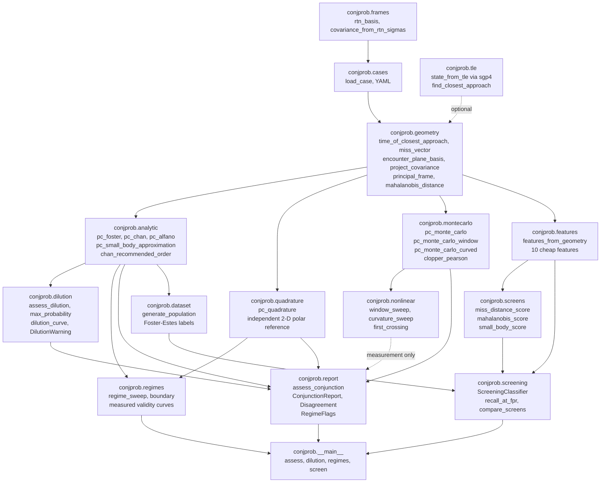
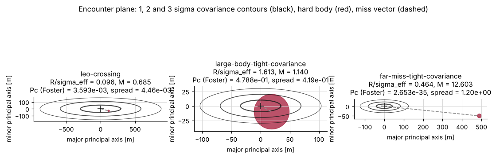
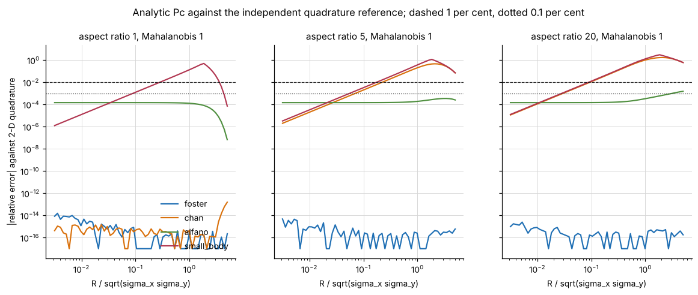
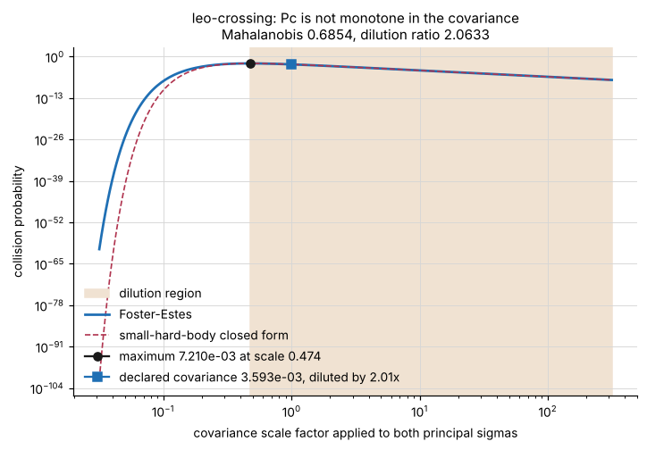
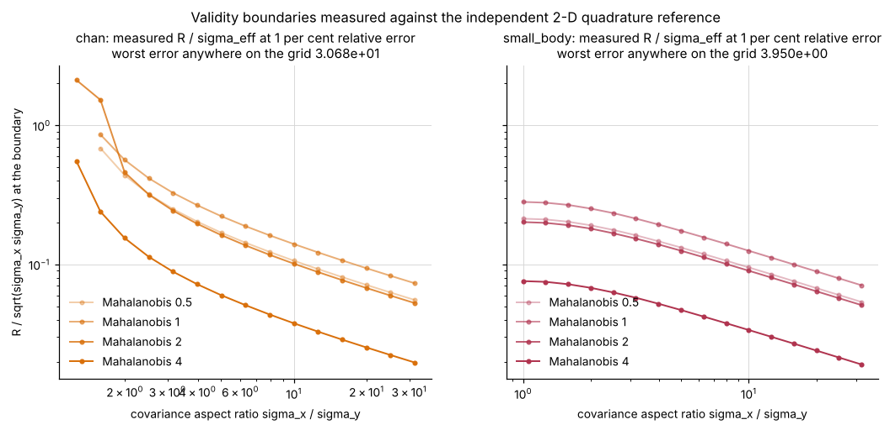
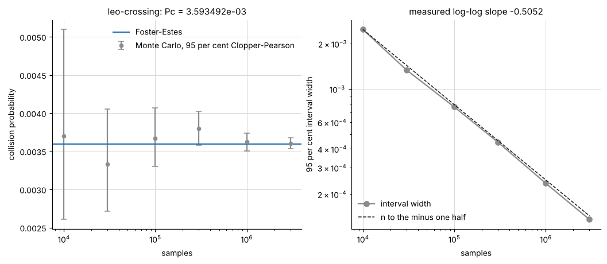
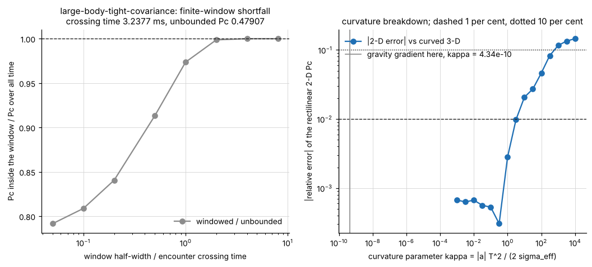
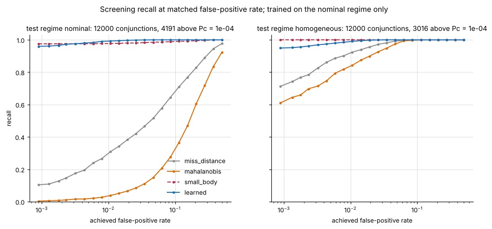

# ConjProb

Collision probability for a close approach, with the validity regime stated next to the number.


**Status: TESTING** · Class: flagship · Validation level 3 (research grade) ·
Learned component present and benchmarked against the baselines it has to beat ·
Apache-2.0 · © 2026 OPTIMA Organisation

This software is research-grade. It is **not flight-qualified, not certified,
and not approved for operational aerospace use.**

> **No output of this package is suitable as an input to a manoeuvre decision.**
> It computes a probability under the covariance you supplied and reports how
> much the published methods disagree about it. Deciding anything is outside the
> package, and the covariance — which is where the real uncertainty lives — has
> to come from orbit determination, not from here.

## The problem

Someone hands you two states with covariances and a combined hard-body radius
and asks for the probability of collision. The published methods will give you
answers that differ by more than an order of magnitude in regimes you can
actually be in, and the one regime that matters most — probability dilution,
where a *larger* covariance produces a *smaller* number — turns a worse state
estimate into a more reassuring answer. A tool that returns one scalar with no
statement of which assumptions it rests on is not neutral about this; it is
actively misleading.

## What this does

- **Computes Pc by four analytic routes and two independent references, and
  reports the disagreement as the output.** On the shipped `leo-crossing` case
  the four analytic values span **4.4603e-03 relative**; on
  `far-miss-tight-covariance` Chan's series is **+1.1977e+00** — wrong by a
  factor of 2.2 — and the leading-order approximation is **-8.6942e-01**
  (`validation/worked_example_output.txt`).
- **Checks the methods against something that is not another quadrature.** For a
  circular encounter-plane covariance the exact answer is the non-central
  chi-square distribution function. Foster-Estes, Chan at its recommended series
  order and the independent 2-D quadrature agree with `scipy.stats.ncx2` to
  **6.661338e-16, 1.110223e-15 and 5.551115e-16** worst relative error over a
  30-cell grid; Alfano's fixed-node rule sits at **1.479235e-04** with a
  **measured convergence order of 1.5004**, not Simpson's nominal 4
  (`validation/validate_analytic_output.txt`).
- **Reports validity regimes as measured curves.** At a 1 per cent tolerance
  Chan's equivalent-area substitution is exact at covariance aspect ratio 1 and
  its boundary falls from `R/sigma_eff = 0.5609` at aspect 2 to **0.02024** at
  aspect 30; the small-hard-body boundary runs from 0.2818 to **0.01958** over
  the same grid. Worst errors anywhere on the 1800-point grid: Chan
  **2.906285e+01**, small-hard-body **3.933262e+00**
  (`validation/validate_regimes_output.txt`).
- **Exhibits the dilution region and warns about it from inside the library.**
  The shipped case reports `Pc = 3.593492e-03` when **7.209827e-03** is
  attainable at covariance scale 0.473905 — a dilution factor of **2.0064** —
  and `dPc/d ln(scale) = -5.480804e-03`, negative. The closed-form maximum
  `R^2 / (e d^2)` is reproduced to **4.440892e-16**
  (`validation/validate_dilution_output.txt`).
- **Measures where the 2-D rectilinear formulation stops being valid.** The
  error reaches 1 per cent at a curvature parameter of **3.288387** and 10 per
  cent at **6.702773e+02**, which for a declared 200 m / 300 m low Earth
  encounter is a relative speed of **0.810120 m/s** and **0.056743 m/s**: the
  formulation is excellent for a fast conjunction and unusable for a slow one
  (`validation/validate_nonlinear_output.txt`).
- **Scores a learned screen against the analytic screens, and reports a mostly
  negative result.** At a 1 per cent false-positive rate a one-line closed-form
  screen reaches **1.00000** recall on both populations the model was not trained
  on, against **0.98840** and **0.99784** for the random forest
  (`validation/validate_screening_output.txt`).

## Who it is for

- Anyone holding one conjunction and one covariance who needs to know how much
  the answer depends on which method produced it.
- Anyone who has been handed a small Pc and wants to know whether it is small
  because the risk is low or small because the covariance is large.
- Anyone implementing Foster-Estes, Chan or Alfano who would like a reference
  implementation checked against an exact distribution function, and a list of
  the places where the published equations as literally written return zero,
  `nan` or five figures of error.
- Anyone who wants to see a learned screening model measured honestly against the
  closed form it is supposed to replace.

## Who it is not for

- **Anyone making a manoeuvre decision.** No output of this package is an input
  to one. That is not a disclaimer about liability; it is a statement about what
  has been validated.
- **Anyone who needs to screen a catalogue.** There is no conjunction detection,
  no catalogue ingest and no screening volume here. Operational conjunction
  assessment is done with CARA- and CSpOC-grade tooling against catalogues this
  product does not have.
- **Anyone who needs a covariance.** This package consumes one and never
  produces one. A TLE gives a state, not a covariance, and a Pc from an assumed
  covariance is a statement about the assumption.
- **Anyone who needs to know whether the covariance is realistic.** That is the
  dominant error term in practice and nothing here can measure it.
- **Anyone with a slow encounter.** Geostationary co-location, formation flight
  and rendezvous all violate the rectilinear assumption, and the measured
  threshold is in the Limitations section. Patera (2001) is the method for a
  curved trajectory and is not implemented here.
- **Anyone who needs a non-spherical hard body.** The hard body is one combined
  radius and attitude is not modelled.
- **Anyone wanting a full astrodynamics stack.** Use Orekit. See below.

## Alternatives, honestly

| Alternative | What it does better | When to use this instead |
|---|---|---|
| **Orekit** (Java, Apache-2.0) | **The mature full-stack option, and this is not a replacement for it.** Numerical propagation with a real force model, frames and time scales done properly, orbit determination, manoeuvre modelling, and collision-probability methods among its space-situational-awareness modules. Years of operational use. | Only if you want the cross-method disagreement, the measured regime boundaries and the dilution report as the deliverable, in Python, with no JVM. If you need an astrodynamics library, Orekit is the answer and this is not. It was not run in this build container and no number in this repository came from it. |
| **`astropy`** (BSD-3) | Frames, time scales, ERFA/SOFA-grade transformations, units, and the whole scientific-Python astronomy ecosystem. Everything to do with getting two states into a common frame at a common epoch correctly. | This package does not transform frames: it takes two states that are already in a common inertial frame at a common epoch and assumes you got that right. Use `astropy` to make that true, then use this. `astropy` was confirmed to exist on the index at version 8.0.2 by the batch-level probe on 2026-10-20; it is **not installed in this build container** and is not a dependency, which the committed validation output records as `astropy : not installed`. No number in this repository came from it. |
| **`sgp4`** (MIT, Vallado's reference implementation) | SGP4/SDP4 propagation of two-line element sets, with the official verification vectors shipped in the package. | This package depends on `sgp4` 2.27 and uses it for its optional TLE entry point rather than reimplementing anything; `validation/validate_tle.py` checks that use against those shipped vectors to 6.819541e-06 m. If all you need is a state from a TLE, use `sgp4` directly. |
| **CARA / CSpOC operational tooling** (not public) | The real thing: catalogue screening at scale, covariance realism assessment, operator-grade dilution handling and a decision process with people in it. | Not installable and not comparable. This product's contribution is **method cross-validation and regime reporting on a conjunction you already have**, not catalogue screening. |

**What this does that the installable alternatives do not:** it computes the same
collision probability four ways plus two independent references, reports their
disagreement as the primary output rather than a footnote, measures the boundary
of each method's validity against that reference as a curve, exhibits the
dilution region explicitly and raises a warning from inside the library when the
number you have been given is on it.

## Install and first run

```bash
git clone https://github.com/OmAcharya-avtr/conjprob.git
cd conjprob
python -m venv .venv && source .venv/bin/activate
pip install -e ".[dev]"
python -m pytest tests/ -q
python -m conjprob assess examples/cases/leo_crossing.yaml
```

The test run ends with:

```
269 passed in 9.00s
```

The wall-clock figure moves between runs on a shared machine; the count does not.
The assessment prints the report in the next section. The example scripts
regenerate the committed screenshots:

```bash
python examples/encounter_plane.py
```

```
wrote screenshots/encounter_plane.png
```

## A worked example

```python
import warnings

from conjprob.cases import load_case
from conjprob.dilution import DilutionWarning
from conjprob.report import assess_conjunction

case = load_case("examples/cases/leo_crossing.yaml")

with warnings.catch_warnings(record=True) as caught:
    warnings.simplefilter("always")
    report = assess_conjunction(
        case.primary,
        case.secondary,
        case.radius_m,
        monte_carlo_samples=3_000_000,
        monte_carlo_seed=20261021,
    )

print(report.summary())
for warning in caught:
    print(f"{warning.category.__name__}: {warning.message}")
```

Real output, from `validation/worked_example_output.txt`:

```
conjunction assessment
  time of closest approach : +0.000891 s from epoch
  miss distance            : 120.7220 m
  relative speed           : 5743.7487 m/s
  hard-body radius         : 12.0000 m
  encounter-plane sigma    : 292.8651 m x 53.8516 m (aspect 5.4384)
  mahalanobis distance     : 0.685422
  R / sigma_eff            : 9.555380e-02
  crossing time            : 2.186441e-02 s

collision probability by method
  foster       : 3.593492e-03   rel. to quadrature +1.110e-15
  chan         : 3.603223e-03   rel. to quadrature +2.708e-03
  alfano       : 3.592965e-03   rel. to quadrature -1.468e-04
  small_body   : 3.609520e-03   rel. to quadrature +4.460e-03
  quadrature   : 3.593492e-03   abserr 2.614e-15
  monte_carlo  : 3.605333e-03   95% CI [3.537823e-03, 3.673804e-03]   hits 10816/3000000
    inside the interval  : foster, chan, alfano, small_body, quadrature
    outside the interval : none

disagreement (the primary output)
  max absolute spread      : 1.655544e-05
  max relative spread      : 4.460264e-03
  worst method             : small_body
  spread in decades        : 0.001997

dilution
  on dilution branch       : True
  dilution ratio           : 2.063275
  dPc / d ln(scale)        : -5.480804e-03
  attainable maximum Pc    : 7.209827e-03 at covariance scale 0.473905
  dilution factor          : 2.006357
```

followed by the warning the library raised by itself:

```
DilutionWarning: collision probability is on the dilution branch: the
mahalanobis distance is 0.6854 (below sqrt(2) = 1.4142), so inflating this
covariance would reduce the reported Pc of 3.593492e-03 rather than raise it.
The attainable maximum over covariance scale is 7.209827e-03 at scale 0.4739. A
small Pc here is not evidence of a small risk.
```

`ConjunctionReport` has no scalar `pc` attribute. Code that wants one number has
to name the method, because choosing a method is choosing a set of assumptions
and this package will not make that choice silently:

```python
report.pc("foster")      # 3.593492e-03
report.pc("quadrature")  # 3.593492e-03
```

## Architecture



## Screenshots



The three shipped cases in the encounter plane: 1, 2 and 3 sigma covariance
contours in black, the hard body in red, the miss vector dashed. Notice that the
hard body is invisible against the covariance in the left and right panels and
comparable to it in the middle one — that ratio is what decides which analytic
method is allowed.



Relative error of each analytic method against the independent quadrature, swept
over hard-body size at three covariance aspect ratios. Notice that Foster-Estes
sits at the quadrature's own precision across the whole sweep, Alfano sits on a
flat floor set by its node count, and Chan and the small-hard-body approximation
climb through the 1 per cent line at points that move by a factor of 7 with
aspect ratio.



Pc against covariance scale for the shipped case. Notice that the curve has a
maximum: the square marker is the declared covariance, sitting on the shaded
right-hand branch where **growing the covariance lowers the reported
probability**. That is the number an operator is handed.



The measured 1 per cent validity boundary of Chan's series and of the
small-hard-body approximation, against covariance aspect ratio, at four
Mahalanobis distances. Notice that Chan's boundary falls steeply with aspect
ratio — its equivalent-area step is exact only at aspect 1, where no point is
plotted because the tolerance is never exceeded — while the small-hard-body
boundary is nearly flat and set by the hard-body size.



The Monte Carlo reference against the analytic value, with exact Clopper-Pearson
intervals, and the interval width against sample count. Notice that every
interval contains the analytic value and that the measured log-log slope is
-0.5052 against the -0.5 a binomial estimator must have.



Left: probability lost by restricting the encounter to a finite window. Right:
error of the rectilinear 2-D value against a curved 3-D Monte Carlo, against the
curvature parameter. Notice the vertical line marking the curvature a real low
Earth conjunction actually has — nine orders of magnitude to the left of where
the 2-D formulation starts to fail.



Recall against achieved false-positive rate for three analytic screens and the
learned model, on the population it was trained on and on one it was not. Notice
that the dashed closed-form curve is on top of or above the learned curve in the
right-hand panel, and that the Mahalanobis screen moves from the bottom of the
left panel to near the top of the right one.

## Validation evidence

Level 3. Every number below was produced by a script in `validation/` run in the
session that wrote this file; the file names are given. Full tables, including
the checks that failed, are in `validation/VALIDATION.md`. `docs/REQUIREMENTS.md`
traces each requirement to its evidence.

### Against an exact distribution function

For a circular encounter-plane covariance the exact Pc is the non-central
chi-square distribution function, `P(chi'^2_2(d^2/sigma^2) <= R^2/sigma^2)`,
evaluated by `scipy.stats.ncx2` — a separately implemented special function.

| Check | Reference | Result | Tolerance |
|---|---|---|---|
| `pc_foster` over a 30-cell grid | `scipy.stats.ncx2` | 6.661338e-16 worst relative error | 1e-9 |
| `pc_chan` at `chan_recommended_order` | `scipy.stats.ncx2` | 1.110223e-15 | 1e-9 |
| `pc_quadrature` | `scipy.stats.ncx2` | 5.551115e-16 | 1e-9 |
| `pc_alfano`, 2001 nodes | `scipy.stats.ncx2` | 1.479235e-04 | 5e-4, derived from its measured order |
| `pc_small_body_approximation` | `scipy.stats.ncx2` | 9.999469e-01 worst | none — the error is the measurement |
| Alfano convergence order over 7 refinements | the same integral by adaptive quadrature | **1.5004 measured**, against Simpson's nominal 4 | reported, not bounded |

### Method disagreement on the shipped cases

From `validation/worked_example_output.txt`. Columns after the reference are
signed relative errors against the independent quadrature.

| Case | R/sigma_eff | aspect | M | quadrature Pc | foster | chan | alfano | small_body |
|---|---|---|---|---|---|---|---|---|
| `leo-crossing` | 0.0956 | 5.4384 | 0.68542 | 3.593492e-03 | +1.1102e-15 | +2.7080e-03 | -1.4680e-04 | +4.4603e-03 |
| `large-body-tight-covariance` | 1.6132 | 3.4583 | 1.13996 | 4.788298e-01 | +2.2204e-16 | +9.3603e-02 | -1.5864e-04 | +4.1900e-01 |
| `far-miss-tight-covariance` | 0.4640 | 3.7151 | 12.60332 | 2.652961e-35 | +8.6597e-15 | +1.1977e+00 | -1.5811e-04 | -8.6942e-01 |

### Measured regime boundaries, 1 per cent tolerance

`validation/validate_regimes_output.txt`. `R/sigma_eff` at which each method
first exceeds 1 per cent relative error against the quadrature reference; a dash
means the tolerance was never exceeded anywhere in the swept range.

| Method | aspect 1 | aspect 2 | aspect 5 | aspect 10 | aspect 30 | worst error on the grid |
|---|---|---|---|---|---|---|
| `pc_foster` | — | — | — | — | — | 1.408800e-13 |
| `pc_alfano` | — | — | — | — | — | 2.453471e-03 |
| `pc_chan` | — | 0.5609 | 0.2221 | 0.1397 | 0.07519 | 2.906285e+01 |
| `pc_small_body_approximation` | 0.2818 | 0.2516 | 0.1746 | 0.1251 | 0.07269 | 3.933262e+00 |

Columns are at Mahalanobis distance 1; the full five-column tables are in
`validation/VALIDATION.md`.

### Monte Carlo reference

`validation/validate_montecarlo_output.txt`.

| Check | Result | Tolerance |
|---|---|---|
| intervals containing the analytic value, 6 sample counts from 1e4 to 3e6 | 6 of 6 | all |
| log-log slope of interval width against sample count | -0.505200 | -0.5 +/- 0.05 |
| **measured coverage** of the nominal 95 per cent interval, 300 seeds | **0.960000**, interval on the coverage [0.931171, 0.979163] | >= 0.93 |
| relative bias of the mean of 300 estimates | +1.208033e-03 against a standard error of 2.999838e-03 | within 3 standard errors |

### Dilution

`validation/validate_dilution_output.txt`.

| Check | Result | Tolerance |
|---|---|---|
| closed-form maximum against Alfano's `R^2 / (e d^2)` | 4.440892e-16 worst relative difference | 1e-13 |
| scale at the maximum against `M / sqrt(2)` | 6.257130e-04 worst | 1e-3 |
| closed-form maximum against the numerical maximum of Foster-Estes, `R/sigma_eff <= 0.01` | 2.882619e-04 worst | 1e-3 |
| Pc-against-scale curve has one interior maximum, strictly rising then strictly falling, 241 scales | maximum 7.20571701e-03 at scale 0.482318 | monotone on both branches |
| `DilutionWarning` raised on the two dilution-branch cases and on neither other | 2 raised, 1 not | exact match |

### Rectilinear-motion breakdown, deliberately violated

`validation/validate_nonlinear_output.txt`.

| Check | Result |
|---|---|
| finite window, ratio to unbounded time at 0.5 crossing times | 0.913176, interval [0.904495, 0.921938] — the 2-D value overstates by a factor of 1.0951 |
| curvature at which the 2-D error reaches 1 per cent | kappa = 3.288387 |
| curvature at which it reaches 10 per cent | kappa = 6.702773e+02 |
| the same, as a relative speed, 200 m sigma and 300 m separation in low Earth orbit | 0.810120 m/s and 0.056743 m/s |
| discretisation bias of the curved estimator at the package default grid against a 4x finer one | +0.000000e+00 |

### The AI component, and the baseline that beats it

`validation/validate_screening_output.txt`. Recall at an achieved false-positive
rate of about 1 per cent, 12000 test conjunctions per regime, model trained on
`nominal` only.

| Screen | `nominal` (trained) | `homogeneous` | `dilution` |
|---|---|---|---|
| `miss_distance` threshold | 0.30112 | 0.91280 | 0.02954 |
| `mahalanobis` threshold | 0.03436 | 0.83720 | 0.01297 |
| `small_body`, one-line closed form | 0.97733 | **1.00000** | **1.00000** |
| `learned`, random forest | **0.99284** | 0.98840 | 0.99784 |

Paired exact binomial tests on the discordant positives: the learned model's win
on `nominal` is real (85 against 20, p = 1.008e-10); the closed form's win on
`homogeneous` is real (35 against 0, p = 5.821e-11); on `dilution` three
discordant pairs do not resolve a difference (p = 0.25).

**The honest verdict.** A closed-form expression that fits on one line, uses
exactly the same features and has no training step is the better screen on two of
the three populations measured. The learned model is ahead only on the population
it was trained on, by +0.01551 recall. **The product specification predicted that
a Mahalanobis threshold would match the learned model; on the broad population it
does not** — it is the worst of the three analytic screens at 0.03436 — and the
reason was measured rather than argued: the Mahalanobis distance is invariant to
`R/sigma_eff`, which spans 3.92251 decades on `nominal` and 0.26125 decades on
`homogeneous`, where the same screen recovers to 0.83720. The prediction holds
under a condition the specification did not state. Nothing was retuned after this
was measured and no screen was removed.

### Checks that FAILED

| Check | Measured | Tolerance | Disposition |
|---|---|---|---|
| calibration of the learned probabilities, worst reliability-bin gap on `nominal` | **0.272486** | 0.15 | **FAIL**, published and not repaired. Recall at a fixed false-positive rate depends only on the ordering of the scores and is invariant under any strictly monotone recalibration, so an isotonic or Platt fit would move the Brier score and not move a single recall number above. The consequence: **the predicted probability is usable as a ranking and is not usable as a probability.** See `MODEL_CARD.md`. |

No other check in the ten validation scripts fails. Two more results are
negative rather than failing and are reported as results: the learned screen
loses to the closed form on two of three regimes, and 0.057305 of the forest's
feature importance is assigned to two features that provably cannot affect the
target.

### Defects found in this package's own first implementation

All six were found by the property-based tests in `tests/test_properties.py` and
none by the hand-written tests. All six are pinned as named regression tests with
literal inputs in `tests/test_regressions.py` (seven tests), because
`.hypothesis/` is gitignored and a counterexample found by one run is otherwise
lost. **Four of the six are defects in the published equations as literally
transcribed**, in regimes an operational tool reaches:

| Defect | Found at | Was wrong by |
|---|---|---|
| an absolute quadrature tolerance of 1e-14 destroyed scale invariance | `sigma = (2160, 2134) m`, `miss = (2, 18061) m`, `R = 200 m`, scaled by 19 | 5.3 per cent between a geometry and the same geometry rescaled, and both values wrong |
| the published error-function form of the chord mass cancels to exactly zero | `sigma_y = 3 m`, `ybar = 68 m`, `h = 1 m` | returned 0.0 where the answer is 8.767418031863e-111 |
| Chan's published finite sum loses twelve significant figures to cancellation | `sigma = 1 m`, `ybar = 8 m`, `R = 1 m` | 5.2e-4 relative |
| Chan's series needs an order growing as `M^2 / 2` | `M = 12`, `R/sigma = 0.5`, order 3 | 15 per cent |
| Chan's series overflows while its prefactor underflows | `sigma = 437 m`, `xbar = 16515 m`, `R = 1 m` | returned `nan` |
| a subnormal miss component underflows the squared Mahalanobis distance | `xbar = 2.2250738585072014e-308 m` | division by zero |

## API reference

<details>
<summary>Public surface, with units</summary>

### Geometry — `conjprob.geometry`

| Function | Returns |
|---|---|
| `ObjectState(position_m, velocity_mps, covariance_m2, name)` | validated state; rejects an asymmetric or indefinite covariance |
| `relative_state(primary, secondary)` | `(r_rel m, v_rel m/s, combined covariance m^2)` |
| `time_of_closest_approach(r_rel_m, v_rel_mps)` | seconds from the epoch |
| `miss_vector(r_rel_m, v_rel_mps)` | relative position at closest approach, m, shape (3,) |
| `encounter_plane_basis(v_rel_mps)` | orthonormal (3, 2) basis of the plane |
| `project_covariance(covariance_m2, basis)` | exact marginal (2, 2) covariance, m^2 |
| `principal_frame(covariance_2d_m2, miss_2d_m)` | `PrincipalFrame(sigma_x_m, sigma_y_m, x_bar_m, y_bar_m, rotation)`, `sigma_x >= sigma_y` |
| `mahalanobis_distance(covariance_2d_m2, miss_2d_m)` | dimensionless |
| `encounter_geometry(primary, secondary)` | `EncounterGeometry` with all of the above plus `crossing_time_s` |

### Analytic probabilities — `conjprob.analytic`

All take `(sigma_x_m, sigma_y_m, xbar_m, ybar_m, radius_m)` in metres and return
a dimensionless probability in `[0, 1]`.

| Function | Method |
|---|---|
| `pc_foster(...)` | Foster-Estes 1992, error-function reduction by adaptive quadrature. The operational default. |
| `pc_chan(..., order=3)` | Chan 1997/2008 equivalent-area series, bracket evaluated as a regularised incomplete gamma, weights in logarithms |
| `pc_alfano(..., nodes=201)` | Alfano 2005, fixed-node composite Simpson |
| `pc_small_body_approximation(...)` | leading order, `R^2 / (2 sigma_x sigma_y) exp(-M^2 / 2)` |
| `pc_circular_closed_form(radius_m, sigma_m)` | exact Rayleigh form at zero miss distance |
| `chan_recommended_order(mahalanobis)` | series order at which `pc_chan` has converged |

### References — `conjprob.quadrature`, `conjprob.montecarlo`

| Function | Returns |
|---|---|
| `pc_quadrature(covariance_2d_m2, miss_2d_m, radius_m)` | `(pc, abserr)`; independent 2-D polar quadrature with the full covariance |
| `pc_monte_carlo(covariance_m2, miss_vector_m, relative_velocity_mps, radius_m, n_samples, seed)` | `MonteCarloResult` with Clopper-Pearson interval; unbounded time |
| `pc_monte_carlo_window(..., window_s, ...)` | the same, restricted to `\|t\| <= window_s`, exact per-sample minimum |
| `pc_monte_carlo_curved(..., window_s, relative_acceleration_mps2, ...)` | the same with a declared constant relative acceleration |
| `clopper_pearson(hits, n_samples, confidence)` | `(low, high)` exact binomial interval |

### Dilution — `conjprob.dilution`

| Function | Returns |
|---|---|
| `assess_dilution(sigma_x_m, sigma_y_m, xbar_m, ybar_m, radius_m, warn=True)` | `DilutionAssessment`; raises `DilutionWarning` when the measured `dPc/d ln(scale)` is negative |
| `max_probability(...)` | `(pc_max, scale_at_max)`, the closed-form maximum over covariance scale |
| `dilution_curve(..., scales)` | `(pc_foster, pc_small_body)` arrays over the scale grid |
| `DILUTION_MAHALANOBIS_THRESHOLD` | `sqrt(2)`, below which the covariance is already diluting Pc |

### Regimes and breakdown — `conjprob.regimes`, `conjprob.nonlinear`

| Function | Returns |
|---|---|
| `geometry_from_dimensionless(radius_over_sigma, aspect_ratio, mahalanobis, psi_rad, sigma_effective_m)` | the five metre quantities |
| `evaluate_methods(...)` | every analytic Pc plus `reference` and `reference_abserr` |
| `regime_sweep(radius_over_sigma, aspect_ratios, mahalanobis_values)` | `RegimeSweep` with `.boundary(method, tolerance)` and `.worst_error(method)` |
| `window_sweep(..., windows_s, sigma_effective_m)` | unbounded reference plus one `WindowPoint` per window |
| `curvature_sweep(..., accelerations_mps2, window_s, pc_linear_2d, sigma_effective_m)` | one `CurvaturePoint` per acceleration |
| `curvature_parameter(acceleration_mps2, window_s, sigma_effective_m)` | `kappa`, dimensionless |
| `gravity_gradient_acceleration_scale(geocentric_radius_m, separation_m)` | m/s^2 |
| `first_crossing(x_values, y_values, threshold)` | interpolated abscissa, `nan` if never crossed |

### Report — `conjprob.report`

| Function | Returns |
|---|---|
| `assess_conjunction(primary, secondary, radius_m, chan_order=None, alfano_nodes=201, monte_carlo_samples=None, monte_carlo_seed=0, warn_on_dilution=True)` | `ConjunctionReport` |
| `ConjunctionReport.pc(method)` | one probability; `method` must be named |
| `ConjunctionReport.summary()` | the plain-text report as a string; never prints |
| `ConjunctionReport.disagreement` | `Disagreement` with absolute and relative spreads and the worst method |
| `ConjunctionReport.regime` | `RegimeFlags` with the dimensionless parameters and the regime notes |

### Screening — `conjprob.features`, `conjprob.screens`, `conjprob.screening`, `conjprob.dataset`

| Function | Returns |
|---|---|
| `features_from_geometry(geometry, radius_m)` | (1, 10) feature matrix |
| `features_from_arrays(sigma_x_m, sigma_y_m, xbar_m, ybar_m, radius_m, relative_speed_mps, sigma_out_of_plane_m)` | (n, 10) |
| `miss_distance_score`, `mahalanobis_score`, `small_body_score`, `all_screen_scores` | screening scores, larger meaning more suspicious |
| `ScreeningClassifier(n_estimators=300, ...)` | `.fit`, `.predict_proba`, `.predict_with_uncertainty` -> `(mean, per-tree dispersion)`, `.score_samples`, `.feature_importances` |
| `recall_at_fpr(y_true, scores, fpr_target)` | `OperatingPoint`; `fpr_achieved <= fpr_target` holds exactly, ties included |
| `compare_screens(y_true, model_scores, features, fpr_targets)` | every screen at every operating point |
| `brier_score`, `reliability_table` | calibration measures |
| `generate_population(n_samples, seed, regime, threshold)` | `ConjunctionPopulation`; regimes `nominal`, `homogeneous`, `dilution` |

### Frames, cases, TLE — `conjprob.frames`, `conjprob.cases`, `conjprob.tle`

| Function | Returns |
|---|---|
| `rtn_basis(position_m, velocity_mps)` | (3, 3) radial / along-track / cross-track basis |
| `covariance_from_rtn_sigmas(position_m, velocity_mps, sigma_rtn_m, correlation_ra=0.0)` | inertial (3, 3) covariance, m^2 |
| `load_case(path)` | `ConjunctionCase` from YAML |
| `state_from_tle(line1, line2, minutes_from_epoch)` | `(position_m, velocity_mps)` in TEME, via `sgp4` |
| `synthetic_secondary(position_m, velocity_mps, offset_rtn_m, velocity_rotation_rad, rotation_axis)` | a declared synthetic secondary state |
| `find_closest_approach(state_a, state_b, t_start_s, t_end_s)` | `ClosestApproach` |

### Command line

```bash
python -m conjprob assess CASE.yaml [--monte-carlo N] [--seed S] [--chan-order K] [--alfano-nodes N]
python -m conjprob dilution CASE.yaml [--decades D] [--points N]
python -m conjprob regimes [--tolerance T] [--aspects ...] [--mahalanobis ...] [--points N]
python -m conjprob screen [--n-train N] [--n-test N] [--seed S] [--regime R]
```

</details>

## Limitations

**On what the output means**

1. **No output is an input to a manoeuvre decision.** Repeated here because it is
   the most important limitation and the easiest to forget after reading a table
   of agreeing numbers.
2. **Every number is conditional on the supplied covariance.** The dominant error
   in a real collision probability is that the covariance is wrong or
   misreported, and nothing in this package can measure that. This is the largest
   single gap between this product and operational conjunction assessment.
3. **The two covariances are assumed uncorrelated**, because the combined
   covariance is formed as their sum. That is standard practice and it is an
   assumption.
4. **Velocity uncertainty is neglected**, which is the short-encounter assumption
   and is what makes the 2-D formulation possible at all.

**On the validity regimes, with the measured boundaries**

5. **Rectilinear relative motion.** The measured 1 per cent curvature boundary is
   `kappa = 3.288387`, which for a declared 200 m sigma and 300 m separation in
   low Earth orbit is a relative speed of 0.810120 m/s. Above a few hundred
   metres per second the assumption costs nothing measurable here; below about
   1 m/s it does. Geostationary co-location, formation flight and rendezvous are
   all in the second category and this package should not be used for them.
   Patera (2001) is the method for a curved trajectory and is not implemented.
6. **Unbounded integration time.** Pc here is the probability of a conjunction
   over all time, not within a screening window. Within half a crossing time the
   2-D value overstates it by a measured factor of 1.0951.
7. **Chan's series is not reliable at large covariance aspect ratio.** Its
   measured 1 per cent boundary falls to `R/sigma_eff = 0.02024` at aspect 30,
   and its worst error on the swept grid is 2.906285e+01 — a factor of 30. It is
   exact at aspect 1.
8. **The small-hard-body approximation is not reliable for a large hard body.**
   Measured 1 per cent boundary 0.2818 at aspect 1, worst grid error 3.933262e+00.
9. **Alfano's fixed-node rule converges at order 1.5004, not 4**, because the
   chord has an infinite derivative at the ends of the integration interval. At
   the package default of 201 nodes its relative error is 1.468000e-04 — fine for
   a screening number, not fine as a reference.
10. **The chord mass underflows beyond about 27 standard deviations.** Below that,
    `pc_foster` returns 0 where the true value is a subnormal double. The
    smallest non-zero Pc measured in this build is 1.92739845e-316.
11. **Monte Carlo is not usable below about `Pc = 1e-5`** inside the declared
    three-minute compute budget: a 10 per cent interval needs about `1537 / Pc`
    samples, which is 1.537e+08 at 1e-5 and 1.537e+09 at 1e-6. The shipped
    `far-miss-tight-covariance` case at 2.652961e-35 therefore has no Monte Carlo
    row, and below 1e-5 the evidence is analytic agreement only.
12. **The hard body is a single combined sphere.** No attitude, no shape, no
    separate radii.
13. **No frame transformations.** Both states must already be in a common
    inertial frame at a common epoch. Use `astropy` to make that true.

**On the learned component**

14. **It loses to a one-line closed form on both populations it was not trained
    on** (1.00000 against 0.98840 and 0.99784). If you want one screen, use
    `small_body_score`.
15. **Its probabilities are miscalibrated** by up to 0.272486 on a reliability
    table, which is a failing check. The score is a ranking, not a probability.
16. **It assigns 0.057305 of its importance to two features that provably cannot
    affect Pc**, so it is partly fitting the synthetic generator.
17. **It was trained on a declared synthetic population, not a real one.** The
    base rate here is about one third; a real screening population is
    overwhelmingly negative, so the precision figures are optimistic by a factor
    this product cannot estimate. See `DATASET_CARD.md`.
18. **Only the `Pc > 1e-4` threshold was examined.** A different threshold is a
    different classification problem.

**On the engineering**

19. **Dependencies are pinned on both sides** — `numpy>=2.5,<2.6`,
    `scipy>=1.18,<1.19`, `scikit-learn>=1.9,<1.10`, `pyyaml>=6.0,<6.1`,
    `sgp4>=2.27,<2.28`. A ceiling is a real cost: the product cannot take a
    future security release of any of these without a port and a re-measurement.
    The alternative is worse, because the measured numbers here are properties of
    those minor versions.
20. **The learned model's predictions are reproducible to within rounding, not
    bit for bit**, because the forest is averaged across two worker processes and
    the summation order is not fixed. The tests assert agreement to 1e-12
    relative and say why.
21. **Compute budget.** The largest single run in the repository is
    `validate_screening.py` at 31.75 s wall clock on a shared two-core container,
    well inside the declared three-minute limit. All wall-clock figures in this
    repository are unstable between runs and no conclusion is drawn from them.
22. **No model artefact is committed.** The forest is refitted from the committed
    generator on every run, deterministically from its seed, so there is no
    pickle whose format could outlive the scikit-learn version that wrote it.

## Reproducing every number

```bash
git clone https://github.com/OmAcharya-avtr/conjprob.git
cd conjprob
python -m venv .venv && source .venv/bin/activate
pip install -e ".[dev]"

# tests, counted from the XML and not from stdout
python -m pytest tests/ -q --junitxml=junit.xml
python -c "import xml.etree.ElementTree as ET; r = ET.parse('junit.xml').getroot(); ts = r if r.tag == 'testsuite' else r.find('testsuite'); print(ts.attrib); print(len(ts.findall('.//testcase')))"

# style
ruff check src/ tests/ examples/ validation/

# every validation number, in the order the evidence appears above
python validation/validate_geometry.py
python validation/validate_analytic.py
python validation/validate_regimes.py
python validation/validate_montecarlo.py
python validation/validate_dilution.py
python validation/validate_nonlinear.py
python validation/validate_screening.py
python validation/validate_tle.py
python validation/validate_cli.py
python validation/worked_example.py

# every screenshot
python examples/encounter_plane.py
python examples/method_disagreement.py
python examples/dilution_curve.py
python examples/regime_map.py
python examples/monte_carlo_convergence.py
python examples/nonlinear_breakdown.py
python examples/screening_performance.py

# the command line
python -m conjprob --version
python -m conjprob assess examples/cases/leo_crossing.yaml --monte-carlo 3000000 --seed 20261021
python -m conjprob dilution examples/cases/leo_crossing.yaml
python -m conjprob regimes --tolerance 0.01
python -m conjprob screen --n-train 24000 --n-test 12000 --seed 0
```

Every validation script changes its working directory to the repository root
before doing anything, so all of them run identically from any directory. That
was verified rather than assumed: all ten were run from the filesystem root, the
system temporary directory, the repository root and `validation/`, and all forty
runs exited zero.

Seeds: dataset training population 0, test populations 1000,
`RandomForestClassifier(random_state=0)`, Monte Carlo coverage study 10000 to
10299, worked example 20261021, nonlinear sweeps 4242, geometry random sampling
20261021.

Measured against Python 3.13.16, numpy 2.5.3, scipy 1.18.1, scikit-learn 1.9.1,
matplotlib 3.11.2, pyyaml 6.0.3, sgp4 2.27, pytest 9.1.1, hypothesis 6.170.5,
ruff 0.17.1, on 2 shared CPU cores. Every validation output file records these
versions at the top.

## Licence

Apache-2.0. Copyright © 2026 OPTIMA Organisation. See `LICENSE`.

## Citation

See `CITATION.cff`. The methods implemented here are due to their authors, not to
this package:

- Foster, J. L., and Estes, H. S. (1992). "A parametric analysis of orbital debris
  collision probability and maneuver rate for space vehicles." NASA/JSC-25898,
  NASA Johnson Space Center.
- Chan, F. K. (1997). "Collision probability analyses for Earth-orbiting
  satellites." *Advances in the Astronautical Sciences*, 96, 1033-1048; and Chan,
  F. K. (2008). *Spacecraft Collision Probability*. The Aerospace Press.
- Alfano, S. (2005). "A numerical implementation of spherical object collision
  probability." *Journal of the Astronautical Sciences*, 53(1), 103-109.
- Alfano, S. (2005). "Relating position uncertainty to maximum conjunction
  probability." *Journal of the Astronautical Sciences*, 53(2), 193-205.
- Alfriend, K. T., Akella, M. R., Frisbee, J., Foster, J. L., Lee, D.-J., and
  Wilkins, M. (1999). "Probability of collision error analysis." *Space Debris*,
  1(1), 21-35.
- Akella, M. R., and Alfriend, K. T. (2000). "Probability of collision between
  space objects." *Journal of Guidance, Control, and Dynamics*, 23(5), 769-772.
- Patera, R. P. (2001). "General method for calculating satellite collision
  probability." *Journal of Guidance, Control, and Dynamics*, 24(4), 716-722.
- Balch, M. S., Martin, R., and Ferson, S. (2019). "Satellite conjunction analysis
  and the false confidence theorem." *Proceedings of the Royal Society A*,
  475(2227), 20180565.
- Clopper, C. J., and Pearson, E. S. (1934). "The use of confidence or fiducial
  limits illustrated in the case of the binomial." *Biometrika*, 26(4), 404-413.
- Vallado, D. A. (2013). *Fundamentals of Astrodynamics and Applications*, 4th ed.
  Microcosm Press.
- Vallado, D. A., Crawford, P., Hujsak, R., and Kelso, T. S. (2006). "Revisiting
  Spacetrack Report #3." AIAA 2006-6753.
- Breiman, L. (2001). "Random forests." *Machine Learning*, 45(1), 5-32.
- Wager, S., Hastie, T., and Efron, B. (2014). "Confidence intervals for random
  forests: the jackknife and the infinitesimal jackknife." *Journal of Machine
  Learning Research*, 15, 1625-1651.
- Brier, G. W. (1950). "Verification of forecasts expressed in terms of
  probability." *Monthly Weather Review*, 78(1), 1-3.

## Credits

This is under reserved rights obtained by OPTIMA Organisation.
