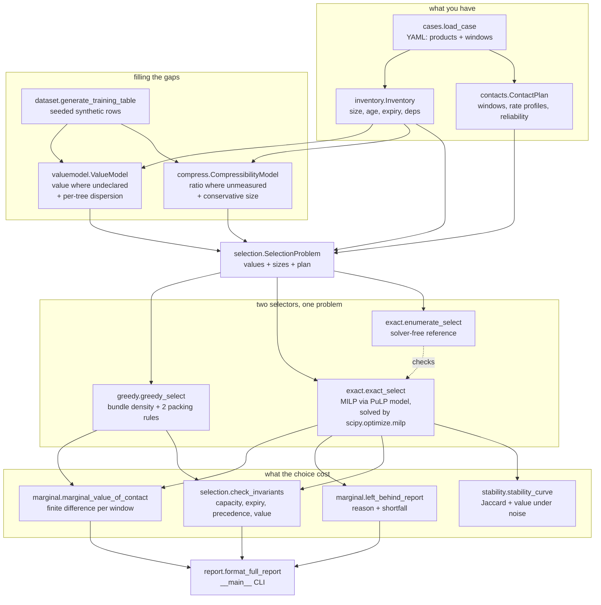
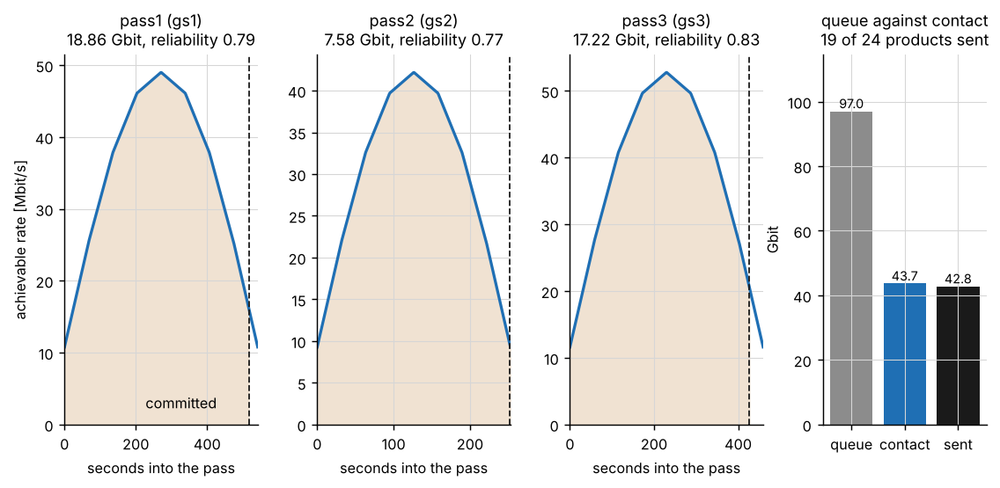
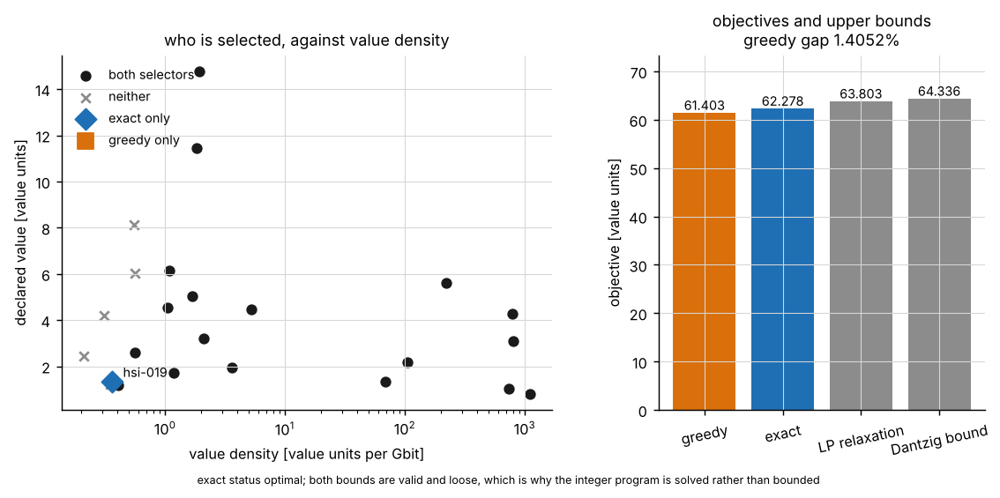
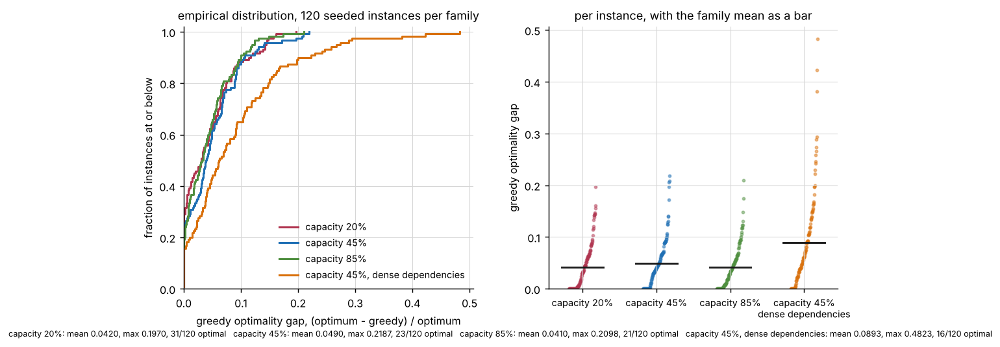
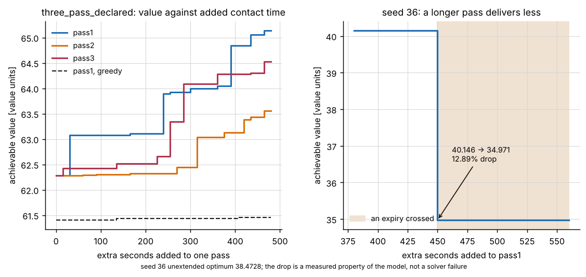
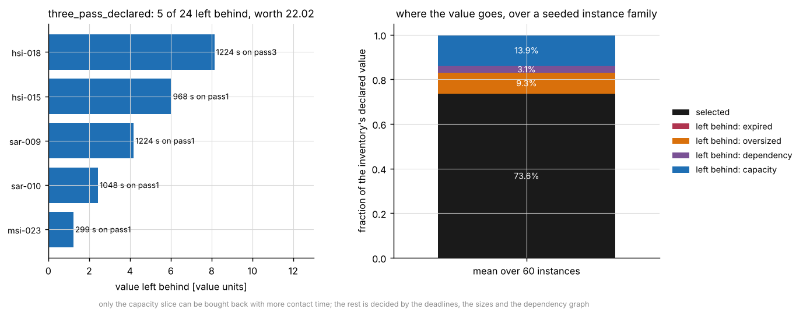
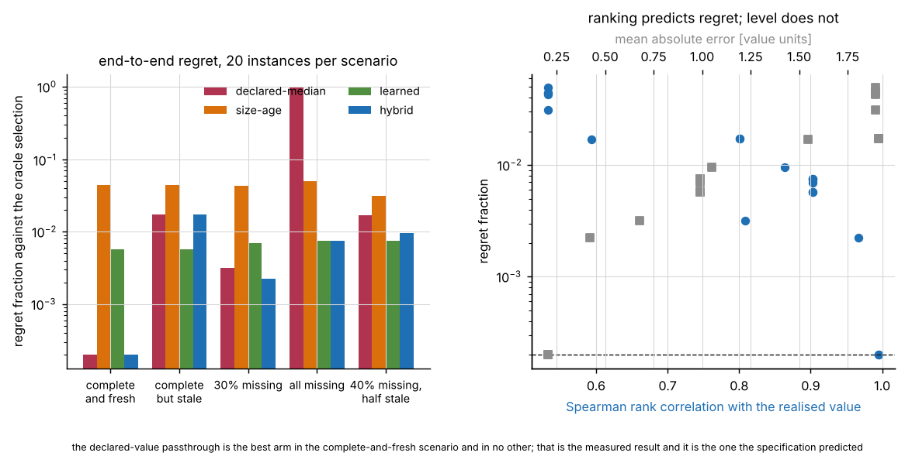
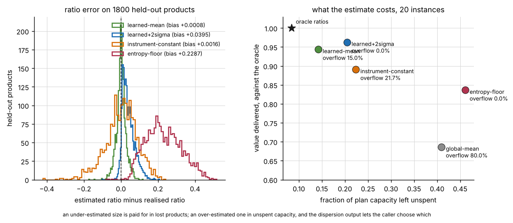
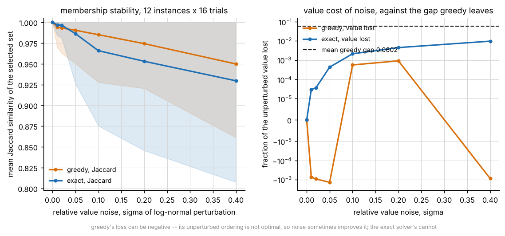

# DownlinkPick

Choose what to downlink when the contact is shorter than the queue, and say what the choice cost.


**Status: TESTING** · Class: flagship · Validation level 3 (research grade) ·
Learned components present and benchmarked against the baselines they have to
beat · Apache-2.0 · © 2026 OPTIMA Organisation

This software is research-grade. It is **not flight-qualified, not certified,
and not approved for operational aerospace use.**

> **This package decides nothing on its own.** It takes a value table you
> supplied or a value it predicted, optimises against it, and tells you what the
> optimisation gave up. The value table is where the real judgement lives, and
> nothing here can check that it is right.

## The problem

The recorder holds more than the next three passes can carry, and somebody has
to decide what does not go. The obvious procedure — sort by value per bit and
fill each window until it is full — is genuinely hard to beat, but it has no way
to tell you how much it gave up, which pass was worth asking the network to
extend, or which of the things it dropped it dropped because of a deadline
rather than because of capacity. A selection with no price attached is an
instruction; a selection with a price attached is an argument you can take to
the people who own the data.

## What this does

- **Selects against a contact plan whose capacity is an integral, not a
  rectangle.** A window's deliverable capacity is the integral of its achievable
  rate over the pass. The closed-form evaluation agrees with adaptive
  Gauss-Kronrod quadrature to **8.384938e-09** worst relative error over five
  profiles and to **4.031808e-15** over the seven windows of the shipped cases
  (`validation/validate_capacity_output.txt`).
- **Gives you a proved optimum and the operational baseline, scored against each
  other.** The MILP optimum matches exhaustive enumeration — a route with no
  solver in it — to **0.000000e+00** worst relative difference over **240**
  instances. On the tight instance family greedy matches the optimum on **51 of
  300** instances, with median gap **3.776537e-02**, 95th percentile
  **1.447293e-01** and maximum **2.491356e-01**
  (`validation/validate_exact_output.txt`, `validation/validate_greedy_gap_output.txt`).
- **Prices the next unit of contact time, and reports when it is worth less than
  nothing.** The price is a finite difference on the integral optimum with an
  explicit step, not a dual variable. It can be **negative**: a window's end is
  also its delivery epoch, and a 20-second extension of one pass was measured
  lowering the achievable value by **12.89 per cent** because it pushed a
  product past its deadline (`validation/validate_marginal_output.txt`).
- **Names everything it left behind, with the reason and the shortfall.** Four
  reasons — expired, oversized, dependency, capacity — of which only capacity
  can be bought back with more contact time. The accounting closes against the
  whole inventory to **1.937e-16** relative over 40 instances, and on 101
  capacity shortfalls the stated seconds freed the room claimed **101 times out
  of 101** (`validation/validate_marginal_output.txt`).
- **Measures whether the selection survives noise in the value table.** At a
  relative value noise of 0.05 the exact selection keeps a Jaccard similarity of
  **0.99313** and **0.999747** of its value; at 0.40, **0.95919** and
  **0.992742**. Against a mean greedy gap of **4.758763e-02** on the same
  family, the optimality is worth having at every noise level measured
  (`validation/validate_stability_output.txt`).
- **Reports a learned value model that loses to a fresh declaration.** Regret
  fraction **0.009582** against the passthrough's **0.000404** when declarations
  are complete and current. It wins once they are stale (**0.009582** against
  **0.015860**) or absent (**0.008156** against **0.986665**)
  (`validation/validate_valuemodel_output.txt`).

## Who it is for

- Anyone with a recorder fuller than their contact plan who has to justify a
  selection to the people whose data did not go.
- Anyone running a value-density heuristic who wants to know, on their own
  instances, how far from optimal it actually is — and whether that distance is
  worth an optimiser.
- Anyone who needs to answer "is it worth asking for another minute on pass 2"
  with a number rather than an opinion.
- Anyone with an inventory where some products carry a declared value and some
  carry nothing, who wants the gap filled by something measured rather than by
  a default.

## Who it is not for

- **Anyone who needs a scheduler.** This does not schedule anything. It decides
  what goes into contact windows you already have, from a queue you already
  have. If you need to choose the windows, you need a contact scheduler.
- **Anyone who needs a link budget.** The rate profile is an input and a shape:
  there is no antenna pattern, no atmospheric model, no slant range and no
  modcod table anywhere in this package. The sine profile in the generator is a
  convenience for making examples reproducible, not physics.
- **Anyone who needs the best solver.** OR-Tools CP-SAT is better at this class
  of problem than anything here. See the alternatives table; the contribution of
  this package is the accounting, not the search.
- **Anyone who needs a real compression ratio.** Nothing in this repository runs
  a codec. It consumes a measured ratio, or predicts one from a model trained on
  synthetic data. Use `numcodecs` to measure the real thing.
- **Anyone who needs re-planning.** Reliability multiplies value in a
  single-shot expected-value objective. There is no recourse model, no partial
  pass and no re-planning after a failed one.
- **Anyone whose value units are not additive across instruments.** The whole
  selection rests on that assumption and nothing here can check it. If a science
  value of 5 and an operational value of 5 are not interchangeable on your
  mission, the objective is meaningless and so is the optimum.
- **Anyone who needs ordering inside a pass.** Precedence is by window: two
  products in the same window satisfy it in either transmission order.

## Alternatives, honestly

| Alternative | What it does better | When to use this instead |
|---|---|---|
| **OR-Tools CP-SAT** (`ortools`, Apache-2.0, 9.15.6755 on PyPI as of 2026-10-21) | **The better solver, plainly.** A mature CP-SAT engine with presolve, clause learning, parallel search and a decade of engineering on exactly this class of assignment-with-side-constraints problem. It will solve larger instances faster and prove optimality where HiGHS through SciPy will not. It was not installed in this build container and no number in this repository came from it. | Only for the contact-window and expiry accounting and the left-behind report. The search here is not a contribution and is not claimed as one. If you are solving a large instance, express it in CP-SAT and keep this package's accounting around it. |
| **`pulp`** (MIT, 4.1.0, and a dependency of this package) | The modelling layer. Writes the LP and MPS files that let you hand the problem to any solver you own, and talks to CBC, Gurobi, CPLEX, SCIP, HiGHS and others when they are installed. | This package *uses* PuLP for the model and `python -m downlinkpick lp` writes the file. Note that PuLP 4.x ships no bundled solver — `pulp.listSolvers(onlyAvailable=True)` is empty here and `PULP_CBC_CMD` no longer exists — so the optimum is computed by `scipy.optimize.milp`. If you have a solver PuLP can find, `exact_select(problem, backend="pulp")` uses it. |
| **`numcodecs`** (MIT, 0.17.1 on PyPI as of 2026-10-21) | **Actually compresses the data.** Blosc, Zstd, LZ4, Zlib, bit-shuffling, delta filters, and the quantisers behind Zarr. Gives you a *measured* ratio on *your* data instead of a prediction. | This package never compresses anything. Measure your ratios with `numcodecs`, put them in the inventory, and the learned predictor becomes unnecessary — which is the better outcome. The predictor exists for products you have not compressed yet. It was not installed in this build container and no number here came from it. |
| **`scipy.optimize.milp`** (BSD-3, and a dependency) | HiGHS branch-and-bound, bundled with SciPy, no external install. | This package calls it. If your problem is already in coefficient form, call it directly; what this package adds is turning an inventory and a contact plan into those coefficients correctly, and turning the answer back into something an operator can read. |
| **A spreadsheet sorted by value per bit** | Everybody has one, nobody has to install it, and on 51 of 300 instances in the tight family it is already optimal. | When you need the 4.8 per cent mean gap closed, or when you need the left-behind report and the marginal price, which a sorted column cannot give you. |
| **`astropy`** (BSD-3, 8.0.2 on PyPI as of 2026-10-21) | Time scales, frames, and the scientific-Python astronomy ecosystem. | This package has no time scale: every time is seconds after a plan epoch you define. Use `astropy` to turn your pass predictions into those seconds correctly. It is **not installed** in this build container, is not a dependency, and the committed validation output records it as `astropy : not installed`. No number here came from it. |

## Install and first run

```bash
git clone https://github.com/OmAcharya-avtr/downlinkpick.git
cd downlinkpick
python -m venv .venv && source .venv/bin/activate
pip install -e ".[dev]"
python -m pytest tests/ -q
```

What the test run prints:

```
300 passed, 1 warning in 14.21s
```

The duration varies between runs and on the shared cores of a build container;
the count does not. The warning is a `ConstantInputWarning` from SciPy: one
benchmark arm emits a constant value vector, which has no ranks, so its Spearman
correlation is `nan`. That is a measurement, not a defect, and is explained in
`validation/validate_valuemodel_output.txt`.

Then the first real command:

```bash
python -m downlinkpick compare examples/cases/three_pass_declared.yaml
```

```
case                  : examples/cases/three_pass_declared.yaml
products / windows    : 24 / 3
greedy value          : 61.402996
exact value           : 62.278150
exact status          : optimal
exact method          : exact-scipy
relative gap          : 1.405234e-02
LP relaxation bound   : 63.802520
Dantzig bound         : 64.336251
in exact not greedy   : hsi-019
in greedy not exact   : -
density order (head)  : hkt-001, cal-005, cal-022, hkt-014, cal-012, cal-000
```

And a figure:

```bash
MPLBACKEND=Agg python examples/contact_timeline.py
```

```
screenshots/contact_timeline.png
```

## A worked example

Declared values on the reference case. This is
`validation/worked_example.py`, and the output beneath it is from
`validation/worked_example_output.txt`.

```python
from downlinkpick import (
    SelectionProblem, best_window_to_extend, exact_select, greedy_select,
    left_behind_report, load_case, marginal_value_of_contact, value_left_behind,
)

case = load_case("examples/cases/three_pass_declared.yaml")
problem = SelectionProblem.from_declared(case.inventory, case.plan)

greedy = greedy_select(problem)
exact = exact_select(problem)
print(f"greedy {greedy.total_value:.4f}  exact {exact.total_value:.4f} ({exact.status})")
print(f"greedy gap {(exact.total_value - greedy.total_value) / exact.total_value:.6f}")
print(f"queue {problem.inventory.total_downlink_bits() / 1e9:.2f} Gbit, "
      f"contact {problem.plan.total_capacity_bits() / 1e9:.2f} Gbit over "
      f"{problem.plan.total_contact_s():.0f} s")

marginals = marginal_value_of_contact(problem, base=exact, delta_s=60.0)
best = best_window_to_extend(marginals)
print(f"extend {best.window}: {best.value_per_second:.6f} value/s, "
      f"{best.delta_bits / 1e9:.3f} Gbit, admits {', '.join(best.entering) or 'nothing'}")

rows = left_behind_report(problem, exact)
print(f"left behind {len(rows)} products worth {sum(r.value for r in rows):.4f}")
for row in rows[:3]:
    print(f"  {row.product:>8s} value {row.value:6.3f}  {row.reason:>9s}  "
          f"{row.extra_seconds_needed:7.1f} s short on {row.best_window}")
print("by reason:", {k: round(v, 3) for k, v in value_left_behind(rows).items()})
```

```
greedy 61.4030  exact 62.2781 (optimal)
greedy gap 0.014052
queue 97.02 Gbit, contact 43.66 Gbit over 1254 s
extend pass1: 0.013294 value/s, 0.647 Gbit, admits hsi-015
left behind 5 products worth 22.0166
   hsi-018 value  8.137   capacity   1223.8 s short on pass3
   hsi-015 value  6.027   capacity    967.6 s short on pass1
   sar-009 value  4.186   capacity   1223.8 s short on pass1
by reason: {'expired': 0.000, 'oversized': 0.000, 'dependency': 0.000, 'capacity': 22.017}
```

Ten of the twenty-four products on the second shipped case have no declared
value at all, and seven have no measured compressibility. That is what the
learned components are for:

```python
case = load_case("examples/cases/missing_declarations.yaml")
inventory = case.inventory
print(f"{len(inventory.missing_declarations())} of {len(inventory)} values undeclared, "
      f"{len(inventory.missing_compressibility())} compressibilities unmeasured")

table = generate_training_table(6000, 1001)
values_model = ValueModel().fit(table.value_features, table.value_target)
ratio_model = CompressibilityModel().fit(
    table.compression_features, table.compression_target
)

features = np.array([value_feature_row(p, inventory) for p in inventory])
value, dispersion = values_model.predict_with_dispersion(features)
learned = dict(zip(inventory.names, (float(v) for v in value)))
ratios = ratio_model.predict_inventory(inventory, case.autocorrelation)

problem = SelectionProblem(
    inventory, case.plan,
    values=hybrid_values(inventory, learned),
    sizes_bits=sizes_from_ratios(inventory, ratios.conservative_mapping()),
    value_source="declared where present, learned where absent",
)
selection = exact_select(problem)
```

```
10 of 24 values undeclared, 7 compressibilities unmeasured
hybrid values  : 40.0958 over 18 products
passthrough    : 28.6410 over 11 products
widest ensemble spread: msi-001 at +-1.858 value units
```

The two objectives are **not** comparable as numbers — they are measured against
different value tables. What is comparable is the product count, and the fact
that the passthrough cannot see 40 per cent of the queue at all. The scored
comparison, on ground-truth values through the same solver, is in
`validation/validate_valuemodel_output.txt` and is summarised below.

## Architecture



## Screenshots

Each is produced by running the named script in `examples/`.



`examples/contact_timeline.py`. Notice that the achievable rate is not flat
across a pass: capacity is the shaded integral, not a rate times a duration. The
right-hand bar is the whole problem — 97.0 Gbit on the recorder against 43.7
Gbit of contact.



`examples/solver_comparison.py`. Notice that the two selectors differ by exactly
one product on this case, and that both upper bounds sit well above the optimum:
the LP relaxation at 63.802520 and Dantzig's fractional bound at 64.336251
against a true optimum of 62.278150. Neither bound is a substitute for solving
the program.



`examples/greedy_gap_distribution.py`. Notice the step at zero on the left: on
the tight family the operational baseline is already optimal on 17 per cent of
instances. Notice also that dense dependencies cost more than tight capacity —
the bundle rollback in the baseline is what you are paying for.



`examples/marginal_value_curve.py`. Notice that the curves are steps, not
smooth: the marginal value of contact time is a difference, not a derivative.
Notice the right panel, where the achievable value **falls** by 12.89 per cent
when the extension pushes the pass past a product's deadline.



`examples/left_behind_report.py`. Notice that only the blue slice — capacity —
can be bought back with more contact time. The orange slice is products larger
than any single window and the purple is products whose prerequisites are
unreachable, and no amount of extra pass time helps either.



`examples/value_model_benchmark.py`. Notice the first group: the declared-value
passthrough is the best arm when declarations are complete and fresh, by more
than an order of magnitude in regret, and the worst by far when they are absent.
Notice the right panel: rank correlation tracks regret and mean absolute error
does not.



`examples/compressibility_benchmark.py`. Notice that the entropy floor's error
distribution sits entirely to the right of zero — it is a bound for a memoryless
source and real data is not memoryless. Notice that the conservative learned arm
is the only point that both avoids every overflow and keeps unspent capacity
low.



`examples/stability_curve.py`. Notice that the Jaccard similarity falls faster
than the value retained: a selection that swaps two products of similar value
loses membership and keeps value. Notice that the greedy curve goes negative on
the right panel, because greedy's unperturbed ordering is not optimal and noise
sometimes improves it.

## Validation evidence

Full detail, including every check that failed and what was done about it, is in
`validation/VALIDATION.md`. Every number below comes from a script in
`validation/` executed in the build session of 2026-10-21.

| Check | Reference | Result | Tolerance |
|---|---|---|---|
| Window capacity | `scipy.integrate.quad` | worst **8.384938e-09** relative, 5 profiles | 1e-7 relative |
| Window capacity | midpoint Riemann, 4e5 intervals | worst **6.960605e-02 of the derived bound** | `4 x sum(step heights) x h / capacity` |
| Capacity additivity | integral identity | worst **1.225630e-16**, 15 splits | 1e-12 relative |
| MILP optimum | exhaustive enumeration, no solver | worst **0.000000e+00**, 240 instances | 1e-9 relative + 1e-6 MIP gap |
| PuLP against SciPy emission | same model object | **0.000000e+00** max coefficient difference | 0 absolute |
| LP relaxation as an upper bound | `scipy.optimize.linprog` | **0** violations in 40; integrality gap mean **1.901325e-01** | 1e-9 relative |
| Greedy gap, tight family | proved optimum | mean **4.843046e-02**, median **3.776537e-02**, q0.95 **1.447293e-01**, max **2.491356e-01**, optimal on **51/300** | distribution, not a threshold |
| Greedy never beats the optimum | proved optimum | **0** of 1500 | 1e-9 relative + 1e-6 MIP gap |
| Invariants, both selectors | `check_invariants` | **0** violations in **4000** selections | capacity `max(1 bit, 1e-6 x cap)`; value 1e-9 |
| Transitive precedence | explicit closure walk | **7726** pairs, **0** violations, deepest closure **8** | exact |
| The checker's own sensitivity | six deliberate corruptions | **6 of 6** detected | detection |
| Capacity sweep monotonicity | integer program | **0** decreasing steps crossing no expiry; **1** that does; **173** convexity violations | 1e-9 relative |
| Marginal value vs an actual re-solve | re-solve | worst **0.000000e+00**, 90 window-prices | 1e-9 relative |
| Left-behind accounting | inventory total | residual at or below **1.937e-16**, 40 instances | 1e-9 relative |
| Stability, exact selector | unperturbed selection | sigma 0.05: Jaccard **0.99313**, value **0.999747** | measured curve |
| CLI including failure paths | exit status and stderr | **7** exit 0, **3** exit 2 with a message, **0** tracebacks | exact status |
| Committed cases reproduce | byte comparison | **3 of 3** unchanged | byte-identical |

### Where a baseline won, and where the learned component won

Two learned components, two different verdicts, both reported as measured.

**The value model loses to a complete, fresh declaration.** End-to-end regret
fraction through the same solver on the same instances:

| Scenario | declared-median | size-age | learned | hybrid | best |
|---|---|---|---|---|---|
| complete and fresh | **0.000404** | 0.039722 | 0.009582 | 0.000404 | declared |
| complete but stale | 0.015860 | 0.039722 | **0.009582** | 0.015860 | learned |
| 30 per cent missing | 0.015418 | 0.036017 | 0.005488 | **0.002253** | hybrid |
| all missing | 0.986665 | 0.042048 | **0.008156** | 0.008156 | learned |
| 40 per cent missing, half stale | 0.021350 | 0.036160 | **0.005799** | 0.009625 | learned |

The batch specification predicted this result in writing. It is published
unchanged. Use the declarations you have; use the model for the gaps.

**The compressibility model beats every baseline.** Charging true sizes at
transmission time, so that an under-estimate loses real products:

| Arm | overflow rate | delivered value | unspent capacity |
|---|---|---|---|
| learned + 2 sigma | **0.000000** | **0.962760** | 0.212954 |
| learned mean | 0.144444 | 0.947669 | 0.143863 |
| per-instrument constant | 0.200000 | 0.900303 | 0.244360 |
| entropy floor H/B | 0.000000 | 0.827558 | 0.468298 |
| global mean | 0.788889 | 0.710566 | 0.391047 |
| oracle ratios | 0.000000 | 1.000000 | 0.089909 |

### Checks that failed during the build

All of these were found by a check in this repository, all are fixed, and all
are pinned as named regression tests with literal inputs in
`tests/test_regressions.py`.

| Found by | Defect | Measured error |
|---|---|---|
| `validate_capacity.py` | The capacity integral over-counted any segment ending at a rate step | 6.065e-02 relative |
| `validate_exact.py` | Unscaled capacity rows made HiGHS report a wrong optimum with a success status | 12 of 240 wrong, worst 4.568e-01 relative, plus one hard solve error |
| Hypothesis | An absolute one-bit capacity tolerance disagreed with the MILP's relative one | optimum 1.0 against 0 |
| Hypothesis | Rounding a near-integral solver vector at 0.5 over-committed a window by 5 bits | reported 2.0 where the optimum is 1.0 |
| Hypothesis | The same defect seen through a violated Dantzig bound | 6.0 against a bound of 5.999998749938903 |
| Hypothesis | Greedy beat the MILP | 5.960464477539063e-08, inside the solver's MIP gap; documented, not fixed |
| `validate_marginal.py` | A decreasing capacity sweep, first read as a monotonicity failure | 12.89 per cent; not a defect, now modelled as an expiry crossing |
| `tests/test_contacts.py` | `extended_window` silently returned an unchanged plan for an unknown name | a mispriced window read as worth zero |
| `tests/test_cli.py` | A PyYAML parser error reached the user as a traceback | wrong exit status |

No tolerance was loosened to make a measurement pass. The one tolerance that
changed — the Riemann reference — was replaced by a bound derived from the
reference's own error mechanism, and the measured disagreement sits at 7 per
cent of it. The error magnitudes in that table were measured in this build
session before each fix and are, by construction, not reproducible from the
current code; the three solver counterexamples are re-measured post-fix in
`validation/validate_exact_output.txt` and the seed-36 drop in
`validation/validate_marginal_output.txt`.

## API reference

<details>
<summary>The public surface, with units</summary>

**Inventory** (`downlinkpick.inventory`)

- `DataProduct(name, raw_bytes, age_s, expiry_s, declared_value=None, compressibility=None, ...)` — one recorded product. Sizes in bytes, times in seconds after the plan epoch, value in dimensionless value units, compressibility as compressed/raw in (0, 1].
- `DataProduct.raw_bits` → bits. `DataProduct.downlink_bits(ratio=None)` → bits on the link.
- `Inventory(products)` — name-unique, acyclic. `.dependency_closure(name)`, `.dependents(name)`, `.topological_order()`, `.missing_declarations()`, `.missing_compressibility()`, `.total_downlink_bits(ratios=None)` → bits.

**Contacts** (`downlinkpick.contacts`)

- `ContactWindow(name, start_s, end_s, rate_breakpoints, reliability=1.0, station="unknown")` — breakpoints are `(seconds, bits per second)` pairs spanning the window.
- `.capacity_bits()` → bits. `.delivered_bits(from_s, to_s)` → bits. `.time_for_bits(bits)` → seconds. `.rate_bps(t)` → bits per second. `.extended(extra_s)` → a copy holding the final rate.
- `ContactPlan(windows)` — non-overlapping. `.capacity_bits()` → `{name: bits}`, `.total_contact_s()` → seconds, `.extended_window(name, extra_s)`.
- `rate_profile_from_elevation(start_s, end_s, peak_rate_bps, floor_fraction=0.25, points=9)`, `constant_rate_profile(start_s, end_s, rate_bps)`.

**Selection** (`downlinkpick.selection`)

- `SelectionProblem(inventory, plan, values, sizes_bits, value_source="declared")`, and `SelectionProblem.from_declared(inventory, plan)`.
- `.pair_value(product, window)` → value units. `.feasible_windows(name)`, `.unreachable()`, `.score(selection)` → value units.
- `Selection` — `.selected_set`, `.window_of`, `.bits_by_window()` → bits, `.total_value` → value units, `.status`.
- `check_invariants(problem, selection)` → `InvariantReport` with `.ok`, `.violations`, `.worst_capacity_overshoot_bits`, `.value_residual_rel`.
- `sizes_from_ratios(inventory, ratios)` → `{name: bits}`.

**Selectors** (`downlinkpick.greedy`, `downlinkpick.exact`)

- `greedy_select(problem)` → `Selection`. `density_order(problem)`, `dantzig_bound(problem)` → value units.
- `exact_select(problem, backend="auto", time_limit_s=None)` → `Selection`; backends `auto`, `scipy`, `pulp`, `enumerate`.
- `enumerate_select(problem)` → the optimum with no solver. `lp_relaxation_bound(problem)` → value units.
- `build_model(problem)` → `MilpModel`. `build_pulp_problem(problem)`, `write_lp(problem, path)`.
- `SOLVER_ABS_GAP_VALUE_UNITS = 1e-6` — the solver's absolute MIP gap, in value units.

**Price of the choice** (`downlinkpick.marginal`)

- `marginal_value_of_contact(problem, selector=exact_select, delta_s=1.0, windows=None, base=None)` → `WindowMarginal` per window, with `.value_per_second`, `.value_per_gbit`, `.entering`, `.leaving`, `.expiry_crossings`.
- `best_window_to_extend(marginals)` → the best, or `None` when none pays.
- `left_behind_report(problem, selection)` → `LeftBehind` rows with `.reason`, `.extra_bits_needed`, `.extra_seconds_needed`.
- `value_left_behind(rows)` → `{reason: value units}`. `capacity_sweep(problem, window, extra_seconds)`.

**Learned components** (`downlinkpick.valuemodel`, `downlinkpick.compress`)

- `ValueModel(...).fit(features, target).predict_inventory(inventory)` → `ValuePrediction` with `.value`, `.dispersion`, `.lower`, `.upper` in value units.
- `declared_values(inventory, fallback="median")`, `fit_size_age_heuristic(features, target)`, `hybrid_values(inventory, learned)`.
- `CompressibilityModel(...).predict_inventory(inventory, autocorrelation)` → `RatioPrediction` with `.ratio`, `.dispersion`, `.conservative`.
- `entropy_floor_ratio(product)` → dimensionless. `instrument_constant_table(instruments, ratios)`, `global_mean_ratios(inventory, ratios)`.

**Measurement** (`downlinkpick.benchmark`, `downlinkpick.stability`)

- `benchmark_value_sources(instances, arms, selector=...)` → `ArmResult` per arm.
- `benchmark_ratio_sources(instances, arms, selector=...)` → `RatioArmResult` per arm.
- `gap_statistics(gaps, seeds)` → `GapStatistics` with quantiles and a histogram.
- `stability_curve(problem, sigmas, selector=..., n_trials=40, seed=...)` → `StabilityPoint` per level.

**Data and reporting** (`downlinkpick.dataset`, `downlinkpick.cases`, `downlinkpick.report`)

- `generate_instance(seed, n_products=24, n_windows=3, capacity_fraction=0.45, ...)` → `GeneratedInstance` with ground-truth values and ratios.
- `generate_training_table(n_rows, seed)` → `TrainingTable`.
- `load_case(path)` → `Case`. `format_full_report(problem, selection, marginals, rows)` → `str`.

</details>

## Limitations

- **Every number in this repository is measured against a synthetic generator,
  not against flight data.** The generator's equations are printed in the
  docstring of `src/downlinkpick/dataset.py` and in `DATASET_CARD.md`. The
  learned components' performance is a statement about that generator.
- **Value units are assumed additive and comparable across instruments.** This
  is the assumption the entire objective rests on and nothing here can check it.
- **Expiry is a hard cut, not a decay.** A product delivered one second late is
  worth zero. That is right for a deadline and wrong for a decay, and a decay
  model would change every number this package reports.
- **Reliability multiplies value, in a single-shot expected-value objective.**
  A window either happens as planned or does not happen; there is no partial
  pass, no correlation between windows and no re-planning.
- **Precedence is by window.** Two products in the same window satisfy it in
  either transmission order.
- **One transmit chain.** `ContactPlan` rejects overlapping windows for that
  reason.
- **The marginal value of contact time is an upper estimate.** The extension
  holds the window's final rate; continuing the falling profile instead delivers
  half as many bits at a 300-second step, measured at a factor of **2.000000**.
- **"Optimal" means optimal to within the solver's MIP gap.** HiGHS stops when
  its incumbent is within **1e-6 value units** of its dual bound, and
  `scipy.optimize.milp` does not expose that tolerance. If your products are
  worth of order 1e-8, the optimality claim is vacuous and you should rescale.
- **A rounded solver vector can over-commit a window.** HiGHS returns a vector
  integral only to within its own tolerance; this package rounds at 0.5 and
  repairs any resulting overflow by dropping the least valuable products and
  everything that depends on them, reporting `status == "optimal-rounded"`. The
  repaired selection is feasible and its objective is a lower bound, not the
  optimum. This did not occur on any of 1740 realistic instances measured and
  was found by a property test at a 5-bit margin.
- **The exact solver is not for large instances.** The model has one binary per
  feasible product-window pair; 1500 solves of 24-product, 3-window instances
  took 45.992 s on two shared cores. For anything much larger, use CP-SAT.
- **The exhaustive enumeration is a small-instance reference only** and refuses
  above 2 000 000 complete assignments.
- **The uncertainty output is a dispersion measure, not a calibrated interval.**
  Measured coverage of the plus-or-minus-two-sigma band is 0.947222 for the
  value model and 0.885000 for the compressibility model against a nominal
  0.9545.
- **Every dependency is pinned on both sides and that has a cost.** This package
  cannot take a `pulp` 4.2 or a `scikit-learn` 1.10 release, including a
  security release, without a port and a re-measurement. The alternative —
  an unbounded floor — broke five of this mission's first fifty products, and
  PuLP in particular has broken it at both ends across versions. The tension is
  real and is recorded here rather than resolved by removing the ceiling.
- **PuLP has no solver in the measured environment.** The model is built with
  PuLP and solved with `scipy.optimize.milp`. The PuLP solve path is implemented
  and tested but was never executed, because there was nothing to execute it
  with.
- **The build environment is Python 3.13.16**, although `requires-python` is
  `>=3.11` and CI covers 3.11, 3.12 and 3.13. Every number in this repository
  was measured on 3.13.16.

## Reproducing every number

From the repository root, after `pip install -e ".[dev]"`:

```bash
# the eleven validation scripts; each writes validation/<name>_output.txt
python validation/validate_capacity.py
python validation/validate_exact.py
python validation/validate_greedy_gap.py
python validation/validate_invariants.py
python validation/validate_marginal.py
python validation/validate_stability.py
python validation/validate_valuemodel.py
python validation/validate_compress.py
python validation/validate_cli.py
python validation/regenerate_cases.py
python validation/worked_example.py

# the suite, counted from the XML and never from stdout
python -m pytest tests/ -q --junitxml=junit.xml

# the lint
ruff check src/ tests/ examples/ validation/

# the figures
MPLBACKEND=Agg python examples/contact_timeline.py
MPLBACKEND=Agg python examples/solver_comparison.py
MPLBACKEND=Agg python examples/greedy_gap_distribution.py
MPLBACKEND=Agg python examples/marginal_value_curve.py
MPLBACKEND=Agg python examples/left_behind_report.py
MPLBACKEND=Agg python examples/value_model_benchmark.py
MPLBACKEND=Agg python examples/compressibility_benchmark.py
MPLBACKEND=Agg python examples/stability_curve.py
```

Every validation script runs identically from any working directory, and that is
verified rather than assumed: each was executed from `/`, `/tmp`, the repository
root and `validation/`, and all four exit 0.

## Licence, citation, credits

Apache-2.0. Copyright © 2026 OPTIMA Organisation. See `LICENSE`.

Citation metadata is in `CITATION.cff`.

### Credits

This is under reserved rights obtained by OPTIMA Organisation.
