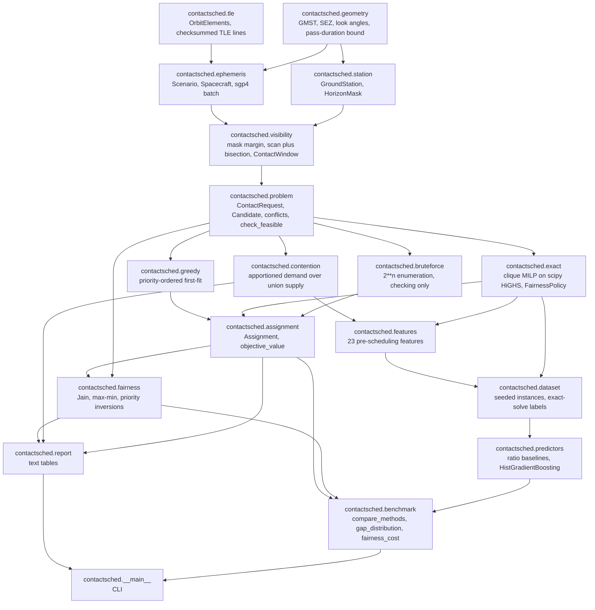
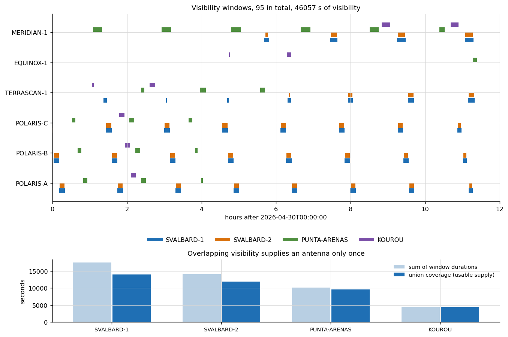
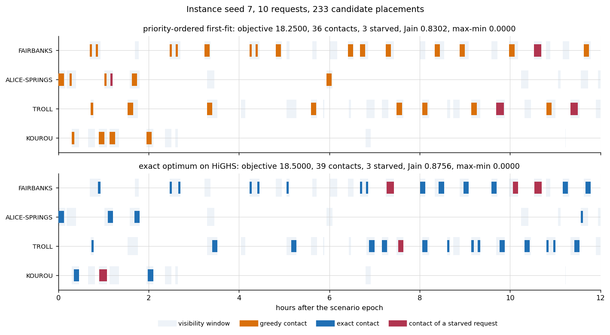
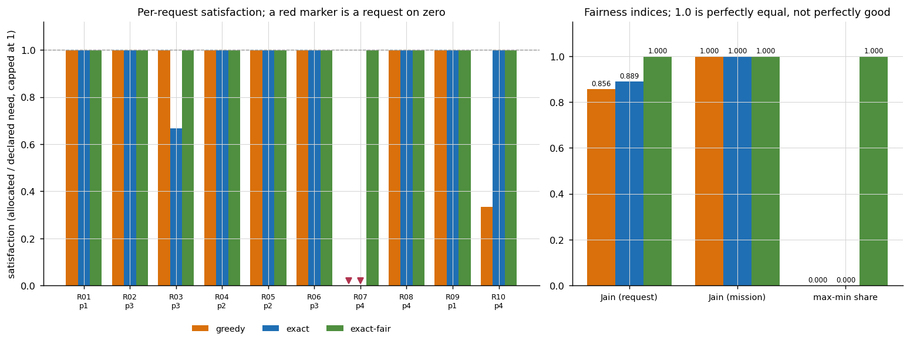
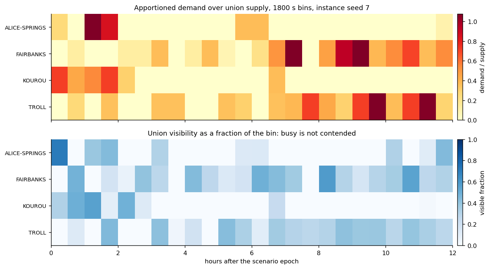
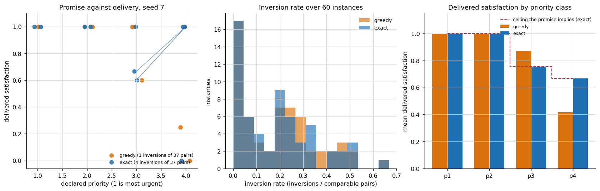
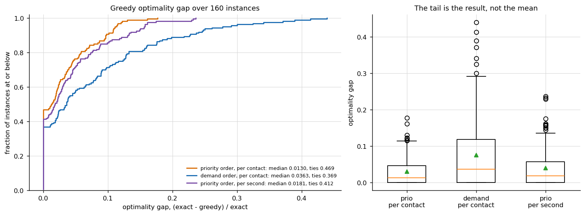
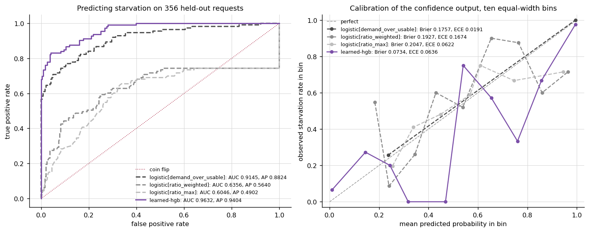

# contactsched

Ground-station contact scheduling with the contention and fairness cost measured.


## The problem

Four missions want the same dish over the same ten minutes, and the scheduler
gives it to one of them. The schedule that comes out says who got a contact; it
does not say who was dropped, by how many seconds, or whether the priority
scheme the missions agreed to actually delivered the ordering it promised. An
operations team then discovers a starved request when a spacecraft misses a
command load, rather than when the request was submitted.

## What this does

- Computes visibility windows from synthetic TLEs through `sgp4` and an
  azimuth-dependent horizon mask, cross-checked against an independent
  geometric derivation to **8.086e-12 deg over 57624 samples**
  (`validation/validate_visibility.py`).
- Schedules two ways on the same candidate grid: a documented priority-ordered
  first-fit, and the proven optimum as a mixed-integer program on HiGHS through
  `scipy.optimize.milp`. The exact method agrees with exhaustive enumeration on
  **140 of 140 small instances across 4 objective and fairness configurations,
  worst objective difference 0.000e+00** (`validation/validate_exact.py`).
- Measures what the schedule cost: per-request shortfall in contacts and
  seconds, Jain's index, the max-min share, and the number of **priority
  inversions** -- pairs where a more urgent request ended worse served than a
  less urgent one. On instance seed 7 the exact optimum scores 1.3514 per cent
  higher than greedy and leaves the same request on zero
  (`validation/validate_fairness.py`).
- Prices the fairness constraints rather than applying them silently. Enforcing
  the declared minimum contact counts on the worked instance costs **0.375 of
  18.500 objective, 2.03 per cent**, and raises the max-min share from **0.000
  to 1.000** (`examples/fairness_metrics.py`).
- Predicts, before scheduling, which requests will be starved, so a request can
  be renegotiated instead of silently dropped. The learned predictor reaches
  **0.9846 area under the ROC curve against 0.9230 for the strongest
  contention-ratio baseline** on 725 held-out requests, and **loses to that
  baseline on calibration, 0.0273 against 0.0122 expected calibration error**
  (`validation/validate_predictors.py`).

## Who it is for

- Mission planners and ground-segment engineers who need to tell a mission
  *why* it lost contact time, with a number.
- Anyone comparing a heuristic scheduler against a proven optimum and wanting
  the gap distribution rather than a mean.
- Researchers studying fairness in shared-resource allocation who want the
  accounting separated from the solver.

## Who it is not for

- **Anyone scheduling a real ground-station network.** Real networks schedule
  with vendor-specific systems against object catalogues, antenna-by-antenna
  keyhole and slew models, and service level agreements. None of that is
  modelled here. This package does not know what a real request looks like.
- Anyone who needs accurate pointing. UT1 against UTC, polar motion and the
  equation of the equinoxes are all omitted; see Limitations.
- Anyone who wants a propagator. `sgp4` is the propagator; this package calls
  it and nothing here reimplements it.
- Anyone who wants a production solver. HiGHS is the solver, and OR-Tools
  CP-SAT would be better for larger instances; see the table below.

## Alternatives, honestly

Every package in this table was checked for presence in the environment these
numbers were measured in, and the result is recorded in
`validation/validate_exact_output.txt` and in the header of every other
validation output.

| Alternative | What it does better | When to use this instead | Present here |
| --- | --- | --- | --- |
| [`sgp4`](https://pypi.org/project/sgp4/) | Propagation. It is the reference implementation of SGP4/SDP4 and this package is a caller of it, not a competitor. | Never instead. This package depends on it. Use this when you want window **accounting** on top of propagation. | yes, 2.27, a dependency |
| [`astropy`](https://www.astropy.org/) | Frames, time scales and coordinate transforms, done properly: UT1, polar motion, nutation, the lot. | When arcsecond-level frames do not matter and you want the contention accounting. For anything pointing-critical use `astropy`. | **no, not installed** |
| [`pulp`](https://pypi.org/project/PuLP/) | A clean modelling layer over many solvers, and the backend this product's specification originally named. | Always, if you have a solver. **Measured and rejected here:** `pulp` 4.1.0 returns an empty list from `listSolvers(onlyAvailable=True)`, so it ships no solver, and `PULP_CBC_CMD` is not even in `listSolvers()` any more since CBC was unbundled in the 4.x series. A `pulp`-backed solve would raise rather than return a schedule. `pulp` is **not** a dependency of this package. Reproduce with `python -m contactsched backends`. | installed, no solver |
| OR-Tools CP-SAT | Scheduling. It is the right tool for interval scheduling at scale, with better propagation, cumulative constraints and search. | When your instance fits HiGHS and you want the fairness accounting. For a large or structurally harder instance, model it in CP-SAT. | **no, not installed** |

**What this does that none of them do.** `sgp4` computes positions, `astropy`
computes frames, `pulp` and CP-SAT compute schedules. None of them computes the
contention and fairness accounting: which mission was starved, by how many
seconds, how unequally the satisfied fraction was distributed, and whether the
delivered order matched the declared priority order. That accounting is this
package's contribution; the scheduling is not.

## Install and first run

```bash
git clone https://github.com/OmAcharya-avtr/contactsched.git
cd contactsched
python -m venv .venv && source .venv/bin/activate
pip install -e ".[dev]"
python -m pytest tests/ -q
python -m contactsched compare --seed 7 --horizon-h 12
```

`python -m pytest tests/ -q` prints:

```
611 passed
```

followed by a wall-clock figure, which is machine-dependent and is deliberately
not quoted here. The count is read from the junit XML and cross-checked against
a literal `testcase` element count; see Reproducing every number.

`python -m contactsched compare --seed 7 --horizon-h 12` prints:

```
method                   status       objective  contacts  starved     jain   maxmin   inv
------------------------------------------------------------------------------------------
greedy-first-fit[priority] heuristic    18.250000        36        3   0.8302   0.0000     1
greedy-first-fit[demand] heuristic    16.125000        36        4   0.8420   0.2500     9
exact-milp[highs]        optimal      18.500000        39        3   0.8756   0.0000     4
exact-milp[highs]        infeasible    0.000000         0       10   1.0000   0.0000     0

greedy optimality gap against the exact optimum: 0.013514

price of enforcing the declared minimum contact counts:
  objective_unconstrained    18.5
  objective_constrained      nan
  objective_loss             nan
  objective_loss_fraction    nan
  jain_gain                  nan
  max_min_gain               nan
  starved_before             3.0
  starved_after              nan
  seconds_short_before       4020.0
  seconds_short_after        nan

the fairness-constrained program is infeasible on this instance:
  HiGHS reported the program infeasible.
  R07 (POLARIS, priority 4) requires 4 contacts but has at most 1 mutually compatible candidates even with the whole network to itself
```

The last three lines are the output this package exists for. The fairness
constraint is not merely unsatisfied, it is unsatisfiable, and the diagnostic
names the request and the number of mutually compatible candidates it actually
has. That is what a planner renegotiates against.

## A worked example

From `validation/worked_example.py`, which is run as part of the validation
suite so the code and the output below cannot drift apart:

```python
from contactsched import (
    ContactRequest, FairnessPolicy, Scenario, all_windows, analyse,
    build_problem, default_fleet, default_network, format_fairness,
    format_schedule, schedule_greedy, solve_exact,
)

scenario = Scenario.from_calendar(2026, 4, 30, duration_s=43200.0)
stations = default_network()[:3]
fleet = default_fleet()[:4]
windows = tuple(all_windows(scenario, stations, fleet, step_s=30.0, tolerance_s=0.25))

requests = (
    ContactRequest("POL-A", "POLARIS", "POLARIS-A", 1, 420.0, min_contacts=3, max_contacts=4),
    ContactRequest("POL-B", "POLARIS", "POLARIS-B", 2, 420.0, min_contacts=3, max_contacts=4),
    ContactRequest("POL-C", "POLARIS", "POLARIS-C", 3, 300.0, min_contacts=2, max_contacts=3),
    ContactRequest("TER-1", "TERRASCAN", "TERRASCAN-1", 1, 600.0, min_contacts=3, max_contacts=3),
    ContactRequest("TER-2", "TERRASCAN", "TERRASCAN-1", 4, 180.0, min_contacts=2, max_contacts=2),
)

problem = build_problem(stations, requests, windows, slot_step_s=120.0)
greedy = schedule_greedy(problem)
exact = solve_exact(problem)
fair = solve_exact(problem, policy=FairnessPolicy(enforce_min_contacts=True))
```

The fairness accounting of the exact schedule, printed by
`format_fairness(analyse(problem, exact))`:

```
fairness report for exact-milp[highs]
request  mission       prio  need  got   need_s    got_s  satisf  state
------------------------------------------------------------------------------
POL-A    POLARIS          1     3    4     1260     1680  1.0000  ok
POL-B    POLARIS          2     3    4     1260     1680  1.0000  ok
POL-C    POLARIS          3     2    3      600      900  1.0000  ok
TER-1    TERRASCAN        1     3    1     1800      600  0.3333  starved
TER-2    TERRASCAN        4     2    2      360      360  1.0000  ok

per-request Jain index        : 0.913514
per-mission Jain index        : 0.871134
max-min share                 : 0.333333
requests starved              : 1
total seconds short           : 1200.0
priority inversions           : 3 of 9 comparable pairs (rate 0.333333)
worst inversion gap           : 0.666667
delivered satisfaction by priority: p1=0.6667, p2=1.0000, p3=1.0000, p4=1.0000
priority promise held in aggregate: False

inversions:
  TER-1 (p1, satisfaction 0.3333) below POL-B (p2, satisfaction 1.0000), gap 0.6667
  TER-1 (p1, satisfaction 0.3333) below POL-C (p3, satisfaction 1.0000), gap 0.6667
  TER-1 (p1, satisfaction 0.3333) below TER-2 (p4, satisfaction 1.0000), gap 0.6667
```

Five contacts were scheduled and every request appears in the schedule, so an
occupancy chart would show nothing wrong. `TER-1` is the most urgent request in
the set and received a third of what it declared it needed, below three requests
of lower priority. Asking for the declared minima to be guaranteed returns:

```
status: infeasible
  HiGHS reported the program infeasible.
  TER-1 (TERRASCAN, priority 1) requires 3 contacts but has at most 1 mutually compatible candidates even with the whole network to itself
```

Lowering that one floor to the capacity the diagnostic named, and re-solving,
returns an optimal schedule at **no objective cost at all** -- the free optimum
and the renegotiated optimum both score 8.000000. The full transcript, including
the per-request renegotiation table, is in
`validation/worked_example_output.txt`.

## Architecture



`contactsched.bruteforce` exists only to falsify `contactsched.exact`; it shares
no part of its formulation and is not a scheduling method.

## Screenshots



Notice the bottom panel: the two antennas at the same high-latitude site see
3493.1 s and 2134.9 s of *overlapping* visibility, so a second dish at one site
buys far less than its window count suggests. The contention ratio divides by
the union for that reason.



Both schedules keep the antennas about equally busy. They differ in who gets the
contested slots, and the greedy schedule's objective is 1.3514 per cent lower
with a different set of losers. An occupancy chart is not a fairness measurement.



The exact optimum raises Jain's index from 0.856 to 0.889 and leaves the max-min
share at exactly 0.000: a better schedule is not a fairer one. Only the
fairness-constrained solve moves the max-min share, and it pays 0.375 of
objective for it.



The hot cell on the top panel is not the busiest cell on the bottom one. A bin
is contended when several requests have few other options at that time, which is
not the same as being occupied, and the validation measurement confirms this
per-bin ratio is a weak predictor of who is actually starved.



Each line joins a pair where the delivered order disagrees with the declared
order. The mean inversion rate over 60 instances is 0.185945 for greedy and
0.181355 for the exact optimum: the optimum does not fix the inversions, because
they come from the geometry and from requests declaring needs their passes
cannot carry.



The baseline ties the proven optimum on 46.9 per cent of instances, and the
distribution has a right tail reaching 0.1769. Either fact alone would be
misleading; the mean of 0.0300 hides both.



The learned model dominates the ROC curve and does *not* dominate the
calibration curve. The one-feature logistic baseline forecasts better-calibrated
probabilities than the learned model while ranking far worse.

## Validation evidence

Level 2. Every number below comes from a script in `validation/` that was
executed in the session this repository was built; the script is named in each
row and its raw output is committed beside it.

| Check | Reference | Result | Tolerance | Script |
| --- | --- | --- | --- | --- |
| WGS-84 constants against their closed forms | closed form | agree to 1e-12 relative | 1e-10 | `validate_geometry.py` |
| Maximum normal-to-radial deviation | brute-force latitude scan at 1e-4 deg | closed form 0.192424301 deg, scan 0.192424301 deg, difference 2.0e-14 deg | 1e-11 deg | `validate_geometry.py` |
| GMST against `sgp4.propagation.gstime` | installed independent implementation | worst 2.211e-11 rad over 120 years, 1.267e-09 deg of Earth rotation | 1e-8 rad | `validate_geometry.py` |
| Two geocentric elevation derivations | law of cosines on three lengths against the vector dot product | worst 2.615e-12 deg over 40000 samples | 1e-6 deg | `validate_geometry.py` |
| **Geodetic against geocentric elevation** | **independently derived bound from the ellipsoid** | worst 0.192424299 deg against a bound of 0.192424301 deg, margin 1.682e-09 deg | bound, not tolerance | `validate_geometry.py` |
| Elevation against an independent geometric derivation | spherical law of cosines on geocentric latitude and longitude | worst 8.086e-12 deg over 57624 samples | 1e-9 deg | `validate_visibility.py` |
| Window boundaries against a dense one-second scan | brute-force scan of the same margin | worst 0.5859 s, no count mismatches | 0.75 s | `validate_visibility.py` |
| **Window durations against a derived upper bound** | **closed-form spherical geometry on the TLE mean motion** | 0 of 22 station-spacecraft pairs exceed it; ratios 0.758 to 0.924 | bound, not tolerance | `validate_visibility.py` |
| Union antenna supply against the naive sum | union by merging intervals | overlap 0.0 to 4694.5 s per antenna, union never above the sum | 1e-6 s | `validate_visibility.py` |
| Scan-step convergence | 2 s scan as the reference | 240 s loses 2 boundaries on one case; 30, 45, 60 and 120 s lose none | exact boundary count | `validate_convergence.py` |
| Bisection-tolerance convergence | 0.001 s setting as the reference | every boundary shift is 0.29 to 0.47 of its own declared tolerance | shift <= tolerance | `validate_convergence.py` |
| **Exact optimum against exhaustive enumeration** | **`2 ** n` bitmask enumeration sharing no formulation** | 140 of 140 instances agree under 4 configurations, worst difference 0.000e+00, 6964736 subsets enumerated | 1e-9 | `validate_exact.py` |
| Candidate-grid refinement | 60 s grid | the optimum never falls; measured gain 600 s to 60 s is 0.0000 on all 5 instances | monotone | `validate_exact.py` |
| Feasibility invariants, every method | `check_feasible` | 0 violations over 120 instances and 3 methods | 0 | `validate_invariants.py` |
| Minimum-contact invariant under the floors | `shortfalls` | 0 requests short in 16 feasible constrained schedules | 0 | `validate_invariants.py` |
| Allocated antenna time against union visibility | independent union computation | 0 breaches over 120 instances | 1e-6 s | `validate_invariants.py` |
| Negative controls | 8 controls, 2 expecting no violation | all 8 behaved as declared, including the boundary at exactly one turnaround | exact | `validate_invariants.py` |
| Determinism of every method | three repeated runs | 0 selection mismatches over 40 instances | exact | `validate_invariants.py` |
| Jain index and max-min share | hand-calculated allocations | 8 of 8 agree, including the all-zero convention and a denormal counterexample | 1e-12 | `validate_fairness.py` |
| Priority inversion under label reversal | reversing every declared priority | 24 of 24 instances changed their schedule; mean inversions 4.2917 before, 3.9583 after | selection must change | `validate_fairness.py` |
| Constructed priority inversion | hand-built instance | 1 inversion of 1 comparable pair, gap exactly 0.666667 | 1e-9 | `validate_fairness.py` |
| **Price of the fairness floors, measured** | free optimum | **zero on all 16 feasible instances of 160**; a constructed instance costs 1.000 of 3.000 | measured | `validate_fairness.py` |
| **Greedy against the exact optimum** | proven optimum on the same grid | mean gap 0.029962, median 0.013007, p90 0.096503, max 0.176871, **ties on 46.88 per cent of 160 instances** | gap >= 0 | `validate_baselines.py` |
| Heuristic ordering head to head | each other | priority better on 78, demand better on 31, tied on 51 | measured | `validate_baselines.py` |
| Dataset determinism | re-generation from the seed | 0 mismatches over 40 instances; dataframe rebuild byte-identical | exact | `validate_dataset.py` |
| Split hygiene | instance-level split | 0 shared `(seed, request_id)` keys, 0 shared seeds | 0 | `validate_dataset.py` |
| Learned predictor against the baselines | strongest baseline per metric | AUC 0.9846 against 0.9230, AP 0.9691 against 0.8850, Brier 0.0467 against 0.0989, hard-subset AUC 0.9529 against 0.8380 | measured | `validate_predictors.py` |
| **Calibration: the BASELINE WINS** | expected calibration error, 10 bins | **learned 0.027302, one-feature logistic baseline 0.012237** | measured | `validate_predictors.py` |
| `pytest.approx` default-tolerance audit | 276 approx calls in the suite | **0 calls rely on the 1e-12 default**; 0 of 44 non-zero-`rel` assertions fail with their absolute bound forced to zero | 0 | `validate_approx_audit.py` |
| Every script from four working directories | filesystem root, temporary directory, repository root, own directory | all exit 0 | 0 | `probe_working_directories.py` |
| No tracked text file contains an absolute path | repository-wide scan | 0 offending lines over 77 files | 0 | `probe_working_directories.py` |
| Every README command re-run | the commands quoted above | 12 commands, every exit status as declared, no absolute path printed | exact | `validate_cli.py` |

### Checks that did not go the way the build expected

These are the credible rows and they are listed separately so they are not lost
in the table.

- **The baseline wins on calibration.** The one-feature logistic regression on
  `demand_over_usable` has an expected calibration error of 0.012237 against the
  learned model's 0.027302. The learned model ranks better and forecasts worse.
  It is published unchanged.
- **The fairness constraints are free where they are feasible.** The measured
  objective price of enforcing every declared minimum contact count is 0.000000
  on all 16 instances of 160 where the constrained program is feasible at all.
  The expectation written before the measurement was that fairness costs
  objective; on this instance family it does not, because the per-contact
  objective is indifferent between placements of the same request. A
  constructed instance where the price is 1.000 of 3.000 is in
  `validate_fairness.py`, and the renegotiated seed-7 instance in
  `examples/fairness_metrics.py` pays 0.375 of 18.500.
- **The contention ratio the specification names is the weakest baseline.** The
  per-station-window demand-over-supply ratio scores 0.6010 and 0.6228 area
  under the ROC curve; the per-request ratio scores 0.9230. On a smaller split
  the per-bin ratios fall *below* 0.5, which is anti-correlation. Taking the
  specified ratio as the baseline would have inflated the learned model's
  margin, so the strongest of the three is the baseline and all three are
  reported.
- **The law-of-cosines elevation loses precision near the zenith, not near the
  horizon.** The prose written before the measurement said the reverse. The
  cancellation in the numerator is nearly flat in elevation; the `arcsin`
  conversion multiplies the error by `1 / cos(elevation)`, which dominates.
- **A hard-coded constant was wrong.** `MAX_GEODETIC_GEOCENTRIC_DEVIATION_DEG`
  stood at 0.19242218 until its own known-answer test failed; the closed form is
  0.19242430115956036. The bound check that uses it was failing by 1.0e-06 deg
  at the same time.
- **The exact optimum does not fix priority inversions.** Mean inversion rate
  0.185945 for greedy against 0.181355 for the proven optimum over 60 instances.
  A better objective is not a better-ordered delivery.

### Defects found during the build

| Defect | Found by | Where it is pinned |
| --- | --- | --- |
| `jain_index` raised `ZeroDivisionError` on a share of 5e-324, because the sum of squares underflowed to zero while the sum did not | Hypothesis | `tests/test_regressions.py::TestHypothesisCounterexamples::test_jain_index_of_the_smallest_positive_double` |
| `look_angles_deg` returned an azimuth of exactly 360.0, outside its documented half-open range, because `-2.6e-66 % 360.0` evaluates to 360.0 in double precision | Hypothesis | `tests/test_regressions.py::TestHypothesisCounterexamples::test_azimuth_stays_below_three_hundred_and_sixty` |
| `HorizonMask` was not periodic in azimuth when two breakpoints shared an azimuth, because `numpy.interp` broke the tie by position in its input array | Hypothesis | `tests/test_regressions.py::TestHypothesisCounterexamples::test_duplicate_mask_azimuths_are_periodic` |
| `MAX_GEODETIC_GEOCENTRIC_DEVIATION_DEG` was wrong in its sixth decimal place | hand-written known-answer test | `tests/test_regressions.py::TestHypothesisCounterexamples::test_the_geodetic_geocentric_constant_is_the_closed_form` |
| `sez_matrix` determinant is +1, not -1; the first version of the test asserted the wrong handedness | hand-written test | `tests/test_geometry.py::TestSezMatrix::test_determinant_is_plus_one` |
| `max_pass_duration_s` does not raise at geosynchronous radius; the relative rate is 4.5e-10 rad/s and the bound is correct but vacuous at 6.3e9 s | hand-written test | `tests/test_geometry.py::TestMaxPassDuration::test_near_geosynchronous_bound_is_vacuous_rather_than_raising` |
| `probe_working_directories.py` reported itself twice: its own scan patterns and then its own previous output were absolute-path literals in a committed file | the probe, on its own first two runs | the patterns are now assembled from `os.sep`, offenders are named by pattern name only, and the output file is deleted immediately before the scan |
| `.github/workflows/tests.yml` reported itself: the grep pattern in the CI step that forbids absolute paths was itself an absolute-path literal | the probe's repository-wide scan | the pattern is now assembled from a shell separator variable |

Three of the eight were found by Hypothesis and by nothing else. The
hand-written suite, 611 tests, did not catch any of those three. Two more were
found by the repository's own self-checks reporting on themselves, which is the
class of defect two consecutive sessions of this mission introduced in the act
of writing about it.

## API reference

<details>
<summary>Public surface, one line each, with units</summary>

**Geometry** (`contactsched.geometry`)

- `gmst_rad(jd_ut1) -> float` -- Greenwich Mean Sidereal Angle, radians in `[0, 2 pi)`.
- `geodetic_to_ecef_km(lat_deg, lon_deg, alt_km) -> ndarray(3,)` -- WGS-84 geodetic to Earth-fixed, km.
- `sez_matrix(lat_deg, lon_deg) -> ndarray(3, 3)` -- Earth-fixed to south-east-zenith, dimensionless.
- `teme_to_ecef_km(r_teme_km, jd_ut1) -> ndarray` -- TEME to Earth-fixed, km.
- `look_angles_deg(r_sat, r_station, sez) -> (az_deg, el_deg, range_km)` -- topocentric look angles; azimuth in `[0, 360)`, elevation in `[-90, 90]`.
- `elevation_geocentric_vector_deg(r_sat, r_station) -> ndarray` -- geocentric elevation from vectors, degrees.
- `elevation_geocentric_norms_deg(r_sat_norm, r_station_norm, range_km) -> ndarray` -- the same angle from three lengths, degrees.
- `max_pass_duration_s(a_km, e, station_radius_km, min_el_deg) -> float` -- independently derived upper bound on one pass, seconds.

**Elements and propagation** (`contactsched.tle`, `contactsched.ephemeris`)

- `OrbitElements(...)` -- mean elements; `.to_lines()` renders a checksummed TLE, `.semi_major_axis_km` in km.
- `tle_checksum(line) -> int` -- modulo-10 digit sum of the first 68 characters.
- `parse_lines(line1, line2) -> dict` -- independent reader; raises on a bad checksum.
- `Scenario(jd, fr, duration_s)` -- epoch and horizon; `.from_calendar(...)`, `.julian_dates(times_s)`.
- `Spacecraft(elements, mission)` -- `.teme_km(scenario, times_s)`, `.ecef_km(...)`, `.radius_km(...)`, all km.
- `default_network() -> tuple[GroundStation, ...]`, `default_fleet() -> tuple[Spacecraft, ...]` -- the declared four antennas and six spacecraft.

**Stations and visibility** (`contactsched.station`, `contactsched.visibility`)

- `HorizonMask(floor_deg, breakpoints)` -- azimuth-dependent minimum elevation, degrees.
- `GroundStation(name, lat_deg, lon_deg, alt_km, mask, turnaround_s)` -- one antenna; `.ecef_km`, `.sez`, `.geocentric_radius_km`.
- `mask_margin_deg(scenario, station, spacecraft, times_s) -> ndarray` -- elevation above the mask, degrees; its zeros are the window boundaries.
- `compute_windows(scenario, station, spacecraft, step_s, tolerance_s) -> list[ContactWindow]`.
- `all_windows(scenario, stations, fleet, step_s, tolerance_s) -> list[ContactWindow]`.
- `supply_seconds_by_station(windows) -> dict[str, float]` -- union coverage per antenna, seconds.

**The problem** (`contactsched.problem`)

- `priority_weight(priority, base) -> float` -- `base ** (1 - priority)`, dimensionless.
- `ContactRequest(request_id, mission, spacecraft, priority, duration_s, min_contacts, max_contacts, stations)`.
- `build_problem(stations, requests, windows, slot_step_s, weight_base, spacecraft_turnaround_s) -> SchedulingProblem`.
- `check_feasible(problem, selected) -> list[str]` -- violations, empty when feasible.
- `shortfalls(problem, selected) -> dict[str, (granted, short, seconds_short)]`.

**Scheduling** (`contactsched.greedy`, `contactsched.exact`, `contactsched.bruteforce`)

- `schedule_greedy(problem, objective_mode, order) -> Assignment` -- priority-ordered first-fit.
- `FairnessPolicy(enforce_min_contacts, max_total_share, min_contacts_floor_override)`.
- `solve_exact(problem, objective_mode, policy, backend, time_limit_s) -> Assignment` -- HiGHS through `scipy.optimize.milp`.
- `standalone_capacity(problem, request_id) -> int` -- most contacts one request could get with the whole network to itself.
- `available_backends() -> dict[str, str]` -- what this interpreter can actually run; never raises.
- `solve_bruteforce(problem, objective_mode, min_contacts_required, max_candidates) -> Assignment` -- enumeration, for checking only.

**Accounting** (`contactsched.contention`, `contactsched.fairness`)

- `contention_map(problem, horizon_s, bin_s) -> list[ContentionCell]` -- apportioned demand and union supply per antenna-time bin, seconds.
- `request_contention(problem, cells) -> dict[str, dict[str, float]]` -- per-request pressure summaries.
- `jain_index(shares) -> float`, `max_min_share(shares) -> float` -- dimensionless, in `[1/n, 1]` and `[0, 1]`.
- `analyse(problem, assignment, tolerance) -> FairnessReport` -- the full accounting.

**Learning and benchmarking** (`contactsched.features`, `.dataset`, `.predictors`, `.benchmark`)

- `request_features(problem, horizon_s, bin_s) -> dict[str, dict[str, float]]` -- the 23 pre-scheduling features.
- `generate_instance(seed, ...) -> Instance`, `build_dataset(seeds, ...) -> DataFrame`, `split_by_instance(frame, train, test)`.
- `RatioRankingBaseline(feature)`, `RatioLogisticBaseline(feature, random_state)`, `LearnedConflictPredictor(...)` -- each with `fit`, `score`, `predict_proba`.
- `roc_auc`, `average_precision`, `brier_score`, `reliability_table`, `expected_calibration_error`, `threshold_metrics`, `best_f1_threshold`.
- `compare_methods(problem, methods, ...) -> dict[str, MethodResult]`, `gap_distribution(problems, ...) -> dict`, `fairness_cost(free, constrained, mode) -> dict`.

</details>

## Limitations

- **Frames and time.** UT1 against UTC is not modelled: the difference is below
  0.9 s, which is up to 0.0037 deg of Earth rotation and roughly 0.4 km of
  station displacement, and that error is carried into every look angle. Polar
  motion and the equation of the equinoxes are omitted as well. Window
  boundaries are reported to the *search* resolution and that resolution is not
  an accuracy claim against a real sky. Use `astropy` where frames matter.
- **Synthetic everything.** No catalogue elements, no real station coordinates,
  no real request mix. Every TLE is constructed by `contactsched.tle` from
  elements written down in a committed script. The learned predictor's measured
  skill is skill on `contactsched.dataset.generate_instance`, whose
  distributional choices are printed in `validation/validate_dataset_output.txt`.
- **The optimum is over a grid.** `solve_exact` is exact over the discretised
  candidate placements, not over continuous placement. The grid step is a
  parameter; `validate_exact.py` measures how the optimum moves as it is
  refined, and on the five instances measured the 600 s grid already reaches the
  60 s grid's objective.
- **A sampled root search can miss a pass.** The coarse scan loses boundaries at
  a 240 s step on one of the three cases measured. A step is safe for *those*
  orbits and masks and nothing more general is claimed.
- **Scheduling model simplifications.** One `GroundStation` is one antenna; a
  turnaround time is the only antenna constraint; keyhole regions, slew rates,
  elevation-dependent data rates, weather and service level agreements are not
  modelled. Conflicts are pairwise interval exclusions and nothing else.
- **Dependency ceilings are a real cost.** Every dependency is bounded on both
  sides at the version this product was measured against. This package cannot
  take a `scikit-learn` 1.10, a `numpy` 2.6 or a `scipy` 1.19 release without a
  port and a full re-measure, and a future security release in that range cannot
  be taken either. That tension is recorded rather than resolved by removing the
  ceiling, because five of this mission's first fifty products were found broken
  or silently wrong for a new install by an unbounded specifier.
- **`scipy`'s tie-breaking is not a public contract.** The objective values are
  exact, but which of several equally optimal schedules HiGHS returns is not
  guaranteed across releases, and `tests/test_regressions.py` pins a selected
  contact count.
- **Jain's index of an all-zero allocation is 1.0 by convention.** That is a
  convention, not a measurement, and it is why the max-min share is always
  printed next to it.
- **The confidence output is not well calibrated at the extremes.** Measured
  expected calibration error 0.027302 over ten bins, against 0.012237 for the
  one-feature logistic baseline. Use the learned model's probability as a
  ranking, and the baseline's as a forecast, until you have re-measured on your
  own traffic.
- This software is research-grade. It is **not flight-qualified, not certified,
  and not approved for operational aerospace use.**

## Reproducing every number

From a cold clone with `pip install -e ".[dev]"`:

```bash
# Test count, read from the XML and never from stdout
python -m pytest tests/ -q --junitxml=junit.xml
python - <<'PY'
import xml.etree.ElementTree as ET
root = ET.parse("junit.xml").getroot()
suite = root if root.tag == "testsuite" else root.find("testsuite")
print(dict(suite.attrib))
print("testcase elements:", len(suite.findall(".//testcase")))
PY

ruff check src/ tests/ examples/ validation/

# Validation, in the order the evidence table is written
python validation/validate_geometry.py
python validation/validate_visibility.py
python validation/validate_convergence.py
python validation/validate_exact.py
python validation/validate_invariants.py
python validation/validate_fairness.py
python validation/validate_baselines.py
python validation/validate_dataset.py
python validation/validate_predictors.py
python validation/validate_approx_audit.py
python validation/validate_cli.py
python validation/worked_example.py
python validation/probe_working_directories.py

# Every figure in Screenshots
MPLBACKEND=Agg python examples/contact_windows.py
MPLBACKEND=Agg python examples/schedule_comparison.py
MPLBACKEND=Agg python examples/fairness_metrics.py
MPLBACKEND=Agg python examples/contention_map.py
MPLBACKEND=Agg python examples/priority_inversion.py
MPLBACKEND=Agg python examples/greedy_optimality_gap.py
MPLBACKEND=Agg python examples/predictor_benchmark.py

# The PuLP measurement that moved the exact baseline onto HiGHS
python -m contactsched backends

# The exhaustive working-directory probe, several minutes
CONTACTSCHED_PROBE_FULL=1 python validation/probe_working_directories.py
```

Every script is seeded. The environment every number was measured in is printed
in the header of each committed output file in `validation/`.

## Licence

Apache-2.0. See `LICENSE`. Copyright 2026 OPTIMA Organisation.

## Citation

See `CITATION.cff`.

## Credits

This is under reserved rights obtained by OPTIMA Organisation.
