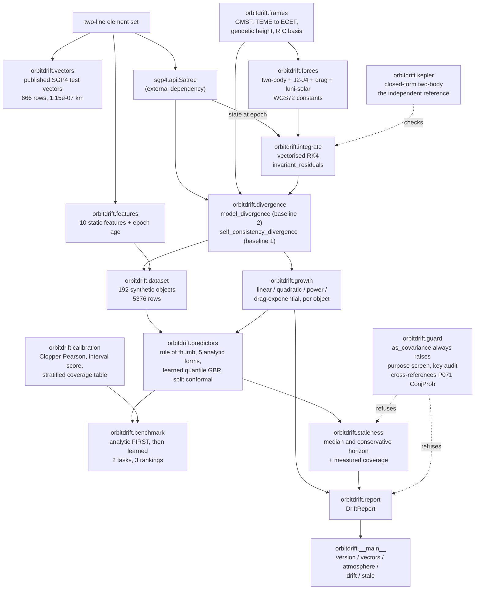
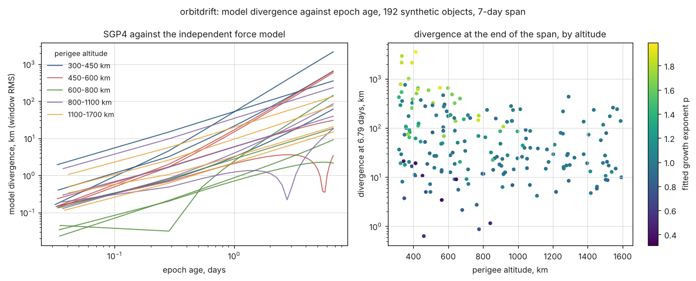
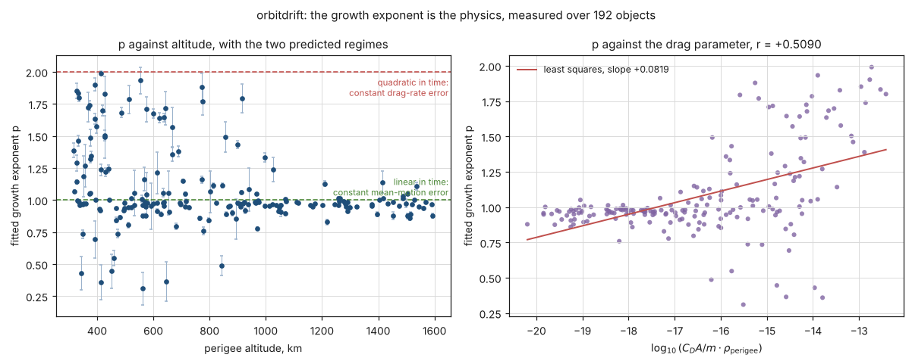
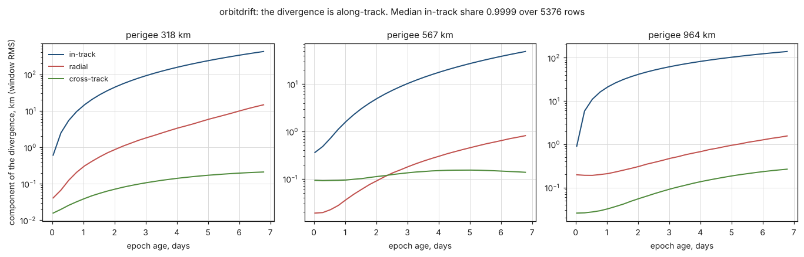
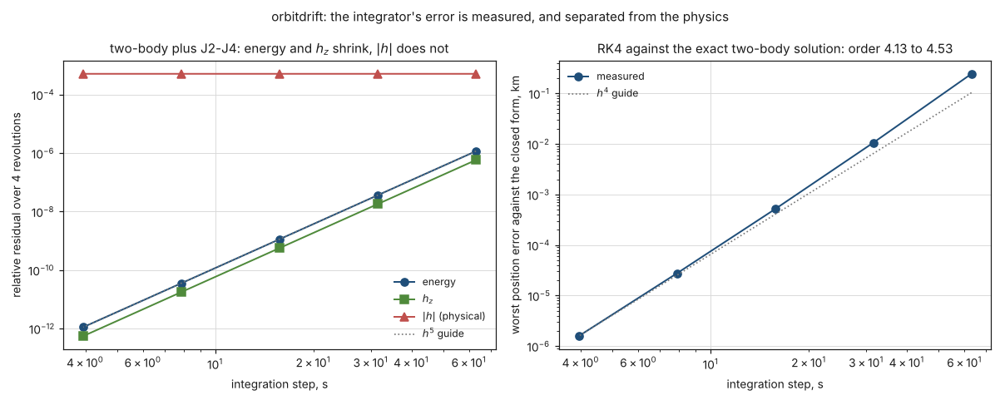
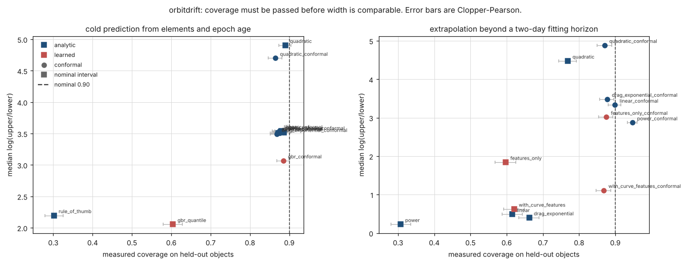
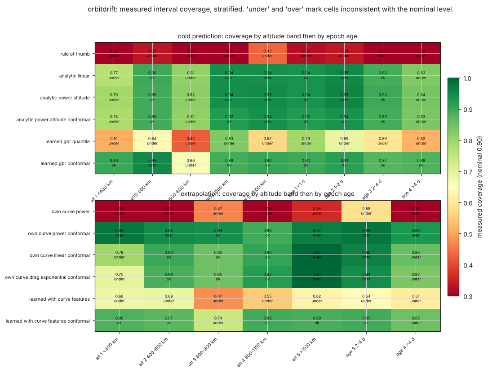
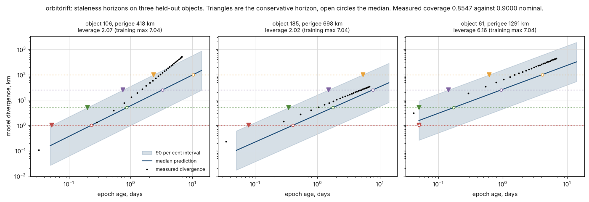

# orbitdrift

How wrong an ephemeris has become, as a measured curve against epoch age.


## The problem

You are holding a two-line element set that is three days old, you need the
object's position to better than five kilometres for the thing you are about to
do, and nothing in your toolchain will tell you whether that element set is
still good enough. `sgp4` will propagate it to any epoch you like and return a
state vector with no error attached; an orbit-determination package will give
you a covariance if you give it tracking data you do not have. So the decision
gets made with a rule of thumb — a kilometre a day, maybe three — and that rule
is measured here to cover 30.17 per cent of cases when it claims 90.

This package computes a divergence curve against epoch age, attaches a
prediction interval whose coverage is **measured on held-out objects**, and
turns that into the age at which a declared position tolerance is crossed.

## Read this before anything else

**This package does not measure the error of an element set against truth, and
it cannot.** There are no precision ephemerides and no element-set archive in
this environment, so there is nothing to call truth. What it measures is **model
divergence**: how fast two propagations of the same object separate.

The only rigorous statement that supports is a triangle inequality. If two
propagators disagree by `D`, and `e1` and `e2` are their unknown errors against
truth, then `|e1| + |e2| >= D`, so

```
max(|e1|, |e2|) >= D / 2
```

`D/2` is a lower bound on **the larger** of the two models' position errors. It
is **not** a bound on either one individually — a perfect propagator compared
against a bad one gives a large `D` while its own error is zero — and it is not
an estimate of the error. `validation/validate_lower_bound.py` verifies the
inequality against a case where truth is known in closed form (20 model pairs,
401 samples, 0 violations), verifies that it does not bound either model alone,
and shows the same bound written as `D` rather than `D/2` failing at 401 of 401
samples.

**No output of this package is a covariance, and none may be used as the input
covariance of a conjunction assessment.** A probability of collision is a ratio
of two small numbers and is dominated by the covariance it is given; supplying a
model-divergence spread in that slot would produce a number with a plausible
magnitude and no meaning, and the failure would be silent. **P071 ConjProb** of
this mission is the product that computes collision probability, and its
covariance must come from orbit determination — a filter with measurement
residuals, or a published covariance in a conjunction data message.

That prohibition is enforced in code, not asserted in prose:
`DriftReport.as_covariance` and `StalenessVerdict.as_covariance` always raise,
`check_purpose` screens a declared purpose, and `DriftReport.to_dict` audits its
own output for covariance-shaped keys before returning it.
`validation/validate_guard.py` records 23 refusals firing and 15 legitimate
calls passing, because a guard that refused everything would be useless.

Research-grade software. **Not flight-qualified, not certified, not approved for
operational aerospace use.**

## What this does

- **Measures a divergence curve** for one element set: SGP4 against an
  independent numerical force model with `J2`-`J4`, drag on a declared static
  atmosphere and luni-solar point masses, seeded from the SGP4 state at epoch so
  the curve is zero at zero age. Measured over 192 objects: 0.63 to 3540.25 km
  at 6.79 days of epoch age.
- **Decomposes it into radial, in-track and cross-track**, and shows the
  in-track component is 99.99 per cent of it (median over 5376 rows), which is
  why a mean-motion error is the right thing to think about.
- **Fits the analytic growth forms the physics names** and reports which one
  holds where. Above 1100 km of perigee the fitted exponent is **0.9685 +/-
  0.0628** — linear in time, which is what a constant mean-motion error gives.
  Below 450 km it rises to 1.2683, toward the quadratic growth a drag-rate error
  gives.
- **Attaches an interval whose coverage is measured.** On held-out objects,
  `own_curve_power_conformal` covers **0.9474** against a nominal 0.90; the
  analytic fit's own in-sample residual spread, which is what a practitioner
  would reach for, covers **0.3069**.
- **Returns a staleness horizon**: the epoch age at which the upper end of that
  interval reaches a declared tolerance, with the measured coverage printed
  beside it, because a conservative horizon from an interval that under-covers
  is not conservative.

## Who this is for

- An operator deciding whether an element set in hand is still good enough for a
  pass prediction, a pointing budget, or a decision about when to request fresh
  tracking.
- Anyone who wants the growth exponent of a divergence curve measured rather
  than assumed to be one or two.
- Anyone building a staleness policy who needs a coverage figure attached to it.

## Who this is **not** for

- **Anyone who needs an actual position error.** This measures divergence
  between two models. If you need error against truth, you need precision
  ephemerides and an orbit-determination package, and this will not substitute.
- **Anyone who needs a covariance.** Nothing here is one. See P071 ConjProb.
- **Conjunction assessment, collision probability, close-approach screening or
  manoeuvre screening.** Refused in code.
- **Anyone propagating an orbit for its own sake.** Use `sgp4`. This drives
  `sgp4`; it does not replace it.
- **Anyone with an eccentric orbit.** The fixed-step integrator is a poor fit to
  a fast perigee passage: the relative position error is 1.014e-06 at `e = 0.59`
  against 5.004e-10 at `e = 0.001`, which is why the population here is capped
  near `e = 0.05`.
- **Anyone in a solar maximum who needs the drag right.** The atmosphere model
  is static with no solar index, and published solar-cycle density variation at
  400 km is about an order of magnitude.

## Alternatives, honestly

Only packages verified to exist in the measurement environment, or named tools
with a stated status, appear here.

| Alternative | What it does better | When to use this instead |
|---|---|---|
| **`sgp4` 2.27** (installed; this package depends on it) | It *is* SGP4. It propagates an element set correctly, fast, and with its published verification vectors shipped alongside. It is the reference, and this package drives it. | When you need to know how fast that propagation is losing contact with an independent dynamical model, and at what epoch age that matters for a tolerance you can state. `sgp4` returns a state with no error attached, by design. |
| **`astropy`** (**not installed** in the environment these numbers were measured in) | Rigorous, tested frame transformations with full IAU precession, nutation, polar motion and time scales; a coordinate ecosystem this package does not attempt. | When you need a frame transform to be right to the milliarcsecond. The transforms here are implemented in `orbitdrift.frames`, checked against published constants and an independent algorithm, and are **not** cross-checked against `astropy` — no claim of such a check appears anywhere in this repository. |
| **Orekit** (a mature, widely used Java flight-dynamics library; not installed here) | Numerical propagation with a real gravity field, a real atmosphere with solar and geomagnetic indices, solar radiation pressure, tides, event detection, and orbit determination with measurement handling. Everything the force model here declares it does not model. | When you want the staleness *decision* with a measured coverage figure on it. Orekit will give you a far better second opinion than the propagator here; it will not tell you that your interval covers 94.74 per cent of held-out cases, because that is a measurement somebody has to make and publish. |
| **Precision ephemerides plus an orbit-determination package** | This is the right answer for accuracy. A fitted orbit with a covariance derived from measurement residuals is what "how wrong is my ephemeris" actually means. | When you do not have tracking data, or when the question is not "how wrong is it" but "**is the element set I have stale**". That second question is what this product answers, and the mature tools do not answer it directly: they compute, and this measures. |
| **A rule of thumb** (what most people actually use) | Free, instant, no dependencies. | Always, if you want the number to mean anything. Measured here: one kilometre per day with a factor-of-three band covers **0.3017** of held-out cases against a claimed 0.90, with an interval score of 1352.77 km against 281.53 km for the best calibrated predictor. |

**What this does that none of them does:** nothing above names the staleness
decision and attaches a measured coverage figure to it. `sgp4` propagates,
Orekit propagates better, an orbit-determination package estimates, and all
three leave "is this element set too old for what I am about to do" to the
operator's judgement. This package makes that the output, and publishes the
coverage of the interval the output rests on — including the four tables of
stratified cells where that coverage is wrong.

## Install and first run

```bash
git clone https://github.com/OmAcharya-avtr/orbitdrift.git
cd orbitdrift
python -m venv .venv && source .venv/bin/activate
pip install -e ".[test]"
python -m pytest tests/ -q
python -m orbitdrift vectors
```

Expected output of the last command, which reproduces the published SGP4
verification vectors out of the installed `sgp4` distribution:

```
published SGP4 verification vectors from the installed sgp4 2.27 distribution
  files SGP4-VER.TLE and tcppver.out, published with AIAA 2006-6753

  satnum   rows  skipped   max |dr| km   max |dv| km/s

  33 cases, 666 rows compared, 1 rows skipped on an error code
  worst position disagreement 1.154503e-07 km
  worst velocity disagreement 4.996954e-10 km/s
```

The test suite prints `273 passed`. To regenerate the committed dataset, which
takes about three minutes on two cores:

```bash
python validation/regenerate_dataset.py
```

## A worked example

The question the product exists for. Full output in
`validation/worked_example_output.txt`, which is the script this is taken from.

```python
from sgp4.api import Satrec

from orbitdrift import (
    AnalyticGrowthPredictor,
    ConformalPredictor,
    DivergenceTable,
    build_report,
    features_from_satrec,
    model_divergence,
    split_by_object,
    staleness_verdict,
)
from orbitdrift.calibration import interval_metrics

satrec = Satrec.twoline2rv(
    "1 25544U 98067A   26015.50000000  .00016717  00000-0  10270-3 0  9003",
    "2 25544  51.6416 247.4627 0006703 130.5360 325.0288 15.72125391563537",
)

# Baseline 2: SGP4 against the independent numerical force model.
curve = model_divergence(satrec, span_days=5.0, steps_per_rev=360)
print(build_report(satrec, curve).summary())

# A predictor whose interval coverage is measured on held-out objects.
table = DivergenceTable.load("fixtures/divergence_dataset.npz")
train, test = split_by_object(table, test_fraction=0.3)
design, drift = table.design(), table.column("drift_km")
objects = table.column("object_index")

predictor = ConformalPredictor(AnalyticGrowthPredictor(form="power_altitude"), coverage=0.90)
predictor.fit(design[train], drift[train], groups=objects[train])
lower, upper = predictor.predict_interval_km(design[test])
metrics = interval_metrics(lower, upper, drift[test], nominal=0.90)

# The decision: three days old, five kilometres of tolerance.
verdict = staleness_verdict(
    predictor,
    features_from_satrec(satrec),
    tolerance_km=5.0,
    age_days=3.0,
    purpose="ephemeris staleness check",
    measured_coverage=metrics.coverage,
)
print(verdict.describe())
```

Its actual output, abridged to the divergence curve and the verdict:

```
object                   : catalogue 25544
perigee altitude         : 348.8 km
eccentricity             : 0.000670
inclination              : 51.642 deg
B*                       : 1.027000e-04 1/earth-radii
divergence source        : sgp4-vs-numerical
                           WGS72: two-body + J2-J4 + drag + luni-solar, step 15.2660 s (360.0 per rev)

epoch age  model divergence  lower bound on larger model error
   (days)              (km)                              (km)
     0.032            0.0775                            0.0387
     0.532            1.6484                            0.8242
     1.032            4.5232                            2.2616
     1.532            8.6913                            4.3457
     2.032           14.1417                            7.0709
     2.532           20.8914                           10.4457
     3.032           28.9234                           14.4617
     3.532           38.2641                           19.1321
     4.032           48.8913                           24.4457
     4.532           60.8401                           30.4200

analytic growth forms fitted to this curve:
  form              amplitude(km)   exponent   tau(d)   log-resid sd
  drag_exponential        4.93916        nan     1.64       0.14978
  linear                  6.69703     1.0000      nan       0.58322
  power                   5.96234     1.3530      nan       0.27258
  quadratic               4.81838     2.0000      nan       0.99360
  best fitting form : drag_exponential

predictor                : conformal[analytic_power_altitude]
tolerance                : 5.000 km
median horizon           : 1.211 days
conservative horizon     : 0.292 days (upper end of a 90% interval)
interval coverage        : 0.8547 measured on held-out objects against 0.9000 nominal
                           the interval UNDER-COVERS; the conservative horizon above is optimistic by that much
element set age          : 3.000 days
predicted drift at age   : 15.598 km [2.627, 92.619]
verdict                  : OUTSIDE
```

Read it as follows. The **median horizon** is the optimistic answer a point
prediction gives: half the time the drift is already worse than it says. The
**conservative horizon** is the one to use, and it is only as good as the
measured coverage printed beside it — which here is 0.8547 against a claimed
0.90, so the package says so in words rather than letting the user assume
otherwise.

## Architecture



## Screenshots

Each is produced by the example named beneath it, from the committed dataset.



`examples/divergence_curves.py`. Notice that the curves are straight on
logarithmic axes, so the growth is a power law, and that the slope is steeper
for the low-altitude objects. The spread at the end of the span is four orders
of magnitude, which is why a single kilometres-per-day rule cannot work.



`examples/growth_exponent_vs_altitude.py`. The central physical result. Above
1100 km the exponent sits on the horizontal line at 1 — the linear-in-time
growth a constant mean-motion error produces. Below 450 km it rises toward 2,
the quadratic growth a constant drag-rate error produces. The right panel shows
the exponent against the drag parameter, correlation +0.5090.



`examples/ric_decomposition.py`. The in-track component is the whole of the
divergence to within a per cent. The radial and cross-track components are
periodic rather than secular, so they do not grow.



`examples/conservation_and_convergence.py`. The energy residual falls by a
factor of about 32 per halving of the step, which is `h^5`, so it is the
integrator. The `|h|` residual does not move at all across five step sizes, so
it is not: it is the `J2` torque. No reference solution is needed to tell the
two apart.



`examples/predictor_benchmark.py`. The vertical dashed line is the nominal 90
per cent. A predictor to its **left** under-covers, and narrowing an interval
moves a point left and down, so a low score to the left of the line is bought
rather than earned. On the extrapolation panel the only points on or right of
the line are analytic.



`examples/coverage_table.py`. The marginal coverage of a conformally calibrated
predictor lands near nominal and the cells do not. Split conformal prediction
promises marginal coverage for exchangeable data and promises nothing
conditional on a feature; the rows here are grouped by object, so the promise it
makes is the only one it keeps.



`examples/staleness_decision.py`. Three real held-out objects. Triangles are the
conservative horizon, open circles the median, and the gap between them is
several-fold. The leverage printed in each title is the distance from the
training feature manifold; it is in the title because the model's answer off
that manifold is an extrapolation of a collinear fit rather than a prediction.

## Validation evidence

Level 3. Full tables with tolerances in `validation/VALIDATION.md`, requirement
by requirement in `docs/REQUIREMENTS.md`, raw output in
`validation/*_output.txt`. **The checks that failed and the claims that are only
partly satisfied are in the table below, not omitted from it.**

| Check | Reference | Result | Tolerance |
|---|---|---|---|
| SGP4 reproduced against its published vectors | `SGP4-VER.TLE` and `tcppver.out`, package data of the installed `sgp4` 2.27, published with AIAA 2006-6753 | 33 cases, 666 rows, worst `|dr|` **1.154503e-07 km**, worst `|dv|` **4.996954e-10 km/s** | < 1e-6 km, < 1e-8 km/s |
| — negative control | inclination edited 34.2682 -> 44.2682 deg | 1275.386193 km | must exceed 100 km |
| Energy conserved, conservative terms | — | 1.7174e-09 at 360 steps/rev | `6e-9 (360/spr)^5` |
| `h_z` conserved under the zonal field | — | 8.5745e-10 at 360 steps/rev | same |
| `\|h\|` **not** conserved under `J2`, residual step-invariant | the `J2` torque is physical | 5.125159e-04, relative spread 5.007e-05 across four step sizes | invariant to 1e-3 |
| Energy decreases with drag on | sign of `a . v` | every sampled difference negative, total -7.072135e-03 km^2/s^2 | strictly decreasing |
| Convergence order, Richardson (no reference solution) | — | 4.3701 to 4.7123 | 4 to 5.2 |
| Convergence against the closed-form two-body solution | `orbitdrift.kepler` | error falls by 18.666 to 26.093 per halving | 8 to 40 |
| Kepler's equation residual | the equation itself | 2.665e-15 rad | < 1e-12 rad |
| **Truncation floor against the divergence** | — | median 2.798e-03, 90th pct 1.593e-02, **worst 1.850e-01** | **the 1-per-cent claim FAILS for 34 of 192 objects** |
| GMST at J2000.0 | published 280.460618370 deg | difference 5.000e-09 deg | < 1e-6 deg |
| Geodetic height against an independent iteration | — | 1.219 mm at 400 km, 15.488 mm at 1700 km | < 20 mm to 1700 km |
| Lunar distance over 2000 days | published perigee-apogee 356400-406700 km | 357350 to 406018 km | inside 352000-410000 |
| Luni-solar term against a cancellation-free series | Montenbruck and Gill eq. 3.37 | difference 1.4999 to 1.7309 times `\|r\|/\|r_b\|` | 0.5 to 3 times |
| Atmosphere band joins | Vallado Table 8-4 | largest relative jump 0.001362; the measured convergence order with drag on is indistinguishable from drag off | < 1 per cent |
| `B*` inversion sensitivity | — | a factor of two moves the median divergence by 0.0002 of itself, worst 0.5909; correlation with the drag parameter **+0.9626** | median < 0.5 |
| Self-consistency on synthetic pairs | chord `2 a sin(dM/2)`, geometric | ratio **0.99996** at every offset; growth-rate ratio 0.99655 at `r^2` 0.999980 | within 2 and 5 per cent |
| — identical pair (negative control) | 0 | **7.691751e-10 km** | < 1e-3 km |
| **Growth exponent above 1100 km** | linear-in-time prediction for a constant mean-motion error | **0.9685 +/- 0.0628** over 46 objects | within 0.1 of 1 |
| Growth exponent below 450 km | quadratic-in-time prediction for a drag-rate error | 1.2683 +/- 0.3914 over 42 objects | must exceed the above by 0.1 |
| Correlation of the exponent with the drag parameter | — | **+0.5090** | > 0.15 |
| — negative control | shuffled drift column | log-residual spread 1.14177 against 0.07469 | > 5x worse |
| **Nominal interval coverage of an own-curve power-law fit** | — | **0.3069** against a claimed 0.90 | the number that justifies the whole product |
| Conformal coverage of the same fit | — | **0.9474** [0.9330, 0.9595] | consistent with or above 0.90 |
| **Extrapolation task: best point prediction** | — | **analytic** `own_curve_drag_exponential` 0.1299 against learned 0.1391 | baseline win, recorded |
| **Extrapolation task: only calibrated interval** | — | **analytic** `own_curve_linear_conformal` 0.8991 [0.8804, 0.9159] | no learned interval contains 0.90 |
| **Extrapolation task: learned coverage** | — | best learned **0.8750**, so **no learned predictor reaches its nominal coverage** | baseline win, recorded |
| Cold task: best point prediction | — | **learned** 0.5942 against analytic 0.7410 | learned win, recorded |
| **Cold task: every predictor under-covers** | — | best 0.8898; no operationally usable row | recorded as a failure of the task, not of a predictor |
| Rule of thumb | 1 km/day, factor-of-three band | coverage **0.3017**, interval score 1352.77 km | measured, not assumed |
| Stratified cells inconsistent with 0.90 | Clopper-Pearson at 95 per cent | **65 cells across four tables** | published, including which under-cover |
| Conditional miscalibration of a conformal predictor | split conformal promises marginal coverage only | marginal 0.8768, altitude cells 0.7802 to 0.9375, spread 0.1573 | published |
| Covariance guard | — | 23 refusals fire, 15 legitimate calls pass | both counts required |
| `pytest.approx` default-tolerance audit | — | **0** of 67 calls rely on the 1e-12 default; forcing `abs=0.0` everywhere changes 17 assertions under both interpreters | 0 required |
| Working-directory independence | — | 26 scripts x 4 directories, 104 invocations, **0** non-zero exits | 0 required |
| Determinism | — | population reproduces byte for byte; both benchmarks bit-reproducible; a different split seed changes 13 of 13 coverages | exact |

### The honest summary of the baseline-against-learned result

On the **realistic task** — the operator has the element set, runs the
divergence computation over the first two days, and asks how far the curve goes
— the analytic growth form beats the learned model on the point prediction by 7
per cent, is the only family whose interval coverage is consistent with the
level it claims, and is the only family that does not under-cover. The learned
model has the lowest interval score on both tasks and that is bought with
coverage it does not have.

On the **cold task** — predict from orbital elements and epoch age alone, having
observed nothing — the learned model wins the point prediction by 20 per cent.
And every predictor on that task, including the learned one, under-covers at the
nominal level, so the task has no operationally usable row at all.

A learned model denied the object's own curve is **3.9095 times worse** at the
point prediction than one given it. The information is in the curve, not in the
learning.

## API reference

<details>
<summary>The public surface, with units</summary>

### Measuring a curve

| Function | Returns |
|---|---|
| `model_divergence(satrec, *, span_days, steps_per_rev, report_every_hours, force, step_s, sample_every)` | `DivergenceCurve`: epoch ages in days, window-RMS drift in km, RIC components in km. Baseline 2. |
| `self_consistency_divergence(satrec_early, satrec_late, *, report_every_hours, samples_per_rev)` | `DivergenceCurve` against the earlier element set's epoch age. Baseline 1. |
| `larger_error_lower_bound_km(drift_km)` | half the drift, in km: a lower bound on the larger of the two models' errors |
| `sgp4_states(satrec, times_s)` | `(positions_km, velocities_km_s)` in TEME; raises on any non-zero SGP4 code |
| `window_rms(times_s, series, window_s, out_times_s)` | root-mean-square over a window, the drift metric's reduction |

### Dynamics

| Function | Returns |
|---|---|
| `ForceModel(gravity, zonal, drag, third_body)` | the force model; `.label()`, `.is_conservative`, `.acceleration_km_s2(r, v, jd, cd_area_over_mass, bodies)` in km/s^2 |
| `propagate(r0_km, v0_km_s, jd0, cd_area_over_mass_m2_kg, *, n_steps, step_s, force, sample_every)` | `Trajectory` for `n` objects on a shared grid; vectorised across objects |
| `invariant_residuals(trajectory, *, zonal)` | maximum relative drift of `energy`, `h_magnitude`, `h_z` |
| `specific_energy_km2_s2(r, v, gravity, *, zonal)` | km^2/s^2; the `zonal` flag has no default |
| `atmospheric_density_kg_m3(altitude_km)` | kg/m^3 from the declared static table |
| `cd_area_over_mass_m2_kg(bstar)` | `C_D A/m` in m^2/kg; `= 2 B* / 0.157`, no assumed `C_D` |
| `propagate_two_body(r0_km, v0_km_s, times_s, mu)` | the closed-form reference, `(positions, velocities)` |
| `rv_to_elements(r_km, v_km_s, mu)` | `ClassicalElements`; angles in radians, lengths in km |

### Growth forms and predictors

| Function | Returns |
|---|---|
| `fit_power_law(ages_days, drift_km, *, exponent)` | `GrowthFit`; refuses a rank-deficient system |
| `fit_all_forms(ages_days, drift_km)` | `{name: GrowthFit}`, omitting any form that cannot be fitted |
| `best_form(fits)` | the name with the smallest log-residual spread, ties to the simpler form |
| `RuleOfThumbPredictor(rate_km_per_day, band_factor)` | the straw man the product is positioned against; `fit` ignores its arguments |
| `AnalyticGrowthPredictor(form)` | `form` in `linear`, `quadratic`, `power`, `power_altitude`, `drag_exponential`; `.effective_exponent`, `.exponent_at_altitude(km)`, `.leverage(x)` |
| `LearnedQuantilePredictor(...)` | gradient-boosted quantile regression; refuses a coverage it was not fitted for |
| `ConformalPredictor(base, coverage, calibration_fraction)` | split-conformal wrapper; `fit(x, y, groups)` splits by group |

### Measurement and the decision

| Function | Returns |
|---|---|
| `clopper_pearson(successes, trials, confidence)` | the exact binomial interval |
| `interval_metrics(lower, upper, truth, *, nominal, confidence)` | `IntervalMetrics`: coverage, its interval, widths in km, log width, Winkler score, crossing fraction |
| `coverage_by_group(lower, upper, truth, groups)` | object-level coverage, its interval, the group count |
| `coverage_table(lower, upper, truth, strata, *, nominal, confidence, minimum_cell)` | `[CoverageCell]`, each with a verdict of `ok`, `under`, `over` or `thin` |
| `run_benchmark(table, ...)` | `BenchmarkResult`; analytic rows first, three rankings |
| `run_extrapolation_benchmark(table, *, fit_horizon_days, ...)` | `ExtrapolationResult`, the realistic task |
| `staleness_verdict(predictor, features, tolerance_km, *, age_days, purpose, coverage, measured_coverage)` | `StalenessVerdict`; `purpose` is screened and `as_covariance` raises |
| `build_report(satrec, curve, *, verdict)` | `DriftReport`; `to_dict` audits its own keys, `as_covariance` raises |

### Refusals

| Function | Behaviour |
|---|---|
| `check_purpose(purpose)` | returns the purpose, or raises `CovarianceRefused` naming P071 |
| `refuse_covariance(detail)` | always raises |
| `DriftReport.as_covariance()`, `StalenessVerdict.as_covariance()` | always raise |

### Command line

```
python -m orbitdrift version      # versions, and what is NOT installed
python -m orbitdrift vectors      # reproduce the published SGP4 test vectors
python -m orbitdrift atmosphere   # the declared atmosphere table and its caveat
python -m orbitdrift drift        # a divergence curve for one element set
python -m orbitdrift stale        # the staleness verdict; --purpose is screened
```

</details>

## Limitations

These are the things a user would otherwise discover the hard way.

1. **Error against truth is not measured and cannot be.** Everything here is
   model divergence between two propagators. The only rigorous error claim is
   `D/2` on the larger of two unknown errors.

2. **For 3 of 192 objects the integrator's truncation floor is more than 10 per
   cent of the divergence reported**, reaching 18.5 per cent for the least
   divergent one, and it exceeds 1 per cent for 34 of 192. Those are the
   high-altitude, tiny-`B*` objects where the two models have almost nothing to
   disagree about, and their rows should be read as *divergence below about a
   kilometre* rather than as the value printed. The floor is 1.168030e-01 km at
   7 days and 360 steps per revolution; the three objects are named in
   `validation/validate_step_refinement_output.txt`.

3. **The atmosphere model is static.** Vallado Table 8-4, no solar index, no
   diurnal bulge, no geomagnetic term. Published solar-cycle variation of
   thermospheric density at 400 km is about an order of magnitude, and this model
   sits at one unspecified point in that range. Every drag-driven divergence
   number inherits that factor.

4. **The `B*` inversion is an assumption.** `C_D A/m = 2 B* / rho_0` needs no
   assumed drag coefficient, because `C_D` cancels, but `rho_0` is nominal and
   an operational `B*` is not a physical ballistic parameter: orbit determination
   lets it absorb whatever else the fit could not explain. A factor of two in
   `C_D A/m` moves the median divergence by 0.0002 of itself and the worst object
   by 0.5909.

5. **Tesseral and sectoral gravity, solar radiation pressure, Earth albedo and
   infrared, solid and ocean tides, and relativistic corrections are not
   modelled.** They are part of the declared divergence rather than part of the
   model. Solar radiation pressure is the largest of them for a high
   area-to-mass object.

6. **The predictors are only valid on the collinear feature manifold the
   population occupies.** Perigee altitude, apogee altitude, period, the log
   perigee density and the log drag parameter are all functions of the same
   orbit. A hand-assembled, internally inconsistent feature vector — a 1300 km
   perigee with an apogee 25 km above it and a period of 105.6 minutes, where
   the real period is 112 — drew a prediction of **2.5e8 km** against the 17.7
   km measured for a real object at that altitude.
   `AnalyticGrowthPredictor.leverage` is the diagnostic: training maximum 7.04,
   held-out maximum 8.45, the inconsistent vector 259. **Build the feature vector
   with `features_from_satrec` from an actual element set.**

7. **The inclination recovered from a state vector has an accuracy floor near
   zero.** It comes back as `arccos(h_z / |h|)`, whose derivative is
   `-1/sin(i)`, so a few machine epsilons of relative error in the ratio become
   `eps / sin(i)` radian of absolute error in the angle. At `i = 6e-08` radian
   that floor is about 3e-08 radian, half the inclination itself. Hypothesis
   found this; it is documented in `rv_to_elements` and pinned in
   `tests/test_regressions.py`.

8. **A fixed-step integrator is a poor fit to an eccentric orbit.** Relative
   position error 1.014e-06 at `e = 0.59` against 5.004e-10 at `e = 0.001`, both
   at 1440 steps per revolution. The population is capped near `e = 0.05` for
   that reason, and a user with a highly eccentric orbit is outside what was
   measured.

9. **Conformal prediction's guarantee is marginal, not conditional.** The rows
   are grouped — 28 epoch ages of one object share its features and its physics —
   so marginal coverage comes out near nominal while coverage conditional on
   altitude or epoch age does not. Measured spread across altitude cells: 0.1573
   for a predictor covering 0.8768 marginally. The row-level Clopper-Pearson
   interval is also **too narrow** for grouped data; the object-level coverage is
   reported beside it and neither is the answer.

10. **Baseline 1 is demonstrated on exactly one real element-set pair**, catalogue
   5 twenty years apart, whose magnitude is meaningless as a staleness figure.
   There is no element-set archive here. The machinery is verified on synthetic
   pairs with geometrically derivable separations.

11. **The population is synthetic and each feature is drawn independently.** It
    is a spanning set over feature space, not a representation of the real
    catalogue's joint distribution. No statement of the form "x per cent of
    catalogued objects behave like this" can be drawn from it.

12. **Nothing is cross-checked against `astropy`**, which is not installed in
    the environment these numbers were measured in, and no such claim appears
    anywhere in this repository. The frame transforms are this package's own,
    checked against published constants and an independent algorithm.

13. **The dependency ceilings are a real cost, not a free safety measure.** This
    package cannot take a `numpy` 2.6, a `scipy` 1.19, a `scikit-learn` 1.10 or
    an `sgp4` 2.28 release without a port and a re-measurement. The `sgp4`
    ceiling is the tightest for a reason beyond API churn: the published
    verification vectors are read out of that distribution as package data, and a
    release revising either file would change a published number here.

14. **The learned model's hyperparameters were not tuned.** The compute budget is
    two shared cores and an unbounded search against a closed-form
    least-squares baseline would turn the comparison into a comparison of search
    budgets. A reader who wants a tuned comparison should run one and say so.

15. **The compute budget is two cores.** Regenerating the dataset takes about
    three minutes, the `pytest.approx` audit about four, and the
    working-directory matrix about six.

## Reproducing every number

From the product root, with `PYTHONPATH=src` and `MPLBACKEND=Agg`:

```bash
python -m pytest tests/ -q --junit-xml=junit.xml   # 273 tests
ruff check src/ tests/ examples/ validation/
python validation/regenerate_dataset.py            # about 3 minutes
python validation/validate_sgp4_vectors.py
python validation/validate_frames.py
python validation/validate_atmosphere.py
python validation/validate_third_body.py
python validation/validate_kepler_reference.py
python validation/validate_conservation.py
python validation/validate_step_refinement.py
python validation/validate_bstar_sensitivity.py
python validation/validate_lower_bound.py
python validation/validate_self_consistency.py
python validation/validate_growth_baseline.py      # the baseline, before the benchmark
python validation/validate_predictors.py
python validation/validate_coverage_table.py
python validation/validate_reproducibility.py
python validation/validate_guard.py
python validation/validate_approx_audit.py         # about 4 minutes
python validation/worked_example.py
python validation/validate_cli.py
python validation/validate_cwd_independence.py     # about 6 minutes
for example in examples/*.py; do python "$example"; done
```

The example runs come **last**, because `validate_cwd_independence.py` redraws
the screenshots from a reduced subset while probing exit statuses.

The test count in the badge is read from the junit XML's `testsuite` element and
cross-checked against a literal count of `testcase` elements, never from pytest
stdout: a suite that collects nothing prints success and exits zero.

## Licence

Apache-2.0. See `LICENSE`. Copyright 2026 OPTIMA Organisation.

## Citation

See `CITATION.cff`.

## Credits

This is under reserved rights obtained by OPTIMA Organisation.
