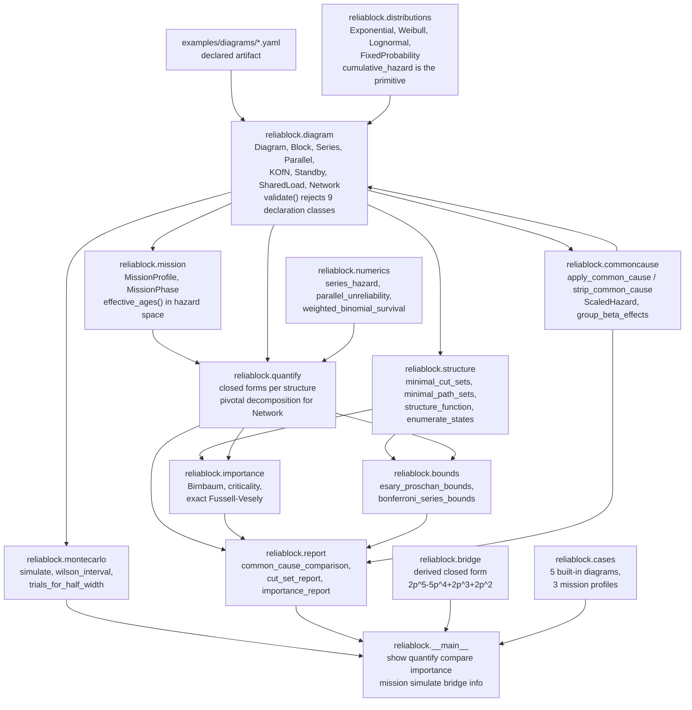
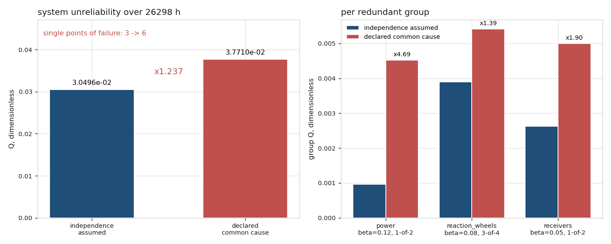
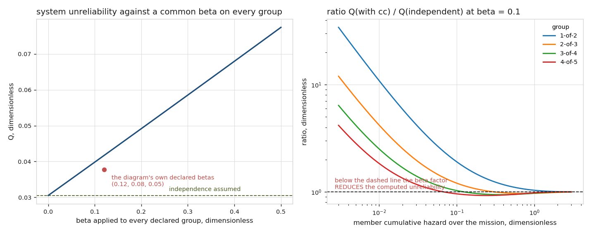
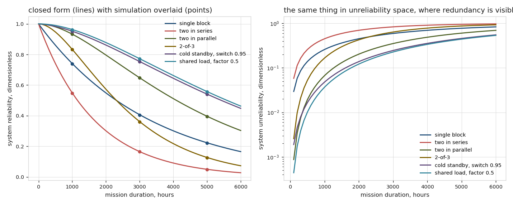
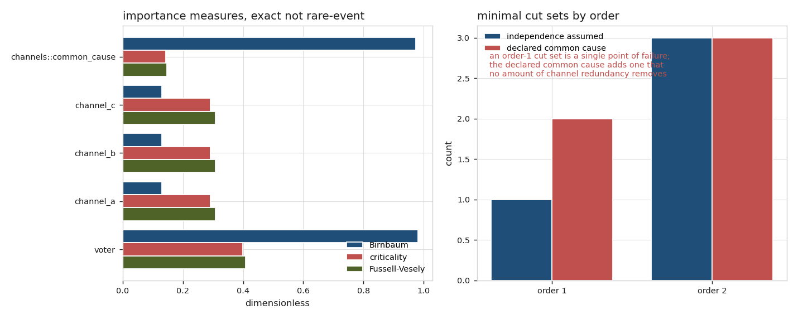
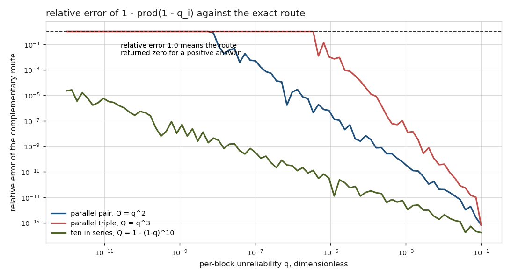
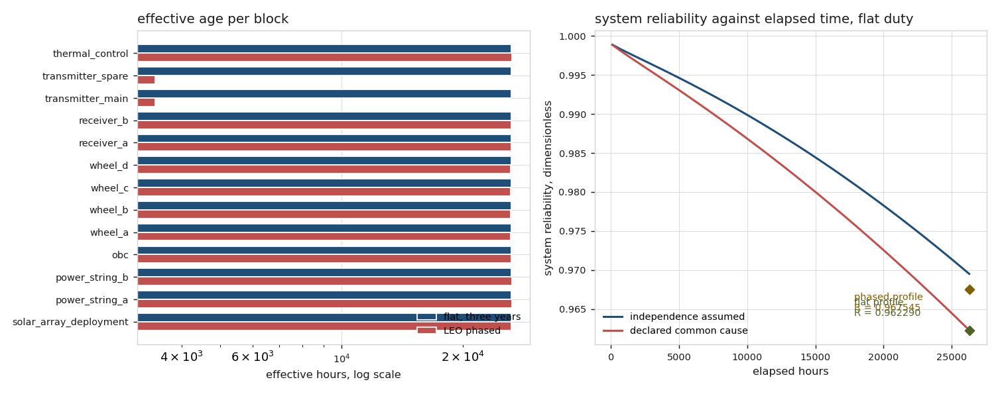

# reliablock

Redundancy arithmetic that is explicit about the assumption doing the work.


## The problem

Someone hands you a reliability figure for a redundant subsystem and it does
not come with the diagram it was computed from, so you cannot see what was
assumed. The assumption that matters is almost always independence: two
identical units from one lot, qualified by one procedure, mounted on one panel,
powered from one bus and inspected by one technician do not fail independently,
and the arithmetic that treats them as though they do is wrong in a known
direction by an unknown amount. On the thirteen-block bus in
`examples/diagrams/smallsat_bus.yaml`, declaring beta factors of 0.12, 0.08 and
0.05 moves the three-year system unreliability from `3.049573463e-02` to
`3.771048369e-02` and raises the number of single points of failure from 3 to 6
(`validation/validate_commoncause_output.txt`).

## What this does

- Takes a **declared** diagram -- series, parallel, k-of-n, standby with a
  declared switching reliability, shared load, common cause as a declared beta
  factor, and a general two-terminal network -- as a YAML artifact that can be
  diffed and reviewed, and **rejects nine classes of declaration** rather than
  defaulting them, including an undeclared standby switching reliability
  (`validation/regenerate_declarations_output.txt`).
- Reports **reliability with and without the declared common-cause beta, side
  by side**, which is the headline. Measured on the bus over 26298 h: a Q ratio
  of `1.236582`, an absolute `7.214749063e-03` of unreliability attributable to
  the assumption, and three new cut sets of order one
  (`validation/validate_commoncause_output.txt`).
- Computes **closed forms for every structure**, each checked against an
  independent reference. Worst relative difference across 300 k-of-n cases
  against `scipy.stats.binom.sf`: `4.281257e-16`. Across 108 shared-load cases
  against a DOP853 solution of the Markov ODE at rtol 1e-12: `4.038264e-14`
  (`validation/validate_structures_output.txt`).
- Enumerates **minimal cut sets** structurally and cross-checks them against
  exhaustive `2**n` state enumeration: identical sets on all 13 diagrams
  measured, over 147712 states, with 95 path sets checked against the structure
  function (`validation/validate_cutsets_output.txt`).
- Computes **Birnbaum, criticality and Fussell-Vesely** importance, the last
  **exactly** rather than by the rare-event approximation, which was measured
  to overestimate by up to `1.268384e-01` on these diagrams. Birnbaum agrees with a
  central finite difference to `3.490329e-09` over 135 comparisons spanning
  five decades of step size (`validation/validate_importance_output.txt`).
- Carries every small failure probability in **unreliability space**. The
  complementary route `1 - prod(1 - q_i)` returns exactly `0.0` for 10 of 18
  measured parallel cases where the answer is positive, and falls outside an
  independently derived Bonferroni bracket in 13 of 20 series cases
  (`validation/validate_precision_output.txt`).

## There is no learned component in this package, deliberately

For a declared diagram with declared distributions the system reliability has a
correct answer. A model fitted to approximate that arithmetic could only be
worse than the arithmetic, and there is nothing in the problem for it to learn:
the inputs are declared, the structure function is declared, and the mapping
between them is a closed form. A learned component here would be a liability,
not a feature, and would obscure the one thing this package exists to make
visible.

`reliablock.AI_ENABLED` is `False`. `validation/validate_cli.py` asserts both
that flag and the absence of any machine-learning import in `src/`, and the CI
workflow does the same, so adding one would fail a check rather than only a
review.

Monte Carlo simulation (`reliablock.montecarlo`) exists to be **scored
against** the closed forms, never to replace them. All 8 seeded runs lie within
`1.9129` standard errors of their closed form
(`validation/validate_montecarlo_output.txt`).

## Who it is for

- Reliability and assurance engineers who have a redundancy figure and need to
  know how much of it rests on independence.
- Reviewers who need the diagram as an artifact they can check, diff and
  attach to the number.
- Anyone who has to justify a declared beta factor, or notice that none was
  declared.

## Who it is not for

- **Anyone needing a safety case, a certification argument or an operational
  decision.** This is research-grade software. A reliability number is not a
  safety case, and no output of this package is suitable for an operational or
  certification purpose.
- **Anyone who needs to fit a distribution to data.** Use `reliability`. This
  package takes distribution parameters as declared inputs and has no
  likelihood, no censoring and no goodness-of-fit anything.
- **Anyone analysing a repairable system.** There is no repair, no
  availability, no renewal process and no intensity function here. Every figure
  is a mission reliability with no maintenance.
- **Anyone who needs partial common-cause failure modes.** The beta-factor
  model has exactly one common-cause mode, the one that fails every member of
  the group. The multiple-Greek-letter and alpha-factor models that carry a
  separate parameter per failure multiplicity are **not implemented**, and
  `validation/validate_commoncause_output.txt` measures exactly where their
  absence matters.
- **Anyone who wants a common-cause beta from data.** Every beta in this
  repository is a declared input chosen to span a range. None is a
  measurement and none is taken from any source.
- **Anyone with a large fault tree.** Exhaustive enumeration is capped at
  `2**22` states and the exact Fussell-Vesely union is capped at 22 involved
  events. Above that this package refuses rather than substituting the
  rare-event approximation silently.

## Alternatives, honestly

Both packages below were confirmed to exist on the Python package index.
Neither is installed in the environment the numbers in this repository were
measured in, and **no number here came from either of them or was cross-checked
against either of them** -- recorded as deviation 1 in
`validation/VALIDATION.md`.

| alternative | what it does better | when to use this instead |
|---|---|---|
| [`reliability`](https://pypi.org/project/reliability/) (0.9.0) | Everything to do with **data**: fitting Weibull, lognormal, gamma and mixture models with censoring, probability plotting and goodness-of-fit, accelerated life testing and acceleration models, repairable-system and renewal analysis, optimal replacement, reliability growth. It is mature, well documented and the right answer for all of it. | When your input is a **declared diagram** rather than a dataset, and the question is *what does this number assume*. `reliability` will fit your distributions and compute series and parallel systems; it will not take a declared diagram as a checkable artifact, enumerate its minimal cut sets, or report the figure with and without a declared common-cause beta side by side with the change in the cut-set structure. **Fit your distributions with `reliability`, then declare them here.** |
| [`lifelines`](https://pypi.org/project/lifelines/) | Survival analysis done properly: Kaplan-Meier, Nelson-Aalen, Cox proportional hazards, accelerated failure time regression, and the statistical machinery for censored and truncated lifetime data with covariates. | When you already have per-block hazard parameters and the question is about the **system structure** rather than about estimating a lifetime distribution from observations. `lifelines` answers "what is the hazard of this population"; this package answers "given these hazards and this diagram, what fails the system and what did I assume". |

No package was found that takes a declared reliability block diagram as a
reviewable artifact and reports the with-and-without-common-cause comparison as
its primary output. If one exists, this README is wrong and should name it.

## Install and first run

```bash
git clone https://github.com/OmAcharya-avtr/reliablock.git
cd reliablock
python -m venv .venv && source .venv/bin/activate
pip install -e ".[dev]"
python -m pytest tests/ -q
python examples/common_cause_headline.py
```

The test run prints the following. The line carries a wall-clock duration,
which moves between runs on shared hardware; the test count does not.

```
454 passed in 14.58s
```

and `python examples/common_cause_headline.py` prints:

```
diagram                  : smallsat bus
mission                  : 26298 h, 26298 h
Q assuming independence  : 3.049573463e-02
Q with declared common cause : 3.771048369e-02
ratio                    : 1.236582
single points of failure : 3 -> 6

group                beta   k-of-n       Q indep     Q with cc    ratio
-----------------------------------------------------------------------
power                0.12   1-of-2  9.650253e-04  4.527052e-03   4.6911
reaction_wheels      0.08   3-of-4  3.903519e-03  5.414720e-03   1.3871
receivers            0.05   1-of-2  2.625206e-03  4.995540e-03   1.9029

written: screenshots/common_cause_headline.png
```

Without installing, `PYTHONPATH=src` is enough:

```bash
PYTHONPATH=src python -m reliablock compare smallsat_bus
PYTHONPATH=src python -m reliablock bridge
```

## A worked example

```python
from reliablock import (
    Block, Diagram, Exponential, KOfN, MissionProfile, Series,
    apply_common_cause, minimal_cut_sets, quantify, strip_common_cause,
)

wheels = KOfN(
    k=3,
    items=tuple(
        Block(name=f"wheel_{s}", distribution=Exponential(1.0e-6))
        for s in ("a", "b", "c", "d")
    ),
    beta_factor=0.08,          # declared, not assumed; a judgement, not data
    label="reaction_wheels",
)
diagram = Diagram(
    "wheels behind one computer",
    Series(items=(Block(name="obc", distribution=Exponential(4.0e-7)), wheels)),
)
mission = MissionProfile.from_hours(26298.0)

for label, structure in (
    ("independence assumed ", strip_common_cause(diagram)),
    ("declared common cause", apply_common_cause(diagram)),
):
    result = quantify(structure, mission)
    singles = [c for c in minimal_cut_sets(structure) if len(c) == 1]
    print(
        f"{label}  R = {result.reliability:.9f}  Q = {result.unreliability:.6e}  "
        f"single points of failure = {len(singles)}"
    )
```

prints

```
independence assumed   R = 0.985673261  Q = 1.432674e-02  single points of failure = 1
declared common cause  R = 0.984177873  Q = 1.582213e-02  single points of failure = 2
```

One cut set of order one becomes two. The added one is
`reaction_wheels::common_cause`, and no amount of wheel redundancy removes it.
The full version of this example, over the whole bus and with the importance
table and the simulation, is `validation/worked_example.py`, whose output is
committed beside it.

## Architecture



## Screenshots



The left bar pair is the whole point: the second bar is not the first plus a
percentage, because the declared common cause adds three cut sets of order one
that the independent diagram does not have. The right panel shows that the
power group, whose members are the most reliable, is the one the beta factor
hurts most -- a factor of `4.6911` against `1.3871` for the wheels.



Left: the system unreliability as a single beta is applied to every group,
with the diagram's own declared values marked. Right: the ratio
`Q(with cc) / Q(independent)` against member hazard, for four group shapes.
Notice that the `2-of-3`, `3-of-4` and `4-of-5` curves cross below 1. Above
that hazard the beta factor **reduces** the computed unreliability; see
Limitations.



Six structures at one per-unit hazard rate. The lines are closed forms and the
points are seeded simulations overlaid on them, worst agreement `2.0634`
standard errors. The right panel is the same information in unreliability
space, which is the only space in which the redundancy is visible at all.



Left: the three importance measures for the voting triple with its declared
beta factor. The common-cause event has a Birnbaum of `9.725311e-01`, almost
the same as the voter's `9.807499e-01`, on a hundredth of the unreliability --
which is what Birnbaum is for. Right: the cut-set order histogram, where the
declared common cause turns one order-1 cut set into two.



The relative error of `1 - prod(1 - q_i)` against the exact route. The dashed
line at 1.0 is where the route returns zero for a positive answer: for a
parallel pair that happens at and below `q = 5.748e-09`, and for a parallel
triple at and below `q = 3.502e-06`.



The same elapsed time declared two ways. The transmitter's 12 percent duty
cycle drops its effective age to `0.1309` of the flat figure while a stress
factor of 3 on the power strings during launch raises theirs to `1.0055`; the
duty cycle wins and the phased profile is the more reliable of the two.

## Validation evidence

Level 2. 14 validation scripts, **134 checks pass and 1 fails**; the failure is
published below and is not tuned away. Every number in this table comes from a
committed output file beside the script that produced it.

| check | reference | result | tolerance |
|---|---|---|---|
| series reliability | product of block reliabilities, 75 cases | worst rel `7.544748e-16` | `1e-14` |
| series unreliability | Bonferroni orders 1 and 2, an independently derived bracket | 0 of 75 outside | bracket + propagated slack |
| parallel unreliability | exact product in Q space | worst rel `1.836710e-16` | `1e-14` |
| parallel quantification | exhaustive `2**n` state enumeration | worst rel `0.000000e+00` | `1e-14` |
| k-of-n reliability | `scipy.stats.binom.sf`, 300 cases | worst rel `4.281257e-16` | `1e-13` |
| k-of-n at `k = n` | the series chain | worst rel `3.017899e-16` | `1e-13` |
| k-of-n at `k = 1` | the parallel group | worst rel `1.147943e-16` | `1e-13` |
| non-identical k-of-n | exhaustive state enumeration | worst rel `3.990254e-16` | `1e-13` |
| standby reliability | `scipy.integrate.quad` on the convolution integral, 81 cases | worst rel `2.211217e-16` | `1e-10` |
| m cold standby units | the Erlang survival sum | worst rel `2.220446e-16` | `1e-13` |
| Weibull standby pair | `quad` on the convolution integral | worst rel `0.000000e+00` | `1e-10` |
| shared load | `scipy.integrate.solve_ivp`, DOP853, rtol 1e-12, 108 cases | worst rel `4.038264e-14` | `1e-9` |
| shared load at degeneracy | the analytic limit `(1 + x) exp(-x)` | worst rel `2.220447e-16` | `1e-14` |
| shared load at sharing factor 1 | a parallel pair | worst rel `1.120369e-16` | `1e-12` |
| network pivotal decomposition | the derived bridge closed form | worst rel `9.673179e-16` | `1e-13` |
| network quantification | exhaustive state enumeration | worst rel `2.269281e-16` | `1e-13` |
| minimal cut sets | exhaustive `2**n` enumeration, 13 diagrams, 147712 states | identical sets, 0 disagreements | exact set equality |
| cut-set definition | the structure function | 0 violations over all cut sets | exact |
| path-set definition | the structure function, 95 path sets | 0 violations | exact |
| Birnbaum importance | central finite difference, 135 comparisons, 5 decades of step | worst rel `3.490329e-09` | `1e-6` |
| criticality identity | `(Q_sys - Q_sys(q_i=0)) / Q_sys`, 27 rows | worst rel `1.789122e-15` | `1e-10` |
| Fussell-Vesely vs rare-event | the exact union against the sum of cut-set probabilities | rare-event **overestimates by up to `1.268384e-01`** | reported, not bounded |
| bridge closed form | 4 algebraic routes plus 32-state enumeration | worst rel `9.673179e-16` and `1.128538e-14` | `1e-13` |
| bridge self-duality | `R(p) + R(1-p) = 1`, 8 values of p | worst abs `0.000000e+00` | `1e-15` |
| Esary-Proschan bracket on the bridge | min-cut and min-path bounds | inside; width `1.920800e-02` at `p = 0.9` | bracket + propagated slack |
| Monte Carlo, 8 runs | the closed forms, budgets sized from a 1 percent target | worst `1.9129` standard errors, 0 of 8 outside | 4 standard errors |
| `pytest.approx` audit | the suite re-run with `rel=` without `abs=` made an error | **0 of 454** assertions depended on the default | 0 |
| 8 negative controls | each injected violation verified to fire | 8 of 8 fired | all must fire |
| five working directories | 87 subprocess invocations | 0 non-zero exits | 0 |
| absolute paths in committed files | 83 text files scanned, 5 patterns | 0 matches | 0 |
| **mission ageing model** | **calendar-time integration of a scaled hazard rate** | **FAILS: worst `1852.73` percent, 4 of 20 cases agree** | **1 percent assumed** |

### The check that fails, and why it is here

`validation/validate_mission.py` declares and fails:

> the cumulative-exposure model agrees with calendar-time hazard rate
> integration to within 1 percent for a non-exponential block

Worst measured divergence **1852.73 percent**, at Weibull shape 3.5 under a
stress factor of 4. Four of twenty cases agree and all four are the
exponential ones, where the model is exact.

The two models answer different physical questions. Cumulative exposure (the
Nelson model, implemented here) says a stress factor advances the block along
its own ageing curve. Calendar-time integration says the stress multiplies the
block's instantaneous hazard rate at its current calendar age. For a wear-out
process the first is usually the intended one, which is why it is the one
implemented -- but a reader who sees "stress factor 3.0" may assume the second,
and the magnitude of the difference is why this check is published instead of
removed.

### What could not be checked

`reliability` and `lifelines` are named in the alternatives table above and are
**not installed** in the environment these numbers were measured in. No number
in this repository came from either of them and none claims to have been
cross-checked against them. Every output file records their absence in its
header. This is deviation 1 in `validation/VALIDATION.md`.

## API reference

<details>
<summary>Public surface, one line each, with units</summary>

**Declaration** (`reliablock.diagram`)

- `Block(name, distribution, description="")` -- a leaf item.
- `Series(items, label="")` -- succeeds only if every child succeeds.
- `Parallel(items, beta_factor=0.0, label="")` -- succeeds if any child does.
- `KOfN(k, items, beta_factor=0.0, label="")` -- succeeds if at least `k` of `n` do. `beta_factor` is refused at `k = n`.
- `Standby(primary, standbys, switch_reliability, standby_hazard_fraction=0.0, label="")` -- `switch_reliability` dimensionless in `[0, 1]`, required; `standby_hazard_fraction` 0 cold, 1 hot.
- `SharedLoad(units, shared_rate_factor, label="")` -- two exponential units; `shared_rate_factor` in `(0, 1]`.
- `Network(edges, source="s", sink="t", label="")` -- `edges` is `(from, to, Block)`.
- `Diagram(name, root, description="", notes=())` -- validates on construction.
- `load_diagram(path) -> Diagram`, `Diagram.to_yaml() -> str`.

**Distributions** (`reliablock.distributions`), all with `cumulative_hazard(t_hours)`, `reliability`, `unreliability`, `density` (1/hour) and `inverse_cumulative_hazard`

- `Exponential(rate_per_hour)` -- `H = lambda t`; `mttf_hours()`.
- `Weibull(shape, scale_hours)` -- `H = (t / eta)**beta`.
- `Lognormal(log_median, log_sigma)` -- `log_median` in log-hours.
- `FixedProbability(probability)` -- per-actuation; not aged by a profile.

**Mission** (`reliablock.mission`)

- `MissionPhase(name, duration_hours, duty_cycles=None, stress_factors=None, default_duty_cycle=1.0)`.
- `MissionProfile(name, phases)`, `MissionProfile.from_hours(hours)`, `.effective_ages(diagram) -> {name: hours}`, `.breakdown(diagram)`.
- `load_mission(path) -> MissionProfile`.

**Quantification** (`reliablock.quantify`)

- `quantify(diagram, mission, *, block_ages=None) -> Quantity` -- `Quantity` carries `reliability`, `unreliability`, `hazard`, `parts`, `notes`, `complement_residual`, all dimensionless.
- `standby_reliability_cold_identical(rate_per_hour, t_hours, n_standby, switch_reliability) -> float`.
- `standby_reliability_general(primary, standby, t_hours, switch_reliability, standby_hazard_fraction) -> (reliability, quad_abs_error)`.
- `shared_load_reliability(rate_1_per_hour, rate_2_per_hour, shared_rate_factor, t_hours) -> float`.

**Common cause** (`reliablock.commoncause`)

- `apply_common_cause(diagram) -> Diagram`, `strip_common_cause(diagram) -> Diagram`.
- `group_beta_effects(diagram, mission) -> tuple[GroupBetaEffect, ...]` -- per group, with `.ratio` and `.conservative`.
- `ScaledHazard(base, factor)` -- a distribution whose hazard is `factor` times another's.

**Structure** (`reliablock.structure`)

- `minimal_cut_sets(diagram)`, `minimal_path_sets(diagram)` -- tuples of frozensets, ordered reproducibly.
- `structure_function(diagram, working) -> bool`, `basic_events(diagram)`, `enumerate_states(diagram) -> dict`.

**Importance** (`reliablock.importance`)

- `importance_table(diagram, mission) -> tuple[Importance, ...]` -- refused for a diagram containing `standby` or `shared_load`.
- `pivot_unreliability(diagram, mission, event, value, *, base_unreliabilities=None) -> float`.
- `system_unreliability_at(diagram, unreliabilities)`, `boolean_system_unreliability(diagram, unreliabilities)`.

**Bounds** (`reliablock.bounds`)

- `esary_proschan_bounds(diagram, mission, reliability, *, unreliabilities=None) -> Bracket`.
- `bonferroni_series_bounds(unreliabilities, value) -> Bracket` -- `Bracket` carries `.lower`, `.upper`, `.value`, `.slack`, `.contains`, `.width`.

**Simulation** (`reliablock.montecarlo`)

- `simulate(diagram, mission, trials, *, seed=0, confidence=0.95, batch=250000) -> MonteCarloResult`.
- `trials_for_half_width(unreliability, half_width, z=1.96) -> int`, `wilson_interval(successes, trials, z) -> (lower, upper)`.
- `sample_lifetimes(distribution, rng, size) -> ndarray` -- effective-age hours.

**Bridge** (`reliablock.bridge`)

- `bridge_reliability_equal(p)`, `bridge_reliability_pivotal(p1..p5)`, `bridge_reliability_inclusion_exclusion(reliabilities)`, `bridge_diagram(p=None, *, edge_unreliabilities=None, mission_hours=1.0)`, `BRIDGE_CUT_SETS`, `BRIDGE_PATH_SETS`.

**Numerics** (`reliablock.numerics`)

- `series_hazard(hazards)`, `series_unreliability(unreliabilities)`, `parallel_unreliability(unreliabilities)`, `weighted_binomial_survival(reliabilities, k)`, and the four hazard/reliability/unreliability conversions.

</details>

## Limitations

**The beta-factor model is not conservative for a k-of-n group with `k >= 2`.**
It has exactly one common-cause mode, the one that fails every member, while
the group fails once `n - k + 1` members have failed, which is fewer. Moving
failure probability into the single mode can therefore *reduce* the computed
group unreliability. Measured at `beta = 0.1`, the member cumulative hazard at
which the ratio crosses 1, by bisection: `0.302944` for 2-of-3, `0.653729` for
2-of-4, `0.124016` for 3-of-4, `0.042978` for 5-of-6. A parallel group
(`k = 1`) has no crossing and is conservative everywhere, verified over the
same sweep. This is a known inadequacy of the beta-factor model for groups
larger than two and is why NUREG/CR-4780 introduces the multiple-Greek-letter
and alpha-factor models; neither is implemented here.
`reliablock.commoncause.group_beta_effects` reports the effect per group and
`reliablock.report.common_cause_comparison` prints a warning naming the
alternative models when any group crosses, so the limitation is surfaced on the
declaration rather than left in this document.

**The mission ageing model is exact only for an exponential block.** See the
failing check above: worst divergence from calendar-time hazard integration
`1852.73` percent at Weibull shape 3.5 under a stress factor of 4.

**Importance measures are refused for a diagram containing a `standby` or
`shared_load` node.** Those have an exact Boolean structure function, and
therefore exact minimal cut sets, but their quantification is not the
independent-event arithmetic over that function, so `dQ_sys/dq_i` is not the
derivative of the number `quantify()` returns. The refusal is deliberate.

**Standby and shared load are quantified in reliability space**, so their
unreliability below about `1e-16` is not resolved and `Quantity.notes` says so
on every such result. Series, parallel, k-of-n and network are all computed in
unreliability space and keep a `Q` down to the subnormal range; the bridge
retains `2.000000e-22` at an edge unreliability of `1e-11`
(`validation/validate_precision_output.txt`).

**A warm standby group is limited to one standby unit**, and a multi-unit cold
standby group to identical exponential units. Anything else raises with the
reason rather than being approximated, and the simulator refuses the same
declarations so the two always cover the same ground.

**A shared-load node takes exactly two exponential units.** The four-state
Markov closed form has no non-exponential form and more units need a full
Markov model this package does not have.

**A declared beta factor requires identical group members.** The beta-factor
model is symmetric -- one shared event fails the group and
`lambda_common = beta lambda` needs one `lambda` -- and the usual fixes for a
non-identical group (mean, minimum, maximum) give three different answers with
no principled basis. It is refused, with the alternative model named.

**Exhaustive enumeration is capped at `2**22` states and the exact
Fussell-Vesely union at 22 involved events.** Above that both refuse. The
rare-event approximation would fit, and was measured to overestimate
Fussell-Vesely by up to `1.268384e-01` on these diagrams, so it is not substituted
silently.

**The three runtime dependency ranges were measured at one point each.**
`numpy>=2.5,<2.6`, `scipy>=1.18,<1.19` and `pyyaml>=6.0,<6.1` record the minor
version the numbers come from and are not evidence that both ends were
exercised: this build ran inside a pre-pinned interpreter and was forbidden to
install anything. Pinning below a future release is a real cost, not a free
safety measure -- the product cannot take that release without a port. The four
tool-only ranges (`pytest`, `hypothesis`, `matplotlib`, `ruff`) *were* measured
at two points each, on two installations with identical numpy, scipy and
pyyaml; all 454 tests, 134 passing validation checks and 20 scripts pass under
both. The exact points are in `validation/VALIDATION.md` section 15.

**Every rate, every beta factor and every switching reliability in this
repository is a declared input chosen to be representative in order of
magnitude.** None is a measurement, none comes from a parts database or a
handbook, and no figure here should be read as a statement about any real
hardware.

**Python 3.13.17 is what these numbers were measured on**, although
`requires-python` is `>=3.11` and CI covers 3.11, 3.12 and 3.13.

## Reproducing every number

```bash
# the test count in the badge, from junit XML and never from stdout
PYTHONPATH=src python -m pytest tests/ -q --junit-xml=junit.xml
python -c "import xml.etree.ElementTree as ET; r=ET.parse('junit.xml').getroot(); s=r if r.tag=='testsuite' else r.find('testsuite'); print(s.get('tests'), len(s.findall('.//testcase')))"

# every validation script; each writes <name>_output.txt beside itself
PYTHONPATH=src python validation/validate_structures.py
PYTHONPATH=src python validation/validate_precision.py
PYTHONPATH=src python validation/validate_cutsets.py
PYTHONPATH=src python validation/validate_importance.py
PYTHONPATH=src python validation/validate_bridge.py
PYTHONPATH=src python validation/validate_commoncause.py
PYTHONPATH=src python validation/validate_mission.py
PYTHONPATH=src python validation/validate_montecarlo.py
PYTHONPATH=src python validation/validate_negative_controls.py
PYTHONPATH=src python validation/validate_cli.py
PYTHONPATH=src python validation/regenerate_declarations.py
PYTHONPATH=src python validation/worked_example.py
PYTHONPATH=src python validation/audit_approx_tolerances.py
MPLBACKEND=Agg PYTHONPATH=src python validation/probe_working_directories.py

# the figures
MPLBACKEND=Agg PYTHONPATH=src python examples/common_cause_headline.py
MPLBACKEND=Agg PYTHONPATH=src python examples/beta_sensitivity.py
MPLBACKEND=Agg PYTHONPATH=src python examples/structure_comparison.py
MPLBACKEND=Agg PYTHONPATH=src python examples/importance_and_cutsets.py
MPLBACKEND=Agg PYTHONPATH=src python examples/precision_space.py
MPLBACKEND=Agg PYTHONPATH=src python examples/mission_phases.py

# style
ruff check src/ tests/ examples/ validation/
```

Every validation script is seeded. `probe_working_directories.py` re-runs every
other script from five working directories and takes about four minutes.

## Documents

- `validation/VALIDATION.md` -- the full evidence record, including the failing
  check and the two deviations from the product specification.
- `docs/DECLARATION_FORMAT.md` -- the YAML declaration format, every node kind,
  and every rejection with its reason.
- `docs/METHOD.md` -- the derivations, in one place, with their references.
- `CHANGELOG.md` -- what was added, and what was deliberately not added.

## Licence, citation, credits

Apache-2.0; see `LICENSE`. Copyright 2026 OPTIMA Organisation.

To cite this software, see `CITATION.cff`.

This software is research-grade. It is not flight-qualified, not certified, and
not approved for operational aerospace use. A reliability number is not a
safety case.

This is under reserved rights obtained by OPTIMA Organisation.
