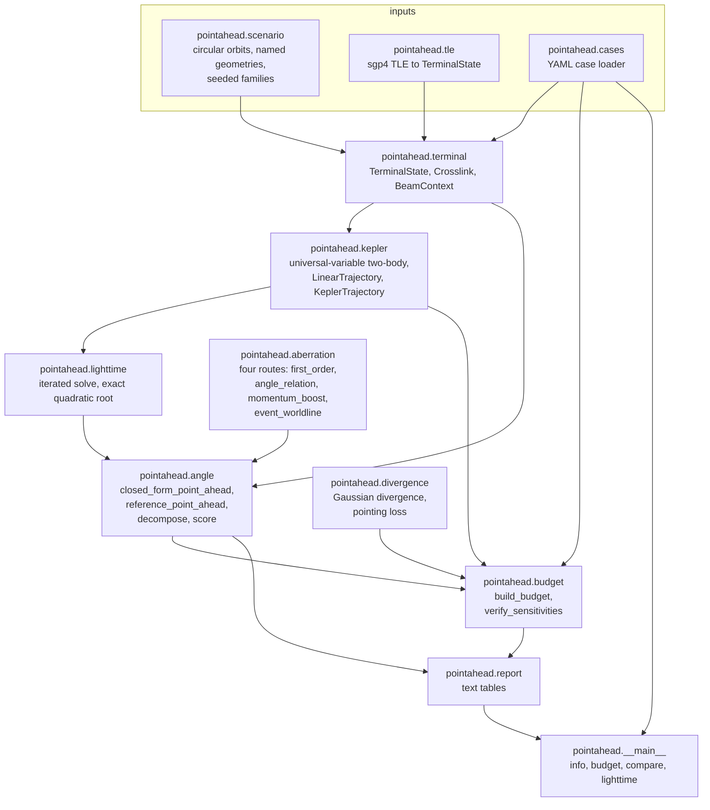
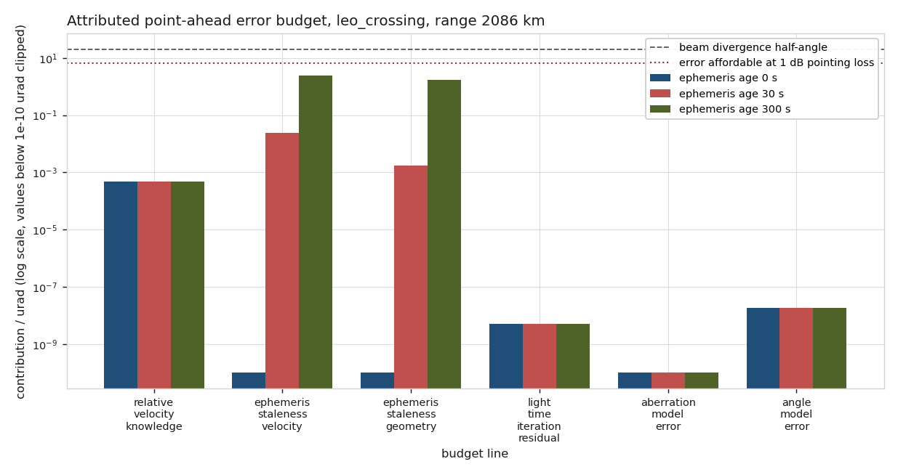
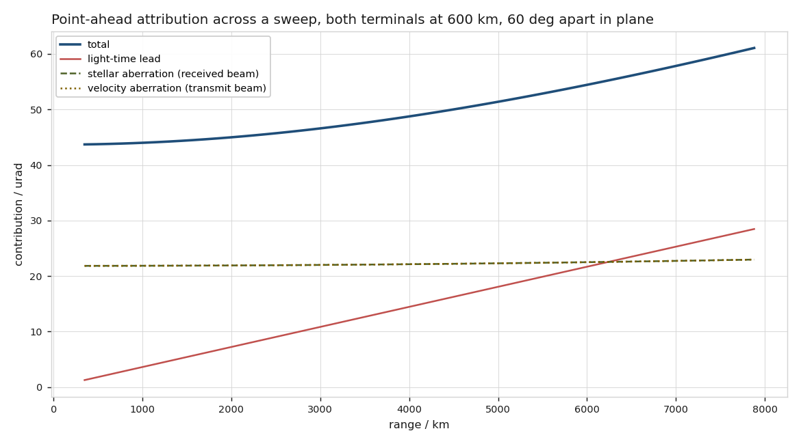
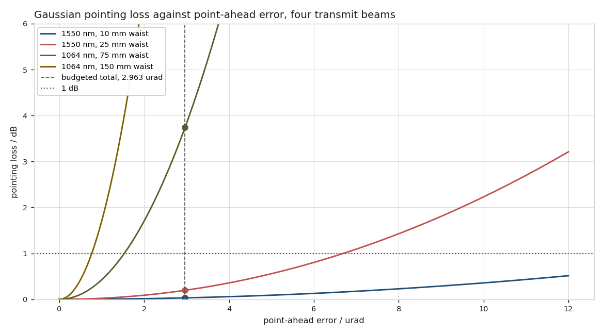
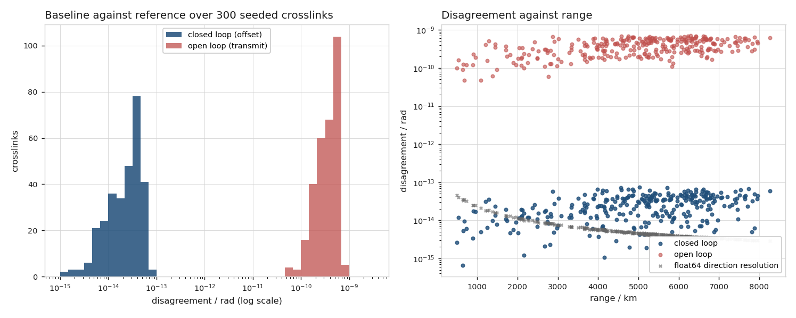
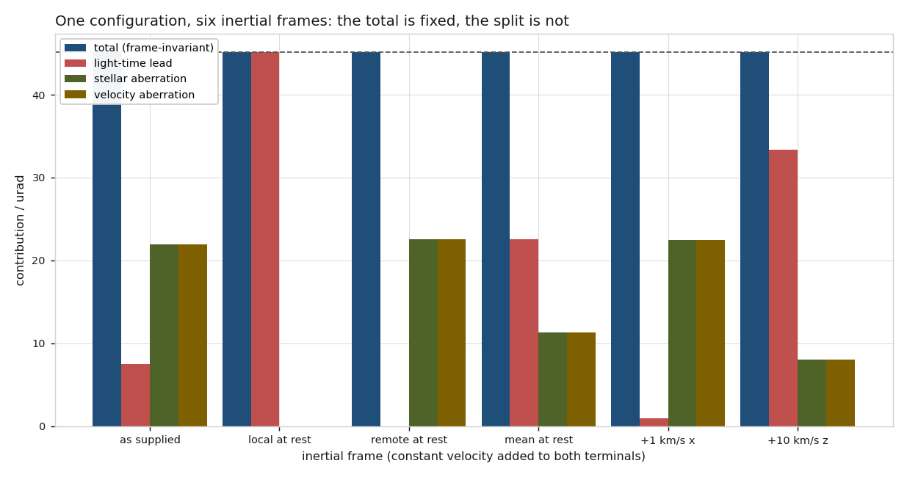
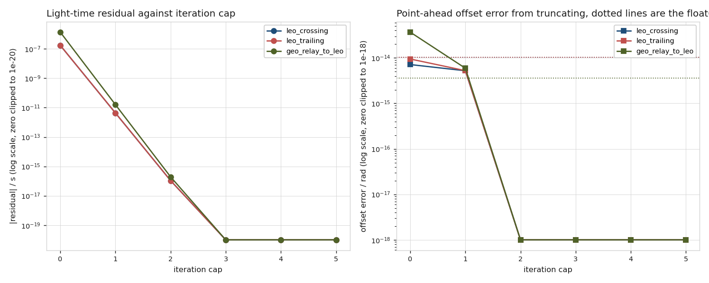

# pointahead

Point-ahead angle for an optical crosslink, with every error term attributed to its own checkable line.


## The problem

An optical crosslink has to transmit ahead of where the far terminal appears to
be, because the far terminal moves while light is in transit, and the angle is
tens of microradians on a beam whose divergence half-angle is also tens of
microradians. Your simulation prints "point-ahead error: 3 microradians" and
that number is useless on its own: on the widest of the four transmit beams
measured in `validation/VALIDATION.md` it costs `3.132821e-02` dB and on the
narrowest it costs `1.495885e+01` dB, and either way it does not tell you
whether to buy a better ephemeris, propagate it more often, or iterate the
light-time solution one more step. This package computes the angle and returns
the breakdown — relative velocity knowledge, ephemeris staleness, light-time
iteration residual, stellar aberration, velocity aberration and the model error
of the closed form — each as a separate line with its equation, its validity
statement, and a numerical check that the equation reproduces a propagated
perturbation.

## What this does

- Computes the point-ahead angle two ways: a **closed-form first-order
  solution** and an **iterated light-time reference** with exact relativistic
  aberration, and scores the first against the second. Over 300 seeded
  crosslinks the closed form's worst disagreement on the point-ahead offset is
  `7.339728e-14` rad, which is `4.826409e-09` of the angle
  (`validate_pointahead.py`).
- Returns an **attributed error budget of six lines**, each individually
  checkable. Every analytic line is verified against a numerical propagation of
  its own input: 1548 of 1584 geometry-and-configuration combinations pass, and
  the 36 that do not are reported, diagnosed and left in place
  (`validate_budget.py`).
- **Splits the magnitude into three sources** — light-time lead, stellar
  aberration of the received beam, velocity aberration of the transmitted beam
  — and states that the split is frame-dependent while the total is not,
  measured: the total moves `3.858295e-14` rad across six inertial frames while the
  light-time lead moves `4.510455e-05` rad, a ratio of `1.169e+09`
  (`validate_frames.py`).
- **Judges the total against the transmit beam.** The same `2.963074` urad total
  costs `3.132821e-02` dB on a 1550 nm / 10 mm-waist beam and `1.495885e+01` dB
  on a 1064 nm / 150 mm-waist one (`validate_budget.py`, section 5).
- Shows the **light-time iteration converging** and reports its residual rather
  than assuming it: 3 iterations at every geometry measured, with the transmit
  residual falling from `1.734e-07` s at iteration cap zero to `0.000e+00` s
  at the solution (`validate_lighttime.py`).

## Who it is for

- Optical-terminal and pointing-acquisition-tracking engineers deciding where
  the pointing error budget is actually being spent.
- Mission analysts who need the point-ahead angle for a declared constellation
  geometry, with the assumptions attached to the number.
- Anyone who has a total and needs the dominant term.

## Who it is not for

- **Anyone needing an operational pointing command.** This is research-grade
  software. No output of it is suitable for an operational pointing decision.
- **Anyone who needs aberration itself done properly, with real time scales and
  real frames.** Use `astropy`. This package does not have a time system, does
  not name its inertial frame, and does not do frame transformations.
- **Anyone who needs an orbit propagator.** The two-body propagator here exists
  only to supply the remote position at the retarded and advanced epochs over a
  light time of milliseconds. It has no oblateness, no drag, no third bodies.
  Use `sgp4` for a TLE or a real propagator for anything else.
- **Anyone modelling a terminal's jitter.** The beam context here is the static
  diffraction-limited pointing loss. A real terminal's error is a distribution
  and the loss has to be integrated over it.
- **Anyone wanting a link budget.** Pointing loss is one line of one; this
  package computes that line and nothing else in it.

## Alternatives, honestly

Every package below was confirmed to exist on the Python package index. Where
one is the right answer, this README says so.

| alternative | what it does better | when to use this instead |
|---|---|---|
| [`astropy`](https://pypi.org/project/astropy/) | Aberration, light-time and frame transformations done properly, with real time scales, IERS data, and a frame graph. It is the reference implementation for this physics and it is maintained by people who do this full time. | When you need the *crosslink-specific geometry* and the *attributed budget*. `astropy` will give you an aberration correction; it will not give you a point-ahead error budget with each term attributed to its own checkable line, nor the ephemeris-staleness sensitivity, nor the beam-divergence context that says whether the total matters. **`astropy` is not installed in the environment this package was measured in and no number in this repository came from it** — see `validation/VALIDATION.md`, deviation 1. |
| [`sgp4`](https://pypi.org/project/sgp4/) | The reference SGP4/SDP4 propagator. If your input is a two-line element set, this is how you turn it into a state vector. | Always use `sgp4` for the propagation. `pointahead.tle` wraps it rather than reimplementing it, and passes the TEME frame label through to every result. |

No mature package was found that produces an attributed point-ahead error
budget. If one exists, this README is wrong and should name it.

## Install and first run

```bash
git clone https://github.com/OmAcharya-avtr/pointahead.git
cd pointahead
python -m venv .venv && source .venv/bin/activate
pip install -e ".[dev]"
python -m pytest tests/ -q
python examples/budget_breakdown.py
```

The test run prints the following. The line carries a wall-clock duration,
which moves between runs on shared hardware; the test count does not.

```
272 passed in 9.18s
```

and `python examples/budget_breakdown.py` prints:

```
geometry                : leo_crossing, range 2085.600 km
point-ahead angle       : 45.104546 urad
beam divergence         : 19.735213 urad half-angle

term                                     age 0 s        age 30 s       age 300 s
--------------------------------------------------------------------------------
relative_velocity_knowledge         4.717309e-04    4.717309e-04    4.717309e-04
ephemeris_staleness_velocity        0.000000e+00    2.380960e-02    2.380960e+00
ephemeris_staleness_geometry        0.000000e+00    1.763756e-03    1.763756e+00
light_time_iteration_residual       5.219820e-09    5.219820e-09    5.219820e-09
aberration_model_error              0.000000e+00    0.000000e+00    0.000000e+00
angle_model_error                   1.855254e-08    1.855254e-08    1.855254e-08
--------------------------------------------------------------------------------
total (root sum of squares)         4.717309e-04    2.387950e-02    2.963074e+00

age      0 s  dominant relative_velocity_knowledge    share 1.0000  loss 4.962714e-09 dB
age     30 s  dominant ephemeris_staleness_velocity   share 0.9971  loss 1.271690e-05 dB
age    300 s  dominant ephemeris_staleness_velocity   share 0.8035  loss 1.958013e-01 dB

written: screenshots/budget_breakdown.png
```

Without installing, `PYTHONPATH=src` is enough:

```bash
PYTHONPATH=src python -m pointahead scenario leo_crossing
```

## A worked example

```python
from pointahead import (
    BudgetInputs,
    build_budget,
    closed_form_point_ahead,
    decompose_point_ahead,
    leo_crossing_pair,
    reference_point_ahead,
    score_closed_form,
    verify_sensitivities,
)
from pointahead.terminal import BeamContext

link = leo_crossing_pair()
beam = BeamContext(wavelength_m=1550e-9, waist_m=0.025, label="1550 nm, 25 mm")
inputs = BudgetInputs(
    sigma_velocity_per_axis_mps=0.05,
    ephemeris_age_s=300.0,
    light_time_iterations=1,
    beam=beam,
    angle_method="closed_form",
    loss_budget_db=1.0,
)

print(closed_form_point_ahead(link).total_urad)
print(reference_point_ahead(link).total_urad)
print(build_budget(link, inputs).dominant_term)
```

prints

```
45.104545687469766
45.1045457035546
'ephemeris_staleness_velocity'
```

and the full budget, from `python validation/worked_example.py`:

```
-- magnitude attribution (frame-dependent split, invariant total) ------------
  frame                      : unspecified Earth-centred inertial
  light_time_lead            :        7.534768 urad
  stellar_aberration         :       21.913892 urad
  velocity_aberration        :       21.913892 urad
  vector sum total           :       45.104546 urad
  closure vs reference       :    1.691966e-08 urad

-- error budget: leo_crossing ------------------------------------------------
  frame                      : unspecified Earth-centred inertial
  range                      :        2085.600 km
  point-ahead angle          :       45.104546 urad
  angle method               : closed_form
  aberration route           : momentum_boost
  light-time iterations      : 1
  sigma v per axis           :        0.050000 m/s
  ephemeris age              :         300.000 s

  term                                   paid /urad    if paid /urad  origin
  -------------------------------- ---------------- ----------------  --------
  relative_velocity_knowledge          4.717309e-04     4.717309e-04  analytic
  ephemeris_staleness_velocity         2.380960e+00     2.380960e+00  analytic
  ephemeris_staleness_geometry         1.763756e+00     1.763756e+00  analytic
  light_time_iteration_residual        5.219820e-09     5.219820e-09  measured
  aberration_model_error               0.000000e+00     1.519224e-08  measured
  angle_model_error                    1.855254e-08     1.855254e-08  measured
  -------------------------------- ---------------- ----------------
  total (root sum of squares)          2.963074e+00
  total (linear sum)                   4.145188e+00
  dominant term              : ephemeris_staleness_velocity (0.8035 of the root sum of squares)

-- beam context --------------------------------------------------------------
  beam                       : 1550 nm, 25 mm
  divergence half-angle      :       19.735213 urad (1/e^2 intensity)
  far field beyond           :        1266.771 m (link is in the far field)
  total as fraction of beam  :    1.501415e-01
  pointing loss at total     :    1.958013e-01 dB
  affordable at 1.00 dB         :        6.696296 urad
  headroom                   :    2.259915e+00 x

-- analytic lines checked against numerical propagation ----------------------
  term                                  analytic       numeric         rel  check
  -------------------------------- ------------- ------------- -----------  -----
  relative_velocity_knowledge       4.717309e-10  4.717309e-10  5.2928e-08  pass (equality)
  ephemeris_staleness_velocity      2.380960e-06  2.360086e-06  8.7670e-03  pass (upper_bound)
  ephemeris_staleness_geometry      1.763756e-06  1.689058e-06  4.2352e-02  pass (upper_bound)
  light_time_iteration_residual     1.497622e-14  5.219820e-15  6.5146e-01  pass (upper_bound)
```

The two columns matter. `paid` is what the declared configuration costs; `if
paid` is what the line would be worth whether or not the configuration pays it,
so the cost of an approximation is on the page even when it is not being
incurred.

## Architecture



`pointahead.geometry` supplies the vector primitives and the speed of light to
every box above; it is left off the diagram because an edge to everything is not
information.

## Screenshots



Six budget lines on a log axis at three ephemeris ages. Notice that the two
staleness lines are absent at age zero and dominate everything by age 300
seconds, and that the two model-error lines never reach the beam-divergence
line at all.



The total and its three contributions as the remote terminal is swept along an
inclined orbit. Notice that the total varies by a factor of 1.397 across the
sweep while the light-time lead varies by a factor of 22.588: the attribution
moves far more than the answer does.



The same budgeted error marked on the pointing-loss curve of four transmit
beams. Notice that the vertical line is in the same place in all four cases and
the markers are not: the error is a result only once a beam is attached to it.



The closed form scored against the iterated reference over 300 seeded
crosslinks. Notice that the closed-loop offset error sits within about an order
of magnitude of the float64 direction resolution marked with crosses, while the
open-loop transmit-direction error is four orders above it.



One physical configuration in six inertial frames. Notice that the first bar in
each group is the same height everywhere and the other three are not.



The light-time residual and the point-ahead offset error against iteration cap.
Notice that the offset error at cap zero is already at the float64 floor marked
by the dotted lines, which is why the budget line for it is unverifiable there
and is reported as a failed check.

## Validation evidence

Full evidence in [`validation/VALIDATION.md`](validation/VALIDATION.md).
Validation level 2. **105 checks passed, 1 failed.** The failures and the
baseline wins are the credible rows, so they are first.

| check | reference | result | tolerance |
|---|---|---|---|
| **FAILED: every analytic budget line verifies on every configuration** | numerical propagation of each input | **36 of 1584 combinations failed**, all on `light_time_iteration_residual` at iteration cap zero, worst ratio 1.7564, both sides of order 1e-14 rad | bound with 1 per cent slack |
| **baseline wins:** the closed form never degrades with range | iterated reference, six range bands of 50 crosslinks | median error as a fraction of the angle flat at 6.690292e-10 to 8.747972e-10 from 494 km to 8268 km | none declared |
| **baseline wins:** closed form vs iterated reference, 300 crosslinks | iterated light-time with exact aberration | worst offset difference 7.339728e-14 rad, 4.826409e-09 of the angle; median float64 direction resolution 4.394229e-15 rad | 1e-07 of the angle |
| **baseline wins:** closed form vs reference, named geometries | iterated light-time reference | worst 3.816931e-09 of the angle | 1e-08 of the angle |
| three exact aberration routes, 2000 draws, `\|beta\|` to 0.95 | each other | worst 1.054369e-15 rad | 1e-13 rad |
| transverse aberration displacement | `arcsin(beta)`, closed form | worst 2.710505e-16 relative | 1e-14 |
| two collinear boosts compose | relativistic velocity addition | worst 2.775558e-16 rad | 1e-14 rad |
| two-body propagation | `scipy.integrate.solve_ivp` DOP853 rtol 1e-13 | worst 1.013e-13 relative position | 1e-10 relative |
| specific energy and angular momentum | exact two-body invariants | worst 1.796569e-15 and 5.192154e-16 relative | 1e-12 relative |
| iterated light time | exact quadratic root, 400 cases | worst 0.000000e+00 relative | 1e-14 relative |
| relativistic light time at 0.6 c | `1 / sqrt(1 - 0.36) = 1.25` s exactly | 1.250000000000000 s | 1e-14 relative |
| point-ahead vanishes for radial relative motion, 120 crosslinks | zero | closed form 0.000000e+00, reference worst 6.729973e-16 rad | 1e-18 / 1e-15 rad |
| offset negates under negated relative velocity | zero | worst 1.681746e-15 relative | 1e-14 relative |
| rotational equivariance, 240 comparisons | each geometry's float64 direction resolution | 0 of 240 residuals above their own floor | per-geometry floor |
| total is frame-invariant, 6 frames x 3 geometries | itself | spread 1.249001e-14 to 6.821943e-14 rad | 1e-07 of the angle |
| attribution split is NOT frame-invariant | itself | the light-time lead moves 1.169e+09, 5.375e+09 and 1.546e+09 times further than the total on the three geometries | expected to fail invariance |
| 17 scripts x 5 working directories | exit status | 85 of 85 exited 0 | 0 |
| absolute paths in tracked text files | — | 74 files scanned, 0 matches | 0 |
| shipped YAML cases regenerate identically | byte comparison | 3 of 3 unchanged | exact |

### Defects this build found

Eleven, all pinned in `tests/test_regressions.py` with literal inputs and
re-measured by `validation/validate_regressions.py`. Hypothesis found six of
them and the hand-written suite found none of those six. Three were defects in
the code:

1. The universal-variable Kepler iteration did not converge over 88
   revolutions of a 37.9 second orbit. Fixed by exact reduction modulo the
   orbital period.
2. `ephemeris_staleness_velocity` omitted the jerk term and predicted
   `2.087363736690764e-22` rad against a measured `2.3807507009717773e-08` rad
   (both recorded in
   `validate_budget.py` and in the pinned regression). For two terminals at
   **equal radius** under two-body gravity the relative acceleration is exactly
   along the line of sight, so a first-order-only staleness model predicts zero
   for the commonest crosslink geometry there is.
3. `ephemeris_staleness_geometry` used `dt^3 / 6` where the stale-position
   expansion gives `dt^3 / 3`, so the bound sat a factor of two below the
   measurement.

The other eight were defects in an acceptance criterion, a prediction or a
docstring. The one worth repeating here because it affects anybody writing a
test about a small angle: **`pytest.approx(expected, rel=r)` carries a default
absolute tolerance of 1e-12**, and accepts a value within either bound, so on a
microradian quantity every relative tolerance tighter than 2e-08 is silently
replaced by it. Re-running this suite with `abs=0.0` substituted into all 95
`rel=` calls found exactly three assertions that depended on the default; all
three are now explicit and the suite passes either way. All eleven defects are
tabulated in `validation/VALIDATION.md`.

## API reference

<details>
<summary>Public surface, one line per entry, with units</summary>

### Geometry — `pointahead.geometry`

| name | returns |
|---|---|
| `C_LIGHT` | speed of light, 299792458 m/s, exact by SI definition |
| `unit(vector)` | unit vector; raises on zero norm |
| `transverse(vector, direction)` | component of `vector` perpendicular to `direction`, units of `vector` |
| `angle_between(a, b)` | angle in radians, `[0, pi]`, via `atan2(\|a x b\|, a . b)` |
| `rotation_matrix(axis, angle_rad)` | 3x3 right-handed rotation |
| `orthonormal_basis(direction)` | `(n, e1, e2)`, deterministic transverse basis |

### Aberration — `pointahead.aberration`

| name | returns |
|---|---|
| `beta_from_velocity(velocity_mps)` | dimensionless `v / c` |
| `lorentz_gamma(beta_magnitude)` | `1 / sqrt(1 - beta^2)` |
| `aberrate_first_order(direction, beta)` | approximate aberrated unit direction |
| `aberrate_angle_relation(direction, beta)` | exact, trigonometric derivation |
| `aberrate_momentum_boost(direction, beta)` | exact, four-momentum boost |
| `aberrate_event_worldline(direction, beta, baseline_m)` | exact, event-coordinate transformation |
| `aberrate(direction, beta, route)` | dispatch by route name |
| `aberration_angle(direction, beta, route)` | angular displacement in radians |
| `route_disagreement(direction, beta)` | pairwise disagreement in radians between all four routes |

### Dynamics — `pointahead.kepler`

| name | returns |
|---|---|
| `MU_EARTH`, `R_EARTH` | 3.986004418e14 m^3/s^2, 6378137.0 m |
| `propagate_two_body(position_m, velocity_mps, dt_s, mu)` | `KeplerStep` with state, iterations, `fg_residual`, revolutions removed |
| `LinearTrajectory(position_m, velocity_mps, epoch_s)` | constant-velocity trajectory |
| `KeplerTrajectory(position_m, velocity_mps, epoch_s, mu)` | two-body trajectory with `position`, `velocity`, `acceleration` |

### Light time — `pointahead.lighttime`

| name | returns |
|---|---|
| `solve_light_time(remote, local_position_m, epoch_s, direction, tol_s, max_iter)` | `LightTimeSolution` with `tau_s`, iterates, residual, convergence flag |
| `linear_light_time_closed_form(trajectory, local_position_m, epoch_s, direction)` | exact light time in seconds for a straight-line remote trajectory |
| `light_time_residual(remote, local_position_m, epoch_s, tau_s, direction)` | residual of the light-time equation in seconds |

### Point ahead — `pointahead.angle`

| name | returns |
|---|---|
| `closed_form_point_ahead(link)` | `PointAheadResult`; `theta = 2 \|v_rel_perp\| / c` in radians |
| `reference_point_ahead(link, tol_s, max_iter, aberration_route)` | `PointAheadResult` from the iterated light time and exact aberration |
| `offset_difference(first, second)` | norm of the difference of two offset vectors, radians |
| `decompose_point_ahead(link)` | `PointAheadDecomposition`: light-time lead, stellar and velocity aberration, closure |
| `score_closed_form(link, tol_s, max_iter)` | `BaselineScore`: magnitude, closed-loop offset and open-loop transmit differences, radians |
| `light_time_pair(link, tol_s, max_iter)` | `(receive, transmit)` light-time solutions |

### Budget — `pointahead.budget`

| name | returns |
|---|---|
| `BudgetInputs(...)` | declared sigma in m/s, ephemeris age in s, iteration cap, beam, routes, loss allocation in dB |
| `build_budget(link, inputs)` | `ErrorBudget`: six `BudgetTerm` lines in radians, RSS and linear totals, dominant term, beam judgement |
| `verify_sensitivities(link, inputs, tolerance)` | four `SensitivityCheck` records, analytic against numeric, radians |
| `relative_acceleration(link)` / `relative_jerk(link)` | m/s^2 and m/s^3 under the declared trajectory model |
| `staleness_velocity_error_mps(link, age_s)` | bound on the transverse relative-velocity error of a stale state, m/s |
| `staleness_position_error_m(link, age_s)` | bound on the transverse relative-position error of a stale state, m |
| `direction_noise_floor_rad(link)` | float64 resolution of an offset difference for that geometry, radians |

### Beam — `pointahead.divergence`

| name | returns |
|---|---|
| `gaussian_divergence_half_angle(wavelength_m, waist_m)` | `lambda / (pi w0)`, 1/e^2 intensity half-angle in radians |
| `rayleigh_range(wavelength_m, waist_m)` | `pi w0^2 / lambda` in metres |
| `beam_fraction(error_rad, divergence_rad)` | dimensionless ratio |
| `pointing_loss_fraction(error_rad, divergence_rad)` | on-axis-normalised intensity in `(0, 1]` |
| `pointing_loss_db(error_rad, divergence_rad)` | loss in decibels, non-negative |
| `error_for_loss_db(loss_db, divergence_rad)` | error in radians that costs exactly that loss |

### Inputs — `pointahead.terminal`, `pointahead.scenario`, `pointahead.cases`, `pointahead.tle`

| name | returns |
|---|---|
| `TerminalState(position_m, velocity_mps, epoch_s, name)` | validated inertial state |
| `Crosslink(local, remote, trajectory_model, mu, label, frame)` | validated link with `range_m`, `line_of_sight`, `relative_velocity_mps`, `reversed()`, `boosted()` |
| `BeamContext(wavelength_m, waist_m, label)` | validated transmit beam |
| `CircularOrbit(altitude_m, inclination_rad, raan_rad, argument_of_latitude_rad)` | element set with `state()`, `period_s()`, `speed_mps()` |
| `leo_crossing_pair()`, `leo_trailing_pair()`, `geo_to_leo_pair()` | the three named geometries |
| `scenario_family(seed, count)` | `count` seeded unoccluded crosslinks, deterministic in `seed` |
| `load_case(path)` | `Case` with link, beam and declared budget inputs |
| `TleTerminal.from_lines(name, line1, line2)`, `crosslink_from_tles(...)` | `sgp4`-backed states, frame labelled `TEME of date` |

</details>

## Limitations

- **No independent third-party cross-check of the aberration.** The batch
  specification for this product asks for one against `astropy`. `astropy` is
  not installed in the environment this package was measured in and installing
  it was not permitted, so the cross-check is three internal exact
  implementations derived three different ways plus the iterated light-time
  reference. They agree to `1.054369e-15` rad, which demonstrates
  implementation consistency and not correctness against the field. This is
  weaker than the specification asks for and it is recorded as deviation 1 in
  `validation/VALIDATION.md`.
- **One point in each dependency range was executed, not both ends.** Every
  range in `pyproject.toml` is bounded on both sides at the minor version the
  numbers come from, but only the exact patch release in the pinned environment
  was run, because installing was forbidden. The build guide asks for both ends
  and this build could not comply. The cost of the ceilings is real: this
  package cannot take a numpy 2.6 or a scipy 1.19 release without a port and a
  re-measure, and that tension is not resolved by removing them.
- **The light-time iteration budget line is unverifiable at iteration cap
  zero.** At cap zero the receive and transmit truncation errors nearly cancel
  and the predicted error falls below the float64 direction resolution, so the
  check fails on 36 of 1584 combinations. At one or more iterations it verifies
  everywhere measured. Iterate at least once; every shipped case does.
- **Two-body dynamics only.** No oblateness, no drag, no solar radiation
  pressure, no third bodies. Over a light time of milliseconds this is far
  below anything the package resolves. Over an ephemeris age of minutes to
  hours it is not, so the ephemeris-staleness lines are statements about
  two-body propagation and not about a real ephemeris.
- **The staleness lines stop meaning anything at long ages.** They are a
  two-term Taylor expansion of the state error under linear extrapolation. At
  900 and 3600 seconds the bound tightness degrades badly and the budget prints
  numbers that should not be trusted. The validity condition is that the age is
  short against the orbital period.
- **The frame is unspecified and there is no time system.** The total
  point-ahead angle is frame-invariant to first order, so this costs nothing
  for the total. The attribution is frame-dependent and therefore inherits the
  ambiguity; `pointahead.tle` labels its frame `TEME of date` and performs no
  rotation.
- **No gravitational light bending**, no refractive medium, no atmosphere. For a
  space-to-space crosslink the first is of order nanoradians near the Earth and
  the others do not apply; for a space-to-ground link none of the three is
  modelled and the beam context is also wrong, because turbulence dominates.
- **The beam context is static and diffraction-limited.** Aperture truncation,
  central obscuration and the terminal's jitter spectrum are not modelled.
- **The `leo_trailing` and `leo_crossing` geometries share a range by
  construction**, and their remote radial velocities happen to be equal. That
  coincidence is useful — it exposed a wrong predictor during validation — but
  it means the two are not independent samples of anything.
- **Compute budget.** Everything in this repository is cheap and nothing needs
  more than one core, so no run is anywhere near the three-minute budget this
  mission sets. The two per-operation timing tables, both declared unstable,
  are in `validation/validate_pointahead_output.txt` and
  `validation/validate_kepler_output.txt`; the suite and each validation script
  complete in seconds on the 2 cores measured. The property tests default to
  200 Hypothesis examples each and `POINTAHEAD_HYPOTHESIS_EXAMPLES=1200` was
  also run clean.

## Reproducing every number in this README

```bash
python -m pytest tests/ -q --junitxml=junit.xml
ruff check src/ tests/ examples/ validation/

python validation/validate_aberration.py
python validation/validate_kepler.py
python validation/validate_lighttime.py
python validation/validate_pointahead.py
python validation/validate_budget.py
python validation/validate_invariants.py
python validation/validate_frames.py
python validation/validate_cli.py
python validation/regenerate_cases.py
python validation/validate_regressions.py
python validation/worked_example.py
python validation/probe_working_directories.py

MPLBACKEND=Agg python examples/budget_breakdown.py
MPLBACKEND=Agg python examples/attribution_vs_geometry.py
MPLBACKEND=Agg python examples/beam_context.py
MPLBACKEND=Agg python examples/baseline_vs_reference.py
MPLBACKEND=Agg python examples/frame_dependence.py
MPLBACKEND=Agg python examples/lighttime_convergence.py
```

Test counts come from `junit.xml`, never from pytest stdout: a suite that
collects zero tests prints success and exits zero. Each validation script writes
its raw output to `validation/<script>_output.txt`.

## Licence, citation, credits

Apache-2.0. See [`LICENSE`](LICENSE). Copyright 2026 OPTIMA Organisation.

Citation metadata in [`CITATION.cff`](CITATION.cff).

Equations and their sources are cited in the module docstrings:
Rindler, *Relativity: Special, General and Cosmological*, 2nd ed., Oxford
University Press 2006, section 3.6, for relativistic aberration; Moyer,
*Formulation for Observed and Computed Values of Deep Space Network Data Types
for Navigation*, JPL Deep-Space Communications and Navigation Series Monograph
2, Wiley 2003, chapter 8, for the light-time iteration; Vallado, *Fundamentals
of Astrodynamics and Applications*, 4th ed., Microcosm Press 2013, Algorithm 8
and section 2.2, for universal-variable two-body propagation; Siegman, *Lasers*,
University Science Books 1986, section 17.1, and Andrews and Phillips, *Laser
Beam Propagation through Random Media*, 2nd ed., SPIE Press 2005, chapter 4, for
the Gaussian far-field divergence; Klein and Degnan, "Optical antenna gain. 1:
Transmitting antennas", *Applied Optics* 13(9), 1974, for what aperture
truncation does to it; Hemmati (ed.), *Deep Space Optical Communications*, JPL
Deep-Space Communications and Navigation Series, Wiley 2006, chapter 1, for the
point-ahead requirement in a link design. Structure and equations only. No
numerical value in this repository is taken from any of them.

This software is research-grade. It is not flight-qualified, not certified, and
not approved for operational aerospace use.

This is under reserved rights obtained by OPTIMA Organisation.
