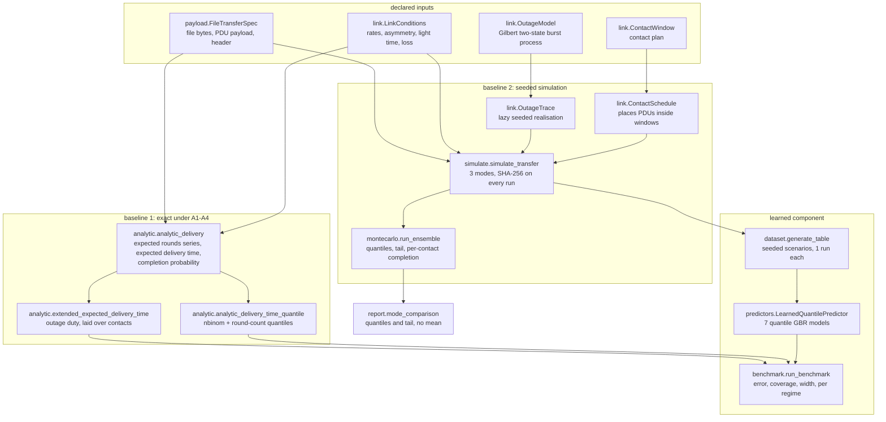
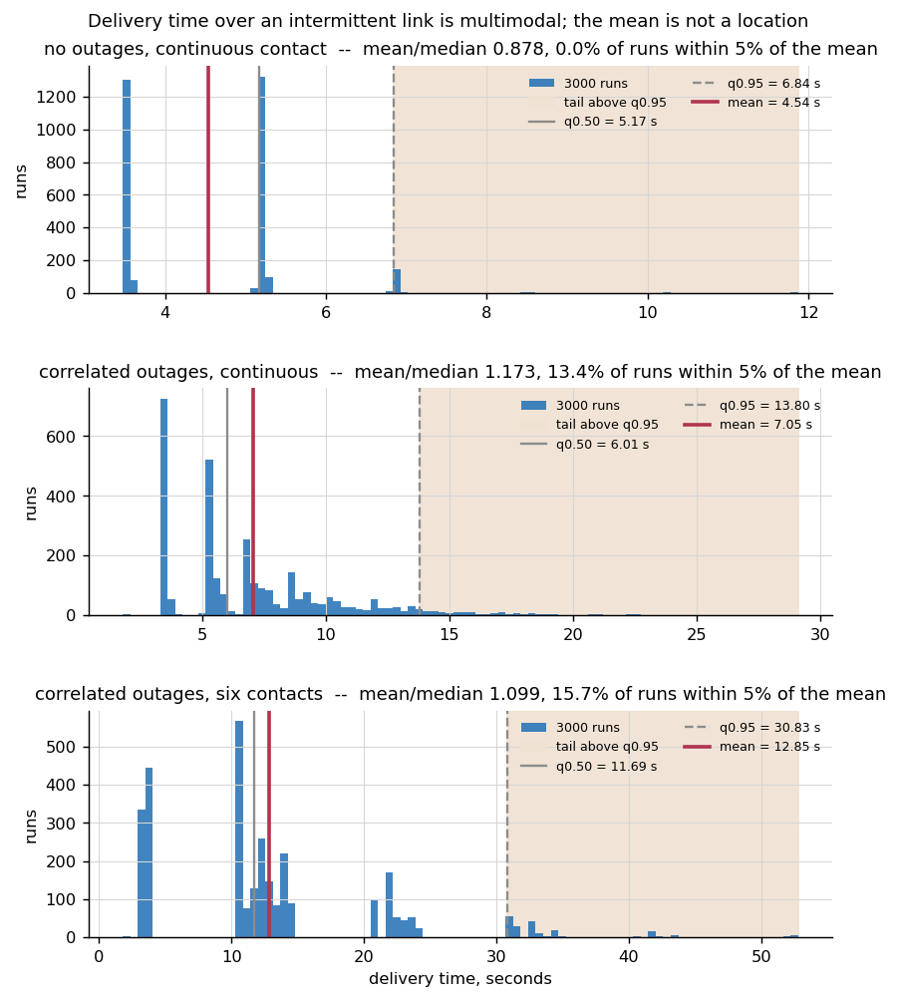
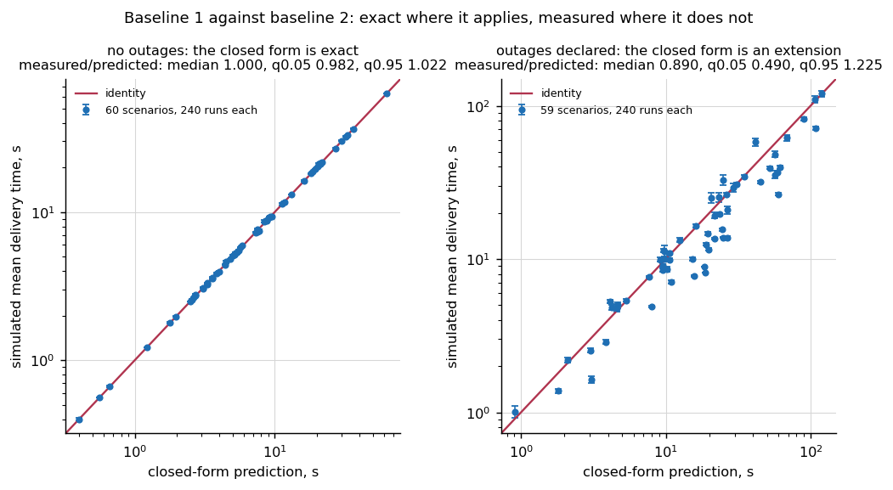
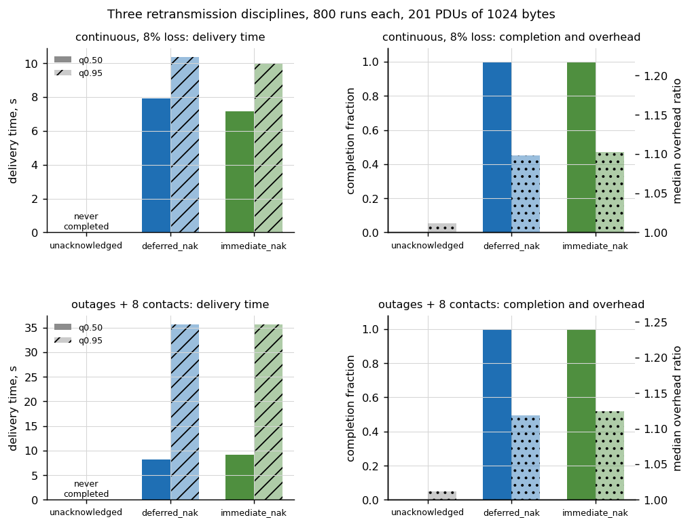
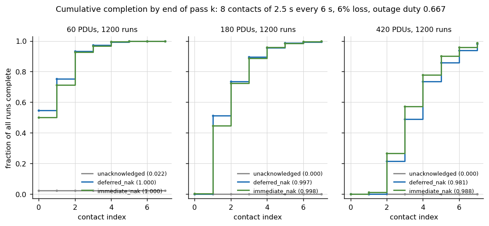
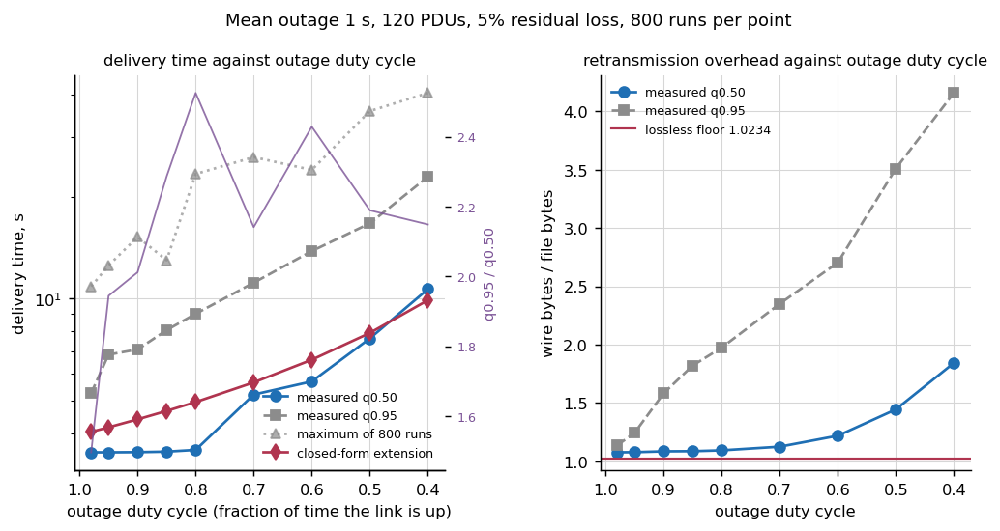
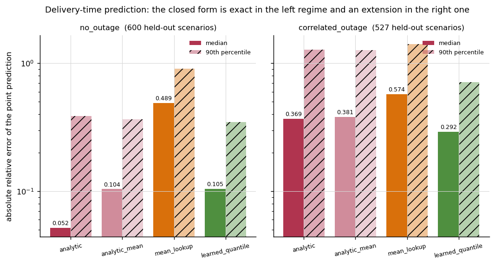
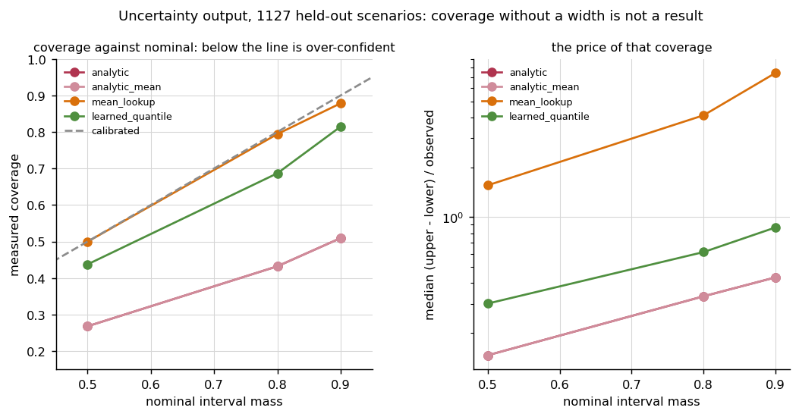

# RelFileDelivery

What a file transfer costs over an intermittent link, measured against a declared link model.


**Status: TESTING** · Class: compact · Validation level 2 (research grade) ·
Learned component present and benchmarked against the baselines it has to beat ·
Apache-2.0 · © 2026 OPTIMA Organisation

This software is research-grade. It is **not flight-qualified, not certified,
and not approved for operational aerospace use.**

> **This is not a CFDP implementation.** [`cfdp-py`](https://pypi.org/project/cfdp-py/)
> and [`spacepackets`](https://pypi.org/project/spacepackets/) implement the
> CCSDS File Delivery Protocol and its packet formats. Use them for the
> protocol. This package implements no wire format, no transaction state
> machine and no filestore request, and nothing here is conformant with
> anything.

## The problem

You have a 2 MiB product on the recorder, a link that drops for twenty seconds
at a time, eight per cent residual loss after coding, a 100:1 forward-to-return
asymmetry and six contacts in the plan. Somebody has to answer "will it be down
by the end of the third pass", and the protocol library cannot answer it
because answering it is not the protocol library's job. The usual substitute is
file size divided by bit rate multiplied by a margin somebody chose, which is a
number with no distribution behind it and no way to tell you that twelve per
cent of transfers will miss the contact you planned against.

## What this does

- **Verifies the simulation against a closed form before trusting either.** In
  the no-outage limit the simulated mean delivery time agrees with the exact
  expectation to within **1.90 sampling standard errors** over 12 declared grid
  cells, worst relative discrepancy **1.537594e-02**, and the transmission
  count agrees to **1.22 standard errors** over 20 cells
  (`validation/validate_simulation_vs_closed_form_output.txt`).
- **Asserts delivered-equals-source by SHA-256 on every run, and proves the
  assertion can fail.** 1829 delivered runs over 2400 across 4 files, 5 link
  regimes and 3 modes, with **0 digest mismatches** and **0** digests reported
  for an undelivered run; **15 of 15** injected single-bit corruptions were
  caught (`validation/validate_completion_invariant_output.txt`).
- **Reports delivery time as quantiles with the tail stated separately, because
  the mean is not a location.** On a continuous link with eight per cent loss
  and no outages, **0.0000** of 3000 runs land within five per cent of their own
  mean: the distribution is quantised by retransmission rounds and the mean sits
  in a gap (`validation/validate_distributions_output.txt`).
- **Cross-checks retransmission accounting against an independent count.** The
  aggregate transmission counter equals the per-unit attempt sum on **1680 of
  1680** runs, and the wire-byte accounting closes exactly on every run
  (`validation/validate_retransmission_accounting_output.txt`).
- **Benchmarks a learned delivery-time predictor against the closed form and
  reports that the closed form wins where it applies.** Median absolute relative
  error over 600 held-out no-outage scenarios: **0.051928** for the closed form
  against **0.104687** for gradient-boosted quantile regression, a factor of
  **2.0160** in the closed form's favour, and the closed form uses no training
  data at all (`validation/validate_predictors_output.txt`).

## Who it's for

- An operator or mission planner who has declared link conditions and needs a
  delivery-time distribution, a retransmission overhead and a per-contact
  completion probability.
- Anyone sizing a contact plan against a file queue and wanting to know the
  spread rather than the centre.
- Anyone who wants to know what deferred-NAK costs against immediate-NAK on
  *their* link rather than in general.

## Who it's not for

- **Anyone who needs to actually transfer a file.** There is no wire format
  here. Use `cfdp-py`.
- **Anyone who needs a conformance statement.** Nothing here is checked against
  CCSDS 727.0-B-5 and no claim of conformance is made anywhere.
- **Anyone whose link loss is not plausibly described by independent loss plus
  a two-state burst process.** The model is Gilbert (1960); a real link has
  structure it does not have.
- **Anyone who needs a number for a flight decision.** Research grade, and the
  numbers are statements about the declared model.
- **Anyone who wants the mean.** It is reported, beside the ratio that shows
  when it has stopped describing anything.

## Alternatives, honestly

| Alternative | What it does better | When to use this instead |
|---|---|---|
| [`cfdp-py`](https://pypi.org/project/cfdp-py/) | Implements CFDP itself: transaction state machines, PDU handling, filestore requests, the acknowledged and unacknowledged classes. If you need to move a file, this is the tool. | When you are not moving a file but deciding whether the contact plan can carry it, and you need the delivery-time distribution rather than the transfer. |
| [`spacepackets`](https://pypi.org/project/spacepackets/) | CCSDS packet and PDU construction and parsing, including the CFDP PDU formats. Correct wire representations. | When no wire representation is needed at all, because nothing is transmitted, and the question is about declared link conditions rather than about bytes on a link. |
| A spreadsheet of past transfer times | Real data from the real link, which no model here has. | When you need a distribution for a link condition you have not seen before, or a file size you have not sent before. The `mean_lookup` predictor in this package *is* that spreadsheet, and it is scored alongside the others: median absolute relative error **0.489155** in the no-outage regime against **0.051928** for the closed form. |
| `ns-3`, OMNeT++ | Full discrete-event network simulation with real protocol stacks, congestion, queueing and routing. | When the question is one link, three retransmission disciplines and a contact plan, and a full network simulator is a week of setup for an answer that fits in a quantile table. |

**Neither `cfdp-py` nor `spacepackets` is installed in the environment these
numbers were measured in**, which the committed validation output records
explicitly at the top of every file. No figure anywhere in this repository was
taken from either package, and none of this package's results is a comparison
against them.

## Install and first run

```bash
git clone https://github.com/OmAcharya-avtr/relfiledelivery.git
cd relfiledelivery
python -m venv .venv && source .venv/bin/activate
pip install -e ".[dev]"
python -m pytest tests/ -q
python -m relfiledelivery compare --file-bytes 262144 --loss 0.05 --runs 200
```

The test run ends with:

```
777 passed
```

(pytest also prints a wall-clock duration on that line; it varies between runs
and no number in this repository is derived from it.)

and the `compare` command prints:

```
==============================================================================
declared scenario
==============================================================================
file size               : 262144 bytes
PDU payload             : 1024 bytes
PDU header              : 12 bytes
PDU count               : 256
last PDU payload        : 1024 bytes
clean-pass wire bytes   : 265216 bytes (overhead ratio 1.011719)
forward rate            : 1e+06 bit/s
return rate             : 10000 bit/s
asymmetry (fwd/ret)     : 100
one-way light time      : 0.25 s
independent PDU loss    : 0.05
outage process          : none (no-outage limit)
contact                 : continuous
availability            : 1.000000

==============================================================================
modes compared, quantiles and tail; no mean
==============================================================================
mode              complete     q0.50 s     q0.95 s       max s   max/med  overhead      tx
------------------------------------------------------------------------------------------
unacknowledged      0.0000         n/a         n/a         n/a       n/a    1.0117     256
deferred_nak        1.0000      3.0640      3.6567      4.7014    1.5344    1.0640     269
immediate_nak       1.0000      2.9354      3.4911      4.1168    1.4025    1.0663     269
```

The `unacknowledged` row is the first thing to read: at five per cent loss over
256 units, `(1 - 0.05) ** 256` is 1.982636e-06, so that mode never completes this
transfer and reports no delivery time rather than an optimistic one.

## A worked example

```python
from relfiledelivery import (
    FileTransferSpec, LinkConditions, OutageModel, TransferMode,
    analytic_delivery, extended_expected_delivery_time, run_ensemble, uniform_windows,
)

spec = FileTransferSpec(file_bytes=2 * 1024 * 1024, pdu_payload_bytes=1024, pdu_header_bytes=12)

link = LinkConditions(
    forward_rate_bps=2.0e6,
    return_rate_bps=2.0e4,
    one_way_light_time_s=2.5,
    pdu_loss_probability=0.08,
    outage=OutageModel(mean_up_s=80.0, mean_down_s=20.0),
    windows=uniform_windows(count=6, duration_s=30.0, period_s=180.0),
)

ideal = analytic_delivery(spec, link.without_outages(), TransferMode.DEFERRED_NAK)
extended = extended_expected_delivery_time(spec, link, TransferMode.DEFERRED_NAK)
measured = run_ensemble(spec, link, TransferMode.DEFERRED_NAK, runs=600, seed=20261024)

print(f"closed form, no outages : {ideal.expected_delivery_time_s:.4f} s")
print(f"analytic extension      : {extended:.4f} s")
print(f"measured q0.50          : {measured.quantiles[0.50]:.4f} s")
print(f"measured q0.95          : {measured.quantiles[0.95]:.4f} s")
print(f"maximum / median        : {measured.tail['max_over_median']:.4f}")
for index, fraction in sorted(measured.completion_by_contact.items()):
    print(f"complete by pass {index}      : {fraction:.4f}")
```

Real output, from `validation/worked_example.py`:

```
closed form, no outages : 25.4821 s
analytic extension      : 181.8527 s
measured q0.50          : 26.7995 s
measured q0.95          : 205.1822 s
maximum / median        : 20.8086
complete by pass 0      : 0.8250
complete by pass 1      : 0.9600
complete by pass 2      : 0.9950
complete by pass 3      : 1.0000
complete by pass 4      : 1.0000
complete by pass 5      : 1.0000
```

Three things worth reading in that output. The median is 26.80 s and the
ninety-fifth percentile is 205.18 s, a factor of 7.66, because a run that misses
the first contact waits 180 s for the next one. The analytic extension reports
181.85 s because the contact time it needs, 31.85 s, exceeds the declared 30 s
window by six per cent, so it deposits the whole transfer into the second
contact — it is a step function of the contact plan and this scenario sits just
on the wrong side of a step, while the simulation says 82.5 per cent of runs
finish in the first contact. And the per-contact vector is the shape the answer
actually has: no single number, analytic or measured, carries it.

## Architecture



## Screenshots



The top panel is the headline: on a continuous link with no outages, the red
mean line sits in a gap between two modes of the distribution where **no run
lands at all**. The modes are retransmission rounds; a mean between them
describes nothing.



Left: in the no-outage limit the simulated mean sits on the identity line, so
the simulation is verified against the closed form rather than against itself.
Right: once outages are declared the closed form becomes an extension and the
scatter off the line is the measured size of its error. The ratios in the panel
titles are computed and printed by `examples/analytic_vs_simulation.py` when it
draws the figure, over 60 generated scenarios per panel at 240 runs each.



Immediate-NAK is usually but not always faster than deferred-NAK, and
unacknowledged mode is the bar that does not exist: it never completes, so it
has no delivery time to plot.



The answer an operator needs is a step function, not a scalar. Note that the
unacknowledged curve is flat: with no retransmission, more passes do not help.



As the outage duty cycle falls the median rises slowly and the 95th percentile
rises fast. The purple line is the ratio between them, which is the quantity a
margin is supposed to cover.



Left panel, where the closed form is exact: the closed form wins. Right panel,
where it is an extension: the learned model wins, by less than the left panel's
margin. Both are reported.



Nothing here is calibrated except the lookup table, and the lookup table pays
for it with an interval **8.6 times wider** than the learned model's. Coverage
without a width is not a result.

## Validation evidence

Validation level 2. Every number below came from a script in `validation/`
executed in this session; the script name is given for each. Checks that failed,
and checks where a baseline beat the learned model, are in the table because
they are the credible rows.

| Check | Reference | Result | Tolerance | Script |
|---|---|---|---|---|
| `E[R]` series against inclusion-exclusion over geometric minima | Closed form with no shared code | worst relative difference **1.258780e-13** over 48 pairs | 1e-09 | `validate_analytic.py` |
| Series truncation bound against measured truncation | Bernoulli's inequality | worst slack **+7.297573e-16** over 9 pairs | 16·eps·E[R] | `validate_analytic.py` |
| Round-count CDF against enumeration | Independent product over units | worst absolute difference **2.220446e-16** over 48 triples | 1e-12 | `validate_analytic.py` |
| Negative-binomial transmission quantile against 200000 draws | `scipy.stats.nbinom` sample | worst absolute difference **0.0** transmissions over 27 triples | 1 transmission | `validate_analytic.py` |
| Simulated mean delivery time against the exact expectation, no-outage limit | Closed form, exact under A1–A4 | worst **1.9000** standard errors, worst relative **1.537594e-02**, **0 of 12** cells outside | 4 sampling standard errors | `validate_simulation_vs_closed_form.py` |
| Simulated transmission count against `n / (1 - p)` | Closed form, mode-independent | worst **1.2187** standard errors, **0 of 20** cells outside | 4 sampling standard errors | `validate_simulation_vs_closed_form.py` |
| Completion invariant: delivered bytes equal source bytes by SHA-256 | The source payload itself | **0** mismatches over **1829** delivered runs of 2400 | exact digest equality | `validate_completion_invariant.py` |
| Negative control: one flipped bit must be caught | Deliberate corruption | **15 of 15** caught, 3 modes × 5 offsets | all must raise | `validate_completion_invariant.py` |
| Aggregate transmission counter against per-unit attempt sum | Independent bookkeeping | **0** discrepancies over **1680** runs | exact integer equality | `validate_retransmission_accounting.py` |
| Wire-byte accounting recomputed from the attempt array | Independent bookkeeping | **0** mismatches over 21 link/mode cells × 40 runs | exact integer equality | `validate_retransmission_accounting.py` |
| Seeded reproducibility, field by field | Repeated run | **0** field mismatches over 225 runs, 23 fields each | exact equality | `validate_reproducibility.py` |
| Independence from surrounding call order | Interleaved repeats | **0** order-dependent results over 9 pairs | exact equality | `validate_reproducibility.py` |
| **FAILED on first run**: truncation bound vs measurement | Bernoulli's inequality | **4 of 9** rows failed against a flat 1e-18 comparison; the comparison was wrong, not the bound | — | `validate_analytic.py` |
| **FAILED on second run**: same check, corrected tolerance | Bernoulli's inequality | 1 of 9 rows failed at slack **-1.83e-13**, traced to catastrophic cancellation in `1 - (1-p**k)**n`; term rewritten as `-expm1(n·log1p(-p**k))` and the worst slack moved to **+7.30e-16** | 16·eps·E[R] | `validate_analytic.py` |
| **FAILED on first run**: immediate-NAK against its analytic lower bound | Busy-time lower bound | **7 of 11** cells failed when compared against the minimum over runs; the bound is on the *expectation*, so the check was wrong | — | `validate_simulation_vs_closed_form.py` |
| **FAILED on first run**: seed sensitivity | Distinct transmission counts | **3 of 9** rows failed; unacknowledged mode sends every unit exactly once whatever the seed, so its transmission count is deterministic by construction | — | `validate_reproducibility.py` |
| **BASELINE WINS**: closed form against the learned model, no-outage regime | 600 held-out scenarios | median \|rel err\| **0.051928** against **0.104687**, a factor of **2.0160** for the closed form | reported, not asserted | `validate_predictors.py` |
| Learned model against the closed form, correlated-outage regime | 527 held-out scenarios | median \|rel err\| **0.292259** against **0.368928**, a factor of **1.2623** for the learned model | reported, not asserted | `validate_predictors.py` |
| **NOT CALIBRATED**: interval coverage at nominal 0.90 | 1127 held-out scenarios | learned **0.8146**, closed form **0.5093**, lookup **0.8784**; **10 of 12** predictor/regime rows outside the declared 0.03 band | 0.03 of nominal | `validate_predictors.py` |
| **REPORTED**: the closed-form expectation falls outside its own 0.90 interval | 1127 held-out scenarios | **2 of 1127** rows, worst excess **0.018720** relative | reported, not asserted | `validate_predictors.py` |
| **REPORTED**: immediate-NAK is not always faster than deferred-NAK | 11 grid cells | slower in **1 of 11**, worst ratio **1.2425** at 120 PDUs, p=0.25, light time 2.5 s | reported, not asserted | `validate_simulation_vs_closed_form.py` |
| **REPORTED**: the one-over-duty-cycle inflation of the transmission count | 400 runs per link | measured **1.1885** against naive **1.3333**; the naive factor over-predicts by **12.2 per cent** because **0.3550** of runs never meet an outage | reported, not asserted | `validate_retransmission_accounting.py` |
| Command line: every invocation and every rejected input | 7 invocations, 7 rejections | **0** failures | exit 0 and the expected text | `validate_cli.py` |

Four checks failed on their first run and all four are in the table. Two of
them were defects in the check and two were defects in the code; the
catastrophic-cancellation one is a real numerical defect in the closed form that
only the validation script found, and the hand-written tests did not.

Two further defects were found by Hypothesis and are pinned as named regression
tests with literal inputs in `tests/test_regressions.py`:
`uniform_windows(11, d, d)` with `d = 114.06854261351316` built contiguous
windows that `LinkConditions` then rejected as overlapping by 2.3e-13 seconds,
and the same windows gave a contact duty cycle of 1.0000000000000002, which is
not a probability.

## API reference

<details>
<summary>Declared inputs</summary>

| Function or class | What it is |
|---|---|
| `FileTransferSpec(file_bytes, pdu_payload_bytes, pdu_header_bytes)` | The file and its segmentation. Bytes throughout. |
| `LinkConditions(forward_rate_bps, return_rate_bps, one_way_light_time_s, pdu_loss_probability, outage, windows, nak_bytes, nak_bytes_per_segment, eof_bytes)` | Declared link. Rates in bit/s, times in s, loss dimensionless in [0, 1). |
| `OutageModel(mean_up_s, mean_down_s)` | Gilbert two-state burst process. `OutageModel.none()` is the no-outage limit. |
| `ContactWindow(start_s, end_s)`, `uniform_windows(count, duration_s, period_s, first_start_s)` | Contact plan, seconds on a common timeline. |
| `TransferMode` | `UNACKNOWLEDGED`, `DEFERRED_NAK`, `IMMEDIATE_NAK`. |

</details>

<details>
<summary>Baseline 1: the closed form</summary>

| Function | Returns |
|---|---|
| `expected_transmissions_per_pdu(p)` | `1/(1-p)`, dimensionless. |
| `expected_total_transmissions(n, p)` | `n/(1-p)`, dimensionless, mode-independent. |
| `rounds_cdf(n, p, k)` | `P(R <= k) = (1 - p**k)**n`. |
| `expected_rounds_detail(n, p, tolerance)` | `E[R]` with its term count and rigorous truncation bound. |
| `rounds_quantile(n, p, q)`, `transmissions_quantile(n, p, q)` | Exact quantiles of the round count and the transmission count. |
| `analytic_delivery(spec, link, mode)` | Full closed-form prediction. Raises outside A1–A4. |
| `analytic_delivery_time_quantile(spec, link, q)` | Semi-analytic delivery-time quantile, seconds. An approximation, declared. |
| `extended_expected_delivery_time(spec, link, mode)` | The closed form extended past A2, seconds. An extension, declared. |
| `extended_delivery_time_quantile(spec, link, q)` | The same extension applied to the quantile. |

</details>

<details>
<summary>Baseline 2: the simulation</summary>

| Function | Returns |
|---|---|
| `simulate_transfer(spec, link, mode, seed, verify=True, horizon_s, max_forward_transmissions, payload_seed, inject_corruption_at)` | One `TransferResult`. Verifies the completion invariant by SHA-256 on every delivered run. |
| `run_ensemble(spec, link, mode, runs, seed)` | A `DeliveryDistribution`: quantiles, tail, overhead, per-contact completion. |
| `accounting_discrepancy(result)` | Aggregate transmission counter minus the per-unit attempt sum. Zero on every run. |
| `standard_error_of_mean(values)` | Sampling standard error, used as the tolerance against the closed form. |

</details>

<details>
<summary>The learned component</summary>

| Function or class | What it is |
|---|---|
| `generate_scenario(seed, regime)`, `generate_table(rows, seed)` | Seeded scenario generator, one simulated run per scenario. |
| `AnalyticPredictor(point="median" \| "mean")` | The closed form as a predictor. Uses no training data. |
| `MeanLookupPredictor()` | Measured quantiles binned by mode, loss and availability. |
| `LearnedQuantilePredictor()` | Seven gradient-boosted quantile models on log delivery time. |
| `predictor.predict_interval(table, nominal=0.90)` | `(lower, median, upper)` in seconds. The uncertainty output. |
| `run_benchmark(predictors, train, test)` | Error, coverage, interval width, per regime. |

</details>

## Limitations

- **Control PDUs are never lost (M4).** No NAK timer, no control retransmission.
  A lost NAK in a real transfer costs a timer expiry this harness does not
  measure, so every delivery time here is optimistic by that amount.
- **The sender transmits during an outage (M3).** Conservative on the
  transmission count and wrong for an outage-aware sender.
- **A PDU is never split across a contact boundary (M1).** A declared choice,
  not a property of any protocol; it can only delay a transfer, never speed it.
- **The learned component is conditional on completion.** Scenarios whose run
  did not finish inside the declared horizon are dropped: **190 of 3000**
  training rows and **73 of 1200** test rows. Nothing here predicts *whether*
  a transfer completes, only how long it takes given that it did.
- **No uncertainty output here is calibrated at nominal 0.90.** Measured
  coverage: learned **0.8146**, closed form **0.5093**, lookup **0.8784**, over
  1127 held-out scenarios where the standard error of a coverage estimate is
  0.0089. The learned interval is the narrowest of the three and the lookup is
  the closest to nominal.
- **The learned quantile models cross.** 939 of 6762 adjacent level pairs, a
  rate of 0.1389, are sorted into order before being returned. The count is
  reported rather than hidden; it says the per-level fits disagree about the
  shape of the conditional distribution in part of the feature space.
- **Every learned result is a statement about the generator in
  `dataset.py`**, whose equations are in its module docstring. No flight data
  is used anywhere in this repository.
- **The closed form is exact only under A1–A4** — independent per-PDU loss, no
  outages, continuous contact, fixed-size control PDUs, back-to-back
  transmission. `analytic_delivery` raises rather than silently applying itself
  outside them.
- **The analytic extension is a step function of the contact plan** and is
  discontinuous at a window boundary. The worked example above sits on the wrong
  side of a step and the extension is 6.79 times the measured median there.
- **Every dependency is bounded above as well as below**, at the versions these
  numbers were measured against. The cost is real: this package cannot take a
  `scikit-learn` 1.10 or a `numpy` 2.6 release without a port and a full
  re-measure, and that is a genuine tension with taking a future security
  release. It is recorded here rather than resolved by removing the ceiling.
- **The declared ranges were measured at one point each, not at both ends.**
  The build environment is a pinned, shared interpreter that this product was
  forbidden to modify, so exactly one version of each dependency was available:
  numpy 2.5.3, scipy 1.18.1, scikit-learn 1.9.1, pandas 3.0.5, pytest 8.4.2,
  hypothesis 6.140.3, ruff 0.14.2, matplotlib 3.10.8. Each range is therefore a
  single minor version wide and is the version actually measured, rather than a
  range whose two ends were both exercised. A reader installing at a different
  patch release inside one of these ranges is outside what was measured, and
  the honest statement is that the ranges are narrow because they were not
  tested wide.
- **Measured on Python 3.13.17 only.** The package declares `>=3.11` and the CI
  matrix covers 3.11, 3.12 and 3.13, but every number in this repository was
  produced on 3.13.17.
- **Compute budget.** Every script finishes well inside the three-minute
  budget on two cores. The figures below are wall clock on a shared container
  and are **unstable**: they move between runs, no conclusion in this
  repository is derived from them, and `validate_predictors.py` prints its own
  stage breakdown under the same warning.

  | Stage (UNSTABLE: wall clock, two cores) | Seconds |
  |---|---|
  | `pytest tests/ -q` | 25 |
  | `validation/validate_analytic.py` | 4 |
  | `validation/validate_simulation_vs_closed_form.py` | 80 |
  | `validation/validate_completion_invariant.py` | 5 |
  | `validation/validate_retransmission_accounting.py` | 12 |
  | `validation/validate_reproducibility.py` | 5 |
  | `validation/validate_distributions.py` | 68 |
  | `validation/validate_predictors.py` | 59 |
  | `validation/validate_cli.py` | 4 |
  | `validation/worked_example.py` | 83 |

## Reproducing every number

```bash
python -m pytest tests/ -q --junitxml=junit.xml
python - <<'PY'
import xml.etree.ElementTree as ET
root = ET.parse("junit.xml").getroot()
suite = root if root.tag == "testsuite" else root.find("testsuite")
print(suite.get("tests"), "declared,", len(suite.findall(".//testcase")), "testcase elements")
PY
ruff check src/ tests/ examples/ validation/

python validation/validate_analytic.py
python validation/validate_simulation_vs_closed_form.py
python validation/validate_completion_invariant.py
python validation/validate_retransmission_accounting.py
python validation/validate_reproducibility.py
python validation/validate_distributions.py
python validation/validate_predictors.py
python validation/validate_cli.py
python validation/worked_example.py

MPLBACKEND=Agg python examples/delivery_time_distribution.py
MPLBACKEND=Agg python examples/mode_comparison.py
MPLBACKEND=Agg python examples/analytic_vs_simulation.py
MPLBACKEND=Agg python examples/outage_sensitivity.py
MPLBACKEND=Agg python examples/completion_per_contact.py
MPLBACKEND=Agg python examples/predictor_benchmark.py
```

Every validation script anchors its paths on `__file__` and changes to the
repository root, so each one exits zero from any working directory. That is
verified from `/`, `/tmp`, the repository root and `validation/` before release.

## Licence, citation, credits

Apache-2.0. © 2026 OPTIMA Organisation. See `LICENSE`.

Cite with `CITATION.cff`, or:

> OPTIMA Organisation (2026). *relfiledelivery: what a file transfer costs over
> an intermittent link, measured rather than reimplemented.* Version 0.1.0.

References used in the code and named at the point of use: Gilbert (1960),
"Capacity of a burst-noise channel", *Bell System Technical Journal* 39(5), for
the two-state outage process; Feller (1968), *An Introduction to Probability
Theory and Its Applications* volume 1 chapter XIII, for the geometric attempt
count; Johnson, Kemp and Kotz (2005), *Univariate Discrete Distributions*
chapter 5, for the negative-binomial transmission count; Friedman (2001),
"Greedy function approximation: a gradient boosting machine", *Annals of
Statistics* 29(5), for the quantile regression; Strobl et al. (2007), *BMC
Bioinformatics* 8:25, for why impurity importances are reported as a
description of the model rather than as evidence about the link; CCSDS
727.0-B-5 (2020) for the names of the transfer modes and for nothing else;
FIPS 180-4 (2015) for SHA-256.

### Credits

This is under reserved rights obtained by OPTIMA Organisation.
