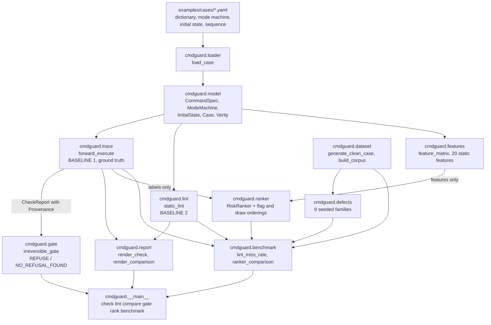
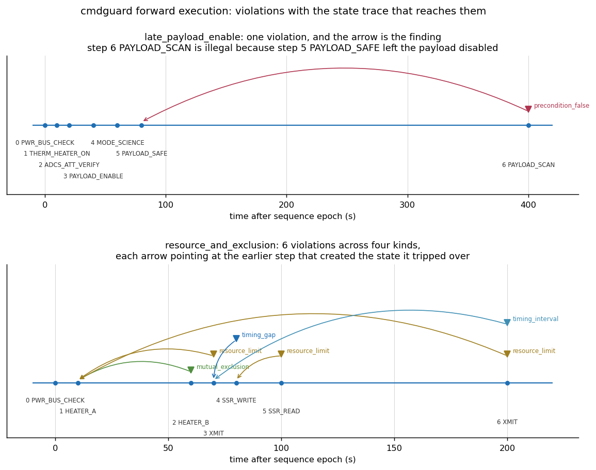
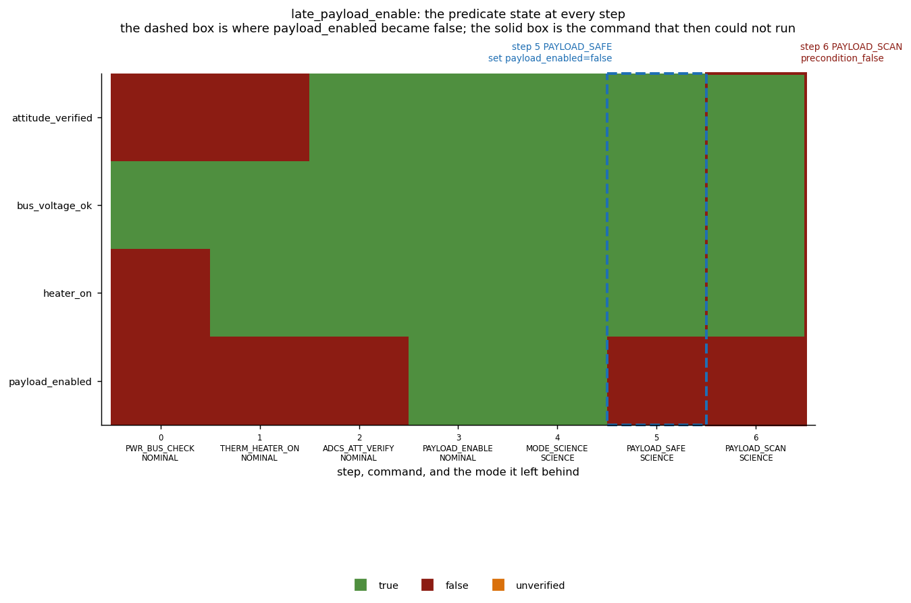
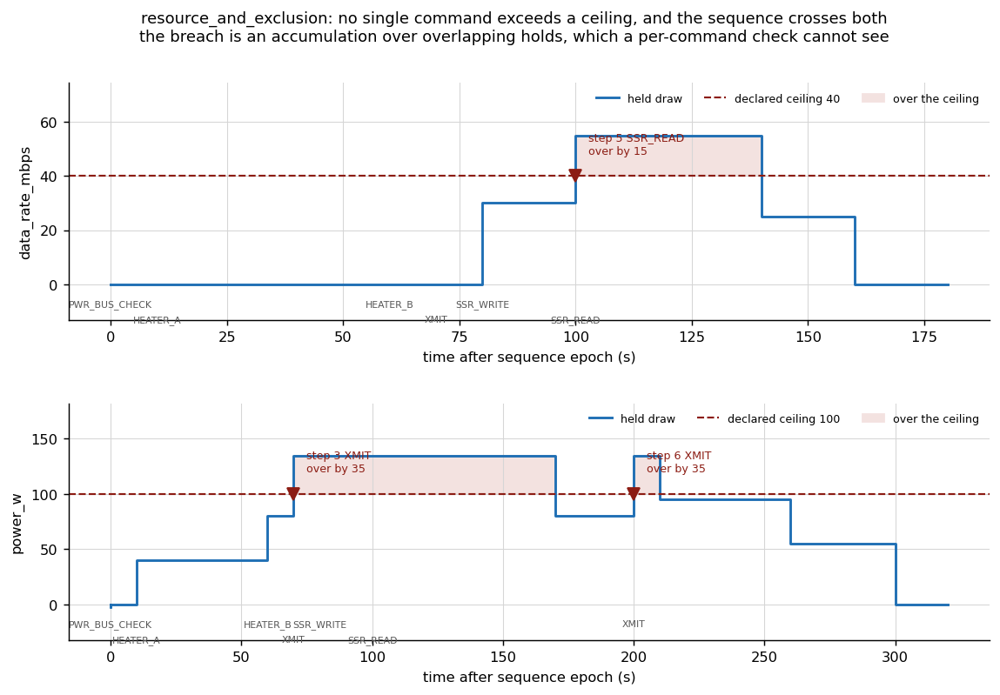
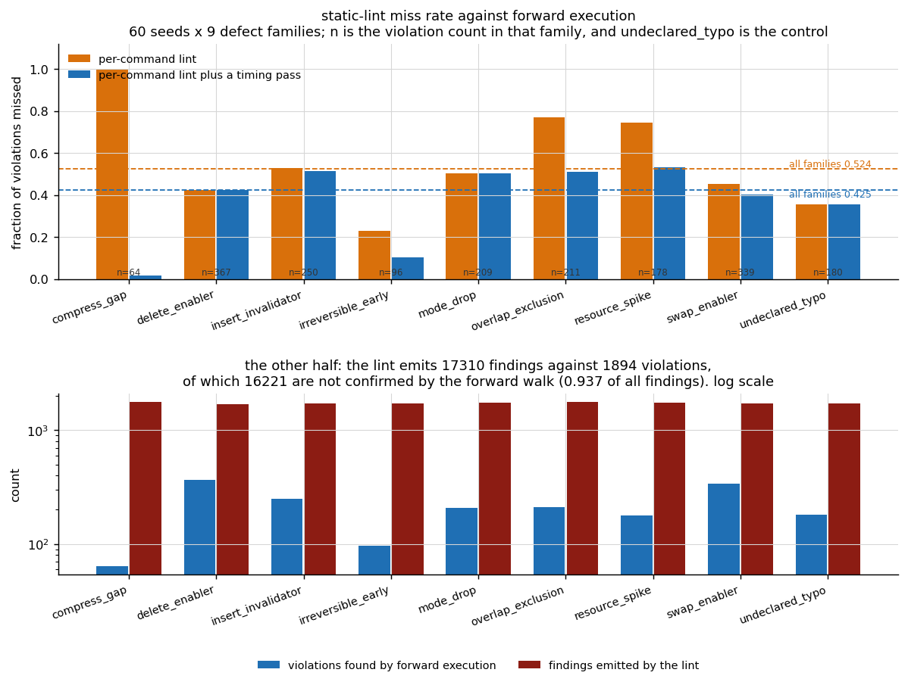
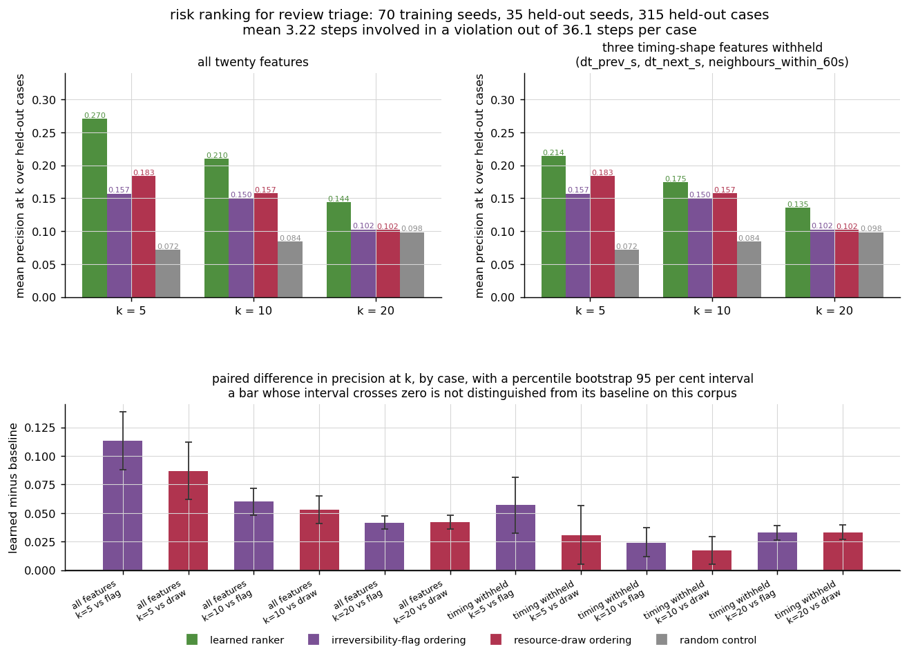
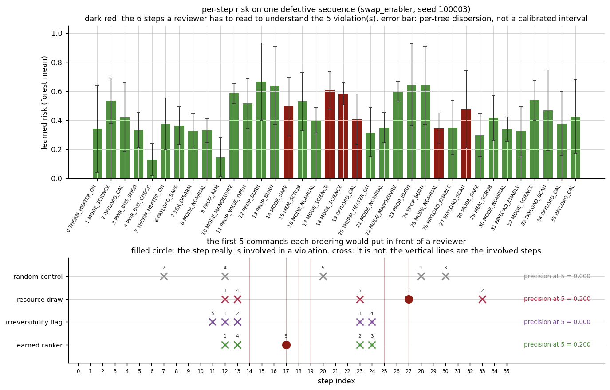

# CmdGuard

Checks a command sequence against the spacecraft state it will actually meet.


**Status: TESTING** · Class: compact · Validation level 2 (research grade) ·
Learned component present and benchmarked against the baselines it has to beat ·
Apache-2.0 · © 2026 OPTIMA Organisation

This software is research-grade. It is **not flight-qualified, not certified,
and not approved for operational aerospace use.**

> **A sequence this package reports clean has not been shown safe to uplink.**
> It has been shown consistent with the command dictionary, the mode machine
> and the initial state you declared. If a declaration is wrong, the check is
> wrong, and nothing here can tell you which.

## The problem

A command sequence is checked one command at a time, against the state somebody
assumed it would meet, and that check passes on sequences that cannot run: the
payload scan at command 47 is legal in isolation and illegal in context,
because command 12 safed the payload and nothing re-enabled it. The finding
that matters is not "command 47 is illegal" — that sends a reviewer back to
read the whole sequence — but "command 47 is illegal because command 12 left
the payload in SAFE and nothing re-enabled it", which is a diff. This package
walks the sequence forward through the declared mode machine and reports every
violation with the chain of earlier steps that produced the state it tripped
over.

## What this does

- **Reports ten violation kinds with the state trace that reaches each one.**
  Undeclared command, mode gate, illegal mode transition, false precondition,
  unverified precondition, unverified precondition on an irreversible command,
  minimum same-command interval, minimum inter-command gap, mutual exclusion
  over a live hold, and a resource ceiling crossed by accumulation. Verified
  against hand-constructed cases with hand-derived shortfalls — exclusion
  **150.000000 s**, power **35.000000 W**, gap **10.000000 s**, data rate
  **15.000000 Mbps**, interval **170.000000 s**
  (`validation/validate_forward_known_output.txt`).
- **Measures what a per-command lint misses, instead of asserting that it
  misses things.** Over 60 seeds and nine injected defect families, 1894
  violations: a per-command lint misses **0.524287** of them and **0.667467**
  of the ones only a sequence-aware check can reach. With a timing pass added
  it misses **0.425026** and **0.441777**
  (`validation/validate_lint_missrate_output.txt`).
- **Measures what that lint costs you in noise.** It emits **17310** findings
  against those 1894 violations, of which **0.937088** are not confirmed by the
  forward walk, because it re-evaluates every command occurrence against the
  declared initial state (same transcript).
- **Refuses, rather than advises, on an irreversible command with an unverified
  precondition.** Over all six orderings of a deployment against its
  verification the gate refuses exactly the three that deploy first, **0
  mismatches of 6**, and it refuses **0** of 420 clean generated sequences
  (`validation/validate_irreversible_gate_output.txt`).
- **Ranks commands for review triage, and reports how much of that ranking is
  an artefact.** The learned ranker reaches precision at 5 of **0.270199**
  against **0.156954** for an irreversibility-flag sort and **0.183444** for a
  resource-draw sort — and **0.056291** of that margin disappears when three
  timing features are withheld, because the defect injector edits the time
  column (`validation/validate_ranker_output.txt`).
- **Reports nothing on sequences that have nothing.** 420 generated clean
  sequences over seven generator shapes, 15317 command occurrences, **0** false
  alarms (`validation/validate_negative_control_output.txt`).

## Who it is for

- Anyone reviewing an uplink load who needs to know *why* a command is illegal,
  not only that it is.
- Anyone whose sequence checker is a script that looks at one command at a
  time, who wants a number for what that misses on their own defect classes.
- Anyone with irreversible commands — deployments, pyros, one-shot valves,
  memory scrubs — who wants a hard gate on the case where the precondition was
  assumed rather than verified.
- Anyone who has a command dictionary and a mode machine written down and wants
  a second opinion that reads them literally.

## Who it is not for

- **Anyone who needs a flight-software checker.** This is research-grade. It is
  not qualified, not certified, and a clean report here is not a release to
  uplink.
- **Anyone who does not have declarations.** The entire contribution is reading
  a declared dictionary and a declared mode machine carefully. If the
  preconditions live in people's heads, this package has nothing to check
  against and will cheerfully report a clean sequence.
- **Anyone who needs their mission's command format.** There is no CCSDS
  service, no SLE, no XTCE, no procedure language. The input is a YAML file in
  this package's own schema, and the translation from your database is yours.
- **Anyone who needs branching procedures.** Forward execution is exact
  *because* a linear sequence has one path. A procedure with conditionals,
  loops or onboard autonomy rules has many, and nothing here enumerates them.
- **Anyone who needs physics.** There is no power model, no thermal model, no
  attitude dynamics. A resource draw is a declared number held for a declared
  duration, and whether that number is right is not checkable here.
- **Anyone who needs a time scale.** Every time is seconds after a sequence
  epoch you define. No UTC, no leap seconds, no TAI.
- **Anyone who needs the learned ranker to be trustworthy on their sequences.**
  It is trained on a synthetic generator and its risk score is not calibrated
  (measured calibration gap **0.331780**). It reorders; it never decides.

## Alternatives, honestly

**No mature equivalent was found on the index.** Searching PyPI for a package
that takes a declared command dictionary and mode machine and checks a sequence
against the state it will meet turned up nothing, and this README is not going
to invent a comparison in order to look well-read. The honest substitute, and
what missions actually do, is **mission-specific scripted checks plus review**.

That substitute is not a straw man, and the measurements here are of exactly
it: `cmdguard.lint` *is* a per-command precondition check with a timing pass,
and the miss rate and the false-positive rate in this README are what it scores
against the forward walk.

The table below names only packages verified to exist on PyPI by
`validation/probe_pypi_names.py`, whose probe is validated against a known-taken
control (`numpy`) and two known-free controls before any of its answers are
used.

| Alternative | What it does better | When to use this instead |
|---|---|---|
| **Mission-specific scripted checks plus review** | Knows your mission. Encodes constraints nobody wrote down, runs in your pipeline, and the reviewers understand it. There is no substitute for it and this package is not one. | When you want a number for what the per-command part of it misses, and when you want a finding to carry the earlier step that caused it. Run both. |
| `spacepackets` (0.32.0 on PyPI, probed 2026-10-24) | **Actually speaks the protocols.** CCSDS space packets, PUS telecommand and telemetry, CFDP. Builds and parses the bytes that go up and come down. | This package never produces a packet, a frame or an APID. It checks a sequence of mnemonics against declarations. Use `spacepackets` for the wire format and this for the ordering question. |
| `yamcs-client` (2.1.0 on PyPI, probed 2026-10-24) | **A real mission control system.** Yamcs has a command database, stack execution, verifiers, telemetry and a user interface, in production on real missions. | Only if you want this package's specific output: the provenance chain behind a violation, and a measured miss rate for a per-command check. If you are choosing a commanding system, choose Yamcs, not this. |
| `transitions` (0.9.3 on PyPI, probed 2026-10-24) | **The better state-machine library.** Hierarchical states, callbacks, async, diagrams, and years of use. | This package's `ModeMachine` is a deliberately minimal DFA with a declared transition relation and nothing else. If you want to *model* a mode machine, use `transitions`; the contribution here is the checking around it. |
| `python-statemachine` (3.2.2 on PyPI, probed 2026-10-24) | Declarative state machines with validation and diagram export. | Same answer as `transitions`. |
| A model checker (NuSMV, SPIN, TLA+) | **Proves properties over all executions.** If your question is about an autonomy rule set or a branching procedure, this is the right tool class and it is strictly more general. | When the artefact really is one linear sequence. Forward execution of a single path is exact, needs no property language, and the output is a trace a flight controller can read without learning temporal logic. |

## Install and first run

```bash
git clone https://github.com/OmAcharya-avtr/cmdguard.git
cd cmdguard
python -m venv .venv && source .venv/bin/activate
pip install -e ".[dev]"
python -m pytest tests/ -q
```

```
295 passed in 32.67s
```

The count is the number that matters and it is taken from the JUnit XML, never
from this line; the duration is wall clock on a shared two-core container and
moves between runs.

Then check a sequence with a known defect:

```bash
python -m cmdguard check examples/cases/late_payload_enable.yaml
```

```
==============================================================================
cmdguard forward execution: late_payload_enable
==============================================================================
steps                 : 7
sequence span         : 400.0 s
effect policy         : apply
violations            : 1
ordering-only defects : 0
gate-blocking         : 0
final mode            : SCIENCE
peak held draw        : data_rate_mbps=22, power_w=46

by kind:
  precondition_false         1

violations, with the state trace that reaches each one:

step   6 t=    400.0 s  PAYLOAD_SCAN           precondition_false
    requires payload_enabled=true but it is false at this step
    because step 5 t=80.0 s PAYLOAD_SAFE: set payload_enabled=false
    because step 6 t=400.0 s PAYLOAD_SCAN: no step between that point and this one set payload_enabled to true
```

The process exits **1**. It exits **0** when nothing was found, **2** when the
irreversible-command gate refused, and **3** when the input could not be loaded.

And a figure:

```bash
python examples/violation_timeline.py
```

```
wrote screenshots/violation_timeline.png
late_payload_enable    : 1 violation(s), steps to review (5, 6)
resource_and_exclusion : 6 violation(s), steps to review (1, 2, 3, 4, 5, 6)
```

## A worked example

From `validation/worked_example.py`, which is re-run as the last step of every
build so this block cannot drift from the code.

```python
from cmdguard import forward_execute, gate_case, load_case, static_lint
from cmdguard.lint import LintStrength

case = load_case("examples/cases/late_payload_enable.yaml")
report = forward_execute(case)

print(f"steps              : {len(case.sequence)}")
print(f"violations         : {report.n_violations}")
print(f"by kind            : {report.kind_counts()}")
print(f"steps to review    : {report.involved_steps()}")
print("")

for violation in report.violations:
    print(violation.render(indent="  "))
print("")

# The same case through the per-command lint, which is what people run.
lint = static_lint(case, LintStrength.WITH_TIMING)
forward_ids = {(v.step, v.kind.value) for v in report.violations}
print(f"lint findings      : {lint.n_findings}")
print(f"confirmed by trace : {len(forward_ids & lint.identities())}")
print(f"not confirmed      : {len(lint.identities() - forward_ids)}")
print("")

# And the gate, which refuses rather than advises.
print(gate_case(case).render())
```

```
steps              : 7
violations         : 1
by kind            : {'precondition_false': 1}
steps to review    : (5, 6)

step   6 t=    400.0 s  PAYLOAD_SCAN           precondition_false
  requires payload_enabled=true but it is false at this step
  because step 5 t=80.0 s PAYLOAD_SAFE: set payload_enabled=false
  because step 6 t=400.0 s PAYLOAD_SCAN: no step between that point and this one set payload_enabled to true

lint findings      : 6
confirmed by trace : 1
not confirmed      : 3

irreversible-command gate: late_payload_enable
  irreversible commands declared : 0
  irreversible executions in seq : 0
  verdict                        : NO_REFUSAL_FOUND
  No gate-blocking violation was found against the declared model. This is not a statement that the sequence is safe to uplink.
```

Six lint findings, collapsing to four distinct `(step, kind)` identities, of
which one matches the real violation and three are conditions an earlier
command already fixed. That ratio, measured over 21660 command occurrences, is
the point of this package.

The same three calls on the deployment case
(`examples/cases/irreversible_before_verify.yaml`) return verdict `REFUSE` and
exit code 2.

## Architecture



The two edges into `RiskRanker` are drawn separately on purpose: the forward
walk supplies the **labels** and the declarations supply the **features**, and
no feature is derived from the walk. That separation is asserted by
`tests/test_features.py::test_features_do_not_read_the_forward_walk`.

## Screenshots

All six are produced by the scripts in `examples/`, so they cannot drift from
the code.



Each downward marker is a violation; each arrow points back at the earlier step
the provenance trace names. The top panel is one defect; the bottom is six
across four kinds. Notice that in the bottom panel three arrows converge on step
1 — one command is responsible for most of the sequence's problems, which is the
kind of thing a flat list of findings hides.



The predicate state at every step, with the mode underneath each command. The
dashed box is where `payload_enabled` became false; the solid box is the command
that then could not run. Notice there are 320 seconds and no commands between
them: the defect is not a typo, it is a gap in the plan.



Held draw against the declared ceiling. Notice that the power trace reaches
135 W while no single command in this dictionary draws more than 55 W — the
breach is an accumulation over overlapping holds, and a per-command resource
check cannot see it at all.



Top: the fraction of violations a per-command lint misses, by defect family,
with and without a timing pass. Notice `compress_gap` falls from 1.000 to 0.016
once timing arithmetic is added, while `mode_drop` does not move at all — the
timing pass is free, and it buys nothing against ordering. Bottom, log scale:
the lint emits roughly an order of magnitude more findings than there are
violations.



Precision at k for four orderings, with and without the timing features, and
the paired bootstrap intervals underneath. Notice the two rightmost bars in the
bottom panel: with the timing features withheld and k=20, the learned margin is
small but its interval still excludes zero, while the free orderings at that
cut-off are not distinguished from a shuffle at all.



One sequence, in detail. Top: per-step risk with the forest's per-tree spread.
Bottom: the five commands each ordering would put in front of a reviewer, and
which of them were worth reading. Notice that on this single case the learned
ranker and the resource-draw ordering both score 0.200 — aggregate results are
the result, and one case is an illustration.

## Validation evidence

Full tables in [`validation/VALIDATION.md`](validation/VALIDATION.md). Every
number traces to a transcript in `validation/`.

| Check | Reference | Result | Tolerance |
|---|---|---|---|
| Peak held power, `nominal_science_pass` | hand: 24.0 + 18.0 + 46.0 at t=80 s | 88.000000 W | 1e-9 abs |
| Six hand-derived violations, `resource_and_exclusion` | hand, in the case file's notes | 6 of 6, every shortfall to 1e-9 | exact count |
| Negative control, generated | 420 sequences, 15317 commands | 0 false alarms | exact |
| Negative control, hand-written | 2 sequences, both effect policies | 0 violations | exact |
| Timing tolerance, inside the band | gap short by 0.1 × `TIME_TOL_S` | not reported | — |
| Timing tolerance, outside | gap short by 1000 × `TIME_TOL_S` | reported | — |
| Gate, all six orderings | hand: refuse iff deploy precedes verify | 0 mismatches of 6 | exact |
| Gate on clean sequences | 420 cases | 0 refusals | exact |
| **Static lint miss rate** (`per_command`) | forward execution, 1894 violations | **0.524287** (993) | counted |
| **Static lint miss rate** (`with_timing`) | same | **0.425026** (805) | counted |
| Ordering-only miss rate (`with_timing`) | 833 ordering-only violations | **0.441777** (368) | counted |
| Lint false-positive rate (`with_timing`) | 17310 findings | **0.937088** (16221) | counted |
| Determinism, forward walk | 20 repeats × 5 cases | 1 fingerprint each | exact |
| Determinism, miss rate | 3 repeats | bit-identical, 0.46701846965699206 | exact |
| Determinism, two ranker fits at one seed | 2 fits | max risk difference 0.000e+00 | exact |
| CLI exit codes | 21 invocations | all as specified; 0 absolute paths in output | exact |

### Where a baseline won, and where nothing was distinguished

These are the credible rows.

- **At k=20 neither free ordering is distinguished from a random shuffle.**
  Flag minus random +0.004139 **[-0.002649, +0.010762]**; resource draw minus
  random +0.003808 **[-0.003146, +0.010596]**. Both intervals include zero.
- **About a third of the learned ranker's margin at k=5 is an artefact of the
  defect generator.** Withholding three timing-shape features costs
  **0.056291** at k=5, **0.035762** at k=10, **0.008775** at k=20, because four
  of the nine defect families edit the time column. The ablated figure,
  **0.213907** at k=5, is the conservative number.
- **The irreversibility flag is the least important feature to the forest**
  (importance **0.003546** of 1.0) — and sorting on it alone still beats a
  shuffle at k=5 and k=10.
- **The learned risk is not calibrated.** Weighted mean absolute calibration gap
  **0.331780**; in the [0.4, 0.5) predicted-risk bin the observed involved
  fraction is **0.079782**. It is a ranking score, not a probability, and it is
  not corrected.
- **The specification for this product predicted the flag ordering would match
  or beat the learned model. On this corpus it did not**, and the paired
  intervals exclude zero at every cut-off. That is reported in the direction it
  came out, and the ablation above is why the margin should not be read as a
  general result.

### Checks that failed during the build

1. **A Hypothesis property was false.** The claim that `EffectPolicy.BLOCK`
   never reports fewer violations than `APPLY` was falsified by a command gated
   to a mode it is not in that also declares a forbidden transition: two
   violations under `APPLY`, one under `BLOCK`. The code was right and the
   property was wrong; the counterexample is pinned with literal inputs in
   `tests/test_regressions.py`.
2. **A defect family's arithmetic was wrong**, and its own no-op count exposed
   it: 18 of 40 `compress_gap` injections changed nothing because
   `min_interval_s` was treated as a gap from the previous step. Fixed, pinned,
   now 40 of 40.
3. **The first generator could not reach four of nine defect families.** A
   uniform random walk never placed a payload scan or a burn;
   `overlap_exclusion` and `resource_spike` were no-ops on every seed. The
   generator was rewritten as goal-directed.
4. **`irreversible_early` injections broke a timing gap 36 times out of 36**,
   burying the finding the family exists to produce. The family now shifts the
   sequence tail; 7 of 36 still produce no violation and that count is printed.

None was resolved by widening a tolerance.

## API reference

<details>
<summary>Declarations — <code>cmdguard.model</code>, <code>cmdguard.loader</code></summary>

| Symbol | One line |
|---|---|
| `Verity` | `TRUE` / `FALSE` / `UNKNOWN`. `UNKNOWN` never satisfies a precondition. |
| `CommandSpec(identifier, subsystem, required_modes, preconditions, effects, mode_effect, resource_draw, hold_s, min_interval_s, min_gap_after_s, irreversible, exclusion_group)` | One declared command. Durations in seconds; draw in the caller's units. |
| `CommandDictionary(commands, resource_limits)` | The declared command set and its ceilings. |
| `ResourceLimits(limits)` | Ceiling per resource key; an undeclared key is unchecked. |
| `ModeMachine(modes, transitions)` | Declared DFA over mode names; the self-loop is implicit. |
| `InitialState(mode, predicates)` | An absent predicate is `UNKNOWN`, not `FALSE`. |
| `SequenceStep(t_s, command, note)` | One command occurrence, seconds after a sequence epoch. |
| `CommandSequence(steps)` | Non-decreasing in `t_s`; otherwise a `ValueError`. |
| `Case(name, dictionary, machine, initial, sequence, description)` | A complete checkable input. |
| `EffectPolicy` | `APPLY` (default) or `BLOCK`: what a violating command's effects do. |
| `load_case(path) -> Case` | Load from YAML; `ValueError` naming the key on any structural error. |
| `dump_case(case) -> str` | Deterministic YAML, a fixed point under reload. |

</details>

<details>
<summary>Baseline 1, ground truth — <code>cmdguard.trace</code></summary>

| Symbol | One line |
|---|---|
| `forward_execute(case, effect_policy=APPLY) -> CheckReport` | One linear pass; exact for a single sequence against the declared model. |
| `ViolationKind` | The ten kinds, as stable strings. |
| `Violation` | `step`, `t_s`, `command`, `kind`, `detail`, `trace`, `shortfall` (seconds or resource units). |
| `Provenance` | `step` (`None` for the initial declaration), `command`, `t_s`, `note`. |
| `CheckReport.clean` | True when nothing was found. Not a safety claim. |
| `CheckReport.kind_counts() -> dict[str, int]` | Count per kind. |
| `CheckReport.involved_steps() -> tuple[int, ...]` | Steps a reviewer must read: violating plus traced. |
| `CheckReport.fingerprint() -> str` | 32-hex digest of the whole finding set, for determinism checks. |
| `peak_draw(report) -> dict[str, float]` | Peak held draw per resource key, sampled at execution instants. |
| `TIME_TOL_S = 1e-9`, `RESOURCE_REL_TOL = 1e-9` | Tolerances on every threshold comparison. |

</details>

<details>
<summary>Baseline 2 and the gate — <code>cmdguard.lint</code>, <code>cmdguard.gate</code></summary>

| Symbol | One line |
|---|---|
| `LintStrength` | `PER_COMMAND` or `WITH_TIMING`. |
| `static_lint(case, strength) -> LintReport` | Per-command checks against the declared initial state only. |
| `LintReport.identities() -> frozenset[(int, str)]` | `(step, kind)` set, comparable with a trace report. |
| `irreversible_gate(report, case) -> GateResult` | `REFUSE` iff an irreversible command met an unverified precondition. |
| `gate_case(case, effect_policy=APPLY) -> GateResult` | Forward-execute and gate in one call. |
| `GateResult.exit_code` | 2 on refusal, 0 otherwise. |
| `Verdict` | `REFUSE` or `NO_REFUSAL_FOUND`. |

</details>

<details>
<summary>The learned component — <code>cmdguard.features</code>, <code>cmdguard.ranker</code></summary>

| Symbol | One line |
|---|---|
| `FEATURE_NAMES` | Twenty static feature names, in order, units in the module docstring. |
| `feature_matrix(case) -> np.ndarray` | `(n_steps, 20)` float64; reads no part of the forward walk. |
| `RiskRanker(n_estimators=200, max_depth=8, seed=20261024, drop_features=())` | Random forest over the static features. |
| `RiskRanker.fit(pairs) -> RiskRanker` | Labels from `involved_mask`; raises on an empty or single-class set. |
| `RiskRanker.score(case) -> RiskScores` | `risk` (forest mean) and `spread` (per-tree dispersion, not an interval). |
| `irreversibility_ordering(case)`, `resource_draw_ordering(case)`, `random_ordering(case, seed)` | The free orderings and the control. |
| `precision_at_k(order, labels, k)`, `recall_at_k(...)` | `nan` when the case is shorter than k or has no positive. |

</details>

<details>
<summary>Measurement and data — <code>cmdguard.benchmark</code>, <code>cmdguard.dataset</code>, <code>cmdguard.defects</code></summary>

| Symbol | One line |
|---|---|
| `lint_miss_rate(corpus, strength) -> MissRateResult` | Per-family and aggregate counts, plus the false-positive rate. |
| `ranker_comparison(train, test, ks, drop_features, random_seed) -> RankerComparison` | Precision and recall at k for four orderings. |
| `RankerComparison.paired_bootstrap(a, b, k) -> (mean, low, high)` | Paired difference by case with a percentile interval. |
| `assert_disjoint(train_seeds, test_seeds)` | Raises on any overlap. |
| `timing_table(cases, repeats)` | Wall clock; belongs in a table declared unstable. |
| `generate_clean_case(seed, config, name) -> Case` | Goal-directed, violation-free by construction. |
| `build_corpus(seeds, families, config, include_clean)` | Clean and defective cases with their forward reports. |
| `FAMILIES`, `inject(case, family, seed)` | Nine seeded defect families; a no-op is reported, not retried. |

</details>

## Limitations

1. **The check is only as good as the declarations.** Nothing here can tell you
   that a precondition is missing from your dictionary, that a resource draw is
   understated, or that a mode transition you never wrote down is in fact
   possible. A clean report is a statement about a file.
2. **One linear sequence.** Exactness comes from there being one path. A
   procedure with conditionals, an onboard autonomy rule, or two sequences
   executing concurrently is outside the model, and nothing here will warn you
   that you have one.
3. **A forbidden mode transition is reported and not applied.** The executor
   does not credit a command with a state change the declared machine says it
   cannot make, so later mode-gated commands are evaluated in the
   pre-transition mode. That is the conservative reading and it can cascade; use
   `--policy block` to model an onboard rejection instead, and note that the two
   policies can report different violation sets (pinned in
   `tests/test_regressions.py`).
4. **Resource draws are rectangles.** A draw is a declared constant held for a
   declared duration. Ramps, duty cycles, inrush and thermal time constants are
   not modelled, and a peak reported here is a peak of the declared step
   function and not of any real bus.
5. **Mutual exclusion is a flat group.** One group name per command, no
   hierarchy, no partial exclusion, no priority.
6. **The learned ranker is trained on synthetic data.** Every learned number in
   this README is a statement about `cmdguard.dataset`'s generator, which has
   one command dictionary and nine injected defect families. Nothing here is
   evidence about real commanding defects, and about a third of the margin at
   k=5 is a signature of the injector. See `DATASET_CARD.md`.
7. **The risk score is not a probability.** Calibration gap **0.331780**,
   measured. `class_weight="balanced"` inflates it and is not corrected because
   a ranking is invariant under a monotone transform.
8. **Sequences measured here are short.** 36 steps by default, 240 in the
   largest timing probe. The forward walk is linear in length, but nothing about
   the ranker at uplink-load length is measured.
9. **Dependency ceilings are claimed, not measured at both ends.** Every range
   is bounded on both sides at the minor version measured, but only the single
   installed patch release of each was executed: installing into this build
   container is prohibited after a shared interpreter was mutated mid-build on
   2026-10-16. The cost of the ceilings is real — this package cannot take a
   numpy 2.6 or a scikit-learn 1.10 release without a port and a re-measure —
   and removing them is not the fix.
10. **Timings move.** Every wall-clock number in this repository is in a table
    declared unstable, measured on a shared two-core container. No ratio derived
    from them appears in any prose conclusion here.
11. **The false-positive rate of the lint is measured against the forward walk,
    not against the truth.** A lint finding the forward walk does not confirm is
    a false positive *against the declared model*. If the declaration is wrong,
    both are wrong together.

## Reproducing every number

```bash
# the eleven validation scripts; each writes validation/<name>_output.txt
python validation/validate_forward_known.py
python validation/validate_negative_control.py
python validation/validate_timing.py
python validation/validate_irreversible_gate.py
python validation/validate_lint_missrate.py
python validation/validate_ranker.py
python validation/validate_determinism.py
python validation/validate_cli.py
python validation/regenerate_cases.py
python validation/worked_example.py
python validation/probe_pypi_names.py

# the suite, counted from the XML and never from stdout
python -m pytest tests/ -q --junitxml=junit.xml
python - <<'PY'
import xml.etree.ElementTree as ET
root = ET.parse("junit.xml").getroot()
suite = root if root.tag == "testsuite" else root.find("testsuite")
print(suite.get("tests"), "declared,", len(suite.findall(".//testcase")), "counted")
PY

# the lint
ruff check src/ tests/ examples/ validation/

# the figures
python examples/violation_timeline.py
python examples/state_trace.py
python examples/resource_profile.py
python examples/lint_miss_rate.py
python examples/risk_ranking.py
python examples/ranker_precision_at_k.py

# the same two measurements from the CLI, over its own corpus rather than the
# validation scripts' seeds, so the figures are close but not identical
python -m cmdguard benchmark --train-seeds 60 --test-seeds 35
```

Seeds are fixed in the scripts: miss rate 0–59; ranker training 0–69, held out
100000–100034; forest `random_state=20261024`; bootstrap and random-control
seed 4711.

## Licence, citation, credits

Apache-2.0. © 2026 OPTIMA Organisation. See [`LICENSE`](LICENSE).

Cite with [`CITATION.cff`](CITATION.cff). The model and the data behind the
learned component are documented in [`MODEL_CARD.md`](MODEL_CARD.md) and
[`DATASET_CARD.md`](DATASET_CARD.md).

### Credits

This is under reserved rights obtained by OPTIMA Organisation.
