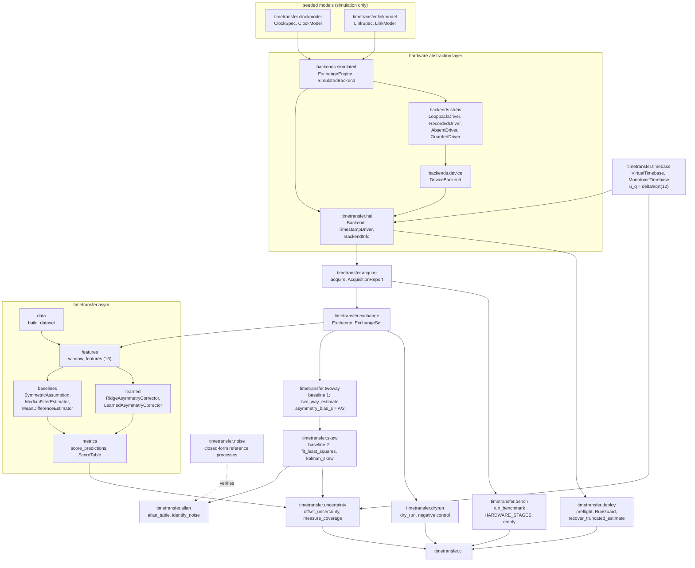
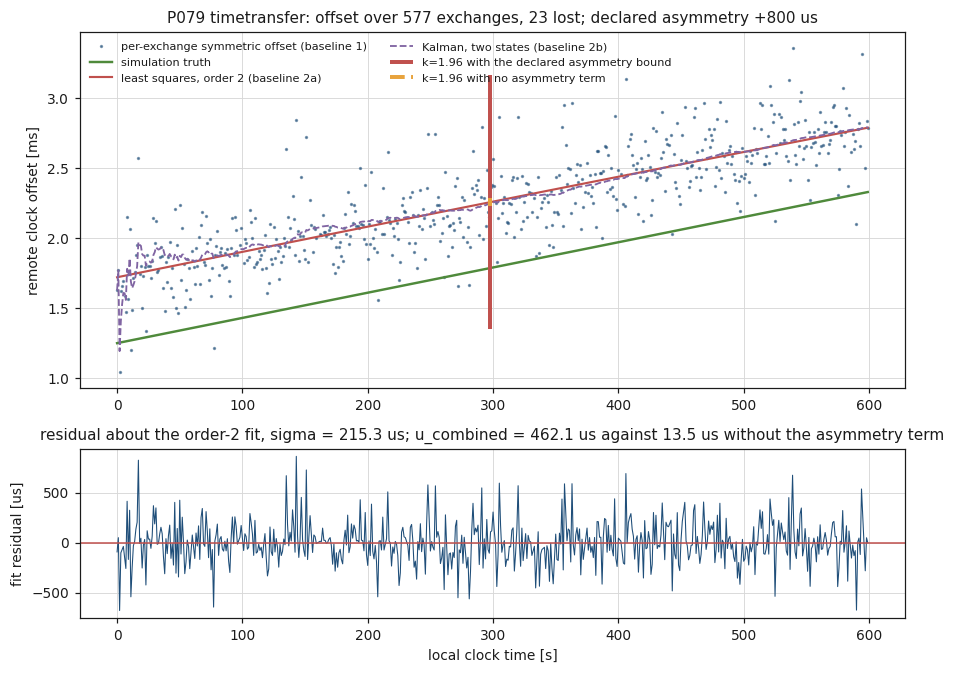
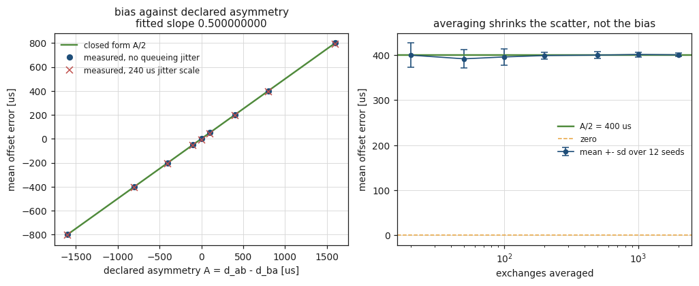
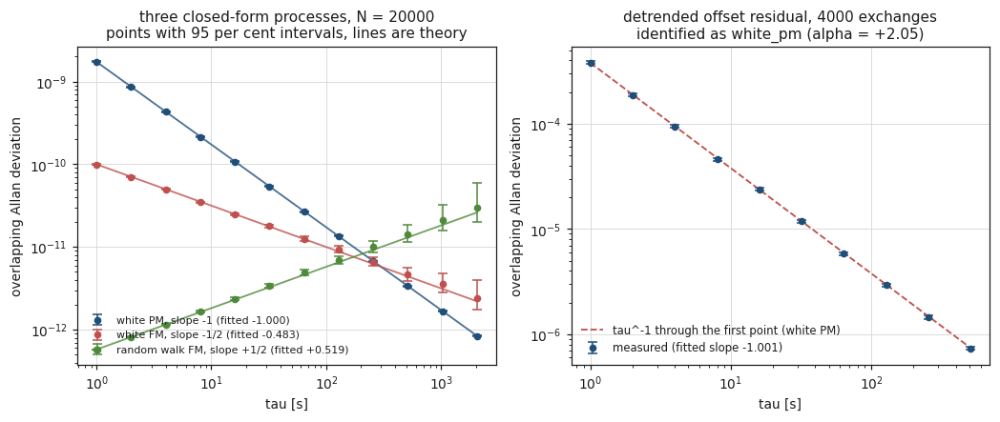
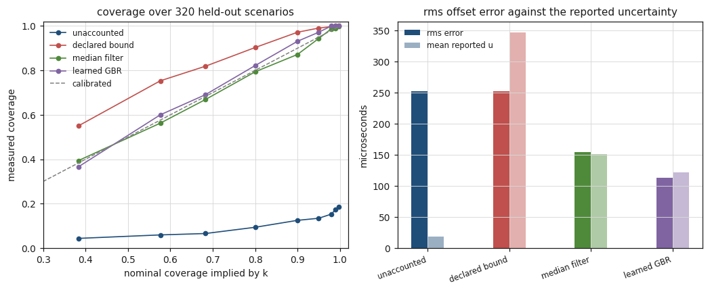
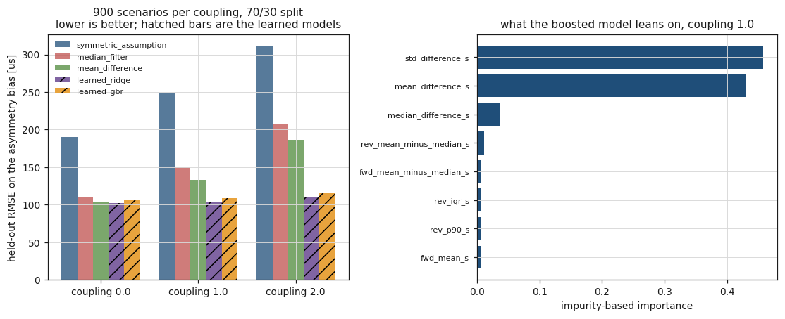
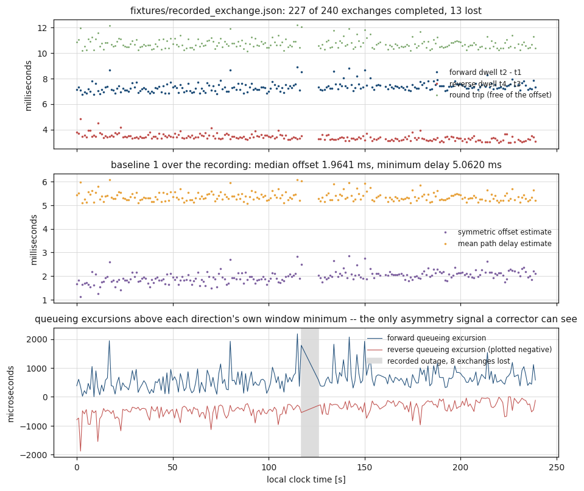
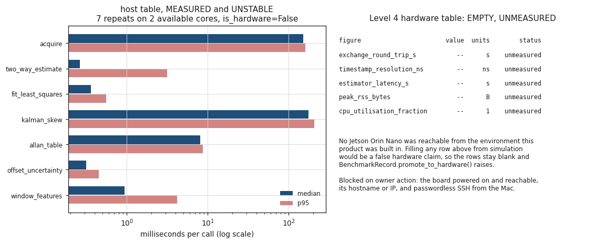

# timetransfer

Clock offset and skew across a link, with the uncertainty measured rather than quoted.


## The problem

Two nodes exchange four timestamps, you compute an offset, and the number you
write down carries an uncertainty you took from somewhere else: an oscillator
datasheet, a vendor's specification, or the scatter of the estimates, which
only tells you how repeatable the answer was and not how wrong it is. The
dominant error on a real link is path asymmetry, it is exactly half the
difference between the two one-way delays, and it does not average away. This
package computes the offset, the skew, the drift and the Allan deviation over
tau, and attaches an uncertainty whose components were measured from the
exchange data and whose coverage against nominal was measured too.

## What this does

- **The symmetric-delay estimator and its exact bias.** The standard two-way
  offset, and the closed-form error `A/2` it carries when the path is
  asymmetric. Measured against a declared asymmetry: worst departure from `A/2`
  is **1.084e-19 s** across seven asymmetries from -1.6 ms to +1.6 ms, and the
  fitted slope of error against asymmetry is **0.500000000000**
  (`validation/validate_symmetric_bias.py`).
- **Offset, skew and drift, by least squares and by a two-state Kalman
  filter.** The skew error converges at a fitted exponent of **-1.5192 +-
  0.0218** against the theoretical `n^-3/2`
  (`validation/validate_skew_estimators.py`).
- **Allan deviation over tau with a confidence interval at each tau.**
  Verified against three closed-form noise processes: fitted slopes
  **-0.9998**, **-0.4834** and **+0.5194** against theory -1, -1/2 and +1/2.
  The interval's coverage is itself measured: 0.9233 to 0.9767 across 27
  (process, tau) cells against a nominal 0.95 (`validation/validate_allan.py`).
- **A measured uncertainty on the offset, and its measured coverage.** Three
  components -- statistical with a serial-correlation inflation taken from the
  residuals, quantisation at `delta/sqrt(12)`, and asymmetry. Coverage at
  k = 1.96 against a nominal 0.9500, over 400 held-out scenarios: **0.1200**
  with no asymmetry term, **0.9900** with a declared bound, **0.9450** with the
  median-filtered corrector and **0.9525** with the learned one
  (`validation/validate_uncertainty_coverage.py`).
- **The Level 4 scaffolding, carried for real.** A hardware abstraction layer
  whose simulated and device backends produce **byte-identical** timestamps and
  an offset max difference of **0.000e+00 s** across four cases; a seeded
  simulation mode; a dry-run mode that replays a recording with **0 hardware
  operations** and a negative control that fires **241** refusals; a documented
  Jetson Orin Nano procedure; and a benchmark harness whose five Level 4 rows
  are **empty and marked `unmeasured`**.

## Validation level: 3, hardware-pending

All five items of the Level 4 entry plan are implemented and exercised: the HAL
with two interchangeable backends and parity asserted by test, deterministic
seeded simulation, dry-run mode, a deployment and recovery procedure with its
checks executable, and a benchmark harness that records its own measurement
method.

**Nothing in this repository has run on a board.** Every backend reports
`is_hardware == False`, the device backend's only drivers are a loopback stub
and a recording replayer, and the Level 4 table in
`validation/benchmark_record.json` has five rows with every value `null` and
every status `unmeasured`. Three guards in `timetransfer.bench` raise
`HardwareClaimError` rather than let a row be filled from simulation, and all
three are exercised in `validation/validate_benchmark_table.py`.

What is missing, and the only thing that is missing, is **measured timing and
resource use from a Jetson Orin Nano**: the five figures in
`timetransfer.bench.HARDWARE_STAGES`, measured with this harness and this
record format, with the raw `.txt` and `.json` captured. Until that exists this
product is Level 3 and is labelled Level 3. See `docs/DEPLOYMENT.md`.

**This is a measurement and characterisation tool, not a time-synchronisation
daemon.** It does not steer a clock, it implements neither NTP nor PTP, and it
has no protocol on the wire.

## Who this is for

- Someone who has to defend a clock-offset number to a reviewer and needs the
  uncertainty budget attached to it, with the coverage of that budget measured
  rather than asserted.
- Someone characterising a link before committing to a synchronisation design,
  who wants the asymmetry bias quantified rather than assumed away.
- Someone who needs an Allan deviation with an interval at each tau and would
  rather the interval's coverage were measured than quoted.
- Someone building a hardware-in-the-loop time-transfer rig who wants the
  parity, dry-run, pre-flight and recovery accounting written once.
- Someone deciding whether a learned asymmetry corrector is worth the
  machinery, who would rather read a measured negative result than a claim.

## Who this is not for

- Anyone who needs clocks **synchronised**. This package measures; it does not
  steer. Use `linuxptp` or `chrony`.
- Anyone who needs an NTP or PTP implementation. There is no protocol here.
- Anyone who needs a hardware number today. There isn't one.
- Anyone who needs a board brought up: powered, flashed, networked, console
  captured. That is `labgrid`'s job.
- Anyone who needs real-time guarantees. Python is not a real-time language and
  nothing here sets a scheduling policy or pins a CPU.
- Anyone who wants a general-purpose frequency-stability toolkit. `allantools`
  is larger, older and has more estimators; see below.
- Anyone expecting the learned component to earn its keep. On this package's
  own generator it loses to a linear ridge at every setting measured.

## Alternatives, honestly

**If your problem is keeping two clocks together, stop here and use PTP.**
`linuxptp` (`ptp4l`, `phc2sys`) implementing IEEE Std 1588-2019 is the mature
answer for real time synchronisation on a local network, with hardware
timestamping, boundary and transparent clocks, and a servo. This package has
none of that and does not want any: it measures what a link does to a clock
comparison and reports the uncertainty on the answer.

| Alternative | What it does better | When to use this instead |
|---|---|---|
| **PTP via [linuxptp](https://linuxptp.sourceforge.net/)** (`ptp4l`, `phc2sys`; not a PyPI package) | Actually synchronises clocks. IEEE 1588 on the wire, NIC hardware timestamping, boundary and transparent clocks, a servo that steers the PHC, sub-microsecond on a managed LAN. | You are characterising a link rather than disciplining a clock, and you need the asymmetry bias and the uncertainty budget written down. `ptp4l` assumes a symmetric path; this package quantifies what that assumption costs. |
| **[ntplib](https://pypi.org/project/ntplib/)** (PyPI `ntplib`, 0.4.0) | Queries an NTP server from Python and hands back the protocol's own offset, delay, root dispersion and stratum. Small, mature, exactly right for "what does that server think the time is". | You have your own exchange and want the estimator, the asymmetry bias, the skew, the Allan deviation and a measured uncertainty. `ntplib` gives you NTP's numbers; it does not characterise your link. **Not installed in the environment this product was measured in, and no number here comes from it.** |
| **[allantools](https://pypi.org/project/allantools/)** (PyPI `allantools`, 2024.6) | A far larger frequency-stability toolkit: overlapping, modified, Hadamard, total and Theo1 variances, noise identification, bias functions, plotting. The right dependency if stability analysis is the job. | You want the Allan deviation *inside* a two-way time-transfer pipeline, with the clock polynomial removed first and the interval's coverage measured. This package implements the overlapping Allan variance only, and verifies it against closed forms rather than against another implementation. **Not installed in the environment this product was measured in**; `timetransfer/allan.py` is written out and no number here comes from `allantools`. |
| **[chrony](https://chrony-project.org/)** (not a PyPI package) | A production NTP client and server with a good disciplining algorithm, hardware timestamping support and measured statistics it will print for you. | Same answer as PTP: you are measuring, not steering. |
| **[filterpy](https://pypi.org/project/filterpy/)** (PyPI `filterpy`, 1.4.5) | A general Kalman, UKF, EKF and particle-filter library with far more structure than the two-state filter here. | You want the clock-model `Q` of Zucca and Tavella 2005 already written, with a measurement variance taken from the data and a consistency diagnostic reported rather than tuned against. For a plain Kalman filter, use FilterPy. |
| **[labgrid](https://pypi.org/project/labgrid/)** (PyPI `labgrid`, 26.0.1) | Board provisioning and control: power, bootstrap, flashing, serial console, resource reservation across a board farm. | You already have a reachable board and your problem is the time-transfer measurement on it. This package has no power control and no flashing. |
| **[P031 HilForge](https://github.com/OmAcharya-avtr/hilforge)** -- sibling product | A general hardware-in-the-loop harness for one periodic control loop: deadline accounting, latency percentiles, overrun prediction. | Your device under test is a clock comparison rather than a control loop. The two share the HAL pattern deliberately; neither imports the other. |

## Install and first run

```bash
git clone https://github.com/OmAcharya-avtr/timetransfer.git
cd timetransfer
python -m venv .venv && source .venv/bin/activate
pip install -e ".[dev]"
python -m pytest tests/ -q
python examples/offset_and_skew.py
```

The suite prints:

```
335 passed in 10.87s
```

The count is fixed; the duration is wall clock on a shared container and moves
between runs.

and the example prints:

```
screenshots/offset_and_skew.png
exchanges              : 577 completed, 23 lost
fitted skew            : 1.782522e-06 s/s (declared 1.800000e-06)
u combined, bounded    : 4.620774e-04 s
u combined, unaccounted: 1.349819e-05 s
estimate minus truth   : +4.705295e-04 s
inside the wide band   : True
inside the narrow band : False
```

The last two lines are the product in miniature. The error is +4.705e-04 s,
which is the declared 800 us path asymmetry divided by two plus the statistical
term. The interval that accounts for the asymmetry contains it; the interval
that does not, does not.

Then check the HAL:

```bash
python -m timetransfer parity --n 500 --asymmetry 8e-4 --loss 0.05
```

```
simulated backend : simulated/n/a is_hardware=False
device backend    : device/loopback is_hardware=False
exchanges         : 475 / 475
timestamp bytes   : equal
digest            : False (identity fields differ by design)
offset max |diff| : 0.000e+00 s
```

## A worked example

```python
from timetransfer import (
    AsymmetrySource, ClockSpec, KalmanConfig, LinkSpec,
    SimulatedBackend, SimulationSpec, acquire, allan_table,
    fit_least_squares, kalman_skew, offset_uncertainty, two_way_estimate,
)

spec = SimulationSpec(
    clock=ClockSpec(offset0_s=1.250e-3, skew_s_per_s=1.800e-6,
                    drift_per_s=2.000e-12, q1_s2_per_s=1e-20, q2_per_s=1e-26),
    link=LinkSpec(floor_ab_s=5.400e-3, floor_ba_s=4.600e-3,   # 800 us asymmetric
                  jitter_scale_ab_s=2.400e-4, jitter_scale_ba_s=1.800e-4,
                  loss_probability=0.03),
    period_s=1.0, timestamp_noise_s=2.000e-8, resolution_ns=1, seed=20261024,
)
backend = SimulatedBackend(spec)
backend.open()
report = acquire(backend, 600, min_exchanges=8)
backend.close()

estimate = two_way_estimate(report.exchanges, assumed_skew_s_per_s=1.8e-6)
fit = fit_least_squares(estimate.midpoint_s, estimate.offset_s, order=2)
uncertainty = offset_uncertainty(
    fit, resolution_ns=1,
    asymmetry_source=AsymmetrySource.DECLARED_BOUND, asymmetry_bound_s=1.600e-3,
)
print(uncertainty.as_text())
```

```
offset              : 2.256888879e-03 s at t = 297.929214 s
u statistical       : 1.349819e-05 s (x1.003 for r1 = +0.0031)
u quantisation      : 1.205512e-11 s (delta = 1 ns)
u asymmetry         : 4.618802e-04 s (declared_bound)
u combined          : 4.620774e-04 s (dominant: asymmetry)
expanded (k=1.96)   : 9.056717e-04 s
n / n_effective     : 577 / 573.4
```

Against simulation truth, from `validation/worked_example.py`:

```
declared static asymmetry  : +8.000000e-04 s
closed-form bias A/2       : +4.000000e-04 s
true offset at the epoch   : +1.786359423e-03 s
estimate                   : +2.256888879e-03 s
estimate minus truth       : +4.705295e-04 s
expanded uncertainty       : 9.056717e-04 s
error inside the interval  : True
```

The same estimate with the asymmetry term omitted:

```
u combined          : 1.349819e-05 s (dominant: statistical)
WARNING             : no asymmetry term. This interval describes repeatability, not accuracy.

u combined with a declared bound : 4.620774e-04 s
u combined with no asymmetry term: 1.349819e-05 s
ratio                            : 34.2325
error inside the narrow interval : False
```

## Architecture



## Screenshots



Notice that the fitted line sits above the truth by a constant: that constant
is half the declared path asymmetry. The two vertical bars at the fit epoch are
the k = 1.96 intervals with and without the asymmetry term; the narrow one is
too small to see at this scale, which is the point.



The measured mean error falls on the `A/2` line with a fitted slope of
0.500000000000. On the right, averaging more exchanges shrinks the scatter by a
factor of 7.857 between 20 and 2000 exchanges and leaves the bias where it was.



The three synthetic processes sit on their theoretical lines at the stated
slopes. On the right, a real acquisition's detrended residual is white PM with
a fitted slope of -1.0008: the queueing jitter dominates the oscillator at
every tau this acquisition reaches, so what is plotted is the stability of the
measurement, not of the clock.



The treatment with no asymmetry term sits far below the diagonal across every
coverage factor. The declared bound sits above it. The two corrector
treatments sit on it.



The hatched bars are the learned models. They are never shorter than the
ridge's bar by a meaningful margin, and at zero coupling the median filter is
within 4 per cent of the boosted model.



The forward and reverse dwell times are separated by a constant offset -- that
separation is the asymmetry plus the clock offset, and the two are not
separable. The grey band is the recorded outage the recovery procedure is
written for.



The left panel is measured on this machine and is unstable. The right panel is
the Level 4 table: five rows, no numbers, every status `unmeasured`.

## Validation evidence

Full detail, including every check that failed or under-performed, is in
`validation/VALIDATION.md`. Test counts come from `junit.xml`, never from
pytest's stdout: `testsuite tests="335"` with 335 `<testcase>` elements, 0
failures, 0 errors, 0 skipped.

| Check | Reference | Result | Tolerance | Script |
|---|---|---|---|---|
| Estimator exact under symmetry | `theta` by construction, 60 exchanges | worst \|error\| 0.000e+00 s | 1.0e-15 s | `validate_symmetric_bias.py` |
| Bias equals `A/2` | equation (5) | worst \|measured - A/2\| 1.084e-19 s | 2.0e-09 s | `validate_symmetric_bias.py` |
| Slope of error against asymmetry | 0.5 exactly | 0.500000000000 | 1.0e-6 | `validate_symmetric_bias.py` |
| Skew-error convergence | `n^-3/2` | -1.5192 +- 0.0218 | 0.25 | `validate_skew_estimators.py` |
| Allan slope, white PM | -1.00 | -0.9998 +- 0.0005 | 0.05 | `validate_allan.py` |
| Allan slope, white FM | -0.50 | -0.4834 +- 0.0032 | 0.05 | `validate_allan.py` |
| Allan slope, random walk FM | +0.50 | +0.5194 +- 0.0017 | 0.05 | `validate_allan.py` |
| Allan CI coverage, 27 cells | 0.95 | 0.9233 to 0.9767 | reported | `validate_allan.py` |
| Noise identification | the generating process | 200/200 on each of three | 0.90 | `validate_allan.py` |
| HAL parity, four cases | byte-identical timestamps | identical; offset max \|diff\| 0.000e+00 s | exact (integers) | `validate_parity.py` |
| Parity falsifying control | must differ | differs; 1.523e-03 s | must be non-zero | `validate_parity.py` |
| Dry-run hardware operations | 0 | **0** | exact | `validate_dryrun.py` |
| Dry-run negative control | must fire | 0 completed, 241 refused | must be non-zero | `validate_dryrun.py` |
| Recovery after five injected aborts | restore all fields | 5/5, 0 of 24 fields differing | exact | `validate_deployment.py` |
| Pre-flight on a healthy backend | 10 checks | 10/10 | all | `validate_deployment.py` |
| Truncated-window uncertainty ratio | `sqrt(600/120)` = 2.2361 | 2.1531 | reported | `validate_deployment.py` |
| L4 hardware rows | empty | 5 rows, all `None`, all `unmeasured` | exact | `validate_benchmark_table.py` |
| Hardware-claim guards | must raise | 3/3 raised | exact | `validate_benchmark_table.py` |
| Scripts run from any directory | exit 0 | 52 runs, 0 non-zero | exact | `validate_cwd_independence.py` |

### Checks that failed, under-performed, or where a baseline won

These are the credible rows.

| Finding | Measured | Nominal or baseline | Reported in |
|---|---|---|---|
| **An interval with no asymmetry term badly under-covers** | 0.1200 | 0.9500 | `validate_uncertainty_coverage.py` |
| A declared asymmetry bound over-covers | 0.9900 | 0.9500 | `validate_uncertainty_coverage.py` |
| **The learned model's own uncertainty band under-covers** | 0.8917 | 0.9500 | `validate_asymmetry_benchmark.py` |
| **The boosted corrector loses to a linear ridge** at every coupling | RMSE ratio 1.0273, 1.0099, 1.0088 | 1.0 would be a tie | `validate_asymmetry_benchmark.py` |
| The median filter matches the learned model only where nothing is learnable | ratio 1.0394 at coupling 0, 1.4401 at 1.0, 1.8868 at 2.0 | the specification predicted a match | `validate_asymmetry_benchmark.py` |
| **The Kalman filter is over-confident when `R` comes from the data** | mean NIS 2.53 to 2.65 with jitter, 8.788e+04 with none | 1.0 | `validate_skew_estimators.py` |
| Allan confidence intervals under-cover at some tau | lowest 0.9233 | 0.95 | `validate_allan.py` |
| The noise identifier reports a biased alpha for random-walk FM | -2.7166 | -2.0 | `validate_allan.py` |
| A guarded stub reported itself as hardware | defect, found and fixed during the build | -- | `tests/test_regressions.py` |
| A fit over identical epochs reported a zero skew with zero uncertainty | defect, found by Hypothesis and fixed | -- | `tests/test_regressions.py` |

## API reference

<details>
<summary>The public surface, with units</summary>

**Exchanges and the HAL**

| Function or class | What it does |
|---|---|
| `Exchange(seq, t1_ns, t2_ns, t3_ns, t4_ns)` | one four-timestamp exchange, integer nanoseconds |
| `ExchangeSet` | arrays of exchanges; `.forward_dwell_ns()`, `.reverse_dwell_ns()`, `.round_trip_ns()`, `.midpoint_s()` [s], `.digest()`, `.write_json()` |
| `SimulationSpec(clock, link, period_s, start_s, timestamp_noise_s, resolution_ns, seed)` | everything a reproducible acquisition needs; `period_s`, `start_s`, `timestamp_noise_s` in s |
| `ClockSpec(offset0_s, skew_s_per_s, drift_per_s, q1_s2_per_s, q2_per_s, epoch_s)` | s, s/s, 1/s, s^2/s, 1/s, s |
| `LinkSpec(floor_ab_s, floor_ba_s, jitter_shape_*, jitter_scale_*_s, turnaround_s, loss_probability, outage_windows)` | s except the dimensionless shapes and probability |
| `SimulatedBackend(spec)`, `DeviceBackend(driver, ...)` | the two HAL backends |
| `make_backend_pair(spec)` | both from one spec, for the parity check |
| `BackendInfo.is_hardware` | `True` only for a device backend whose driver is not a stub |
| `acquire(backend, n_attempts, min_exchanges, max_consecutive_losses, keep_truth)` | drives a backend, counts losses, stops on a loss run |

**Estimators**

| Function | What it returns |
|---|---|
| `two_way_estimate(exchanges, assumed_skew_s_per_s)` | per-exchange offset and delay [s], plus summaries |
| `asymmetry_bias_s(asymmetry_s)` | `asymmetry / 2` [s], exactly |
| `fit_least_squares(t_s, offset_s, order, t_ref_s)` | clock polynomial, covariance, residuals; `offset_at(t)` returns value and standard uncertainty [s] |
| `kalman_skew(t_s, offset_s, config)` | filtered `[theta, a]` or `[theta, a, D]` with covariances; `normalised_innovation_mean` is the consistency diagnostic |
| `allan_table(x_s, tau0_s, m_values, noise_kind, confidence)` | overlapping Allan deviation over tau with an interval at each |
| `identify_noise(x_s)` | power-law noise type and the measured alpha |
| `fit_log_slope(x, y)` | log-log slope with its standard error |

**Uncertainty**

| Function | What it returns |
|---|---|
| `offset_uncertainty(fit, epoch_s, resolution_ns, asymmetry_source, asymmetry_bound_s, asymmetry_stderr_s, coverage_factor)` | the three-component budget [s], with `accounted` false when no asymmetry term was supplied |
| `measure_coverage(errors_s, uncertainties_s, coverage_factor, interval_confidence)` | measured coverage with an exact Clopper-Pearson interval and a verdict |
| `effective_sample_size(residuals)` | `n_eff`, `r1` and the inflation factor applied to the standard error |

**Asymmetry correction**

| Class | What it does |
|---|---|
| `window_features(exchanges)` | the sixteen window features [s] |
| `SymmetricAssumption`, `MedianFilterEstimator`, `MeanDifferenceEstimator` | the closed-form estimators; `fit` measures a residual spread rather than fitting parameters |
| `RidgeAsymmetryCorrector`, `LearnedAsymmetryCorrector` | the learned ones; `predict_with_uncertainty` returns a per-row sigma |
| `build_dataset(n_scenarios, seed, config)` | the seeded scenario generator |
| `score_predictions(...)`, `ScoreTable` | one metric set, all estimators, one table |

**Operations**

| Function | What it does |
|---|---|
| `preflight(backend, expect_hardware, ...)` | ten executable checks; `expect_hardware` is the operator's declaration |
| `RunGuard(backend)` | restores the backend if the run inside it raises, and verifies the restore field by field |
| `recover_truncated_estimate(exchanges, n_planned, ...)` | an estimate from a window that ended early, labelled as truncated |
| `dry_run(recorded, ...)`, `dry_run_negative_control(recorded)` | the full path over a recording, and the control that makes the counts evidence |
| `record_exchanges(backend, n, path)` | writes a replayable recording |
| `run_benchmark(stages, ...)` | the host table; the Level 4 table stays empty |
| `hardware_rows()`, `HARDWARE_STAGES` | the five Level 4 figures, with every value `None` |

</details>

## Limitations

- **No hardware measurement exists.** Every backend is simulated or a stub.
  The Level 4 table is empty on purpose and the product is Level 3.
- **The static path asymmetry is not identifiable from timestamps**, by any
  estimator in this package or any other. `theta` and `A/2` enter the only
  observable difference identically. Averaging reduces the variable part and
  does nothing to the static part; this is measured, not argued, in
  `validate_symmetric_bias.py` section 1e.
- **The learned corrector does not justify itself.** It loses to a linear ridge
  on the same features at every coupling measured, and its own uncertainty band
  under-covers at 0.8917 against 0.9500. `MODEL_CARD.md` recommends against it.
- **Every learned result is a statement about a seeded generator**, including
  one declared assumption -- the coupling between the unobservable static
  asymmetry and the observable congestion difference -- that has no measurement
  behind it. See `DATASET_CARD.md`.
- **The Kalman filter's default measurement variance is a robust scale estimate
  calibrated for a Gaussian**, and the queueing delay is a right-skewed gamma.
  Mean normalised innovation is 2.53 to 2.65 on a jittery link, so the filter
  is over-confident by a factor of about 1.6; on a link with no jitter the
  estimate collapses to its floor and the factor is 296. Pass
  `floor_variance_s2` or an explicit `measurement_variance_s2`.
- **The Allan confidence intervals rest on simplified equivalent-degrees-of-
  freedom formulas.** Measured coverage ranges from 0.9233 to 0.9767 against a
  nominal 0.95. The flicker-FM formula at `m = 1` is below one degree of
  freedom for every N and is clipped.
- **No flicker noise is synthesised.** It has no finite-dimensional Markov
  representation, so verifying an estimator against an approximation of it
  would undermine the point of verifying against closed forms.
- **Dependency ranges are bounded on both sides** at the versions every number
  was measured against. This is a real cost: the package cannot take a numpy
  2.6, a scipy 1.19 or a scikit-learn 1.10 release without a port and a
  re-measurement, including a security release. The tension is recorded rather
  than resolved by removing a ceiling, because five of this mission's first
  fifty products were found broken or silently wrong for a new install by an
  unbounded specifier.
- **Timings move between runs.** Every timing in this repository appears in a
  table explicitly declared unstable and nowhere else.
- **Validity ranges.** The clock polynomial is a local expansion with no
  temperature coefficient, frequency step, retrace or leap second. The link
  model assumes a constant delay floor, a stationary queueing distribution and
  loss independent of delay.

## Reproducing every number

```bash
python -m pytest tests/ -q --junitxml=junit.xml
ruff check src/ tests/ examples/ validation/

python validation/regenerate_fixture.py
python validation/validate_symmetric_bias.py
python validation/validate_skew_estimators.py
python validation/validate_allan.py
python validation/validate_uncertainty_coverage.py
python validation/validate_parity.py
python validation/validate_dryrun.py
python validation/validate_reproducibility.py
python validation/validate_asymmetry_benchmark.py
python validation/validate_deployment.py
python validation/validate_benchmark_table.py
python validation/worked_example.py
python validation/validate_cli.py
python validation/validate_cwd_independence.py

MPLBACKEND=Agg python examples/offset_and_skew.py
MPLBACKEND=Agg python examples/asymmetry_bias.py
MPLBACKEND=Agg python examples/allan_deviation.py
MPLBACKEND=Agg python examples/uncertainty_coverage.py
MPLBACKEND=Agg python examples/asymmetry_benchmark.py
MPLBACKEND=Agg python examples/exchange_timeline.py
MPLBACKEND=Agg python examples/benchmark_table.py
```

Every script writes its raw output beside itself as
`validation/<name>_output.txt`. The working-directory probe re-runs the others
from four directories and takes roughly three minutes; everything else together
takes about four.

## Safety statement

This software is **research-grade**. It is **not flight-qualified, not
certified, and not approved for operational aerospace use**. It measures and
characterises a clock comparison; it does not synchronise anything, and nothing
in it should be placed in a control loop.

## References

- D. L. Mills, "Internet time synchronization: the Network Time Protocol",
  *IEEE Transactions on Communications* 39(10):1482-1493, 1991. The offset and
  delay formulas of `timetransfer.twoway`.
- IEEE Std 1588-2019, *Precision Clock Synchronization Protocol*, section
  7.4.2. The mean-path-delay assumption this package quantifies the cost of.
- D. W. Allan, "Statistics of atomic frequency standards", *Proceedings of the
  IEEE* 54(2):221-230, 1966; IEEE Std 1139-2008. The two-sample variance.
- W. J. Riley, *Handbook of Frequency Stability Analysis*, NIST Special
  Publication 1065, 2008. Overlapping Allan variance (5.2.4), confidence
  intervals and the simplified edf formulas (Table 3, after Howe, Allan and
  Barnes 1981), noise identification by lag-1 autocorrelation (5.5.3).
- C. Zucca and P. Tavella, "The clock model and its relationship with the Allan
  and related variances", *IEEE Transactions on Ultrasonics, Ferroelectrics and
  Frequency Control* 52(2):289-296, 2005. The two-state clock model and its
  discrete-time process covariance.
- W. R. Bennett, "Spectra of quantized signals", *Bell System Technical
  Journal* 27(3):446-472, 1948. The uniform quantisation variance behind
  `delta/sqrt(12)`.
- JCGM 100:2008, *Evaluation of measurement data -- Guide to the expression of
  uncertainty in measurement*, sections 4.3.7 and 5.1.2. Type B evaluation from
  a bound, and combination in quadrature.
- G. V. Bayley and J. M. Hammersley, "The effective number of independent
  observations in an autocorrelated time series", *Journal of the Royal
  Statistical Society, Supplement* 8(2):184-197, 1946. The AR(1) effective
  sample size.
- C. J. Clopper and E. S. Pearson, "The use of confidence or fiducial limits
  illustrated in the case of the binomial", *Biometrika* 26(4):404-413, 1934.
  The interval on the measured coverage.
- P. J. Rousseeuw and C. Croux, "Alternatives to the median absolute
  deviation", *Journal of the American Statistical Association*
  88(424):1273-1283, 1993. The Gaussian consistency factor in the measurement
  variance estimate.
- J. H. Friedman, "Greedy function approximation: a gradient boosting machine",
  *Annals of Statistics* 29(5):1189-1232, 2001. The learned corrector and its
  quantile variant.
- N. R. Draper and H. Smith, *Applied Regression Analysis*, 3rd ed., Wiley,
  1998, chapter 5. The least-squares parameter covariance.

## Licence

Apache-2.0. Copyright (c) 2026 OPTIMA Organisation.

## Citation

See `CITATION.cff`.

## Credits

This is under reserved rights obtained by OPTIMA Organisation.
