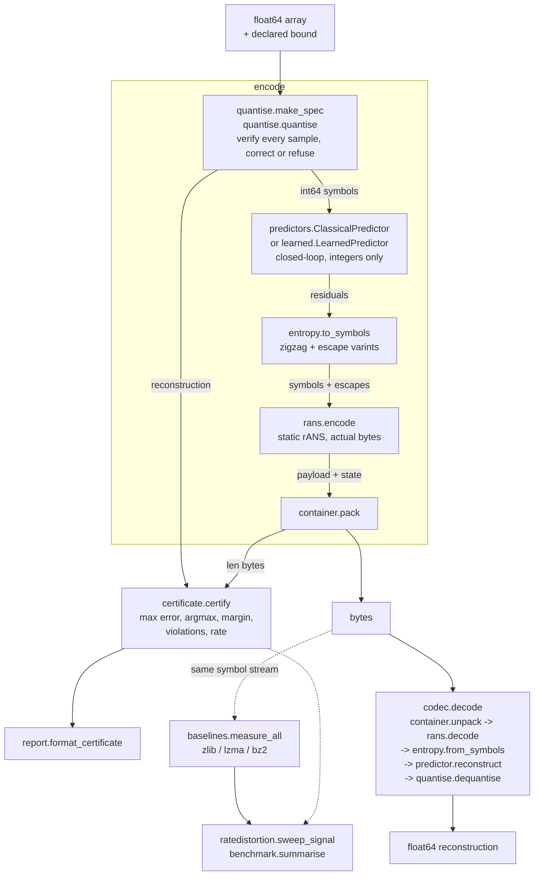
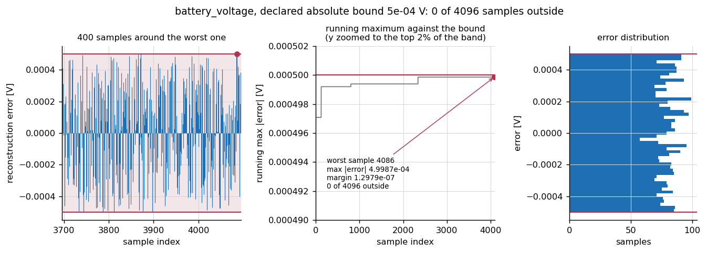
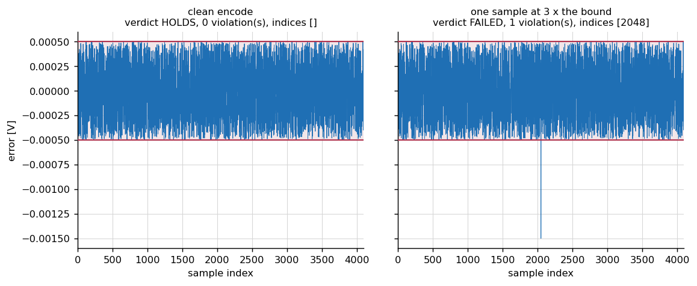
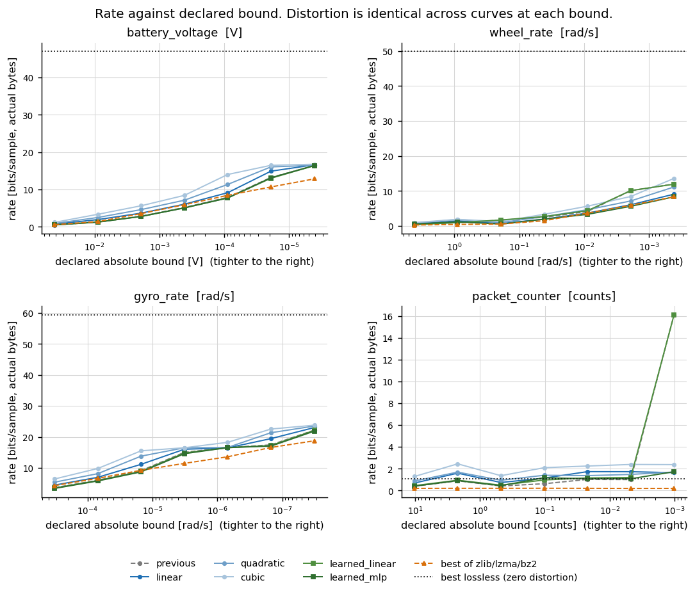
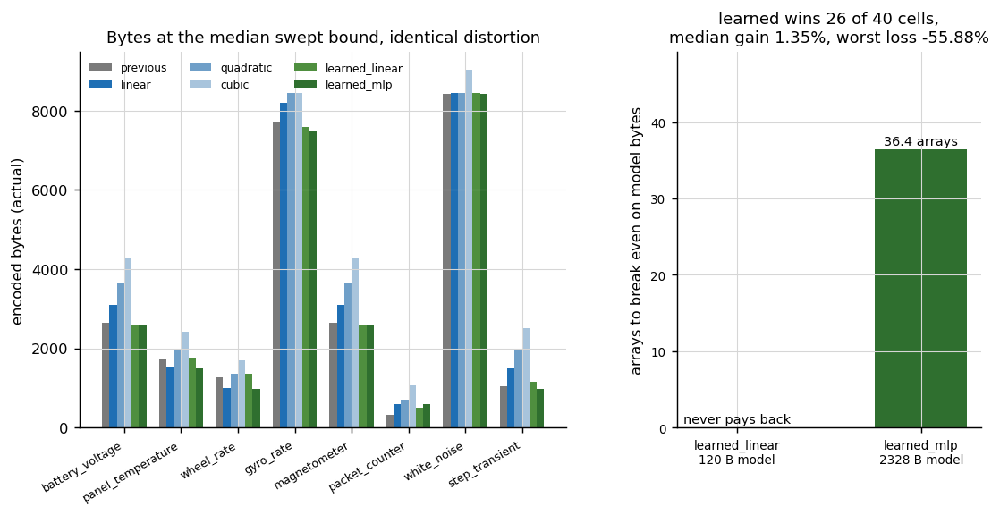
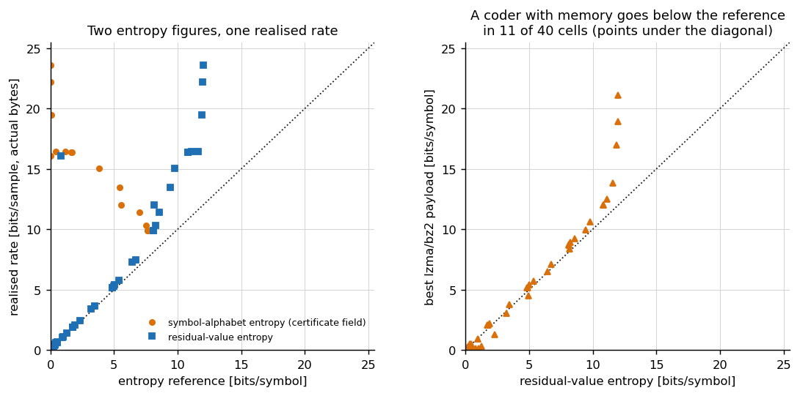
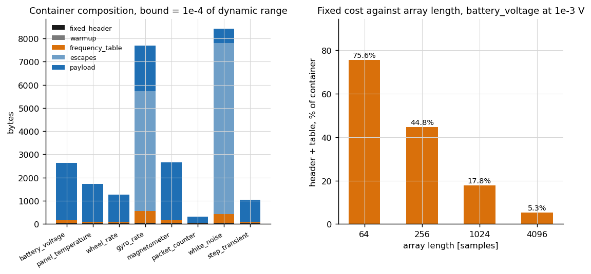
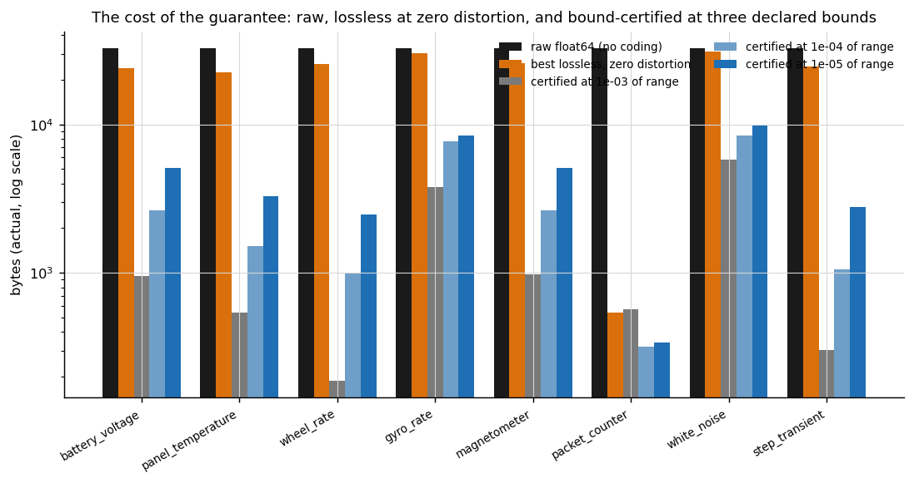
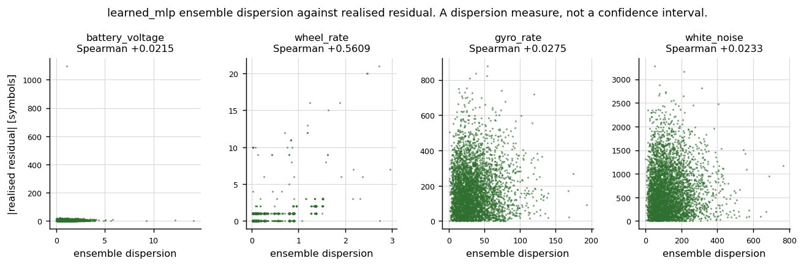
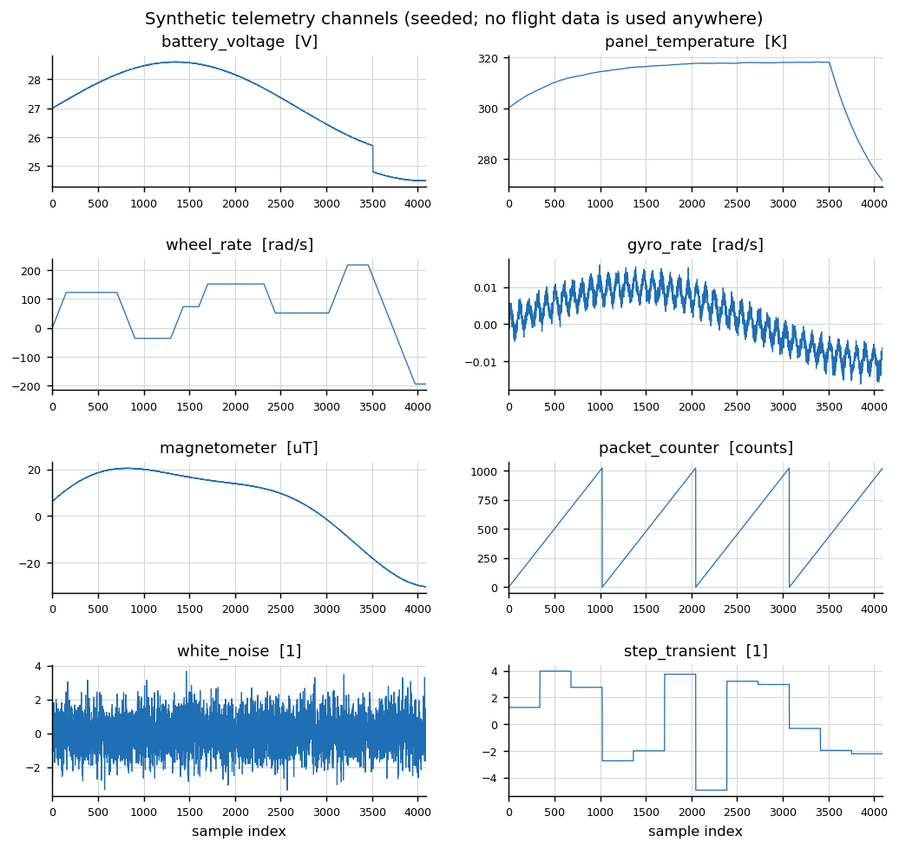

# boundcompress

Compress a telemetry array under a declared per-sample error bound, and certify that the bound held.


## The problem

You are about to lossily compress a spacecraft housekeeping channel and you
have declared that no sample will move by more than 0.5 mV. Downstream there
is a limit check that fires on one sample, so a mean error of 0.2 mV tells you
nothing and a 99.9th percentile tells you nothing either. What you need is
evidence that **no sample** exceeded the bound, and an honest statement of
what the guarantee cost you in bits.

## What this does

- Encodes a 1-D float64 array under a declared **absolute**, **pointwise
  relative** or **range-relative** error bound, and verifies the bound on
  every sample at encode time, refusing to encode rather than issuing a
  certificate it cannot support.
- Issues a **certificate**: the measured maximum per-sample error, the index
  where it occurred, the margin to the bound, the number of violations, the
  rate in actual encoded bytes and the SHA-256 of the container. Measured over
  **1,310,720** individual sample-versus-bound comparisons: 0 outside the
  bound, tightest margin 1.543376e-12.
- Measures **rate as actual encoded bytes**, never as an entropy estimate, and
  reports the first-order entropy beside it labelled as a reference. A coder
  with memory went below that reference on 3 of 8 signals, by a factor of 6.7
  on one of them.
- Compares every predictor at **exactly matched distortion** — not matched by
  search. Everything after the quantiser is lossless on the integer symbols,
  so swapping the predictor changes the byte count and cannot change a single
  reconstructed sample.
- Benchmarks a **learned residual predictor** against four integer
  finite-difference extrapolators and charges it for its own parameters. A
  classical predictor wins **14 of 40** cells; the learned perceptron wins the
  median cell by **1.35 per cent** and loses one by **55.88 per cent**.

## Who it is for

- Someone who has to defend a lossy-compression decision with evidence rather
  than a mean.
- Someone choosing a declared bound and wanting the rate-against-bound curve
  measured on their own arrays.
- Someone who wants to know whether a learned predictor is worth its bytes on
  their data before building one.

## Who it is not for

- **Anyone who needs the smallest bitstream.** This package's own entropy
  coder is beaten by `lzma` or `bz2` on 6 of 8 signals at the median swept
  bound, and by a factor of 4.788 on one of them. Use a real codec.
- **Anyone compressing a flight product.** Use a standardised codec:
  CCSDS 121.0-B-3 or CCSDS 122.0-B-2.
- **Anyone with multidimensional data.** This is 1-D only; a transform codec
  exploits structure across dimensions that nothing here looks at.
- **Anyone who needs a decoder on different silicon from the encoder *and*
  wants the learned predictor.** The classical predictors are integer-exact
  and portable; the learned ones call `tanh`.
- **Anyone looking for a streaming codec.** The whole array is encoded at
  once.

## Alternatives, honestly

| alternative | what it does better | when to use this instead |
| --- | --- | --- |
| [`zfpy`](https://pypi.org/project/zfpy/) | A real error-bounded transform codec for 1-D to 4-D arrays, with fixed-accuracy, fixed-precision and fixed-rate modes. Faster, smaller output, multidimensional. **Not installed in the environment this product was measured in; no number in this repository comes from it.** | When you need the certificate and the rate-against-bound accounting rather than the smallest bitstream. |
| [`numcodecs`](https://pypi.org/project/numcodecs/) | Production codec bindings — Blosc, Zstandard, LZ4, Zlib, plus quantisation filters — and the Zarr integration. **Not installed here; no number in this repository comes from it.** | When you want a per-sample bound *proved* on every sample rather than implied by a quantiser setting. |
| CCSDS 121.0-B-3, *Lossless Data Compression* | A standard with flight heritage and a Rice-coder implementation on real hardware. | Never, for flight. Use the standard. Use this to decide which bound to declare to it. |
| CCSDS 122.0-B-2, *Image Data Compression* | The standard for 2-D spacecraft imagery, with rate control. | Never, for flight. Use the standard. |
| `zlib`, `lzma`, `bz2` (Python standard library) | General-purpose, well tested, present everywhere, and measured here beating this package's own coder on 6 of 8 signals. | When you want the bound certificate and the matched-distortion comparison around them — which is exactly how they are used inside this package's baselines. |
| `numpy.round(x / (2*b)) * (2*b)` | Three lines, no dependency, and it is the same quantiser this package uses. | When you want the three lines *checked*: the encoder here verifies every sample, corrects the ones floating-point rounding pushes out, and refuses when it cannot. |

**A flight implementation should use a standardised codec. This product's
contribution is the certificate and the cost of the guarantee.**

## Install and first run

```bash
git clone https://github.com/OmAcharya-avtr/boundcompress.git
cd boundcompress
python -m venv .venv && source .venv/bin/activate
pip install -e ".[dev]"
python -m pytest tests/ -q
python examples/certificate_error_profile.py
```

Expected output of the last two commands:

```text
.......................................................................  [100%]
287 passed in 8.06s
```

The elapsed time is the one thing in that line that moves between runs; the
count does not. Test counts in this repository are taken from the junit XML
and never from pytest's stdout — see *Reproducing every number*.

```text
screenshots/certificate_error_profile.png
max |error| 4.998702e-04 <= bound 5.000000e-04; violations 0; independent check 4.998702e-04; worst sample 4086
```

The command-line interface gives the same certificate without writing any
Python:

```bash
python -m boundcompress certify --signal battery_voltage --bound 5e-4
```

```text
signal                 : battery_voltage
samples                : 4096
bound verdict          : HOLDS
declared mode          : abs
declared bound         : 5.000000e-04
effective abs bound    : 5.000000e-04
max absolute error     : 4.998702e-04
max relative error     : 2.040495e-05
worst sample index     : 4086
worst sample value     : 24.4974999
worst reconstruction   : 24.497
margin to bound        : 1.297887e-07
violating samples      : 0 of 4096
predictor              : linear
original bytes         : 32768
encoded bytes          : 2930
bits per sample        : 5.722656
compression ratio      : 11.183618
residual entropy bits  : 5.338437  (reference, not a floor)
rate below entropy ref : False
escaped residuals      : 2
rounding corrections   : 0
container sha256       : 097a097fb19aced4ae267dcb853aacbd4d096904ef7807296ca5e27d2af5356a
```

`certify` exits non-zero when the bound does not hold, so it works as a check
in a shell script.

## A worked example

```python
import numpy as np

from boundcompress import dataset
from boundcompress.certificate import certify
from boundcompress.codec import decode, encode
from boundcompress.report import format_certificate

signal = dataset.generate("battery_voltage", samples=4096, seed=0)
bound = 5e-4                                  # volts, declared absolute

result = encode(signal.values, "abs", bound, predictor="linear")
decoded = decode(result.blob)

print(format_certificate(result.certificate))
print("decoded == reconstruction :", np.array_equal(decoded, result.reconstruction))
print("max error of the DECODED array:", np.max(np.abs(signal.values - decoded)))

# The negative control: move one sample outside the bound on purpose.
corrupted = result.reconstruction.copy()
corrupted[2048] = signal.values[2048] + 3.0 * bound
failed = certify(signal.values, corrupted, "abs", bound)
print("caught :", failed.bound_holds is False, failed.violation_indices)
```

Real output, produced by running the block above verbatim:

```text
bound verdict          : HOLDS
declared mode          : abs
declared bound         : 5.000000e-04
effective abs bound    : 5.000000e-04
max absolute error     : 4.998702e-04
max relative error     : 2.040495e-05
worst sample index     : 4086
worst sample value     : 24.4974999
worst reconstruction   : 24.497
margin to bound        : 1.297887e-07
violating samples      : 0 of 4096
predictor              : linear
original bytes         : 32768
encoded bytes          : 2930
bits per sample        : 5.722656
compression ratio      : 11.183618
residual entropy bits  : 5.338437  (reference, not a floor)
rate below entropy ref : False
escaped residuals      : 2
rounding corrections   : 0
container sha256       : 097a097fb19aced4ae267dcb853aacbd4d096904ef7807296ca5e27d2af5356a
decoded == reconstruction : True
max error of the DECODED array: 0.0004998702113390152
caught : True (2048,)
```

The same array with every predictor, at **identical** distortion, from
`validation/worked_example_output.txt`:

| predictor | bytes | bits/sample | ratio | max_abs_error | escapes |
| --- | --- | --- | --- | --- | --- |
| previous | 2485 | 4.8535 | 13.186 | 4.998702e-04 | 1 |
| linear | 2930 | 5.7227 | 11.184 | 4.998702e-04 | 2 |
| quadratic | 3451 | 6.7402 | 9.495 | 4.998702e-04 | 3 |
| cubic | 4097 | 8.0020 | 7.998 | 4.998702e-04 | 4 |

The error column is one number repeated, not four close numbers. On this
channel at this bound the first-order `previous` predictor beats the
second-order `linear` one by 445 bytes, which is the result and not a
preamble to a different one.

## Architecture



Everything after `quantise.quantise` is lossless on the integer symbol stream.
That is why the predictor moves the rate and cannot move the error, and why
`certificate.certify` takes the reconstruction from the quantiser rather than
from the end of the pipeline.

## Screenshots



The running maximum in the middle panel is the summary a mean would hide: it
can only rise, and the question is whether it ever touches the red line. The
y-axis there is zoomed to the top 2 per cent of the admissible band, because a
uniform quantiser at the bound-implied step fills the band within the first
few hundred samples.



The same array with one sample moved to three times the declared bound away
from the truth. The certificate must come back FAILED and name index 2048, and
it does. A certificate that cannot fail certifies nothing.



Rate against declared bound for four channels. The distortion is identical
across every curve at a given bound, so the vertical gap between two curves is
the whole comparison. Notice that the dashed orange standard-library baseline
is below the package's own coder almost everywhere, and that on
`packet_counter` the learned predictors fall off a cliff at the finest bound
where `linear` does not.



Bytes per predictor at the median swept bound, and the number of arrays the
mission must send before each learned model pays back its own parameters.
`learned_linear` never does.



Left: the certificate's symbol-alphabet entropy understates badly on
escape-heavy streams, which is why `entropy.value_entropy_bits` exists. Right:
points below the diagonal are a real coder going below the "floor" — 11 of 40
cells.



Where the bytes went. Nothing is omitted from the rate, including the 38-byte
fixed header and the shipped frequency table, which are 5.34 per cent of a
4096-sample container and 75.61 per cent of a 64-sample one.



The cost of the guarantee on one log axis: raw float64, the best lossless
coding at zero distortion, and the bound-certified container at three declared
bounds.



The ensemble dispersion against the realised residual. It ranks errors
usefully on `wheel_rate` and is close to useless on the other three, which is
the measurement and not an endorsement.



The eight seeded synthetic channels every number in this repository is a
statement about. No flight data is used anywhere.

## Validation evidence

Level 2. Full detail, including the raw script output, is in
[`validation/VALIDATION.md`](validation/VALIDATION.md). The rows below include
the checks that failed and the ones the baseline won, because those are the
credible ones.

| check | reference | result | tolerance |
| --- | --- | --- | --- |
| declared bound on every sample, every mode, every predictor | the declared bound itself | **1,310,720 comparisons, 0 outside** | none; non-strict inequality, no tolerance either side |
| tightest margin to the bound observed | — | 1.543376e-12 (`gyro_rate`, `previous`, bound 1.197816e-07, sample 605) | must be >= 0 |
| samples needing a one-step rounding correction | — | 0 | — |
| negative controls caught and located | injected violations | **11 of 11** | exact index match |
| exactly at the bound / one ulp past | IEEE-754 | admissible / caught, margins 0.000000e+00 and -4.440892e-16 | none |
| round-trip, decoded vs reconstruction | — | 32 of 32 bit-identical | exact |
| determinism, SHA-256 over three encodes | — | 22 of 22 stable, both learned predictors included | exact |
| learned batch vs sequential forward pass | — | 4091 predictions, 0 differences | exact |
| container blocks sum to the rate | — | 3 of 3 | exact |
| rate-distortion cells measured | — | 624, all round-trip, all hold their bound | — |
| **package coder vs `zlib`/`lzma`/`bz2`** | same symbol stream, matched distortion | **package wins 2 of 8; loses 6, worst by a factor of 4.788** | — |
| **a coder with memory below the entropy reference** | Shannon 1948 | **3 of 8 signals, worst ratio 0.1501** | — |
| realised rate below the entropy reference, package coder | — | 0 of 192 cells (static order-0 rANS cannot) | — |
| **learned vs classical, 40 cells** | rate at identical distortion | **classical wins 14, learned 26; median gain 1.3451 %, worst loss -55.8824 %** | — |
| **`learned_linear` break-even** | 120 model bytes | **never pays back** (mean saving -264.52 B) | — |
| `learned_mlp` break-even | 2328 model bytes | 36.4 arrays | — |
| **`learned_mlp` optimiser convergence** | L-BFGS, 400 iterations | **0 of 3 members converged**; doubling the cap moves the loss 0.27 % (0.631258 to 0.629583) | — |
| **uncertainty output, Spearman vs realised residual** | Wager, Hastie & Efron 2014 | **median 0.0280**, range 0.0179 to 0.8329 | — |
| validation scripts from five working directories | — | 40 of 40 exit 0 | — |
| defects found during the build and pinned as regressions | — | 5 distinct defects, 8 pinned tests with literal inputs in `tests/test_regressions.py`; one was found by Hypothesis and none by inspection | — |

## API reference

<details>
<summary>Public surface, with units</summary>

| function | signature and units |
| --- | --- |
| `encode(values, mode, bound, *, predictor="linear", model=None)` | `values` 1-D float64 in any unit; `mode` one of `"abs"`, `"rel"`, `"range_rel"`; `bound` in the array's unit for `"abs"`, dimensionless otherwise. Returns `EncodeResult(blob, reconstruction, certificate, spec)`. |
| `decode(blob, *, model=None)` | Bytes to float64 reconstruction. `model` required when the container names `learned`. |
| `encode_decode(values, mode, bound, ...)` | Both, for round-trip checks. |
| `certify(values, reconstruction, mode, bound, ...)` | Certifies **any** reconstruction, independently of the encoder. Returns `Certificate`. |
| `Certificate` | `max_absolute_error`, `max_relative_error` (dimensionless), `argmax_index`, `margin`, `violations`, `violation_indices`, `bound_holds`, `encoded_bytes`, `bits_per_sample`, `compression_ratio`, `residual_entropy_bits`, `escape_count`, `corrections`, `digest`. |
| `make_spec(values, mode, bound)` | The quantiser a declared bound implies. `QuantiserSpec.step` is in the transformed domain; `absolute_bound` is `nan` for `"rel"`. |
| `quantise.quantise(values, spec)` | `(symbols int64, reconstruction float64, corrections int)`. Raises `BoundNotAchievable`. |
| `get_predictor(name)` | `"previous"`, `"linear"`, `"quadratic"`, `"cubic"`. Integer-exact. |
| `noise_gain(name)` | Sum of absolute coefficients: 1, 3, 7, 15. |
| `LearnedPredictor(kind, members, hidden, seed, max_iter, alpha, max_rows, clip)` | `.fit(arrays)`, `.residuals(symbols)`, `.dispersion(symbols)`, `.model_bytes`, `.converged`. |
| `shannon_entropy_bits(symbols)` | Bits per symbol over the 256-symbol alphabet. A reference, not a floor. |
| `entropy.value_entropy_bits(residuals)` | Bits per symbol over distinct residual values; the figure to compare with a byte count. |
| `sweep_signal(name, values, bounds, ...)` | Rate-distortion rows in actual bytes. |
| `geometric_bounds(values, count, ...)` | Bounds spanning 1e-2 to 1e-6 of the dynamic range. |
| `baselines.measure_all(values=, symbols=, residuals=)` | `zlib`/`lzma`/`bz2` over the residual stream, the symbol stream and the raw float64, each round-trip verified. |
| `benchmark.run` / `summarise` / `break_even_arrays` | The predictor benchmark and its verdict. |
| `block_sizes(container)` | Bytes per container block; sums to `len(pack(container))`. |
| `format_certificate(certificate)` | The fixed-width report. No library code prints. |

</details>

## Limitations

- **The entropy coder is the weakest part and is measured as such.** Static
  order-0 rANS loses to `lzma` or `bz2` on 6 of 8 signals and by a factor of
  4.788 on `packet_counter`, whose residual stream is long runs that an
  order-0 coder cannot model.
- **1-D only.** `make_spec` raises on anything else.
- **`mode="rel"` requires every sample to be non-zero and of one sign.** A
  pointwise relative bound is undefined at zero, and the log magnitude is
  non-monotone across it. Zero-crossing channels must use `"abs"` or
  `"range_rel"`. `"range_rel"` is relative to the **dynamic range**, not
  per-sample, and this README never calls it a relative bound.
- **The symbol magnitude is capped at 2^57**, derived from the `cubic`
  predictor's coefficient sum of 15 and the zigzag fold: 32 x 2^57 = 2^62. A
  bound fine enough relative to the array's magnitude to need a larger integer
  is refused with `BoundNotAchievable` rather than wrapped. Hypothesis found
  the wrap; the guard is the fix.
- **The learned predictors are not bit-exact across machines.** `tanh` is a
  libm call. The classical predictors are integer-only and have no such
  caveat. Determinism was measured within one pinned interpreter and is not
  claimed beyond it.
- **`learned_linear` never pays back its 120 bytes**, and `learned_mlp` needs
  36.4 arrays of this size to pay back its 2328. Both numbers are measured on
  this synthetic generator.
- **`learned_mlp` did not converge** within its 400-iteration cap. Doubling
  the cap moves the training loss from 0.631258 to 0.629583, 0.27 per cent, so
  the cap is a compute decision, but the fit is non-converged and is labelled
  so.
- **The uncertainty output is a dispersion measure, not a confidence
  interval**, and its median rank correlation with the realised residual is
  0.0280.
- **Dependencies are bounded on both sides** — `numpy>=2.5,<2.6`,
  `scikit-learn>=1.9,<1.10`. The scikit-learn ceiling is at the minor version
  because `boundcompress.learned` extracts `Ridge.coef_`,
  `MLPRegressor.coefs_` and `MLPRegressor.intercepts_` and evaluates the
  forward pass itself, which depends on the shape and meaning of attributes
  covered by no stability promise. The cost is real and is not resolved by
  removing the ceiling: this package cannot take a scikit-learn 1.10 release
  without a port and a re-measure.
- **No flight data.** Every number is a statement about the seeded generator
  in `boundcompress.dataset`.
- **Research grade. Not flight-qualified, not certified, not approved for
  operational aerospace use.**

## Reproducing every number

```bash
python -m pytest tests/ -q --junitxml=junit.xml
ruff check src/ tests/ examples/ validation/

python validation/validate_bound_every_sample.py     # the central claim
python validation/validate_negative_control.py       # the controls that must fail
python validation/validate_roundtrip_determinism.py  # round-trip and SHA-256
python validation/validate_rate_distortion.py        # rate in actual bytes
python validation/validate_predictors.py             # learned against classical
python validation/validate_learned.py                # the fit and the uncertainty
python validation/validate_cli.py                    # every quoted command
python validation/worked_example.py                  # the example above
python validation/probe_working_directories.py       # all of the above, from five directories

MPLBACKEND=Agg python examples/telemetry_shapes.py
MPLBACKEND=Agg python examples/certificate_error_profile.py
MPLBACKEND=Agg python examples/negative_control.py
MPLBACKEND=Agg python examples/rate_distortion_curve.py
MPLBACKEND=Agg python examples/predictor_comparison.py
MPLBACKEND=Agg python examples/entropy_versus_realised_rate.py
MPLBACKEND=Agg python examples/rate_breakdown.py
MPLBACKEND=Agg python examples/guarantee_cost.py
MPLBACKEND=Agg python examples/learned_uncertainty.py
```

Test counts come from the junit XML, never from pytest's stdout: a suite that
collects nothing prints success and exits 0.

```bash
python - <<'PY'
import xml.etree.ElementTree as ET
root = ET.parse("junit.xml").getroot()
suite = root if root.tag == "testsuite" else root.find("testsuite")
print("declared", suite.get("tests"), "counted", len(root.findall(".//testcase")))
PY
```

```text
declared 287 counted 287
```

## Licence, citation, credits

Apache-2.0. Copyright 2026 OPTIMA Organisation. See [`LICENSE`](LICENSE).

Citation metadata is in [`CITATION.cff`](CITATION.cff).

References the implementation rests on:

- Shannon, C. E. (1948). A mathematical theory of communication. *Bell System
  Technical Journal* 27(3). The source-coding theorem behind the entropy
  reference figure.
- Duda, J. (2013). Asymmetric numeral systems. arXiv:1311.2540. The rANS coder
  in `boundcompress.rans`.
- Gersho, A. and Gray, R. M. (1992). *Vector Quantization and Signal
  Compression*, chapter 4. The round-to-nearest uniform quantiser error bound.
- Liang, X. et al. (2018). Error-controlled lossy compression optimized for
  high compression ratios of scientific datasets. *IEEE BigData*. Log-domain
  quantisation for a pointwise relative bound.
- Makhoul, J. (1975). Linear prediction: a tutorial review. *Proceedings of
  the IEEE* 63(4). The linear-prediction feature set.
- Wager, S., Hastie, T. and Efron, B. (2014). Confidence intervals for random
  forests. *JMLR* 15. Why an ensemble spread is a dispersion measure and not
  coverage.
- CCSDS 121.0-B-3, *Lossless Data Compression*, and CCSDS 122.0-B-2, *Image
  Data Compression*. The standards a flight implementation should use. No
  numerical value in this repository is taken from either.

### Credits

This is under reserved rights obtained by OPTIMA Organisation.
