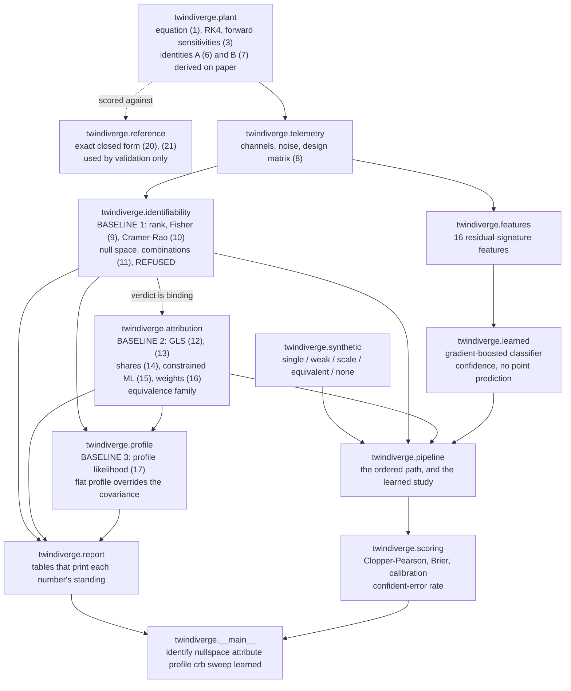
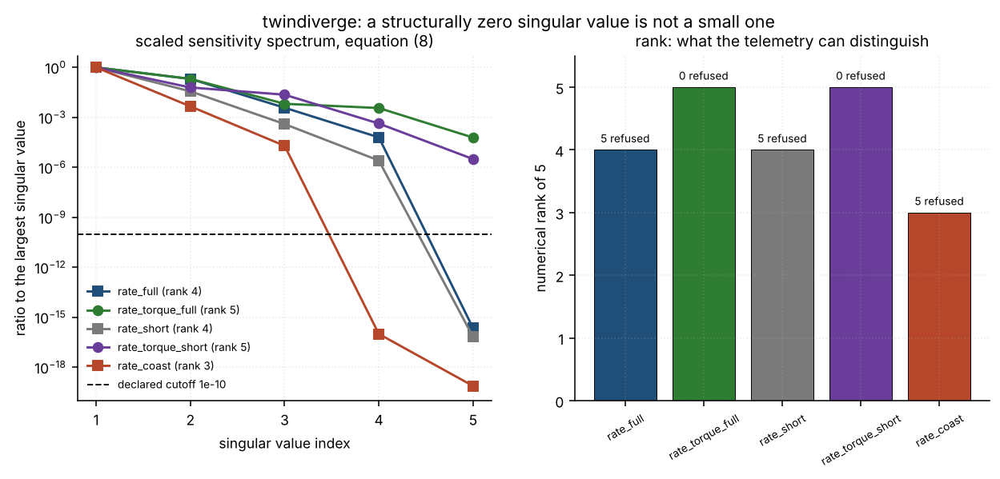
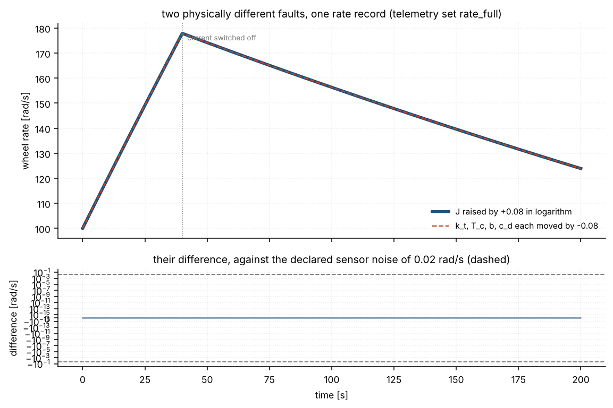
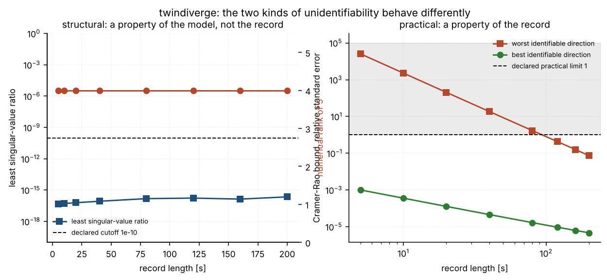
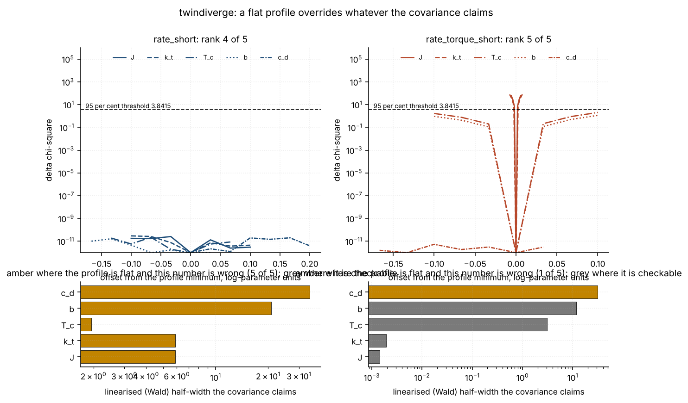
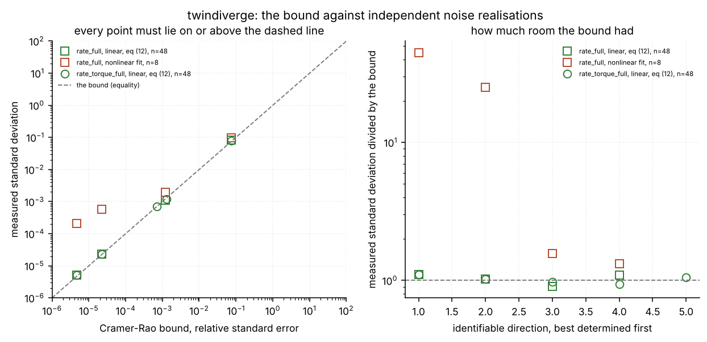
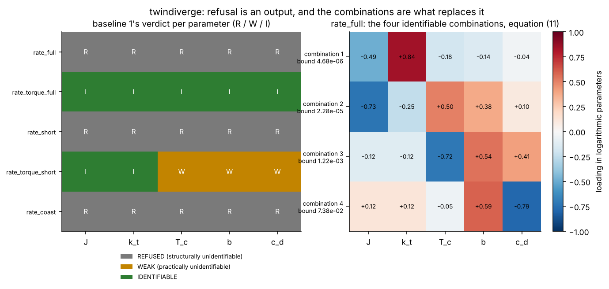
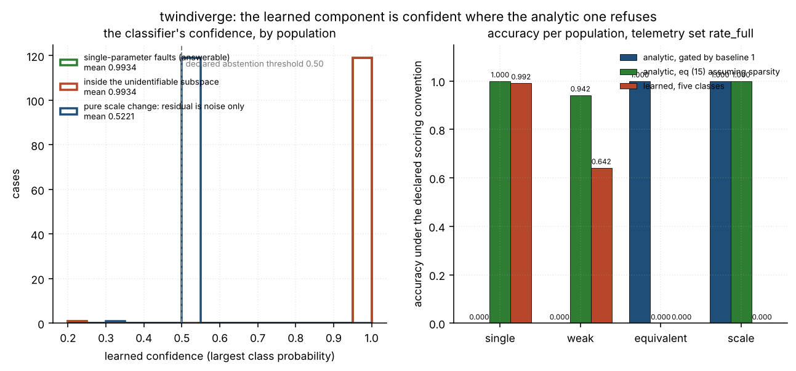

# twindiverge

Attribute a twin-versus-reality residual to a parameter subset, after refusing the parameters the telemetry cannot identify.

**Status:** TESTING · **Class:** flagship · **Validation level:** Level 3 · **AI:** yes


## The aerospace problem

Your reaction-wheel digital twin disagrees with a 200 s telemetry record by
twenty-four times the sensor noise, and the review wants to know which parameter
drifted. The tool you reach for fits all five parameters, prints five numbers
with five error bars, and names the inertia: what it does not tell you is that
the same record is reproduced *exactly* by leaving the inertia alone and moving
the other four parameters the other way, so four of those five error bars are
fiction and the fifth is arbitrary. Identifiability analysis settles that
before any attribution is attempted, and the honest answer is sometimes a
refusal.

## Executive overview

`twindiverge` answers the question in three layers and uses them in this order.

- **Baseline 1, local identifiability. The gate.** The rank, conditioning and
  Fisher information of the scaled sensitivity matrix, with Cramer-Rao bounds
  that are `+inf` for any parameter with a component in the null space — because
  that is what the bound is. On the reference 200 s rate-only record the rank
  is **4 of 5**, with **5.6483 decades** of margin from the declared cutoff, and
  **all five parameters are REFUSED**. The four identifiable *combinations* are
  reported in their place, and they are measured to span exactly the space of
  the four ratios `k_t/J`, `T_c/J`, `b/J`, `c_d/J` (worst principal angle
  **1.207418e-06 degrees**).
- **Baseline 2, attribution on the identifiable subspace only.** Generalised
  least squares with confidence regions, plus — under a sparsity assumption the
  telemetry cannot verify, declared as such — a single-parameter attribution
  printed together with the family of perturbations it cannot be distinguished
  from.
- **Baseline 3, the nonlinear profile likelihood.** The reference the linearised
  covariance is scored against. On the reference set **five of five profiles are
  flat -- the largest value any of them reaches is 7.385097e-10 in chi-square,
  against a 95 per cent threshold of 3.841459 -- while the covariance claims
  half-widths between 0.7 and 11 per cent**, so the profile overrides it five times out of five.
  Where the profiles do close, on a two-channel set, the covariance is validated
  against them to **0.9972, 0.9977, 1.0024 and 1.1622**.
- **A learned residual-signature classifier**, with a confidence output and no
  point-prediction method, scored on accuracy at a measured computation budget
  and — separately — on what it does inside the unidentifiable subspace.

**The measured headline is the learned component's behaviour where the analytic
method refuses.** On 120 held-out cases whose true cause lies in the
unidentifiable subspace, each producing telemetry identical to a
single-parameter fault to within two units in the last place, the analytic path
refuses **1.000000** of them and prints the equivalence family on **1.000000**
of them; the learned classifier answers with a mean confidence of **0.993426**,
reaches an accuracy of **0.000000**, is confident and wrong on **0.991667**
(exact interval [0.954444, 0.999789]) and declares an ambiguity on
**0.000000**. Outside that subspace the strongest analytic attributor also
wins: **1.000000 against 0.991667** on ordinary faults and **0.941667 against
0.641667** on faults a tenth the size. Those numbers are in
[`validation/VALIDATION.md`](validation/VALIDATION.md) and they are the research
result of this product.

This software is research-grade: **not flight-qualified, not certified, not
approved for operational aerospace use.**

## What this does

- **Refuses, as a first-class reported outcome.** `REFUSED` is a verdict with a
  reason — the parameter's component in the null space of the sensitivity
  matrix, measured at **4.472136e-01** for every one of the five on a rate-only
  record — and not an error. Measured in
  `validation/validate_identifiability_output.txt`.
- **Reports identifiable combinations in place of refused parameters.** Four
  combinations on the reference set, with Cramer-Rao bounds on their relative
  standard errors of **4.677542e-06**, **2.276973e-05**, **0.001224** and
  **0.073789**.
- **Separates practical from structural unidentifiability, and shows the
  difference moving.** Over record lengths from 10 s to 200 s the rank stays at
  4 and the refusal list does not change, while the bound on the worst
  identifiable direction falls from **2285.926965** to **0.073789**, a factor of
  **30979.4**.
- **Prints what it cannot distinguish.** For every single-parameter attribution
  on a degenerate telemetry set, the equivalence family: measured over 120 test
  cases, a perturbation and its partner give rate records agreeing to a worst
  relative difference of **2.340688e-16**, and 97 of 120 observation pairs are
  bit-identical.
- **Checks its own error bars against mathematics it does not use.** The
  Cramer-Rao bound against the measured scatter of 20 independent nonlinear
  fits: **0 violations in 4 and in 5 directions**, with the linear estimator's
  ratios sitting on the bound at **1.002398 to 1.209669** and the matrix form of
  the inequality holding with a least eigenvalue of **-1.171462e-09** against a
  sampling tolerance of **-7.066074e-03**.

## Who it is for

- Digital-twin and model-validation engineers who have to attribute a residual
  to a cause and want to know first whether the question has an answer.
- Attitude-control and reaction-wheel engineers reading a coast-down or
  spin-up record and asking which friction coefficient moved.
- Anyone who has been handed five parameter estimates with five error bars from
  a least-squares fit and suspects some of them are not real.
- Anyone designing a telemetry set, who wants to know what a second sensor
  would buy before the harness is built. The `rate` and `rate+torque` tables in
  `validation/validate_identifiability_output.txt` are exactly that comparison.
- Anyone scoring a learned component on what it does when the question is
  ill-posed, rather than only on accuracy when it is not.

## Who it is not for

- Anyone who needs a certified or flight-qualified answer. This is
  research-grade software: not certified, not flight-qualified, not approved for
  operational aerospace use.
- Anyone wanting GLOBAL structural identifiability. Everything here is **local**
  — a first-order statement at one parameter point — and is not the
  differential-algebra question of Bellman & Astrom 1970. For this plant the
  local answer happens to coincide with the global one along the scale
  direction, because equation (6) holds at every parameter point, and that is a
  property of this plant and not a general licence. For the symbolic route, see
  the alternatives table.
- Anyone wanting global SENSITIVITY analysis. The sensitivities here are local
  derivatives, not variance shares over a parameter distribution; for that, see
  `SALib` in the table below.
- Anyone whose plant is not smooth in its parameters, or whose wheel crosses
  zero rate. Equation (1) carries the Coulomb torque as a constant and is valid
  for one sign of rotation only, inside a declared window of 20 to 400 rad/s; a
  zero crossing is exactly the regime where a Stribeck or smoothed friction
  model is needed and this package does not ship one.
- Anyone who needs a high-fidelity wheel model. The declared coefficients are a
  fiction with an engineering shape, fitted to nothing and measured on nothing.

## Alternatives, honestly

Every package named below was verified to exist on PyPI on 2026-11-09 by
fetching its JSON metadata. None of them is installed in the environment these
numbers were measured in, and **no number in this repository is compared against
any of them.**

| alternative | what it does better | when to use it instead of this |
| --- | --- | --- |
| [`identifiability`](https://pypi.org/project/identifiability/) 0.5.1 | A focused, mature profile-likelihood identifiability analysis built on `lmfit`, with parallel scans and plotting. It is the closest thing on PyPI to this product's baseline 3. | Whenever profile-likelihood confidence intervals are all you need. It does not compute a null space, does not refuse a parameter structurally, and does not report identifiable combinations — which is the whole of this product's baseline 1. |
| [`lmfit`](https://pypi.org/project/lmfit/) 1.3.4 | A far better general nonlinear least-squares front end than anything here: named parameters, bounds, many minimisers, `conf_interval` based on an F-test. | For ordinary parameter estimation and its intervals. Use this product when you need to know *before fitting* which parameters the data cannot separate. |
| [`SALib`](https://pypi.org/project/SALib/) 1.6.0 | Global sensitivity analysis — Sobol, Morris, FAST — over a whole parameter distribution. | When the question is "which parameters matter over their plausible range", which is a different question from "which can this record distinguish". `twindiverge` is purely local. |
| [`sympy`](https://pypi.org/project/sympy/) 1.14.0 | Symbolic algebra, and therefore the route to GLOBAL structural identifiability by differential elimination. | When you need a proof about every parameter point rather than a local statement, and your model is small enough to eliminate symbolically. |
| [`statsmodels`](https://pypi.org/project/statsmodels/) 0.15.0 | Mature regression inference, robust and sandwich covariances, diagnostics. | For statistical inference on a regression you already trust. It will happily report a covariance for a rank-deficient design; this product exists because that number is not a bound. |
| [`emcee`](https://pypi.org/project/emcee/) 3.1.6, [`pymc`](https://pypi.org/project/pymc/) 6.4.0 | Full posterior sampling, which exposes a flat ridge directly as an unbounded posterior. | When you can afford the samples and want the whole posterior shape rather than a rank and a bound. A ridge that is exactly flat will make the sampler wander forever, which is the same fact this product reports in one line. |
| [`numdifftools`](https://pypi.org/project/numdifftools/) 0.11.2 | High-accuracy numerical derivatives, including Richardson-extrapolated Jacobians and Hessians. | When you need a sensitivity matrix for a model whose variational equations you do not want to write. This product integrates equation (3) instead and checks it against a complex step. |
| `scipy.optimize` | Already a dependency here. | For any fitting problem you do not need an identifiability verdict for. |

There is no package on PyPI that gates attribution on a structural
identifiability verdict and reports identifiable combinations in place of
refused parameters, which is this product's subject. That is a reason to be
careful rather than a selling point.

## Install and first run

```bash
git clone https://github.com/OmAcharya-avtr/twindiverge.git
cd twindiverge
python -m venv .venv && source .venv/bin/activate
pip install -e ".[dev]"
python -m pytest tests/ -q
```

What that prints, measured on the environment in
[`validation/VALIDATION.md`](validation/VALIDATION.md):

```
........................................................................ [ 28%]
........................................................................ [ 56%]
........................................................................ [ 85%]
......................................                                   [100%]
254 passed in 23.65s
```

Then the first example:

```bash
python examples/sensitivity_spectrum.py
```

```
written: screenshots/sensitivity_spectrum.png
  rate_full            rank 4 of 5, least ratio 2.247702e-16, refused 5
  rate_torque_full     rank 5 of 5, least ratio 6.160457e-05, refused 0
  rate_short           rank 4 of 5, least ratio 6.647927e-17, refused 5
  rate_torque_short    rank 5 of 5, least ratio 3.162341e-06, refused 0
  rate_coast           rank 3 of 5, least ratio 7.573069e-20, refused 5
```

And the gate itself, from the command line:

```bash
python -m twindiverge identify --telemetry rate_full
```

```
telemetry set            : rate_full
numerical rank           : 4 of 5 (relative cutoff 1.0e-10)
rank margin              : 5.6483 decades from the cutoff to the nearest singular-value ratio
condition number (rank)  : 1.577511e+04
Fisher condition number  : 5.268523e+16  (the square; nothing here is computed from it)
Fisher least eigenvalue  : -4.684327e-08  (a Fisher matrix is positive semi-definite; a negative value here is rounding from forming A^T A)

parameter  unit             verdict  null component  CRB (relative)  pinv diagonal (NOT a bound)
---------  ---------------  -------  --------------  --------------  ---------------------------
J          kg m^2           REFUSED  4.472136e-01    inf             0.009084
k_t        N m / A          REFUSED  4.472136e-01    inf             0.009052
T_c        N m              REFUSED  4.472136e-01    inf             0.003605
b          N m s / rad      REFUSED  4.472136e-01    inf             0.043486
c_d        N m s^2 / rad^2  REFUSED  4.472136e-01    inf             0.058119

identifiable combinations, equation (11), best determined first:

combination                                         CRB on its relative standard error
--------------------------------------------------  ----------------------------------
J^-0.487 k_t^+0.842 T_c^-0.182 b^-0.136 c_d^-0.036  4.677542e-06
J^-0.731 k_t^-0.248 T_c^+0.503 b^+0.377 c_d^+0.099  2.276973e-05
J^-0.118 k_t^-0.118 T_c^-0.715 b^+0.540 c_d^+0.411  0.001224
J^+0.123 k_t^+0.123 T_c^-0.047 b^+0.589 c_d^-0.788  0.073789

null space (orthonormal rows, logarithmic parameters):

direction  J          k_t        T_c        b          c_d
---------  ---------  ---------  ---------  ---------  ---------
n1         +0.447214  +0.447214  +0.447214  +0.447214  +0.447214
```

The `pinv diagonal (NOT a bound)` column is the number a naive implementation
reports as an error bar. It is a correct description of the minimum-norm
solution's scatter — measured ratios 1.042900 to 1.080857 against repeated fits
— and it says nothing about the parameter. The `CRB (relative)` column next to
it is the bound, and it is `inf`.

## A worked example

```python
import numpy as np
from twindiverge.attribution import attribute
from twindiverge.identifiability import analyse
from twindiverge.plant import NOMINAL, PARAMETER_NAMES, perturb, simulate_with_sensitivities
from twindiverge.telemetry import TELEMETRY_SETS, measure, residual_vector

telemetry = TELEMETRY_SETS["rate_full"]                   # 200 s rate-only record
truth = perturb(NOMINAL, np.array([0.08, 0, 0, 0, 0]))    # J is 8 per cent high
observed, _ = measure(telemetry, truth, seed=90001)

report = analyse(telemetry, NOMINAL)                      # baseline 1 runs FIRST
print("rank          :", report.rank, "of 5")
print("REFUSED       :", ", ".join(report.refused) or "none")
print("Cramer-Rao    :", report.crb_relative)

twin = simulate_with_sensitivities(NOMINAL, telemetry.campaign)
residual = residual_vector(telemetry, observed, twin)
result = attribute(telemetry, report, residual, twin=twin)

print("detected      :", result.detected)
print("chi-square    :", f"{result.residual_chi2:.6f}", "on", result.residual_rows, "rows")
for line in result.combination_answer:
    print("moved         :", line)
print("per-parameter :", result.parameter_estimate)
print("single-param  :", result.constrained_choice,
      f"{result.constrained_estimate[PARAMETER_NAMES.index(result.constrained_choice)]:+.6f}",
      f"(weight {result.constrained_confidence:.6f})")
print("equivalent to :", result.equivalence_family()[1])
```

```
rank          : 4 of 5
REFUSED       : J, k_t, T_c, b, c_d
Cramer-Rao    : [inf inf inf inf inf]
detected      : True
chi-square    : 71495069.426184 on 2001 rows
moved         : J^-0.487 k_t^+0.842 T_c^-0.182 b^-0.136 c_d^-0.036 moved by -0.037898 +/- 0.000009 (z = -8102.208)
moved         : J^-0.731 k_t^-0.248 T_c^+0.503 b^+0.377 c_d^+0.099 moved by -0.055060 +/- 0.000045 (z = -2418.110)
per-parameter : [nan nan nan nan nan]
single-param  : J +0.077581 (weight 1.000000)
equivalent to : [ 0.         -0.07758053 -0.07758053 -0.07758053 -0.07758053]
```

Read the last two lines together. The single-parameter route names `J` and gets
it right, under an assumption the telemetry cannot check. The line beneath says
that "the other four each fell by 0.0776" reproduces the same record, and it is
not a caveat in prose: it is a vector the caller can simulate, and
`validation/validate_attribution.py` does, finding a worst rate difference of
2.842171e-14 rad/s against a sensor noise of 0.02 rad/s. The `per-parameter`
row is `nan` five times over, which is the product working.

The full narrative version, including what a reaction-torque sensor would buy,
is `validation/worked_example.py` and its committed output.

## Architecture



## Screenshots



Notice the two rate-only sets whose smallest singular-value ratio sits at 1e-16
or below — structurally zero, six decades under the declared cutoff — and the
two-channel sets where nothing does.



Two physically different faults, one rate record. The lower panel is their
difference, which for this pair is exactly zero at all 2001 samples, against a
sensor noise fourteen orders of magnitude larger.



Notice that the left panel's lines are flat and the right panel's fall through
four orders of magnitude. Structural identifiability is a property of the model;
practical identifiability is a property of the record.



The left column's five profiles lie on the zero line while the bars beneath show
the half-widths the covariance claims for the same five parameters. Amber means
the profile is flat and the number is wrong.



Every point must lie on or above the dashed diagonal. The linear estimator sits
on it; the nonlinear global fit sits well above it, and the reason is in the
figure's own caption.



The left panel is the verdict per parameter per telemetry set; the right is the
loading of each identifiable combination, which is what replaces the refused
parameters.



The headline. The classifier's confidence on ordinary faults and on cases inside
the unidentifiable subspace is the SAME distribution, because they are the same
observations — and in the second case every answer is wrong.

## Validation evidence

Level 3. Full detail, including the checks that are weaker than they look, is in
[`validation/VALIDATION.md`](validation/VALIDATION.md).

| check | reference | result | tolerance or criterion |
| --- | --- | --- | --- |
| integrator against an exact closed form | `twindiverge.reference`, equations (20) and (21) | worst relative difference **6.615096e-15** over 3 campaigns | 1e-13 |
| convergence order | Richardson extrapolation against the same | **4.0201 to 4.2425** | 3.8 to 4.6 |
| forward sensitivities against an independent complex step | a separate complex-arithmetic integrator in `validate_plant.py` | worst relative difference **4.304265e-15** over 15 columns | 1e-12 |
| identity A, equation (6) | derived on paper in `twindiverge.plant` | worst relative residual **3.802603e-15** over 15 combinations | 1e-11 |
| computed null space against the derived one | algebra, never touching a sensitivity matrix | worst principal angle **1.207418e-06 deg** over 5 telemetry sets | 1e-5 deg |
| the identifiable subspace IS the space of ratios | the same algebra | angles **1.207418e-06, 8.537736e-07, 0, 0 deg** | 1e-5 deg |
| removing a null projection changes no record | equation (6) | worst relative difference **5.631127e-16** | 1e-10 |
| structural rank over a record-length sweep | — | **4 at every one of 6 lengths** | constant |
| practical bound over the same sweep | — | falls by a factor of **30979.4** | more than 1e3 |
| coverage of the identifiable intervals | the declared 95 per cent, over 400 realisations | worst deviation **1.6059** standard errors | declared 4 sigma |
| profile likelihood on the reference set | baseline 3 against baseline 1's covariance | **5 of 5 flat** at 7.385097e-10 chi-square; **5 of 5 override** | flatness tolerance 1e-3 |
| profile against the covariance where it closes | baseline 3 | ratios **0.9972, 0.9977, 1.0024, 1.1622** | reported, not asserted |
| Cramer-Rao bound against measured scatter | Rao 1945, Cramer 1946; 20 nonlinear fits | **0 violations in 4 and in 5 directions** | bound minus 4 sampling sigmas |
| the matrix form of the same inequality | the same | least eigenvalue **-1.171462e-09** | sampling tolerance -7.066074e-03 |
| negative controls | each anchored on a derived value | **29 declared; 17 must fire and all 17 did; 12 must not and none did** | both directions |
| `pytest.approx` audit | the suite re-run with the default forced off | **0 of 254** assertions depend on the 1e-12 default; **2 of 254** rest on an absolute bound, both comparisons against an exact zero | 0 |
| working directories | the release gate's own `cwd` | **0 non-zero exits in 44 + 14 runs** | all zero |

### Where the baselines win, and where a check is weak

- **The analytic attributor beats the learned classifier** on both answerable
  populations: **1.000000 against 0.991667** on ordinary single-parameter
  faults and **0.941667 against 0.641667** on faults a tenth the size. A
  baseline win is research evidence and is not removed, softened or retuned
  away.
- **Equation (15) is not uniformly better than the specified equation (14).**
  Its margin runs from **-0.025000** on `rate_torque_short` to **+0.000000** on
  the reference set. Both routes are printed on every case and neither is
  dropped.
- **The analytic path's accuracy on single-parameter faults is 0.000000** on
  every rate-only set, because it refuses. That is the honest answer to an
  ill-posed question and it is tabulated at zero rather than omitted.
- **The `git ls-files` hygiene check is no longer vacuous, and that is a
  correction to an earlier draft of this file.** When the build measured it the
  product was uncommitted, so the check examined 0 files and was recorded as
  vacuous. It now examines **81 tracked files and finds 0 offenders**.
  Release-gate check 9 enforces the same claim independently.
- **Three of five profiles on `rate_torque_short` are truncated by the declared
  inner box** of 0.5 log-parameter units and no interval is quoted for them. The
  box exists because an unconstrained Gauss-Newton step on a problem of
  condition number above 1e5 left the plant's validity window in one step and
  sent the integrator to a rate of order 1e199.
- **Both ends of every dependency range were run for `ruff` only.** See
  Limitations.

## API reference

<details>
<summary>The public surface, with units</summary>

**`twindiverge.plant`** — the declared twin.

| name | returns |
| --- | --- |
| `WheelParameters(inertia_kg_m2, torque_constant_nm_per_a, coulomb_nm, viscous_nm_s, drag_nm_s2)` | the five parameters of equation (1), SI units, all strictly positive |
| `NOMINAL` | the declared nominal set: 1.30e-02 kg m^2, 3.20e-02 N m/A, 2.50e-03 N m, 1.20e-05 N m s/rad, 2.00e-08 N m s^2/rad^2 |
| `perturb(base, delta_log)` | parameters moved by a relative amount in logarithm; `0.05` is 5.127 per cent |
| `Campaign(name, sample_period_s, samples, drive_current_a, drive_duration_s, initial_rate_rad_s)` | an excitation and sampling schedule |
| `CAMPAIGNS` | the three declared campaigns: `full` (200 s), `short` (20 s), `coast` (60 s) |
| `simulate(parameters, campaign)` | `Trajectory` with rate in rad/s and net torque in N m |
| `simulate_with_sensitivities(parameters, campaign)` | the same plus `(samples, 5)` derivatives with respect to `log(theta)`, equations (3) and (5) |
| `SCALE_DIRECTION` | `(1,1,1,1,1)/sqrt(5)`: the exact null direction of equation (6) |
| `OMEGA_MIN`, `OMEGA_MAX` | 20.0 and 400.0 rad/s, the declared validity window |

**`twindiverge.reference`** — the independent closed form, used by validation only.

| name | returns |
| --- | --- |
| `exact_rate(parameters, current_a, initial_rate_rad_s, times_s)` | equation (20) or (21), rad/s |
| `exact_campaign(parameters, campaign)` | the same, chained across the current step |

**`twindiverge.telemetry`** — what was recorded.

| name | returns |
| --- | --- |
| `TelemetrySet(name, campaign, channels, sigmas, note)` | a campaign plus channels from `("rate", "torque")` and their noise standard deviations |
| `TELEMETRY_SETS` | the five declared sets |
| `design_matrix(telemetry, parameters, trajectory=None)` | equation (8), shape `(rows, 5)`, dimensionless |
| `measure(telemetry, parameters, seed)` | noisy telemetry in physical units, a function of `seed` alone |
| `residual_vector(telemetry, observed, twin)` | the noise-scaled residual, shape `(rows,)` |

**`twindiverge.identifiability`** — baseline 1.

| name | returns |
| --- | --- |
| `analyse(telemetry, parameters, rank_rtol, practical_limit)` | `IdentifiabilityReport` |
| `IdentifiabilityReport.rank`, `.rank_margin_decades` | the numerical rank and its distance from the cutoff in decades |
| `.crb_relative` | the Cramer-Rao bound per parameter, relative; `+inf` where the parameter has a null-space component |
| `.pinv_diagonal_not_a_bound` | what a pseudo-inverse reports instead, under a name that says what it is not |
| `.verdict`, `.refused`, `.weak`, `.identifiable` | `REFUSED`, `WEAK` or `IDENTIFIABLE` per parameter |
| `.combinations()` | the identifiable combinations of equation (11) with their bounds |
| `.equivalent_perturbation(delta_log)` | the part of a perturbation this telemetry cannot see |
| `analytic_null_basis(telemetry)` | the null space derived on paper, for checking the computed one |
| `subspace_angles_deg(first, second)` | principal angles in degrees, ascending |

**`twindiverge.attribution`** — baseline 2.

| name | returns |
| --- | --- |
| `attribute(telemetry, identifiability, residual, ...)` | `Attribution` |
| `Attribution.detected`, `.residual_chi2` | the chi-square detection test on `delta = 0` |
| `.directions` | one `DirectionEstimate` per identifiable direction: estimate, standard deviation, z-score, interval |
| `.parameter_estimate`, `.parameter_half_width` | per parameter, `nan` where baseline 1 refused |
| `.sensitivity_share`, `.sensitivity_choice` | equation (14), the specified attributor |
| `.constrained_chi2`, `.constrained_choice`, `.constrained_weight` | equations (15) and (16) |
| `.equivalence_family(parameter=None)` | perturbations with identical noiseless telemetry |

**`twindiverge.profile`** — baseline 3.

| name | returns |
| --- | --- |
| `fit(telemetry, observed)` | the unconstrained nonlinear fit and its chi-square |
| `profile_direction(telemetry, observed, direction, label, wald_half_width, ...)` | `ProfileResult` along any unit direction |
| `profile_parameters(telemetry, observed, wald_half_widths, ...)` | the five parameter profiles |
| `ProfileResult.flat`, `.max_delta_chi2` | whether the data say anything about this direction |
| `.lower_limit`, `.upper_limit`, `.sides_crossed` | the threshold crossings found, which are routinely one-sided |
| `.overrides_covariance`, `.one_sided_ratio` | the verdict on the linearised covariance, and the score |

**`twindiverge.features`, `.learned`** — the learned component.

| name | returns |
| --- | --- |
| `FEATURE_NAMES`, `extract(telemetry, observed, twin)` | the 16 declared residual-signature features |
| `ResidualClassifier(variant, ...)` | `variant="parameter"` (5 classes) or `"with_refusal"` (6) |
| `.fit(features, labels)`, `.predict(features)` | `Prediction` objects; **there is no method returning a bare label** |
| `Prediction.probabilities`, `.confidence`, `.margin`, `.abstains` | the whole class-probability vector and what follows from it |

**`twindiverge.synthetic`, `.pipeline`, `.scoring`, `.report`** — cases, the
ordered path, scores with exact intervals, and rendering. `python -m twindiverge
--help` lists the eight subcommands.

</details>

## Limitations

- **Local, not global.** Every verdict is a first-order statement at one
  parameter point. It is not the differential-algebra question of Bellman &
  Astrom 1970, and it is not global sensitivity analysis. The scale degeneracy
  of equation (6) happens to hold at every parameter point for this plant,
  proved in `twindiverge.plant`; nothing generalises that to another plant.
- **One plant, declared and fictional.** A single-state reaction-wheel model,
  equation (1). The coefficients in `NOMINAL` are a declared fiction with an
  engineering shape, taken from no source and measured on no hardware, and the
  form of the friction decomposition is cited while the values are not.
- **One sign of rotation.** The Coulomb torque is a constant, so the model is
  valid only for `20 <= omega <= 400` rad/s and `simulate` raises outside that
  window. A wheel zero crossing — the regime where friction identification is
  most interesting — is outside what this package models.
- **The noise is assumed independent between samples** with a known standard
  deviation. A tachometer that differentiates an encoder count produces
  correlated rate noise, and that correlation would change every interval and
  every bound reported here. The declared standard deviations, 0.02 rad/s and
  2.0e-04 N m, are declared and not measured.
- **Baseline 2 is a first-order estimator.** Its linearisation error is second
  order in the perturbation and is measured, not assumed: 1.081920e-03 at an 8
  per cent perturbation in the best-determined direction, falling with measured
  halving orders of 1.9958 to 1.9996. At 8 per cent that error exceeds the
  statistical interval in the two best-determined directions, which is reported
  in `validation/worked_example_output.txt` rather than hidden behind a wider
  interval.
- **The profile likelihood is a local optimiser** inside a declared box of 0.5
  log-parameter units. A second minimum elsewhere in parameter space would not
  be found, and a profile truncated by the box has its limits suppressed rather
  than quoted.
- **The sparsity assumption behind equation (15) is not testable from the
  telemetry.** Its accuracy of 1.000000 on the reference set is entirely
  conditional on exactly one parameter having moved. Drop the assumption and the
  same data cannot separate `J` from the other four.
- **Dependency ranges were run at both ends for `ruff` only.** The build
  environment is a shared pre-pinned interpreter this product is forbidden to
  modify, so `numpy`, `scipy`, `scikit-learn`, `matplotlib`, `pytest` and
  `hypothesis` are bounded at the single version each was measured at. A pin
  below a future security release is a real cost, not a free safety measure:
  this product cannot take such a release without a port. `pyproject.toml` says
  the same thing in a comment.
- **Compute budget.** 2 cores. The whole learned study runs in 4.197 s and the
  full validation suite in about 196 s, except
  `probe_working_directories.py`, which runs the suite four times and the
  examples twice. Elapsed times on two shared cores are not
  stable to better than about twenty per cent.
- **`torch` is not installed** in the environment these numbers were measured
  in, and nothing here is compared against it. Neither is `sympy`, which is
  named above as the symbolic route this product does not take.
- **The learned component's confidence is a model output**, not a probability
  derived from the physics. Nothing in it knows the rank of the sensitivity
  matrix, and the measurement of what that costs is the product's headline.

## Reproducing every number

```bash
python -m pytest tests/ -q --junit-xml=junit.xml
python validation/validate_plant.py
python validation/validate_identifiability.py
python validation/validate_attribution.py
python validation/validate_profile.py
python validation/validate_independent_bound.py
python validation/validate_learned_model.py
python validation/validate_negative_controls.py
python validation/validate_approx_audit.py
python validation/validate_examples.py
python validation/validate_cli.py
python validation/worked_example.py
python validation/probe_working_directories.py
ruff check src/ tests/ examples/ validation/
```

Every script writes its raw output to `validation/<script-name>_output.txt`, and
those files are committed. Every figure in `screenshots/` is produced by the
example of the same name. Nothing in this repository requires a network
connection or a data download: the synthetic cases are a deterministic function
of declared integer seeds and are regenerated rather than stored.

## Licence, citation, credits

Apache-2.0. See [`LICENSE`](LICENSE). Copyright © 2026 OPTIMA Organisation.

To cite this software, see [`CITATION.cff`](CITATION.cff).

### Credits

This is under reserved rights obtained by OPTIMA Organisation.
