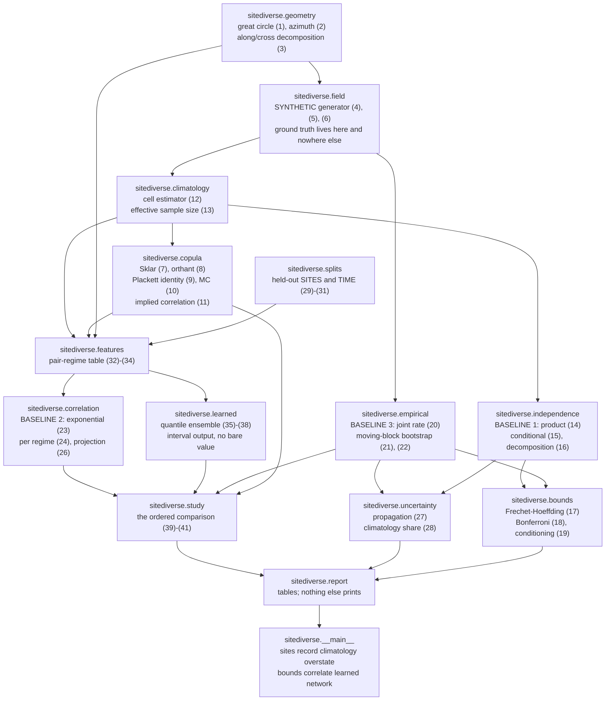
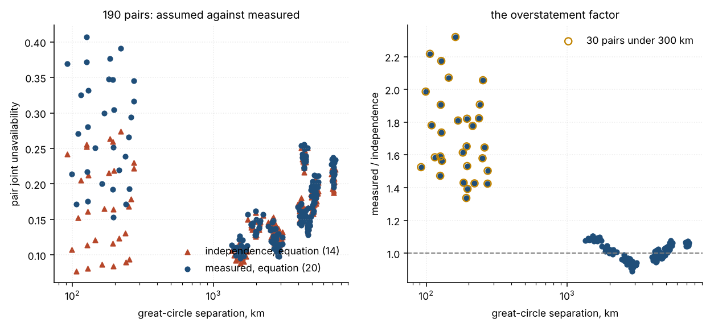
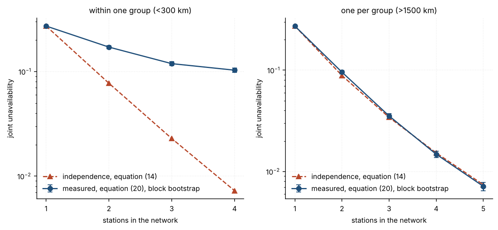
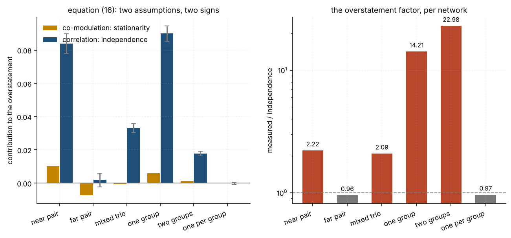
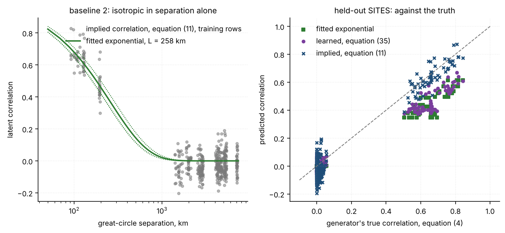
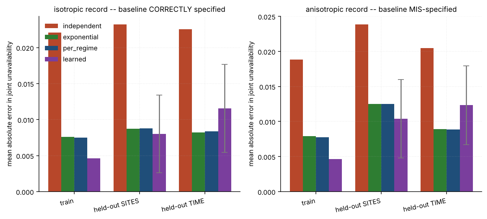
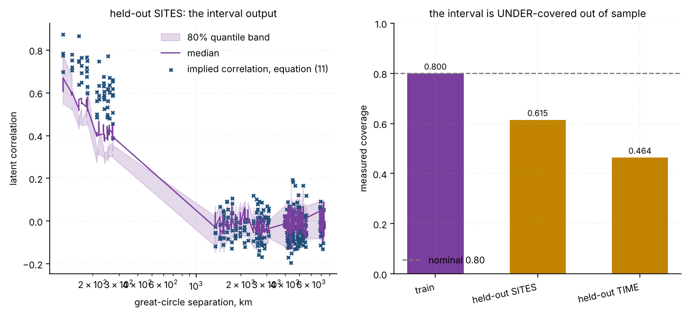
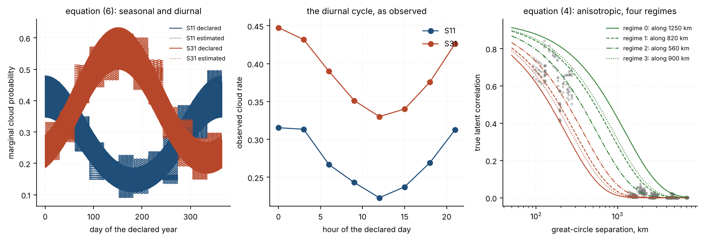

# sitediverse

Measures how much the independence assumption overstates optical ground-station site-diversity availability.

**Status:** TESTING · **Class:** flagship · **Validation level:** Level 3 · **AI:** yes


## The aerospace problem

An optical downlink is blocked when cloud sits over the ground station, so a
network of stations is unavailable only when every station is clouded at once,
and the usual first estimate of how often that happens is the product of the
stations' individual cloud probabilities. That product assumes the stations'
cloud cover is independent, which it is not, and the error runs in one
direction: independence **understates** joint unavailability and therefore
**overstates** the availability the network delivers. This package measures the
overstatement, decomposes it into the part caused by spatial correlation and the
part caused by treating the climatology as stationary, and attaches the record's
own sampling uncertainty to every figure.

## Executive overview

Four correlation models, all of them feeding the same Gaussian copula, so the
comparison isolates the dependence model and reports in availability units.

- **Baseline 1, independence — implemented in order to be refuted.** The product
  of long-term marginals, equation (14), computed in log space so the
  complement never loses its digits. On the declared six-station two-group
  network it claims a joint unavailability of **0.000866 ± 0.000037** where the
  record shows **0.019906 ± 0.001472**: an overstatement factor of **22.98** and
  **1.3614 nines of availability** that are not there.
- **Baseline 2, fitted correlation length.** A two-parameter exponential
  `rho_0 exp(-d/L)` over great-circle separation, equation (23), with a
  strengthened per-regime form beside it, equation (24). Both are fitted on the
  training rows only and both are reported everywhere.
- **Baseline 3, the empirical reference.** The directly observed joint cloud
  rate, equation (20), with a moving-block bootstrap, equation (21), because the
  epochs are serially dependent and an iid bootstrap understates the variance by
  up to a factor of 2.35.
- **A learned spatio-temporal correlation model** with an interval output and no
  bare point-estimate method, scored on **held-out SITES** and **held-out TIME**
  separately and never merged.

**The measured result, stated plainly.** On every hold-out cell of both declared
records the learned model's margin over the strongest baseline is **smaller than
the bootstrap half-width on the empirical reference**. On the record where the
two-parameter baseline is correctly specified by construction, the paired
interval on the held-out-SITES margin contains zero — they are not
distinguishable at all. On **held-out TIME, on both records, the baseline beats
the learned model**, by more than the learned model's best win. And scored
against the generator's own correlation rather than against the noisy empirical
target, the learned model is **worse** than the baseline even where it beats it
against the reference: it is fitting the estimation noise. Those numbers are in
[`validation/VALIDATION.md`](validation/VALIDATION.md) and they are the research
result of this product.

**The record is synthetic.** It is generated by `sitediverse.field` from
declared constants and a fixed seed, with a known correlation structure. No real
site climatology is used and no real optical ground station is a data source.
See [`DATASET_CARD.md`](DATASET_CARD.md).

This software is research-grade: **not flight-qualified, not certified, not
approved for operational aerospace use.**

## What this does

- **Measures the overstatement, per network, with its uncertainty.** Six
  declared networks, overstatement factors from **22.98** down to **0.9552**,
  each figure carrying the record's own sampling uncertainty. Measured in
  `validation/validate_overstatement_output.txt`.
- **Splits the overstatement exactly.** Equation (16) separates what assuming a
  *stationary* climatology costs from what assuming spatial *independence*
  costs, with no cross term: the residual is **0.00e+00** on all six networks.
  Two of the six have a *negative* co-modulation term, which is why their
  overstatement ratio is below 1 and is reported rather than hidden.
- **Computes the correlation excess without cancellation.** Equation (9)
  evaluates `Phi_2 - Phi(h)Phi(k)` as an integral of a positive integrand, so it
  keeps full relative precision down to `rho = 1e-20`, where the subtraction
  returns exactly **0.0** for a quantity of 1.964128e-25.
- **Checks every answer against bounds it does not use.** Frechet-Hoeffding,
  equation (17): **0 violations in 380 comparisons** over 190 pairs by two
  routes. The n = 2 Bonferroni identity closes to **2.220446e-16** over all 190
  pairs by a completely different route — clear-rate statistics against a count
  of cloudy epochs.
- **Reports two hold-outs separately.** Held-out SITES and held-out TIME, with
  opposite verdicts on both declared records, and a fourth cell that is computed
  and printed but is **not** a headline score because it cannot be attributed.

## Who it is for

- Optical-downlink and ground-segment engineers sizing a diversity network, who
  want to know how wrong the product-of-marginals figure is before it reaches a
  link budget.
- Anyone who has been handed a diversity availability number with no statement
  of what it assumed about correlation.
- Anyone building a Gaussian-copula availability calculation who wants a
  reference implementation with its numerics measured: the orthant quadrature
  agrees with SciPy's independent Genz-algorithm implementation to
  **1.088539e-16** absolute.
- Anyone scoring a learned model on a problem where the ground truth exists, and
  who wants to see a comparison in which the baselines win half the cells.

## Who it is not for

- **Anyone who needs a certified or flight-qualified answer.** This is
  research-grade software: not certified, not flight-qualified, not approved for
  operational aerospace use.
- **Anyone who wants a real availability figure for a real site.** Every number
  here is measured on a synthetic record. The generator's correlation is
  exponential *by construction*, so a model that recovers it has demonstrated
  consistency and not skill. `DATASET_CARD.md` says this four different ways
  because it is the single thing that would be most damaging to misread.
- **Anyone who needs turbulence, pointing loss or a full link budget.** This
  package models cloud blockage as a binary indicator and nothing else. There is
  no scintillation, no fade depth, no aperture averaging and no elevation
  dependence. For the propagation physics see Andrews & Phillips 2005.
- **Anyone who wants general copula modelling or geostatistics.** See the table
  below; `copulas`, `pyvinecopulib` and `gstools` are each better at their own
  question than anything here.
- **Anyone whose stations are closer than about 90 km or further than about 7300
  km apart.** That is the separation range of the declared network, and nothing
  here is validated outside it. The declared geometry also has no pair between
  400 km and 800 km, so that band is uncovered.

## Alternatives, honestly

Every package named below was verified to exist on PyPI on 2026-11-10 by
fetching its JSON metadata from `https://pypi.org/pypi/<name>/json` and reading
the version out of the response. **None of them is installed in the environment
these numbers were measured in, and no number in this repository is compared
against any of them.**

| alternative | what it does better | when to use it instead of this |
| --- | --- | --- |
| [`copulas`](https://pypi.org/project/copulas/) 0.15.0 | A real copula library: many families, fitting, sampling, conditional simulation. | Whenever your dependence structure is not Gaussian, or you need to sample from it. This package implements exactly one copula and inverts it for one correlation. |
| [`pyvinecopulib`](https://pypi.org/project/pyvinecopulib/) 1.0.1 | Vine copulas, which model high-dimensional dependence without assuming one correlation matrix. | For a network of many stations where pairwise correlations are not consistent with any single Gaussian field. `correlation.matrix_from_pairs` here projects and *reports* the projection; a vine avoids needing one. |
| [`gstools`](https://pypi.org/project/gstools/) 1.7.0 | Geostatistical random fields done properly: many covariance models, anisotropy, krige, conditioned simulation. | For generating or fitting a spatial field. `sitediverse.field` is a 60-line special case of what GSTools does, written so that its ground truth is trivially inspectable. |
| [`scikit-gstat`](https://pypi.org/project/scikit-gstat/) 1.0.27 | Variogram estimation and model fitting, with directional variograms. | For estimating a correlation length from spatial data. It is the right tool for baseline 2's job if your data are continuous rather than a binary indicator. |
| [`statsmodels`](https://pypi.org/project/statsmodels/) 0.15.0 | Mature time-series inference: HAC and Newey-West standard errors, ARMA, proper handling of serial dependence. | For a defensible standard error on a serially dependent mean. Equation (13) here is a plain AR(1) correction and `validate_climatology.py` measures that it disagrees with a block bootstrap on 20 of 20 stations. |
| [`arch`](https://pypi.org/project/arch/) 8.0.0 | Bootstrap methods done properly: stationary, circular-block, moving-block, with the block length chosen by a rule rather than declared. | For any bootstrap you want to defend. This package declares a block of 64 epochs and *reports* that the interval width does not plateau; `arch` would at least choose the length for you. |
| [`SALib`](https://pypi.org/project/SALib/) 1.6.0 | Global sensitivity analysis over a parameter distribution. | For "which inputs matter over their plausible range", which is a different question from the one here. |
| [`lmfit`](https://pypi.org/project/lmfit/) 1.3.4 | A far better nonlinear least-squares front end: named parameters, bounds, confidence intervals from an F-test. | For fitting equations (23) and (24) if you want intervals on `rho_0` and `L`. This package reports the fitted *function* error instead, because the parameters are weakly identified — equation (25). |
| `scipy.optimize`, `scipy.stats` | Already dependencies here. | For anything you do not need a site-diversity verdict for. |

There is no package on PyPI that computes an optical site-diversity availability
under measured spatial correlation and reports the overstatement against the
independence assumption as its headline. That is a reason to be careful rather
than a selling point: the pieces all exist above, and this product's value is
the ordering and the error bars, not the mathematics.

## Install and first run

```bash
git clone https://github.com/OmAcharya-avtr/sitediverse.git
cd sitediverse
python -m venv .venv && source .venv/bin/activate
pip install -e ".[dev]"
python -m pytest tests/ -q
```

What that prints, on the environment recorded in
[`validation/VALIDATION.md`](validation/VALIDATION.md):

```
........................................................................ [ 16%]
........................................................................ [ 33%]
........................................................................ [ 49%]
........................................................................ [ 66%]
........................................................................ [ 83%]
........................................................................ [ 99%]
.                                                                        [100%]
433 passed in 55.24s
```

The wall clock is the one figure above that moves between runs on a shared
machine; the count does not. `validation/VALIDATION.md` takes the count from
the junit XML rather than from this line, because a suite that collects zero
tests prints success and exits 0.

Then the headline, straight from the command line:

```bash
python -m sitediverse overstate
```

```
network        n  P_independent          P_measured             ratio    difference  nines lost
-------------  -  ---------------------  ---------------------  -------  ----------  ----------
cluster        4  0.007256 +/- 0.000264  0.103125 +/- 0.004592  14.2124  +0.095869   1.1527
far-pair       2  0.121586 +/- 0.002788  0.116139 +/- 0.003971  0.9552   -0.005447   -0.0199
near-pair      2  0.077335 +/- 0.002064  0.171447 +/- 0.005986  2.2169   +0.094112   0.3458
one-per-group  5  0.007408 +/- 0.000253  0.007149 +/- 0.000714  0.9651   -0.000259   -0.0154
two-groups     6  0.000866 +/- 0.000037  0.019906 +/- 0.001472  22.9809  +0.019040   1.3614
```

And the first example:

```bash
python examples/overstatement_by_separation.py
```

```
written: screenshots/overstatement_by_separation.png
  pairs                          : 190
  mean ratio under 300 km        : 1.7219
  mean ratio over 3200 km        : 1.0130
  largest pair ratio             : 2.3198 at 161.2 km
  pairs with a ratio below 1     : 67
  near-pair bootstrap 95% interval: [0.157946, 0.181435]
```

## A worked example

```python
import numpy as np
from sitediverse.bounds import frechet_hoeffding
from sitediverse.climatology import estimate_climatology
from sitediverse.empirical import bootstrap_joint_rate
from sitediverse.field import RECORD_SPECS, generate_record
from sitediverse.independence import availability_nines, overstatement
from sitediverse.uncertainty import climatology_share

record = generate_record(RECORD_SPECS["anisotropic"])      # synthetic, seed 20260002
climatology = estimate_climatology(record.cloud)           # estimated from the record
network = (0, 1, 2, 3)                                     # one group, all baselines < 300 km

result = overstatement(climatology, record.cloud, network)
band = bootstrap_joint_rate(record.cloud, network)          # moving-block, 400 replicates

print("P_independent :", f"{result.naive:.6f}")
print("P_measured    :", f"{result.measured:.6f} +/- {band.standard_error:.6f}")
print("ratio         :", f"{result.ratio:.4f}")
print("nines claimed :", f"{availability_nines(result.naive):.4f}")
print("nines measured:", f"{availability_nines(result.measured):.4f}")
print("co-modulation :", f"{result.comodulation_term:+.6f}")
print("correlation   :", f"{result.correlation_term:+.6f}")
print("identity resid:", f"{abs(result.identity_residual()):.3e}")
print("clim share    :", f"{climatology_share(result.naive - result.measured, band.standard_error):.6f}")

bounds = frechet_hoeffding(climatology.long_term_rate[list(network)])
print("Frechet bounds:", f"[{bounds.lower:.6f}, {bounds.upper:.6f}]",
      "contains both:", bounds.contains(result.naive) and bounds.contains(result.measured))
```

```
P_independent : 0.007256
P_measured    : 0.103125 +/- 0.004592
ratio         : 14.2124
nines claimed : 2.1393
nines measured: 0.9866
co-modulation : +0.005867
correlation   : +0.090002
identity resid: 0.000e+00
clim share    : 0.002289
Frechet bounds: [0.000000, 0.272603] contains both: True
```

Read the last four lines together. The overstatement of 0.095869 splits
**exactly** into 0.005867 from assuming a stationary climatology and 0.090002
from assuming spatial independence, with a residual of zero because the identity
has no cross term. The climatology share of **0.002289** says the discrepancy is
not the record being short: it is 20.9 bootstrap standard errors. And both
figures sit inside a bound derived from the marginals alone, which uses no
copula and no correlation at all.

The full narrative version, step by step, is
`validation/worked_example.py` and its committed output.

## Architecture



## Screenshots



Notice the left panel's two clouds separating below about 300 km and converging
above about 2000 km, and the right panel's points falling to the dashed line as
separation grows. The circled points are the 30 pairs under 300 km; their mean
overstatement factor is 1.7219 against 1.0130 for the pairs over 3200 km.



The left panel is four stations inside one regional group and the right is one
station per group. Notice that the dashed independence line keeps falling in
both panels while the measured line flattens in the left one: short-baseline
diversity stops buying availability long before the product of marginals says it
does.



The amber bars are what assuming a stationary climatology costs and they change
sign; the blue bars are what assuming spatial independence costs and they do
not. The right panel is the overstatement factor on a log scale — notice that
two networks sit below the dashed unit line.



The left panel is baseline 2 seeing only separation. The right panel is the
honest one: predicted against the generator's TRUE correlation on held-out
sites, where the learned model's points scatter further from the diagonal than
the fitted exponential's do.



The research finding, in one figure. The purple bar beats the green and blue
bars on held-out SITES and loses to them on held-out TIME, on both records. The
grey whisker is the bootstrap half-width on the empirical reference: every
difference between the bars is smaller than it.



The left panel is the 80 per cent quantile band on held-out sites. The right
panel is what it is actually worth: coverage of 0.6147 on held-out SITES and
0.4643 on held-out TIME against a nominal 0.80.



What the synthetic record is, before any number measured on it is trusted. The
third panel's grey points are the true pair correlations and the lines are the
along-axis and cross-axis limits of equation (4); the spread between the two
lines in each regime is the anisotropy the isotropic baseline cannot represent.

## Validation evidence

Level 3. Full detail, including every check that is weak or vacuous, is in
[`validation/VALIDATION.md`](validation/VALIDATION.md).

| check | reference | result | tolerance or criterion |
| --- | --- | --- | --- |
| orthant quadrature against SciPy's Genz algorithm | a different algorithm for the same integral | worst absolute difference **1.088539e-16** over 600 cases | 1e-14 |
| haversine against the spherical law of cosines | an independently derived form | worst absolute difference **7.925394e-11 km** over 4000 pairs | 1e-05 km |
| the n = 2 Bonferroni identity | clear-rate statistics against a count of cloudy epochs | worst residual **2.220446e-16** over 190 pairs | 1e-14 |
| Frechet-Hoeffding bounds | the marginals alone | **0 violations in 380 comparisons** | conditioned slack, equation (19) |
| equation (10) Monte Carlo against equation (8) | random against deterministic | worst deviation **1.9705 sigma** | declared 4 sigma |
| the equation (16) decomposition | an exact identity with no cross term | residual **0.00e+00** on all 6 networks | 1e-15 |
| the generator's marginals, recovered | the declared `q_it` of equation (6) | worst station deviation **1.4054 sigma** | declared 4 sigma |
| the generator's spatial correlation, recovered | the declared `R(r)` of equation (4) | worst deviation **2.4864 sigma** over 4 regimes | declared 4 sigma |
| the implied correlation against the truth | the generator's own matrix | rms error **0.073751** (anisotropic), **0.076051** (isotropic) | reported, not asserted |
| the fitted correlation function against the truth | the same | rms **0.014631** correctly specified, **0.065972** mis-specified | 0.15 |
| the block bootstrap against the iid bootstrap | serial dependence | inflation **1.2992 to 2.3479** across 6 networks | greater than 1 |
| `pytest.approx` audit | the suite re-run with the default forced off | **0 of 433** assertions depend on the hidden 1e-12 default; **10 of 433** rest on an absolute bound, each accounted for by name | 0 |
| negative controls | each anchored on a declared value or a closed-form bound | **26 declared; 15 must fire and all 15 did; 11 must not and none did** | both directions |
| working directories | the release gate's own `cwd` | **0 non-zero exits in 70 runs**, probe run twice from a clean tree and agreeing on every status | all zero |
| ruff | 0.16.9 on the path and 0.17.4 as a module | clean under **both** | 0 findings |

### Where the baselines win, and where a check is weak

- **The baselines beat the learned model on held-out TIME, on both records**:
  0.008870 against 0.012329 (anisotropic) and 0.008382 against 0.011550
  (isotropic). A baseline win is research evidence and is not removed, softened
  or retuned away.
- **Scored against the generator's own correlation the learned model is worse
  everywhere**, including on the cell it wins against the empirical reference:
  0.063107 against 0.043236 on held-out SITES. It is fitting the estimation
  noise in the target, whose own rms error against the truth is 0.073751. Only a
  synthetic record can show this.
- **On the correctly-specified record the learned margin is not distinguishable
  from zero**: the paired bootstrap interval on the held-out-SITES margin is
  [-0.000604, +0.001409].
- **The learned model's interval is badly under-covered out of sample**: 0.4643
  on held-out TIME against a nominal 0.80.
- **The block bootstrap does not plateau.** The standard error rises
  monotonically by a factor of 3.9553 from a block of 1 epoch to one of 512,
  because the record carries a seasonal cycle as well as synoptic persistence.
  Every interval quoted at the declared 64 epochs is a **lower bound**; a
  512-epoch block gives 1.7062 times more. That direction only strengthens this
  product's conclusion.
- **The Bonferroni bracket is vacuous for 3 of 6 networks** and the Frechet
  lower bound is informative for only **8 of 190 pairs**. Both counts are
  printed rather than a pass being claimed on the full set.
- **Equation (13) disagrees with a block bootstrap on 20 of 20 stations** by
  more than 5 per cent. A negative control asserts the disagreement is detected.
- **The `git ls-files` hygiene check examined 0 files** when this build measured
  it, because the product was uncommitted, and was recorded as VACUOUS.
  **Corrected after commit (2026-11-10):** committing the product made the check
  real and the coordinator's independent re-run measured **92 tracked files
  examined, 0 offenders**. The weaker claim above is left legible rather than
  overwritten, because it is what the build could honestly measure at the time.
- **This product's first version of the bound slack was wrong** — it looked
  conditioned and was an absolute constant in disguise. It is pinned in
  `tests/test_regressions.py` and reconstructed by a negative control.
- **Three real defects were found by this product's own tests during the build**:
  an asymmetric along/cross decomposition (up to 1478.5 km), a bearing that
  could return exactly 360.0, and epoch nodes using cell centres instead of cell
  means (an error three orders of magnitude too large). All three are in
  `tests/test_regressions.py` with their literal inputs.

## API reference

<details>
<summary>The public surface, with units</summary>

**`sitediverse.geometry`** — stations as coordinates and nothing else.

| name | returns |
| --- | --- |
| `Site(name, latitude_deg, longitude_deg, altitude_m, cluster)` | one station; `altitude_m` is carried and used by no computation |
| `SITES` | the 20 declared synthetic stations in 5 groups of 4 |
| `great_circle_km(lat_a, lon_a, lat_b, lon_b)` | equation (1), km |
| `initial_bearing_deg(...)`, `midpoint_bearing_deg(...)` | equation (2), degrees in `[0, 360)`; the midpoint form is symmetric and is what equation (3) uses |
| `along_cross_km(separation_km, bearing_deg, axis_deg)` | equation (3), `(along, cross)` in km |
| `separation_matrix()`, `along_cross_matrices()` | the pairwise forms, symmetric, zero diagonal |

**`sitediverse.field`** — the SYNTHETIC generator. Ground truth lives here.

| name | returns |
| --- | --- |
| `FieldSpec(...)` | the declared generator constants of equations (4) to (6) |
| `RECORD_SPECS` | the three declared records: `anisotropic`, `isotropic`, `short` |
| `generate_record(spec)` | a `Record`: `cloud` (epochs, S) bool, `regime`, `latent`, `threshold_true` |
| `true_correlation(spec, regime)` | the generator's own `R(r)`. Validation only; no estimator calls it |
| `Record.margin_to_threshold()` | `z - threshold`, the quantity equation (6)'s strict comparison rounds away |

**`sitediverse.climatology`** — the marginal climatology, estimated from the record.

| name | returns |
| --- | --- |
| `estimate_climatology(cloud, nseason, nhour, shrinkage)` | `Climatology`, equation (12) |
| `Climatology.rate_series()`, `.threshold_series()` | `(epochs, S)` marginal probability and its probit |
| `.effective_sample_size()`, `.rate_standard_error()` | equation (13) |
| `lag_one_autocorrelation(series)` | per column; returns 0.0 for a constant column |

**`sitediverse.independence`** — baseline 1, the thing being refuted.

| name | returns |
| --- | --- |
| `product_of_marginals(rates)` | equation (14), computed as `exp(sum(log q))` |
| `conditional_product(rate_series)` | equation (15) |
| `overstatement(climatology, cloud, sites)` | `Overstatement`, with `.ratio`, `.nines_lost`, `.comodulation_term`, `.correlation_term`, `.identity_residual()` |
| `availability_nines(unavailability)` | `-log10(q)`, never from `1 - A` |

**`sitediverse.copula`** — the Gaussian copula and the identity it uses.

| name | returns |
| --- | --- |
| `bivariate_orthant(h, k, rho)` | equation (8) |
| `correlation_excess(h, k, rho)` | equation (9); the headline quantity at pair level, without cancellation |
| `epoch_nodes(threshold_i, threshold_j, bins)` | the binned epoch representation; cell MEANS, not centres |
| `implied_correlation(nodes, observed_joint)` | equation (11), with an `at_bracket_end` flag |
| `network_joint_monte_carlo(thresholds, correlation, samples, seed)` | equation (10), with a reported standard error |
| `pair_joint_exact(...)`, `pair_excess_exact(...)` | the exact epoch-by-epoch forms every headline figure uses |

**`sitediverse.bounds`** — bounds from mathematics nothing here uses.

| name | returns |
| --- | --- |
| `frechet_hoeffding(rates)` | equation (17), with `.slack`, `.condition_number`, `.lower_informative` |
| `bonferroni_bracket(rates, pair_clear)` | equation (18); an exact identity at n = 2 |
| `bound_slack(rates, bound_value)`, `bound_condition_number(...)` | equation (19) |

**`sitediverse.empirical`** — baseline 3 and its bootstrap.

| name | returns |
| --- | --- |
| `joint_rate(cloud, sites)` | equation (20) |
| `bootstrap_joint_rate(cloud, sites, block, replicates, level, seed)` | equation (21), a `BootstrapInterval` |
| `bootstrap_pair_rates(cloud, pairs, ...)` | every pair on ONE shared set of draws |
| `bootstrap_difference(left, right, estimate)` | equation (22), the paired interval |

**`sitediverse.correlation`, `.uncertainty`, `.splits`, `.features`, `.learned`,
`.study`, `.report`** — baseline 2 and its projection, the sampling-uncertainty
propagation and share, the hold-out split, the pair table, the learned model and
the ordered comparison. `python -m sitediverse --help` lists the eight
subcommands.

</details>

## Limitations

- **The record is synthetic, and that is the dominant limitation.** The
  generator's correlation is exponential by construction, its climatology is two
  harmonics in probit space and its temporal structure is an AR(1). A model that
  recovers any of those has demonstrated consistency, not skill.
  [`DATASET_CARD.md`](DATASET_CARD.md) states this at length.
- **One copula family, and the choice is an assumption rather than a
  consequence.** Sklar's theorem does not give a unique copula for discrete
  margins, so "the copula of a binary cloud field" does not exist. What equation
  (8) asserts is a latent-variable model — the indicator is a thresholded
  Gaussian — which is exactly how the record is generated and is the first thing
  to doubt on a real record.
- **Cloud blockage only.** No scintillation, no fade depth, no aperture
  averaging, no elevation dependence, no pointing loss. A station is up or down.
- **The spherical Earth of equation (1)** misdescribes an ellipsoidal geodesic by
  up to about 0.5 per cent, which is far below the ten per cent sampling
  uncertainty on any correlation length fitted here. Near the antipodes the
  haversine form loses half its digits, measured at a relative 9.486e-09; no
  pair of the declared network is anywhere near that regime.
- **The `(rho_0, L)` pair is weakly identified**, equation (25). The fitted
  length moves by tens of per cent while the function it implies moves by a few
  hundredths of a correlation, which is why the function error is quoted as the
  primary figure.
- **The declared block of 64 epochs gives a lower bound on the sampling
  uncertainty**, not a converged one; the interval width does not plateau by 512
  epochs. The direction is safe for this product's conclusion.
- **Held-out TIME is not a test of temporal extrapolation by the model**, because
  no feature encodes the time half. It tests whether a model fitted on the first
  half reproduces the second half's joint rates.
- **One leak is declared**: the marginal climatology is estimated once over the
  whole record and used in both time halves. It is identical for every model in
  the comparison.
- **The n-station joint unavailability is Monte Carlo, not closed form.** Only
  the pair case has the exact quadrature of equation (9). Every n-station figure
  carries its Monte Carlo standard error and is never called closed form.
- **Dependency ranges were run at both ends for `ruff` only.** The build
  environment is a shared pre-pinned interpreter this product is forbidden to
  modify, so `numpy`, `scipy`, `scikit-learn`, `matplotlib`, `pytest` and
  `hypothesis` are bounded at the single version each was measured at. A pin
  below a future security release is a real cost, not a free safety measure:
  this product cannot take such a release without a port. `pyproject.toml` says
  the same in a comment.
- **Compute budget, measured on 2 cores.** The whole study on one record runs in
  6.710 s, of which the learned fit is 1.217 s. The full validation suite is
  238.7 s and `probe_working_directories.py` is a further 278.2 s because it
  runs 70 subprocesses. All of these move by ten to twenty per cent between
  runs on two shared cores; the counts do not. Nothing here approaches the declared three-minute limit for a
  single training or Monte Carlo run. No GPU is used or required.
- **`torch` is not installed** in the environment these numbers were measured
  in, and nothing here is compared against it. Neither are `statsmodels`,
  `copulas` or any other package in the alternatives table.

## Reproducing every number

```bash
python -m pytest tests/ -q --junit-xml=junit.xml
python validation/validate_geometry.py
python validation/validate_field.py
python validation/validate_climatology.py
python validation/validate_copula.py
python validation/validate_bounds.py
python validation/validate_empirical.py
python validation/validate_overstatement.py
python validation/validate_correlation.py
python validation/validate_learned_model.py
python validation/validate_negative_controls.py
python validation/validate_approx_audit.py
python validation/validate_examples.py
python validation/validate_cli.py
python validation/worked_example.py
python validation/probe_working_directories.py
ruff check src/ tests/ examples/ validation/
```

Every script writes its raw output to `validation/<script-name>_output.txt`, and
those files are committed. Every figure in `screenshots/` is produced by the
example of the same name. Nothing in this repository requires a network
connection or a data download: the record is a deterministic function of a
declared integer seed and is regenerated rather than stored.

## Licence, citation, credits

Apache-2.0. See [`LICENSE`](LICENSE). Copyright © 2026 OPTIMA Organisation.

To cite this software, see [`CITATION.cff`](CITATION.cff).

### References

Real, verifiable, and each cited for what it actually says.

- **Sklar, A. (1959)**, *Fonctions de répartition à n dimensions et leurs
  marges*, Publications de l'Institut de Statistique de l'Université de Paris 8,
  229–231. The theorem that a joint distribution factors into its margins and a
  copula. Cited for the statement and for its **discrete-margin caveat**.
- **Nelsen, R. B. (2006)**, *An Introduction to Copulas*, 2nd edition, Springer.
  Chapter 2 for Sklar's theorem and the non-uniqueness of the copula for
  discrete margins; theorem 2.10.12 for the Frechet-Hoeffding bounds as the
  copulas `W` and `M`.
- **Plackett, R. L. (1954)**, *A reduction formula for normal multivariate
  integrals*, Biometrika 41, 351–360. The reduction formula behind equation (9).
- **Genz, A. (2004)**, *Numerical computation of rectangular bivariate and
  trivariate normal and t probabilities*, Statistics and Computing 14, 251–260.
  The algorithm SciPy implements, used here only as an independent cross-check.
- **Efron, B. and Tibshirani, R. J. (1993)**, *An Introduction to the
  Bootstrap*, Chapman and Hall. Chapter 13 for the percentile interval.
- **Künsch, H. R. (1989)**, *The jackknife and the bootstrap for general
  stationary observations*, Annals of Statistics 17, 1217–1241. The moving-block
  bootstrap of equation (21), which is what a serially dependent record needs.
- **Stein, M. L. (1999)**, *Interpolation of Spatial Data*, Springer. Chapter 2
  for the Matérn family; the exponential correlation of equation (4) is Matérn
  at smoothness one half.
- **Friedman, J. H. (2001)**, *Greedy function approximation: a gradient
  boosting machine*, Annals of Statistics 29, 1189–1232. The algorithm behind
  `sklearn.ensemble.GradientBoostingRegressor`.
- **ITU-R Recommendation P.618** (Earth-space propagation data) and **ITU-R
  Recommendation P.1815** (differential rain attenuation / site diversity).
  Cited for what they are — the ITU-R framework for site-diversity statistics
  parameterised by station separation and baseline orientation — and **not** for
  any specific clause or numerical value, none of which is used or reproduced
  here.
- **Andrews, L. C. and Phillips, R. L. (2005)**, *Laser Beam Propagation through
  Random Media*, 2nd edition, SPIE Press. Cited for the propagation physics this
  package does **not** model: scintillation, fade statistics and aperture
  averaging.
- **Kim, I. I. et al. (2001)**, SPIE vol. 4214, on atmospheric attenuation of
  free-space optical links. Cited, like Andrews & Phillips, for the attenuation
  physics outside this package's scope.
- **Fuchs, C. and Giggenbach, D. (2012)**, on optical satellite downlinks to
  optical ground stations and the role of site diversity. Cited for the
  engineering context — that cloud blockage is the dominant availability driver
  for an optical downlink and that diversity is the standard mitigation — and
  not for any number reproduced here.
- **Bartlett, M. S. (1946)**, on the theoretical specification of sampling
  properties of autocorrelated time series, JRSS B 8, 27–41. The effective
  sample size of equation (13).

### Credits

This is under reserved rights obtained by OPTIMA Organisation.
