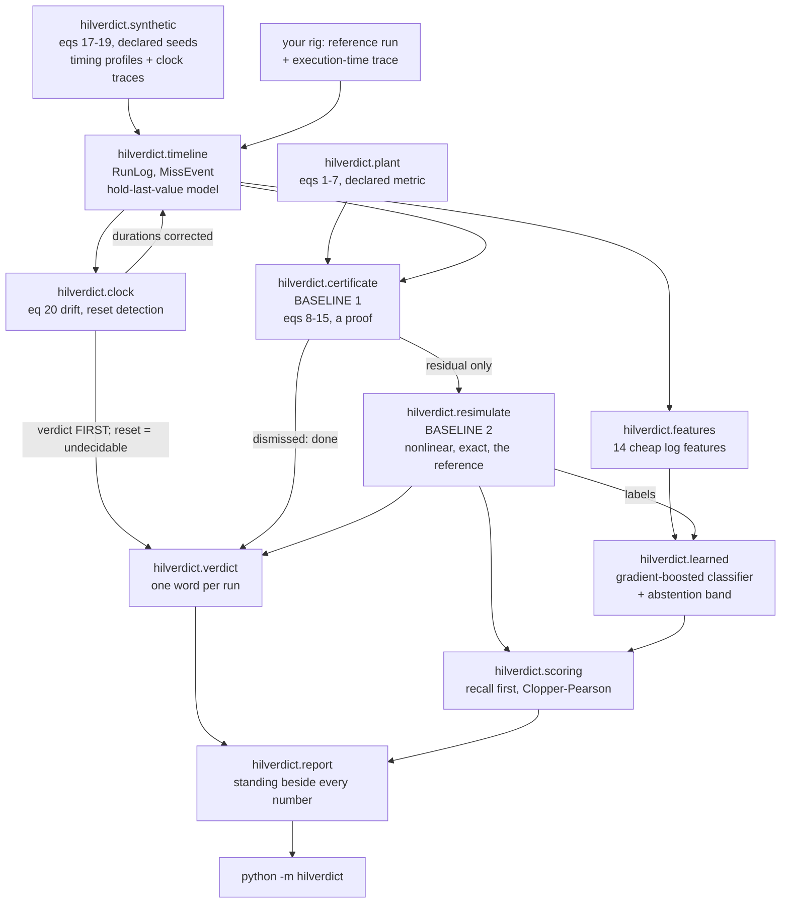
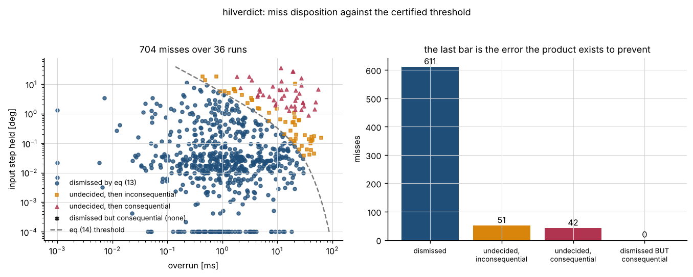
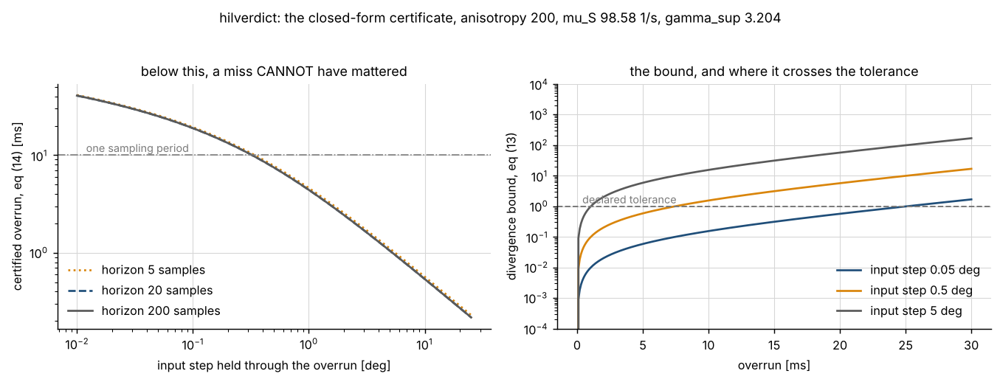
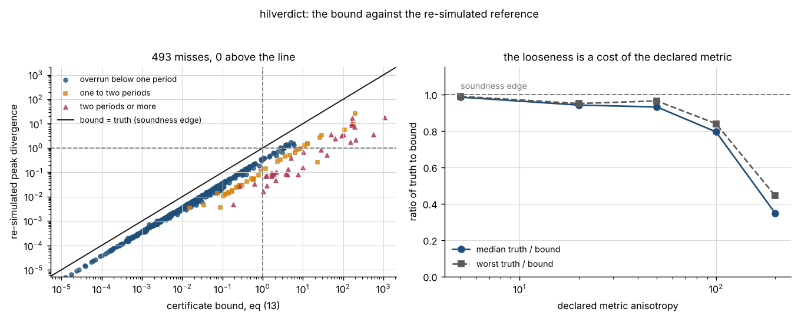
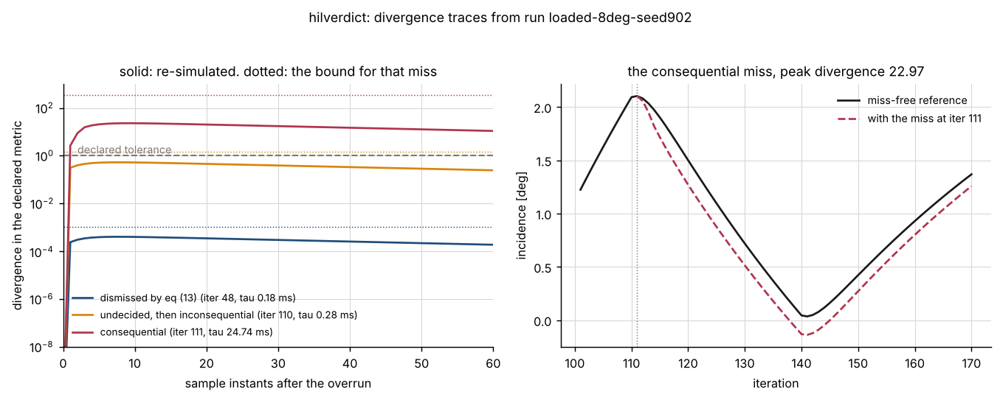
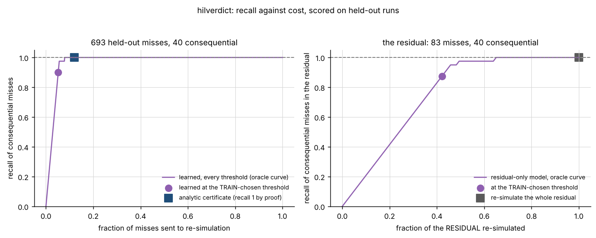
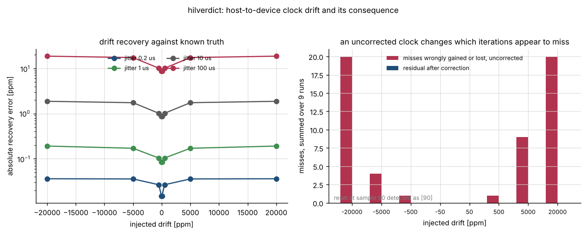
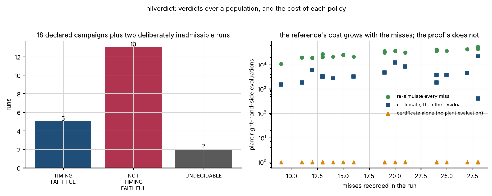

# hilverdict

Decide whether a hardware-in-the-loop run was timing-faithful, and which deadline misses actually mattered.

**Status:** TESTING · **Class:** medium · **Validation level:** Level 3 · **AI:** yes


## The aerospace problem

Your hardware-in-the-loop rig ran a 2 s manoeuvre at 100 Hz and the execution
log says twenty-two of the two hundred iterations overran their deadline. The
review asks whether the result is still worth anything, and an overrun count
does not answer that: a 7.4 ms overrun holding a command that was not going to
change moves nothing, and a 0.3 ms overrun at the instant the command swings
by 27 degrees moves the trajectory by twenty-three times the declared
tolerance. Re-simulating every miss answers it exactly and costs one plant
integration per miss, which on a campaign of a few hundred runs is the whole
afternoon.

## Executive overview

`hilverdict` answers the question in three layers, and uses them in this order.

- **Baseline 1, the analytic certificate.** A closed-form upper bound on how
  far a miss of duration `tau`, holding an input step `du`, could possibly move
  the trajectory of the declared linearisation. A miss whose bound falls below
  the declared tolerance **cannot** have mattered: that is a proof, not an
  estimate, and no re-simulation of that miss can change it. Measured over 875
  misses: **87.66 per cent dismissed in closed form, 0 of 50 consequential
  misses among them, 0 bound violations against the nonlinear reference.**
- **Baseline 2, direct re-simulation.** Run the declared nonlinear plant with
  the miss and without it. Slow, exact, and the reference every other number
  here is scored against. It is paid for only on the residual the certificate
  leaves undecided, which saves **0.869239 of the plant evaluations** at zero
  cost in recall.
- **A learned classifier** over cheap log features, for the case where
  re-simulation is unaffordable, scored on **recall of consequential misses**
  because dismissing a miss that mattered is not symmetric with re-simulating
  one that did not.

**The measured result is that the analytic bound wins outright.** On 841
held-out misses the certificate reaches a recall of 1.0000 and dismisses 0 of
47 consequential misses; the learned classifier, at the only threshold a user
could actually have chosen, reaches **0.7234** and dismisses **13**. On the
certificate's residual set -- the one role the specification allows the
learned component -- it saves **nothing** at no cost in recall. Those numbers
are in `validation/VALIDATION.md` and they are the research result of this
product.

The clock is checked before any duration is believed, because a device clock
running 2 per cent fast changes which iterations appear to have overrun at all
(**28 misses** wrongly gained or lost over 12 runs, **0** after correction),
and a device-clock reset makes the durations spanning it meaningless rather
than merely biased.

## What this does

- **Proves that most misses cannot have mattered, in closed form.** Equation
  (13) costs two matrix exponentials per run and one logarithm per miss, and
  dismissed **767 of 875** misses over 45 runs with **0** consequential misses
  among them. Measured in `validation/validate_certificate_output.txt`.
- **Gives one number per run below which no miss needs looking at.** Equation
  (14) inverts the bound: at a 1 deg input step and the full horizon the
  certified overrun is **4.408112 ms**; at 0.05 deg it is **25.109992 ms**.
- **Is never violated by the nonlinear reference, and says how much room it
  had.** 0 violations in 875 misses, worst ratio of truth to bound
  **0.710647**, median **0.338738**. The looseness is driven by the declared
  metric's anisotropy and is swept: median ratio **0.984466** at anisotropy 5
  falling to **0.326902** at the declared 200.
- **Detects clock drift and resets against synthetic drift of known rate.**
  36 of 36 sweep points recovered inside four of the estimator's own standard
  errors, worst absolute error **9.059894 ppm** against injected rates up to
  20000 ppm; reset recall and precision **1.000000** over 24 injected resets,
  with the detection floor measured at **1.1e-4 s** and a smaller reset
  reported as missed.
- **Scores the learned component on recall and publishes the baseline win.**
  Recall **0.7234** against the certificate's **1.0000**, 13 consequential
  misses dismissed against 0, and a recall that moves from 0.588235 to
  0.812500 across three folds of the test population at one fixed threshold
  while the certificate's does not move at all.

## Who it is for

- Hardware-in-the-loop and real-time engineers who have to say, in a review,
  whether a run's timing was faithful enough for its result to stand.
- Flight-software and GNC engineers triaging an overrun log and deciding which
  iterations are worth re-running.
- Anyone who wants the cheap test and the expensive test in one place, with
  the cheap one's dismissals backed by a proof rather than a heuristic.
- Anyone scoring a learned component on the error that actually costs
  something rather than on accuracy.

## Who it is not for

- Anyone who needs a certified or flight-qualified answer. This is
  research-grade software: not certified, not flight-qualified, not approved
  for operational aerospace use.
- Anyone without a declared plant model. The whole certificate is a statement
  about one; with no model there is nothing to bound and nothing to
  re-simulate.
- Anyone whose loop cascades. The miss model is hold-last-value and does not
  cascade. The cascade overrun count is reported beside the direct one on
  every run and is 2 to 3 times larger on a loaded run; a run whose cascade
  count greatly exceeds its direct count is outside what the verdict covers.
- Anyone analysing the schedule rather than the trajectory. For queueing,
  priorities and resource contention, use a discrete-event simulator; see the
  table below.
- Anyone who needs a high-fidelity plant. The declared plant is a two-state
  short-period model with a cubic pitching moment and its coefficients are a
  declared fiction with an engineering shape, fitted to nothing.

## Alternatives, honestly

There is no mature package on PyPI that answers this product's exact question,
and that is a reason to be careful rather than a selling point: every row
below does part of the job better than this does.

| alternative | what it does better | when to use this instead |
| --- | --- | --- |
| **`control`** 0.10.2, the Python Control Systems Library | the mature control-systems library: state space, transfer functions, discretisation, margins, LQR, far more model types than the single declared plant here | when the question is whether a RECORDED deadline miss changed a trajectory enough to matter, which `control` does not answer |
| **`ruptures`** 1.1.10 | the reference change-point detection library: many cost functions, exact and approximate search, penalty selection | for the clock-reset detector specifically, `ruptures` will beat the eight-robust-scales rule here; use this when you also want the drift fit, the duration correction and the verdict that depends on them |
| **`scipy`** 1.18.1, already a dependency | `scipy.stats.theilslopes` is the same Theil-Sen estimator and `scipy.signal.cont2discrete` the same zero-order-hold discretisation, both better maintained than anything here | when you want those inside a pipeline that also carries the miss model, the certificate and the re-simulation reference |
| **`statsmodels`** 0.15.0 | robust regression, structural-break tests and diagnostics far beyond the two estimators here | the same |
| **`simpy`** 4.1.2 | discrete-event simulation of a real scheduler: tasks, queues, priorities, resources, preemption | when you want to know what an overrun DID to a control trajectory rather than how the schedule behaved |
| **`ntplib`** 0.4.0 | querying NTP for a real network clock offset | when the two clocks are a host and a device on one rig and you have paired timestamps rather than a time server |
| **re-simulating every miss** | exact, with no bound to argue about | always, if you can afford it. This product's certificate exists to make that affordable: it saved 0.869239 of the plant evaluations on the measured population, and on a small campaign that saving is not worth a new dependency |

If you need a hardware-in-the-loop harness rather than a post-run verdict,
this is the wrong package: it never talks to a device. HilForge, product P031
of the same portfolio, is the harness; it is not published on PyPI.

## Engineering theory

Every equation carries its source, units, assumptions and validity range. The
numbering is the numbering used in the source docstrings.

### The declared plant

A two-state longitudinal short-period model with a cubic pitching moment, the
standard textbook shape for an airframe whose static stability falls away with
incidence (Etkin & Reid 1996, *Dynamics of Flight: Stability and Control*, 3rd
edition, chapter 6, for the linear short-period form; Stengel 2004, *Flight
Dynamics*, Princeton, chapter 5, for the cubic extension):

```
alpha_dot = z_a alpha + q + z_d u                                        (1)
q_dot     = m_a alpha + m_a3 alpha^3 + m_q q + m_d u                     (2)
```

Units: `alpha` rad, `q` rad/s, `u` rad. **The coefficients are declared, not
measured**: a fiction with an engineering shape, chosen so the open loop has a
short period at 3.3047 rad/s and a damping ratio of 0.42364. No number in this
repository is attributed to any real airframe. Validity: `|alpha| <= 10 deg`
and `|u| <= 40 deg`; outside either, the cubic term is an extrapolation and
this package **refuses to certify** rather than extrapolating.

The controller is a trim feedforward plus a constant-gain regulator, sampled
and held:

```
u_k    = u_trim(alpha_c) + K (x_k - x_trim(alpha_c)), saturated to +-u_max  (3)
u_trim = -( alpha_c (m_a - m_q z_a) + m_a3 alpha_c^3 ) / (m_d - m_q z_d)    (4)
q_trim = -z_a alpha_c - z_d u_trim                                          (5)
```

Equation (4) is exact for the cubic plant, so the feedforward does not degrade
with amplitude; its residual is measured at **2.220446e-16 1/s**, and the same
trim with the cubic term dropped leaves **2.232962e-01 1/s** at 10 deg.

### The metric, and why the tolerance is exactly 1

A difference in `(alpha, q)` cannot be measured by a plain Euclidean norm: the
two components carry different units. The divergence metric is weighted by the
**declared engineering tolerances**:

```
D = max over sample instants of sqrt( (d_alpha/alpha_tol)^2 + (d_q/q_tol)^2 ) (6)
```

so `D >= 1` means the difference exceeded the tolerance and the verdict
threshold is the dimensionless number 1. The declared weights are 0.01 deg of
incidence and 2 deg/s of pitch rate, an anisotropy of 200. **This is a
declaration about what the run is for, not a property of the plant, and it is
the single biggest lever on how loose the certificate is.** That dependence is
measured, not mentioned.

### Baseline 1 — the certificate

Write `e(t)` for the difference between the run with exactly one miss injected
and the miss-free reference. Both start at the same state at the sample
instant where the overrun begins.

**Step 1, the hold injects the error, open loop.** Over the hold the perturbed
branch holds the stale command and the reference branch applies its own
commands from a known trajectory, so the input difference is an exogenous
signal rather than a feedback of `e`:

```
mu_2(M)    = lambda_max( (M + M^T)/2 ),   || exp(M t) ||_2 <= exp(mu_2(M) t)  (8)
phi(mu, t) = ( exp(mu t) - 1 ) / mu,      phi(0, t) = t                       (9)
|| e(t_k + tau) ||_S <= || S B ||_2 phi(mu_S, tau) du_max                    (10)
```

Equation (8) is Dahlquist's inequality: Dahlquist (1958), *Stability and error
bounds in the numerical integration of ordinary differential equations*,
Transactions of the Royal Institute of Technology Stockholm 130; Coppel
(1965), *Stability and Asymptotic Behavior of Differential Equations*, Heath,
chapter 2; reviewed in Söderlind (2006), "The logarithmic norm. History and
modern theory", *BIT Numerical Mathematics* 46(3), 631-652. It is checked here
over 124 matrices and 26 times each with **0 violations in 3224 pairs**.

**Step 2, the rest of the period settles freely**, for at most one period:

```
c_free = max( 1, exp(mu_S T) )                                               (11)
```

**Step 3, the closed loop propagates it.** From the first sample instant after
the overrun the error maps through `Phi = A_d + B_d K` once per period:

```
gamma_m = || S Phi^m S^-1 ||_2 ,  gamma_sup(N) = max_{0<=m<=N} gamma_m       (12)
```

an exact maximum over a finite set, because the metric is read at sample
instants and there are `N + 1` of them. The zero-order-hold matrices come from
Van Loan's block exponential (Van Loan 1978, "Computing integrals involving
the matrix exponential", *IEEE Transactions on Automatic Control* 23(3),
395-404, section II), which needs no matrix inverse — equation (7).

**The certificate, and its inversion:**

```
Bound(tau, du, N) = c_free gamma_sup(N) || S B ||_2 phi(mu_S, tau) du        (13)
tau*(du, N, tol)  = (1/mu_S) ln( 1 + mu_S tol / (c_free gamma_sup ||SB||_2 du) )
                                                                             (14)
Aggregate(run)   <= sum_i Bound(tau_i, du_i, N_i)                            (15)
```

For the declared loop: `mu_S = 98.577700 1/s`, `||S B||_2 = 1208.655792918`,
`c_free = 2.679893`, `gamma_sup(200) = 3.203899` peaking at `m = 8`.

**What is proved and what is not.** (13) is a theorem about the declared
**linearisation**. Whether the real plant respects it is a question about the
linearisation, and this package answers it by measurement: 875 misses, 0
violations, worst ratio 0.710647. Three conditions are **refused** rather than
extrapolated through — actuator saturation anywhere in the reference run,
incidence beyond the declared validity limit, and mean utilisation at or above
1 — because each breaks a step of the derivation.

### Baseline 2 — the reference

The declared nonlinear plant, integrated with classical fourth-order
Runge-Kutta at a fixed declared step (Butcher 2016, *Numerical Methods for
Ordinary Differential Equations*, 3rd edition, section 232), with and without
the miss. Fixed-step rather than adaptive because an adaptive step would make
the reference depend on the perturbation. Measured convergence orders
**3.9924, 3.9958, 3.9982, 4.0074** against the matrix exponential on the
linear plant, and a relative error of **2.245295e-12** at the declared 4
substeps.

### The miss model

An iteration whose execution time exceeds the declared deadline has missed,
with overrun `tau`. The consequence is the hold-last-value dropout of the
networked-control literature (Hespanha, Naghshtabrizi & Xu 2007, "A survey of
recent results in networked control systems", *Proceedings of the IEEE* 95(1),
138-162, section III; Schenato, Sinopoli, Franceschetti, Poolla & Sastry 2007,
"Foundations of control and estimation over lossy networks", *Proceedings of
the IEEE* 95(1), 163-187): the actuator keeps the previous command for `tau`
seconds past the sample instant, and from then on the freshest command that
exists applies. **It does not cascade**, and the cascade accounting is
reported beside it on every run so that a reader quoting an overrun count
knows which definition it is.

### The clock

Within a segment between resets the device timestamps obey

```
device_k = o_j + (1 + rho)(host_k - host_{r_j}) + noise_k                    (19)
```

`rho` is reported in parts per million by least squares and by Theil-Sen
(Theil 1950, *Nederlandse Akademie van Wetenschappen Proceedings* 53, 386-392
and 521-525; Sen 1968, "Estimates of the regression coefficient based on
Kendall's tau", *JASA* 63(324), 1379-1389). Resets are found as jumps in the
offset series against a robust scale built from the median absolute deviation
(Rousseeuw & Croux 1993, "Alternatives to the median absolute deviation",
*JASA* 88(424), 1273-1283).

### The learned component

A gradient-boosted tree classifier over fourteen cheap log features (Friedman
2001, "Greedy function approximation: a gradient boosting machine", *Annals of
Statistics* 29(5), 1189-1232, implemented by
`sklearn.ensemble.GradientBoostingClassifier`). Two of the features are
**exactly** the two numbers equation (13) is a function of, so the model is
given everything the proof uses and twelve more besides. Recall is reported
with the exact Clopper-Pearson interval (Clopper & Pearson 1934, *Biometrika*
26(4), 404-413) rather than a normal approximation, which is wrong at exactly
the end of the range that matters.

## Architecture



The structural rule: `hilverdict.verdict` runs the clock check before anything
that reads a duration, and `hilverdict.report` prints the standing of every
number beside it — a dismissal backed by a proof and one backed by a
classifier's probability are not the same statement.

## Installation

```bash
git clone https://github.com/OmAcharya-avtr/hilverdict.git
cd hilverdict
python -m venv .venv && source .venv/bin/activate
pip install -e ".[dev]"
python -m pytest tests/ -q
python examples/certificate_threshold.py
```

Expected output of the first run:

```
518 passed
```

and of the example:

```
written: screenshots/certificate_threshold.png
certified overrun at a 1 deg input step: 4.408112 ms
at a 0.05 deg input step: 25.109992 ms
mu_S = 98.577700 1/s, gamma_sup = 3.203899, c_free = 2.679893
np version 2.5.3
```

## Quick start

```python
from hilverdict import certify_run, generate_run, render_verdict, run_verdict

log = generate_run(seed=902, profile="loaded", amplitude_deg=8.0, steps=200)

# the whole pipeline: clock, then certificate, then re-simulation on the residual
print(render_verdict(run_verdict(log, tolerance=1.0)))

# or the certificate alone, which costs no plant integration at all
certificate = certify_run(log, tolerance=1.0)
print(len(certificate.dismissed), "of", len(certificate.certificates),
      "misses dismissed with a proof")
print("any miss shorter than",
      f"{certificate.certified_overrun_s * 1e3:.4f} ms", "is harmless in this run")
```

From your own rig, build a `RunLog` from the reference trajectory and the
execution-time trace:

```python
from hilverdict import LoopModel, RunLog, miss_events, overrun_counts

log = RunLog(
    model=LoopModel(),            # your declared plant, controller, metric
    command_rad=commanded_alpha,  # (steps,)
    durations_s=execution_times,  # (steps,) measured on the device
    states=reference_states,      # (steps + 1, 2), miss-free
    computed_rad=reference_commands,
    saturated=reference_saturation_mask,
    host_time_s=host_timestamps,  # (steps + 1,)
    device_time_s=device_timestamps,
)
print(len(miss_events(log)), "overruns;", overrun_counts(log).cascade, "under cascade")
```

## Configuration

Everything is an argument; nothing is a hidden default.

| what | where | default | note |
| --- | --- | --- | --- |
| incidence tolerance | `DivergenceMetric.alpha_tolerance_rad` | 0.01 deg | the metric's weight; drives the bound's looseness |
| rate tolerance | `DivergenceMetric.rate_tolerance_rad_s` | 2 deg/s | the same |
| divergence tolerance | `tolerance` | 1.0 | exactly 1 because the metric is scaled by the two above |
| sampling period | `SamplingLaw.period_s` | 0.010 s | |
| deadline | `SamplingLaw.deadline_s` | 0.010 s | must lie in `(0, period_s]` |
| integrator substeps | `SamplingLaw.substeps` | 4 | fixed, never adaptive |
| incidence validity | `ALPHA_VALID_RAD` | 10 deg | beyond it the certificate refuses |
| actuator limit | `Plant.u_max_rad` | 40 deg | saturation makes the certificate refuse |
| clock drift allowance | `allowance_ppm` | 100 ppm | beyond it the durations are corrected |
| reset threshold | `scales`, `floor_s` | 8 robust scales, 1e-4 s | the floor is measured, see Limitations |
| model hyperparameters | `ClassifierSpec` | `n_estimators=150, learning_rate=0.08, max_depth=3, min_samples_leaf=4, subsample=0.9, positive_weight=8.0` | declared, not tuned; there is no tuning loop in this repository |
| abstention band | `ClassifierSpec.abstention_band` | 0.05 | a probability inside it is referred to re-simulation, never dismissed |
| early exit | `peak_divergence(early_exit=...)` | `False` | its criterion rests on the same linearisation as baseline 1 |

CLI:

```bash
python -m hilverdict threshold --steps 200
python -m hilverdict certify --seed 902 --profile loaded --amplitude-deg 8.0
python -m hilverdict resimulate --seed 902 --profile loaded --amplitude-deg 8.0
python -m hilverdict verdict --seed 902 --profile loaded --amplitude-deg 8.0
python -m hilverdict clock --seed 902 --drift-ppm 5000
python -m hilverdict clock --seed 902 --resets 0.4
python -m hilverdict learned --train-runs 9 --test-runs 6 --steps 120
```

## Examples

| script | figure | what to notice |
| --- | --- | --- |
| `certificate_threshold.py` | `screenshots/certificate_threshold.png` | the certified overrun falls logarithmically with the input step, so a miss in a quiet stretch can be an order of magnitude longer and still be provably harmless |
| `miss_disposition.py` | `screenshots/miss_disposition.png` | every consequential miss lies above the threshold curve; the fourth bar, dismissed-but-consequential, is zero |
| `bound_vs_truth.py` | `screenshots/bound_vs_truth.png` | every point below the diagonal, and the right panel showing the looseness is a function of the declared metric |
| `divergence_traces.py` | `screenshots/divergence_traces.png` | the divergence peaks within about ten sample instants, which is why `gamma_m` saturates at `m = 8` |
| `recall_tradeoff.py` | `screenshots/recall_tradeoff.png` | the gap between the oracle curve and the point a user could actually reach |
| `clock_drift.py` | `screenshots/clock_drift.png` | the recovery error, and the miss-count error an uncorrected clock causes |
| `verdict_and_cost.py` | `screenshots/verdict_and_cost.png` | the reference's cost grows with the number of misses; the proof's does not |

## A worked example

`validation/worked_example.py`, run on one declared run, in the order the
product insists on. Its actual output, from
`validation/worked_example_output.txt`:

```
step 0: what the rig recorded
  iterations                 : 200
  mean utilisation           : 0.863510
  overruns, direct count     : 22
  overruns, cascade count    : 55
  cascade / direct           : 2.500000
  longest overrun            : 34.7377 ms against a 10 ms deadline
  peak reference incidence   : 2.7959 deg
  saturated iterations       : 0

step 1: the clock, before any duration is believed
CLOCK VERDICT: CLOCK_CLEAN
  pooled drift      : 0.0361 ppm +- 0.0255
  declared allowance: 100.0000 ppm
  resets detected   : none

step 2: the analytic certificate, equation (13)
misses recorded                  22
dismissed in closed form         19
left undecided                   3
dismissal rate                   0.8636
certified overrun, eq (14) [ms]  0.2009

iter  tau [ms]  tau/T  p  du [deg]  horizon  bound   margin   verdict    proof
----  --------  -----  -  --------  -------  ------  -------  ---------  -----
2     7.397     0.740  0  0.0000    197      0.0000  1.0000   DISMISSED  yes
48    0.183     0.018  0  0.0323    151      0.0011  0.9989   DISMISSED  yes
81    0.265     0.026  0  11.4415   118      0.5555  0.4445   DISMISSED  yes
103   6.421     0.642  0  0.0388    96       0.0630  0.9370   DISMISSED  yes
110   0.284     0.028  0  27.2105   89       1.4215  -0.4215  UNDECIDED  -
```

and the paragraph a programme would write down, verbatim from that run:

```
  Run loaded-8deg-seed902 recorded 22 deadline overruns in
  200 iterations at a mean utilisation of 0.8635. The host-to-device
  clock was within 100 ppm with no reset, so the recorded
  durations are believable.

  19 of those 22 overruns are
  dismissed in closed form: for the declared plant, controller and
  linearisation, no overrun of that duration holding that input step can
  move the trajectory past the declared tolerance. That is a proof about
  the declared model, not an estimate, and it is why only
  3 overruns needed re-simulating.

  Of those 3, 2 measurably changed the
  trajectory. The worst, iteration
  111 with a 24.7377 ms overrun,
  moved it by 22.9675 times the declared tolerance,
  peaking 9 iterations later.

  The run is therefore NOT_TIMING_FAITHFUL: its result is not timing-faithful
  at the declared tolerance, and the iterations to look at are
  [111, 174].
```

Note the 7.397 ms overrun at iteration 2 that is dismissed with a bound of
exactly zero — it held a command that was not going to change — and the
0.284 ms overrun at iteration 110 that is not, because it held one that was
about to move by 27 degrees.

## Screenshots



Notice that every red triangle, which is a miss the re-simulation found
consequential, lies above and to the right of the dashed threshold curve, and
that the fourth bar on the right — dismissed by the certificate but
consequential in fact — is zero. That bar is the error the whole product
exists to prevent.



Notice that the three horizon curves on the left lie almost on top of each
other: the closed loop's worst amplification is reached within about ten
sample instants, so the length of the remaining run barely changes the answer.



Notice that no point lies above the diagonal, and that the blue points — short
overruns — crowd it while the red ones, multi-period holds, fall far below. The
right panel is the price of the declared metric.



Notice that the dotted line over each trace is that miss's bound: it sits above
the solid trace everywhere, which is the certificate in one picture.



Notice the gap between the purple curve, which is the model scored at every
threshold using the test labels, and the purple dot, which is the same model at
the threshold a user could actually have chosen from the training runs. This
figure is drawn on its own seed ranges, disjoint from the validation study's,
so its numbers are not the headline ones: **693 held-out misses, 40
consequential, certificate recall 1.000000 at a flag rate of 0.119769, learned
recall 0.900000 at 0.051948**. The ordering is the same and the magnitudes are
not, which is itself the point of the fold table in
`validation/VALIDATION.md`.



Notice the right panel: at 20000 ppm the uncorrected log disagrees with the
truth about which iterations missed, by twenty-eight misses over twelve runs,
and the correction removes all of it.



Notice that the green points climb with the number of misses in a run while the
orange ones do not move at all: the certificate costs no plant integration.

## Validation evidence

Level 3. Full evidence, with raw output beside every script, in
[`validation/VALIDATION.md`](validation/VALIDATION.md); every requirement
stated so a script can pass or fail it in [`docs/REQUIREMENTS.md`](docs/REQUIREMENTS.md).
**147 checks, 0 failures. 34 negative controls declared, 22 fired, every one in
the declared direction.**

| check | reference | result | tolerance |
| --- | --- | --- | --- |
| trim is an equilibrium of the cubic plant | the plant's own right-hand side | **2.220446e-16 1/s** worst | 1e-14 |
| `B_d` against the inverse formula and against Simpson quadrature | two derivations the implementation avoids | **2.220446e-16** and **8.881784e-16** | 1e-15, 1e-13 |
| integrator order on the linear plant | the matrix exponential | **3.9924, 3.9958, 3.9982, 4.0074** | 3.5 to 4.6 |
| Dahlquist's inequality, eq (8) | 124 matrices x 26 times | **0 violations of 3224**, tightest ratio 1.00000000000000022 | 64 eps relative |
| eq (14) inverts eq (13) | the bound evaluated at `tau*` | worst relative departure **1.110223e-15** over 18 cases | 1e-12 |
| **the certificate against the nonlinear reference** | re-simulation, 45 runs | **0 violations of 875 misses**, worst ratio 0.710647, median 0.338738 | bound + measured integrator floor |
| **consequential misses among the dismissed** | re-simulation | **0 of 50** | exact |
| dismissal rate | the same | **0.876571** | reported |
| the certificate against the EXACT linear response | matrix propagation, no norms anywhere | **0 violations of 189 misses**, worst ratio 0.705074628 | 1e-9 relative |
| the horizon factor against a Gronwall bound | sub-additivity of the log norm, eq (16) | **0 violations of 11 horizons**; vacuous beyond `N = 12`, reported at that strength | strict |
| eq (9) against adaptive quadrature | `scipy.integrate.quad` | **2.697168e-16** worst relative | 1e-12 |
| the bound with `c_free` removed | the same re-simulations | **47 violations**, worst ratio 1.889527 — the factor is necessary | must fire |
| the bound with `phi` replaced by `tau` | the same | **0 violations**, worst ratio 0.717512 — **not falsified by this population**, reported as measured and NOT offered as a control | reported |
| prefix reuse and the optional early exit | full-horizon re-simulation | both **bit-identical**, 0 verdict flips over 128 and 228 misses | exact |
| verdict flips between 4 and 16 substeps | the 16-substep peak | **0**; worst step-size shift is 5.4e-08 of a miss's own margin | exact |
| the aggregate bound, eq (15) | the ALL-misses re-simulation | **0 violations of 18 runs** | strict |
| clock drift recovery | the injected rate, 36 sweep points | **36 of 36** inside 4 standard errors, worst **9.059894 ppm** | 4 se |
| reset detection | the generator's own indices | recall **1.000000**, precision **1.000000**, 24 injected | exact index |
| the reset detection floor | injected jumps | **9e-05 s missed, 1.1e-4 s detected** — reported as the limitation it is | reported |
| drift's effect on the miss set | the same seeds with a clean clock | **28 misses** wrongly gained or lost at 20000 ppm, **0** after correction | reported |
| **learned recall, threshold chosen on train** | re-simulation, 841 held-out misses | **0.7234** [0.5736, 0.8438], **13 of 47 consequential misses dismissed** | the baseline win |
| **certificate recall on the same misses** | the same | **1.0000** [0.9245, 1.0000], **0** dismissed, flag rate 0.1153 | a theorem |
| learned recall across three folds at one threshold | the same | **0.588235 to 0.812500**; the certificate's does not move | reported |
| learned on the residual set only | the same | recall **0.765957**, **11 consequential dismissed**, saving **0.000000** | the measured result |
| `pytest.approx` hidden default | the suite with the default forced off | **0 of 518** depend on it; 3 rest on an absolute bound, all named | — |
| working directories | `/`, `/tmp`, product root, `validation/` | **0 non-zero in 44 runs** and 0 in 14 example runs | exact |

## API reference

<details>
<summary>The public surface, one line each, with units</summary>

**`hilverdict.plant`**

- `Plant.derivative(state, control)` — equations (1)-(2), rad/s and rad/s².
- `Plant.derivative_scalar(alpha, rate, control)` — the same on floats; the integrator's inner loop.
- `Plant.jacobian(alpha=0.0)` — state Jacobian at incidence `alpha` (rad), 1/s.
- `Plant.trim(alpha_command)` — exact trim state (rad, rad/s) and control (rad), equations (4)-(5).
- `Plant.saturate(control)` — clip to the declared actuator limit, rad.
- `Controller.command_with_saturation(plant, state, alpha_command)` — `(rad, bool)`, equation (3).
- `DivergenceMetric.norm(difference)` — the weighted norm of equation (6), dimensionless.
- `LoopModel.monodromy()` / `.scaled_monodromy()` — `Phi` and `S Phi S^-1`, dimensionless.
- `zoh_matrices(jacobian, input_matrix, duration_s)` — equation (7) by Van Loan's block exponential.

**`hilverdict.timeline`**

- `RunLog` — the reference trajectory plus the execution-time trace.
- `miss_events(log)` — every overrun as a `MissEvent`, with `overrun_s`, `hold_periods`, `input_step_rad`.
- `overrun_counts(log)` — direct and cascade counts, and their ratio.
- `utilisation(log)` — mean execution time over the period, dimensionless.

**`hilverdict.certificate` — baseline 1**

- `log_norm(matrix)` — `mu_2` of equation (8), units of `matrix`.
- `exponential_integral(mu, duration_s)` — equation (9), seconds.
- `horizon_gains(scaled_monodromy, steps)` — `gamma_m` of equation (12), dimensionless.
- `CertificateModel.build(model, horizon_steps)` — the three constants, once per loop.
- `divergence_bound(constants, overrun_s, input_step_rad, steps_remaining)` — equation (13), metric units.
- `certified_overrun_s(constants, input_step_rad, steps_remaining, tolerance)` — equation (14), seconds.
- `certify_miss` / `certify_run` — `DISMISSED` or `UNDECIDED`, plus the run's refusals.
- `gronwall_horizon_factor(model, steps)` — equation (16), the independent cross-check.
- `require_admissible(certificate)` — raise on a refusal.

**`hilverdict.resimulate` — baseline 2**

- `simulate(model, command_rad, misses, ...)` — the declared loop with hold-last-value misses.
- `peak_divergence(...)` — `(peak, peak_index, plant_calls, steps_simulated)`.
- `classify_miss` / `resimulate_run` — `CONSEQUENTIAL` or `INCONSEQUENTIAL`.
- `timed_resimulation(log, tolerance)` — results plus wall-clock seconds.

**`hilverdict.clock`**

- `least_squares_rate` / `theil_sen_rate(host_time_s, device_time_s)` — the slope of equation (20).
- `detect_resets(host, device, scales, floor_s)` — reset indices.
- `estimate_clock(...)` — `CLOCK_CLEAN`, `CLOCK_DRIFTING` or `CLOCK_RESET`, with per-segment drifts in ppm.
- `drift_corrected_log(log, drift_ppm)` — durations divided by `1 + rho`.

**`hilverdict.features` / `hilverdict.learned` / `hilverdict.scoring`**

- `feature_matrix(log)` — `(n, 14)` of cheap log features in the declared order.
- `MissClassifier.fit` / `.predict_with_uncertainty(features)` — probability, decision, margin, abstention.
- `MissClassifier.reliability(features, labels)` — measured calibration and the Brier score.
- `clopper_pearson(successes, trials, confidence)` — the exact binomial interval.
- `score_decision(...)` / `threshold_at_recall(...)` / `operating_points(...)`.

**`hilverdict.verdict` / `hilverdict.report`**

- `run_verdict(log, tolerance, ...)` — `TIMING_FAITHFUL`, `NOT_TIMING_FAITHFUL`, `UNDECIDED` or `UNDECIDABLE`.
- `render_verdict` / `render_certificates` / `render_resimulations` / `render_clock` / `render_scores`.

</details>

## Limitations

- **Every number is measured against synthetic runs.** The plant's
  coefficients and the execution-time model are a declared fiction with an
  engineering shape. No measurement of any real rig, flight computer, bus or
  test article appears anywhere in this repository, and nothing here
  establishes that the method behaves the same way on a real log.
- **The certificate is a theorem about the declared linearisation, not about
  the plant.** The measurement that the linearisation covers the plant is 875
  misses with 0 violations, which is evidence and not a proof. A user with a
  different plant must repeat it.
- **The bound is loose for long holds, by a lot.** It is within a factor of
  1.4 of the truth at its tightest and overstates an eight-period hold by about
  a factor of **1055**, because equation (9) grows exponentially while this
  plant's divergence grows roughly linearly in the overrun. Long misses
  therefore always go to re-simulation.
- **The looseness is a direct function of the declared metric.** At an
  anisotropy of 5 the median ratio of truth to bound is 0.984466; at the
  declared 200 it is 0.326902. Declaring a tight incidence tolerance beside a
  loose rate tolerance costs about a factor of three in the bound.
- **The miss model does not cascade**, and the cascade count is 2 to 3 times
  the direct count on a loaded run. A run whose cascade count greatly exceeds
  its direct count is outside what the verdict covers.
- **The analysis is one miss at a time.** Interactions are covered only by the
  superposition bound of equation (15); the all-misses divergence exceeded the
  largest single miss on 6 of 18 runs measured, by up to a factor of 1.373314.
- **The reset detector has a floor of 1e-4 s** and misses smaller resets:
  measured, a 9e-05 s offset jump is not detected and a 1.1e-4 s one is. The
  consequence of a missed reset is bounded by the floor, which is 1 per cent of
  a period, and the report says so rather than claiming the detector is exact.
- **Only three refusal conditions are checked.** Saturation, incidence
  validity and utilisation. A plant whose linearisation is wrong for some other
  reason will be certified anyway.
- **The learned model under-recalls and is of no defensible use here.** It
  dismisses 13 of 47 consequential misses at the only threshold a user could
  choose, and on the certificate's residual it saves nothing at no cost in
  recall. It is shipped because the comparison is the result, not because it
  is recommended.
- **`git ls-files` is vacuous in the measured environment**: the tracked-file
  scan in `validate_cli.py` section 3b examined 0 files, because this product
  directory is not yet tracked. That check will only mean something once it is.
- **Declared dependency ranges were measured at one version each**, except
  `ruff`, which was measured at both ends. The build environment is a shared
  pre-pinned interpreter this product is forbidden to modify, so installing a
  second version of numpy, scipy, scikit-learn, matplotlib, pytest or
  hypothesis was not possible. The tension is real: a pin below a future
  security release is a cost, not a free safety measure, and this product would
  need a port to take one.
- **No model artifact is serialised or committed.** Every model in
  `validation/` is refitted from a declared seed by the script that reports it,
  so there is no pickle whose format would need bounding — but every run pays
  the fit cost.

## Hardware requirements

Two cores. Peak resident memory of the heaviest script,
`validate_learned_model.py`, measured at **165.9 MB** with
`resource.getrusage(RUSAGE_CHILDREN).ru_maxrss`. No GPU; PyTorch is not a
dependency and is not installed in the measured environment. The longest
single script is `probe_working_directories.py` at **273.3 s**, which runs the
entire validation suite four times by design; every other script finishes in
under 25 s and every Monte Carlo and training run is inside the declared 180 s
budget. The whole test suite runs in **10.489 s** on two cores, from the
junit XML's own `time` attribute. Every wall-clock figure here is unstable on
shared hardware and is reported rather than asserted; the plant-evaluation
counts beside them are exact.

## Safety statement

This software is research-grade. It is not flight-qualified, not certified, and
not approved for operational aerospace use. The learned model is not certified
for operational flight use. A `TIMING_FAITHFUL` verdict is an evidence
statement about a declared plant, controller, metric and tolerance; it is not a
certification and not an airworthiness statement. Nothing in this repository
has been validated against a measurement of a real aerospace article.

## Roadmap

- A certificate linearised about the **nominal trajectory** rather than one
  operating point, which would make the bound valid over a wider amplitude
  range and remove the incidence refusal.
- A cascading miss model, so that runs whose cascade count exceeds their direct
  count are covered rather than excluded.
- A pairwise interaction bound, so that two misses close together are covered
  by something tighter than the superposition sum.
- A change-point reset detector with a declared false-alarm rate rather than a
  robust-scale threshold with a measured floor.
- A real hardware-in-the-loop log, with the plant model taken from a
  system-identification record rather than declared.

## Reproducing every number

From `products/P083`:

```bash
python3 -m pytest tests/ -q -p no:cacheprovider --junit-xml=/dev/null
python3 validation/validate_plant.py
python3 validation/validate_certificate.py
python3 validation/validate_independent_bound.py
python3 validation/validate_resimulation.py
python3 validation/validate_clock.py
python3 validation/validate_learned_model.py
python3 validation/validate_negative_controls.py
python3 validation/validate_approx_audit.py
python3 validation/validate_examples.py
python3 validation/worked_example.py
python3 validation/probe_working_directories.py
python3 validation/validate_cli.py
for e in examples/*.py; do [ "$e" = "examples/_common.py" ] || python3 "$e"; done
python3 -m ruff check src/ tests/ examples/ validation/
ruff check src/ tests/ examples/ validation/
```

`validate_cli.py` is last because it is the script that checks the tree is
clean of caches and absolute paths. Both ruff lines are listed because two
installations coexist in the measured environment, 0.16.9 on the path and
0.17.3 as a Python module, and the declared range `ruff>=0.16,<0.18` is clean
under both.

## License

Apache-2.0. See [LICENSE](LICENSE). Copyright © 2026 OPTIMA Organisation.

## Credits

This is under reserved rights obtained by OPTIMA Organisation.

## Citation

See [CITATION.cff](CITATION.cff).

```bibtex
@software{hilverdict_2026,
  title  = {hilverdict: deciding whether a hardware-in-the-loop run was
            timing-faithful, and which deadline misses measurably mattered},
  author = {{OPTIMA Organisation}},
  year   = {2026},
  version = {0.1.0},
  license = {Apache-2.0},
  url    = {https://github.com/OmAcharya-avtr/hilverdict}
}
```
