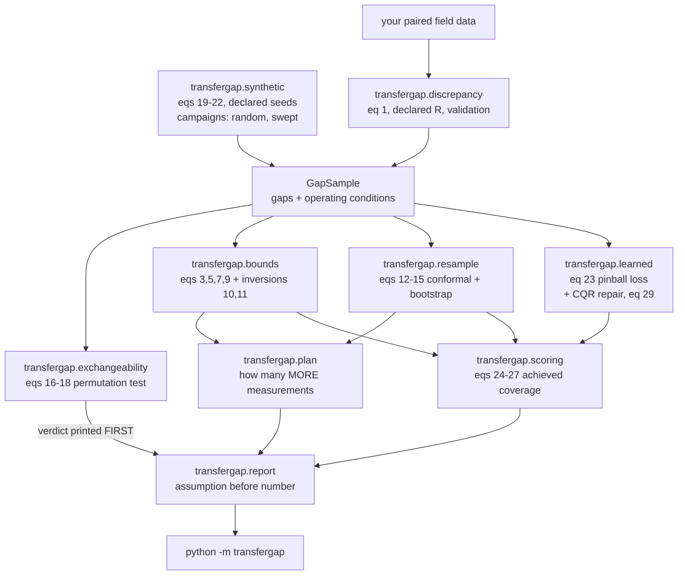
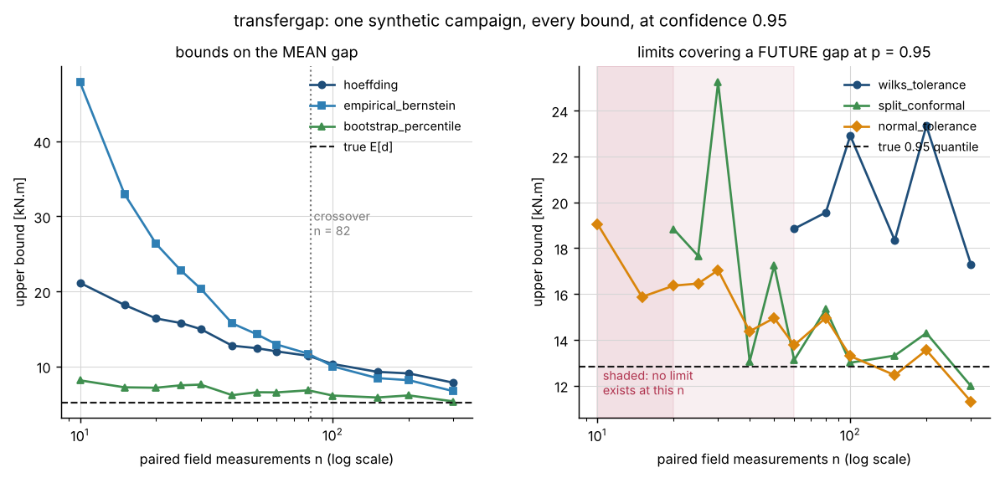
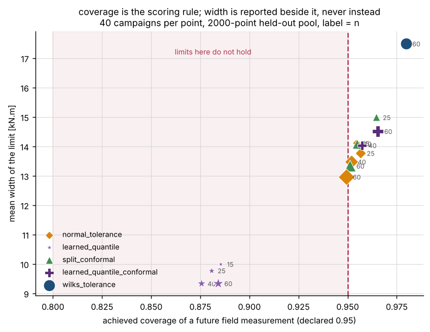
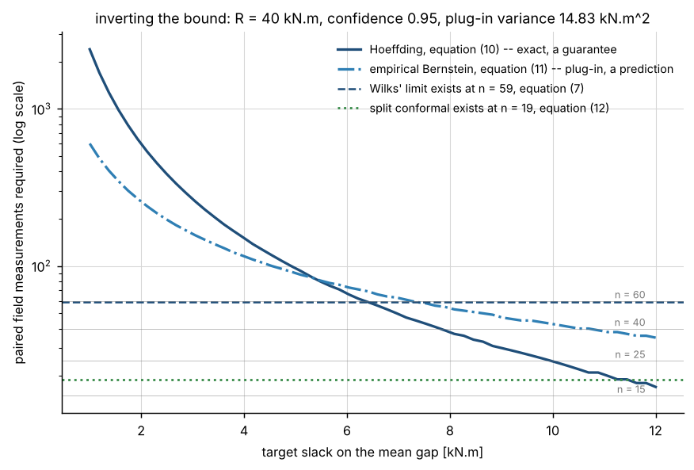
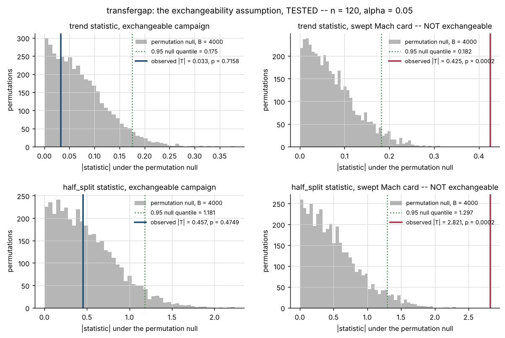
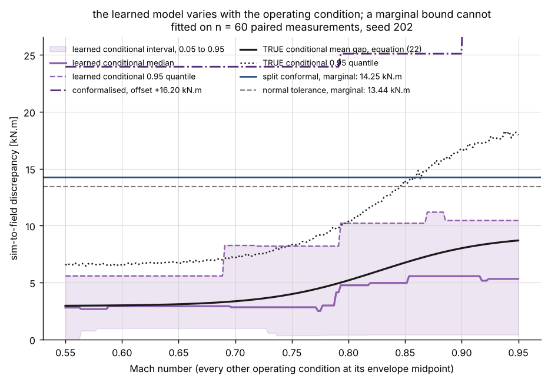
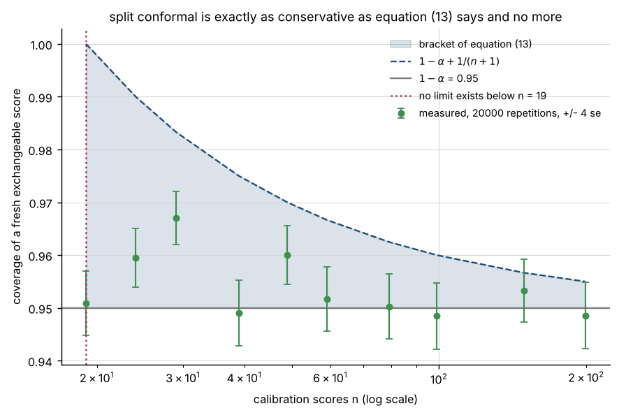

# transfergap

Bound the simulation-to-field discrepancy from the few paired measurements you have, and say how many more you need.

**Status:** TESTING · **Class:** medium · **Validation level:** 2 · **AI:** yes


## The aerospace problem

Your digital twin predicts wing-root bending moment and the flight-test
campaign came back with fifteen paired points. The mean absolute discrepancy
across those fifteen is 5.93 kN.m, and the question in the review is not what
the mean of fifteen numbers is — it is what the discrepancy is, on the
population of operating conditions the aircraft will actually fly, with a
number you are willing to defend. The second question is how many more flights
would halve it. Neither question is answered by a sample mean, and both have
answers that depend entirely on which assumptions you are prepared to make.

## Executive overview

`transfergap` computes upper bounds on the sim-to-field gap from a handful of
paired measurements, and inverts each bound into the number of additional
measurements that would bring it to a declared target at a declared
confidence. Three families are provided, at three different standings, and the
standing is printed in the same table as the number:

- **Distribution-free.** Hoeffding (1963) and the Maurer–Pontil (2009)
  empirical Bernstein bound on the mean gap; Wilks' (1941) nonparametric
  one-sided tolerance limit and the exact normal-theory limit on a future gap.
  The sample-count requirement is inverted in closed form from each.
  Conservative, and explicit about it.
- **Tighter, under exchangeability.** The nonparametric bootstrap and split
  conformal prediction. Exchangeability is the load-bearing assumption and
  this package **tests** it with a permutation test against the drift and step
  alternatives a flight-test card actually produces, rather than assuming it.
- **Learned.** A gradient-boosted conditional quantile model mapping operating
  condition to the conditional discrepancy distribution, with a conformal
  repair of its coverage.

Everything is scored on **achieved coverage at the declared confidence**, never
on tightness. Width is reported in its own column and never enters the verdict.

**The measured result at field-sample sizes of tens is that the learned model
under-covers and the distribution-free bound is the only trustworthy answer.**
Over 80 independent campaigns the raw learned conditional quantile achieves
0.8761, 0.8754, 0.8769 and 0.8843 against a declared 0.95 at n = 15, 25, 40 and
60 — while being the tightest limit at every one of them. That is reported as
measured, in `validation/VALIDATION.md`, and it is the research result of this
product.

## What this does

- **Bounds the mean gap distribution-free, and the bound actually holds.**
  Hoeffding's inequality achieves coverage **1.0000** of the true mean at every
  field sample size measured over 300 campaigns, at a width of 17.84 kN.m at
  n = 15 falling to 11.51 at n = 60 against a true mean of 5.12. Measured in
  `validation/validate_bounds_output.txt`.
- **Refuses to state a limit the sample cannot support.** Wilks' tolerance
  limit does not exist below **n = 59** at `p = 0.95, 1−δ = 0.95`, and split
  conformal does not exist below **n = 19**. Both raise, with the required `n`
  in the message, rather than returning the sample maximum under a name it has
  not earned.
- **Inverts the bound into a flight count, and verifies the inversion by
  drawing the flights.** The Hoeffding plan is exact: at a 2 kN.m target it
  asks for 600 points and the realised slack hits the target on **600 of 600**
  trials, identically to every printed digit. The empirical Bernstein plan is
  a plug-in and hits **0.5167** of the time at the same target; both numbers are
  in `validation/validate_inversion_output.txt`.
- **Tests exchangeability instead of assuming it, and reports the test's
  power.** Against a swept-Mach flight-test card the permutation test rejects
  on **0.4300** of campaigns at n = 15 and **0.9967** at n = 120, with a size
  never above 0.0767 against a declared α of 0.05.
- **Scores the learned model on coverage and reports the baseline win.** The
  learned conditional quantile is 30 per cent narrower than every limit that
  holds and under-covers at **4 of 4** sample sizes; its per-campaign tolerance
  rate falls to **0.0500** at n = 60. The conformal repair restores coverage to
  0.9721 and needs more data than the model does.

## Intended users

- Flight-test and ground-test engineers who have to put a sim-to-field number
  in a review and want one that survives being asked what it assumes.
- Digital-twin and model-V&V engineers choosing between a wide bound that
  holds and a narrow interval that might not.
- Test planners who need a defensible answer to "how many more points".
- Anyone scoring a learned uncertainty model on coverage rather than on
  sharpness.

## Who it is not for

- Anyone who needs a certified or flight-qualified answer. This is
  research-grade software and is not certified, not flight-qualified and not
  approved for operational aerospace use.
- Anyone with thousands of paired measurements. At that point the empirical
  distribution is the answer and the concentration inequalities here are a
  needless loss; the crossover for the two mean bounds alone is at n = 82.
- Anyone who needs conformal prediction as a production component. Use MAPIE
  or crepes; see the table below.
- Anyone whose discrepancy is unbounded. Every distribution-free bound here
  rests on a declared finite range `R`, and a bound computed with the wrong `R`
  is not conservative, it is wrong.
- Anyone looking for a digital twin. This package never models the twin; the
  gap is an observable it is handed.

## Alternatives, honestly

| alternative | what it does better | when to use this instead |
| --- | --- | --- |
| **MAPIE** (scikit-learn-contrib) | the mature conformal-prediction library: CV+, jackknife+, classification, cross-conformal, a scikit-learn-native API | when you want the sample-count inversion, the distribution-free mean bounds, and an exchangeability test alongside the conformal limit |
| **crepes** | conformal regressors and predictive systems, Mondrian/conditional variants, well-documented | the same; `crepes` will give you a better conformal predictor than this package does |
| **nonconformist** | the original Python conformal-prediction package, broad inductive/transductive coverage | the same |
| **`scipy.stats.bootstrap`** | BCa and studentised intervals, vectorised, already installed | when you need the one-sided limit reported beside a distribution-free bound with the assumption difference in the table |
| **`statsmodels`** | a full statistics library: power analysis, proportion intervals, regression diagnostics | when the quantity you need bounded is a sim-to-field discrepancy with a declared range and you want the sample-count inversion |
| **the R package `tolerance`** | the reference implementation of tolerance intervals across dozens of distributions | when you want the nonparametric Wilks limit and the exact normal-theory limit in Python, in the same table as a conformal limit |
| **a sample mean and a standard error** | one line, no dependencies | when the sample is fifteen points and the standard error of a right-skewed quantity is not a confidence statement |

If all you need is a conformal interval, use MAPIE or crepes. What this package
adds is the comparison: four bounds at three standings in one table, the
sample-count inversion from each, and an exchangeability test for the
assumption half of them need.

## Engineering theory

Every equation below carries its source, units, assumptions and validity
range. The numbering is the numbering used in the source docstrings.

### The gap

A digital twin predicts a scalar; a field test measures the same scalar at the
same operating condition. The **discrepancy** of a paired measurement is

```
d_i = min(|y_i - s_i|, R)                                              (1)
```

with `y_i` the field measurement, `s_i` the twin's prediction, and `R` a
**declared** finite range: the largest discrepancy the measurement chain can
report. Units are those of the predicted quantity; this package never assumes
one and carries the caller's unit string through every result.

`R` is not fitted. Every distribution-free bound here rests on the random
variable being bounded, and `R` is that bound. The honest source of `R` is the
instrument: a strain channel calibrated to ±40 kN.m cannot report a
discrepancy above 40 kN.m, and one that saturates is censored rather than
measured. `clip_fraction()` reports how much of a sample the clip touched, so a
censored sample can be recognised instead of silently absorbed.

### Baseline 1 — distribution-free

**Hoeffding (1963)**, *JASA* 58(301), 13–30, Theorem 2. For independent `X_i`
with `a_i ≤ X_i ≤ b_i`,
`P(X̄ − E[X̄] ≥ t) ≤ exp(−2n²t²/Σ(b_i−a_i)²)`. With every `d_i` in `[0, R]`:

```
mu <= dbar + R sqrt( ln(1/delta) / (2n) )      with prob >= 1 - delta   (3)
n  >= R^2 ln(1/delta) / (2 eps^2)              for a slack of eps      (10)
```

Units: the measurement's. Assumptions: independence, `d_i ∈ [0, R]` with `R`
declared in advance. The slack in (3) does not depend on the data at all,
which is its weakness and the reason (10) is exact.

**Maurer & Pontil (2009)**, "Empirical Bernstein bounds and sample-variance
penalization", *COLT 2009*, Theorem 4. For i.i.d. `X_i ∈ [0,1]` and `n ≥ 2`,
`E[X] ≤ X̄ + sqrt(2V_n ln(2/δ)/n) + 7ln(2/δ)/(3(n−1))` with `V_n` the unbiased
sample variance. By positive homogeneity, for `d_i ∈ [0, R]`:

```
mu <= dbar + sqrt( 2 V_n ln(2/delta) / n ) + 7 R ln(2/delta) / (3(n-1))  (5)
```

`V_n` in squared measurement units. Assumptions: i.i.d., bounded, `n ≥ 2`.
Equation (5) beats (3) when the sample variance is small relative to `R²` —
**measured crossover n = 82** on this package's synthetic population. Its
inversion (11) solves a quadratic in `1/sqrt(n)` with `n−1` replaced by `n`,
then walks upward against the true expression; the walk, not the closed form,
is what the returned number satisfies.

**Wilks (1941)**, "Determination of sample sizes for setting tolerance
limits", *Annals of Mathematical Statistics* 12(1), 91–96. For `n` i.i.d.
draws from any continuous distribution the population proportion below the
largest order statistic is `Beta(n, 1)`-distributed, so
`P(F(d_(n)) ≥ p) = 1 − pⁿ` and `d_(n)` is an upper tolerance limit for
proportion `p` at confidence `1−δ` exactly when

```
n >= ln(delta) / ln(p)                                                  (7)
```

Exact, not asymptotic. At `p = 0.95, 1−δ = 0.95` this is
`ceil(58.40397481431972) = 59`. The multi-order-statistic and multivariate
extension is Wald (1943), *AMS* 14(1), 45–55; this package uses only the
largest order statistic, where the inversion is closed form.

**The exact normal-theory one-sided tolerance factor.** Krishnamoorthy &
Mathew (2009), *Statistical Tolerance Regions*, Wiley, chapter 1. For normal
`d_i`, `dbar + k s` covers proportion `p` with confidence `1−δ` at

```
k = t_{n-1, 1-delta}( z_p sqrt(n) ) / sqrt(n)                           (9)
```

with `t` the non-central t quantile. **Assumption: normality.** A discrepancy
magnitude is a folded quantity with a hard floor at zero and is not normal, so
this limit ships as the parametric comparison it is, and its measured coverage
is reported rather than asserted — it is measurably below its declared 0.95 at
n = 60.

### Baseline 2 — tighter, under exchangeability

**Split conformal.** Vovk, Gammerman & Shafer (2005), *Algorithmic Learning in
a Random World*, Springer; and Angelopoulos & Bates (2023), "Conformal
prediction: a gentle introduction", *Foundations and Trends in Machine
Learning* 16(4), 494–591, section 1. For `n` exchangeable calibration scores,

```
k = ceil( (n+1)(1-alpha) ),   qhat = s_(k)                             (12)
1 - alpha  <=  P( s_{n+1} <= qhat )  <=  1 - alpha + 1/(n+1)           (13)
```

The upper half of (13) needs almost-surely distinct scores and is Lei, G'Sell,
Rinaldo, Tibshirani & Wasserman (2018), *JASA* 113(523), 1094–1111, Theorem
2.2. `k > n` happens exactly when `n < ceil(1/alpha) − 1`, which is why there
is no 95 per cent conformal limit from 15 points.

The quantile is taken as an order statistic by integer index, never through
`numpy.quantile`: an interpolation rule is a library default that can change,
and the guarantee in (13) holds for the order statistic and not for an
interpolated value between two of them.

**The bootstrap.** Efron & Tibshirani (1993), *An Introduction to the
Bootstrap*, Chapman and Hall, chapters 12–13: the percentile interval (14) and
the basic reverse-percentile interval (15). Validity: asymptotic, i.i.d.
sampling, a smooth functional of the empirical distribution. At `n` of tens
neither is distribution-free and neither carries a finite-sample guarantee;
both measurably under-cover here.

### The assumption, tested

Exchangeability is not testable against every alternative. It is testable
against a **named** one, and two are named: Spearman's rank correlation
between index and discrepancy (16), sensitive to monotone drift, and
`mean(second half) − mean(first half)` (17), sensitive to a step change. Both
are referred to an exact **permutation null** — under exchangeability the
labels are exchangeable by definition, so the randomisation distribution is
exact in finite samples (Lehmann & Romano 2005, *Testing Statistical
Hypotheses*, 3rd edition, chapter 15) — with the p-value

```
phat = ( 1 + #{ b : T_b >= T } ) / ( 1 + B )                           (18)
```

The `+1` in both places is not smoothing: it makes `phat` a valid p-value for
every `B` (Phipson & Smyth 2010, *Statistical Applications in Genetics and
Molecular Biology* 9(1), article 39). The naive ratio can return zero, which
claims more than any finite number of permutations supports.

A rejection is evidence against exchangeability. **A non-rejection is not
evidence for it**, and the verdict string says `not rejected` rather than
`exchangeable` for that reason.

### The learned model

A gradient-boosted tree ensemble fitted with the pinball loss, so it estimates
a conditional quantile directly rather than a mean with an assumed error law:

```
L_q(y, f) = q (y - f)_+ + (1 - q) (f - y)_+                            (23)
```

whose population minimiser is the conditional `q`-quantile. Koenker & Bassett
(1978), *Econometrica* 46(1), 33–50, equation (1.2); the boosting algorithm is
Friedman (2001), *Annals of Statistics* 29(5), 1189–1232.

The conformal repair is conformalised quantile regression: Romano, Patterson &
Candès (2019), "Conformalized quantile regression", *NeurIPS* 32. With
`s_i = y_i − upper(x_i)` as the nonconformity score, `upper(x) + qhat` has the
finite-sample marginal guarantee of (13) whatever the model does. The cost is
that the repair is marginal: it adds one constant to every condition, so it
fixes the average coverage and not the conditional coverage.

### The synthetic truth

The generator's own equations, declared so they can be argued with. For
operating condition `x = (mach, altitude_km, alpha_deg, load_factor)`:

```
e(x) = b(x) + s(x) Z,   Z ~ Normal(0, 1)                               (19)
b(x) = B0 + B1 sigmoid((M - M_b)/W_b) + B2 (alpha/10)^2                (20)
s(x) = S0 + S1 sigmoid((M - M_s)/W_s) + S2 (nz - 1)                    (21)
```

and `d = min(|e(x)|, R)` by (1). This is a **declared fiction with an
engineering shape**, not a physical derivation, and it is labelled as such
everywhere it is used. What it encodes is the one qualitative fact that makes
the problem interesting: a twin's error is not uniform over the envelope, and
(20)–(21) put the growth in the transonic corner because a steady
linear-aerodynamics twin loses fidelity as shock formation begins. Nothing in
the distribution-free bounds knows any of this; they see only `d` and `R`.

The conditional mean of (19) is the folded-normal mean — Leone, Nelson &
Nottingham (1961), *Technometrics* 3(4), 543–550, equation 2 —

```
E|e| = s sqrt(2/pi) exp(-b^2/(2 s^2)) + b (1 - 2 Phi(-b/s))            (22)
```

which is the conditional truth the learned model is scored against.

## Architecture



The one structural rule: `transfergap.report` prints the exchangeability
verdict above anything that depends on it, and the `dist-free` column is never
optional. A bound printed without the assumption it rests on is the thing this
package exists to stop.

## Installation

```bash
git clone https://github.com/OmAcharya-avtr/transfergap.git
cd transfergap
python -m venv .venv && source .venv/bin/activate
pip install -e ".[dev]"
python -m pytest tests/ -q
python examples/bound_comparison.py
```

Expected output of the first run:

```
188 passed
```

and of the example:

```
written: screenshots/bound_comparison.png
true E[d] = 5.1199 kN.m, true 0.95 quantile = 12.8140
sizes plotted: [10, 15, 20, 25, 30, 40, 50, 60, 80, 100, 150, 200, 300]
R = 40.0 kN.m; np version 2.5.3
```

## Quick start

```python
import numpy as np
from transfergap import (
    generate, hoeffding_mean_upper, permutation_test, plan_for_slack, render_bounds,
)

sample = generate(15, "random", seed=101)          # or build a GapSample from your own pairs

# test the assumption BEFORE using anything that rests on it
print(permutation_test(sample.gaps, "trend", permutations=1999, seed=0).verdict)

bound = hoeffding_mean_upper(sample.gaps, sample.bound_range, 0.95, sample.unit)
print(render_bounds([bound], sample.unit))

for plan in plan_for_slack(sample, target_slack=2.0, confidence=0.95):
    print(plan.method, plan.basis, "needs", plan.additional_n, "more measurements")
```

From your own data:

```python
from transfergap import GapSample, gaps_from_pairs, clip_fraction

gaps = gaps_from_pairs(field_measurements, twin_predictions, bound_range=40.0)
print("censored fraction:", clip_fraction(field_measurements, twin_predictions, 40.0))
sample = GapSample(gaps, operating_conditions, ("mach", "alt_km"), "kN.m", 40.0)
```

## Configuration

Everything is an argument; nothing is a hidden default.

| what | where | default | note |
| --- | --- | --- | --- |
| declared range `R` | `bound_range` on every bound | none, required | from the instrument, never fitted |
| confidence `1−δ` | `confidence` | 0.95 | strictly inside (0, 1) |
| proportion `p` | `proportion` | 0.95 | tolerance and prediction limits only |
| bootstrap resamples | `resamples` | 2000 | at least 100 |
| bootstrap reflection | `kind` | `"percentile"` | or `"basic"` |
| permutations `B` | `permutations` | 2000 | at least 99 |
| exchangeability statistic | `statistic` | `"trend"` | or `"half_split"` |
| model hyperparameters | `hyperparameters` | `n_estimators=80, learning_rate=0.12, max_depth=2, min_samples_leaf=3` | declared, not tuned; there is no tuning loop in this repository |
| conformal split | `calibration_fraction` | 0.5 | larger is a less noisy offset and a worse model |
| lean model fit | `fit_full` | `True` | `False` fits the upper quantile only, three times cheaper |

CLI:

```bash
python -m transfergap bounds --n 60 --seed 202
python -m transfergap plan --n 15 --target-slack 2.0
python -m transfergap exchangeability --n 120 --campaign swept --permutations 399
python -m transfergap learned --n 60 --seed 202
python -m transfergap truth --draws 200000
```

## Examples

| script | figure | what to notice |
| --- | --- | --- |
| `bound_comparison.py` | `screenshots/bound_comparison.png` | the two distribution-free mean bounds cross at n = 82; the prediction limits do not exist below n = 59 and n = 19 |
| `coverage_vs_width.py` | `screenshots/coverage_vs_width.png` | the learned quantile is furthest left and furthest from the declared coverage line |
| `sample_count_inversion.py` | `screenshots/sample_count_inversion.png` | the Hoeffding curve is the only guarantee and the steepest: `1/eps²` |
| `exchangeability_test.py` | `screenshots/exchangeability_test.png` | the swept card's statistic sits in the far tail of the same null the exchangeable one sits inside |
| `learned_discrepancy.py` | `screenshots/learned_discrepancy.png` | the learned band varies with Mach; the marginal limits are flat lines |
| `conformal_bracket.py` | `screenshots/conformal_bracket.png` | the measured coverage tracks the lower edge of the bracket, never the upper |

## A worked example

```python
# validation/worked_example.py -- a fifteen-point campaign, worked through.
from transfergap import (
    empirical_bernstein_mean_upper, generate, hoeffding_mean_upper,
    normal_tolerance_upper, permutation_test, plan_existence, plan_for_slack,
    render_bounds, render_plan, split_conformal_upper, wilks_tolerance_upper,
)

sample = generate(15, "random", seed=101)

# step 1: test the assumption before using anything that rests on it.
for name in ("trend", "half_split"):
    print(permutation_test(sample.gaps, name, permutations=1999, seed=0).verdict)

# step 2: the bounds that exist at this sample size.
bounds = [
    hoeffding_mean_upper(sample.gaps, sample.bound_range, 0.95, sample.unit),
    empirical_bernstein_mean_upper(sample.gaps, sample.bound_range, 0.95, sample.unit),
    normal_tolerance_upper(sample.gaps, sample.bound_range, 0.95, 0.95, sample.unit),
]
print(render_bounds(bounds, sample.unit))
for builder in (wilks_tolerance_upper, split_conformal_upper):
    try:
        builder(sample.gaps, sample.bound_range, 0.95)
    except ValueError as error:
        print(error)

# step 3: how many more flights.
print(render_plan(plan_for_slack(sample, 2.0, 0.95) + plan_existence(sample, 0.95, 0.95)))
```

Its actual output, from `validation/worked_example_output.txt`:

```
the fifteen discrepancies, in the order flown:
  3.469  4.075  15.229  5.724  3.340  4.509  5.991  3.681  6.848  1.710  9.041  11.320  2.021  6.779  5.172
  sample mean 5.9271 kN.m, sd 3.6230, max 15.2290

statistic   n   perms  observed  null mean  null sd  p       verdict
----------  --  -----  --------  ---------  -------  ------  ------------
trend       15  1999   0.1179    0.2184     0.1578   0.6905  not rejected
half_split  15  1999   0.0790    1.6122     1.1194   0.9675  not rejected

method                target    n   conf   prop   estimate [kN.m]  upper [kN.m]  slack [kN.m]  dist-free
--------------------  --------  --  -----  -----  ---------------  ------------  ------------  ---------
hoeffding             mean      15  0.950  -      5.9271           18.5672       12.6401       yes
empirical_bernstein   mean      15  0.950  -      5.9271           33.0605       27.1334       yes
bootstrap_percentile  mean      15  0.950  -      5.9271           7.5069        1.5798        NO
normal_tolerance      quantile  15  0.950  0.950  5.9271           15.2238       9.2966        NO

Wilks' nonparametric tolerance limit does not exist at n = 15:
  Wilks' limit at proportion 0.95 and confidence 0.95 needs n >= 59 by equation (7) (ln(0.05)/ln(0.95)); got n = 15. The largest of 15 observations does not cover 0.95 of the population at that confidence, and returning it anyway would be the defect this package exists to avoid.

the split-conformal limit does not exist at n = 15:
  split conformal at alpha = 0.05 needs n >= 19 calibration scores by equation (12); got n = 15, which asks for the 16-th smallest of 15. There is no finite conformal quantile at this sample size.

method               basis      have  need  MORE  target slack [kN.m]  slack at need [kN.m]  conf
-------------------  ---------  ----  ----  ----  -------------------  --------------------  -----
hoeffding            exact      15    600   585   2.000                1.999                 0.950
empirical_bernstein  plug-in    15    251   236   2.000                1.998                 0.950
wilks_tolerance      existence  15    59    44    -                    -                     0.950
split_conformal      existence  15    19    4     -                    -                     0.950
```

The answer a programme would write down, verbatim from that run:

```
  From 15 paired points, the mean sim-to-field discrepancy in wing-root
  bending moment is at most 18.57 kN.m with 0.95 confidence,
  distribution-free (Hoeffding 1963), assuming independent sampling and a
  declared channel range of 40 kN.m.
  Reaching a slack of 2 kN.m needs 600 points in total, 585 more.
  No tolerance limit on a FUTURE measurement can be stated from 15 points:
  equation (7) needs 59 and equation (12) needs 19.
```

## Screenshots



Notice that the empirical Bernstein curve sits **above** Hoeffding's at every
sample size on the left of the crossover marker at n = 82, and that the shaded
regions on the right panel are where a prediction limit does not exist at all.



Notice that the single narrowest cluster — the learned conditional quantile,
stars — is also the one furthest to the left of the declared-coverage line.
Everything that reaches the line is wider. This is the whole argument of the
product in one figure.



Notice that the two prediction limits are horizontal lines: their sample-count
requirement is for the statement to exist at all and has nothing to do with a
width target.



Notice that the permutation null is the same shape in both columns — it is
built by permuting the sample, so it knows nothing about the campaign — and
only the observed statistic moves.



Notice that the learned band rises through the transonic corner and the two
marginal limits are flat, and that the learned 0.95 quantile sits **below** the
true conditional 0.95 quantile over 85.5 per cent of the Mach sweep.



Notice that the measured points sit on the lower edge of the bracket at every
n, so split conformal's conservatism is bounded in advance by `1/(n+1)` — a
statement no bootstrap interval can make about itself.

## Validation

Level 2. Full evidence, with raw output beside every script, in
`validation/VALIDATION.md`. **93 checks, 0 failures.** Highlights, including
the ones that went against the product:

| check | reference | result | tolerance |
| --- | --- | --- | --- |
| Hoeffding slack closed form | hand calculation, `10·sqrt(ln20/8)` | 6.11936707670204 against 6.119367076702041 | 1e-13 relative |
| normal tolerance factor, 4 cases | published table, Krishnamoorthy & Mathew (2009) ch. 1 | worst deviation **6.81e-4** | 1e-3 absolute |
| Hoeffding vs the EXACT binomial tail | `scipy.stats.binom.sf`, mathematics the code does not use | **0 violations in 72 grid points**, worst exact/bound ratio 0.460412 | `64·eps·|log bound|`, in log space |
| split conformal vs the bracket of eq. (13) | Lei et al. (2018) Thm 2.2, two-sided | **inside at all 5 sample sizes**, 40 000 reps each | ±4 binomial se |
| Wilks vs the `Beta(n,1)` law | `scipy.stats.beta`, a different derivation | 0.951025 measured against 0.951505 | ±4 se = 0.004296 |
| Hoeffding coverage of the true mean | synthetic population truth, 400 000 draws | **1.0000** at n = 15, 25, 40, 60 | 300 campaigns per cell |
| bootstrap coverage of the true mean | the same | **0.9067 ± 0.0168 at n=40, measurably below 0.95** | reported as found |
| normal tolerance coverage | the same | **0.9421 ± 0.0037 at n=60, measurably below 0.95** | reported as found |
| **raw learned quantile coverage** | the same | **0.8761 / 0.8754 / 0.8769 / 0.8843 against 0.95** | the baseline win; 80 campaigns per cell |
| learned plug-in mean bound coverage | the same | **0.5750 at n=15** against a declared 0.95 | reported as found |
| Hoeffding sample-count inversion | drawing the predicted n, 600 trials | slack hit rate **1.0000** at all four targets | exact |
| empirical Bernstein inversion | the same | slack hit rate **0.5167** at a 2 kN.m target | a plug-in, so a prediction |
| exchangeability test size | declared α = 0.05, 300 campaigns | never above **0.0767** | α + 3 se = 0.0877 |
| exchangeability test power | the swept card, 300 campaigns | **0.4300** at n=15, 0.9967 at n=120 | reported as found |
| negative controls | the true mean, quantile, conditional mean, declared α | **19 declared, 11 fired, all as declared** | three se on the declared level |
| `pytest.approx` hidden default | the suite with the default forced off | **0 of 188** assertions depend on it | — |
| working directories | `/`, `/tmp`, product root, `validation/` | **0 non-zero in 36 runs** | — |

## Benchmark results

`tests/test_regressions.py` freezes six bound values on a declared sample
(`generate(60, "random", seed=202)`, R = 40 kN.m, confidence and proportion
0.95, bootstrap seed 202 with 2000 resamples) to 12 significant figures, so a
silent change in a quantile rule, a random-number stream or a library default
is caught by a test rather than discovered in a validation output diff:

| method | frozen upper bound [kN.m] |
| --- | --- |
| Hoeffding | 10.9750920366 |
| empirical Bernstein | 12.0130859561 |
| bootstrap percentile | 5.55961654509 |
| normal tolerance | 13.4350590317 |
| split conformal | 14.2450127814 |
| Wilks tolerance | 25.5521561097 |

A wall-clock benchmark asserts the whole analytic stack evaluates 50 times in
under 10 seconds, which is about fifty times the measured cost on two cores.
The budget is deliberately loose: a tight wall-clock assertion on shared
hardware is a flaky test, and a flaky test is worse than no test.

## AI model details

The learned component is a gradient-boosted conditional quantile model. Full
card in [`MODEL_CARD.md`](MODEL_CARD.md); dataset card in
[`DATASET_CARD.md`](DATASET_CARD.md).

- **Baseline:** implemented and validated FIRST, in `validation/validate_bounds.py`,
  before the learned model existed. The model is benchmarked against it on the
  same held-out pool at the same declared confidence.
- **Architecture:** three `sklearn.ensemble.GradientBoostingRegressor`
  ensembles with the pinball loss of equation (23), at the lower, median and
  upper quantiles. Declared hyperparameters, no tuning loop.
- **Dataset:** synthetic, generated by `transfergap.synthetic` from declared
  seeds. No measurement of any real article appears anywhere.
- **Metrics:** achieved coverage at the declared confidence (primary), width
  (reported, never the verdict), per-campaign tolerance rate, rank correlation
  with the true conditional mean gap, quantile crossing rate.
- **Test split:** the model is fitted on a field campaign of n points and
  scored on a disjoint 2500-point pool drawn from the same envelope; the
  conformal variant splits the campaign half and half and the halves never
  overlap.
- **Uncertainty output:** `predict_with_uncertainty()` returns a conditional
  median, a lower and an upper conditional quantile, the width between them
  and a boolean crossing mask. The model is never used as a point predictor
  anywhere in this package.
- **Failure cases:** it under-covers at every field sample size measured —
  0.8761 at n = 15 rising only to 0.8843 at n = 60 against a declared 0.95 —
  and its per-campaign tolerance rate falls to 0.0500. Quantile crossing runs
  at 2 to 4 per cent of conditions. The conformal repair restores coverage and
  needs more data than the model does.
- **Reproducibility:** `python3 validation/validate_learned_model.py`, seeds in
  `validation/_bootstrap.py`.
- **Compute:** 66.5 to 68.8 s wall clock on 2 cores for the whole coverage study, measured from four working directories.

**This model is not certified for operational flight use.**

## Hardware requirements

Two cores and about 400 MB of resident memory. No GPU; PyTorch is not a
dependency and is not installed in the measured environment. The longest
single script is `probe_working_directories.py` at 304 s, which runs the entire
validation suite four times by design; every other script finishes in under
70 s and every Monte Carlo and training run is inside the declared 180 s
budget.

## Limitations

- **Every number is measured against synthetic data.** The paired records come
  from equations (19)–(21) of `transfergap.synthetic`, which are a declared
  fiction with an engineering shape and not a physical derivation. No
  measurement of any real aircraft, engine or test article appears anywhere in
  this repository, and nothing here establishes that the method behaves the
  same way on a real campaign.
- **The distribution-free bounds are loose, and on this population they are
  very loose.** The negative-control measurement makes it concrete: at n = 40,
  Hoeffding's entire slack could be deleted and the bound would still cover
  the true mean on every draw. That is the price of needing no assumptions,
  and it is why the slack is reported in its own column.
- **`R` is the whole foundation and the package cannot check it.** A bound
  computed with an `R` below the true support is not conservative, it is
  wrong. `validate_gaps` refuses an `R` below the observed maximum, which
  catches the gross error and not the subtle one.
- **Independence is assumed by `transfergap.bounds` and is not tested.** Only
  exchangeability is tested, and only against drift and a step change. Serial
  correlation with no trend and no step would not be detected by either
  statistic, and the module says so.
- **The exchangeability test has little power at the sample sizes this product
  is about.** 0.4300 at n = 15 against a swept card. A non-rejection there is
  close to uninformative and must not be read as validation of the conformal
  bound.
- **The learned model under-covers at every sample size measured** and is the
  tightest limit at every one of them. Use it to rank operating conditions,
  not to produce a number for a report.
- **The conformal repair is marginal, not conditional.** It adds one constant
  to every operating condition, so it fixes the average coverage and leaves
  the conditional coverage wherever the model put it.
- **The bounds on the mean and the limits on a future measurement are not
  comparable**, and nothing stops a reader comparing them except the `target`
  column. They answer different questions and a single-column table would
  hide that.
- **Quantile crossing is reported, not repaired.** Three independently fitted
  ensembles can return an upper quantile below the median at 2 to 4 per cent
  of conditions. Sorting the quantiles would hide how thin the training data
  was.
- **Declared dependency ranges were measured at one version each**, except
  `ruff`, which was measured at both ends. The build environment is a shared
  pre-pinned interpreter this product is forbidden to modify, so installing a
  second version of numpy, scipy, scikit-learn, matplotlib, pytest or
  hypothesis was not possible. The ranges are bounded at the measured version
  widened to the patch floor the code plainly supports, and the tension is
  real: a pin below a future security release is a cost, not a free safety
  measure, and this product would need a port to take one.
- **No model artifact is serialised or committed.** Every model in
  `validation/` is refitted from a declared seed by the script that reports
  it, so there is no pickle whose format would need bounding — but it also
  means every run pays the fit cost.
- **The `scipy.stats.nct` quantile is the one place a reported number rests on
  a library's special-function accuracy** that this package does not
  independently check. Its agreement with the published tables, worst
  deviation 6.81e-4, is the available evidence.

## Safety statement

This software is research-grade. It is not flight-qualified, not certified, and
not approved for operational aerospace use. The learned model is not certified
for operational flight use. Nothing in this repository has been validated
against a measurement of a real aerospace article.

## Roadmap

- Betting-style and empirical-Bernstein **confidence sequences**
  (Waudby-Smith & Ramdas), which are anytime-valid and would remove the need
  to fix `n` in advance.
- Mondrian or group-conditional conformal, so the repair can be conditional on
  a declared envelope partition rather than marginal.
- A censored-data path for samples where the clip fraction is non-zero, which
  every bound here currently handles only by reporting it.
- An exchangeability test with power against a change in higher moments, which
  neither current statistic has.
- A real paired dataset, with the measurement chain's `R` taken from its
  calibration record rather than declared.

## Reproducing every number

From `products/P084`:

```bash
python3 -m pytest tests/ -q -p no:cacheprovider --junit-xml=junit.xml
python3 validation/validate_bounds.py
python3 validation/validate_independent_bound.py
python3 validation/validate_exchangeability.py
python3 validation/validate_inversion.py
python3 validation/validate_learned_model.py
python3 validation/validate_negative_controls.py
python3 validation/validate_approx_audit.py
python3 validation/worked_example.py
python3 validation/probe_working_directories.py
python3 validation/validate_cli.py
for e in examples/*.py; do [ "$e" = "examples/_common.py" ] || python3 "$e"; done
python3 -m ruff check src/ tests/ examples/ validation/
ruff check src/ tests/ examples/ validation/
```

`validate_cli.py` is last because it is the script that checks the tree is
clean of caches and absolute paths. Both ruff lines are listed because two
installations coexist in the measured environment, 0.16.9 on the path and
0.17.3 as a Python module, and the declared range `ruff>=0.16,<0.18` is clean
under both.

## License

Apache-2.0. See [LICENSE](LICENSE). Copyright © 2026 OPTIMA Organisation.

## Credits

This is under reserved rights obtained by OPTIMA Organisation.

## Citation

See [CITATION.cff](CITATION.cff).

```bibtex
@software{transfergap_2026,
  title  = {transfergap: bounding the simulation-to-field discrepancy from a
            handful of paired measurements, and inverting the bound into a
            measurement count},
  author = {{OPTIMA Organisation}},
  year   = {2026},
  version = {0.1.0},
  license = {Apache-2.0},
  url    = {https://github.com/OmAcharya-avtr/transfergap}
}
```
