# pointmodel

Decompose a pointing error budget, and refuse to split the terms the observed geometry cannot separate.

**Status:** TESTING · **Class:** medium · **Validation level:** 2 · **AI:** no


## The aerospace problem

Your antenna's pointing run came back with 300 residuals and the fit says the
collimation error is 15 arcsec. Every pointing you took was between 43 and 47
degrees elevation, because that is where the satellites you track are, and over
that band the collimation error, the azimuth encoder index and the axis
non-perpendicularity are the same constant on the sky. The fit split them
anyway, gave each a standard error, and left a post-fit residual of 1.9 arcsec
against a declared noise of 2.0. Nothing in that report says the elevation
index it printed is wrong by fifteen thousand arcseconds.

## Executive overview

`pointmodel` fits the classical nine-term alt-azimuth pointing model to
measured cross-elevation and elevation residuals by weighted least squares,
with a full covariance, a confidence interval on every term, a condition number
and a per-term variance inflation factor. Before any of that it performs a rank
analysis on the singular value decomposition of the weighted design matrix,
names the directions the observed geometry cannot determine in terms of the
physical coefficients, refuses to report a per-term split along them, and
reports the identifiable linear **combinations** instead. Robust Huber and
RANSAC fits run alongside, with their disagreement with least squares reported
as a diagnostic and neither silently preferred.

**There is deliberately no learned component.** The problem is a linear fit with
a known design matrix whose entire difficulty is conditioning, and the correct
answer to a restricted geometry is a rank analysis. A model fitted here would
predict a confident split exactly where no split exists.

## What this does

- **Refuses to split what the geometry cannot separate.** On a 43–47 degree
  elevation band it refuses 7 of 9 terms at a condition number of **6.49e5**,
  and names the direction `+0.707 CA − 0.500 NPAE − 0.500 IA`. On a
  single-azimuth sweep the rank deficiency is **exactly two**, at machine
  precision. Measured in `validation/validate_identifiability_output.txt`.
- **Shows what least squares does instead.** On that single-azimuth sweep the
  estimate of the azimuth-axis tilt component `AW` is repeatable across 200
  noise realisations to **2.32 arcsec**, carries a reported standard error of
  **2.53 arcsec**, and sits **16.125 arcsec** from the truth. A repeatable
  wrong number with a tight error bar reads as a measurement.
- **Reports the combinations the run did determine.** A complete orthogonal
  reparameterisation with exact standard errors. Across five geometries, every
  determined combination has a bias below **0.2448 arcsec** — including on the
  geometries where individual coefficients are wrong by thousands.
- **Checks its own design matrix against mathematics it does not use.** An
  exact composition of rotation matrices, bounded by the operator-norm Taylor
  remainder of a product of matrix exponentials. Measured worst error-to-bound
  ratio **0.2627 to 0.3888 across five decades** of misalignment amplitude:
  never violated, never vacuous.
- **Cross-checks refraction against an independent ray trace written here.**
  The normalised shape the model uses agrees to **1.96 per cent** over 10 to 85
  degrees; the absolute refraction agrees to **4.1270 arcsec** with an optical
  refractivity constant, inside the 4.2 arcsec Meeus quotes, and to only
  **8.4736 arcsec** with a dry-air radio constant, which does not pass and is
  reported as measured.
- **Reports the disagreement between robust and least-squares fits**, flagging
  a contamination as small as **2 per cent — six failed acquisitions out of
  300** — without deciding which fit is right.

## Intended users

- Antenna and telescope engineers reducing a pointing run who have to say
  whether the coefficients they are about to load into the servo are measured
  or merely printed.
- Flight dynamics and ground-segment engineers deciding whether a tracking
  schedule will support a pointing-model update at all, before the run rather
  than after.
- Anyone writing a pointing-model fitter who wants a reference implementation
  of the rank analysis, the identifiable-combination reporting and the bound
  check against an exact rotation model.

## Who it is not for

- **Anyone needing a full telescope pointing package.** TPOINT is the
  industry standard, has forty years of operational use, a term library far
  larger than nine, and the model-selection machinery this does not have. If
  you are commissioning a telescope, use TPOINT.
- **Real-time or onboard use.** Everything here runs over a residual set after
  the fact. It is not in a control path and must not be put in one.
- **Anyone who wants the coefficients regardless.** The output of this package
  is often a refusal. `numpy.linalg.lstsq` on the same design matrix will give
  you nine numbers in one line, and that is the right tool if nine numbers are
  what you want.
- **Anyone expecting a certified tool.** Research grade. Every number here is
  measured against synthetic residual sets; no real instrument appears anywhere
  in this repository.

## Alternatives, honestly

| alternative | what it does better | when to use this instead |
|---|---|---|
| [TPOINT](https://www.tpointsw.uk/) | The operational standard for telescope pointing. A term library of dozens rather than nine, interactive term selection, harmonic and polynomial terms, sky-plot diagnostics, and decades of use on real mounts. Its term names are the ones used here. | When you need the rank verdict and the identifiable combinations as a computed, scriptable output rather than as an operator's judgement, and when you want the refusal to be machine-readable. TPOINT is commercial and is **not installed** in this repository's measured environment; no number here is compared against it. |
| [`numpy.linalg.lstsq`](https://numpy.org/) | The fit itself, in one line, faster and better tested than anything here. This package is built on `numpy` and depends on it. | When the question is which coefficients the geometry supports rather than what the least-norm solution is. `lstsq` returns nine numbers on a rank-deficient design without comment. |
| [`scipy.optimize.least_squares`](https://scipy.org/) | Robust losses including Huber and soft-L1, bounds, and a general non-linear solver. If your model is non-linear or you need box constraints, use it. | When you want the rank analysis, the named null directions and the identifiable combinations in front of the fit. This package uses `scipy` for quadrature and for interval multipliers, not for the fit. |
| [`astropy`](https://www.astropy.org/) | Coordinate frames, the full IAU transformation chain, and a refraction model with proper handling of wavelength and humidity. Its `AltAz` frame is the right place to get your residuals from. | When the question is the mount model rather than the coordinate transform. **`astropy` is not installed in this repository's measured environment** and no number here is compared against it; the independent refraction calculation used as a cross-check is written in `src/pointmodel/refraction.py`. |
| [`statsmodels`](https://www.statsmodels.org/) | `RLM` for robust linear models with a wide choice of M-estimators, proper inference, and condition-number warnings. | When you want the degeneracy named in terms of the physical coefficients rather than reported as a condition number, and the combinations reported in place of a refused split. **Not installed here**; no number is compared against it. |

The honest summary: for commissioning a telescope, use TPOINT. For fitting a
linear model, use `numpy` or `statsmodels`. This package's contribution is the
refusal and what it reports in place of the split.

## Engineering theory

Azimuth `A` is measured from north toward east, elevation `E` from the horizon,
both in radians. The unit sky vector in a local north-east-up frame is

```
v(A, E) = [cos E cos A, cos E sin A, sin E]                               (7)
```

An observation contributes two residuals in arcseconds: the elevation residual
`dE`, and the **cross-elevation** residual `dX = dA cos E`, which is the
azimuth residual projected on the sky. Cross-elevation is used because
`(dX, dE)` is an orthonormal tangent pair at every point, which is what makes
the condition number of the design matrix a statement about geometry rather
than about a coordinate singularity at the zenith.

### The nine terms

Every coefficient is in arcseconds; the design matrix is dimensionless.

| term | physical meaning | contributes to `dX` | contributes to `dE` |
|---|---|---|---|
| `IA` | azimuth encoder index error | `cos E` | 0 |
| `IE` | elevation encoder index error | 0 | 1 |
| `CA` | collimation, cross-elevation sense | 1 | 0 |
| `AN` | azimuth-axis tilt toward north | `sin A sin E` | `cos A` |
| `AW` | azimuth-axis tilt toward east | `−cos A sin E` | `sin A` |
| `NPAE` | azimuth/elevation non-perpendicularity | `sin E` | 0 |
| `TF` | gravitational flexure, cosine term | 0 | `cos E` |
| `TS` | gravitational flexure, sine term | 0 | `sin E` |
| `RF` | refraction at 45° elevation | 0 | `ρ̂(E)` |

The **list** of terms is standard and citable: Ulich (1981), *International
Journal of Infrared and Millimeter Waves* 2(2), 293–310, for a large
alt-azimuth antenna; Wallace (2002), *Proceedings of SPIE* 4848, 125–136, for
the geometric model whose term names `IA`, `IE`, `CA`, `AN`, `AW`, `NPAE` and
`TF` are used here; Mangum & Wallace (2015), *PASP* 127(947), for the
refraction term's place in a pointing model and for the statement that its
coefficient is fitted rather than assumed.

**The functional forms and the signs above are derived in
`src/pointmodel/terms.py`, not copied.** Sign conventions differ between
implementations and a sign taken on trust is a defect waiting to happen. The
tilt pair in particular is not independent: a lean of magnitude `θ` toward
azimuth `φ`, with `AN = θ cos φ` and `AW = θ sin φ`, gives

```
dE = θ cos(A − φ) = AN cos A + AW sin A                                   (9)
dA = θ tan(E) sin(A − φ) = (AN sin A − AW cos A) tan E                   (10)
```

so the same two numbers set both components, and the relative sign between
(9) and (10) is the part most often wrong when a convention is copied. A reader
comparing against another implementation should expect to find signs flipped on
individual coefficients; that is a convention difference, not a different model.

**Validity range.** Every form is first order in the coefficients. The
truncation error is bounded below and measured: at 100 arcsec of total
misalignment it is 5.762266e-06 as a vector norm, and at 10000 arcsec it is
5.383570e-02,
so a mount with degree-level misalignments is outside the model's range and
must be mechanically corrected before this model is fitted. The elevation range
is 2 to 89.9 degrees, set by the refraction column and not by the algebra; the
upper limit exists because Bennett's formula returns a **negative** refraction
above 89.9225 degrees, the positive root of `h² − 85.6h − 388.69 = 0`.

### Refraction

The `RF` column is the normalised shape

```
ρ̂(E) = R(E) / R(45°)                                                      (6)
```

with `R` from Bennett (1982), *Journal of Navigation* 35(2), 255–259, as
published by Meeus (1998) *Astronomical Algorithms* 2nd ed., chapter 16,
equation (16.4):

```
R = 1 / tan(h + 7.31 / (h + 4.4))        arcminutes, h in degrees         (1)
f = (P / 1010) × (283 / (273 + T))       P in hPa, T in °C                (2)
```

Meeus states the accuracy of (1) as about 0.07 arcminutes = 4.2 arcsec, for
standard conditions of 1010 mbar and 10 °C. Because the shape is normalised,
the conditions factor (2) cancels and `RF` in arcseconds is the refraction at
45 degrees that the fit attributes to the atmosphere — about 59.7 arcsec at
standard conditions.

The **independent cross-check** is `pointmodel.refraction.raytrace_refraction`,
a numerical integration of the refraction integral

```
n(r) r sin ζ(r) = constant                                                (3)
R = −∫ tan ζ(r) (1/n)(dn/dr) dr                                           (4)
```

through a US Standard Atmosphere 1976 profile, **written in this repository**.
It shares no mathematics with (1): no fitted constant, no arctangent form, no
altitude-domain polynomial. Refractivity is `N = K P / T` with two declared
constants, `K = 77.6` K/hPa for dry air at radio frequencies (Smith &
Weintraub 1953, *Proc. IRE* 41, 1035) and `K = 78.9586` K/hPa for optical light
at 550 nm, back-computed in the module from the standard-air refractivity of
Ciddor (1996), *Applied Optics* 35, 1566. **No refraction package is installed
in the measured environment and none is called.**

### The rank analysis

With `A_w` the whitened design matrix, `S` its column norms and
`A_n = A_w S⁻¹`, take the thin SVD `A_n = U diag(s₁…s₉) Vᵀ`. For a right
singular vector `v_k` with small `s_k`:

- the direction in **physical coefficient space** that the data do not
  constrain is `d_k ∝ S⁻¹ v_k`, reported with unit norm and named by its
  largest components;
- the combination the data **do** determine is `g_k(θ) = v_k · (S θ)`, with an
  exact standard error of `σ / s_k` in the normalised metric.

Two declared thresholds on `s_k / s₁`: **1e-3**, at or below which the split is
refused, and **1e-2**, between which it is returned and flagged weak. Both
defaults are policy, not theorems, and both are printed in every report. The
measured gap between the good and the restricted geometries is four to twelve
orders of magnitude, so the verdict is insensitive to the threshold anywhere
inside it.

### The bound

`src/pointmodel/geometry.py` builds the same mount as an exact composition of
rotation matrices with no small-angle approximation. Writing the composition as
`G · Π exp(C_i)` with `G` the two nominal rotations and `C_i` the five small
ones, and `s = Σ‖C_i‖` in radians,

```
B(s) = exp(s + s² exp(s)/2) − 1 − s                                      (15)
‖v_exact − (v_nominal + dX·e_X + dE·e_E)‖₂ ≤ B(s)                        (16)
```

Equation (16) is a bound, not a tolerance: no fitted constant, no slack term,
and its admissible error follows the conditioning of the problem through `s²`.

## Architecture

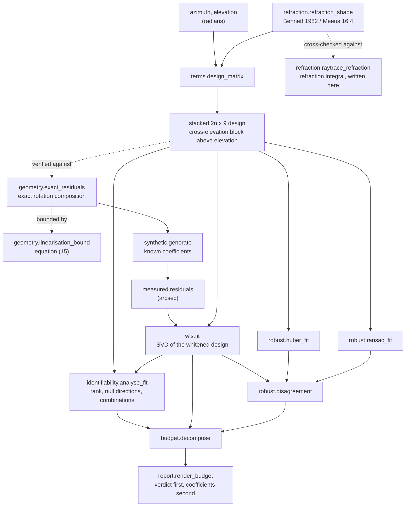

The dotted edges are the two independent checks. Neither
`geometry.linearisation_bound` nor `refraction.raytrace_refraction` is used by
the fit; they exist to be a second calculation of something the fit relies on.

## Installation

```bash
git clone https://github.com/OmAcharya-avtr/pointmodel.git
cd pointmodel
python -m venv .venv && source .venv/bin/activate
pip install -e ".[dev]"
```

## Quick start

```bash
python -m pytest tests/ -q
python -m pointmodel compare --observations 300
```

The test run ends (the elapsed time varies between runs and is not quoted):

```
241 passed
```

and the comparison prints:

```
RANK VERDICT BY DECLARED GEOMETRY

observations per geometry : 300
declared sigma            : 2 arcsec
thresholds                : null <= 0.001, marginal <= 0.01

geometry   condition  rank  verdict            terms refused           max VIF  
---------  ---------  ----  -----------------  ----------------------  ---------
full_sky   128.9      9     weakly determined  -                       3070     
low_el     3172       8     not separable      IE,TF,TS                1.504e+06
narrow_el  6.493e+05  6     not separable      TF,TS,RF,IA,CA,NPAE,IE  7.299e+10
single_az  2.143e+15  7     not separable      AN,AW,NPAE,IE           5.258e+29
two_az     129        9     weakly determined  -                       3071     
```

`two_az` has two azimuths and is within 0.1 per cent of the full sky's
condition number. `narrow_el` samples every azimuth and is not.

## Configuration

Everything that can change an answer is an argument with a printed default.

| argument | default | what it controls |
|---|---|---|
| `sigma_arcsec` | 2.0 | declared per-row residual standard deviation; scalar or per row |
| `confidence_level` | 0.95 | two-sided coverage of every reported interval |
| `error_model` | `"scaled"` | `"scaled"` multiplies the covariance by the reduced chi-square and uses Student-t; `"declared"` trusts sigma and uses the normal quantile |
| `null_threshold` | 1e-3 | `s_k/s₁` at or below which a direction is refused |
| `marginal_threshold` | 1e-2 | `s_k/s₁` below which a direction is flagged weak |
| `robust` | `True` | run the Huber and RANSAC fits and the disagreement diagnostics |
| `ransac_seed` | 20261101 | the RANSAC sampler is deterministic in this |
| `ransac_trials` | 200 | number of random subsets |
| `delta` (Huber) | 1.345 | tuning constant, 95 per cent Gaussian efficiency |
| `inlier_sigma` (RANSAC) | 3.0 | consensus threshold in declared sigmas |
| `subset_size` (RANSAC) | 27 | observations per trial; larger is better conditioned and less robust |
| `refractivity_constant` | `K_RADIO_DRY` | 77.6 or 78.9586 K/hPa for the independent ray trace |

## Examples

Each example in `examples/` writes a PNG into `screenshots/` and prints the
numbers behind it.

```bash
python examples/term_shapes.py
python examples/geometry_coverage.py
python examples/identifiability_map.py
python examples/null_space_directions.py
python examples/confident_split.py
python examples/confidence_intervals.py
python examples/budget_contributions.py
python examples/linearisation_bound.py
python examples/refraction_crosscheck.py
python examples/robust_vs_wls.py
```

## A worked example

Lifted verbatim from `validation/worked_example.py` with that script's output
helper spelled `print`. Its printed output is below it, copied from
`validation/worked_example_output.txt`, which that script produces.

```python
import numpy as np

import pointmodel
from pointmodel import synthetic

# A pointing run confined to a narrow elevation band, which is what a
# mission tracking one orbital regime produces. The generating
# coefficients are known, so the fit can be scored against them.
run = synthetic.generate("narrow_el", 300, sigma_arcsec=2.0, seed=20260101)

budget = pointmodel.decompose(run.design, run.observed, sigma_arcsec=2.0)

print(f"verdict        : {budget.identifiability.verdict}")
print(f"rank           : {budget.identifiability.numerical_rank} of 9")
print(f"condition      : {budget.identifiability.condition_number:.4g}")
print(f"terms refused  : {', '.join(budget.refused_terms)}")
print("")
print("what the geometry cannot determine:")
for direction in budget.identifiability.null_directions:
    print(f"  {direction.statement()}")
print("")
print("what it did determine, best first:")
for combination in budget.identifiability.combinations[:3]:
    print(f"  {combination.statement()}")
print("")
print("the per-term budget, with the refusal marked:")
for row in budget.terms:
    mark = "ok " if row.separable else "REF"
    truth = run.truth_mapping()[row.name]
    print(
        f"  {mark} {row.name:<4s} {row.coefficient:12.4f} "
        f"+/- {row.standard_error:9.4f}  truth {truth:8.4f}  "
        f"error {row.coefficient - truth:+12.4f}"
    )
```

Its output:

```
verdict        : not separable
rank           : 6 of 9
condition      : 6.493e+05
terms refused  : IA, IE, CA, NPAE, TF, TS, RF

what the geometry cannot determine:
  -0.884*TF +0.398*RF +0.237*TS +0.059*IE  (s/s1 = 2.288e-04, not identifiable)
  +0.707*CA -0.500*NPAE -0.500*IA -0.000*TF  (s/s1 = 7.039e-05, not identifiable)
  +0.737*IE -0.626*TS -0.205*TF -0.149*RF  (s/s1 = 1.540e-06, not identifiable)

what it did determine, best first:
  -0.577*RF -0.576*IE -0.408*TS -0.407*TF  precision |g|/se = 676
  +0.706*CA +0.499*NPAE +0.499*IA +0.053*AN  precision |g|/se = 56
  +0.736*AN +0.675*AW -0.026*IE -0.025*RF  precision |g|/se = 34.9

the per-term budget, with the refusal marked:
  REF IA      -381.0607 +/-  454.2406  truth -45.0000  error    -336.0607
  REF IE    -55755.9850 +/- 29969.0468  truth  30.0000  error  -55785.9850
  REF CA       478.9603 +/-  642.7482  truth  12.0000  error    +466.9603
  ok  AN        -8.1427 +/-    0.1280  truth  -8.0000  error      -0.1427
  ok  AW         5.0072 +/-    0.1296  truth   5.0000  error      +0.0072
  REF NPAE    -304.3041 +/-  454.9508  truth  20.0000  error    -324.3041
  REF TF     15819.5133 +/- 8335.2651  truth -25.0000  error  +15844.5133
  REF TS     47300.4923 +/- 25467.0907  truth   6.0000  error  +47294.4923
  REF RF     11198.1416 +/- 6071.9087  truth  58.0000  error  +11140.1416

worst error on a SEPARABLE term  : 0.1427 arcsec
worst error on a REFUSED term    : 55785.9850 arcsec
post-fit residual rms            : 1.9069 arcsec
robust disagreement              : 0.0565 arcsec, flagged False
```

The post-fit residual is 1.9069 arcsec against a declared sigma of 2.0 and the
robust diagnostic is clean, so by every ordinary measure the fit is good. The
elevation index is wrong by 55,786 arcsec. Nothing but a rank analysis says so.

## Screenshots

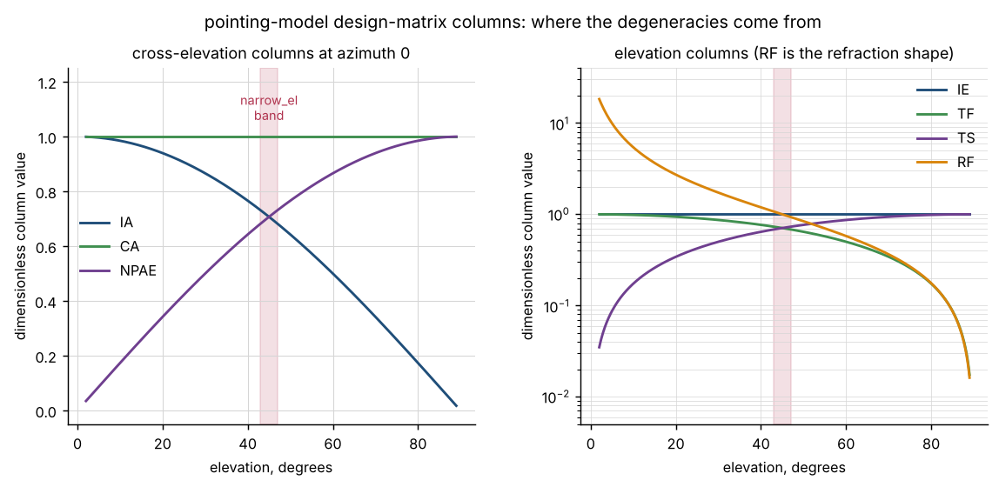

The nine columns as functions of elevation. Notice that inside the shaded
43–47 degree band the three cross-elevation columns are nearly the same
constant, and so are the four elevation-side ones. That is where the
degeneracies come from.

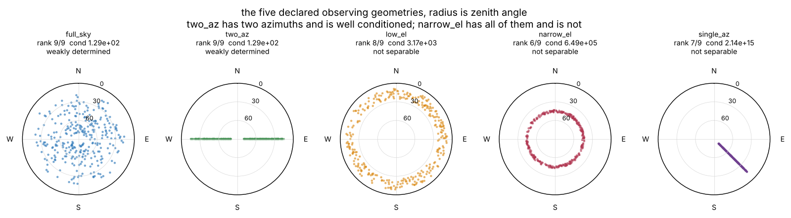

The five declared geometries with their verdicts. `two_az` has two azimuths and
is well conditioned; `narrow_el` has all of them and is not.

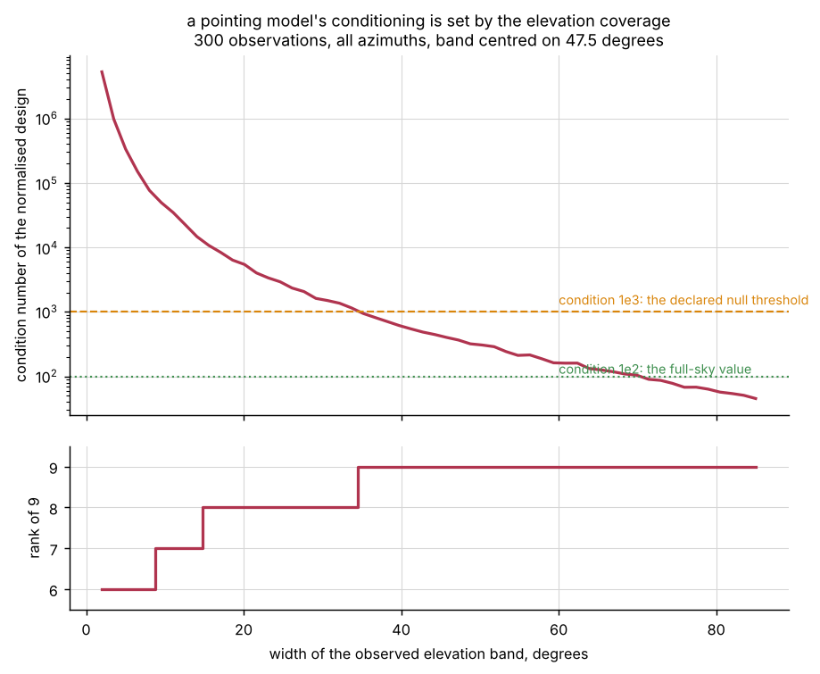

Condition number and rank against the width of the observed elevation band.
There is no sharp edge, which is why the package reports the number and the
named directions rather than a yes or no.

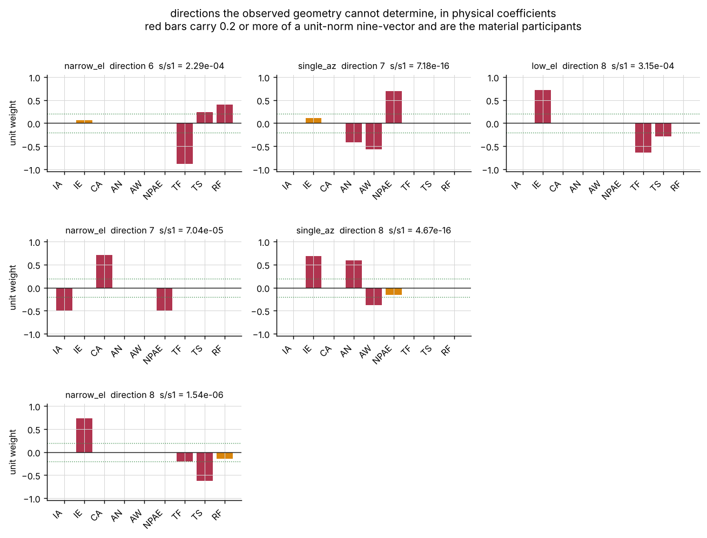

The directions three restricted geometries cannot determine, in physical
coefficients. The `narrow_el` direction 7 panel is the collimation against half
the azimuth index and half the non-perpendicularity, to three decimal places.

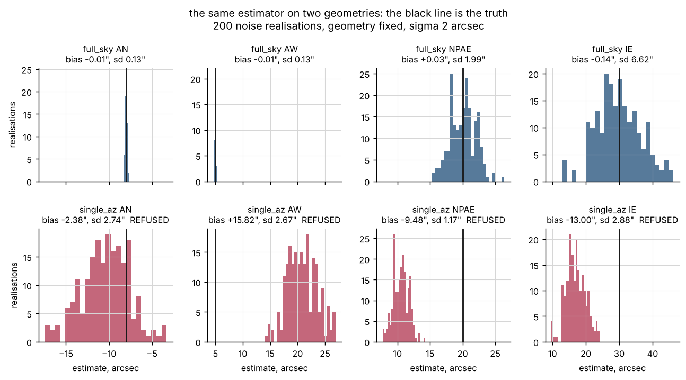

The same estimator on two geometries over 200 noise realisations; the black
line is the truth. On `single_az` the `AW` distribution is 2.3 arcsec wide and
sits entirely to the right of the truth.

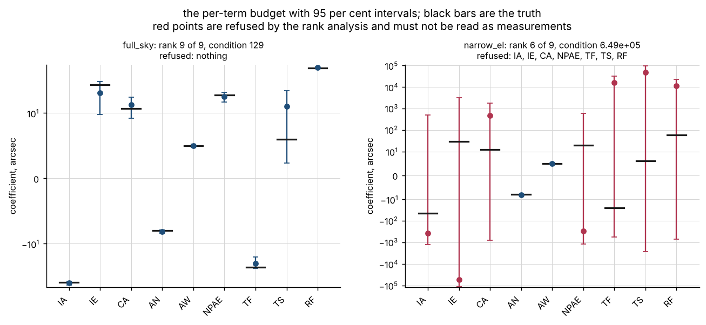

The per-term budget with 95 per cent intervals. On `narrow_el` the intervals on
the refused terms are enormous and still do not contain the truth, because the
error there is systematic. A wide interval is not a safe interval.

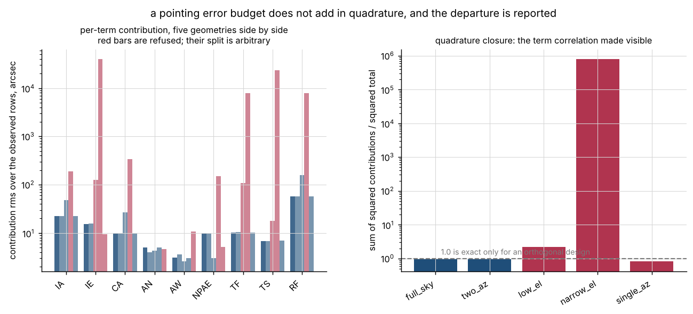

Per-term contributions and the quadrature closure. The budget rows do not add
in quadrature because the columns are not orthogonal, and the departure is
reported rather than assumed away.

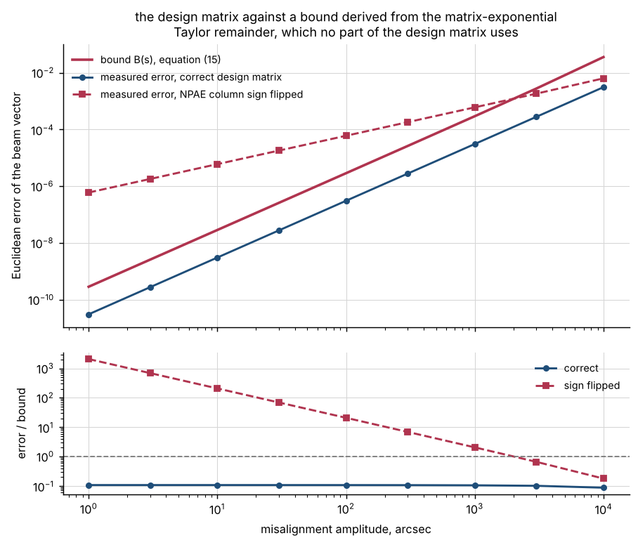

The design matrix against the bound derived from the matrix-exponential Taylor
remainder, over five decades. The dashed line is the same measurement with one
column's sign flipped.

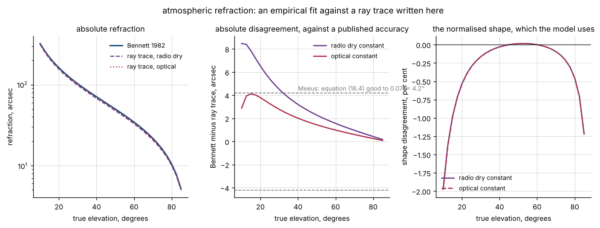

Bennett's formula against the ray trace written here. The middle panel is the
absolute disagreement against Meeus's published 4.2 arcsec; the right panel is
the normalised shape, which is what the design matrix uses.

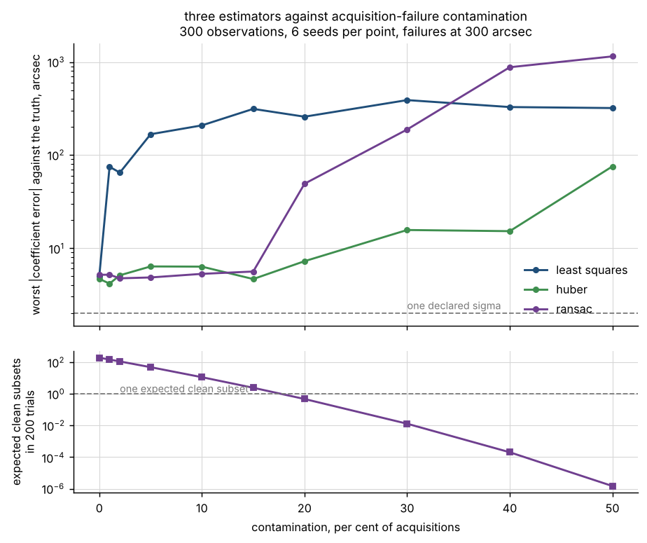

Three estimators against contamination, with RANSAC's expected count of clean
subsets beneath. The collapse between 10 and 20 per cent happens exactly where
that count crosses one.

## Validation

Full evidence in [`validation/VALIDATION.md`](validation/VALIDATION.md).
**169 checks across ten scripts, 0 failed.** Every number traces to a
`validation/<script>_output.txt` produced by a script in this repository.

| check | reference | result | tolerance |
|---|---|---|---|
| single-term recovery order | derived: five terms exact, `AN`/`AW` quadratic, `CA`/`NPAE` cubic | ratios 25.08, 24.94, 104.80, 99.03 against derived 25 and 125 | order, not a tolerance |
| interval coverage, 300 realisations | the true generating coefficients | worst coverage **0.9300**, worst `sd/se` 1.0702 | derived 4σ bands [0.8997, 1.0] and [0.8364, 1.1636] |
| design matrix vs exact rotation model | operator-norm Taylor remainder, eq. (15) | worst error/bound **0.2627–0.3888** over 5 decades, **0 violations of 2000** | a derived bound; no fitted constant |
| refraction shape vs independent ray trace | a ray trace written in this repository | **1.964086e-02** relative, worst at 10° | reported; the model uses only the shape |
| refraction absolute, optical constant | Meeus (1998) ch. 16: 0.07′ = 4.2″ | **4.1270″** — passes with 1.7 % margin | published accuracy, not chosen here |
| refraction absolute, radio dry constant | the same 4.2″ | **8.4736″ — FAILS** by a factor 2.02 | the excess is the 1.7508 % constant difference |
| plane-parallel limit of the ray trace | derived `−(H/R⊕)sec²z`, no quadrature | measured/predicted **0.9520 to 0.9977** | leading order only |
| rank verdict, five geometries | the geometry's own structure | `single_az` deficiency **exactly 2** at `s/s₁ < 1e-15` | machine precision |
| the confident split, `single_az` | the true coefficients | `AW` bias **+16.125″**, scatter 2.321″, reported se 2.534″ | reported, not bounded |
| normal-equation formal errors | the empirical scatter over 200 realisations | overstated by **2.94e+05×** at the tightest | reported, not bounded |
| identifiable combinations | the true coefficients | worst bias **0.2448″** on every geometry | against per-term biases up to 3816″ |
| the refusal, truth-anchored scoring | bias > k declared sigmas, k ∈ {2, 10} | recall **1.0000** at both; precision 0.9286 and 0.5000 | both reported; neither chosen |
| RANSAC breakdown | derived `1 − (1/200)^(1/27) = 0.1784` | measured collapse between 10 % and 20 % | the derivation predicts it |
| robust diagnostic sensitivity | injected contamination | flags at **2 %**, six acquisitions of 300 | threshold one declared sigma |
| negative controls | the true value, never an output | 83 controls: **61 must-fire fired, 22 must-not-fire did not** | both directions asserted |
| `pytest.approx` default audit | the suite re-run with the default off | **0 of 241** assertions depend on it | 9 rest on an absolute bound, each named |
| working directories | the release gate's `cwd=validation/` | **95 runs, 0 non-zero exits** | all five directories |
| absolute paths in committed files | release-gate check 8 | 64 text files scanned on a clean tree, **0 offenders** | exact |

## Benchmark results

Timings on the measured two-core machine, unstable and quoted nowhere else:

| operation | measured |
|---|---|
| `synthetic.generate("full_sky", 300)` | 0.020 s |
| `decompose` on 300 observations with both robust fits | 0.043 s |
| the full test suite, 241 tests | 20.199 s |
| all nine validation scripts in sequence | 162.7 s |
| the working-directory probe (everything, five times, two at a time) | 587.0 s |

There is no Monte Carlo in the library itself. The two slowest validation
scripts are `validate_approx_audit.py` at 52.6 s, because it runs the whole
test suite twice more under a patched `pytest.approx`, and
`validate_negative_controls.py` at 43.8 s, because it fits 21 deliberately
corrupted models.

## API reference

<details>
<summary>The public surface, one line each, with units</summary>

| function | returns |
|---|---|
| `decompose(design, observed, sigma_arcsec=2.0, ...)` | `PointingBudget`: the identifiability verdict, the nine-row budget, both robust fits and both disagreements |
| `design_matrix(azimuth_rad, elevation_rad, ...)` | `(cross, elevation)`, two `(n, 9)` dimensionless blocks |
| `stack_residuals(cross, elevation)` | the `(2n, 9)` stacked matrix, cross-elevation block first |
| `fit(design, observed, sigma=1.0, ...)` | `WlsFit`: coefficients (arcsec), covariance (arcsec²), intervals, VIF, singular values, rank |
| `normal_equation_fit(...)` | the same type, computed the textbook way. Not the recommended API; ships to be wrong measurably |
| `analyse_fit(design, result, ...)` | `IdentifiabilityReport`: spectrum, named null directions, identifiable combinations, verdict |
| `huber_fit(design, observed, sigma, delta=1.345, ...)` | `RobustFit`: coefficients (arcsec), asymptotic errors, final weights |
| `ransac_fit(design, observed, sigma, inlier_sigma=3.0, ...)` | `RobustFit`; standard errors are conditional on the consensus set and optimistic |
| `disagreement(design, first, second, sigma_reference, ...)` | `Disagreement`: predicted sky rms (arcsec), per-term z, flagged |
| `bennett_refraction(elevation_deg, P=1010, T=10)` | refraction in arcsec, equation (1); raises outside 2–89.9° |
| `raytrace_refraction(elevation_deg, ...)` | refraction in arcsec by quadrature of equation (4); the independent calculation |
| `refraction_shape(elevation_rad, ...)` | the dimensionless `RF` column, 1.0 at 45° |
| `compare_refraction(elevation_deg, ...)` | `RefractionComparison`: both calculations, both shapes, the three summary figures |
| `exact_residuals(azimuth_rad, elevation_rad, coefficients, ...)` | `(dX, dE)` in arcsec from the exact rotation composition |
| `linearisation_error(azimuth_rad, elevation_rad, coefficients, ...)` | `(error, bound)`, dimensionless vector norms; `error <= bound` must hold |
| `linearisation_bound(total_angle_rad)` | `B(s)` of equation (15), dimensionless |
| `generate(name, n, ...)` | `ResidualSet` with complete ground truth including the outlier mask |
| `render_budget(budget)` | the whole decomposition as text, verdict first |

</details>

## AI model details

**There is no learned component in this product, deliberately.** The problem is
a linear fit with a known design matrix whose entire difficulty is
conditioning: a restricted geometry distribution makes standard terms mutually
unidentifiable while least squares returns a confident split anyway, and the
correct answer is a rank analysis. A model fitted here would learn to predict
that confident split, which is exactly the failure this package exists to
prevent. There is no `MODEL_CARD.md` and no `DATASET_CARD.md` because there is
no model and no training set; the synthetic residual sets in
`pointmodel.synthetic` are test inputs generated by a committed, seeded,
deterministic generator and nothing is fitted to them beyond the nine declared
coefficients.

## Hardware requirements

Two CPU cores, and a peak resident set of **99.3 MB** measured on the largest
case used anywhere here — a 1200-observation `decompose` with both robust
fits. The
largest array built anywhere is the `(2n, 9)` design matrix; at the largest
observation count used in validation, 1200, that is 21,600 float64 entries. No
GPU, no accelerator, no network access. The package is pure Python over `numpy`
and `scipy`.

## Limitations

- **No real instrument appears anywhere.** Every number in this repository is
  measured against synthetic residual sets generated by the package's own exact
  rotation model. The model is standard and the mathematics is checked, but
  nothing here has been confronted with a real pointing run.
- **The term set is fixed at nine.** A mount with a tenth error source — a
  harmonic in the azimuth encoder, a gravitational term with a different
  elevation dependence, a tube-flexure hysteresis — will have that source
  absorbed by the nine, and this package will report a clean fit. It does no
  model selection and it does not test for a missing term. Measured in
  `validation/validate_negative_controls_output.txt`: omitting `TS` leaves a
  post-fit residual of 0.0868 arcsec, which on a 2-arcsec run is invisible.
- **The first-order model breaks down above about 1000 arcsec of total
  misalignment.** At 10000 arcsec the truncation reaches 5.383570e-02 as a
  vector norm, which is 11,100 arcsec on the sky. A mount that far out needs
  mechanical correction, not a fit.
- **The refraction column is an optical fit.** Using it for a radio antenna
  introduces a measured 1.75 per cent scale error, which is 5.7 arcsec at 10
  degrees elevation. The fitted `RF` coefficient absorbs a constant scale but
  not the 1.96 per cent shape difference. There is no humidity term and no
  wavelength argument.
- **`RF` and the flexure terms are weakly determined even on good geometry**,
  at a singular-value ratio of 7.760e-03 on a 15–80 degree all-azimuth run. A
  fitted refraction coefficient from this package is not a measurement of the
  atmosphere.
- **The refusal is conservative.** Scored against a truth-anchored criterion,
  precision is 0.5000 at 10 declared sigmas: half the refused terms would have
  been recovered acceptably. Recall is 1.0000, which is the direction that
  matters, and the cost is reported rather than tuned away.
- **RANSAC's defaults break down above about 18 per cent contamination**, and
  the breakdown point follows from the subset size and the trial count. At 20
  per cent its worst error is 52.69 arcsec against Huber's 6.89.
- **The identifiability thresholds are policy.** 1e-3 and 1e-2 are declared
  defaults, not theorems. They are printed in every report so a reader can
  apply their own, and the measured spectra are published so that the choice
  can be checked.
- **Dependency ranges were measured at one version each.** The build
  environment is a shared pre-pinned interpreter that this product is forbidden
  to modify, so `numpy`, `scipy`, `matplotlib`, `pytest` and `hypothesis` were
  each measured at a single version and the declared ranges are bounded at it.
  `ruff` is the exception: 0.16.9 and 0.17.3 were both present and the source
  is clean under both. A ceiling below a future security release is a real
  cost, recorded here rather than removed.
- **A single Python-loop rotation composition per observation** makes
  `synthetic.generate` linear rather than vectorised: 300 observations take
  0.020 s, about half of a full `decompose` call on the same data. That is why
  the Monte Carlo in validation holds the geometry fixed and redraws only the
  noise, and why a 200-realisation sweep over five geometries takes 23.8 s
  rather than minutes.

## Safety statement

This software is research-grade. It is not flight-qualified, not certified, and
not approved for operational aerospace use.

## Roadmap

Not commitments; the open problems this build leaves.

- Model selection: a defensible procedure for deciding whether a tenth term is
  supported by the data, which is the limitation above that matters most.
- Schedule design: inverting the rank analysis to answer "which pointings do I
  need to add to make `CA` separable", which is the question an operator
  actually has.
- Harmonic encoder terms, which are standard in TPOINT and absent here.
- A humidity term and a wavelength argument for the refraction model, and a
  radio-frequency fit to replace the optical one.
- Confrontation with a real pointing run, which no amount of synthetic
  validation substitutes for.

## Reproducing every number

From the repository root:

```bash
python -m pytest tests/ -q --junit-xml=junit.xml
python validation/validate_term_recovery.py
python validation/validate_linearisation.py
python validation/validate_refraction.py
python validation/validate_identifiability.py
python validation/validate_robust.py
python validation/validate_negative_controls.py
python validation/validate_approx_audit.py
python validation/validate_cli.py
python validation/worked_example.py
python validation/probe_working_directories.py
for f in examples/*.py; do python "$f"; done
```

The test count is read from the junit XML's `testsuite` element and
cross-checked against a count of `testcase` elements, never from pytest's
stdout: a suite that collects zero tests exits 0 and prints success. `junit.xml`
is excluded by `.gitignore` with an **anchored** `/junit.xml`, not a bare
`junit.xml`, because a pattern with no slash matches at any depth and would
also exclude a fixture of that name several directories down.

## License

Apache-2.0. See [`LICENSE`](LICENSE). Copyright © 2026 OPTIMA Organisation.

## Credits

This is under reserved rights obtained by OPTIMA Organisation.

## Citation

See [`CITATION.cff`](CITATION.cff).

```bibtex
@software{pointmodel_2026,
  title   = {pointmodel: decomposing a pointing error budget with an explicit
             statement of what the observed geometry cannot separate},
  author  = {{OPTIMA Organisation}},
  year    = {2026},
  version = {0.1.0},
  license = {Apache-2.0},
  url     = {https://github.com/OmAcharya-avtr/pointmodel}
}
```
