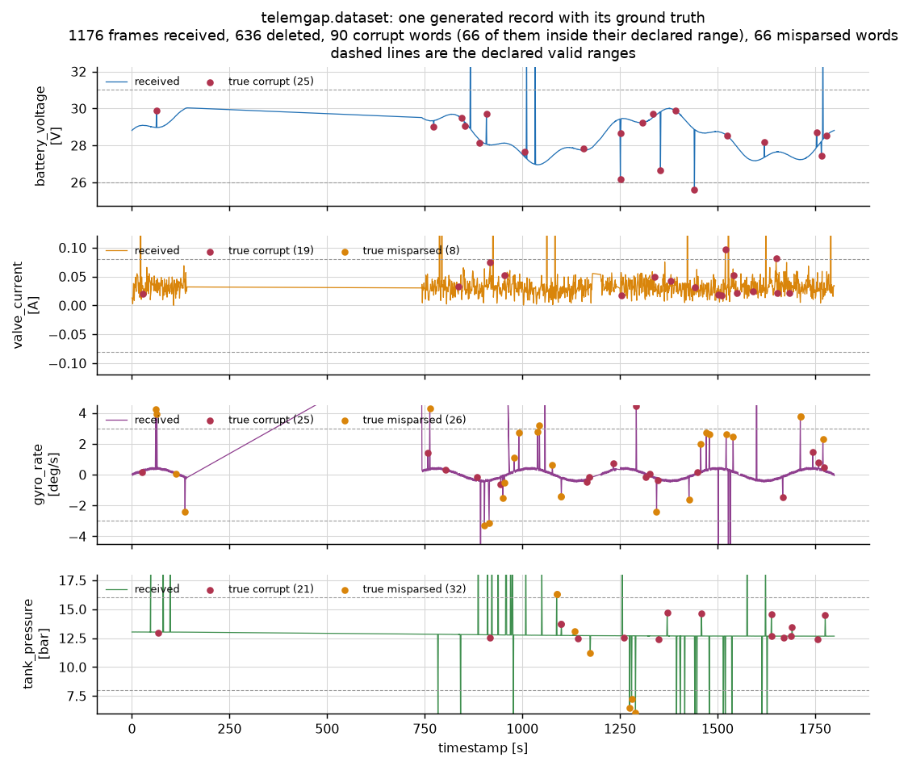
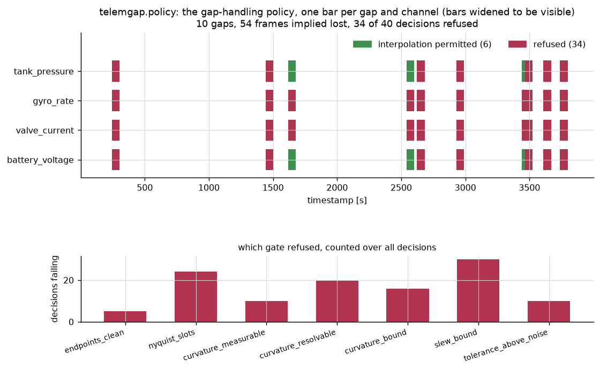
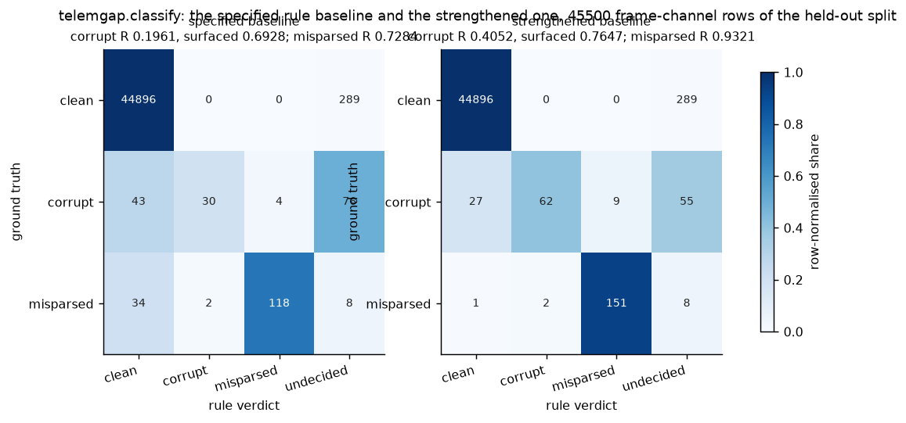
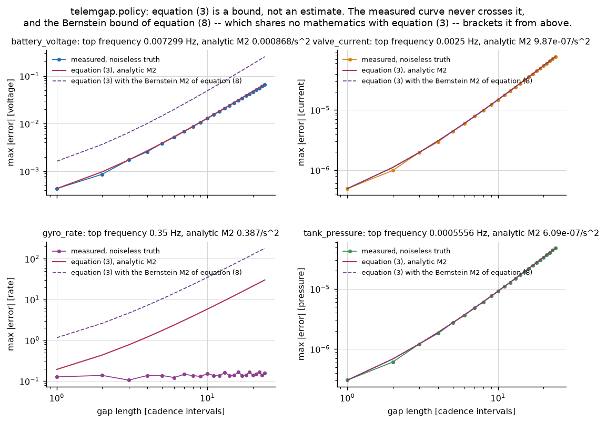
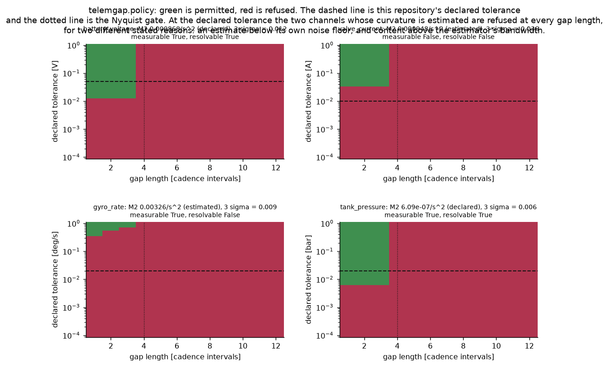
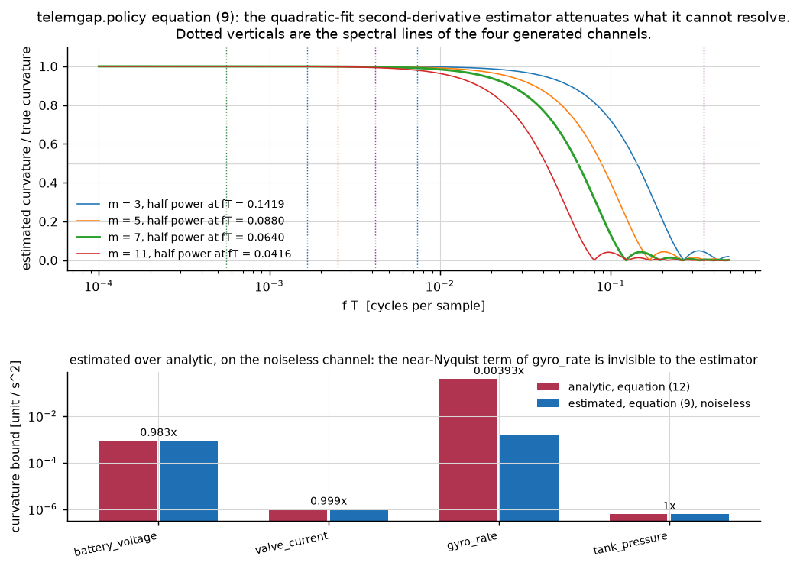
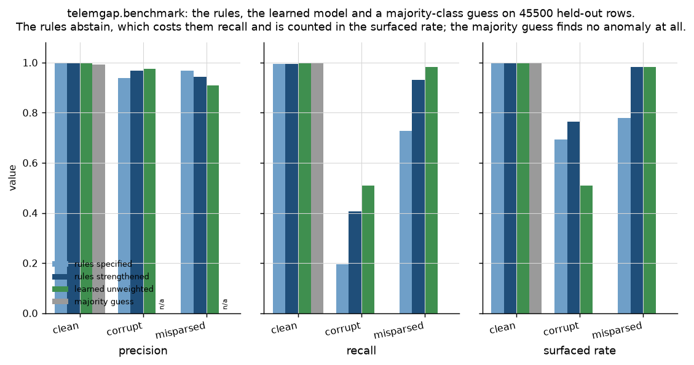
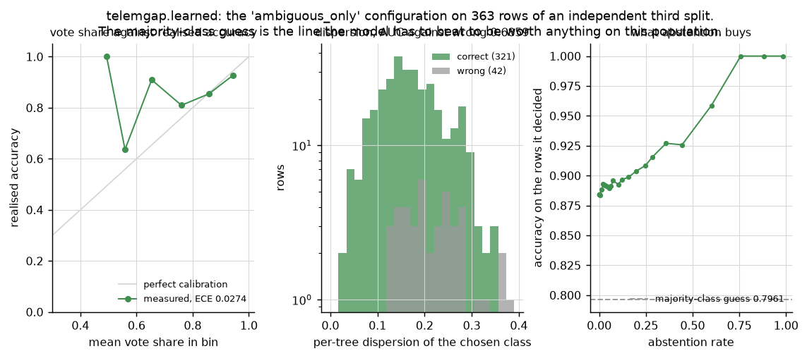
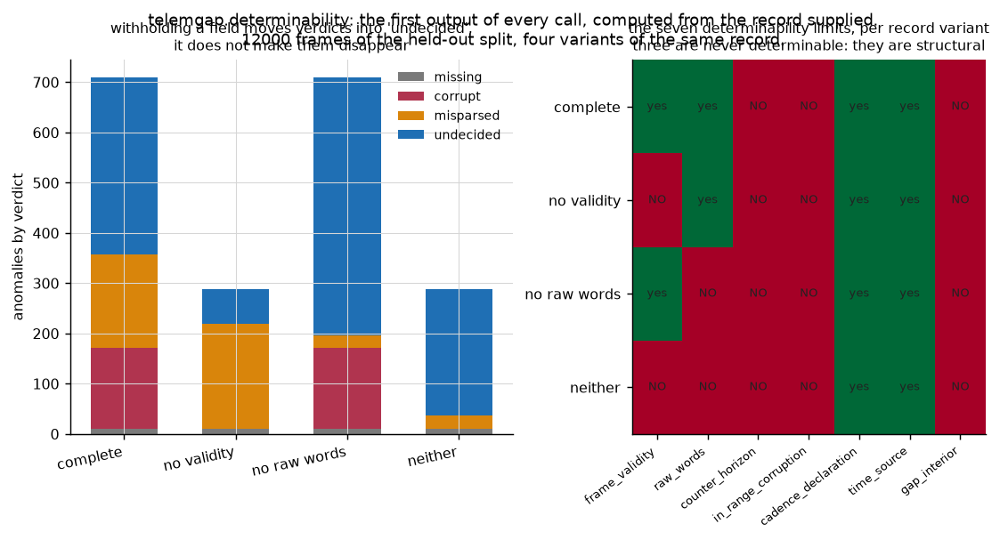

# telemgap

Separate missing telemetry from corrupt telemetry from a reader that is wrong, and refuse to interpolate when it cannot be justified.


## The problem

A channel in your telemetry archive reads 0.64 A where it should read −0.008 A,
and there is a six-hour hole in the middle of the pass. Every analysis
downstream of that archive resamples onto a regular grid and interpolates, and
the interpolation is usually fine and occasionally invents a signal across the
hole. The missing part is not a better interpolator: it is a statement of what
the archive can and cannot tell you, and a permission to interpolate that can
be refused.

## What this does

- **Classifies every anomaly three ways** — *missing*, *corrupt*, or
  *correctly received and misparsed* — with the evidence behind each verdict,
  and a fourth verdict, *undecided*, when the record does not contain the
  evidence to separate them. Measured on a 45,500-row held-out split:
  misparsed precision 0.9437 and recall 0.9321, corrupt precision 0.9688 and
  recall 0.4052.
- **Reports what it cannot determine, first, as computed output.** Seven
  limits, each with a number. Three are structural and never determinable; the
  one that matters most says that **0.862371** of single-bit errors on the
  worst channel leave the value inside its declared range, which is an upper
  bound on what any range screen must miss.
- **Proves a misparse rather than guessing one.** A value outside its range is
  reported *misparsed* only when a declared alternative reading of the same raw
  word is both inside the range and consistent with its neighbours. Requiring
  that second condition tightens the chance-rescue rate by a factor of 3.18 to
  5.57 depending on the channel.
- **Emits a refusable gap policy.** Per gap and per channel, a decision with
  the gate that produced it: a Taylor-remainder error bound, a coverage term
  for endpoint measurement noise, a Nyquist gate, a check that the curvature
  bound is measurable and resolvable at all, and a check that the frames
  bounding the gap are not themselves anomalous. On the measured records it
  refuses **34 of 40** decisions, and it refuses a constructed six-hour outage
  on every channel.
- **Scores a learned classifier against the rules and against a majority-class
  guess**, and publishes both outcomes. On the ambiguous residual set the best
  declared configuration reaches 0.926136 against a majority guess of 0.821023;
  another declared configuration reaches **0.255682** and loses to that guess
  by 56.5 points.

## Who it is for

- Flight dynamics and operations engineers who have to say whether a telemetry
  archive supports a conclusion.
- Anyone writing an analysis pipeline over archived telemetry who wants the
  interpolation to be a decision rather than a default.
- Ground-segment engineers debugging a decommutation database, who need to know
  whether a wrong-looking value is a link problem or a database problem.

## Who it is not for

- **Anyone who needs resampling and interpolation machinery.** Use `pandas`.
  This package does not compete with it and depends on nothing from it.
- **Real-time or onboard use.** Everything here runs over a record after the
  fact. It is not in a control path and must not be put in one.
- **Anyone expecting a certified tool.** Research grade. The numbers come from
  a synthetic generator, not from flight data.
- **Anyone who wants the gaps filled.** The output of this package is often a
  refusal. If you want a complete series regardless, `pandas.DataFrame.interpolate`
  will give you one in a line, and that is the right tool for that job.

## Alternatives, honestly

| alternative | what it does better | when to use this instead |
|---|---|---|
| [`pandas`](https://pandas.pydata.org/) | Resampling, reindexing, `interpolate` with a dozen methods, rolling statistics, time-zone handling, and an ecosystem. The mechanical work of putting telemetry on a grid and filling it is solved, fast, and better tested than anything here. | When you need to decide *whether* to fill a gap and defend the decision. `pandas` will interpolate across a six-hour outage without comment; this package refuses and says which bound it refused on. |
| [`numpy`](https://numpy.org/) | `interp`, `diff`, masked arrays, and the array model everything here is built on. This package is a thin layer of policy over numpy and depends on it. | When the question is an integrity verdict rather than an array operation. |
| [`xarray`](https://docs.xarray.dev/) | Labelled N-dimensional arrays, alignment on a time coordinate, `interpolate_na` with a `max_gap` argument, and the right data model for multi-channel telemetry at scale. Its `max_gap` is genuinely the same idea as this package's Nyquist gate. | When you want the gap limit *derived* from a declared error tolerance and a curvature bound rather than chosen by hand, and when you want the three-way corrupt / missing / misparsed verdict in front of it. **`xarray` is not installed in this repository's measured environment and no number here is compared against it.** |

The honest summary: `pandas` resampling and interpolation do the mechanical
work well, and you should use them. This package's contribution is the
integrity classification and the explicit refusal policy that sits in front of
them.

## Install and first run

```bash
git clone https://github.com/OmAcharya-avtr/telemgap.git
cd telemgap
python -m venv .venv && source .venv/bin/activate
pip install -e ".[dev]"
python -m pytest tests/ -q
python -m telemgap refuse --outage-frames 21600
```

The test run ends (the elapsed time varies between runs and is not quoted):

```
334 passed
```

and the refusal demonstration ends:

```
constructed outage of 21600 cadence intervals
gaps found              : 1
frames the gaps imply   : 21600
policy decisions        : 4
refusals                : 4
permissions             : 0

REFUSAL CHECK PASSED: every channel was refused across this outage
```

## A worked example

The real API, lifted verbatim from `validation/worked_example.py` with that
script's output helper spelled `print`. Its printed output is below it, copied
from `validation/worked_example_output.txt`, which that script produces.

```python
import telemgap
from telemgap import dataset, interpolate, policy

generated = dataset.generate(samples=4000, seed=515, n_clock_resets=0)
record = generated.record

report = telemgap.check(record)

print(f"frames received            : {len(record)}")
print(f"gaps                       : {len(report.findings.gaps)}")
print(f"frames the gaps imply lost : {report.missing_frame_total}")
print(f"verdict counts             : {report.counts}")

limit = report.determinability["in_range_corruption"]
print("")
print("what this record cannot determine, first output of every call:")
for key in report.determinability.undeterminable_keys:
    print(f"  {key}")
print(f"worst-channel share of single-bit errors a range screen cannot see: {limit.quantity:.6f}")

plan = policy.plan(
    record,
    report,
    tolerances={
        "battery_voltage": 0.05,
        "valve_current": 0.01,
        "gyro_rate": 0.02,
        "tank_pressure": 0.02,
    },
)
print("")
print(f"policy decisions           : {len(plan.decisions)}")
print(f"interpolation permitted    : {len(plan.permissions)}")
print(f"interpolation refused      : {len(plan.refusals)}")

first = plan.refusals[0]
print("")
print(f"first refusal: gap {first.gap_index}, channel {first.channel_name}")
print(f"  gap duration   : {first.duration_s:.3f} s ({first.slots:.2f} cadence slots)")
print(f"  curvature used : {first.curvature.value:.6g} per s^2 ({first.curvature.source})")
print(f"  failed gates   : {list(first.failed_gates)}")

reconstruction = interpolate.reconstruct(record, report.findings.gaps, plan)
print("")
print(f"grid slots                 : {reconstruction.n_slots}")
print(f"filled share               : {reconstruction.fill_fraction:.6f}")
print(f"refused share              : {reconstruction.refused_fraction:.6f}")

column = record.schema.channel_index("battery_voltage")
error, count = interpolate.measured_error(
    reconstruction, generated.truth_times, generated.truth_values[:, column], column
)
predicted = max(
    decision.predicted_error
    for decision in plan.decisions
    if decision.channel == column and not decision.refused
)
print("")
print(f"battery_voltage synthesised slots : {count}")
print(f"  realised max absolute error     : {error:.6g} V")
print(f"  worst predicted by equation (3'): {predicted:.6g} V")
```

```
frames received            : 3958
gaps                       : 10
frames the gaps imply lost : 54
verdict counts             : {'missing': 10, 'corrupt': 159, 'misparsed': 125, 'undecided': 335}

what this record cannot determine, first output of every call:
  counter_horizon
  in_range_corruption
  gap_interior
worst-channel share of single-bit errors a range screen cannot see: 0.862371

policy decisions           : 40
interpolation permitted    : 6
interpolation refused      : 34

first refusal: gap 0, channel battery_voltage
  gap duration   : 3.927 s (3.93 cadence slots)
  curvature used : 0.000867779 per s^2 (declared)
  failed gates   : ['endpoints_clean', 'slew_bound']

grid slots                 : 4000
filled share               : 0.987125
refused share              : 0.012875

battery_voltage synthesised slots : 5
  realised max absolute error     : 0.00243405 V
  worst predicted by equation (3'): 0.0130086 V
```

## Architecture

```mermaid
flowchart TD
    record["telemgap.record<br/>TelemetryRecord + RecordSchema<br/>timestamps, counters, values,<br/>raw words, validity flag"]
    determinability["telemgap.determinability<br/>seven limits, computed FIRST"]
    screens["telemgap.screens<br/>counter, clock, cadence,<br/>range, validity, local residual"]
    reparse["telemgap.reparse<br/>reinterpretation test<br/>byteswap, signedness, scale, offset"]
    classify["telemgap.classify<br/>missing / corrupt / misparsed / undecided<br/>IntegrityReport"]
    policy["telemgap.policy<br/>eq (3) bound, eq (3') coverage,<br/>six gates per gap and channel"]
    interpolate["telemgap.interpolate<br/>fills the permitted gaps,<br/>leaves the refused ones nan"]
    features["telemgap.features<br/>15 frame-channel features"]
    learned["telemgap.learned<br/>random forest + majority guess<br/>vote share and per-tree dispersion"]
    benchmark["telemgap.benchmark<br/>eq (13)-(15b) per class"]
    report["telemgap.report<br/>text rendering"]
    cli["telemgap.__main__<br/>info check policy refuse<br/>determinability benchmark"]

    record --> determinability
    record --> screens
    determinability --> classify
    screens --> classify
    record --> reparse
    reparse --> classify
    classify --> policy
    classify --> benchmark
    record --> features
    features --> learned
    learned --> benchmark
    policy --> interpolate
    classify --> report
    policy --> report
    benchmark --> report
    report --> cli
```

The arrow from `classify` to `policy` is the load-bearing one. The integrity
classification is not documentation that sits beside the gap policy; it is an
input to it, and the policy refuses a gap whose bounding frames carry an
unresolved verdict. Blinding that one edge makes the policy's error prediction
fail on 3 of 8 measured seeds.

## Screenshots

Every figure is produced by a script in `examples/`, so none can drift from the
code.



The four channels with every injected anomaly marked. Notice the sparse scatter
of `valve_current` samples at full scale: that channel is declared unsigned and
its field is signed, so every sample whose true value is negative reads about
0.64 A.



One bar per gap and channel, green permitted and red refused, with a tally of
which gate did the refusing. Notice that `valve_current` and `gyro_rate` are
refused everywhere and for different reasons.



The specified rule baseline against the strengthened one. Notice the
`undecided` column: the rules abstain rather than guess, and the corrupt row is
where most of the abstention lives.



The measured interpolation error against equation (3) and against the
independently derived Bernstein bound. Notice that the measured curve never
crosses either line over 12,800 comparisons.



Permitted and refused in the plane of gap length against declared tolerance.
Notice that at this repository's declared tolerances (dashed) the two channels
whose curvature is estimated are refused at every gap length.



The estimator's transfer function with the four channels' spectral lines marked,
and the estimated curvature against the analytic one. Notice that `gyro_rate`
is under-estimated by a factor of 255 — this is the product's headline negative
result and the reason the resolvability gate exists.



Precision, recall and surfaced rate for both rule baselines, the learned model
and a majority-class guess. Notice that the majority guess scores 0.9931
accuracy and finds no anomaly at all, which is why accuracy is not reported as
a headline number anywhere here.



Vote share against realised accuracy, the dispersion separation, and what
abstention buys. Notice the dashed line: the majority-class guess is what the
model has to beat on this population.



What each withheld field costs, and the seven limits per record variant. Notice
that withholding a field moves verdicts into `undecided` rather than making
them disappear.

## Validation evidence

Full detail, including every check that was run, is in
[`validation/VALIDATION.md`](validation/VALIDATION.md). Selected numbers:

| check | reference | result | tolerance |
|---|---|---|---|
| equation (3) as a theorem | analytic curvature, equation (12) | **0 violations in 32 cells, 12,800 comparisons** | `eps * (4 * bound + amplitude)` |
| equation (3) against an independent bound | Bernstein's inequality, Boas 1954 Thm 11.1.2 | 0 violations | same form |
| gap, duplicate and reorder recall | injected ground truth, 16 swept cells | **1.0000** each, 0 timing false positives | exact index match |
| gap recall with clock resets present | the same injected runs | mean **0.9602**, worst cell 0.6667 | reported, not bounded |
| in-range single-bit flips, worst channel | enumeration of all 65,536 word codes | **0.862371** | exact |
| corrupt class, strengthened rules | generator ground truth, 45,500 rows | P 0.9688, R 0.4052, surfaced 0.7647 | — |
| misparsed class, strengthened rules | the same | P 0.9437, R 0.9321, surfaced 0.9815 | — |
| curvature estimate, near-Nyquist channel | analytic curvature, equation (12) | **0.004933x** — under-predicted by 203 | closed-form transfer 0.00326383 |
| coverage statement, equation (3') | noiseless truth on the generation grid | **1 exceedance in 16 channel-records (0.0625)** | none; the rate is the measurement |
| that exceedance explained | ground-truth class of the gap endpoints | 1 of 1 traced to an undetected in-range corruption | exact |
| resolvability gate disabled | the same records | the near-Nyquist channel exceeds on **8 of 8** seeds | — |
| endpoint gate blinded | the same records | **3 of 8** seeds exceed | — |
| controls | fifteen, each anchored on a truth | 11 must fire and fired; 4 must not and did not | — |
| learned against the rules, full population | 45,500 held-out rows | **rules 3, learned 4, tie 2** over nine metrics | — |
| learned against a majority guess, ambiguous set | 352 rows | best configuration **+0.105114**; one configuration **−0.565341** | — |
| every script from five working directories | filesystem root, temp, repo root, `validation/`, `src/` | all exit 0 | — |

**Three of these are unfavourable to this package and are the reason to trust
the rest.**

1. The product specification predicted the rules would win on every class they
   cover. On the full held-out population **they did not** — the learned model
   takes four of the nine precision/recall/surfaced metrics. The rules keep the
   one large margin, surfacing 0.7647 of the corrupt class against 0.5098,
   because they abstain where they cannot decide.
2. One of the three declared learned configurations **loses to a
   majority-class guess by 56.5 accuracy points** on the population it exists
   for. The imbalance handling decides that completely; the architecture is
   identical.
3. The policy's coverage statement **failed once in sixteen channel-records**,
   and the failure traces to a bit error that stayed inside its declared range
   and passed the frame error-control check, so no screen saw it and the
   endpoint gate could not refuse the gap it anchored. The policy's arithmetic
   is sound and the classification feeding it is not complete; the two
   multiply.

## API reference

<details>
<summary>Public surface, one line each, with units</summary>

### `telemgap`

- `check(record, mode="strengthened", residual_window=8, residual_z=8.0) -> IntegrityReport` — screen, assess determinability, classify. The front door.

### `telemgap.record`

- `ChannelSpec(name, unit, scale, offset, low, high, max_slew, max_curvature, noise_sigma=0, word_bits=16, signed=False)` — scale in units per count, offset in units, slew in units/s, curvature in units/s², noise sigma in units.
- `ChannelSpec.decode(raw) -> ndarray` — equation (1), engineering units.
- `ChannelSpec.in_range(value) -> ndarray` — elementwise membership of the declared inclusive range.
- `RecordSchema(cadence_s, jitter_s, counter_modulus, channels, has_validity_flag, has_raw_words, reorder_horizon=None)` — cadence and jitter in seconds; `jitter_s` bounds an *interval*, so declare at least twice the per-sample timestamp jitter.
- `TelemetryRecord(schema, timestamps, counters, values, raw_words, validity, provenance)` — timestamps in seconds, values in each channel's unit.
- `TelemetryRecord.without_validity()`, `.without_raw_words()` — copies with a field withheld, for determinability experiments.

### `telemgap.screens`

- `screen(record, residual_window=8, residual_z=8.0) -> ScreenFindings` — all six screens, evidence only, no verdict.
- `counter_delta(previous, counter, modulus) -> int` — equation (2), dimensionless.
- `robust_local_statistics(values, window, span) -> (median, scaled_mad)` — equation (5), channel units.
- `timeline_order(record) -> tuple[int, ...]` — time-sorted, counter-deduplicated view.

### `telemgap.determinability`

- `assess(record, seed=0) -> DeterminabilityVerdict` — the seven limits, each with a number and a unit.
- `in_range_single_bit_flip_fraction(channel, seed=0) -> (fraction, method, code_fraction)` — exact by enumeration for a 16-bit word.

### `telemgap.reparse`

- `reinterpret(word, channel, local_median, scaled_mad, tau=4.0) -> tuple[Reinterpretation, ...]` — conditions (7a) and (7b) for five alternative readings.
- `best_rescue(candidates) -> Reinterpretation | None` — the rescuing candidate closest to the local median.

### `telemgap.classify`

- `classify(record, mode="strengthened", ...) -> IntegrityReport` — determinability first, then anomalies.
- `IntegrityReport.counts`, `.undecided`, `.by_observation(name)`, `.missing_frame_total`.

### `telemgap.policy`

- `plan(record, report, tolerances, max_gap_slots=4.0, coverage_k=3.0, ...) -> PolicyPlan` — tolerances in each channel's unit; every channel must appear.
- `linear_error_bound(curvature, duration_s) -> float` — equation (3), channel units.
- `hold_error_bound(slew, duration_s) -> float` — equation (4), channel units.
- `bernstein_curvature(amplitude, bandwidth_hz) -> float` — equation (8), units per second squared.
- `estimate_curvature(values, cadence_s, span, ...) -> CurvatureEstimate` — equation (9) with its noise floor, bandwidth and verdicts.
- `estimate_noise_sigma(values) -> float` — equation (16), channel units.

### `telemgap.interpolate`

- `reconstruct(record, gaps, plan) -> Reconstruction` — fills only the permitted gaps; refused slots stay `nan`.
- `measured_error(reconstruction, truth_times, truth_values, column) -> (max_abs_error, n)` — channel units.

### `telemgap.features`, `telemgap.learned`, `telemgap.benchmark`

- `features.build(record, window=8, tau=4.0) -> (matrix, pairs)` — 15 dimensionless features per frame-channel row.
- `LearnedClassifier(...).fit(features, labels).predict(features, abstain_threshold=0.0) -> Prediction`.
- `MajorityClassifier().fit(labels).predict(features) -> Prediction`.
- `expected_calibration_error(probability, correct, bins=10)`, `dispersion_error_auc(dispersion, wrong)`.
- `benchmark.rule_labels(record, report)`, `benchmark.score(truth, predicted, label) -> ScoreTable`.

</details>

## Limitations

- **Synthetic data only.** Every number in this repository comes from a seeded
  generator whose closed forms are printed in `telemgap/dataset.py`. No flight
  data is used anywhere and the measured scores do not transfer to a real
  archive.
- **The corrupt class has a ceiling this package cannot raise.** 0.862371 of
  single-bit errors on the worst channel leave the value inside its declared
  range. The best measured corrupt recall from any predictor here is 0.5098.
- **The policy's coverage statement fails at a measured rate.** One exceedance
  in sixteen channel-records, traced to an undetected in-range corruption at a
  gap endpoint. The cure is a tighter declared range or per-word error control,
  neither of which this package can supply.
- **An estimated curvature bound is not trustworthy on a channel with
  near-Nyquist content.** Measured under-prediction factor 203 on the
  constructed channel. The resolvability gate catches it and refuses; it does
  not fix it. Declare the bound.
- **Equation (3') is a coverage statement, not a bound.** The deterministic
  part is a theorem; the `k sigma` endpoint-noise term is a coverage factor in
  the sense of JCGM 100:2008 §6.3 and has no deterministic guarantee.
- **Equation (1) is the only decommutation modelled.** Affine scale and offset.
  A polynomial or table calibration error has no alternative reading in
  `telemgap.reparse` and will be reported undecided, correctly but unhelpfully.
- **Three misparse kinds.** Byteswap, signedness, decade scale error. Bit-field
  misalignment and wrong word offset are not modelled.
- **`jitter_s` bounds an interval, not a sample.** A record with per-sample
  timestamp jitter `a` must declare `jitter_s >= 2a` or the cadence screen
  fires on nothing but jitter: measured, 697 findings on a record with nothing
  injected at `a = 0.24` cadences against a declared 0.25.
- **A clock reset degrades gap detection.** Mean gap recall falls from 1.0000
  to 0.9602 and to 0.6667 on the worst swept cell. The record's time base is
  not single-valued after one and nothing in the array says so.
- **Dependency ceilings are real costs.** `scikit-learn` is pinned below 1.10
  because `telemgap.learned` reads `RandomForestClassifier.estimators_` and
  evaluates per-member probabilities, which no cross-minor stability promise
  covers. This package cannot take a 1.10 release without a port and a
  re-measure, and that is a cost, not a free safety measure.
- **The dependency ranges were not exercised at both ends.** The build
  environment is a shared pre-pinned interpreter this product may not modify,
  so `numpy` was measured only at 2.5.3 and `scikit-learn` only at 1.9.1. Both
  ranges are bounded on both sides at those measurements, but the floors are
  reasoned rather than run. The one exception is `ruff`, where 0.16.9 and
  0.17.3 were both available and the source measured clean under both.
- **No hyperparameter search was run** for the learned model. Three declared
  configurations, all reported.
- **A clean integrity report does not mean the telemetry is correct.**

## Safety statement

This software is research-grade. It is not flight-qualified, not certified, and
not approved for operational aerospace use.

## Reproducing every number

```bash
python -m pytest tests/ -q --junitxml=junit.xml           # 334 tests
python validation/validate_rule_screens.py                # §1 of VALIDATION.md
python validation/validate_classification.py              # §2
python validation/validate_interpolation_policy.py        # §3
python validation/validate_refusal_controls.py            # §4
python validation/validate_learned.py                     # §5
python validation/validate_cli.py                         # §6
python validation/worked_example.py                       # the worked example above
python validation/probe_working_directories.py            # every script from five directories

python examples/telemetry_record.py
python examples/gap_map.py
python examples/classification_confusion.py
python examples/interpolation_error_vs_gap.py
python examples/refusal_boundary.py
python examples/curvature_estimator.py
python examples/rules_versus_learned.py
python examples/learned_confidence.py
python examples/determinability.py
```

`junit.xml` is covered by an anchored pattern in `.gitignore`. Count the tests
from it, never from the pytest summary line:

```bash
python - <<'PY'
import xml.etree.ElementTree as ET
root = ET.parse("junit.xml").getroot()
suite = root if root.tag == "testsuite" else root.find("testsuite")
print("declared", suite.get("tests"), "counted", len(suite.findall(".//testcase")))
PY
```

```
declared 334 counted 334
```

Seeds: training 20261028, test 71120261, calibration 44520261, forest 20261028.
Sweep cell seeds are derived from the cell indices inside each script.

## Licence, citation, credits

Apache-2.0. Copyright 2026 OPTIMA Organisation. See [`LICENSE`](LICENSE).

Citation metadata is in [`CITATION.cff`](CITATION.cff).

References the implementation rests on:

- Hildebrand, F. B. (1987). *Introduction to Numerical Analysis*, 2nd ed.,
  Dover, §3.2. The Lagrange remainder behind equation (3) and the zero-order
  hold bound of equation (4).
- Atkinson, K. E. (1989). *An Introduction to Numerical Analysis*, 2nd ed.,
  Wiley, §3.2. The same results, independently stated.
- Boas, R. P. (1954). *Entire Functions*, Academic Press, Theorem 11.1.2.
  Bernstein's inequality for band-limited functions, equation (8), used as the
  independent cross-check on equation (3).
- Shannon, C. E. (1949). Communication in the presence of noise. *Proceedings
  of the IRE* 37(1), 10–21. The sampling theorem behind the Nyquist gate.
- Savitzky, A. and Golay, M. J. E. (1964). Smoothing and differentiation of
  data by simplified least squares procedures. *Analytical Chemistry* 36(8),
  1627–1633. The quadratic-fit second-derivative estimator of equation (9).
- Rousseeuw, P. J. and Croux, C. (1993). Alternatives to the median absolute
  deviation. *Journal of the American Statistical Association* 88(424),
  1273–1283. The 1.4826 consistency constant in equations (5) and (16).
- Harris, F. J. (1978). On the use of windows for harmonic analysis with the
  discrete Fourier transform. *Proceedings of the IEEE* 66(1), 51–83. The Hann
  window in equation (17).
- JCGM 100:2008, *Evaluation of measurement data — Guide to the expression of
  uncertainty in measurement*, §6.3. The coverage factor in equation (3′),
  which is why equation (3′) is called a coverage statement and not a bound.
- CCSDS 132.0-B-3, *TM Space Data Link Protocol*, §4.1.4.2, and CCSDS
  133.0-B-2, *Space Packet Protocol*, §4.1.3.5. The frame and packet error
  control fields this package's validity flag models, and the big-endian wire
  order behind the byteswap alternative. No numerical value in this repository
  is taken from either.
- CCSDS 522.1-B-1, *Mission Operations — Parameter Services*, §3. The affine
  parameter calibration of equation (1).
- Pedregosa, F. et al. (2011). Scikit-learn: machine learning in Python.
  *JMLR* 12. The random forest in `telemgap.learned`.

### Credits

This is under reserved rights obtained by OPTIMA Organisation.
