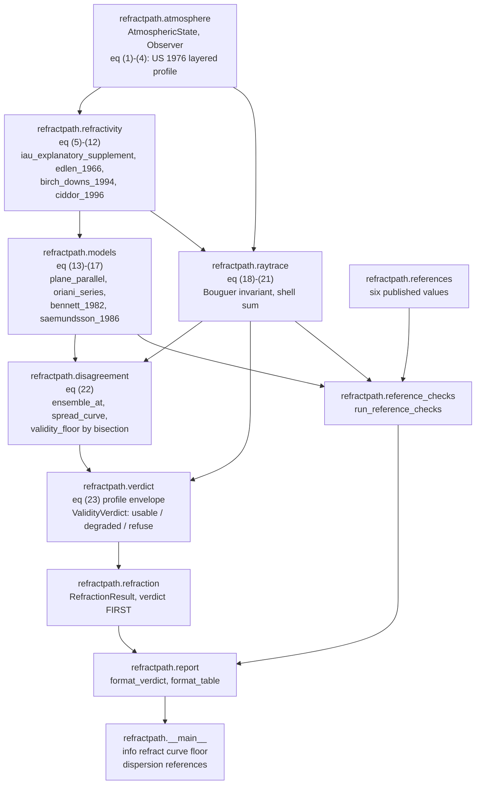
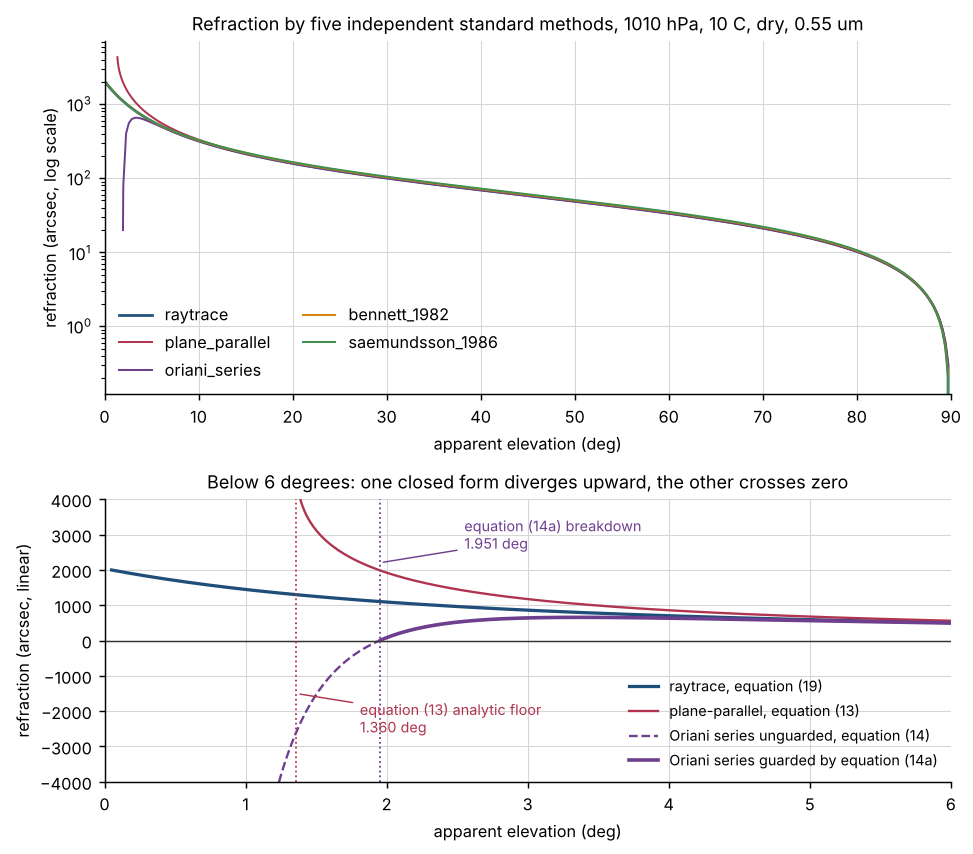
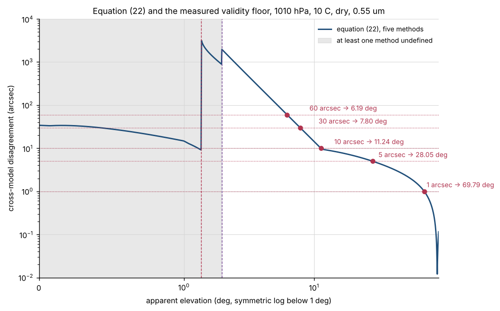
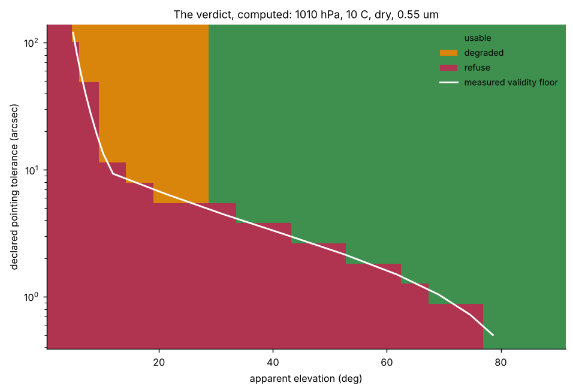
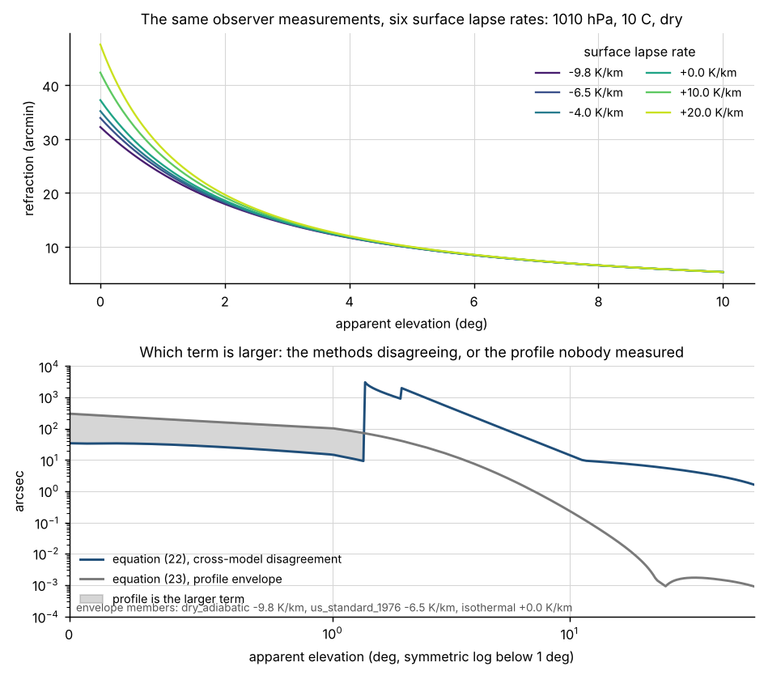
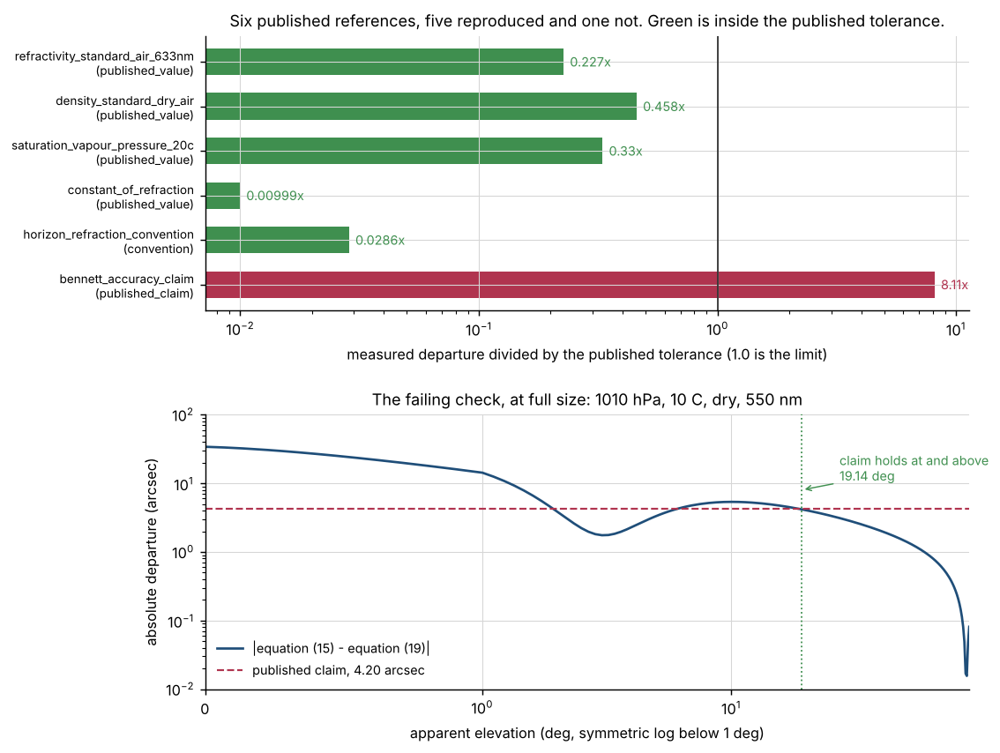
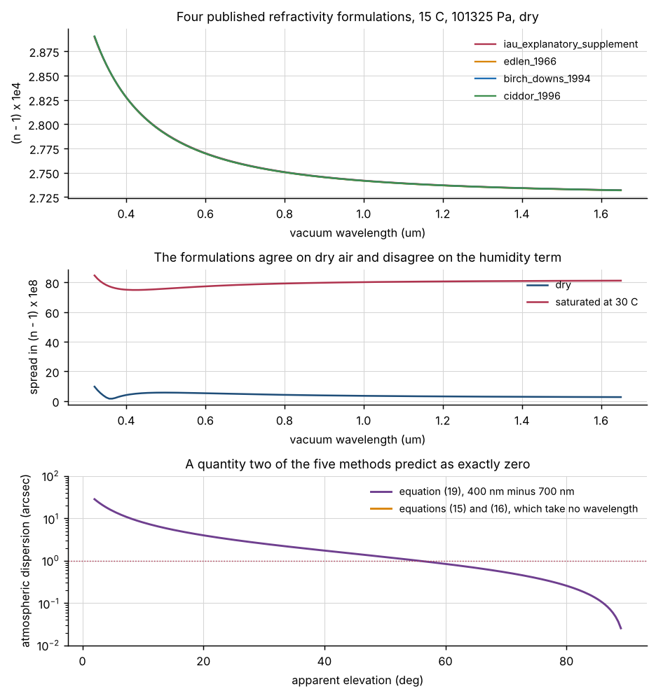
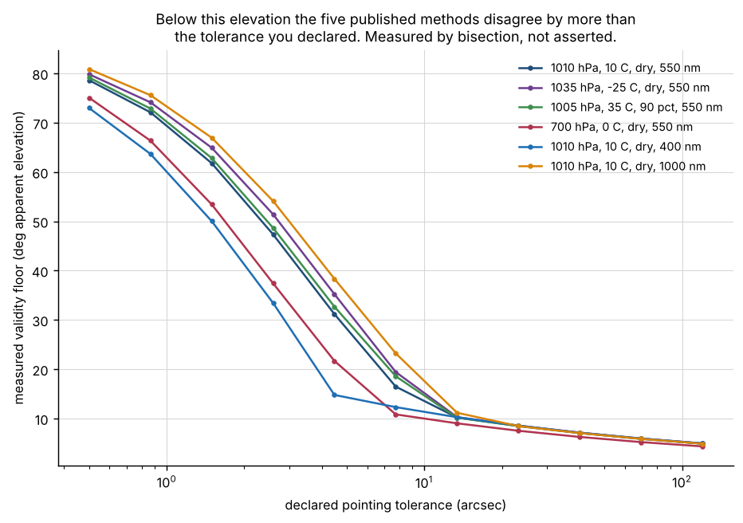
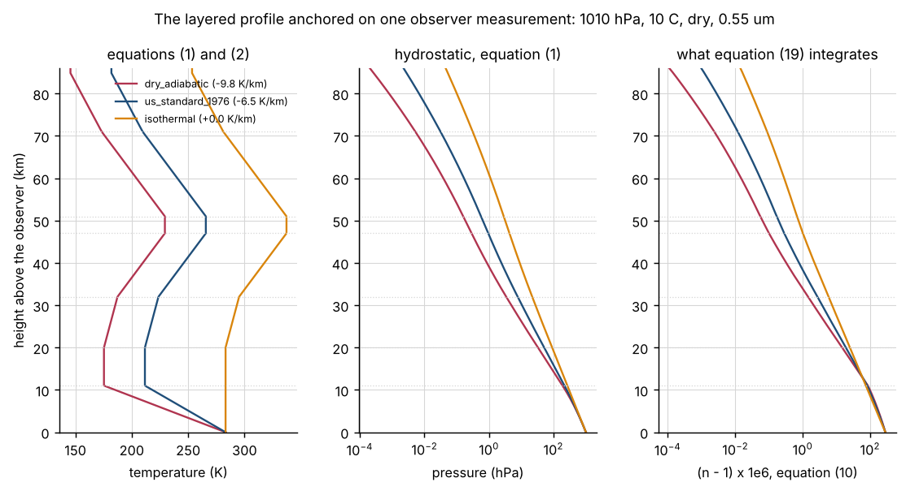

# refractpath

Slant-path atmospheric refraction by several standard methods, with their disagreement measured.


## The problem

You point a mount at an apparent elevation of five degrees, apply a refraction
correction out of a textbook, and the residual is tens of arcseconds. You
change the formula and it moves, which tells you the formula was never the
problem. Nothing in any of those formulae tells you the elevation below which
they stop agreeing with each other, so you cannot tell whether the error you
are chasing is yours or theirs.

## What this does

- Computes the refraction by **five independent standard methods** — the exact
  plane-parallel solution, Oriani's two-term series, Bennett (1982),
  Sæmundsson (1986), and a ray trace through a layered refractivity profile —
  and reports **their spread**, not a single number.
- **Measures the elevation at which that spread crosses a pointing tolerance
  you declare**, by bisection on a 181-point grid, and reports the bracket. At
  1010 hPa, 10 C, dry and 550 nm the floor is **11.2448 degrees for a 10 arcsec
  tolerance** and **69.789 degrees for 1 arcsec**.
- Returns a **validity verdict as the first field of every result** —
  `usable`, `degraded` or `refuse` — computed before the correction it gates,
  with the reasons named and five things the library cannot determine from its
  inputs listed explicitly.
- Measures **how much of the answer is an input you did not supply**: three
  physically attainable surface lapse rates, all consistent with your own
  measurements, move the horizon refraction by **300.0181 arcsec** and move the
  45-degree refraction by **0.0014 arcsec**.
- Implements **four published refractivity formulations** and measures their
  disagreement: **9.748e-08 in n** at worst on dry air across 0.32 to 1.69 um,
  rising to **11.77 times that** on the humidity term at 40 C and saturation.

## Who it is for

- Anyone budgeting a pointing error at low elevation who needs a defensible
  number for "how much of this is the refraction model".
- Anyone deciding which published refraction formula to implement, who wants
  the measured departures rather than the published claims.
- Anyone who needs an explicit, computed refusal rather than a number that
  looks fine.

## Who it is not for

- **Astrometry.** If you need a refracted horizontal coordinate as part of a
  coordinate transformation, use `astropy`. Its `AltAz` frame applies
  refraction and is the right tool for astrometric work. Use it for that.
- **Anyone who wants one number.** This package will give you the ray trace,
  but its reason for existing is the spread around it.
- **Radio and microwave work.** Every formulation here is optical. Water
  vapour lowers optical refractivity and raises radio refractivity, and nothing
  in this package models the radio band.
- **Operational pointing below the measured validity floor.** The package
  refuses there, and the refusal is the correct answer rather than a missing
  feature.
- **Anyone needing turbulence, seeing or short-term jitter.** This is the mean
  refraction only.

## Alternatives, honestly

| alternative | what it does better | when to use this instead |
|---|---|---|
| [`astropy`](https://www.astropy.org/) | A complete astrometry stack. Its `AltAz` frame **applies refraction** as part of a rigorous coordinate transformation, with proper motion, aberration, parallax, polar motion and time scales handled correctly. **It is the right tool for astrometric work and you should use it for that.** | When the question is not "where is the star" but "how far apart are the standard refraction models here, and below what elevation should I stop trusting any of them". `astropy` gives you one refraction; this gives you five and their spread. **`astropy` is not installed in this repository's measured environment and no number here is compared against it.** |
| [`pyephem` / `ephem`](https://rhodesmill.org/pyephem/) | A mature, fast ephemeris library with a long track record in observing software, which applies refraction to body positions as part of computing rise, set and transit. | When you need the refraction itself as the object of study, with its uncertainty, rather than as a correction inside a position. **`ephem` is not installed in the measured environment and no number here is compared against it.** |
| [`erfa`](https://github.com/liberfa/erfa) (and its Python binding `pyerfa`) | The reference implementation of the IAU SOFA algorithms, including `refco` and the refracted-coordinate routines. It is the standard against which astrometric software is checked, and it is far better tested than anything here. | When you want the cross-model disagreement measured rather than one authoritative answer, or when you want the validity floor computed for a tolerance you declare. **`pyerfa` is not installed in the measured environment and no number here is compared against it.** |

This package's contribution is **the cross-model disagreement measurement and
the explicit validity floor**, not a better single number. Any of the three
alternatives above will give you a refraction that is at least as good as the
one here.

## Install and first run

```bash
git clone https://github.com/OmAcharya-avtr/refractpath.git
cd refractpath
python -m venv .venv && source .venv/bin/activate
pip install -e ".[dev]"
python -m pytest tests/ -q
python examples/refraction_curves.py
```

The test run prints:

```
........................................................................ [ 55%]
........................................................................ [ 73%]
........................................................................ [ 91%]
................................                                         [100%]
392 passed in 51.79s
```

The elapsed time is unstable and is quoted only so the line is the real one;
nothing in this repository rests on it.

and the example prints:

```
written: screenshots/refraction_curves.png
```

A first look at what the package is for, with no arguments beyond an elevation:

```bash
python -m refractpath refract --elevation 12 --tolerance 10
```

```
VERDICT: DEGRADED
  apparent elevation        : 12.00000 deg
  declared tolerance        : 10.0000 arcsec
  cross-model disagreement  : 9.30609 arcsec
  profile envelope, eq (23) : 0.10208 arcsec
  measured validity floor   : 11.25694 deg
  above the floor           : True
  plane-parallel hard floor : 1.36237 deg (analytic, eq 13)
  oriani breakdown elevation: 1.95033 deg (computed, eq 14a)
  refractivity rel. spread  : 1.509e-04
  reasons:
    - below the declared validity floor of: oriani_series (15 deg), plane_parallel (30 deg)
```

The output continues with the five things the library cannot determine from
these inputs at any elevation; `python -m refractpath info` prints the same
list.

## A worked example

An observer at 1180 m, 1004 hPa, 3.5 C, 62 per cent relative humidity and
550 nm, with a declared pointing tolerance of 10 arcseconds. The code below is
`validation/worked_example.py` and the output beneath it is what that script
printed.

```python
from refractpath import AtmosphericState, Observer, refraction

state = AtmosphericState(
    pressure_hpa=1004.0,
    temperature_c=3.5,
    relative_humidity=0.62,
    wavelength_um=0.55,
)
observer = Observer(height_m=1180.0, latitude_deg=34.2)

for elevation in (60.0, 25.0, 12.0, 6.0):
    result = refraction(elevation, state, observer, tolerance_arcsec=10.0)
    print(result.verdict.verdict, result.reference_refraction_arcsec)
```

The verdict object carries the evidence. At 60 degrees:

```
VERDICT: USABLE
  apparent elevation        : 60.00000 deg
  declared tolerance        : 10.0000 arcsec
  cross-model disagreement  : 1.66124 arcsec
  profile envelope, eq (23) : 0.00071 arcsec
  measured validity floor   : 11.21991 deg
  above the floor           : True
  plane-parallel hard floor : 1.37158 deg (analytic, eq 13)
  oriani breakdown elevation: 1.92320 deg (computed, eq 14a)
  refractivity rel. spread  : 3.540e-04
  reasons: none; every gate passed
  cannot be determined from these inputs at any elevation:
    ... five items, elided here; see python -m refractpath info
  reference (ray trace)     : 34.074 arcsec
  true elevation            : 59.99054 deg
method            refraction (arcsec)  minus reference
----------------  -------------------  ---------------
oriani_series         34.074              -0.000
raytrace              34.074              +0.000
plane_parallel        34.132              +0.058
bennett_1982          35.084              +1.010
saemundsson_1986      35.735              +1.661
```

and across the four elevations:

```
elevation  verdict   reference (arcsec)  eq (22)    eq (23)    floor (deg)
---------  --------  ------------------  ---------  ---------  -----------
  60.0     usable       34.074               1.661      0.001   11.220
  25.0     degraded    125.967               5.736      0.001   11.220
  12.0     degraded    271.283               9.415      0.101   11.220
   6.0     refuse      515.924              65.540      1.852   11.220
```

The floor is the same in every row because it is a property of the atmosphere
and the tolerance, not of the elevation asked for. The verdict is what changes.

## Architecture



## Screenshots



The five methods are indistinguishable above 20 degrees and separate below 5.
In the lower panel the plane-parallel model diverges upward and the unguarded
Oriani series crosses zero and goes negative; the dotted lines are the two
computed floors, at 1.360 and 1.951 degrees.



Equation (22) against elevation, with the measured floor marked for each
declared tolerance. The curve is **not monotone**: the two cliffs near 1.4 and
2.0 degrees are methods leaving the ensemble at their own validity limits, and
the spread falls because the most discrepant member has gone.



The verdict over elevation and declared tolerance. The white line is the
measured validity floor. The amber band above it is where the methods agree but
at least one of them is below the elevation this product declares it usable at.



The upper panel is the same observer measurements under six surface lapse
rates. The lower panel is which term is larger: the methods disagreeing, or the
profile nobody measured. Below one degree the profile wins by a factor of seven
to nine.



Six published references, five reproduced and one not, at full size. The lower
panel is the failing one: Bennett's own 0.07 arcminute claim measured against
this package's ray trace, which holds at and above 19.14 degrees.



The four refractivity formulations agree on dry air and disagree on humidity.
The lower panel is the atmospheric dispersion across the visible, which
equations (15) and (16) predict as exactly zero because they take no
wavelength.



The measured floor against the tolerance you declare, for six atmospheric
states. Tightening a budget from 30 arcsec to 1 arcsec moves the floor from
under 8 degrees to about 70, which is most of the sky.



The layered profile the ray trace integrates. Refractivity falls by three
orders of magnitude over the first 40 km, and the integral is dominated by the
first few kilometres — exactly the region the library has to invent from one
surface measurement.

## Validation evidence

Full detail, including every conditions and tolerance provenance note, is in
[`validation/VALIDATION.md`](validation/VALIDATION.md). **The failing check is
listed first because it is the one that matters.**

| check | reference | result | tolerance |
|---|---|---|---|
| **Bennett (1982) maximum error** | **the author's own published claim, against this package's ray trace** | **FAIL: 34.0737 arcsec measured, 63 of 181 grid points outside, claim holds at and above 19.1361 deg** | **4.20 arcsec, one-sided** |
| refractivity of standard air at 633 nm | Birch and Downs (1993/1994), 2.76530e-04 | 2.765288675e-04, difference -1.133e-09 | 5e-9 |
| density of standard dry air | US Standard Atmosphere 1976, 1.2250 kg/m^3 | 1.2254582, difference +0.0004582 | 0.001 |
| saturation vapour pressure at 20 C | tabulated 2339 Pa, pure water | 2338.3400 Pa by eq (4), 2339.1632 by the bare form of eq (12); **2348.5798 Pa with the Ciddor enhancement factor, which is a different quantity and is not compared against this reference** | 2.0 Pa |
| constant of refraction | Smart (1977) ch. 3, 58.2 to 58.3 arcsec | 58.247503 arcsec at 550 nm; **58.81265 at 450 nm and 57.97341 at 633 nm, a span 3.36x the tolerance** | 0.25 arcsec |
| horizon refraction | adopted convention, 34 arcmin | 2041.7165 arcsec; **the profile envelope there is 301.3 arcsec, 5.02 times this check's tolerance** | 60 arcsec |
| ray trace inside an independently derived bracket | monotonicity plus the mean value theorem, sharing no mathematics with the shell sum | 7 of 7 elevations inside | bracket width, 0.0181 to 1.2154 of the value |
| the bracket rejects the plane-parallel answer | a model this package ships | 4 of 4 elevations rejected, +0.00636 to +0.19306 arcsec | — |
| flat-Earth limit against the exact Snell solution | one application of Snell's law, no integral | worst 3.506e-06 relative | 2e-4 |
| grid residual, 10,000 against 40,000 shells | self-convergence | 9.299e-05 arcsec above the horizon, 6.077e-03 at zero | 1e-3 / 2e-2 arcsec |
| Oriani series against the ray trace at 45 deg | two independent derivations, 54 states | worst 0.0007 arcsec | — |
| **bennett_1982 and saemundsson_1986 against the ray trace at 45 deg** | 54 swept states | **worst 2.8670 and 4.1900 arcsec, overstating at every state** | — |
| **measured usable range of the two published fits** | 54 states, 10 arcsec budget | **15 deg and 30 deg, against a published range of 0 to 90** | — |
| bennett_1982 signed error at the horizon | 54 swept states | **spans 489.64 arcsec, -300.81 to +188.83** | — |
| validity floor, 1010 hPa 10 C dry 550 nm | measured by bisection | 69.789 / 28.050 / 11.245 / 7.799 / 6.192 deg at 1 / 5 / 10 / 30 / 60 arcsec | bracket 8.613e-05 deg |
| **tolerance crossings of equation (22)** | the 181-point grid | **3 crossings; the lowest understates the floor by a factor of 9.179** | — |
| profile envelope, three declared lapse rates | equation (23) | 0.0014 arcsec at 45 deg, 300.0181 at zero | — |
| a 25 m +20 K/km surface inversion | ray trace against the 1976 profile | +137.001 arcsec at zero elevation | — |
| four refractivity formulations, dry | 0.32 to 1.69 um | worst 9.748e-08 in n, 0.01174 arcsec at 45 deg inside the commonly published band | 1e-7 |
| four refractivity formulations, humid | 40 C, saturated | **11.77 times the dry-air spread** | — |
| atmospheric dispersion, 400 to 700 nm | ray trace | 1.4571 arcsec at 45 deg; exceeds 1 arcsec below 55.426 deg | — |
| equations (15) and (16) atmospheric dispersion | the published formulae | **exactly zero, at every elevation** | — |
| controls | 9 must fire, 5 must not | 9 of 9 fired, 0 of 5 fired | — |
| every script from five working directories | filesystem root, temp, repo root, `validation/`, `src/` | 0 non-zero exits of 90 runs | — |

## API reference

<details>
<summary>Public surface, one line each, with units</summary>

### `refractpath`

- `refraction(apparent_elevation_deg, state=None, observer=None, tolerance_arcsec=10.0, ...) -> RefractionResult` — the entry point; the result's **first** field is the verdict.
- `RefractionResult.reference_refraction_arcsec` — the ray trace, arcseconds, to be used only if the verdict permits.
- `DEFAULT_TOLERANCE_ARCSEC = 10.0` — declared default pointing tolerance, arcseconds.

### `refractpath.atmosphere` — equations (1) to (4)

- `AtmosphericState(pressure_hpa, temperature_c, relative_humidity, wavelength_um, co2_ppm, surface_lapse_rate_k_per_m, surface_layer_top_m, vapour_scale_height_m)` — hPa, degrees C, fraction 0 to 1, micrometres, ppm, K/m, metres, metres.
- `Observer(height_m, latitude_deg)` — metres, degrees. Only the height enters the ray trace.
- `build_profile(state, height_m, top_m=None) -> LayeredProfile` — temperature (K), pressure (Pa), vapour pressure (Pa) on a height grid (m).
- `saturation_vapour_pressure_pa(temperature_c) -> float` — Buck (1981), pascals.

### `refractpath.refractivity` — equations (5) to (12)

- `iau_explanatory_supplement`, `edlen_1966`, `birch_downs_1994`, `ciddor_1996` — all take `(wavelength_um, pressure_pa, temperature_c, vapour_pressure_pa[, co2_ppm])` and return `n - 1`, dimensionless.
- `refractivity_spread(...) -> dict[str, float]` — every formulation plus `spread` and `relative_spread`.
- `REFRACTIVITY_VALIDITY_UM` — published wavelength range per formulation, with the source of the range.

### `refractpath.models` — equations (13) to (17)

- `plane_parallel`, `oriani_series`, `bennett_1982`, `saemundsson_1986` — all take `(apparent_elevation_deg, state, observer=None, refractivity_model="ciddor_1996")` and return `h_apparent - h_true` in **arcseconds**, or `nan` where undefined.
- `plane_parallel_floor_deg(state, ...) -> float` — `90 - arcsin(1/n)`, degrees, analytic.
- `oriani_breakdown_elevation_deg(state, ...) -> float` — equation (14a) in closed form, degrees.
- `oriani_truncation_ratio(...) -> float` — the `tan^3` term over the `tan` term, dimensionless.
- `oriani_series_unguarded(...)` — the raw series, for exhibiting the divergence.
- `saemundsson_1986_from_true(true_elevation_deg, state) -> float` — the published direction.

### `refractpath.raytrace` — equations (18) to (21)

- `trace(apparent_elevation_deg, state, observer=None, refractivity_model=..., shells=10000, top_m=90000.0, grid_exponent=3.0) -> RayTraceResult` — arcseconds plus diagnostics.
- `raytrace_refraction(...) -> float` — arcseconds at the package defaults.
- `shell_heights(shells, top_m, grid_exponent) -> np.ndarray` — shell boundaries, metres above the observer.

### `refractpath.disagreement` — equation (22)

- `ensemble_at(elevation_deg, state, ...) -> SpreadPoint` — every member's refraction, the spread and which members were undefined.
- `spread_curve(elevations_deg, ...) -> tuple[SpreadPoint, ...]`.
- `validity_floor(state, tolerance_arcsec, ...) -> ValidityFloor` — the measured floor, the bracket, the crossing count and whether the curve was monotone.
- `pairwise_disagreement(point) -> dict[tuple[str, str], float]` — arcseconds.

### `refractpath.verdict` — equation (23)

- `compute_verdict(elevation_deg, state, tolerance_arcsec, ...) -> ValidityVerdict`.
- `profile_envelope_arcsec(elevation_deg, state, ...) -> tuple[float, dict[str, float]]` — the envelope width and its three members, arcseconds.
- `UNDETERMINABLE` — five structural limits, returned on every verdict.

### `refractpath.references` and `refractpath.reference_checks`

- `PUBLISHED_REFERENCES` — six external references with kind, conditions, citation and tolerance provenance.
- `run_reference_checks() -> tuple[ReferenceComparison, ...]` — runs all six; a miss is a result, not an exception.
- `bennett_departure_arcsec(state=None, grid_deg=None) -> tuple[np.ndarray, np.ndarray]`.

</details>

## Limitations

- **One external check fails.** Bennett's published 0.07 arcminute accuracy
  claim is not reproduced against this package's ray trace below 19.1361
  degrees. The claim was made against Garfinkel (1967), which this package does
  not implement, so the miss measures the difference between two reference
  atmospheres. It is reported, the tolerance was not widened, and this package
  cannot attribute the difference.
- **There is no transcribed refraction table in this repository.** None was
  available to this build and inventing plausible entries would be worse than
  having none. This is the principal weakness of the external verification.
- **Nothing here is compared against a measurement.** Every number compares one
  computation against another computation or against a published number. There
  is no theodolite data.
- **Nothing here is compared against `astropy`, `ephem` or `erfa`.** None of
  the three is installed in the measured environment and nothing was installed
  to get them.
- **Everything above the observer is invented.** The library is given one
  pressure, one temperature and one humidity at one point, and applies the US
  Standard Atmosphere 1976 lapse-rate structure above it. Three physically
  attainable surface lapse rates move the horizon refraction by 300.0181
  arcsec.
  Equation (23) is a **lower** bound on that uncertainty, not an upper one.
- **The ray trace assumes spherical symmetry.** A horizontal refractivity
  gradient along the line of sight produces a refraction that is not a function
  of elevation alone, and this package cannot see one.
- **No turbulence, no seeing, no radio band.** Mean refraction only, optical
  only. Water vapour lowers optical refractivity and raises radio
  refractivity.
- **The constant-of-refraction check rests on a wavelength this product
  chose.** The published figure is given for the visible band without a stated
  wavelength and the measured coefficient spans 0.83924 arcsec across the
  visible, 3.36 times the check's tolerance.
- **Equation (22) is not monotone**, and a naive search for its tolerance
  crossing understates the floor by a factor of 9.179 at a 10 arcsec tolerance.
  This package always takes the highest crossing, which is the conservative
  reading.
- **The dependency ranges were not run at both ends.** The build environment is
  a shared pre-pinned interpreter this product is forbidden to modify, and
  installing a second numpy or scipy would have required `pip`. `numpy>=2.5,<2.6`
  and `scipy>=1.18,<1.19` are bounded at the single version each was measured
  at. The cost is real: this package cannot take a numpy 2.6 or scipy 1.19
  release without a port and a re-measure, and that tension is recorded here
  rather than resolved by removing the ceiling. The ruff range is the
  exception — 0.16.9 and 0.17.3 were both available and the source measured
  clean under both.
- **Compute budget.** One ray trace at the package defaults takes a few
  milliseconds on the two cores this was measured on; one `validity_floor` call
  is a few hundred. `examples/validity_floor_map.py` is the slowest script in
  the repository at roughly half a minute. All timings are unstable and appear
  only in tables declared as such.

## Safety statement

This software is **research-grade**. It is **not flight-qualified, not
certified, and not approved for operational aerospace use**. No correction
computed by this package is suitable for operational pointing below the
measured validity floor reported in the verdict.

## Reproducing every number

From a cold clone, in order. Each script writes its raw output beside itself
as `validation/<script>_output.txt`, which is committed.

```bash
python -m pytest tests/ -q --junitxml=junit.xml
python validation/validate_published_references.py
python validation/validate_raytrace_convergence.py
python validation/validate_model_grid.py
python validation/validate_disagreement_floor.py
python validation/validate_dispersion.py
python validation/validate_profile_sensitivity.py
python validation/validate_low_elevation_failure.py
python validation/validate_controls.py
python validation/validate_cli.py
python validation/worked_example.py
python validation/probe_working_directories.py
```

The figures:

```bash
python examples/refraction_curves.py
python examples/disagreement_curve.py
python examples/validity_floor_map.py
python examples/profile_envelope.py
python examples/dispersion_band.py
python examples/published_references.py
python examples/verdict_map.py
python examples/atmosphere_profile.py
```

Count the tests from the junit XML, never from the pytest summary line:

```bash
python - <<'PY'
import xml.etree.ElementTree as ET
root = ET.parse("junit.xml").getroot()
suite = root if root.tag == "testsuite" else root.find("testsuite")
print(suite.get("tests"), len(suite.findall(".//testcase")))
PY
```

Lint:

```bash
ruff check src/ tests/ examples/ validation/
```

## Licence, citation, credits

Apache-2.0. See [`LICENSE`](LICENSE). Copyright © 2026 OPTIMA Organisation.

Citation metadata is in [`CITATION.cff`](CITATION.cff).

### References implemented

- Edlén, B. (1966). "The refractive index of air". *Metrologia* **2**(2), 71–80.
- Birch, K. P. and Downs, M. J. (1993). "An updated Edlén equation for the refractive index of air". *Metrologia* **30**(3), 155–162; and the 1994 correction, *Metrologia* **31**(4), 315–316.
- Ciddor, P. E. (1996). "Refractive index of air: new equations for the visible and near infrared". *Applied Optics* **35**(9), 1566–1573.
- Bennett, G. G. (1982). "The calculation of astronomical refraction in marine navigation". *Journal of Navigation* **35**(2), 255–259.
- Sæmundsson, Þ. (1986). *Sky and Telescope* **72**, 70, as given in Meeus (1998) chapter 16.
- Meeus, J. (1998). *Astronomical Algorithms*, 2nd edition. Willmann-Bell, chapter 16.
- Smart, W. M. (1977). *Textbook on Spherical Astronomy*, 6th edition. Cambridge University Press, chapter 3.
- Auer, L. H. and Standish, E. M. (2000). "Astronomical refraction: computation for all zenith angles". *Astronomical Journal* **119**, 2472–2474.
- Garfinkel, B. (1967). "Astronomical refraction in a polytropic atmosphere". *Astronomical Journal* **72**, 235–254. **Named as the reference Bennett's accuracy claim was made against; not implemented here.**
- Buck, A. L. (1981). "New equations for computing vapor pressure and enhancement factor". *Journal of Applied Meteorology* **20**, 1527–1532.
- US Standard Atmosphere 1976. NOAA/NASA/USAF.
- Urban, S. E. and Seidelmann, P. K. (eds., 2013). *Explanatory Supplement to the Astronomical Almanac*, 3rd edition. University Science Books.

### Credits

This is under reserved rights obtained by OPTIMA Organisation.
