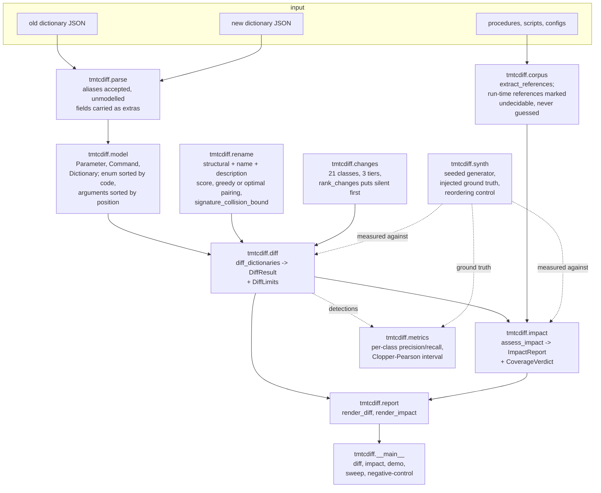
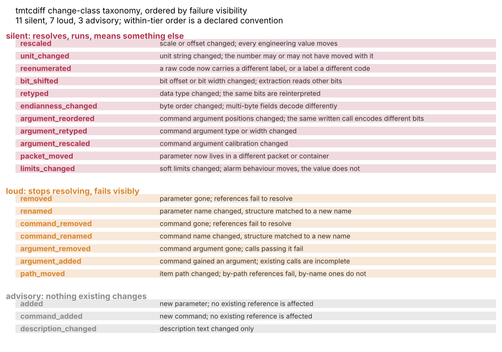
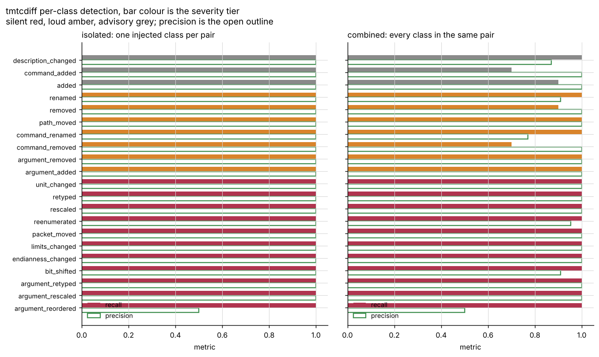
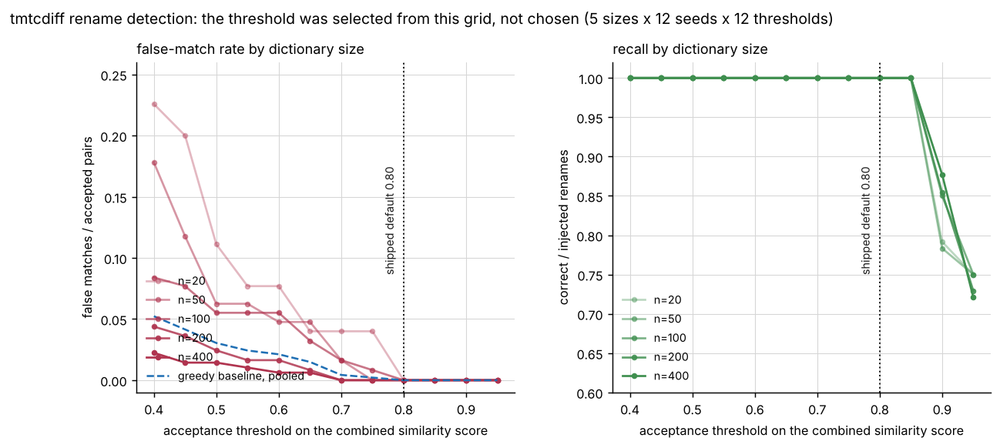
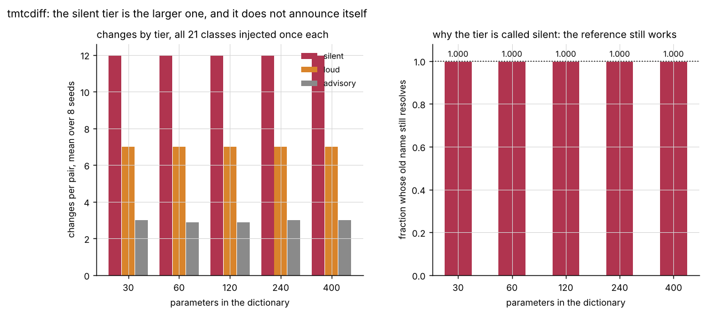
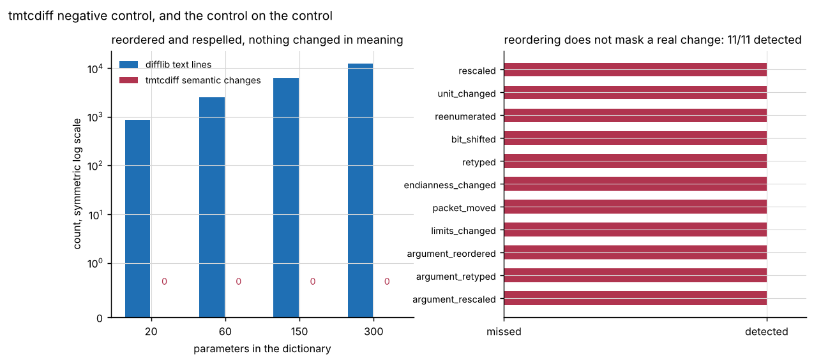
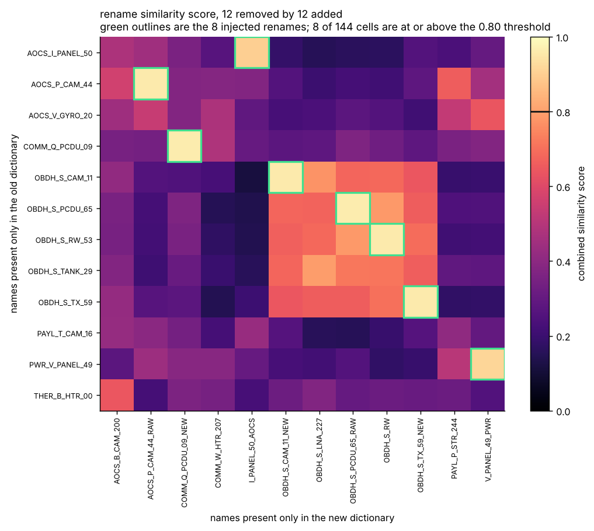
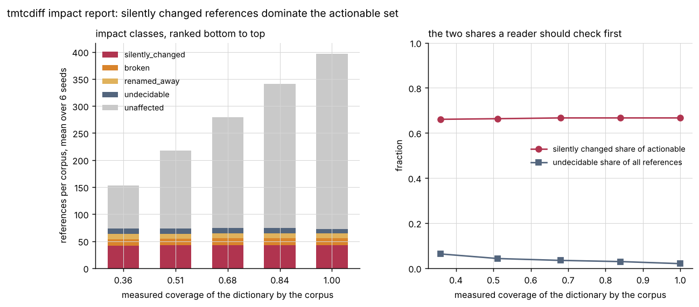
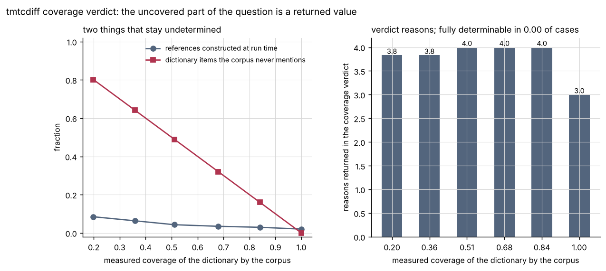
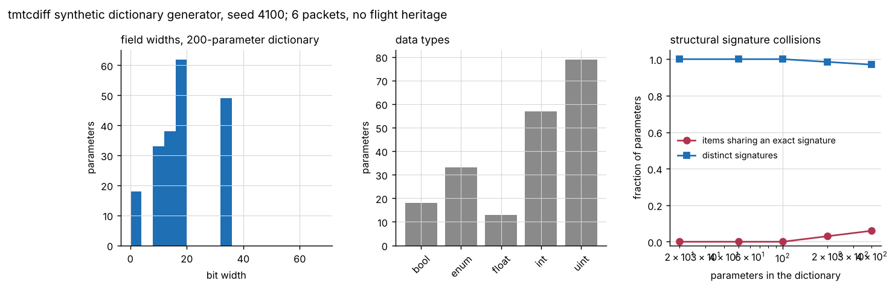

# tmtcdiff

Diff two telemetry and command dictionaries and report which existing procedures break.


## The problem

A telemetry and command dictionary is reissued and somebody has to decide what
it breaks. The removed mnemonic is the easy case: every procedure referencing
it fails at load with the name in the error message. The hard case is the
mnemonic that kept its name and changed its scale factor, its unit, its bit
offset, its byte order, its data type, its enumeration mapping or its command
argument positions, because everything downstream keeps running and quietly
means something else.

## What this does

- Classifies every difference between two dictionary versions into **21 change
  classes** in **three tiers of failure visibility**: 11 silent, 7 loud, 3
  advisory. The silent tier is reported first by every function in the package.
- Detects renames by structural similarity, at a threshold of **0.80** that a
  declared criterion selected from a measured grid of 12 thresholds by 5
  dictionary sizes by 12 seeds by 2 matching strategies, where the measured
  false-match rate falls from **0.2258** to exactly **0.0000**.
- Resolves an optional corpus of procedures, scripts and configuration files
  against both versions and ranks every reference as silently changed, broken,
  renamed away, undecidable or unaffected, with the silently changed ones
  first.
- Returns a **coverage verdict** as a value, not a caveat: how many references
  it could not resolve statically, how many dictionary items the corpus never
  mentions, which sources it could not read, and which fields it does not
  model. On the worked example below that is **1 of 9 references**.
- Measures its own per-class detection: **precision 1.0000 and recall 1.0000**
  over 420 injected changes when one class is injected per pair, and
  **0.9665 / 0.9619** when all 21 are injected into the same pair.

## Who it is for

- Operations and ground-segment engineers reviewing a mission database
  delivery before it reaches a control system.
- Anyone maintaining procedures or offline analysis written against a
  dictionary that somebody else version-controls.
- People who need the list of *silently* changed references separated from the
  list of broken ones, because the two require different work.

## Who it is not for

- **Anyone who needs a general structured diff.** Use `deepdiff`. This package
  understands one domain model and will reject a document that does not fit it.
- Anyone who needs their dictionary *validated* rather than *compared*. Use
  `jsonschema` against a schema you write.
- Anyone who needs a text diff of two files. Use `difflib`, or `git diff`.
- Anyone expecting it to read XTCE, SCOS-2000 MIB tables, or any other real
  database format. It reads one JSON shape, documented in
  `src/tmtcdiff/parse.py`, and ships no importer for anything else.
- Anyone who wants a verdict on whether an upgrade is safe. This package does
  not produce one, and says so in the returned verdict rather than leaving the
  reader to infer it.

## Alternatives, honestly

| Alternative | What it does better | When to use this instead |
|---|---|---|
| [`deepdiff`](https://pypi.org/project/deepdiff/) | General structured diffing of arbitrary Python objects and JSON, with type coercion control, tolerance handling, exclusion paths and a stable serialisation of the delta. It is mature, widely used, and the right tool for comparing two structures. | When you need the *classification* rather than the difference: which of the two dozen things that can change in a telemetry definition changed, and whether a consumer will notice. `deepdiff` will correctly tell you `scale` moved from 0.0625 to 0.125; it has no opinion about that being more dangerous than a removed mnemonic. The change-class taxonomy and the silent-semantic-change ranking are this package's contribution, and nothing else here is. |
| [`jsonschema`](https://pypi.org/project/jsonschema/) | Validating that one document conforms to a declared schema, with precise error paths. | When the question is about two documents rather than one. A schema says whether a dictionary is well formed; it cannot say that version 1.1 reinterprets a field version 1.0 defined differently. Use `jsonschema` first to reject a malformed delivery, then this to compare two valid ones. |
| `difflib` (standard library) | Line and sequence diffing, and the Ratcliff/Obershelp similarity this package uses for its own name scoring. | When the file layout is itself the subject. On a document whose entries, keys, enumerations and key spellings have been reordered with no semantic change, `difflib` reports **2526 changed lines between two 1267-line documents** and this package reports **0 changes**; measured in `validation/validate_negative_control_output.txt`. That gap is the whole point, and it is not a criticism of `difflib`, which is doing exactly its job. |

`deepdiff` is **not installed** in the environment this package was measured
in, and no number in this repository is taken from it or from a comparison
against it. Every output file in `validation/` states its absence in its own
header. `jsonschema` 4.26.0 and `difflib` (standard library) are present;
`difflib` is used, `jsonschema` is not.

## Install and first run

```bash
git clone https://github.com/OmAcharya-avtr/tmtcdiff.git
cd tmtcdiff
python -m venv .venv && source .venv/bin/activate
pip install -e ".[dev]"
python -m pytest tests/ -q
python -m tmtcdiff negative-control --size 60
```

The suite prints (the elapsed time varies run to run; it is a transcript, not
a measured quantity, and no conclusion anywhere in this repository rests on a
timing):

```
608 passed in 18.30s
```

and the negative control prints:

```
dictionary size            : 75 items
canonical text lines       : 1274
reordered text lines       : 1274
text lines differing       : 2540
semantic changes reported  : 0
silent changes reported    : 0
loud changes reported      : 0
control held: substantial textual reordering, empty semantic diff
```

That is the control, not the feature. For the feature, run
`python -m tmtcdiff demo --size 60 --max-rows 3`, which generates a pair with
one injected change of each of the 21 classes and reports:

```
generated pair: size 60, seed 20261029
injected changes: 21

dictionary 1.0 -> 1.1
items 75 -> 75

SILENT CHANGES FIRST. A silent change leaves every existing reference resolving
and running, and alters what it means. Within-tier order is a declared
convention and is not a measured ranking.

-- silent (12) ----------------------------------------
  [silent  ] rescaled             PWR_Q_LNA_01  scale: 3.0517578125e-05 -> 1.52587890625e-05  every engineering value scales by 0.5
  [silent  ] unit_changed         THER_F_CAM_30  unit: 'degC' -> 'K'
  [silent  ] reenumerated         OBDH_S_PANEL_17  enum: {0: 'UNLOCKED', 1: 'ACQUIRING', 2: 'LOCKED'} -> {0: 'LOCKED', 1: 'ACQUIRING', 2: 'UNLOCKED'}  codes relabelled [0, 2]; labels recoded ['LOCKED', 'UNLOCKED']
  ... 9 more

-- loud (7) ----------------------------------------
  [loud    ] removed              OBDH_S_MAG_47  name: 'OBDH_S_MAG_47' -> None  references fail to resolve, visibly
  [loud    ] renamed              OBDH_S_LNA_23 -> OBDH_S_LNA  name: 'OBDH_S_LNA_23' -> 'OBDH_S_LNA'  (similarity 0.9609)  structural match; a by-name reference to the old name fails to resolve
  [loud    ] command_removed      PAYL_DUMP_MEMORY_04  name: 'PAYL_DUMP_MEMORY_04' -> None  references fail to resolve, visibly
  ... 4 more
```

## A worked example

Two dictionaries written out by hand, four parameters and one command, with a
procedure and an analysis script written against the older one. The full
script is `validation/worked_example.py`; this is its core.

```python
from tmtcdiff import (
    Corpus, CorpusSource, Dictionary, Parameter, Command, CommandArgument,
    assess_impact, diff_dictionaries,
)

OLD = Dictionary(version="1.0", parameters=(
    Parameter(name="BATT_T_1", data_type="int", bit_offset=0, bit_width=12,
              scale=0.0625, unit="K", low_limit=250.0, high_limit=330.0,
              packet="PWR_HK", description="battery one temperature"),
    Parameter(name="BUS_V", data_type="uint", bit_offset=12, bit_width=16,
              scale=0.001, unit="V", packet="PWR_HK"),
    Parameter(name="AOCS_MODE", data_type="enum", bit_offset=28, bit_width=4,
              enum=((0, "IDLE"), (1, "SAFE_MODE"), (2, "NOMINAL_MODE"))),
    Parameter(name="PAYL_CNT", data_type="uint", bit_offset=32, bit_width=32,
              unit="count", description="payload frame counter"),
), commands=(
    Command(name="SET_HEATER", arguments=(
        CommandArgument(name="HEATER_ID", position=0, bit_width=8),
        CommandArgument(name="DUTY", position=1, bit_width=8, unit="percent"),
    )),
))

NEW = Dictionary(version="1.1", parameters=(
    # Same name, same bits, different calibration and unit.
    OLD.parameter_map["BATT_T_1"].with_fields(offset=-273.15, unit="degC",
                                              low_limit=-23.0, high_limit=57.0),
    OLD.parameter_map["BUS_V"].with_fields(bit_offset=14),
    OLD.parameter_map["AOCS_MODE"].with_fields(
        enum=((0, "IDLE"), (1, "NOMINAL_MODE"), (2, "SAFE_MODE"))),
    OLD.parameter_map["PAYL_CNT"].with_fields(name="PAYLOAD_FRAME_COUNT"),
), commands=(
    # Argument positions swapped, both names unchanged.
    Command(name="SET_HEATER", arguments=(
        CommandArgument(name="DUTY", position=0, bit_width=8, unit="percent"),
        CommandArgument(name="HEATER_ID", position=1, bit_width=8),
    )),
))

result = diff_dictionaries(OLD, NEW)
corpus = Corpus((CorpusSource("procedures/battery.proc", "procedure", PROCEDURE),
                 CorpusSource("analysis/trend.py", "script", SCRIPT)))
report = assess_impact(result, corpus, OLD, NEW)
```

The diff, verbatim from `validation/worked_example_output.txt`:

```
-- silent (7) ----------------------------------------
  [silent  ] rescaled             BATT_T_1  offset: 0.0 -> -273.15  every engineering value shifts by -273.15
  [silent  ] unit_changed         BATT_T_1  unit: 'K' -> 'degC'
  [silent  ] reenumerated         AOCS_MODE  enum: {0: 'IDLE', 1: 'SAFE_MODE', 2: 'NOMINAL_MODE'} -> {0: 'IDLE', 1: 'NOMINAL_MODE', 2: 'SAFE_MODE'}  codes relabelled [1, 2]; labels recoded ['NOMINAL_MODE', 'SAFE_MODE']
  [silent  ] bit_shifted          BUS_V  bit_offset: 12 -> 14
  [silent  ] argument_reordered   SET_HEATER  argument:DUTY.position: 1 -> 0  the same written call encodes different bits
  [silent  ] argument_reordered   SET_HEATER  argument:HEATER_ID.position: 0 -> 1  the same written call encodes different bits
  [silent  ] limits_changed       BATT_T_1  limits: (250.0, 330.0) -> (-23.0, 57.0)

-- loud (1) ----------------------------------------
  [loud    ] renamed              PAYL_CNT -> PAYLOAD_FRAME_COUNT  name: 'PAYL_CNT' -> 'PAYLOAD_FRAME_COUNT'  (similarity 0.8778)  structural match; a by-name reference to the old name fails to resolve
```

and the impact on the two files, same source:

```
impact class      references  meaning
----------------  ----------  -------------------------------------------------------
silently_changed  7           resolves, runs, and now means something else
broken            0           no longer resolves; fails visibly at load or first use
renamed_away      1           no longer resolves; a renamed item matched structurally
undecidable       1           constructed at run time; this tool cannot resolve it
unaffected        0           resolves to an item with no silent or loud change

-- silently_changed (7) ------------------------------------
  [silently_changed] analysis/trend.py:3    BATT_T_1  limits_changed,rescaled,unit_changed  resolves in both versions; the meaning moved
  [silently_changed] procedures/battery.proc:2    BATT_T_1  limits_changed,rescaled,unit_changed  resolves in both versions; the meaning moved
  [silently_changed] procedures/battery.proc:3    BUS_V  bit_shifted  resolves in both versions; the meaning moved
  [silently_changed] procedures/battery.proc:4    SAFE_MODE  reenumerated  label moved from AOCS_MODE code 1 to AOCS_MODE code 2
  [silently_changed] procedures/battery.proc:5    SET_HEATER  argument_reordered  resolves in both versions; the meaning moved
  [silently_changed] procedures/battery.proc:5    SET_HEATER.DUTY  argument_reordered  the call still parses and encodes different bits
  [silently_changed] procedures/battery.proc:5    SET_HEATER.HEATER_ID  argument_reordered  the call still parses and encodes different bits

-- renamed_away (1) ------------------------------------
  [renamed_away    ] analysis/trend.py:4    PAYL_CNT  renamed  suggestion: PAYLOAD_FRAME_COUNT  structural match only; verify before applying

-- undecidable (1) ------------------------------------
  [undecidable     ] analysis/trend.py:6    "PANEL_T_%d" % index  name assembled by a run-time expression

-- coverage verdict: what this assessment could not determine ----
  references extracted           : 9
  references undecidable         : 1 (0.1111 of extracted)
  dictionary items               : 5
  items referenced by the corpus : 5 (1.0000)
  changed items not referenced   : 0
  incomparable fields            : 0
  fully determinable             : False
  undetermined because:
    - 1 of 9 extracted references are constructed at run time and cannot be resolved statically, so their impact is unknown
```

The line `SEND SET_HEATER(HEATER_ID=3, DUTY=50)` is the one worth reading
twice. It parses in both versions, it is accepted by both, and in version 1.1
it puts 50 into the heater identifier.

## Architecture



## Screenshots



The 21 classes in three tiers. Notice that the silent tier is the largest of
the three: a dictionary has more ways to change meaning quietly than to break
loudly.



Per-class recall (filled) and precision (outline), isolated on the left and
combined on the right. Notice `command_removed` and `command_added` losing
recall only in the combined panel: an unrelated removal and an unrelated
addition in the same pair can be paired as a rename.



False-match rate and recall against the acceptance threshold, one curve per
dictionary size. Notice that the false-match rate reaches zero at 0.80 while
recall is still 1.0000, and that recall collapses from 0.90 onwards. The
dotted line is the shipped default, which this curve selected.



Left: changes per pair by tier. Right: the fraction of silent changes whose
old name still resolves in the new dictionary, which is 1.000 at every size.
That is what makes the tier name a measurement rather than a label.



Left, on a symmetric log scale: the text lines a reordered document differs on
against the semantic changes reported, which is zero at every size. Right: the
control on the control, 11 of 11 injected silent classes still detected
through the same reordering.



The rename score between every removed and every added name in one pair. Green
outlines are the injected renames. Notice the bright off-permutation cells:
those are structurally identical unrelated items, and they are what the
threshold has to clear.



Impact classes against corpus coverage. Notice that the silently changed group
is the largest actionable one at every coverage level, and that the
undecidable group never reaches zero.



What stays undetermined as the corpus grows. Run-time-constructed references
stay undecidable however many files are supplied; the right panel counts the
reasons the library returns.



The seeded generator every number here is measured against. The right panel is
the one that matters: structural signature collisions rise with dictionary
size, and without them the rename false-match rate would measure zero at every
threshold and the sweep would mean nothing.

## Validation evidence

Level 2. Every number below comes from a script in `validation/` that was run
in the session that produced this README. 51 checks across 9 scripts, 0
failures. The unfavourable results are in the table, not below it.
`validation/VALIDATION.md` carries the full evidence, including the two checks
that failed during the build and how each was fixed at its cause.

| Check | Reference | Result | Tolerance |
|---|---|---|---|
| Per-class detection, one class per pair | 420 injected changes, 21 classes, 2 sizes, 10 seeds (`validate_change_classes.py`) | precision 1.0000, recall 1.0000, 0 false positives; all 21 classes fired on all 20 pairs each | exact counts |
| Per-class detection, all classes per pair | same generator, all 21 injected together | precision 0.9665, recall 0.9619, TP 404, FP 14, FN 16 | exact counts |
| **`command_removed` recall, combined regime** | same | **0.7000** (14 of 20); 6 removals absorbed into inferred renames | exact counts |
| **`command_renamed` precision, combined regime** | same | **0.7692** (20 of 26); 6 false renames | exact counts |
| **`removed` and `added` recall, combined regime** | same | **0.9000** each | exact counts |
| Silent tier, isolated | 220 injected silent changes | precision 1.0000, recall 1.0000 | exact counts |
| Silent tier with the loud tier present | 220 injected silent changes on 20 pairs carrying all 21 classes (`validate_silent_changes.py`) | precision 1.0000, recall 1.0000; the loud tier on the same pairs measures 0.9929 / 0.9929 | exact counts |
| Ranking: silent before loud | 20 pairs carrying both tiers | 0 ordering violations, 0 rendered-order violations | exact |
| Silence is testable: old name still resolves | 220 isolated silent injections | 220 of 220 resolve | exact |
| Loudness is testable: old reference stops resolving | 100 isolated loud injections of the 5 resolution-breaking classes | 100 of 100 stop resolving | exact |
| **`argument_added` tier is an assumption, not a measurement** | 20 isolated injections | the command still resolves 20 of 20 and every pre-existing argument is still present 20 of 20, so nothing here confirms the call fails | exact |
| Rename false-match rate, optimal matcher | 12 thresholds x 5 sizes x 12 seeds (`validate_rename_sweep.py`) | 0.2258 at threshold 0.40 and n=20, falling to 0.0000 at 0.80 at every size | exact counts |
| Rename recall, optimal matcher | same | 1.0000 (924 of 924) up to threshold 0.85; 0.8593 (794 of 924) at 0.90; 0.7294 (674 of 924) at 0.95 | 95% Clopper-Pearson intervals in the output |
| Threshold selection | criterion declared in the script before the grid was run | rule 1 fired; selected 0.80; the shipped constant is checked against it and a disagreement fails the script | exact |
| **Greedy baseline against optimal assignment** | same grid | **indistinguishable at the selected threshold: 924 correct, 0 false, for both.** Largest difference in any cell of the whole grid: 2 false matches, in both directions | exact counts |
| Negative control: reordered and respelled | 24 pairs, 4 sizes x 6 seeds (`validate_negative_control.py`) | 0 semantic changes on all 24; 2526 text lines differ at n=60 | exact |
| Control on the control | 11 silent classes x 6 pairs | 66 of 66 still detected through the reordering; 0 extra changes | exact |
| `difflib` on the same pair | `validate_negative_control.py` | 12572 changed lines between two 6290-line documents at n=300, line ratio 0.0006, against 0 semantic changes | exact |
| Impact classification | 408 probed references, 17 classes x 8 seeds (`validate_impact_report.py`) | 0 misclassified; confusion table diagonal | exact |
| Rename suggestion correctness | 8 probed rename references | 8 of 8 suggested the injected target | exact |
| Coverage verdict | 5 constructed cases | full coverage with no change reports determinable with 0 reasons; partial coverage, unreadable source and empty corpus each report 2 to 3 reasons | exact |
| Empty report is not a safety statement | case B: silent change outside the corpus | 0 actionable findings, interpretation says "NOT complete" and names every reason | exact |
| Safety-word scan | 5 rendered reports and 14 CLI transcripts | 0 occurrences of safe, certified, flight-qualified or production-ready as words | exact |
| Bound 1: cardinality conservation | 24 pairs, from set sizes alone (`validate_bounds.py`) | 0 violations | exact |
| Bound 2: silent change iff signature tuple differs | 24 pairs, tolerance set to exactly zero | 0 items disagreed between the two routes | exact |
| Bound 3: counting bound on indistinguishable matches | 24 pairs, occupancy argument | 0 violations; measured slack 0 at every size, so the bound is tight here | exact |
| Bound 4: missed renames predicted from the scores | 24 pairs | 0 disagreements | exact |
| Bound 5: union bounds on the impact findings | 24 pairs | 0 violations | exact |
| Detection floor on a relative scale change | bisection, not read off the configuration | 9.999778782798785e-13 detected at the default 1e-12 tolerance; ratio 0.999978 | bisection to adjacent doubles |
| No-change control | 20 pairs, dictionary against itself | 0 changes reported | exact |
| Working directory | 8 scripts x 5 directories (`probe_working_directories.py`) | 40 of 40 exit 0, including the gate's `cwd=validation/` | exact |
| CLI | 14 invocations as subprocesses (`validate_cli.py`) | every invocation exits with its expected status; the tree gains nothing but the script's own output | exact |

### Results unfavourable to this package

Four, and none of them is softened above.

1. **The greedy baseline is not beaten.** At the selected threshold the simple
   greedy matcher and the optimal rectangular assignment produce identical
   results: 924 correct, 0 false, both. Across the entire swept grid they
   never differ by more than 2 false matches in a cell, and they differ in
   both directions. The optimal matcher is the default because it cannot be
   worse by construction, not because it measured better.
2. **Loud-class detection degrades when every class is present.**
   `command_removed` recall falls to 0.7000 and `command_renamed` precision to
   0.7692 in the combined regime, because an unrelated removal and an
   unrelated addition in the same pair can be paired as a rename. The silent
   tier does not degrade, which is the useful half of that result and not a
   reason to omit the other half.
3. **One tier assignment is an assumption.** `argument_added` is classified
   loud on the assumption that a command system rejects a call missing an
   argument. Measured, the command still resolves with all its old arguments
   intact. If an uplink system defaults the missing argument, the class is
   silent and is ranked one tier too low by this taxonomy.
4. **The within-tier ordering is a convention, not a measurement.** Nothing in
   this repository ranks a rescale against a re-enumeration. Only the three
   tiers are argued for, and only the silent-above-loud claim is checked.

## API reference

<details>
<summary>Public surface, one line each</summary>

**`tmtcdiff.model`**

- `Parameter(name, path, description, data_type, bit_offset, bit_width, byte_order, scale, offset, unit, enum, low_limit, high_limit, packet, extra)` — one telemetry parameter; offsets and widths in bits, scale in engineering units per raw count, offset and limits in engineering units.
- `Parameter.engineering(raw) -> float` — `scale * raw + offset`, in the declared unit.
- `Parameter.structural_signature() -> tuple` — the fields a rename is scored on, excluding every name-bearing field.
- `Parameter.with_fields(**changes) -> Parameter` — a re-validated copy.
- `CommandArgument(name, position, data_type, bit_width, unit, scale, offset, enum)` — one argument; `position` is the zero-based index in the encoded argument list.
- `Command(name, path, description, arguments, extra)` — one telecommand; arguments are stored sorted by position.
- `Dictionary(version, parameters, commands, source, extra)` — a versioned dictionary; names are unique across both kinds.
- `Dictionary.resolve(reference) -> str | None` — resolve by name or by path.
- `Dictionary.enum_labels -> dict[str, tuple[str, int]]` — every label to `(parameter, code)`.

**`tmtcdiff.parse`**

- `loads(text, strict=False, source="") -> Dictionary`, `load_dictionary(path, strict=False) -> Dictionary` — read; unmodelled keys are carried as extras unless `strict`.
- `dumps(dictionary, indent=2) -> str`, `dictionary_to_mapping`, `dictionary_from_mapping`, `round_trip` — write and round-trip.
- `DictionaryFormatError` — a `ValueError` subclass naming the item and the field.

**`tmtcdiff.changes`**

- `ChangeClass` — the 21 classes; `.severity` and `.is_silent`.
- `Severity` — `SILENT` (rank 0), `LOUD` (1), `ADVISORY` (2).
- `Change` — one detected change; `.sort_key`, `.one_line()`.
- `rank_changes(changes) -> tuple[Change, ...]` — silent tier first.
- `SILENT_CLASSES`, `LOUD_CLASSES`, `ADVISORY_CLASSES`, `CLASS_NOTES`.

**`tmtcdiff.rename`**

- `text_similarity(left, right) -> float` — Ratcliff/Obershelp ratio, 0 to 1.
- `structural_similarity(left, right) -> float` — weighted fraction of agreeing structural fields, 0 to 1.
- `pair_score(left, right, weights=None) -> (score, structural, name, description)`.
- `match_renames(removed, added, threshold, strategy="optimal", weights=None, ambiguous_band=0.05) -> tuple[RenameCandidate, ...]`.
- `signature_collision_bound(items) -> (colliding, distinct, fraction)` — the independently derived counting bound.

**`tmtcdiff.diff`**

- `diff_dictionaries(old, new, config=None) -> DiffResult`.
- `DiffConfig(rename_threshold=0.80, strategy, weights, numeric_rel_tol=1e-12, numeric_abs_tol=0.0, detect_renames, ambiguous_band)`.
- `DiffResult.silent / .loud / .advisory / .semantic / .changes / .renames / .rename_map / .class_counts / .changed_item_names / .changes_for(name) / .limits`.
- `DiffLimits.reasons`, `.determinable`, `.incomparable_fields`, `.ambiguous_renames`, `.numeric_rel_tol`.

**`tmtcdiff.corpus`**

- `CorpusSource(label, kind, text)`, `Corpus(sources, unreadable)`.
- `extract_references(corpus, accessors=DEFAULT_ACCESSORS) -> tuple[Reference, ...]`.
- `load_corpus(directory) -> Corpus` — labels are relative paths.
- `Reference.decidable`, `.reason` — false and populated for a run-time-constructed reference.

**`tmtcdiff.impact`**

- `assess_impact(diff, corpus, old, new, references=None) -> ImpactReport`.
- `ImpactClass` — `SILENTLY_CHANGED` (rank 0), `BROKEN`, `RENAMED_AWAY`, `UNDECIDABLE`, `UNAFFECTED`.
- `ImpactReport.findings / .silently_changed / .broken / .renamed_away / .undecidable / .unaffected / .actionable / .class_counts / .interpretation / .verdict`.
- `CoverageVerdict.coverage_fraction / .changed_item_coverage / .decidable_fraction / .determinable / .reasons / .report_lines()`.

**`tmtcdiff.synth`**, **`tmtcdiff.metrics`**, **`tmtcdiff.report`**

- `baseline_dictionary(size, seed)`, `inject_changes(old, classes, seed, per_class=1)`, `change_pair(size, seed)`, `rename_pair(size, seed, renames, removals, additions)`, `reordering_control(dictionary, seed, aliases=True, indent=4)`, `synthetic_corpus(dictionary, seed, names=None, ...)`.
- `per_class_metrics(truth, detected)`, `aggregate(metrics)`, `clopper_pearson(successes, trials, alpha=0.05)`.
- `format_table(headers, rows)`, `render_diff(result, max_rows=0)`, `render_impact(report, max_rows=0)`, `taxonomy_table()`, `impact_class_table()`.

</details>

## Limitations

- **An empty impact report is not a statement that an upgrade is safe.** It
  means no finding was produced for the references this tool could resolve in
  the sources it was given. `ImpactReport.interpretation` renders that
  sentence and no stronger one, and under partial coverage it says the
  assessment is incomplete and names every reason.
- **Every number here is measured against a seeded synthetic generator.** No
  flight database is used, read or approximated anywhere in this repository,
  and no mnemonic, bit layout, calibration or enumeration in it is taken from
  any mission. Detection rates on a real database will differ, in a direction
  this package cannot predict.
- **Reference extraction is syntactic and line-based.** It finds accessor
  calls by accessor name, procedure verbs by keyword and configuration keys by
  key name. A corpus that reaches the dictionary some other way is
  under-extracted, and the fraction of dictionary items the corpus never
  mentions is reported in the coverage verdict for exactly that reason.
- **A reference constructed at run time cannot be resolved statically.**
  `tm["T_PANEL_%d" % index]` names eight parameters or none depending on data
  this package never sees. Such references are extracted, counted and marked
  undecidable; they are never guessed at and never dropped.
- **Renames are inferred, not read.** The measured false-match rate is zero at
  the shipped threshold on this generator; it is not zero in general, and a
  suggested replacement name is labelled "verify before applying" for that
  reason.
- **The numeric detection floor is real.** A scale or offset change below a
  relative `1e-12` is not reported. The floor is in `DiffLimits.reasons` on
  every diff, and `DiffConfig(numeric_rel_tol=0.0)` removes it at the cost of
  reporting changes of one unit in the last place.
- **One dictionary format.** The parser reads one JSON shape with a documented
  alias table. There is no XTCE importer, no SCOS-2000 MIB importer and no CSV
  importer, and writing one is left to the caller.
- **Dependency ceilings cost something.** `numpy<2.6` and `scipy<1.19` are
  bounded at the versions every number here was measured against, which means
  this package cannot take a `scipy` 1.19 or `numpy` 2.6 release — including a
  security release — without a port and a re-measure. That is a deliberate
  trade against the alternative, which is a dependency range that silently
  changes published numbers.
- **The all-classes generator needs at least 28 parameters.** Seven change
  classes consume a distinct command and the generator builds
  `max(3, size // 4)` of them. A smaller size raises rather than silently
  skipping an injection.
- **Compute budget.** The whole validation suite runs in well under a minute
  on two cores apart from the rename sweep, which is the only script that
  takes more than a few seconds. The working-directory probe runs the suite
  five times and is the longest job in the repository.

This software is research-grade. It is not flight-qualified, not certified,
and not approved for operational aerospace use.

## Reproducing every number

From a cold clone, with the environment above:

```bash
# the evidence document these commands produce: validation/VALIDATION.md

# the suite, counted from junit XML rather than from stdout
python -m pytest tests/ -q --junitxml=junit.xml

# lint, under both versions this package was measured clean with
ruff check src/ tests/ examples/ validation/

# every validation script; each writes <name>_output.txt beside itself
python validation/validate_change_classes.py      # per-class precision and recall
python validation/validate_silent_changes.py      # the silent tier, separately
python validation/validate_rename_sweep.py        # the swept grid and the threshold
python validation/validate_negative_control.py    # reordering control, and its control
python validation/validate_impact_report.py       # impact classes and the verdict
python validation/validate_bounds.py              # five independent bounds
python validation/validate_cli.py                 # every CLI invocation
python validation/worked_example.py               # the example in this README

# every script again from the working directory the release gate uses
python validation/probe_working_directories.py

# the nine figures
python examples/taxonomy_map.py
python examples/dictionary_shapes.py
python examples/change_class_detection.py
python examples/silent_versus_loud.py
python examples/rename_threshold_sweep.py
python examples/similarity_matrix.py
python examples/negative_control.py
python examples/impact_breakdown.py
python examples/coverage_verdict.py
```

Every generator seed is in the script that uses it. The environment each
output was produced in is recorded in that output's own header: Python
3.13.18, numpy 2.5.3, scipy 1.18.1, matplotlib 3.11.2, pytest 9.1.1,
hypothesis 6.170.13, 2 cores.

## Licence, citation, credits

Apache-2.0. See `LICENSE`. Copyright 2026 OPTIMA Organisation.

Citation metadata is in `CITATION.cff`, which carries the full reference list:
CCSDS 660.0-B (XTCE) and ECSS-E-ST-70-41C for the record model,
Ratcliff and Metzener (1988) for the string similarity, Kuhn (1955) and Crouse
(2016) for the assignment matcher, Feller (1968) for the collision bound,
Clopper and Pearson (1934) for the interval on a measured rate, and
van Rijsbergen (1979) for precision and recall.

### Credits

This is under reserved rights obtained by OPTIMA Organisation.
