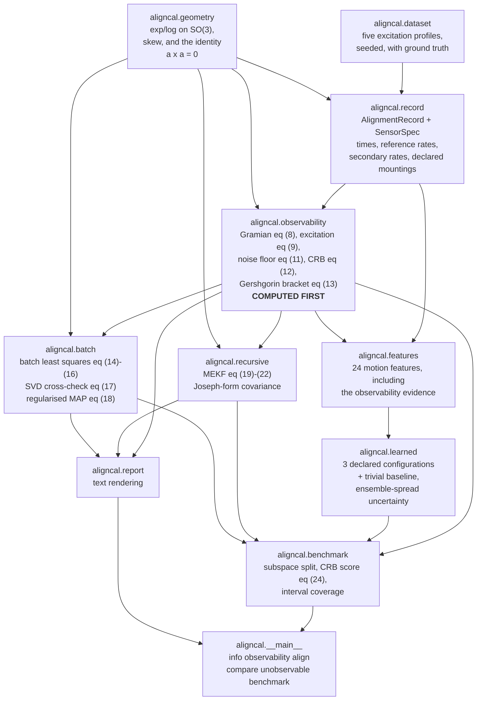
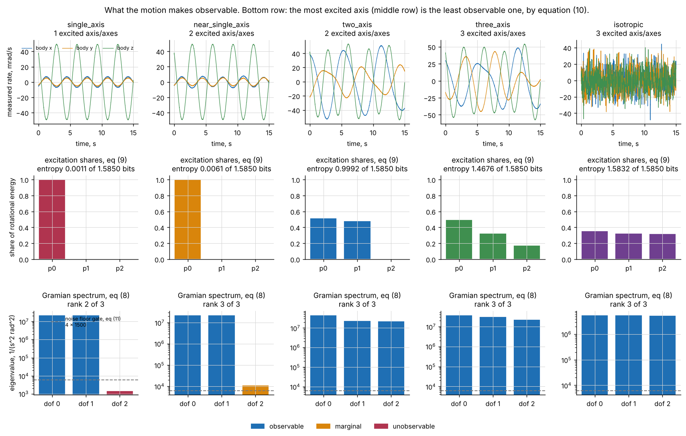
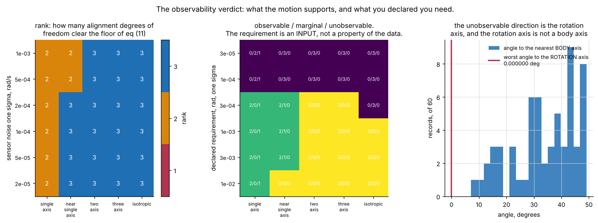
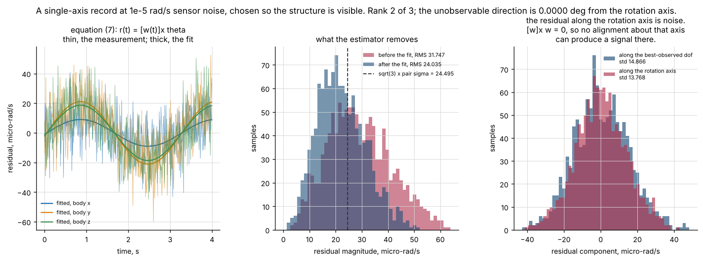
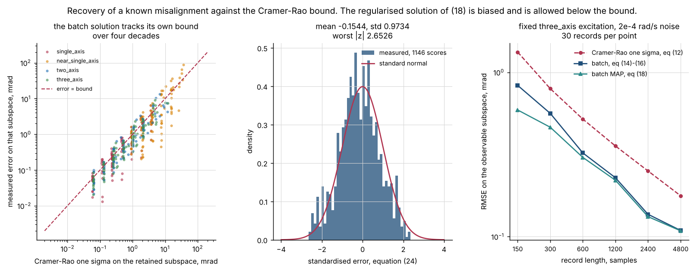
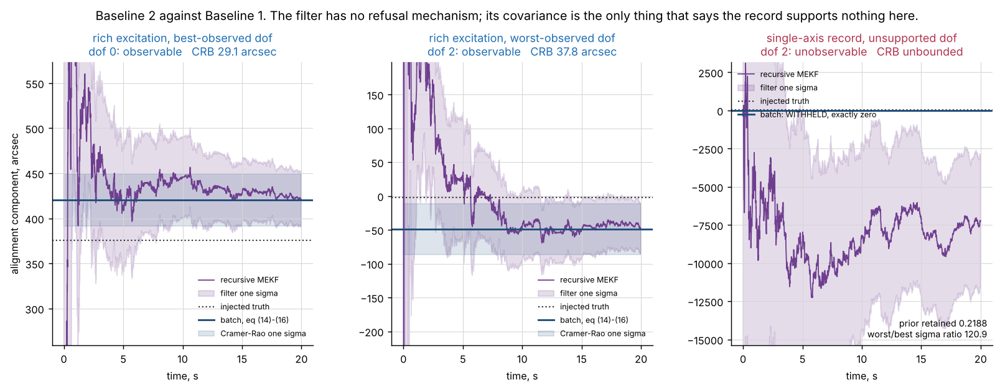
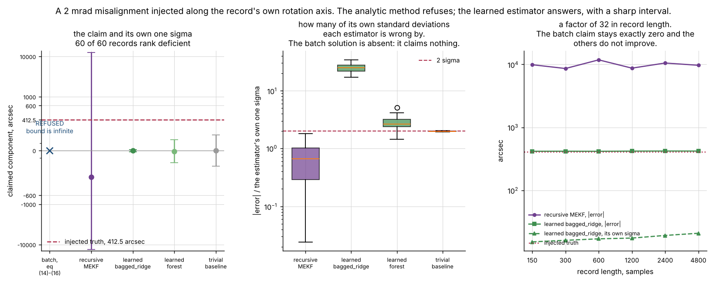
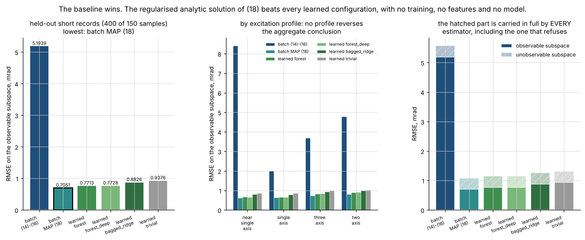
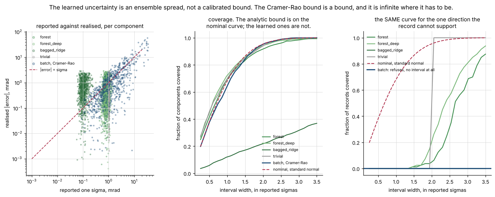
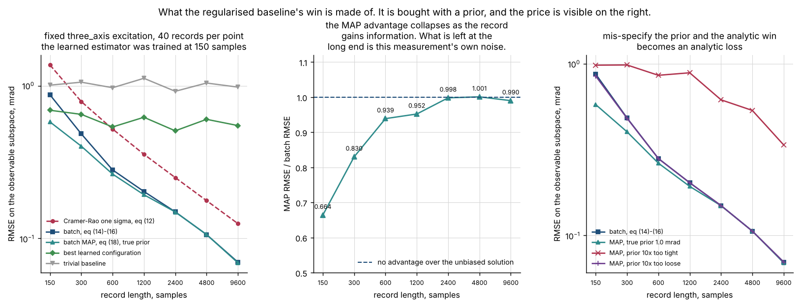

# aligncal

Estimate relative sensor alignment from flight time series, and say first which alignment degrees of freedom the motion supports.


## The problem

You have a pass of rate data from two sensors on the same vehicle and a declared
mounting geometry, and you want the relative misalignment between them. The
estimator will return three numbers whatever the vehicle did, and if the vehicle
spent that pass rotating about one axis, the component of the misalignment about
that axis is not in the data at all — not poorly determined, not determined. The
missing part is not a better estimator: it is a statement, before the estimate,
of which degrees of freedom the motion actually excited.

## What this does

- **Reports observability first, as computed output.** The observability Gramian
  per sensor, its eigendecomposition, the Cramer-Rao bound per degree of freedom
  and per body axis, and a three-valued verdict — observable, marginal,
  unobservable. It is the first field of every result object and every estimator
  takes it as a required argument, so an alignment number cannot be read without
  it.
- **Names the unobservable direction as the rotation it corresponds to.** The
  Gramian of equation (8) and the normalised rate second moment of equation (9)
  share eigenvectors exactly, so the least observable alignment direction is the
  most excited rotation axis. Measured over 60 seeded single-axis records: the
  worst-observed Gramian direction lies **0.000000 deg** from the record's
  dominant rotation axis, while that axis is never closer than **7.0421 deg** to
  a body axis.
- **Refuses to be fooled by a rank test.** The Gramian is built from the
  *measured* reference rate, so the reference sensor's own noise fills the null
  space at `2 n sigma^2` per sample. `numpy.linalg.matrix_rank` reports rank 3 on
  **5 of 5** single-axis records that support 2. The declared noise floor of
  equation (11) reports 2 on all five.
- **Gives two analytic solutions that agree.** A batch Wahba-type least-squares
  solution restricted to the floor-clearing subspace, cross-checked against
  Markley's SVD solution, and a multiplicative extended Kalman filter scored
  against it. They agree to **0.052809** of the Cramer-Rao one sigma on
  well-conditioned records and **0.352091** on full-rank records of any
  conditioning.
- **Measures what a learned estimator does where the data runs out.** With 2 mrad
  injected along a single-axis record's own rotation axis, the sharpest of three
  declared learned configurations reports a one sigma of **14.3540 arcsec** and
  is wrong by **29.0693** of it, with two-sigma coverage of **0.0000** over 120
  records. The batch solution withholds the direction and reports an infinite
  bound on all 120.

## Who it is for

- Flight dynamics and AOCS engineers deciding whether a pass of data supports an
  alignment update at all.
- Anyone who has been handed an alignment number and needs to know which of its
  components the data could have produced.
- Test engineers designing an excitation manoeuvre, who need to know how much
  rotation about how many axes a declared alignment requirement implies.

## Who it is not for

- **Anyone who wants attitude.** This package does not estimate where the vehicle
  is pointing. It estimates a fixed relative rotation between two rate sensors.
  For single-epoch attitude from vector pairs, use a Wahba solver.
- **Anyone who needs a calibration.** An observable alignment is not a calibrated
  one. Observability is a statement about the record, not about the instrument,
  and nothing here may be applied to flight software.
- **Real-time or onboard use.** The recursive estimator runs online in the sense
  that it processes one sample at a time, but it is a Python loop over 3x3
  matrices written for clarity and it is not in a control path.
- **Anyone expecting a certified tool.** Research grade. Every number comes from
  a synthetic generator whose only sensor error is white noise.
- **Anyone who needs a filtering library.** Use `filterpy`. This package has one
  filter, for one state, with a fixed model.

## How it differs from the other attitude products in this portfolio

Two products in this mission's portfolio are adjacent and this one is not a
substitute for either. **P026 WahbaKit** solves attitude from vector pairs at a
single epoch: one time, many vectors, find the rotation. **P017 EstimKit** is
general estimation machinery. This is the **time-series relative alignment**
problem: two sensors, many times, find the fixed rotation between them — and its
characteristic failure mode is not noise or outliers but a degree of freedom the
motion never excited, which no amount of data recovers and which a single-epoch
formulation does not have.

## Alternatives, honestly

| alternative | what it does better | when to use this instead |
|---|---|---|
| [`scipy.spatial.transform`](https://docs.scipy.org/doc/scipy/reference/spatial.transform.html) | Rotations, properly. Quaternions, Euler angles, Davenport, slerp, `align_vectors` with weights and a returned sensitivity matrix, all faster and far better tested than the SO(3) algebra here. This package's rotation code is cross-checked against it to 1e-14 and depends on it for exactly that. | When the question is which components of a relative rotation a *time series* supports, before you solve for it. `align_vectors` will return a rotation from a rank-deficient set without comment; this package reports the rank first and withholds the direction. |
| [`numpy.linalg`](https://numpy.org/doc/stable/reference/routines.linalg.html) | `eigh`, `svd`, `solve`, `matrix_rank`, `lstsq`, `pinv` — everything here is a thin layer over them and depends on them. | When a bare numerical rank test is the wrong test. Measured here: `matrix_rank` reports 3 on 5 of 5 records that physically support 2, because the reference sensor's own noise fills the null space. The floor gate of equation (11) is the contribution. |
| [`filterpy`](https://filterpy.readthedocs.io/) | A real filtering library: Kalman, EKF, UKF, particle filters, smoothers, fading memory, adaptive filters, and a book to go with it. If you want to build a filter, build it there. | When you want one specific alignment filter whose covariance is interpreted for you, scored against a batch reference, and reported alongside a verdict that says which of its states the record could inform. **`filterpy` is not installed in this repository's measured environment and no number here is compared against it.** |

The honest summary: `scipy.spatial.transform` and `numpy.linalg` do the
mathematics, and you should use them. This package's contribution is **the
observability report in front of the alignment estimate**.

## Install and first run

```bash
git clone https://github.com/OmAcharya-avtr/aligncal.git
cd aligncal
python -m venv .venv && source .venv/bin/activate
pip install -e ".[dev]"
python -m pytest tests/ -q
python -m aligncal observability --profile single_axis --samples 1500
```

The test run ends (the elapsed time varies between runs and is not quoted):

```
307 passed
```

and the observability command prints, with no estimate at all:

```
OBSERVABILITY VERDICT (computed before any estimate)
  provenance        : aligncal.dataset.generate(profile='single_axis', samples=1500, rate_hz=100, amplitude=0.05, noise_sigma=0.0002, seed=20261029)
  samples           : 1500, duration 14.99 s
  excitation shares : p0 0.999936, p1 0.000033, p2 0.000031
  excitation entropy: 0.001050 bits of a possible 1.584963
  dominant rotation axis: [-0.1394, -0.1048, +0.9847]
sensor secondary_1: rank 2 of 3 -- RANK DEFICIENT
  samples 1500, rotational energy 1.8394 rad^2/s^2
  noise floor (eq 11) 1500, declared floor factor 4, declared requirement 0.001 rad
  Gramian condition number 15588.3
  lambda_min bracket (eq 13) [-4.82905e+06, 701281], consistent: True
  the record does NOT support these degrees of freedom at any data volume:
    dof 2: rotation about 10.0 deg from the z axis [-0.1394, -0.1048, +0.9847] -- unobservable, CRB unbounded, excitation share 0.999936, floor ratio 0.9833
    the dominant rotation axis of this record is [-0.1394, -0.1048, +0.9847]; the worst-observed direction lies 0.0000 deg from it
    dof 0: rotation about 14.5 deg from the y axis [+0.2124, +0.9681, +0.1332] -- observable, CRB 43.02 arcsec, excitation share 0.000031, floor ratio 1.533e+04
    dof 1: rotation about 14.7 deg from the x axis [+0.9672, -0.2277, +0.1127] -- observable, CRB 43.02 arcsec, excitation share 0.000033, floor ratio 1.533e+04
    dof 2: rotation about 10.0 deg from the z axis [-0.1394, -0.1048, +0.9847] -- unobservable, CRB unbounded, excitation share 0.999936, floor ratio 0.9833
  per-body-axis CRB one sigma: x unbounded, y unbounded, z unbounded

NO ESTIMATE WAS COMPUTED. The verdict above is what gates one, and it is the first output of every call in this package.
```

## A worked example

Lifted from `validation/worked_example.py` between its two `README BLOCK`
markers, with that script's output helper spelled `print`. Its output is below
it, copied from `validation/worked_example_output.txt`, which that script
writes.

```python
import numpy as np

from aligncal import batch, dataset, observability

generated = dataset.generate(profile="single_axis", samples=1500, seed=9091)
record = generated.record

# The verdict is computed BEFORE any estimate, and it is the first field of
# the result. Nothing in this package returns an alignment without it.
verdict = observability.assess(record, required_sigma_rad=1.0e-3)
sensor = verdict["secondary_1"]

print(f"samples                  : {len(record)}")
print(f"excitation shares (eq 9)  : {np.array2string(verdict.excitation, precision=6)}")
print(f"excitation entropy        : {verdict.excitation_entropy:.6f} of 1.584963 bits")
print(f"Gramian rank (eq 8, 11)   : {sensor.rank} of 3")
print(f"dominant rotation axis    : {np.array2string(verdict.dominant_axis, precision=4)}")
print("")

print("per degree of freedom, worst last:")
for dof in sensor.degrees_of_freedom:
    bound = (
        "unbounded"
        if not np.isfinite(dof.crb_sigma_rad)
        else f"{dof.crb_sigma_arcsec:9.3f} arcsec"
    )
    print(
        f"  dof {dof.index}  {dof.verdict:<13s} CRB {bound:>18s}  "
        f"excitation share {dof.excitation_share:.6f}"
    )
print("")

unsupported = sensor.unobservable_directions[0]
print(f"the record does not support dof {unsupported.index}, and that direction is")
print(f"  {np.array2string(unsupported.direction, precision=4)}")
print(f"which is {sensor.unobservable_axis_angle_deg:.4f} deg from the dominant rotation axis.")
print("No volume of this motion would change that: by equation (10) the Gramian")
print("eigenvalue along a rotation axis is (W / s^2) (1 - p) with p = 1.")
print("")

# Only now the estimate, which takes the verdict as a required argument.
solution = batch.solve(record, verdict, "secondary_1")
print(f"batch estimate (eq 14-16) : "
    f"{np.array2string(solution.theta_mrad, precision=6)} mrad")
print(f"withheld degrees of freedom: {solution.withheld}")
for index in solution.withheld:
    direction = sensor.degrees_of_freedom[index].direction
    print(f"  component along dof {index}   : "
        f"{float(np.dot(solution.theta_rad, direction)):+.3e} rad, projected out")
    print(f"  bound reported there      : {solution.sigma_rad_in_direction(direction)}")
print("")

truth = generated.truth["secondary_1"]
print(f"injected truth            : {np.array2string(truth * 1e3, precision=6)} mrad")
observable_error = sensor.project_observable(solution.theta_rad - truth)
unobservable_error = sensor.project_unobservable(solution.theta_rad - truth)
arcsec = 206264.806247
print(f"error, observable part    : "
    f"{np.linalg.norm(observable_error) * arcsec:.4f} arcsec")
print(f"error, unobservable part  : "
    f"{np.linalg.norm(unobservable_error) * arcsec:.4f} arcsec")
print("The second figure is the component of the truth the record cannot support.")
print("Every estimator carries it in full, including this one, which declines to")
print("guess at it rather than reporting a number for it.")
```

```
samples                  : 1500
excitation shares (eq 9)  : [9.999363e-01 3.364890e-05 3.007891e-05]
excitation entropy        : 0.001044 of 1.584963 bits
Gramian rank (eq 8, 11)   : 2 of 3
dominant rotation axis    : [ 0.8992  0.0024 -0.4375]

per degree of freedom, worst last:
  dof 0  observable    CRB      43.061 arcsec  excitation share 0.000030
  dof 1  observable    CRB      43.061 arcsec  excitation share 0.000034
  dof 2  unobservable  CRB          unbounded  excitation share 0.999936

the record does not support dof 2, and that direction is
  [ 0.8992  0.0024 -0.4375]
which is 0.0000 deg from the dominant rotation axis.
No volume of this motion would change that: by equation (10) the Gramian
eigenvalue along a rotation axis is (W / s^2) (1 - p) with p = 1.

batch estimate (eq 14-16) : [0.478813 0.797257 0.988465] mrad
withheld degrees of freedom: (2,)
  component along dof 2   : -6.706e-20 rad, projected out
  bound reported there      : inf

injected truth            : [-1.027121  0.969418  1.736265] mrad
error, observable part    : 36.4446 arcsec
error, unobservable part  : 346.7128 arcsec
The second figure is the component of the truth the record cannot support.
Every estimator carries it in full, including this one, which declines to
guess at it rather than reporting a number for it.
```

The 346.7128 arcsec is the point. It is the component of the truth the record
cannot support, and it is carried in full by every estimator in this package and
by every estimator anywhere — including this one, which declines to report a
number for it rather than guessing.

## Architecture



Every arrow out of `aligncal.observability` is load-bearing. `batch.solve` and
`recursive.run` take an `ObservabilityReport` as a **required positional
argument**, not an optional one, so the verdict cannot be produced after the
estimate it gates; `tests/test_integration.py` asserts that omitting it is a
`TypeError` and that `observability` is the first field of every result
dataclass. The arrow into `aligncal.features` is there because the learned
estimator is given the observability evidence too — the excitation shares, the
dominant axis and the Gramian structure — so that its behaviour in the
unsupported direction cannot be blamed on missing information.

## Screenshots

Every figure is produced by a script in `examples/`, so none can drift from the
code.



The five declared excitation profiles, their excitation shares and their Gramian
spectra. Notice the bottom-left panel: the single-axis record's third eigenvalue
sits *below* the noise-floor gate, and the middle row shows why — all the
rotational energy is on one axis, and by equation (10) that makes the alignment
about it the least observable direction, not the most.



Rank against excitation and noise, the three-valued verdict against the declared
requirement, and the angle between the worst-observed direction and the rotation
axis. Notice the middle panel: the verdict depends on a requirement you declare,
and "observable" means nothing without one.



The residual of equation (7) with the fit on top, what the fit removes, and the
residual resolved along the rotation axis. Notice the right-hand panel: the
component along the rotation axis is pure noise, because `[w]x w = 0`.



864 records over the swept grid. Notice the middle panel: the standardised error
of equation (24) is standard normal to a measured mean of -0.073846 and standard
deviation of 0.959812, which is a check on the estimator and on the bound
together.



The MEKF converging onto the batch solution, per degree of freedom. Notice the
right-hand panel: on a single-axis record the filter never converges on the
third degree of freedom and keeps 22 per cent of the prior it started with,
while the batch solution withholds the direction outright.



The product's headline result. Notice the middle panel: the learned
`bagged_ridge` configuration is wrong by about 30 of its own standard
deviations, and the batch solution is absent from that panel because it claims
nothing.



Notice the left panel: the lowest bar is the regularised analytic baseline, not
a learned configuration, and the middle panel shows no excitation profile
reverses it.



Notice the difference between the middle and right panels: the same models on
the same records are at or above nominal coverage along the best-observed
direction and collapse to near zero along the unsupported one.



Notice the right-hand panel: a prior ten times too tight turns the analytic win
into an analytic loss at every record length.

## Validation evidence

Full detail, including every check run and every failure, is in
[`validation/VALIDATION.md`](validation/VALIDATION.md). 94 checks across nine
scripts, 0 failed. Selected numbers:

| check | reference | result | tolerance |
|---|---|---|---|
| equation (10) as an identity | `numpy.linalg.eigvalsh` against the closed form | worst relative departure **6.870e-16** | 1e-9 |
| the unobservable direction is the rotation axis | 60 seeded single-axis records | worst angle **0.000000 deg** | 0.5 deg |
| the result is not trivial | the same 60 records | the motion is never within **7.0421 deg** of a body axis | > 5 deg |
| an independent bracket on lambda_min | Gershgorin 1931 and the Rayleigh quotient | **0 of 5** profiles inconsistent with `eigh` | — |
| a bare rank test on a single-axis record | `numpy.linalg.matrix_rank` | reports 3 on **5 of 5** records that support 2 | — |
| the floor gate of equation (11) | the same records | reports 2 on **5 of 5** | — |
| recovery against the Cramer-Rao bound | 864 records, 2290 standardised scores | mean **-0.073846**, std **0.959812**, worst \|z\| 2.7673 | mean < 0.1, std in [0.85, 1.20] |
| the Cramer-Rao interval, measured as an interval | 1534 retained degrees of freedom | **0.953064** at two sigma | nominal 0.954500 |
| batch against recursive, well conditioned | 108 records | worst **0.052809** of the bound | 0.1 |
| batch against recursive, full rank | 131 records | worst **0.352091** of the bound | 0.5 |
| batch against recursive, **rank deficient** | 49 records | worst **1.942601** of the bound | none declared; reported as measured |
| the learned estimator in the unsupported direction | 120 records, 2 mrad injected along the rotation axis | two-sigma coverage **0.0000**, **29.0693** sigma wrong | nominal 0.954500 |
| the same models along the best-observed direction | the same 120 records | two-sigma coverage **1.0000**, **1.0000**, 0.7250 | nominal 0.954500 |
| **the baseline wins** | 600 held-out short records | analytic MAP **0.697326 mrad** against best learned **0.760152 mrad** | — |
| the learned estimator against a trivial baseline | the same 600 records | learned 0.760152 against trivial 0.938906 mrad | — |
| the recursive filter in the unsupported direction | 49 rank-deficient records | two-sigma coverage **0.591837** | nominal 0.954500 |
| controls | 16, each anchored on a truth | 10 must fire and fired; 6 must not and did not | — |
| `pytest.approx` audit | the suite re-run with the default patched off | **1 of 307** tests depends on it, the one that demonstrates it | — |
| every script from five working directories | filesystem root, temp, repo root, `validation/`, `src/` | all exit 0 | — |

**Four of these are unfavourable to parts of this package and are the reason to
trust the rest.**

1. **The analytic baseline beats the learned component.** The regularised batch
   solution of equation (18) reaches 0.697326 mrad on the observable subspace
   against 0.760152 mrad for the best learned configuration, a margin of 9.01
   per cent, and on every one of the four excitation profiles. The learned
   component does beat a trivial predictor by 19.04 per cent and the specified
   unbiased baseline by a factor of 7.5, and all three figures are published.
2. **The recursive estimator is overconfident in the unsupported direction too.**
   Its two-sigma interval contains the truth on 0.591837 of rank-deficient
   records. The mechanism is the same noise floor of equation (11): the filter
   builds its Jacobian from the measured reference rate and reduces its prior on
   the strength of the reference sensor's own noise. The only estimator here
   that is not overconfident there is the batch solution, which withholds it.
3. **An unconstrained solution is wrong about the directions it CAN determine.**
   The SVD solution of equation (17) picks up a gauge rotation with a median of
   1.5355 rad in the null direction, and the recursive estimator's leakage
   reaches 1.942601 of the Cramer-Rao one sigma on rank-deficient records
   against 0.352091 on full-rank ones. A rank deficiency is not confined to the
   direction that is rank deficient.
4. **One declared learned configuration is overconfident everywhere**, not only
   in the unobservable subspace: `bagged_ridge` reports a median one sigma 12
   times below its realised error on the whole population.

## API reference

<details>
<summary>Public surface, one line each, with units</summary>

### `aligncal`

- `align(measurements, *, required_sigma_rad=1e-3, floor_factor=4.0, with_recursive=False, initial_sigma_rad=0.1) -> AlignmentResult` — the front door. Assesses observability, then estimates. `AlignmentResult.observability` is its first field.

### `aligncal.geometry`

- `skew(vector) -> ndarray` — `[a]x`, the cross-product matrix; units follow the input.
- `unskew(matrix) -> ndarray` — the inverse, taken on the antisymmetric part.
- `rotation_from_vector(theta) -> ndarray` — Rodrigues, equation (2); `theta` in radians.
- `rotation_to_vector(rotation) -> ndarray` — the principal logarithm, radians, `|theta| <= pi`.
- `rotation_angle(rotation) -> float` — radians, in `[0, pi]`.
- `is_rotation(matrix, tolerance=1e-9) -> bool`, `angle_between(first, second) -> float` — radians.

### `aligncal.record`

- `SensorSpec(name, noise_sigma, mounting=I)` — `noise_sigma` is the per-axis one sigma of a single rate sample in rad/s and must be positive; `mounting` is the declared nominal rotation, checked for orthogonality.
- `AlignmentRecord(times, reference, reference_rates, secondaries, secondary_rates, provenance)` — times in s and strictly increasing, rates in rad/s.
- `AlignmentRecord.derotated(name) -> ndarray`, `.pair_sigma(name) -> float`, `.subrecord(stop, start=0)`, `.names`, `.duration_s`, `.mean_interval_s`.
- `residuals(record, name) -> ndarray` — equation (7), rad/s.

### `aligncal.observability`

- `assess(record, *, required_sigma_rad=1e-3, floor_factor=4.0) -> ObservabilityReport` — **call this first.**
- `gramian(record, name) -> ndarray` — equation (8), units 1/(s^2 rad^2).
- `excitation_spectrum(record) -> (p, V, W)` — equation (9); `p` dimensionless and descending, `W` in rad^2/s^2.
- `dominant_rotation_axis(record) -> ndarray` — the unit axis the record rotated about most.
- `noise_floor_eigenvalue(record, name) -> float` — equation (11).
- `eigenvalue_bracket(matrix) -> (lower, upper)` — equation (13); independent of any eigensolver.
- `SensorObservability.rank`, `.rank_deficient`, `.degrees_of_freedom`, `.unobservable_directions`, `.marginal_directions`, `.observable_mask`, `.basis`, `.axis_crb_sigma_rad()`, `.project_observable(v)`, `.project_unobservable(v)`, `.summary()`.
- `DegreeOfFreedom.verdict`, `.eigenvalue`, `.crb_sigma_rad`, `.crb_sigma_arcsec`, `.excitation_share`, `.floor_ratio`, `.direction`, `.describe()`.

### `aligncal.batch`

- `solve(record, observability, name, *, max_iterations=40, tol=1e-12, max_step_rad=0.2) -> BatchSolution` — equations (14)-(16); exactly zero in every withheld direction.
- `solve_map(record, observability, name, *, prior_sigma_rad, ...) -> BatchSolution` — equation (18); biased, withholds nothing.
- `wahba_svd(record, name) -> (theta_rad, singular_values)` — equation (17), the independent cross-check.
- `normal_equation_rhs(record, name) -> ndarray` — equation (15).
- `predicted_residual(record, theta_rad) -> ndarray` — rad/s.
- `BatchSolution.theta_rad`, `.theta_mrad`, `.magnitude_arcsec`, `.withheld`, `.covariance`, `.sigma_rad_in_direction(d)` (`inf` on a withheld direction), `.rotation`, `.summary()`.

### `aligncal.recursive`

- `run(record, observability, name, *, initial_sigma_rad=0.1, process_noise=0.0, store_history=True) -> RecursiveSolution` — equations (19)-(22).
- `RecursiveSolution.theta_rad`, `.covariance`, `.history`, `.sigma_history`, `.prior_retention()`, `.inflation_ratio()`, `.sigma_rad_in_direction(d)`, `.joseph_symmetry`, `.min_eigenvalue`, `.summary()`.

### `aligncal.dataset`

- `generate(*, profile, samples, rate_hz, amplitude, noise_sigma, theta_max_rad, n_secondaries, seed, leak, theta_rad=None) -> GeneratedRecord` — rates in rad/s, misalignment in radians.
- `rate_profile(profile, times, *, amplitude, seed, leak) -> ndarray` — equation (23), rad/s.
- `training_population(*, count, samples, rate_hz, seed, profiles, amplitude_range, noise_range, theta_max_rad) -> list[GeneratedRecord]`.

### `aligncal.features`, `aligncal.learned`, `aligncal.benchmark`

- `features.build(record, name, observability=None) -> ndarray` — 24 features, order in `FEATURE_NAMES`.
- `features.build_population(population) -> (matrix, targets, profiles)`.
- `LearnedEstimator(kind=..., seed=..., **parameters).fit(features, targets).predict(features) -> Prediction`.
- `TrivialEstimator().fit(features, targets).predict(features) -> Prediction`.
- `Prediction.theta_rad`, `.sigma_rad`, `.members`, `.sigma_in_direction(d)`, `.component_in_direction(d)` — radians.
- `benchmark.subspace_split(error, sensor)`, `benchmark.crb_z_scores(error, sensor)` — equation (24), `nan` on a withheld direction.
- `benchmark.coverage(errors, sigmas, k=2.0)`, `benchmark.score(label, errors, sensors) -> ScoreTable` — milliradians.

### `aligncal.report`

- `observability_lines(report)`, `solution_lines(solution)`, `compare_lines(batch_solution, recursive_solution, *, truth_rad=None)` — all return `list[str]` and print nothing.

</details>

## Limitations

- **Synthetic data only.** Every number comes from `aligncal.dataset`, whose
  closed forms are printed in its module docstring. No flight data is used
  anywhere and the measured scores do not transfer to a real vehicle.
- **White noise is the only sensor error modelled.** No bias, no scale-factor
  error, no angular random walk, no g-sensitivity, no quantisation, no latency,
  no time-tag error. A real relative-alignment estimate is usually limited by one
  of those and nothing here says anything about them. This is the largest single
  gap between this package and a usable tool.
- **A mis-declared mounting is indistinguishable from a misalignment.** Control
  C8 measures it: a 5 mrad error in the declared geometry moves the estimate by
  5.000000 mrad. If the declared mounting is wrong, the estimate absorbs the
  error silently.
- **The Gramian is built from the measured reference rate**, so it is an
  errors-in-variables problem and the sensitivity matrix carries noise. That is
  what makes the noise floor of equation (11) necessary and it is also a
  second-order bias on the estimate that is not corrected.
- **The verdict depends on two declared thresholds.** The floor factor of 4 is
  not load-bearing — the rank verdict is unchanged from 1.5 to 64 on every
  profile — but the three-valued verdict is sensitive to the declared
  requirement, by design. "Observable" means nothing without a requirement.
- **The relative linearisation error of the residual is `O(|theta|)`, not
  `O(|theta|^2)`**: about 5e-3 at 10 mrad. The batch and recursive estimators
  re-linearise and do not inherit it; a single linear pass and the learned
  estimator do.
- **The learned component loses to the strengthened analytic baseline**, by 9.01
  per cent on the observable subspace. It is kept because the comparison is the
  product's most useful result, not because it is the recommended estimator.
- **The learned uncertainty is an ensemble spread, not a calibrated interval**,
  and in a direction the record cannot support it does not contain the truth.
- **The misalignment is assumed constant over the record.** The recursive
  estimator accepts a random-walk process noise for a drifting one, but no
  time-varying misalignment is generated or scored anywhere.
- **One reference sensor.** Several secondaries are supported and each is
  estimated independently against the reference; a joint solution over a sensor
  network is not implemented.
- **Dependency ceilings are real costs.** `scikit-learn` is pinned below 1.10
  because `aligncal.learned` reads `RandomForestRegressor.estimators_` and
  evaluates per-member predictions, which no cross-minor stability promise
  covers. This package cannot take a 1.10 release without a port and a
  re-measure, and that is a cost, not a free safety measure.
- **The dependency ranges were not exercised at both ends.** The build
  environment is a shared pre-pinned interpreter this product may not modify, so
  `numpy` was measured only at 2.5.3, `scipy` at 1.18.1 and `scikit-learn` at
  1.9.1. All three ranges are bounded on both sides at those measurements, but
  the floors are reasoned rather than run. The one exception is `ruff`, where
  0.16.9 and 0.17.3 were both available and the source measured clean under
  both.
- **No hyperparameter search was run** for the learned model. Three declared
  configurations, all reported.
- **A full-rank verdict does not mean the alignment estimate is right.** It means
  the motion excited every degree of freedom above a declared noise floor.

## Safety statement

This software is research-grade. It is not flight-qualified, not certified, and
not approved for operational aerospace use. An alignment estimate produced here
must not be applied to flight software, and an observable alignment is not a
calibrated one.

## Reproducing every number

```bash
python -m pytest tests/ -q --junitxml=junit_self.xml      # 307 tests
python validation/validate_observability.py               # §1 of VALIDATION.md
python validation/validate_recovery_grid.py               # §2
python validation/validate_recursive_agreement.py         # §3
python validation/validate_unobservable.py                # §4
python validation/validate_learned.py                     # §5
python validation/validate_controls.py                    # §6
python validation/validate_cli.py                         # §7, the command line
python validation/worked_example.py                       # the worked example above
python validation/probe_working_directories.py            # every script from five directories

python examples/rate_profiles.py
python examples/observability_map.py
python examples/residual_structure.py
python examples/recovery_vs_crb.py
python examples/batch_versus_recursive.py
python examples/unobservable_subspace.py
python examples/learned_versus_baselines.py
python examples/learned_calibration.py
python examples/prior_and_record_length.py
```

`junit_self.xml` is covered by an anchored pattern in `.gitignore`. Count the
tests from it, never from the pytest summary line — a suite that collects
nothing prints success:

```bash
python - <<'PY'
import xml.etree.ElementTree as ET
root = ET.parse("junit_self.xml").getroot()
suite = root if root.tag == "testsuite" else root.find("testsuite")
print("declared", suite.get("tests"), "counted", len(suite.findall(".//testcase")))
PY
```

```
declared 307 counted 307
```

Seeds: training 20261029, test 70120261, controls 55120261, grid 31420261.
Per-cell seeds are derived from the cell indices inside each script.

## Licence, citation, credits

Apache-2.0. Copyright 2026 OPTIMA Organisation. See [`LICENSE`](LICENSE).

Citation metadata is in [`CITATION.cff`](CITATION.cff). Model and data
provenance are in [`MODEL_CARD.md`](MODEL_CARD.md) and
[`DATASET_CARD.md`](DATASET_CARD.md).

References the implementation rests on:

- Wahba, G. (1965). A least squares estimate of satellite attitude. *SIAM
  Review* 7(3), 409. The minimisation that equation (14) is the linearisation
  of.
- Markley, F. L. (1988). Attitude determination using vector observations and
  the singular value decomposition. *Journal of the Astronautical Sciences*
  36(3), 245–258. The SVD solution of equation (17), used as the independent
  cross-check.
- Lefferts, E. J., Markley, F. L. and Shuster, M. D. (1982). Kalman filtering for
  spacecraft attitude estimation. *Journal of Guidance, Control, and Dynamics*
  5(5), 417–429. The multiplicative error-state formulation and the reset of
  equation (22).
- Markley, F. L. and Crassidis, J. L. (2014). *Fundamentals of Spacecraft
  Attitude Determination and Control*, Springer. §2.9 and equation (2.113) for
  the rotation parameterisation; §6.2 for the alignment state and the convention
  of equation (4).
- Kay, S. M. (1993). *Fundamentals of Statistical Signal Processing: Estimation
  Theory*, Prentice Hall, §3.9. The Cramer-Rao bound of equation (12), which
  constrains unbiased estimators only.
- Horn, R. A. and Johnson, C. R. (2013). *Matrix Analysis*, 2nd ed., Cambridge,
  Theorems 6.1.1 and 4.2.2, and Gershgorin, S. A. (1931), *Izv. Akad. Nauk SSSR
  Ser. Mat.* 6, 749–754. The independent bracket of equation (13).
- Bar-Shalom, Y., Li, X.-R. and Kirubarajan, T. (2001). *Estimation with
  Applications to Tracking and Navigation*, Wiley, §5.2. The Joseph-form
  covariance update of equation (21).
- James, W. and Stein, C. (1961). Estimation with quadratic loss. *Proc. Fourth
  Berkeley Symp.* 1, 361–379. The bias-variance trade behind equation (18).
- Lehmann, E. L. and Casella, G. (1998). *Theory of Point Estimation*, 2nd ed.,
  Springer, §4.1. Cited for what is **not** claimed about equation (18).
- Pedregosa, F. et al. (2011). Scikit-learn: machine learning in Python. *JMLR*
  12, 2825–2830. The ensembles in `aligncal.learned`.
- Virtanen, P. et al. (2020). SciPy 1.0. *Nature Methods* 17, 261–272.
  `scipy.special.erf` for the nominal coverage figures, and
  `scipy.spatial.transform.Rotation` as the independent cross-check on
  `aligncal.geometry`.

### Credits

This is under reserved rights obtained by OPTIMA Organisation.
