# tlecheck

Screen a two-line element set before you propagate it, and say which of its problems the propagator will not report.


## The problem

You hand a two-line element set to `sgp4`, it returns a position, and the
position is wrong by ninety kilometres. The element set parsed, the propagator
reported success at every sample, its checksum was valid and every element was
inside every physical bound; the drag term's sign had flipped somewhere between
the catalogue and your disk. `sgp4` does exactly what it is for and tells you
nothing about that, because telling you is a different job.

## What this does

- **Classifies every problem it finds by measured consequence**, into
  *will fail loudly*, *silently wrong*, or *benign*. The class boundary is not
  a label: it comes from propagating the element set and its uncorrupted
  reference with `sgp4` over the same grid and differencing the positions. On a
  420-object held-out split the three classes occur 18, 112 and 290 times.
- **Reports what it cannot determine, first, as computed output.** Eleven
  limits, returned before any screen runs. Three are structural. The sharpest
  computed one is exact: the checksum detects **0.888889** of two-digit
  corruptions and **0.000000** of digit transpositions, enumerated over 91,368
  and 992 cases on line 1 and confirmed against a closed form of 72/81 derived
  by a congruence argument that enumerates nothing.
- **Separates integrity from consequence**, because a checksum says a character
  changed and nothing about what the change costs. Measured: the checksum screen
  reaches precision **1.0000** and recall **1.0000** on the 57 element sets of
  the split whose checksum should be inconsistent, and the 31 whose only
  corruption is the checksum column itself have a propagated position error of
  exactly **0.0000 km**.
- **Screens ephemeris continuity against the object's own history, in
  kilometres**, with the tolerance measured from that object rather than
  declared. It also reports the screen's own resolution, and on **4 of 6**
  orbit families that resolution is above the declared 1 km threshold, so the
  absolute test is withheld rather than returned as noise.
- **Scores a learned classifier against the rule screens and against a
  majority-class guess, and publishes the result that went against the
  specification.** The learned model reaches a silent-class recall of
  **0.7946** at a false-positive rate of 0.0455 where the swept rule baseline
  reaches **0.4286**; the rules win back **0.2153** and **0.1463** of area on
  two corruption families the model was not trained on.

## Who it is for

- Flight dynamics and operations engineers who have to decide whether an
  element set is fit to propagate before they propagate it.
- Anyone running a catalogue ingest who wants element sets rejected with a
  stated reason rather than silently accepted.
- Anyone comparing two sources for the same object and wanting the
  disagreement in kilometres rather than in digits.

## Who it is not for

- **Anyone who needs a propagator.** Use [`sgp4`](https://pypi.org/project/sgp4/).
  This package screens *for* it, depends on it, and does not reimplement any
  part of it.
- **Anyone who needs a catalogue.** This package ships none and cannot get you
  one. The authoritative source of element sets is an operator's catalogue and
  it is not redistributable.
- **Anyone who wants a guarantee that an ephemeris is accurate.** Nothing here
  can establish that, and the library says so as computed output rather than as
  a footnote.
- **Real-time or onboard use.** Everything here runs over an element set after
  the fact. It is not in a control path and must not be put in one.
- **Anyone expecting a certified tool.** Research grade. Every screening number
  is measured against a seeded synthetic corpus, not against flight data.

## Alternatives, honestly

| alternative | what it does better | when to use this instead |
|---|---|---|
| [`sgp4`](https://pypi.org/project/sgp4/) | **The correct and mature propagator, and the reference implementation of Vallado et al. (2006).** It parses a two-line element set and propagates it, and it does both well. It is a dependency of this package and every consequence number in this repository was produced by it. | Never instead — alongside. `sgp4` is where the ephemeris comes from. What it does not do is tell you the element set is three weeks stale, that the drag term's sign flipped, that two sources disagree by kilometres, or that an element is implausible for the object. Measured here: `sgp4` does not verify the checksum, and two lines of 69 spaces parse to object 0 with a mean motion of 0.0. Neither is a defect in `sgp4`; screening is a separate job and this package is that job. |
| [`astropy`](https://www.astropy.org/) | Time scales, frames, units and coordinate transformations, properly. If you need TEME to GCRS, or UTC to TT, or a quantity with units attached, use it. | When the question is whether the element set is fit to propagate. This package does one frame-free thing — differencing two positions in the same frame — and needs no transformation. **`astropy` is not installed in this repository's measured environment and no number here is compared against it.** |
| [`skyfield`](https://rhodesmill.org/skyfield/) | A complete, well-documented ephemeris and observation toolkit built on `sgp4` for Earth satellites, with topocentric passes, rise and set events, and an API designed for people rather than for FORTRAN. For computing what you can see from where you are, it is the better tool. | When you want the element set screened before it reaches `skyfield`'s `EarthSatellite`. Its `satellite.epoch` and the `sgp4` error codes give you staleness and loud failures; the silent class, the object-history consistency test and the cross-source comparison are what this package adds. **`skyfield` is not installed in this repository's measured environment and no number here is compared against it.** |
| [`numpy`](https://numpy.org/) | The array model everything here is built on, and a dependency. | When the question is a screening verdict rather than an array operation. |

The honest summary: `sgp4` propagates, `skyfield` and `astropy` give you a real
toolkit around it, and this package is a gate in front of all three. If you are
not worried about where your element sets came from, you do not need it.

## Install and first run

```bash
git clone https://github.com/OmAcharya-avtr/tlecheck.git
cd tlecheck
python -m venv .venv && source .venv/bin/activate
pip install -e ".[dev]"
python -m pytest tests/ -q
python -m tlecheck check --objects 48 --corruption sign_flip
```

The test run ends (the elapsed time varies between runs and is not quoted):

```
491 passed
```

The `check` command constructs an element set, flips the sign of its drag term,
recomputes the checksum so the line is internally consistent, and screens it.
The determinability report comes first and the verdict second:

```
constructed element set: object 40012, family leo_sun_synchronous, injected corruption 'sign_flip'
1 40012U 26012A   26200.50000000  .00002849  00000-0 -60853-4 0  1120
2 40012  97.9101 295.6019 0012975 234.2678 151.8885 14.53749915103608

==============================================================================
WHAT THIS SCREEN CANNOT DETERMINE (computed before any screen ran)
==============================================================================
[NOT DETERMINABLE] propagated_ephemeris_accuracy  basis=structural  value=-
...
==============================================================================
QUALITY VERDICT
==============================================================================
predicted consequence class : silently_wrong
equation (15) silent risk    : 20.622385
integrity intact             : yes
problems found               : 1
  - [history] history_outlier_bstar -> silently_wrong
      bstar is 82.49 robust scales from its equation (10) detrended modified
      z-score prediction 6.2426325e-05 (threshold 4, value -6.0853e-05)
```

`integrity intact : yes` is the part worth reading. The line is exactly what
its source wrote, the checksum agrees, and the element set is still wrong.

## A worked example

```python
import numpy as np

from tlecheck import dataset, screen
from tlecheck.consequence import measure
from tlecheck.elements import format_tle, parse_tle
from tlecheck.epoch import epoch_julian_date

fields = dict(
    satnum=25544, epoch_year=2019, epoch_day=343.69339541,
    inclination_deg=51.6439, raan_deg=211.2001, eccentricity=0.0007417,
    arg_perigee_deg=17.6667, mean_anomaly_deg=85.6398,
    mean_motion_rev_per_day=15.50103472, bstar=3.8792e-05,
    mean_motion_dot_rev_per_day2=1.764e-05, designator="98067A",
    element_number=999, revolution_number=20248,
)

# The element set the operator has, and the twelve that came before it.
truth = parse_tle(*format_tle(**fields), source="catalogue")
rng = np.random.default_rng(7)
history = [
    dataset.rewound(truth, -1.5 * (12 - i), source="catalogue", rng=rng)
    for i in range(12)
]

# The same element set with the drag term's sign flipped, re-checksummed.
flipped = parse_tle(*format_tle(**{**fields, "bstar": -fields["bstar"]}))

use_jd = epoch_julian_date(truth) + 1.0
verdict = screen(flipped, history=history, reference_jd=use_jd)
consequence = measure(flipped, truth, use_jd, horizon_days=7.0, samples=49)
```

Run by `validation/worked_example.py`, which printed:

```
the element set as received:
1 25544U 98067A   19343.69339541  .00001764  00000-0 -38792-4 0  9992
2 25544  51.6439 211.2001 0007417  17.6667  85.6398 15.50103472202482

checksum line 1 stated 2, computed 2 -- the line is internally consistent
integrity intact            : True
predicted consequence class : silently_wrong
equation (15) risk score    : 25.151756
problems found              : 2
  [history] history_outlier_bstar -> silently_wrong
  [continuity] ephemeris_continuity_exceeded -> silently_wrong

what this screen reports as not determinable, as returned:
  propagated_ephemeris_accuracy (structural)
  which_source_is_correct (structural)
  element_covariance (structural)
  cross_source_divergence (data-dependent)

two of the computed limits, with their numbers:
  checksum_blindness_to_double_substitution = 0.888889
  continuity_resolution_km = 0.565978

measured consequence of using it, against the uncorrupted element set:
  class            silently_wrong
  max error        121.6833 km over 7 days
  rms error        58.8670 km
  threshold        1 km (declared policy)
```

## Architecture

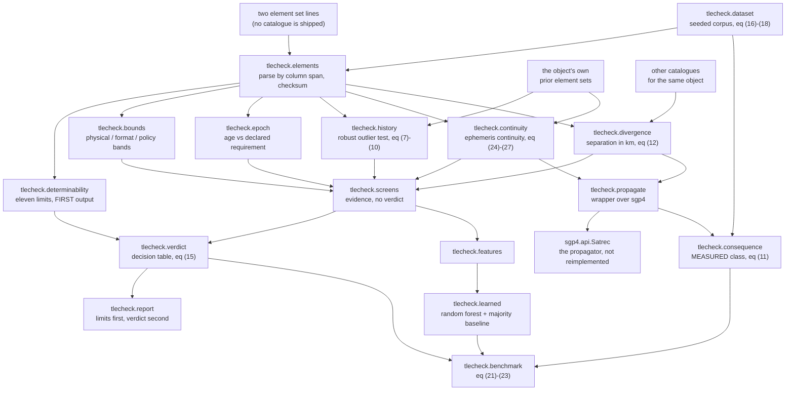

## Screenshots

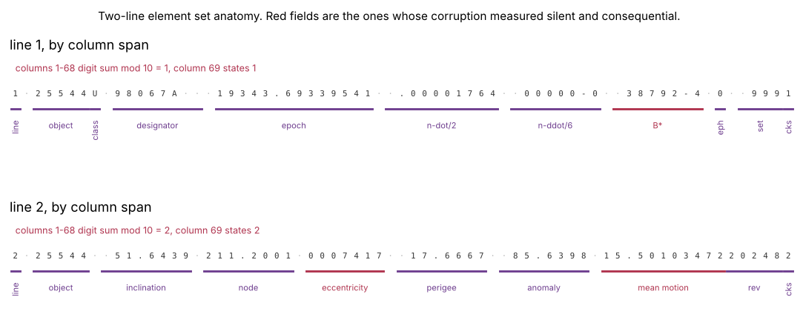

The format by column, with the checksum arithmetic printed above each line.
Notice that the checksum is a digit sum: it sees any single changed digit and
no transposition at all. The three red fields are the ones whose corruption
measured silent and consequential.

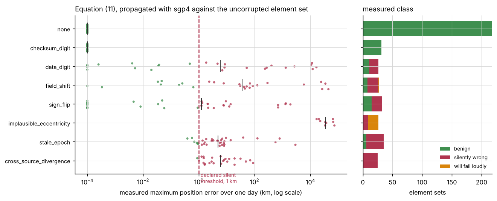

Every point is one element set's propagated position error against its
uncorrupted reference. Notice the `checksum_digit` row: it sits at the plot
floor because its error is exactly zero, and it is the one corruption the
checksum screen detects with certainty.

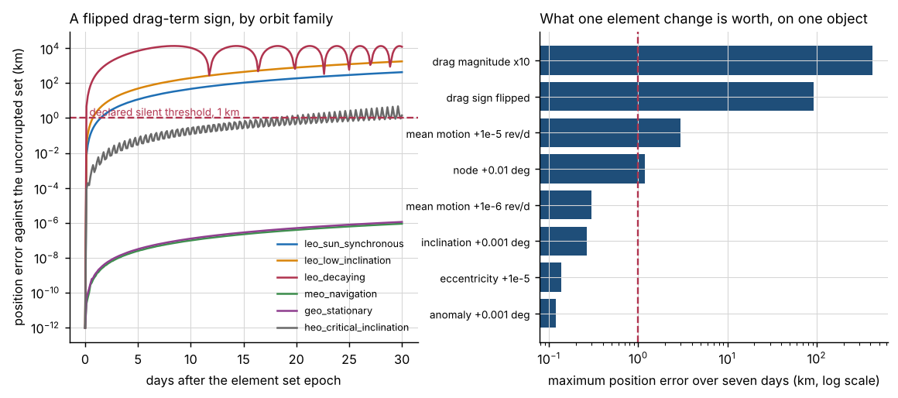

Left, a flipped drag-term sign by orbit family over thirty days. Right, what
each single element change is worth over seven days on one object. Notice that
a mean motion change of 1e-6 rev/day is worth more than a tenfold change in the
drag term.

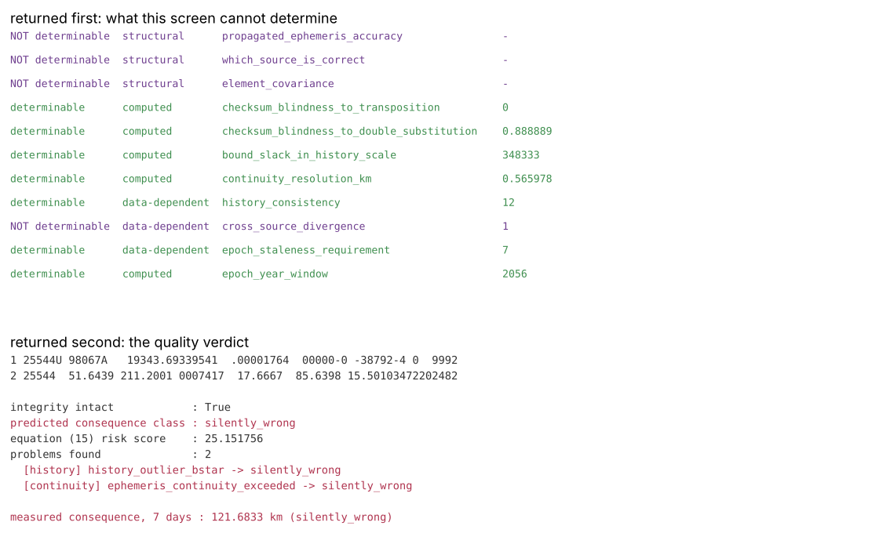

One call's output, in the order the library returns it: the eleven limits
first, the verdict second. Notice `integrity intact : True` above a
`silently_wrong` class.

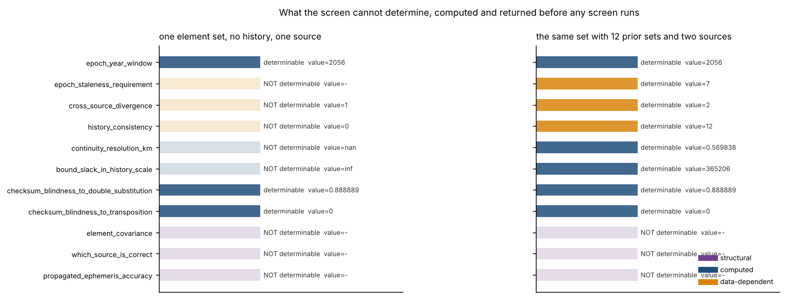

The same element set screened with no history and one source, and with twelve
prior sets and two sources. Notice which limits move and which do not: the
three structural ones are unchanged by any amount of data.

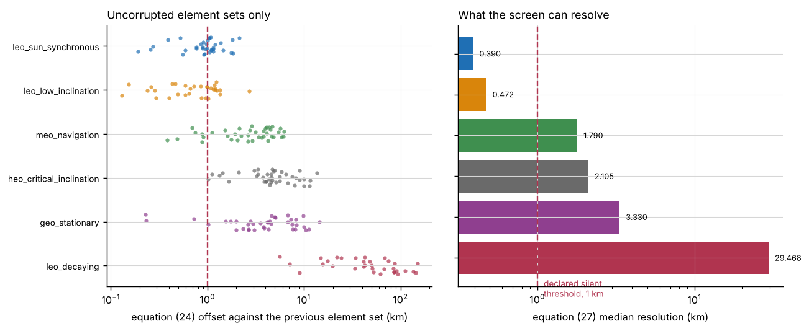

Left, the propagated disagreement between consecutive uncorrupted element sets.
Right, the robust scale of that disagreement, which is the screen's resolution.
Notice that four of the six families sit above the 1 km threshold line, so for
those objects the screen withholds its absolute test.

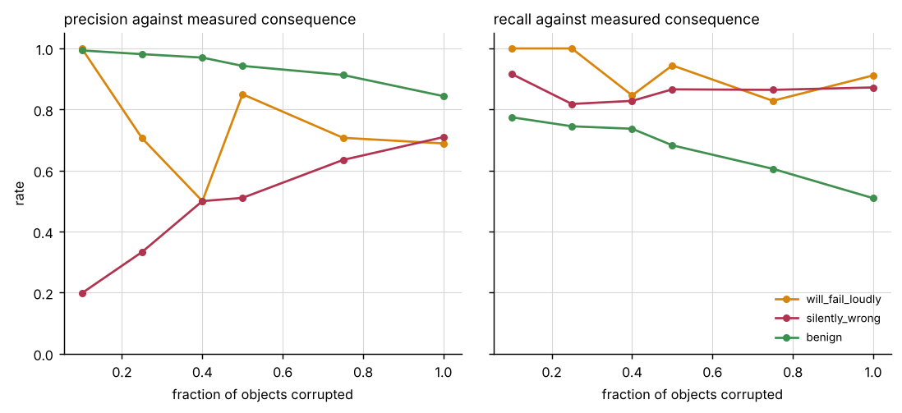

Six grid cells, 420 objects each. Notice that recall is roughly flat and
precision is not: precision is a property of the population a screen is run on.

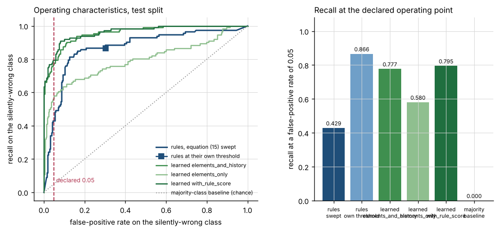

The headline comparison. Notice that the learned curves are above the rule
curve, which is **not** what the product specification predicted, and that the
majority-class baseline is the diagonal because its score is a constant.

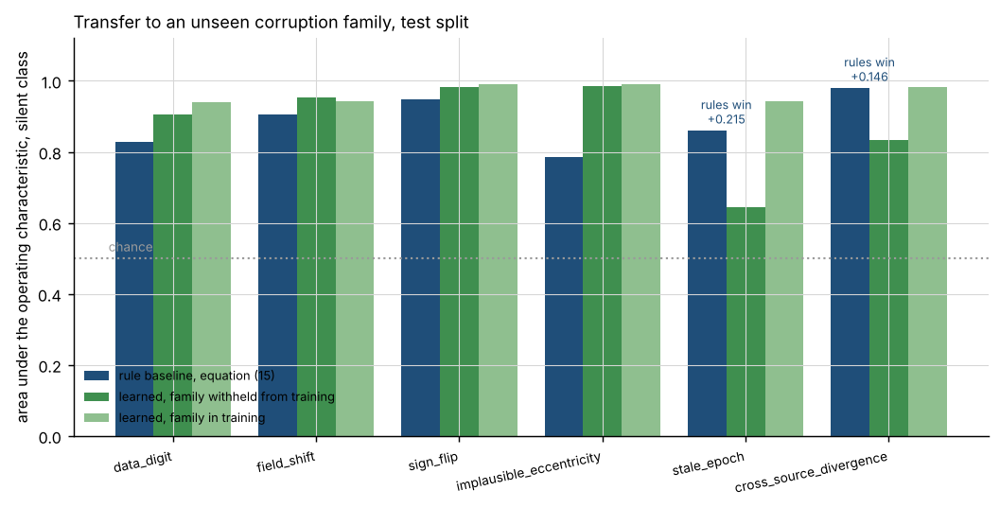

The same learned model retrained with one corruption family withheld. Notice
the two families where the rule baseline wins, and that the learned model
recovers when the family is restored to its training set.

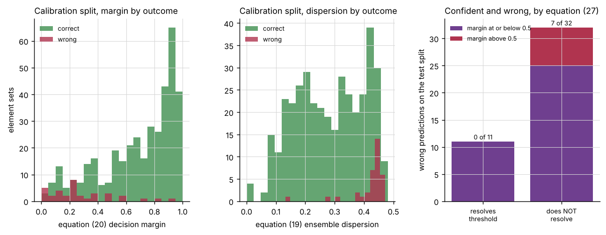

Left and centre, the two uncertainty outputs on the independent calibration
split. Right, the model's wrong answers split by whether the analytic
continuity screen could resolve the declared threshold at all. Notice that
7 of 32 errors on the unresolvable subset carry a decision margin above 0.5.

## Validation evidence

**Validation level 2.** Every number below was produced by a script in
`validation/`, executed on 2026-10-29, and every script writes its raw output
beside itself. The unfavourable results are in the table with the others.

| check | reference | result | tolerance |
|---|---|---|---|
| checksum of a published element set | the digits in column 69 of a distributed element set for object 25544 | computed **1** and **2**, stated **1** and **2** | exact integer match |
| formatting round trip | the same published element set, character for character | **all 69 columns** of both lines identical | exact string match |
| equation (13), single-digit substitution | a closed form derived by a congruence argument | enumerated **1.0000000000** over 432 cases, closed form 1 | 1e-12 |
| equation (13), digit transposition | the same closed form | enumerated **0.0000000000** over 992 cases, closed form 0 | 1e-12 |
| equation (13), two-digit substitution | the same closed form, 72/81 | enumerated **0.8888888889** over 91,368 cases | 1e-12 |
| equation (1) semi-major axis | `sgp4`'s own semi-major axis after its Kozai conversion | worst bias **2.9231 km** over six orbit families, smallest **0.0108 km** | bias < 20 km and > 0.001 km, both asserted |
| equations (16) and (17) secular rates | `sgp4`'s own `nodedot` and `argpdot` | worst relative difference **0.001579** and **0.279937** | 0.10 and 0.50; the second is loose because the critically inclined family sits where equation (17) vanishes |
| equation (5) Julian date | a day count from the proleptic Gregorian ordinal | **0** disagreements over 1,200 month starts, 1957 to 2056 | bit-exact |
| equation (5) outside its range | the same independent derivation | **one day** out in January 1900 and from March 2100, asserted as a test | exact, and reported as a limit |
| epoch decoding | `sgp4`'s own epoch decoding, 5,460 element sets | worst difference **0.000e+00 s** | 1e-6 days |
| checksum screen, integrity | the generator's ground truth, 420 objects | precision **1.0000**, recall **1.0000**, 57 of 57, **0** false positives in 363 | exact; the checksum is arithmetic |
| re-checksummed corruptions | the same ground truth | **0 of 85** seen by the checksum screen | exact, and this is the limit rather than a defect |
| loud-failure recall, rules | `sgp4`'s own error codes, 420 objects | **0.9444** (17 of 18), precision 0.8500 | reported, not bounded |
| loud failures missed, cause | the same records | **1** was a field this package could not read, **0** passed unflagged | exact count |
| silent-class recall, rules at their own threshold | measured consequence, 420 objects | **0.8661** at a false-positive rate of 0.3019 | reported |
| silent-class recall, rules swept | the same | **0.4286** at a false-positive rate of 0.0455 | target rate 0.05 |
| silent-class recall, best learned | the same | **0.7946** at 0.0455 — the learned model **wins** by +0.3661 | target rate 0.05 |
| majority-class baseline | the same | recall **0.0000**, area **0.5000** by construction, accuracy 0.6905 | exact |
| per-class metric tally | rules against the best learned configuration | rules **2**, learned **3**, tie **1** | reported as found |
| **transfer to an unseen corruption family** | the same split, family withheld from training | **the rules beat the learned model on 2 of 6**, by **+0.2153** area on `stale_epoch` and **+0.1463** on `cross_source_divergence` | reported |
| confident errors where the screen withholds | equation (27) resolution against the declared threshold | **7 of 32** errors on the unresolvable subset carry a margin above 0.5, against **0 of 11** on the resolvable one | exact counts |
| equation (27) resolution by family | the objects' own element histories | **4 of 6** families above the 1 km threshold; 0.3895 km to 29.4676 km | reported |
| history screen false-positive rate | uncorrupted element sets only, 1,085 z-scores | **0.0433** at a four-sigma threshold, against 0.0001 for a Gaussian tail | reported, not corrected |
| cross-source screen precision | measured consequence, 130 records with a second source | **0.8889**; **3** irreducible false positives from the symmetric construction | capped by the structural limit |
| equation (12) symmetry | swapping the two arguments | **10.44971342 km** both ways | bit-exact |
| controls that must fire | 12 constructed corruptions | **12 of 12** fired | each asserted individually |
| controls that must not fire | 5 constructed clean cases | **0 of 5** fired | each asserted individually |
| valid-but-stale control, consequence | the fresh element set for the same object | **0.0193 km** at 1.5 days to **12.7868 km** at 60 days; first exceeds 1 km at **30 days** | monotone in age, asserted |
| invalid-checksum control, consequence | the same object | **exactly 0.000000 km** | exact |
| uncertainty margin | the independent calibration split | **0.6871** on correct predictions against **0.2839** on wrong | reported |
| working directory | five directories per script, 18 scripts | identical exit status and output hash from all five | exact |

Three results are unfavourable to this package and are published as measured.

1. **The specification's central prediction was wrong.** It predicted the rule
   screens would match or beat the learned classifier on every class they
   cover. On the silent class they do not: 0.4286 against 0.7946 at a
   comparable false-positive rate, and the learned model takes 3 of 6 per-class
   metrics against the rules' 2. The baseline was strengthened five times
   before this was published — see `validation/VALIDATION.md` for what each
   strengthening was worth — and the learned model still wins.
2. **The rules' loud-failure recall is 0.9444 and not 1.0.** A physical bound
   violation is checked rather than estimated, but an element set with a field
   this package cannot parse is deliberately classified silently wrong rather
   than loud, and one of those was refused by the propagator after all. The
   trade is published with both sides: making it took the field-shift
   operating characteristic from 0.3686, below chance, to 0.9065.
3. **The history screen's false-positive rate is 0.0433 per element at a
   four-sigma threshold**, against the 0.0001 a Gaussian four-sigma tail would
   give. The cause is the small-sample variance of a median absolute deviation
   over twelve points. It is reported rather than corrected, because a scale
   estimated from twelve numbers is not a scale.

## API reference

<details>
<summary><code>tlecheck</code> — the one call most readers need</summary>

- `screen(element_set, history=None, other_sources=None, reference_jd=None, epoch_requirement_days=7.0, history_threshold=4.0, divergence_threshold_km=1.0, continuity_threshold=4.0, silent_threshold_km=1.0, policy=None) -> Verdict` — screen one element set. The first field of the result is the determinability report.
- `parse_tle(line1, line2, source="unnamed") -> ElementSet` — parse by column span. Never raises; a malformed line produces `faults`.
- `format_tle(**fields) -> tuple[str, str]` — write two conforming lines with checksums. This is how every element set in this repository is constructed.
- `checksum(line) -> int` — the modulo-10 digit sum of columns 1 to 68.
</details>

<details>
<summary><code>tlecheck.elements</code>, <code>tlecheck.bounds</code>, <code>tlecheck.epoch</code></summary>

- `elements.apply_checksum(body) -> str` — 68 columns plus the checksum they imply.
- `elements.format_implied_decimal(value) -> str` — the 8-column exponential field.
- `bounds.semi_major_axis_km(mean_motion_rev_per_day) -> float` — equation (1), kilometres. Biased by the Kozai convention; see Limitations.
- `bounds.mean_motion_ceiling_rev_per_day() -> float` — equation (3), 17.0436417193 rev/day.
- `bounds.derive(element_set) -> DerivedOrbit` — semi-major axis km, perigee and apogee altitude km, period minutes.
- `bounds.check(element_set, policy=None) -> list[BoundFinding]` — every violation, each tagged `physical`, `format` or `policy`.
- `epoch.julian_date(year, month, day) -> float` — equation (5), days.
- `epoch.epoch_julian_date(element_set) -> float` — equation (6), days.
- `epoch.epoch_age(element_set, reference_jd, requirement_days=7.0, future_tolerance_days=0.5) -> EpochVerdict` — age in days against a declared requirement.
</details>

<details>
<summary><code>tlecheck.history</code>, <code>tlecheck.continuity</code>, <code>tlecheck.divergence</code></summary>

- `history.robust_scale(values) -> float` — equation (7), the element's own unit.
- `history.modified_z(value, values, floor=0.0) -> float` — equation (8), dimensionless.
- `history.theil_sen(times, values) -> tuple[float, float]` — equation (9).
- `history.scale_floor(element, values) -> float` — one count of the element's text field.
- `history.check(element_set, history, threshold=4.0) -> HistoryVerdict` — the outlier test, or an explicit refusal.
- `continuity.pairwise_offsets_km(history, ...) -> list[float]` — equation (24), kilometres.
- `continuity.check(candidate, history, use_jd, ...) -> ContinuityVerdict` — equations (25) to (27), with the screen's own resolution in kilometres.
- `divergence.compare(source_a, source_b, start_jd, ...) -> Divergence` — equation (12), kilometres. `which_source_is_correct` is always `None`.
</details>

<details>
<summary><code>tlecheck.propagate</code>, <code>tlecheck.consequence</code>, <code>tlecheck.determinability</code></summary>

- `propagate.propagate(element_set, times_jd) -> Propagation` — hands the raw lines to `sgp4`; `loud` is the propagator's own verdict.
- `propagate.time_grid(start_jd, horizon_days, samples) -> ndarray` — absolute Julian dates, days.
- `consequence.position_errors_km(candidate, reference) -> ndarray` — equation (11), kilometres.
- `consequence.measure(candidate, reference, start_jd, horizon_days=1.0, samples=25, silent_threshold_km=1.0) -> Consequence` — the measured class and the kilometres behind it.
- `determinability.checksum_detection_fractions(line) -> dict[str, float]` — equation (13), exact.
- `determinability.bound_slack(element_set, history, policy=None) -> dict[str, float]` — equation (14), in history-scale units.
- `determinability.report(element_set, history=None, sources=1, epoch_requirement_days=None, policy=None, silent_threshold_km=1.0) -> tuple[Limit, ...]` — the eleven limits, in a fixed order.
</details>

<details>
<summary><code>tlecheck.dataset</code>, <code>tlecheck.features</code>, <code>tlecheck.learned</code>, <code>tlecheck.benchmark</code></summary>

- `dataset.split(name, objects=240, corruption_rate=0.5, **overrides) -> list[Record]` — one of `train`, `test`, `calibration`, on disjoint object blocks.
- `dataset.rewound(base, offset_days, source="rewound", rng=None, ...) -> ElementSet | None` — the same orbit at a different epoch, via the propagator. The only honest way to construct an older element set.
- `dataset.unkozai_mean_motion` / `dataset.kozai_mean_motion` — equation (18) and its inverse, radians per minute.
- `dataset.nodal_regression_deg_per_day` / `dataset.apsidal_precession_deg_per_day` — equations (16) and (17), degrees per day.
- `features.build(records, evidences, configuration="elements_and_history") -> ndarray` — the design matrix.
- `learned.LearnedClassifier(...).fit(matrix, labels).predict(matrix) -> Prediction` — labels, probabilities, equation (19) dispersion and equation (20) margin.
- `learned.MajorityClassifier().fit(labels).predict(rows) -> Prediction` — the chance baseline.
- `benchmark.prepare(records, ...) -> Prepared` — screen, measure and featurise a split.
- `benchmark.per_class`, `benchmark.recall_at_fpr`, `benchmark.area_under_curve`, `benchmark.operating_characteristic` — equations (21) to (23).
</details>

## Limitations

- **A clean verdict is not a statement that a propagated ephemeris is
  accurate.** It means no screened problem was found. An element set is a fit,
  its fit residuals are not distributed with it, and no independent observation
  is available to this package. This is returned as the first limit of every
  report, `propagated_ephemeris_accuracy`, and it is the single most important
  thing on this page.
- **Every screening number is measured against a seeded synthetic corpus.** The
  generator is documented in `DATASET_CARD.md` and its element histories are
  built with the propagator itself, but it is not a catalogue and a real
  corruption distribution would give different precision and recall. The
  *consequence* numbers in kilometres are different: those are real
  measurements of what `sgp4` does with these element sets.
- **This package ships no catalogue and cannot get you one.** Deliberate. The
  authoritative element source is an operator's catalogue, which is not
  redistributable and should not be bundled as a stale copy by a screening tool.
- **The checksum is blind to a whole family of corruptions, exactly.** One in
  nine two-digit corruptions and every digit transposition pass it. More than
  that: any corruption whose checksum was recomputed is invisible to it, which
  is 85 of the 420 test-split element sets and is what a ground system that
  formats and then checksums produces.
- **The continuity screen cannot resolve the declared threshold on four of the
  six orbit families** in the corpus, with resolutions from 1.7898 km to
  29.4676 km against a 1 km threshold. For a high-drag object this is physical:
  its element set genuinely does not predict its own successor's ephemeris to
  within kilometres.
- **The cross-source screen cannot say which source is wrong, at any
  threshold.** Equation (12) is symmetric to the last bit. The corpus contains
  the same observable situation labelled both ways and the measured cost is 3
  irreducible false positives in 130 records.
- **Equation (1) is biased** by up to 2.9231 km over the six orbit families,
  because it inverts Kepler's law on a Kozai mean motion. It is a screening
  quantity and not an orbit determination result; `sgp4` performs the
  conversion and this package does not.
- **Equation (5) is one day wrong outside 1900 March to 2100 February.** No
  element set this package can decode reaches there, because the two-digit
  epoch year resolves into 1957 to 2056, but the 2057 cliff is real and is
  reported as a limit.
- **The history screen does not test the argument of perigee or the mean
  anomaly at all.** Both circulate at rates a short history cannot separate
  from a corruption. The report says so rather than running a test it cannot
  justify.
- **Every threshold in this package is a policy choice, not a physical
  constant** — the 1 km silent threshold, the 7 day epoch requirement, the
  four-sigma z thresholds, the bound bands. All of them are returned with every
  verdict so a reader cannot quote the verdict without them, and all of them
  are swept in `validation/`.
- **Dependency ranges were not tested at both ends.** The build environment is
  a shared pre-pinned interpreter this product is forbidden to modify, and
  installing a second version of `sgp4`, `numpy` or `scikit-learn` would have
  required running `pip`. Each range is bounded at the single version it was
  measured at — `sgp4` 2.27, `numpy` 2.5.3, `scikit-learn` 1.9.1 — widened only
  to the floor the code plainly supports. The `ruff` range is the exception:
  0.16.9 and 0.17.3 were both available and the source measured clean under
  both. The cost of the `sgp4` ceiling is real: this package cannot take an
  `sgp4` 2.28 release without a port and a re-measure, because
  `tlecheck.dataset` reads post-propagation mean elements that are an
  implementation surface rather than a promised API.
- **Compute budget.** Two CPU cores, no GPU, no PyTorch — it is not installed
  and nothing here uses a neural network. Screening, measuring and featurising
  three 420-object splits takes about twelve seconds; fitting all three learned
  configurations takes under two. The working-directory probe runs 90
  subprocesses and takes several minutes. Timings vary between runs and no
  conclusion in this repository rests on one.

## Safety statement

This software is **research-grade**. It is **not flight-qualified, not
certified, and not approved for operational aerospace use.** It must not be
placed in a control path or used as the basis of an operational decision
without independent verification. A verdict from this package is a screening
opinion about an element set, with its own limits attached, and nothing more.

## Reproducing every number

```bash
# the test suite, counted from junit XML and never from stdout
python -m pytest tests/ -q --junitxml=junit.xml
python - <<'PY'
import xml.etree.ElementTree as ET
root = ET.parse("junit.xml").getroot()
suite = root if root.tag == "testsuite" else root.find("testsuite")
print(suite.get("tests"), len(suite.findall(".//testcase")))
PY

# linting, under both versions this repository was measured against
ruff check src/ tests/ examples/ validation/

# every validation document, each writing its raw output beside itself
python validation/validate_elements.py        # equation (13) two ways
python validation/validate_baseline_history.py  # every superseded behaviour, re-measured
python validation/validate_bounds.py          # equations (1), (5), (16), (17) against sgp4
python validation/validate_consequence.py     # the measured class, swept
python validation/validate_rule_screens.py    # the swept grid and equation (27)
python validation/validate_controls.py        # 17 controls, both directions
python validation/validate_learned.py         # rules, learned, majority
python validation/validate_cli.py             # every entry point in a subprocess
python validation/worked_example.py           # the example above
python validation/probe_working_directories.py  # 90 runs, several minutes

# every figure
MPLBACKEND=Agg python examples/element_set_anatomy.py
MPLBACKEND=Agg python examples/consequence_by_corruption.py
MPLBACKEND=Agg python examples/sign_flip_growth.py
MPLBACKEND=Agg python examples/precision_recall_grid.py
MPLBACKEND=Agg python examples/recall_at_fpr.py
MPLBACKEND=Agg python examples/determinability.py
MPLBACKEND=Agg python examples/continuity_resolution.py
MPLBACKEND=Agg python examples/corruption_transfer.py
MPLBACKEND=Agg python examples/learned_confidence.py
MPLBACKEND=Agg python examples/screen_verdict.py

# the command line
python -m tlecheck info
python -m tlecheck determinability --objects 12
python -m tlecheck check --objects 48 --corruption sign_flip
python -m tlecheck consequence --objects 120
python -m tlecheck screen --objects 120
python -m tlecheck benchmark --objects 180
python -m tlecheck divergence --objects 60
```

Every corpus is regenerated deterministically from a fixed seed, so the numbers
above reproduce exactly on the measured versions. `TLECHECK_VALIDATION_OBJECTS`
shrinks the corpus and is used only by the working-directory probe; every
committed output file prints the corpus size it used.

## Licence, citation, credits

Licensed under the Apache License, Version 2.0. See `LICENSE`.
Copyright © 2026 OPTIMA Organisation.

Cite this software with the metadata in `CITATION.cff`. The references the
equations rest on are listed there in full; the load-bearing ones are:

- Hoots, F. R. and Roehrich, R. L. (1980), *Models for Propagation of NORAD
  Element Sets*, Spacetrack Report No. 3.
- Vallado, D. A., Crawford, P., Hujsak, R. and Kelso, T. S. (2006),
  *Revisiting Spacetrack Report #3*, AIAA 2006-6753.
- Vallado, D. A. (2013), *Fundamentals of Astrodynamics and Applications*,
  4th edition, Microcosm Press.
- Rousseeuw, P. J. and Croux, C. (1993), *Alternatives to the median absolute
  deviation*, Journal of the American Statistical Association 88(424).
- Sen, P. K. (1968), *Estimates of the regression coefficient based on
  Kendall's tau*, Journal of the American Statistical Association 63(324).

### Credits

This is under reserved rights obtained by OPTIMA Organisation.
