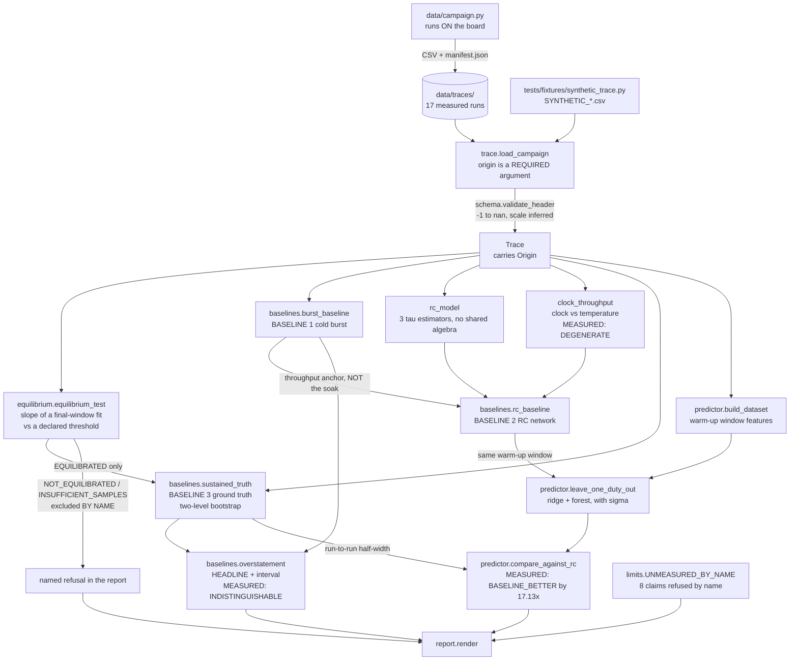
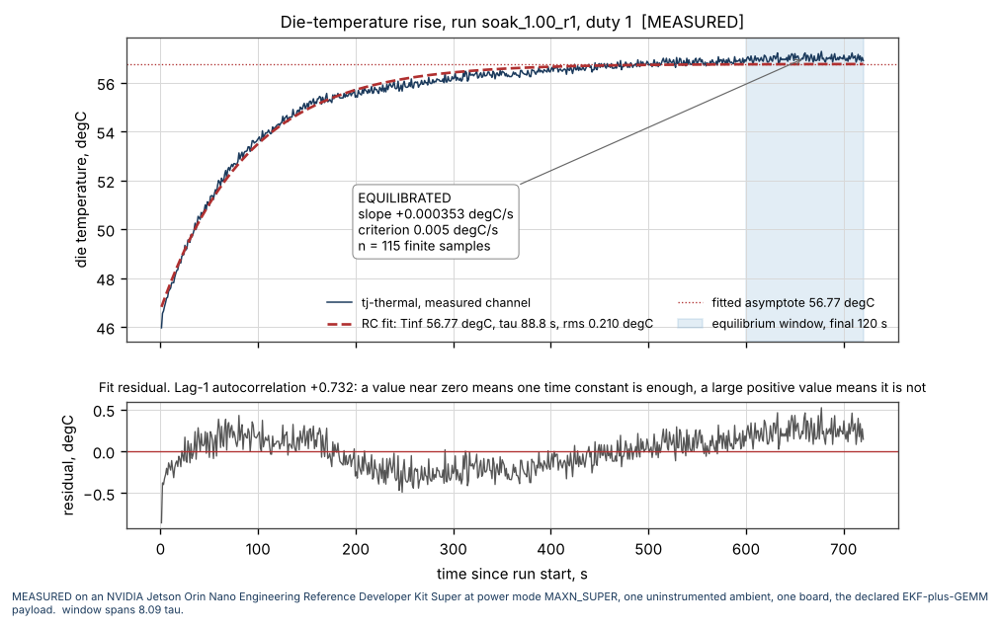
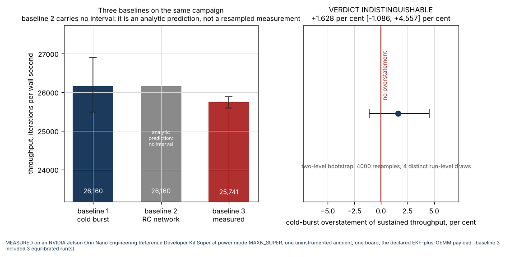
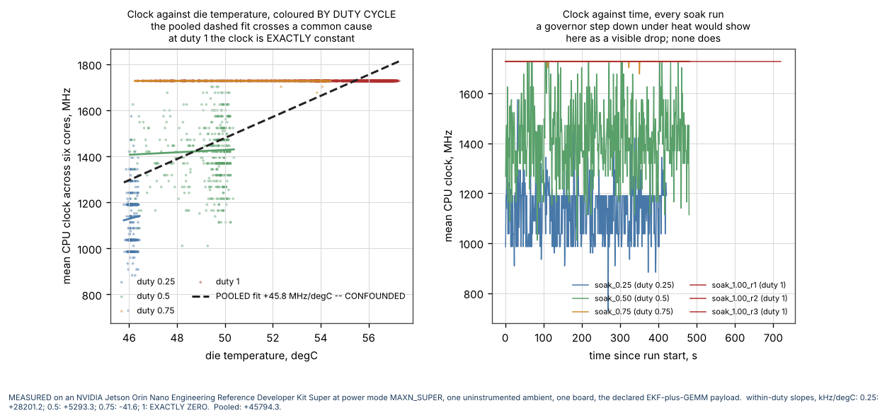
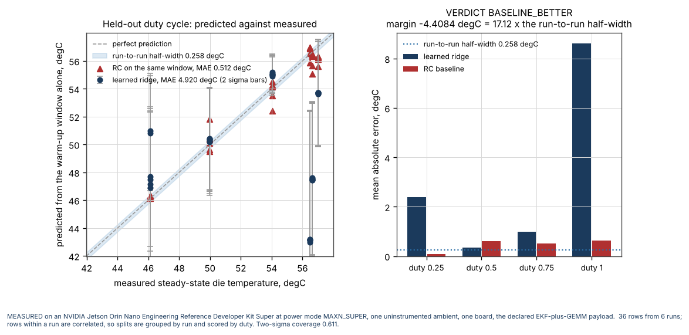

# thermalbudget

Sustained on-board throughput after thermal equilibrium, against the cold-burst figure.

**Status:** TESTING · **Class:** flagship · **Category:** hardware-in-the-loop · **AI:** yes


> **Validation level 4, set by the mission coordinator at Phase 9 on
> 2026-11-12, and the first Level 4 in this mission.** The criterion it is set
> against is the mission's own: measured timing and resource figures come from
> an NVIDIA Jetson Orin Nano itself rather than from a model of one. They do.
> The campaign ran on the board, its 17 traces are in `data/traces/`, and every
> figure in this README marked MEASURED was computed from them by a named script
> in `validation/`, each of which the coordinator re-executed independently of
> the agent that wrote it.
>
> **Level 4 here is not a claim of generality, and the scope is part of the
> result.** The figures hold for one power mode, MAXN_SUPER, because the board
> has no passwordless sudo and no other mode was reachable; one ambient, which
> was never instrumented or varied; a CPU-only payload, the GPU having stayed at
> its 306 MHz devfreq floor in 4954 of 4975 samples with no engine-utilisation
> counter sampled at all; soaks no longer than 720 s, against a measured die
> time constant of 88.85 s and an enclosure whose own time constant is longer
> than anything measured here; and this one board with its own heatsink and fan.
> **Nothing here supports a general statement about Orin Nano thermal
> behaviour.** Held-out ambient remains STRUCTURALLY UNMEASURABLE. The full
> evidence, including the checks that were not satisfied, is in
> [`validation/VALIDATION.md`](validation/VALIDATION.md).

## The headline, measured

On an **NVIDIA Jetson Orin Nano Engineering Reference Developer Kit Super** at
power mode **MAXN_SUPER**, running the declared CPU-only EKF-plus-GEMM payload
at duty 1.0:

| | iterations per wall second |
|---|---|
| Cold burst, 20 s from a cold board (baseline 1) | **26160.398** [25478.165, 26923.403] |
| First-order thermal RC network (baseline 2) | **26160.398** — reduces to baseline 1 |
| Measured sustained after equilibrium (baseline 3) | **25741.404** [25593.028, 25885.792] |

**Cold-burst overstatement: +1.6277 per cent, 95 per cent interval
[-1.0870, +4.6481]. VERDICT: INDISTINGUISHABLE — the interval contains zero.**
Steady-state die temperature 56.7085 [56.4813, 56.9959] degC.
(`validation/validate_measured_campaign_output.txt`)

**The reason, and it is the campaign's strongest result: the board never
throttled.** Across the three duty-1.0 soaks the die rose **10.94 degC**, from
46.34 to 57.28, and **not one of the 9654 per-core clock samples fell below
`cpuinfo_max_freq` 1728000 kHz.** The within-duty clock-versus-temperature slope
at duty 1.0 is **exactly zero**
(`validation/validate_clock_confound_output.txt`).

**This result holds for exactly one configuration and must not be generalised.**
MAXN_SUPER only, because `nvpmodel` needs root and there is no passwordless
sudo on the board. One ambient, never instrumented in degrees. A **CPU-only**
payload: the GPU devfreq sat at its 306 MHz floor for 4954 of 4975 samples
(99.578 per cent), so **a GPU-loaded perception pipeline is untested here and
could behave completely differently**. Soaks of at most 720 s, so this is
*sustained over twelve minutes*, and the enclosure's own thermal mass has a far
longer time constant than the die's 88.85 s. One board, with its own heatsink
and fan. **"No throttling" is not a claim about Jetson Orin Nano modules in
general.**

## The problem

Your datasheet says the board does 26000 iterations a second. That figure was
taken in a twenty-second burst from a cold board, and your autonomy loop runs
for hours. Somewhere between the two sits thermal throttling, and nobody in the
review can tell you whether the gap is thirty per cent, three per cent, or
nothing at all — which is the difference between a schedule that holds and one
that does not.

## What this does

- **Reports the cold-burst overstatement as the headline, with an interval.**
  Sustained throughput after equilibrium as a fraction of the burst figure
  (**0.983984 [0.955584, 1.010990]** measured), with a two-level bootstrap
  interval across runs and within runs. **When the interval contains zero the
  verdict is `INDISTINGUISHABLE` and that is published as the finding**, which
  is what happened here.
- **Tests equilibrium instead of assuming it.** The slope of a linear fit over
  the final 120 s against a declared 0.005 degC/s criterion. Measured: all six
  soaks EQUILIBRATED, with final-window slopes **+0.000353, +0.000980,
  -0.000251** degC/s (duty 1.0 r1/r2/r3) and **-0.000345, -0.000756, +0.001371**
  (duty 0.25/0.50/0.75) — all far inside the criterion, which stays
  EQUILIBRATED down to the tightest rung of the ladder, 0.001 degC/s. Both
  20 s bursts return `INSUFFICIENT_SAMPLES`, which is explicitly not a pass.
- **Separates the clock-versus-temperature relation within duty cycle from
  between it, because pooling them is a confound.** Measured within-duty slopes
  in kHz/degC: **duty 1.00 exactly zero** (n=1644), **0.75 -41.6**, **0.50
  +5293.3**, **0.25 +28201.2**; pooled across duties **+46110.5**. Duty drives
  both the clock, through the `schedutil` governor, and the die temperature,
  through dissipated power, so the pooled figure is generated entirely between
  duty groups and is **not** a measurement of throttling.
- **Estimates the thermal time constant three ways that share no algebra**, and
  reports tau from the rise beside tau from the cooldown rather than picking
  one. Measured: rise mean **80.99 s** over 3 runs (88.85, 82.17, 71.96),
  cooldown mean **110.69 s** over 8 runs, ratio **1.367** where a true
  single-pole system would give 1.000. The area-rule cross-check gives
  **81.76 s**; the log-difference route **refused** on the measured rise,
  by name, because no part of the differenced trace clears its 3-sigma floor of
  0.1996 degC.
- **Keeps measured and synthetic numbers apart by construction.** A two-element
  origin lattice with `SYNTHETIC` absorbing, carried on every trace and every
  derived result; no function promotes one to the other; a figure derived from
  zero inputs is refused. Before the campaign's traces existed, the two measured
  validation scripts refused to run and exited non-zero rather than falling back
  to fixtures.

## Who it is for

- Anyone sizing an on-board compute budget who has to defend a sustained
  throughput number in a review and say where it came from.
- Anyone with a board on a bench who wants the burst-against-sustained gap
  measured rather than guessed, with an interval attached.
- Anyone who needs the honest answer when the answer is "there is no gap".

## Who it is not for

- **Anyone who wants to watch a Jetson's sensors live.** Use `jtop` from
  `jetson-stats`, or NVIDIA's own `tegrastats`. They are the right tools and
  this package does not try to be either. See the table below.
- Anyone who needs a certified or qualified answer. This software is
  research-grade and is **not flight-qualified, not certified and not approved
  for operational aerospace use**.
- Anyone who needs a figure at a power mode other than `MAXN_SUPER`, at a
  second ambient, under GPU load, or for different hardware. The campaign
  measured none of those and the package **refuses those claims by name**: run
  `python -m thermalbudget limits`.
- Anyone who needs a general-purpose stress or thermal-soak harness. The payload
  here is one fixed GNC-representative CPU kernel, chosen so the thermal load is
  reproducible, not so it is representative of yours.

## Alternatives, honestly

None of the tools below is installed in the environment this package was
measured in, none was executed here, and **no number in this repository is
compared against any of them.** They are named because a reader who knows the
field would otherwise stop reading.

| Alternative | What it does better | When to use this instead |
|---|---|---|
| `jetson-stats` (`jtop`) | The live Jetson dashboard: temperatures, clocks, power rails, nvpmodel, all of it, interactively. Mature and widely used. | When you want a number with an interval rather than a dashboard, and a verdict on whether burst and sustained differ. |
| `tegrastats` (NVIDIA, ships with JetPack) | The vendor's own sampler, with rail power and GR3D engine utilisation this campaign did not record at all. | When you need the equilibrium test, the RC fit and the bootstrap, not a sample stream. |
| `s-tui` | Live CPU frequency and temperature under a built-in stress load, on any Linux box. | When the question is a quantified sustained-throughput figure for one payload rather than a live view. |
| `stress-ng` | A vastly more capable load generator, with dozens of stressors. | When the payload must be a fixed-work GNC kernel whose per-iteration cost is stable enough to count. |
| `phoronix-test-suite` | A large, maintained benchmark corpus with result tracking. | When the question is specifically burst-against-sustained on one board, with the gap and its interval as the output. |
| Rolling your own loop plus `sysfs` reads | Nothing to install, full control. | When you want the parts that are easy to get wrong already done: `-1` as missing, the inferred scale, a tested equilibrium window, a cluster bootstrap, the duty confound separated out, and a refusal to label a synthetic figure measured. |

## Install and first run

```bash
git clone https://github.com/OmAcharya-avtr/thermalbudget.git
cd thermalbudget
python -m venv .venv && source .venv/bin/activate
pip install -e ".[dev]"
python -m pytest tests/ -q
python examples/overstatement.py
```

Expected output of the first run:

```
221 passed in 12.00s
```

and from the example, on a clone that carries the campaign's traces:

```
wrote screenshots/overstatement.png
  burst     26160.40 iters/s
  RC        26160.40 iters/s  [reduces to baseline 1]
  sustained 25741.40 iters/s
  overstatement +1.628 per cent [-1.086, +4.557] -> INDISTINGUISHABLE
  origin: MEASURED
```

The last line is the important one. The examples fall back to the synthetic
fixture generator when `data/traces/` is empty, print `origin: SYNTHETIC` and
stamp the figure with a diagonal watermark. A **validation** script in the same
situation refuses and exits non-zero instead. The interval here is narrower than
the headline's because the examples draw 4000 bootstrap resamples and the
validation scripts draw 20000; the authoritative figure is the validation
script's.

## A worked example

```python
from thermalbudget import (
    burst_baseline, equilibrium_test, load_campaign, overstatement,
    rc_baseline, sustained_truth,
)
from thermalbudget.provenance import Origin, meet

# origin is required and is never inferred from a filename.
campaign = load_campaign("data/traces", origin=Origin.MEASURED)

verdict = equilibrium_test(campaign["soak_1.00_r1"])
print(verdict.status, f"{verdict.slope_c_per_s:+.6f} degC/s")

base1 = burst_baseline(campaign.bursts(), seed=910091)
base2 = rc_baseline(campaign.soaks(1.0), campaign.cooldowns(), campaign.bursts())
base3 = sustained_truth(campaign.soaks(1.0), seed=910091)

head = overstatement(
    base1.throughput_groups, base3.throughput_groups,
    seed=910091, origin=meet(base1.origin, base3.origin),
)
print(head.statement)
```

Run against the measured campaign, `validation/validate_measured_campaign.py`
prints:

```
  burst throughput  26160.398 [25478.165, 26923.403] iters/s (95 per cent, 20000 resamples, 4 distinct run-level draws)
    burst_1.00_a     26077.927 iters/s
    burst_1.00_b     26242.870 iters/s
  rise     soak_1.00_r1     tau    88.85 s  Tinf  56.765 degC  T0  46.823 degC  rms 0.2100 degC  rho +0.732  span 8.09 tau
  TAU SIDE BY SIDE: rise mean 80.99 s over 3 run(s), cooldown mean 110.69 s over 8 run(s), ratio cooldown/rise 1.367
  clock relation : DEGENERATE
      measured temperature range 45.875 to 57.281 degC; clock range 1728000 to 1728000 kHz over 1 distinct level(s)
  BASELINE 2 PREDICTS sustained = 26160.398 iters/s  [REDUCES TO BASELINE 1]
  sustained     25741.404 [25593.028, 25885.792] iters/s, half-width 146.382, standard error 75.178, bias -1.252
  steady die    56.7085 [56.4813, 56.9959] degC, half-width 0.2573
  cold-burst overstatement          +1.6277 per cent [-1.0870, +4.6481] per cent
  VERDICT: INDISTINGUISHABLE
```

## Architecture



## Screenshots

All four are produced from the **measured** traces by the scripts in
`examples/`, and each carries the measured provenance line along its foot.



Notice the lower panel. The fit residual is not white: its lag-1
autocorrelation is **+0.732**, which is the signature of a second, slower
thermal time constant that a single exponential cannot represent. The fitted
tau of 88.85 s is reported with that caveat attached, never as a property of the
board on its own.



Notice the right-hand panel. The vertical line is zero overstatement and the
measured interval straddles it, so the finding is that **sustained throughput is
statistically indistinguishable from burst throughput on this board**. Baseline
2 carries no whisker on purpose: it is an analytic prediction, not a resampled
measurement, and here it lands exactly on baseline 1.



Notice the red band along the top. That is duty 1.0: the clock is pinned at
1728 MHz across an 11 degC rise. The black dashed line is the **confounded**
pooled fit, drawn and labelled as such so nobody reads it as throttling — it is
generated entirely between duty groups, because duty drives both axes.



Notice the shaded diagonal band: it is the run-to-run bootstrap half-width of
the measured steady state, 0.2573 degC. The learned model's errors are far
outside it and the RC baseline's are mostly inside, which is what
`BASELINE_BETTER` means here.

## Validation evidence

Every row comes from a script executed against the measured traces or against
this repository's own code; the file is named. The negative results are in the
table because they are the credible part.

| Check | Reference | Result | Origin |
|---|---|---|---|
| Test suite, counted from junit XML | `pytest --junit-xml` | **221 declared, 221 `testcase` counted, 0 failed, 0 errored, 0 skipped** | code |
| **Headline overstatement** | `validate_measured_campaign_output.txt` | **+1.6277 per cent [-1.0870, +4.6481]. INDISTINGUISHABLE** | **MEASURED** |
| **No throttling at duty 1.0** | `validate_measured_campaign_output.txt` | **0 of 9654 per-core clock samples below 1728000 kHz** over a 10.94 degC die rise | **MEASURED** |
| **Clock-vs-temperature within duty** | `validate_clock_confound_output.txt` | duty 1.00 **exactly zero**, 0.75 **-41.6**, 0.50 **+5293.3**, 0.25 **+28201.2**, pooled **+46110.5** kHz/degC. 3 checks, 0 failed | **MEASURED** |
| Governor resolution | `validate_measured_campaign_output.txt` | 14 distinct clock levels, 729600–1728000 kHz, smallest gap **76800 kHz** = **8.9x** the 0.5 per cent identifiability floor | **MEASURED** |
| Equilibrium, every run | `validate_measured_campaign_output.txt` | all six soaks EQUILIBRATED at every rung of the ladder down to 0.001 degC/s; both bursts INSUFFICIENT_SAMPLES | **MEASURED** |
| Baseline 1 and 2 against ground truth | `validate_measured_campaign_output.txt` | both err **+418.994 iters/s (+1.6277 per cent)**, **2.862x** the ground-truth half-width 146.382, **OUTSIDE** the interval | **MEASURED** |
| Baseline 2 steady-die prediction | `validate_measured_campaign_output.txt` | **56.649** degC predicted against **56.7085** measured, error **-0.0597 degC** against a half-width of **0.2573** — inside | **MEASURED** |
| Independent bound on the measured asymptote | `validate_measured_campaign_output.txt` | the fit is **0.233 degC below** the final-window mean and **0.038 degC below** an independent cooldown-tau bracket; both findings reported, and the disagreement is **0.180** of the fit's own rms residual | **MEASURED** |
| Tau, three routes | `validate_measured_campaign_output.txt` | rise mean **80.99 s**, cooldown mean **110.69 s**, ratio **1.367**; area rule **81.76 s**; the log-difference route **refused by name** | **MEASURED** |
| Contamination | `validate_measured_campaign_output.txt` | pooled foreign CPU **17.05 per cent** over 4975 samples, per-run means **14.93 to 20.62** per cent | **MEASURED** |
| Missing-data census | `validate_measured_campaign_output.txt` | **0** sentinel-coded or unparseable samples in the whole campaign | **MEASURED** |
| GPU scope | `validate_measured_campaign_output.txt` | devfreq at its **306 MHz floor in 4954 of 4975 samples (99.578 per cent)**; 21 transient samples at 1020 MHz, present in idle and cooldown runs too. **GR3D utilisation is not in the schema and was not recorded** | **MEASURED** |
| Achieved duty | `validate_measured_campaign_output.txt` | soak_1.00_r1 **0.9998** (0.9497–1.2012); 0.25/0.50/0.75 soaks **0.2527 / 0.5030 / 0.7507** | **MEASURED** |
| **Learned vs RC, held-out duty** | `validate_measured_learned_output.txt` | ridge MAE **4.9205 degC** against RC **0.5120 degC**; margin **-4.4084 degC = 17.13x** the run-to-run half-width. **BASELINE_BETTER** | **MEASURED** |
| Learned uncertainty calibration | `validate_measured_learned_output.txt` | two-sigma coverage **0.6111** (ridge) and **0.8333** (forest) against a calibrated 0.95 — **badly calibrated, reported as such** | **MEASURED** |
| Held-out ambient | `validate_measured_learned_output.txt` | **STRUCTURALLY UNMEASURABLE**, one ambient, no score | — |
| Loader contract | `validate_loader_contract_output.txt` | 29 checks, 0 failed; 15 controls, must-fire **14/14**, must-NOT-fire silent **1/1** | SYNTHETIC + the five real rows |
| Equilibrium estimator and drift controls | `validate_equilibrium_output.txt` | 16 checks, 0 failed; 9 controls, must-fire **7/7**, must-NOT-fire silent **2/2** | SYNTHETIC |
| Four independent bounds on the estimators | `validate_independent_bound_output.txt` | 16 checks, 0 failed; 6 controls, must-fire **4/4**, must-NOT-fire silent **2/2** | SYNTHETIC |
| Cross-module negative controls | `validate_negative_controls_output.txt` | 41 checks, 0 failed; **40 controls**, must-fire **32/32**, must-NOT-fire silent **8/8** | SYNTHETIC |
| `pytest.approx` hidden-default audit | `validate_approx_audit_output.txt` | **51** `rel=` sites, **51** with an explicit `abs=`, **0** bare; suite re-run with `abs=0.0` forced: 221 tests, **0** failed | code |
| Property hunt | `validate_property_hunt_output.txt` | 10 properties x **2000** examples, about **20000** generated cases, **0 falsified** | generated |
| Working-directory probe | `probe_working_directories_output.txt` | every script giving the same exit status from the filesystem root, the system temporary directory, the product root and `validation/` | code |
| Tree hygiene | `validate_tree_hygiene_output.txt` | shipped paths checked against `.gitignore`, none excluded; cache paths all excluded; the script adds nothing | code |

**Four results worth reading twice.**

1. **Baseline 1 and baseline 2 are both wrong by the same +1.6277 per cent**, and
   both sit 2.862 half-widths outside the ground-truth interval — yet the
   headline is INDISTINGUISHABLE, because the headline's interval carries the
   burst runs' own spread as well and only two burst runs exist. The two
   statements are consistent and both are reported.
2. **Baseline 2 reduces to baseline 1 on this board**, because there is no
   thermal signal for the clock-to-throughput chain to act on. That is a
   measured property of the board under this payload, not an implementation
   defect.
3. **The learned model lost decisively**, by 17.13 times the run-to-run
   interval, and its uncertainty output is badly calibrated. Published as found;
   nothing was retuned.
4. **The within-run intervals are wider than the between-run interval**:
   225.65, 221.65 and 226.86 iters/s within runs against 146.38 across them.
   Sampling noise inside a soak dominates the run-to-run spread here.

**Inherited finding, reported and not failed.** The repository-root `.gitignore`
carries `**/junit.xml`, which would exclude a nested `junit.xml` fixture in any
product that shipped one. This product ships none and its own `.gitignore`
anchors the pattern as `/junit.xml`.

## API reference

<details>
<summary>Public surface, one line each, with units</summary>

| Name | What it returns |
|---|---|
| `load_trace(path, *, origin, label=None, duty=None)` | One `Trace`. `origin` is required; a filename is not evidence. |
| `load_campaign(directory, *, origin, require=())` | A `Campaign`; raises `TraceDataAbsentError` naming any required run that is absent. |
| `Trace.die_temperature_c` | Junction temperature, degrees Celsius, `nan` where unreadable. |
| `Trace.mean_cpu_khz` | Mean clock across cores per sample, kHz, `nan` for an all-missing row. |
| `expected_columns(zones, n_cores)` | The binding 20-column header. |
| `infer_temperature_divisor(samples)` | 1000.0 or 1.0; raises rather than guessing. |
| `fit_linear(x, y)` | `LinearFit`: slope, intercept, OLS and AR(1) standard errors, lag-1 residual autocorrelation. |
| `equilibrium_test(trace, *, window_s, threshold_c_per_s, min_samples)` | `EquilibriumVerdict`: status, slope in degC/s, AR(1) interval, sample counts, reason. |
| `equilibrium_sensitivity(trace, ...)` | Status at each of five declared thresholds in degC/s. |
| `fit_exponential_relaxation(t_s, temperature_c)` | `RelaxationFit`: asymptote degC, amplitude degC, tau s, rms residual degC, residual autocorrelation, span in tau. |
| `tau_from_log_differences(t_s, temperature_c, ...)` | `TauEstimate` in seconds, using no asymptote. Refuses on a noise-dominated trace. |
| `tau_from_integral(t_s, temperature_c, *, asymptote_c)` | `TauEstimate` in seconds, by the area rule. |
| `clock_temperature_relation(traces)` | `ClockTemperatureRelation`: identifiable or degenerate, slope kHz/degC with an interval. Pool duty cycles into it only if you mean to. |
| `proportionality_exponent(traces, *, duty)` | Measured exponent in `throughput ~ clock**e`, or `nan` when not identifiable. |
| `burst_baseline(traces, *, skip_s, seed, n_resamples)` | `BurstBaseline`: baseline 1, iters/s with a two-level interval. |
| `rc_baseline(heating, cooldowns, bursts, ...)` | `RCBaseline`: baseline 2, tau from rise and cooldown side by side, predicted iters/s. |
| `sustained_truth(traces, *, window_s, threshold_c_per_s, seed, n_resamples)` | `SustainedTruth`: baseline 3, iters/s and degC with intervals, plus every exclusion by name. |
| `overstatement(burst_groups, sustained_groups, ...)` | `Overstatement`: sustained fraction, overstatement, verdict, from the same resample draws. |
| `bootstrap_mean` / `bootstrap_cluster_mean` / `bootstrap_cluster_ratio` | `BootstrapResult` with the number of distinct run-level draws attached. |
| `t_interval_of_group_means(groups, *, confidence)` | `(point, low, high)` from normal theory, as an independent cross-check. |
| `build_dataset(traces, ...)` | `Dataset` of warm-up features and measured steady-state targets, grouped by run. |
| `SteadyStatePredictor.fit/predict` | `(prediction degC, sigma degC)`; sigma is one-sigma, not an interval, and measured two-sigma coverage is 0.6111. |
| `rc_warmup_prediction(trace, window_s)` | Baseline 2 on the same warm-up window, degC, `nan` on refusal. |
| `leave_one_duty_out(dataset, traces, *, kind, ...)` | `HeldOutDutyResult`: per-duty and pooled MAE in degC for both methods. |
| `compare_against_rc(result, reference)` | `ModelVerdict`; `NOT_DISTINGUISHABLE` whenever the margin is inside the interval. |
| `analyse(campaign, ...)` / `render(analysis)` | The whole chain, and its plain-text report. |
| `refuse_unmeasured(key)` | Raises `UnmeasuredClaimError` naming the claim and why the campaign cannot support it. |
| `structurally_unmeasurable_axes()` | The evaluation axes with no score in this campaign. |
| `measured_evidence(root=None)` | What measured data is on disk right now, as data rather than a claim. |
| `VALIDATION_LEVEL`, `VALIDATION_BASIS` | The claimed level and exactly what is and is not hardware-backed. |

CLI: `python -m thermalbudget {schema,limits,validation-level,equilibrium,tau,report}`.
Every loading subcommand requires `--origin {measured,synthetic}`.

</details>

## Limitations

- **One power mode.** `MAXN_SUPER`, because `nvpmodel` needs root and the
  campaign account has no passwordless sudo. Every figure is a `MAXN_SUPER`
  figure and no other mode may be inferred from it.
- **One ambient, never instrumented in degrees.** The idle-run die temperature,
  **44.489 degC**, is its only proxy. The held-out-**ambient** evaluation axis is
  therefore **structurally unmeasurable** here and has no score; it is not
  approximated by the duty-cycle split.
- **CPU-only.** The GPU devfreq sat at its 306 MHz floor for 99.578 per cent of
  the campaign and GR3D utilisation was never sampled, so the claim "the GPU was
  idle" is an inference from the devfreq floor, not a measurement. A
  GPU-loaded perception pipeline is untested and could behave completely
  differently.
- **Twelve minutes, not hours.** The longest soak is 720 s. The die's time
  constant is 88.85 s, but the enclosure's thermal mass has a far longer one, and
  a multi-hour drift, a dust effect or an enclosure heat-soak would not appear
  in these traces. The measured die was still rising at +0.000353 degC/s at the
  end of the longest soak; it had slowed to within the equilibrium criterion, not
  stopped.
- **One board, one heatsink, one fan.** Thermal behaviour is a property of the
  whole assembly and nothing here transfers to another unit. **"No throttling" is
  not a claim about Jetson Orin Nano modules in general.**
- **A granular interval.** Three duty-1.0 soaks give at most 27 distinct
  run-level resample multisets; two burst runs give 4, which is why the
  headline's interval is as wide as it is. A Student-t interval over per-run
  means is reported as an independent cross-check. More runs is the only fix.
- **The board was shared.** Pooled foreign CPU 17.05 per cent over 4975 samples,
  per-run means 14.93 to 20.62 per cent, mostly `avahi-daemon`, recorded every
  second rather than assumed absent. Every throughput figure is a figure for this
  payload on a board carrying that load.
- **A single-exponential model of a system that is not single-exponential.** The
  measured rise fit has a lag-1 residual autocorrelation of **+0.732**. Both
  independent bounds put the true asymptote above the fitted 56.765 degC — by
  0.233 degC against the final-window mean and 0.038 degC against the cooldown-tau
  bracket. The fit is biased low in a known direction and a longer soak would
  widen that bias.
- **The clock-to-throughput map is a declared proportionality and is
  unmeasurable on this campaign.** With the clock pinned at one level the
  exponent cannot be identified, so the code returns `nan` rather than the
  assumed 1.0.
- **`clock_temperature_relation` pools whatever traces it is given, and pooling
  duty cycles confounds the result.** Use
  `validation/validate_clock_confound.py` as the model: decompose within duty
  before reading any slope.
- **Dependency ranges were exercised at both ends only for `ruff`** (0.16.9 and
  0.17.4). numpy, scipy, scikit-learn, pytest, hypothesis and matplotlib are
  bounded at the single version each was measured at, because the build
  environment is a shared pre-pinned interpreter this product may not run `pip`
  against. Those ceilings are a real cost: the product cannot take a future
  security release of any of them without a port and a re-measurement.
- **The learned model is trained on six runs.** 36 rows are six warm-up window
  lengths per run, which multiplies the row count and not the information.
  Every split is grouped by run; no random-row cross-validation score is offered
  anywhere, because it would be meaningless.
- **Compute budget.** Two cores. The suite runs in about 12 to 14 s. The slowest
  validation script is the property hunt at 20.2 s, followed by the `pytest.approx`
  audit at 14.1 s, which re-runs the whole suite in a subprocess; the measured
  campaign script takes 3.0 s and the measured learned-model script 3.7 s. The
  working-directory probe runs 15 scripts from four directories each and takes a
  few minutes. Nothing here needs a GPU.

## Reproducing every number

```bash
python -m pytest tests/ -q -p no:cacheprovider --junit-xml=junit.xml
python validation/validate_measured_campaign.py
python validation/validate_measured_learned.py
python validation/validate_clock_confound.py
python validation/validate_loader_contract.py
python validation/validate_equilibrium.py
python validation/validate_independent_bound.py
python validation/validate_negative_controls.py
python validation/validate_approx_audit.py
python validation/validate_property_hunt.py
python validation/worked_example.py
python validation/validate_tree_hygiene.py
python validation/probe_working_directories.py
python examples/thermal_rise.py
python examples/overstatement.py
python examples/clock_relation.py
python examples/learned_vs_rc.py
ruff check src/ tests/ examples/ validation/
```

Seeds: 910091 for every analysis, interval and fixture stream; 880091 for
controls. The campaign itself is `data/campaign.py` and runs on the board.

## Licence

Apache-2.0. See [`LICENSE`](LICENSE). Copyright © 2026 OPTIMA Organisation.

## Citation

See [`CITATION.cff`](CITATION.cff).

## Credits

This is under reserved rights obtained by OPTIMA Organisation.

---

This software is research-grade. It is not flight-qualified, not certified and
not approved for operational aerospace use.
