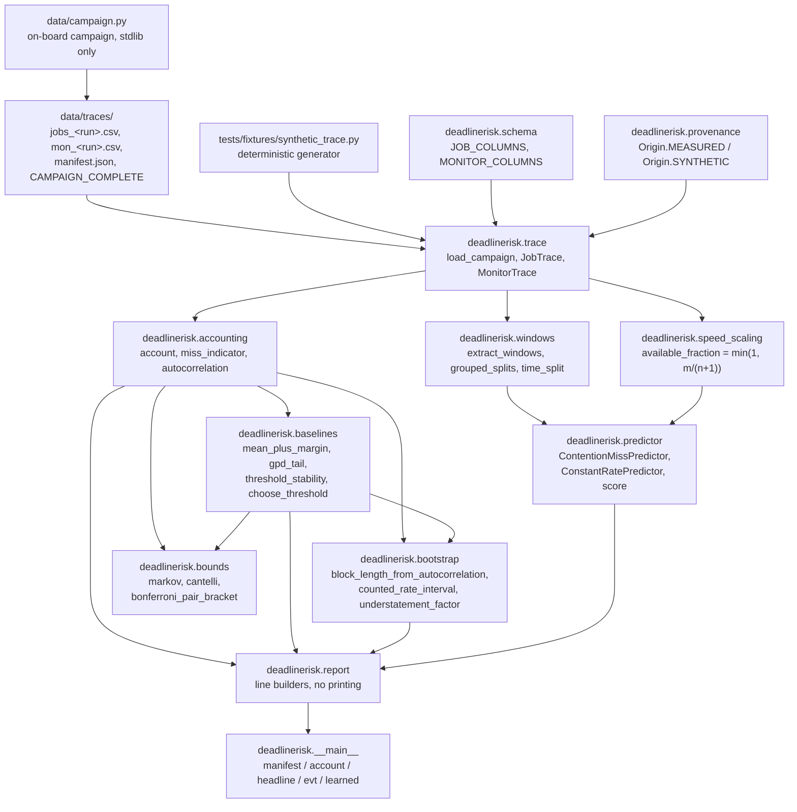
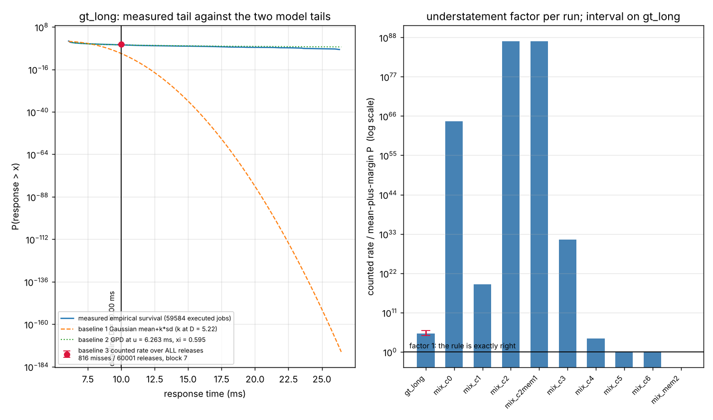
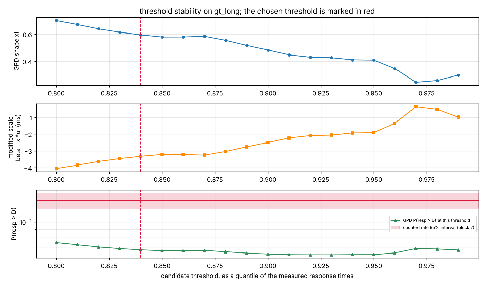
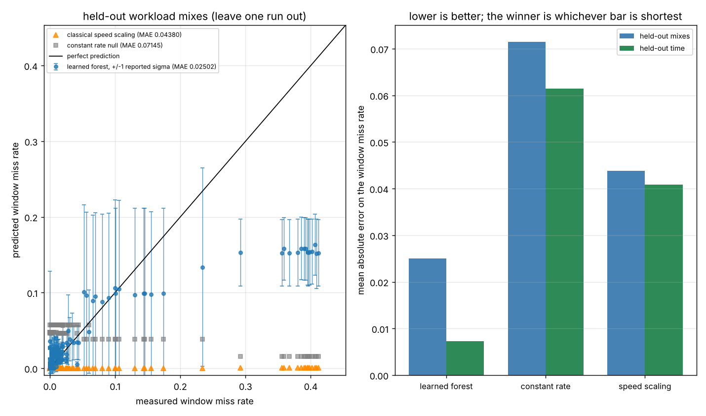
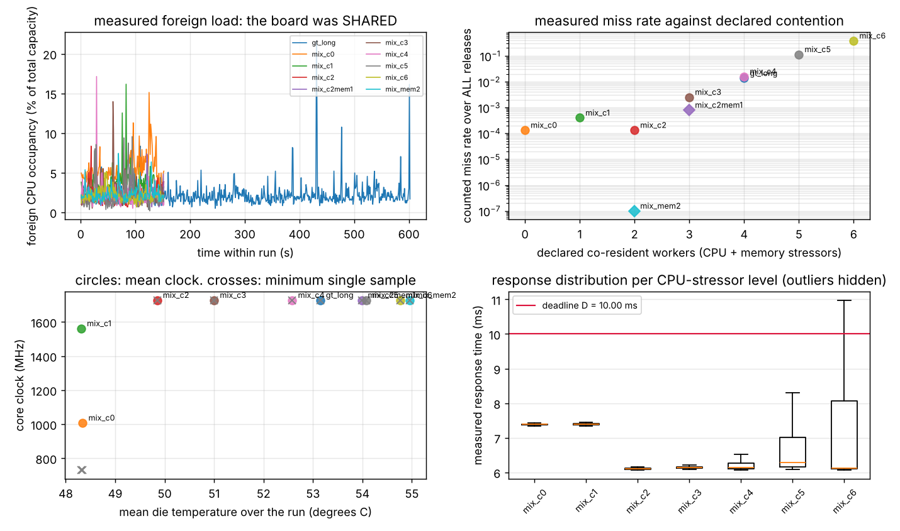

# deadlinerisk

How far the mean-plus-margin rule is wrong about a measured deadline-miss rate.

**Status:** TESTING · **Class:** flagship · **Category:** autonomous-aerospace-systems · **AI:** yes


> **Validation level: Level 4, measured on hardware, with the scope below.**
> Every figure in this document comes from a campaign run on an NVIDIA Jetson
> Orin Nano Engineering Reference Developer Kit Super (aarch64, JetPack R36.4.7,
> kernel 5.15.148-tegra, 6 cores, governor `schedutil`, `cpuinfo_max_freq`
> 1728000 kHz, power mode `MAXN_SUPER`), specified in `docs/SPEC.md`, executed by
> `data/campaign.py`, and committed whole in `data/traces/` — 10 runs, 190 662
> executed jobs over 195 010 releases, with the per-second contention monitor
> beside each one. **Level 4 here is not a claim of generality**; it is the
> mission's criterion that the timing and resource figures come from the board
> rather than from a model of one. They do. The scope below is part of the
> result.
>
> **The campaign's scope will be part of the result, and is stated now so that no
> reader mistakes a later figure for a general one.** One power mode,
> `MAXN_SUPER`, because the board has no passwordless sudo and no other mode is
> reachable unattended. One ambient, never instrumented or varied. One CPython
> CPU-only payload at one period. One board, with its own heatsink and fan. **The
> board is shared, so the foreign CPU occupancy is measured per second and
> reported rather than assumed absent.** Nothing this campaign can produce will
> support a general statement about deadline misses on Orin Nano.

> **How this document was written, because it matters for how far you should
> trust it.** The library, the tests and this prose were built before any trace
> existed. Every slot that would hold a measured figure carried the literal token
> `MEASURED_PENDING` and named the script that fills it, and the measured
> validation scripts and all four examples exited non-zero rather than fall back
> to the committed synthetic generator. The tokens were then replaced, one at a
> time, with the output of those scripts run against the campaign. No number here
> was written from an expectation of what the board would do.

## The headline, measured

**On the ground-truth run the mean-plus-margin rule understates the measured
deadline-miss rate by a factor of 1.528423e+05, with a 95 per cent moving-block
interval of [3.635383e+04, 9.160321e+05]. The interval excludes 1, so the
understatement is larger than this campaign's own sampling variability.**

The rule is not being strawmanned. On this run it corresponds to a margin of
**k = 5.221001 standard deviations** to the deadline — a margin a practitioner
would call comfortable — and a Gaussian with the measured mean (6.277342 ms) and
the measured standard deviation (0.713016 ms) puts `P(response > D)` at
**8.897912e-08**, about one miss in eleven million releases. The board delivered
**816 misses in 60 001 releases**, which is **1.359977e-02**, about one in 74.

The extreme-value fit, on exactly the same data, gives **6.727478e-03** — low by
a factor of 2.02, not by a factor of 150 000. Both baselines sit outside the
counted rate's interval and the product says so; the difference between them is
five orders of magnitude.

Measured by `validation/validate_measured_campaign.py` and
`validation/validate_measured_evt.py`; reproduced independently from the raw CSVs
by the mission coordinator before publication.

## The problem

A hard-real-time autonomy loop has a period `T` and an implicit deadline
`D = T`, and practice sizes the margin from the mean and the standard deviation
of the measured execution time: mean plus `k` sigma fits, therefore it is safe.
That rule is a statement about the centre of a distribution being used to make a
statement about its tail. The tail of an execution time on a shared multicore
SoC is not Gaussian, because it is generated by preemption, cache contention and
memory-bandwidth interference from co-resident work rather than by the sum of
many small independent effects.

## What this does

- **Reports the factor by which the mean-plus-margin rule understates the
  counted miss rate**, with a 95 per cent moving-block bootstrap interval, on a
  600 s measured run. Measured: **1.528423e+05**, interval
  **[3.635383e+04, 9.160321e+05]**, which excludes 1
  (`validation/validate_measured_campaign.py`).
- **Counts a dropped release as a miss.** A job that overruns its period
  prevents later releases from ever executing, and the deadline says nothing
  about whether something ran, only about whether it finished in time. The
  measured difference between the all-release rate and the executed-only rate on
  the ground-truth run is a factor of **2.030899**: 816 misses in 60 001
  releases against 399 in the 59 584 executed, because **417 releases — 51.10 per
  cent of all misses on that run — were never executed at all.** Counting only
  what ran halves the answer (`validation/validate_measured_campaign.py`).
- **Selects the bootstrap block length from the measured autocorrelation of the
  miss indicator** by a rule stated in code, and reports the selection: the
  cut-off lag, the integrated autocorrelation time and the resulting block
  length. Measured on the ground-truth run: lag-1 autocorrelation **0.547771**,
  cut-off lag **60**, integrated autocorrelation time **6.276304**, block length
  **7** releases. An i.i.d. bootstrap on the same series returns an interval
  **1.44 times narrower**, which is precisely the overstatement of precision the
  block resample exists to avoid (`validation/validate_measured_campaign.py`).
- **Ships the extreme-value threshold-choice diagnostic as a deliverable**, not
  as an optional extra: the GPD shape and modified scale over 20 candidate
  thresholds, with the chosen threshold produced by a declared stability-window
  rule applied in code. Measured: the rule chose quantile **0.8400**,
  **u = 6.263055 ms**, **9534 exceedances**, shape **xi = 0.594814** — positive,
  so the tail is heavy and the Gaussian rule is not merely mis-scaled but the
  wrong family (`validation/validate_measured_evt.py`).
- **Scores a learned contention-aware predictor against two baselines on two
  held-out splits** — held-out workload mixes grouped by run, and held-out time
  in every run — and publishes whichever wins. **The learned forest won both
  splits**, against the pre-registered expectation written in `docs/SPEC.md` that
  the classical predictors would be competitive: MAE **0.025022** against
  **0.043799** for speed scaling on held-out mixes, and **0.007330** against
  **0.040879** on held-out time. The expectation is recorded as refuted, with the
  mechanism, under "Validation evidence"
  (`validation/validate_measured_learned.py`).

## Measurement model, stated once

Every number in this repository depends on this and nothing else:

- The loop has period `T` and an **implicit deadline** `D = T`.
- Job `i` is **released** at `t0 + i*T`. Its **response time** is
  `end - release`, not `end - start`: the time a job waits to be scheduled is
  part of the response the deadline is stated against.
- A job whose response time exceeds `D` is a **miss**.
- If a job finishes after one or more later releases have already passed, those
  releases are never executed. They are **dropped**, and **each dropped release
  is also a miss**. Every executed row carries `dropped_before`, so both totals
  are reconstructible from the committed traces:

  `releases = sum(1 + dropped_before)` and `misses = sum(missed + dropped_before)`.

- The response times in a trace are therefore those of the **executed** jobs
  only. A dropped release has no response time, because nothing ran. The
  mean-plus-margin rule is computed from measured response times and so never
  sees a dropped release; it is nonetheless compared against the counted rate
  over **all** releases, because that is the comparison the practice makes and
  the error of that comparison is what this product measures.

The model is the implicit-deadline periodic task model of Liu & Layland 1973,
"Scheduling Algorithms for Multiprogramming in a Hard-Real-Time Environment",
JACM 20(1):46-61, with the dropped-release accounting that a non-queueing
periodic loop forces. It assumes one task, one period and no queueing of missed
releases; nothing here models a server with a backlog.

## Who it is for

- Someone sizing a periodic autonomy loop on a shared multicore SoC who has a
  measured response-time trace and needs a miss probability with an interval
  rather than an observed maximum.
- Someone who has been handed a mean-plus-`k`-sigma margin and wants to know
  what sigma level it corresponds to on their own data, and how far wrong it is.
- Someone comparing an extreme-value tail fit against a counted rate and who
  needs the threshold choice to be auditable rather than asserted.

## Who it is not for

- **Anyone needing a sound WCET bound.** This measures observed behaviour. A
  static analyser bounds the worst case over all inputs and paths; nothing here
  does, and no number here is an upper bound on anything.
- **Anyone needing a certification artifact.** Research-grade, not
  flight-qualified, not certified.
- **Anyone wanting scheduling latency of an idle system.** That is
  `cyclictest`'s question, and it is a different one: `cyclictest` measures how
  late a timer wakes a thread that then does nothing, while this measures the
  response time of a job with real execution.
- **Anyone wanting a general statement about Orin Nano.** One board, one power
  mode, one ambient, one payload, one period. The scope section above is not
  boilerplate.
- **Anyone needing per-task kernel-level attribution.** Ftrace and LTTng see
  scheduler events; this product sees only the loop's own timestamps and a 1 Hz
  descriptor sample.

## Alternatives, honestly

| Alternative | What it does better | When to use it instead of this |
|---|---|---|
| `cyclictest` (rt-tests suite) | Measures scheduling latency directly, over hours, with per-core histograms and no payload of its own. The standard instrument for answering "is this kernel's preemption healthy". | When the question is scheduling latency rather than response time, or when you need a latency histogram over a long soak on an otherwise-idle system. It will not give you a miss probability for a job that executes. |
| Ftrace (in-kernel tracer) | Per-event kernel visibility: which task preempted yours, when, and why. Attribution this product cannot do. | When you need to know *what* caused a miss rather than *how often* misses happen. |
| LTTng | Low-overhead userspace and kernel tracing with a stable trace format and tooling for very large traces. | When you need correlated userspace and kernel traces over long runs, or a trace format other tools can consume. |
| `scipy.stats.genpareto` | The GPD distribution itself: maximum-likelihood fitting, pdf, cdf, moments, fully general. This product calls it. | When you want to fit a GPD and nothing else. It knows nothing about deadlines, dropped releases, threshold choice or serial dependence. |
| `pyextremes` | A dedicated extreme-value-analysis library: block maxima as well as peaks-over-threshold, return-level plots, model diagnostics, confidence intervals on the fit parameters. | When extreme-value modelling *is* the task and you want a mature EVA toolkit. This product's EVT baseline is deliberately one page of code so it can be read against the counted rate; `pyextremes` is the better tool if the fit itself is the deliverable. |
| A static WCET analyser (e.g. aiT, Heptane) | A sound upper bound over all inputs and paths, which no measurement can give. | Whenever you need a bound rather than an estimate. This product measures; it does not bound. |

How each was verified, because naming a tool one has not checked is worse than
naming none:

- `scipy.stats.genpareto` — **verified by import** in this environment, scipy
  1.18.1, shape parameter `c`, `.fit` present. This product calls it.
- `pyextremes` — **verified to exist on PyPI as version 2.6.1**, "Extreme Value
  Analysis (EVA) in Python", by fetching its PyPI metadata. It is **not
  installed in this environment** and no number in this repository is compared
  against it.
- Ftrace — the tracefs mount point `/sys/kernel/tracing` **is present on the
  analysis machine**; `trace_pipe` was not readable there.
- `cyclictest` and LTTng — **not installed in this environment** (`command -v`
  finds neither), `rt-tests` is not a PyPI distribution, and the upstream hosts
  are blocked by this environment's egress proxy, so neither could be verified
  beyond its absence here. They are named because the specification requires an
  honest comparison against them, and the comparison above is about what they
  measure, not about any number they produced.
- aiT and Heptane — named as a category, not verified. Nothing is compared
  against either.

## Install and first run

```bash
git clone https://github.com/OmAcharya-avtr/deadlinerisk.git
cd deadlinerisk
python -m venv .venv && source .venv/bin/activate
pip install -e ".[dev]"
python -m pytest tests/ -q
python examples/headline_understatement.py
```

Expected output of the test run:

```
219 passed in 13.05s
```

The elapsed time varies between runs; the counts do not. The test COUNT in the
badge row is taken from the junit XML, not from that line:
a suite that collects zero tests prints success and exits 0, which is how an
earlier product of this mission shipped with a recorded 251 passing tests and a
config that collected none. See "Reproducing every number" for the two-line
cross-check.

Expected output of the first example, as it actually printed:

```
period T                 10.000 ms
deadline D               10.000 ms
gt_long releases         60001
gt_long misses           816
gt_long dropped          417
counted miss rate        1.359977e-02
k with mean + k*sd = D   5.221001
mean-plus-margin P       8.897912e-08
GPD P at chosen u        6.727478e-03
understatement factor    1.528423e+05
95% interval             [3.723606e+04, 9.007137e+05]
interval contains 1      False
figure written to        screenshots/headline_understatement.png
```

The interval printed here is **not** the one in the headline above
([3.635383e+04, 9.160321e+05]). Both are 95 per cent moving-block intervals on
the same data and the same block length; they differ because the example and the
validation script seed the resampler differently, and a bootstrap interval is a
random variable. The point estimate, which is not, is identical to all seven
digits in both. Neither interval comes near 1.

## A worked example

`python3 validation/worked_example.py` loads the committed campaign, reconstructs
the accounting, and prints the whole chain. Its real output:

```
period T                 10.000 ms
deadline D (implicit)    10.000 ms
executed rows            59584
dropped releases         417
releases                 60001
misses                   816
counted miss rate        1.359977e-02
mean response            6.277342 ms
sd response              0.713016 ms
k with mean + k*sd = D   5.221001
mean-plus-margin P       8.897912e-08
block length (releases)  7
counted 95% interval     [1.219938e-02, 1.501642e-02]
EVT threshold u          6.263055 ms
EVT shape xi             0.594814
EVT P(resp > D)          6.727478e-03
understatement factor    1.528423e+05
factor 95% interval      [3.635383e+04, 9.160321e+05]
interval contains 1      False
[PASS] the factor lies inside its own interval -- [3.635383e+04, 9.160321e+05]
[PASS] the counted rate lies inside its own interval -- [1.219938e-02, 1.501642e-02]
```

## Architecture



## Screenshots

Each PNG below was produced by running the example named under it against the
committed campaign. Every example still refuses with a non-zero exit when
`data/traces/` is absent or incomplete, rather than falling back to the committed
synthetic generator: an example that did would publish a figure that looks like a
measurement and is not one.



**The whole product in one figure.** Left: the measured empirical survival
function of the response time over 59 584 executed jobs, with the Gaussian
mean-plus-margin tail and the fitted GPD tail on the same axes. At the deadline
the measured curve and the GPD are within a factor of two of each other; the
Gaussian is below both by five orders of magnitude. At the largest response
the campaign recorded, 26.4507 ms, that Gaussian is 28.2930 standard
deviations out and assigns 2.109012e-176 to an event that happened once in
ten minutes. Right: the understatement factor per run on a log
scale, with the bootstrap interval on the ground-truth run. The factor reaches
roughly 10^87 on `mix_c2` and `mix_c2mem1`, where a 20-sigma margin meets a
counted rate of one in 7500. `mix_mem2` has no bar because it recorded zero
misses, so its factor is zero and has no logarithm.



**The threshold diagnostic, which is a deliverable here and not an appendix.**
20 of 20 candidate quantiles from 0.80 to 0.99 were admissible, leaving between
596 and 11 917 exceedances; the shape estimate ranges over 0.242682 to 0.702151
across them, so the choice is not cosmetic. The declared stability-window rule —
minimise the standard deviation of the shape over the next five candidates —
selected quantile 0.8400, `u = 6.263055 ms`, 9534 exceedances, `xi = 0.594814`,
`beta = 0.397903 ms`, modified scale `-3.327452 ms`. Read the modified-scale
panel before trusting the fit: it is **not** flat across the candidate range,
which says the GPD limit is not fully reached at the lower thresholds and is the
honest reason the EVT probability is low by a factor of about two rather than
exact.



**The forecasting comparison, in which the pre-registered expectation lost.**
195 windows over 10 runs; held-out mixes grouped by run, and a 132/63 train/test
split on time. Learned forest MAE 0.025022 against 0.043799 for speed scaling
and 0.071455 for a constant rate on held-out mixes; 0.007330 against 0.040879
and 0.061431 on held-out time. The speed-scaling bias is -0.043749 and
-0.040822, always negative, and the mechanism is visible in the figure: with six
cores the classical model's available fraction `min(1, m/(n+1))` is exactly 1
for every stressor count up to five, so it predicts no slowdown and therefore
essentially no misses, while the board measured 0.113526 at five stressors.



**The measured contamination, reported because the board was shared.** Foreign
CPU occupancy averaged 2.172 per cent on the ground-truth run and 2.521 per cent
pooled over all 1970 monitor samples, with a worst single second of 21.644 per
cent. Two runs are worth reading twice: `mix_c0` and `mix_c1` have the **highest**
foreign load (5.400 and 3.619 per cent) and the **lowest** mean clock (1008.0 and
1561.8 MHz against 1728.0 elsewhere), because with little load the `schedutil`
governor drops the frequency. Their median execution time is therefore the
longest in the campaign at 7.33 ms, and their miss rates are still among the
lowest. Slow and safe are not opposites here: frequency scaling and contention
are different mechanisms and the campaign separates them.

## Validation evidence

The measured half of the evidence table:

| What was checked | Against what | Measured | Verdict |
|---|---|---|---|
| Release and miss accounting | `releases = sum(1 + dropped_before)` and `misses = sum(missed + dropped_before)`, on all 10 runs | 195 010 releases, 8556 misses reconstructed exactly | PASS, 20 of 20 |
| Counted rate inside its own interval | moving-block bootstrap, block 7, 2000 resamples | 1.359977e-02 in [1.219938e-02, 1.501642e-02] | PASS |
| Understatement factor inside its own interval | moving-block bootstrap on the factor | 1.528423e+05 in [3.635383e+04, 9.160321e+05] | PASS |
| No degenerate bootstrap replicate | 4000 replicates on the factor | 0 with a Gaussian probability of exactly zero | PASS |
| Threshold chosen by code, not by eye | the declared stability-window rule | quantile 0.8400 minimises the forward-window shape spread at 0.013192 | PASS |
| Modified scale is `beta - xi*u` | Coles 2001 eq. 4.10, at all 20 candidates | identity holds | PASS |
| Learned fit inside the compute budget | 180 s budget, 2 cores | 0.202 s | PASS |
| Reported sigma strictly positive | every held-out window | minimum 3.013e-04 | PASS |
| Held-out ambient temperature | — | never instrumented or varied | STRUCTURALLY UNMEASURABLE |
| Held-out board | — | one board was available | STRUCTURALLY UNMEASURABLE |
| Held-out payload and period | — | one payload, one period | STRUCTURALLY UNMEASURABLE |

**Three results that did not go the way the specification expected, published
because the rule cuts both ways.**

1. **The pre-registered expectation about the learned model is refuted.**
   `docs/SPEC.md` was written before the campaign and says the classical
   predictors would be competitive and that any learned margin would be smaller
   than the bootstrap interval on the counted reference. The learned forest won
   both splits, by 0.018776 MAE on held-out mixes and 0.033550 on held-out time,
   against a counted-rate bootstrap half-width of 1.4085e-03 — margins of 13.3
   and 23.8 half-widths. The expectation is recorded as wrong rather than
   quietly dropped, and the mechanism is named above: the classical
   speed-scaling model is structurally blind to misses below core saturation on
   a six-core part.
2. **EVT is competitive on the tail-model task and is still outside the
   interval.** 6.727478e-03 against a counted 1.359977e-02 is low by a factor of
   2.02, which is excellent beside 1.5e+05 and is still wrong by more than this
   campaign's own sampling variability. Both baselines are reported as outside.
   Being much better than the thing being refuted is not the same as being right.
3. **`mix_mem2` recorded zero misses in 15 001 releases.** Two memory-bandwidth
   stressors produced no measurable deadline risk for this payload, so its
   understatement factor is exactly zero and the campaign says the memory
   mechanism did not bite here rather than reporting a small number.

The half that does not depend on the campaign has been measured and is in `validation/VALIDATION.md`: the suite (219 tests, 0 failures, 0 errors, 0 skipped, from the junit XML `testsuite` element, cross-checked against 219 `testcase` elements); the `pytest.approx` audit (69 `rel=` sites, all with an explicit `abs=`, and 0 assertions depending on the hidden absolute default, measured by re-running the whole suite with it forced to zero); the three independent bounds; the four negative controls (3 of 3 must-fire controls fired, 1 of 1 must-not-fire control stayed silent); the Hypothesis hunt and the one counterexample it found, now pinned; tree hygiene; and path independence across four working directories.

## API reference

<details>
<summary>Public surface, one line per function, with units</summary>

**`deadlinerisk.trace`**

- `load_campaign(directory, origin, require=(), directory_label=None) -> Campaign` — load `manifest.json` and every `jobs_<run>.csv` beside it; raises `TraceDataAbsentError` naming every absent required run.
- `load_job_trace(path, run, period_s, deadline_s, origin) -> JobTrace` — one run's executed-job rows; seconds throughout.
- `load_monitor_trace(path, run) -> MonitorTrace` — one run's 1 Hz descriptors; percentages, kHz, degrees Celsius.
- `campaign_is_complete(directory) -> bool` — whether `CAMPAIGN_COMPLETE` exists.

**`deadlinerisk.accounting`**

- `account(jobs) -> DeadlineAccount` — `releases`, `dropped`, `misses`, `miss_rate` and `executed_miss_rate`; rates dimensionless.
- `miss_indicator(jobs) -> ndarray` — per-release 0/1 indicator of length `releases`, in release order.
- `autocorrelation(series, max_lag) -> ndarray` — biased sample autocorrelation at lags `0..max_lag`, dimensionless.

**`deadlinerisk.baselines`**

- `mean_plus_margin(response_s, deadline_s) -> MeanMarginResult` — mean and sd in seconds, the `k` with `mean + k*sd = D` dimensionless, and the Gaussian `P(resp > D)`.
- `gpd_tail(response_s, deadline_s, threshold_s) -> GpdFit` — GPD shape (dimensionless), scale (seconds), modified scale (seconds) and tail probability at a fixed threshold.
- `threshold_stability(response_s, deadline_s, quantiles=THRESHOLD_QUANTILES) -> list[GpdFit]` — one fit per admissible candidate threshold.
- `choose_threshold(fits, window=5) -> ThresholdChoice` — the declared stability-window rule, applied by code.
- `counted_rate(jobs) -> DeadlineAccount` — baseline 3, the counted rate.

**`deadlinerisk.bootstrap`**

- `block_length_from_autocorrelation(indicator) -> BlockChoice` — the declared block rule, with the cut-off lag and integrated tau it used; block length in releases.
- `moving_block_index(n, block_length, rng) -> ndarray` — one moving-block resample of `0..n-1`.
- `moving_block_bootstrap(statistic, n, block_length, resamples, seed) -> ndarray` — replicates of `statistic`.
- `percentile_interval(replicates, confidence=0.95) -> tuple[float, float]` — percentile interval, non-finite replicates excluded.
- `counted_rate_interval(jobs, resamples, seed) -> RateInterval` — the counted rate with its interval.
- `understatement_factor(jobs, resamples, seed) -> UnderstatementFactor` — the headline factor, dimensionless, with its interval.

**`deadlinerisk.bounds`**

- `markov_upper_bound(mean_s, deadline_s) -> float` — `E[R]/D`, dimensionless, clipped at 1.
- `cantelli_upper_bound(mean_s, sd_s, deadline_s) -> float` — `s^2/(s^2 + (D-mean)^2)`, dimensionless.
- `markov_slack(mean_s, deadline_s)`, `cantelli_slack(mean_s, sd_s, deadline_s) -> float` — tolerances that follow the conditioning of their own bound, with no absolute floor.
- `bonferroni_pair_bracket(indicator) -> PairBracket` — `max(p1,p2) <= observed <= p1+p2` on consecutive release pairs.

**`deadlinerisk.speed_scaling`**

- `available_fraction(cores, n_workers) -> float` — `min(1, m/(n+1))`, dimensionless.
- `predicted_response(idle_exec_s, cores, n_workers) -> ndarray` — seconds.
- `predicted_miss_probability(idle_exec_s, deadline_s, cores, n_workers) -> float` — dimensionless.

**`deadlinerisk.windows`**

- `extract_windows(campaign, window_s=10.0, min_releases=100) -> WindowSet` — design matrix, per-window counted rates, run labels and window start times in seconds.
- `grouped_splits(windows) -> list[tuple[str, ndarray, ndarray]]` — leave-one-run-out splits.
- `time_split(windows, holdout_fraction=0.3) -> tuple[ndarray, ndarray]` — the later portion of every run held out.

**`deadlinerisk.predictor`**

- `ContentionMissPredictor().fit(features, targets, feature_names).predict(features, releases=None) -> Prediction` — rate and sigma, both dimensionless.
- `ConstantRatePredictor().fit(features, targets).predict(features) -> Prediction` — the training mean.
- `target_noise_sd(rate, releases) -> ndarray` — binomial `sqrt(p(1-p)/N)`, dimensionless.
- `score(label, truth, prediction, sigma=None) -> Score` — MAE, RMSE, bias and one-sigma coverage, all dimensionless.

**CLI**

- `python -m deadlinerisk --traces data/traces manifest | account | headline | evt | learned` — exit 0 on success, 2 on a usage or input error, 3 when the requested traces are absent.

</details>

## Limitations

1. **One power mode.** `sudo -n true` returns non-zero on the board, so
   `nvpmodel` and `jetson_clocks` are unreachable unattended. Every figure is a
   `MAXN_SUPER` figure.
2. **One uninstrumented ambient.** Held-out ambient is **structurally
   unmeasurable** from this campaign: there is no second ambient to hold out, so
   that check does not exist here rather than having failed.
3. **One board, with its own heatsink and fan.** Nothing supports a statement
   about a second Orin Nano, let alone about the part in general.
4. **One CPython CPU-only payload, one period, one implicit deadline.** Nothing
   here supports a statement about a compiled payload, a GPU payload, or a
   different period. No descriptor varies with payload or period, because
   neither varies.
5. **The board is shared and the contamination will not be separable.** Foreign
   CPU occupancy is recorded per second by the campaign monitor and is reported
   by `validation/validate_measured_campaign.py` section 7 wherever that script
   has data. The campaign cannot attribute any part of a miss rate to foreign
   load rather than to the declared stressors, because the foreign load is not
   controlled.
6. **The mean-plus-margin rule sees only executed jobs.** It is computed from
   response times, and a dropped release has none. It is compared against the
   all-release counted rate because that is the comparison the practice makes,
   and the two rates are always reported separately so a reader can see how much
   of the gap is the distributional error and how much is the drop accounting.
7. **The GPD fit can state that the deadline is unreachable.** When the fitted
   shape is negative and the fitted finite upper endpoint `u - beta/xi` falls
   below `D`, the closed form gives exactly zero. That is a model statement, not
   a measurement, and it is flagged as `endpoint_below_deadline` wherever it
   occurs.
8. **The moving-block bootstrap preserves dependence only up to the block
   length.** Dependence at lags longer than the selected block is not
   represented, so a long-range dependence in the miss process would make the
   reported interval too narrow. The block rule caps the length at `n//20` so
   that at least twenty blocks span the series, which is a variance constraint
   and not a claim about the dependence structure.
9. **The forest cannot extrapolate.** A random forest averages leaf means, so
   its prediction is confined to the range of its training targets. Presented
   with a contention level more severe than anything in training it will predict
   the most severe rate it saw, not a higher one. The reported uncertainty does
   not grow to signal this.
10. **The uncertainty output is a lower bound on predictive uncertainty.** It is
    the across-tree spread combined in quadrature with the binomial noise of the
    window's own counted rate. It does not include model misspecification, and
    its calibration is reported as a measured coverage figure rather than
    assumed.
11. **Dependency ranges are bounded at one measured version, not at both ends.**
    The mission's build guide asks for the suite to be run at both ends of every
    declared range. The build environment is a shared pre-pinned interpreter and
    this product is forbidden to run `pip`, so a second version of numpy, scipy,
    scikit-learn, pytest, hypothesis or matplotlib could not be installed. Those
    ranges are bounded at the single version each was measured at. `ruff` is the
    exception and was measured at both 0.16.9 and 0.17.5.
12. **A ceiling below a future security release is a real cost.** Taking such a
    release would require a port. The tension is recorded rather than resolved by
    removing the ceiling.
13. **`data/campaign.py` is excluded from the lint scope**, deliberately and not
    because it is dirty. Measured: it is clean under this product's own rule set,
    `python -m ruff check --isolated --select E,F,W,I,UP,B --line-length 100
    data/campaign.py` passes. It is excluded because it is the measurement script
    byte for byte as specified to run on the board, and it must not be edited to
    satisfy a rule set it was never written against. Under a broader selection it
    does report findings — `--select E,F,W,I,UP,B,PIE,ARG,BLE,SIM,C4,RET` gives 6,
    four `BLE001` blind-except handlers that exist because three thermal zones on
    that board raise from `pathlib.read_text`, and two `PIE808` unnecessary
    `range` starts. The exclusion is declared in `pyproject.toml` under
    `[tool.ruff] extend-exclude` rather than hidden. The lint scope used
    everywhere in this product is `src/ tests/ examples/ validation/`.
14. **The analysis machine is not the measured machine.** The traces are
    produced on aarch64 on the board; every piece of arithmetic in this
    repository runs on the analysis machine named in each validation script's
    environment block, which prints its own architecture rather than leaving it
    to be inferred.
15. **Window length is a declared constant, not a tuned one.** 10 s was chosen
    before the data existed, to give the largest window count the campaign
    supports at a length long enough for a window's counted rate to be something
    other than zero or one. No sensitivity analysis over window length is
    reported.

16. **The learned predictor's dominant descriptor is one the specification does
    not license.** `task_pct`, the task's own measured CPU occupancy, carries
    importance 0.654312 in the full-data fit, and an operator can only observe
    it by already running the task. `validation/validate_descriptor_leak.py`
    refits without it, and without `load1`, at a cost of 1.1354x on held-out
    mixes and 1.2619x on held-out time. The headline forecasting figure is
    therefore an upper bound; the restricted figure, grouped MAE 0.028411, is
    the one an operator could achieve.

17. **Three campaigns ran on this board and only the third is published.** The
    first wrote every job trace and not one monitor file, because the monitor
    subprocess was launched without an argument its own `argparse` declares
    required; it exited 2 each time with its stderr discarded, and the campaign
    reported success. The first also calibrated the payload against a 1.2 s
    probe taken as the board went idle, so it ran at 0.19 of the deadline rather
    than the intended 0.45 and six of its ten runs recorded zero misses. The
    second was killed for the same calibration defect and left five orphaned
    stressor processes running at about 97 per cent each, found and killed by
    PID before the third started. `validation/VALIDATION.md` records all three.
    **A campaign that completes is not a campaign that measured**, and both
    defects produced a clean exit status and a plausible set of files.

18. **The miss-rate curve is not monotone below two stressors.** `mix_c1`
    measured a higher rate than `mix_c2`, and `mix_c0` and `mix_c1` have the
    longest median execution times in the campaign because the governor drops
    the clock when there is little load. Frequency scaling and contention are
    different mechanisms and this campaign does not separate their contributions
    at low contention; it only shows that they do not act in the same direction.

## Reproducing every number

```bash
# 1. The suite, with the test count taken from junit XML and cross-checked.
python -m pytest tests/ -q --junit-xml=junit.xml
python - <<'PY'
import xml.etree.ElementTree as ET
root = ET.parse("junit.xml").getroot()
suite = root if root.tag == "testsuite" else root.find("testsuite")
print({k: suite.get(k) for k in ("tests", "failures", "errors", "skipped")})
print("testcase elements:", len(root.findall(".//testcase")))
PY

# 2. Lint, under both ruff installations this product was measured against.
ruff check src/ tests/ examples/ validation/
python -m ruff check src/ tests/ examples/ validation/

# 3. Every validation script. Each writes <script>_output.txt beside itself.
python validation/validate_loader_contract.py
python validation/validate_independent_bound.py
python validation/validate_negative_controls.py
python validation/validate_approx_audit.py
python validation/validate_property_hunt.py
python validation/validate_measured_campaign.py
python validation/validate_measured_evt.py
python validation/validate_measured_learned.py
python validation/validate_tree_hygiene.py
python validation/worked_example.py
python validation/probe_working_directories.py

# 4. Every example. Each writes its PNG into screenshots/.
python examples/headline_understatement.py
python examples/evt_threshold_stability.py
python examples/learned_vs_classical.py
python examples/contention_descriptors.py

# 5. The CLI.
python -m deadlinerisk --traces data/traces manifest
python -m deadlinerisk --traces data/traces account
python -m deadlinerisk --traces data/traces headline --run gt_long
python -m deadlinerisk --traces data/traces evt --run gt_long
python -m deadlinerisk --traces data/traces learned
```

Declared seeds: analysis `920092`, fixtures `920092`, negative controls `5150`.
Bootstrap resamples for every reported interval: `4000`.

The hardware campaign itself is `data/campaign.py`, committed byte-identical to
the file that ran on the board. Re-running it requires that board, so the
campaign is not reproducible from this repository alone; **every trace it
produced is committed under `data/traces/`**, which is what makes the analysis
above reproducible without one. Remove or truncate that directory and every
command here exits non-zero by its declared contract — 1 for the validation
scripts and the examples, 3 for the CLI — rather than falling back to the
committed synthetic generator, and
`validation/probe_working_directories.py` confirms each refusal is identical
from all four working directories.

## Hardware requirements

Analysis runs on any machine with the dependencies above; two cores and a few
hundred megabytes are enough, and the whole validation set finishes in minutes.
The measurement campaign requires the board named in the scope note.

## Safety statement

This software is research-grade. It is not flight-qualified, not certified, and
not approved for operational aerospace use.

## Roadmap

- A second power mode, which requires a board with passwordless sudo.
- A second ambient, which requires an instrumented thermal enclosure.
- A compiled payload beside the CPython one, to separate interpreter jitter from
  contention.
- A second period, to test whether the understatement factor is a property of
  the distribution or of the period.
- Sensitivity of the reported interval to the window length and to the block
  rule's cap.

## Licence

Apache-2.0. See `LICENSE`. Copyright © 2026 OPTIMA Organisation.

## Citation

See `CITATION.cff`.

## Credits

This is under reserved rights obtained by OPTIMA Organisation.
