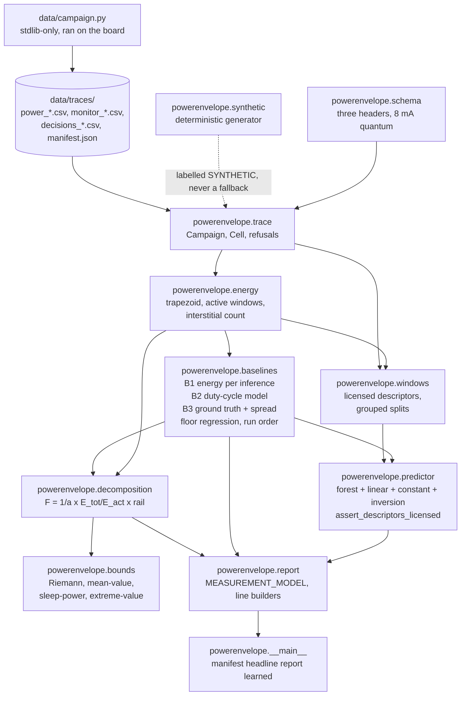
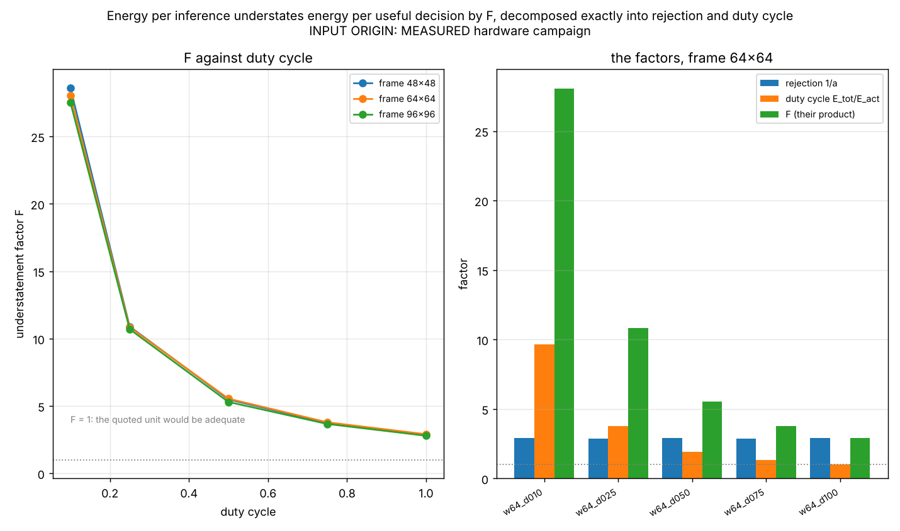
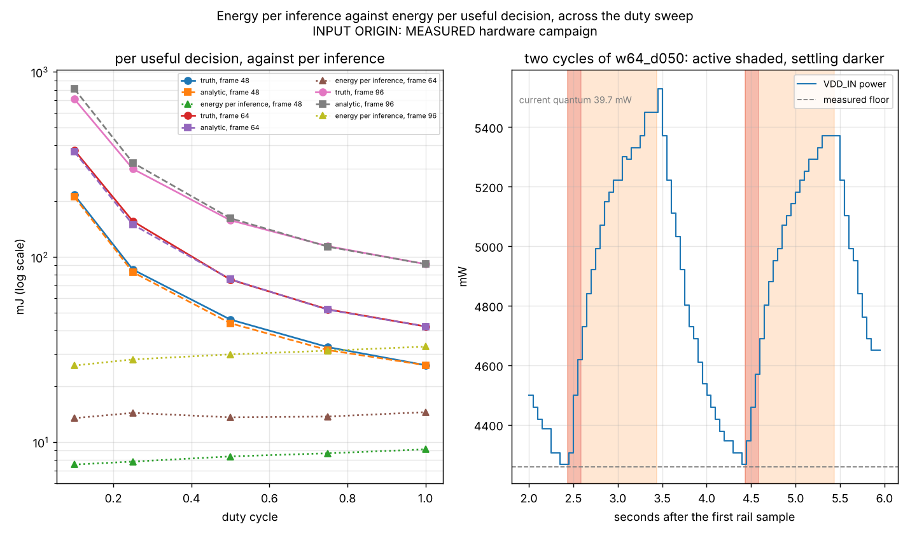
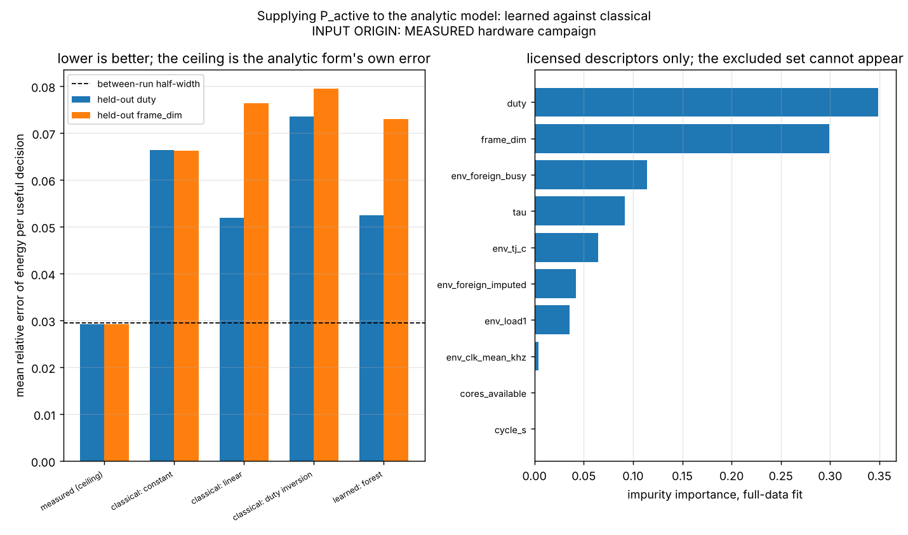

# powerenvelope

Measured energy per **useful decision** for a duty-cycled on-board autonomy
pipeline, and the factor the usual unit misses.


-orange)


## The headline, measured

On the reference cell of the hardware campaign — frame 64×64, duty 0.50, strict
gate, 38 cycles, 76 s on an NVIDIA Jetson Orin Nano:

| quantity | measured |
|---|---|
| energy per inference, measured-active `E_active/N` | **13.608386 mJ** |
| energy per useful decision `E_total/A` | **75.456680 mJ** |
| **understatement factor F** | **5.544866** |
| rejection factor `1/a` | 2.898629 |
| duty-cycle factor `E_total/E_active` | 1.912927 |
| nominal-versus-measured rail factor | 1.000000 (measured-active) |
| closure error of the three factors | 0.000e+00 |
| acceptance rate, counted | 0.344991 (4449 of 12896) |

`E_total` is the trapezoidal integral of rail power over the run window
`[t0_mono, t1_mono]` exactly, with `P` interpolated at both ends.
`E_active` and `E_sleep` partition that same window using the declared
per-cycle phases, again with `P` interpolated at every boundary, so the
decomposition is **exact in three factors with no residual term**:
`F = (1/a) × (E_total/E_active) × (rail)`. The closure check
`|E_active + E_sleep − E_total| / E_total` is reported on every cell; its
worst value over the campaign is **8.114e-05** on `w96_d100`, against a
declared tolerance of 1e-4.

Across the 15-cell grid F runs from **2.791586** (frame 96, duty 1.00) to
**28.597765** (frame 48, duty 0.10). Quoting this pipeline in energy per
inference understates what a mission actually spends per decision by between
about three and twenty-nine times, depending on how hard it is duty-cycling.

With the **nominal 5.0 V rail** substituted for the measured bus voltage, F is
**5.488281** on the same cell — *smaller*, not larger, because this board's
VDD_IN averages 4961.5 mV under load, so quoting 5.0 V overstates the active
power and flatters the comparison. A power budget on this board is wrong in the
direction that makes it look better.

The between-run interval over the four repeats of the reference cell is
**73.4156 ± 2.1689 mJ** per useful decision (Student-t, 95 per cent, n = 4),
which is **2.95 per cent** relative, and is the noise floor every comparison
below is judged against.

The ratio `T_act / (N·L)` is **not** a factor of F. It is reported separately
as a phase-occupancy diagnostic: on the reference cell the inferences occupy
37.989458 s of the 38.000000 s declared active window, an occupancy of
**0.999723** and a **shortfall of 10.542 ms**. The loop checks the clock before
starting an inference and will not start one that would run past the phase
boundary, so the inferences *undershoot* the declared phase; the merged span of
the inference intervals overshoots it by 2.672 ms because the last inference of
a phase starts before the boundary and finishes after it.

**The learned component is beaten.** Scored on the job the specification gives
it — supplying `P_active` to the analytic model without measuring it — the
random forest does not beat the strongest classical predictor on either
held-out scheme. The pre-registered expectation is **NOT REFUTED**. Numbers in
*Validation evidence* below.

Every figure here comes from `validation/validate_measured_headline.py`,
`validate_measured_baselines.py` and `validate_measured_learned.py`, which write
their raw output beside themselves.

## The problem

An on-board autonomy pipeline is quoted in **energy per inference**: the power
drawn while it is running, times the inference latency. A mission does not act
on inferences; it acts on the **decisions it accepted**, and two things sit
between the two numbers — inferences whose output fails the confidence or
geometry gate, and the platform power a duty-cycled pipeline draws while it
sleeps. Energy per inference charges neither of those to the decisions they
enabled, so a power budget written in that unit can be wrong by a factor nobody
has measured.

## What this does

- Computes **energy per useful decision** as the trapezoidal integral of the
  measured VDD_IN rail power over the run window `[t0_mono, t1_mono]` exactly,
  sleep windows included, divided by accepted decisions counted from a committed
  per-inference record.
  268,425 inferences and 100,789 accepted decisions across the campaign;
  acceptance is never asserted and every rejection carries its reason.
- Reports the **understatement factor** and decomposes it into exactly three
  factors — the rejection factor, the duty-cycle factor and the
  nominal-versus-measured active-power error. Because `E_active` and `E_sleep`
  partition the same run window the numerator integrates, the decomposition has
  **no residual term**: closure error 0.000e+00 on the reference cell and below
  2.3e-16 on every cell of the grid. The partition's own closure,
  `|E_active + E_sleep − E_total| / E_total`, is checked separately on all 19
  pipeline cells and its worst value, 8.114e-05 on `w96_d100`, is named rather
  than passed over.
- Implements all three baselines and validates the analytic one against the
  ground truth **before** anything is benchmarked: the duty-cycle model lands
  within **13.48 per cent** of the integrated truth on the worst grid cell
  (`w96_d010`) and within 3.02 per cent on average.
- Measures how much of the "floor" is other people's load rather than assuming:
  regressed on the floor run's own `/proc/stat` occupancy the slope is
  **2034.3 mW per unit occupancy** with a Pearson **r = 0.6932**, implying
  **250.9 mW, 5.90 per cent** of the measured floor is foreign work — and
  publishes a three-row floor-sensitivity table rather than one number.
- Carries four independent brackets whose mathematics the integrator does not
  use, **one of which is falsified on the measured data** and is published as a
  falsification rather than removed: the campaign-floor sleep-power bound is
  violated on 7 of the 19 pipeline cells because the run order was not
  randomised, so the bound's premise — that a sleep window draws at least the
  minimum power ever seen on the floor run — is false on this campaign. The
  seven cells are pinned as literals, so the check fails for real if the
  falsification set ever changes. See *Limitations*.

## Measurement model, stated once

The platform rail is VDD_IN, measured by the on-board INA3221 as bus voltage
(mV) times shunt current (mA); `P(t) = V(t)*I(t)`. Energy over a window is the
**trapezoidal** integral of `P(t)` over the sampler's `CLOCK_MONOTONIC`
timestamps. A cycle is 2.0 s: the pipeline runs back-to-back inferences for
`duty * 2.0` s and sleeps the rest; a run is 38 cycles. An inference is one pass
over one frame, one row of the decisions CSV. A **useful decision** is an
inference that passes the gate — a candidate exists, its box does not touch the
border, its area is within the declared bounds, and its score is at least `tau`
— so the acceptance rate is counted from the committed CSV and never asserted.
**Energy per useful decision** is the integral of `P(t)` over the **run window
`[t0_mono, t1_mono]` exactly**, with `P` interpolated at both ends, sleep
windows included, divided by the number of accepted decisions in that run. The
sampler brackets the run on purpose, starting early and stopping late, so its
span is **wider** than the run and is never what is integrated. `E_active` and
`E_sleep` partition that same window using the declared per-cycle phases, with
`P` interpolated at every boundary.

The same paragraph is in `src/powerenvelope/trace.py`'s module docstring, in
`powerenvelope.report.MEASUREMENT_MODEL`, in `validation/VALIDATION.md`, and at
the head of every validation output that reports a measured quantity.

## Who it is for

- An engineer sizing an on-board power budget for a duty-cycled autonomy
  pipeline who wants to know what the quoted unit leaves out.
- Someone who has a rail trace and a per-inference log from the same board and
  wants the energy per accepted decision rather than per inference.
- A reviewer who wants the decomposition — how much of the gap is rejection,
  how much is duty cycling, how much is a nominal rail voltage — because those
  three have different fixes.

## Who it is not for

- Anyone who wants a power meter. `tegrastats` and `jtop` already do that, and
  better.
- Anyone who wants per-code-region joules in a server context. `pyJoules` and
  `CodeCarbon` already do that.
- Anyone who wants a number for a GPU or DLA pipeline, a compiled pipeline, a
  different cycle period, a second power mode or a second board. None of those
  is in this campaign, and the loader refuses a manifest declaring a different
  cycle period rather than extrapolating.
- Anyone who needs a certified or flight-qualified result. This is
  research-grade.
- Anyone who wants a converter-efficiency curve. What this measures is a
  **rail-accounting ratio** on the three channels the INA3221 instruments
  (0.4943 to 0.6444 across the campaign, R² = 0.119 against load), and the code
  says so wherever it prints one.

## Alternatives, honestly

Checked on 2026-11-14 by querying `https://pypi.org/pypi/<name>/json` and
reading the returned `info.name` and `info.version`. The version column is what
that query returned on that date.

| alternative | checked | what it does better | when to use it instead |
|---|---|---|---|
| `tegrastats` | **Not on PyPI** (`/pypi/tegrastats/json` → HTTP 404). It is an NVIDIA binary shipped with JetPack, not a Python package. | The vendor's own live rail and thermal readout, with no instrumentation to write | You want to watch the rails while something runs |
| `jetson-stats` (`jtop`) | PyPI, version 7.2.2 | A curated interactive monitor and a Python API over every Jetson sensor, maintained against JetPack | You want a Jetson power trace, a TUI, or a programmable sensor API |
| `pyJoules` | PyPI, version 0.5.1 | Per-code-region energy with decorators and context managers, across RAPL, NVIDIA and Jetson backends | You want joules for a function call rather than per decision |
| `codecarbon` | PyPI, version 3.3.2 | Energy and CO2 accounting for training and inference, with reporting and a dashboard | You want emissions accounting across machines |
| `experiment-impact-tracker` | PyPI, version 0.1.8 | Energy, carbon and compute metrics for ML experiments, with a reporting harness | You want a per-experiment impact report |
| `powertop` | A PyPI package named `powertop` exists, version 0.2.2, described as a small wrapper around the Intel PowerTOP utility. **It is not the utility itself**, and the utility is a Linux distribution package. | System-wide power attribution per process and per device on x86 | You are on x86 and want to know which process is costing you power |
| MLPerf Tiny | **No `mlperf-tiny` on PyPI** (HTTP 404). A package named `mlperf` exists, version 0.1.0, described as "an automation interface for ML applications" — unrelated to the MLPerf benchmark suites. | A standard, comparable, peer-reviewed energy-per-inference benchmark across hardware | You want a comparable number in the unit the field already uses |

None of them divides by the number of decisions a mission could act on, and
none separates the duty-cycle and rejection components of the gap. The
contribution here is not a better power meter; it is the denominator, and the
decomposition that says which part of the gap an engineer can actually reduce.

## Install and first run

```bash
git clone https://github.com/OmAcharya-avtr/powerenvelope.git
cd powerenvelope
python -m venv .venv && source .venv/bin/activate
pip install -e ".[dev]"
python -m pytest tests/ -q
python examples/headline_decomposition.py
```

The suite prints, on the analysis machine described in
`validation/VALIDATION.md` (the duration varies between runs; the count does
not):

```
360 passed in 35.11s
```

and the example begins:

```
INPUT ORIGIN: MEASURED hardware campaign from data/traces/

MEASUREMENT MODEL. The platform rail is VDD_IN, measured by the on-board INA3221 ...

INPUT ORIGIN: measured -- 20 cell(s) from data/traces/

THE REFERENCE CELL, both variants of energy per inference

  cell                              : w64_d050
  variant of energy per inference   : measured-active
  inferences counted                : 12896
  useful decisions counted          : 4449
  acceptance rate a                 : 0.344991
  run energy E_total                : 335706.769863 mJ
  declared-active energy E_active   : 175493.746037 mJ
  declared-sleep energy E_sleep     : 160208.592118 mJ
  partition residual                : -1.320e-05
  active duration                   : 38.000000 s
  mean inference latency L          : 0.002945833 s
  energy per inference (baseline 1) : 13.608386014 mJ
    spec-literal P_act * L          : 13.604610761 mJ
  energy per useful decision        : 75.456680 mJ
  HEADLINE understatement factor F  : 5.544866
    rejection factor N/A            : 2.898629
    duty-cycle factor E_tot/E_act   : 1.912927
    rail-voltage factor             : 1.000000
    closure error of the three      : 0.000e+00
  DIAGNOSTIC, not a factor:
    declared active time            : 38.000000 s
    occupied by inferences          : 37.989458 s (occupancy 0.999723)
    spanned by merged intervals     : 38.002672 s
    shortfall / overshoot           : 10.542 ms / 2.672 ms
```

## A worked example

```python
from powerenvelope import decompose, load_campaign, Origin
from powerenvelope.baselines import energy_per_inference, ground_truth

campaign = load_campaign("data/traces", origin=Origin.MEASURED,
                         directory_label="data/traces")
print(campaign.provenance.banner())

cell = campaign.require("w64_d050")
baseline = energy_per_inference(cell, "measured-active")
truth = ground_truth(cell)
print(f"energy per inference      : {baseline.energy_mj:.4f} mJ")
print(f"energy per useful decision: {truth.energy_per_useful_decision_mj:.4f} mJ")
print(f"acceptance rate (counted) : {truth.acceptance_rate:.4f}")

result = decompose(cell, "measured-active")
print(f"understatement factor F   : {result.factor:.4f}")
print(f"  rejection 1/a           : {result.rejection_factor:.4f}")
print(f"  duty cycle E_tot/E_act  : {result.duty_cycle_factor:.4f}")
print(f"  rail voltage            : {result.rail_voltage_factor:.4f}")
print(f"  closure error           : {result.closure_error:.2e}")
print(f"  partition residual      : {result.partition_residual:+.2e}")
print(f"  occupancy (diagnostic)  : {result.occupancy.occupancy:.6f}")
```

prints

```
INPUT ORIGIN: measured -- 20 cell(s) from data/traces/
energy per inference      : 13.6084 mJ
energy per useful decision: 75.4567 mJ
acceptance rate (counted) : 0.3450
understatement factor F   : 5.5449
  rejection 1/a           : 2.8986
  duty cycle E_tot/E_act  : 1.9129
  rail voltage            : 1.0000
  closure error           : 0.00e+00
  partition residual      : -1.32e-05
  occupancy (diagnostic)  : 0.999723
```

## Architecture



## Screenshots

All three are drawn from the **measured** campaign and are produced by the
example named under each.



`examples/headline_decomposition.py`. Notice the left panel: the factor rises
steeply as the duty falls, which is the duty-cycle term, and it does **not** go
to 1 at duty 1.00 — what is left there, about 2.8 to 2.9, is the rejection
factor alone. The three frame dimensions lie almost on top of each other, which
says the gap is a property of the duty cycle and the gate and not of the
workload size.



`examples/duty_cycle_sweep.py`. Notice two things. On the left, energy per
inference (dotted) is nearly flat against duty by construction — it charges
nothing to the sleep window — while both the analytic model and the integrated
ground truth rise by more than an order of magnitude as the duty falls, and the
two track each other closely. On the right, the rail trace of two cycles: the
power does not step, it **ramps**, peaking near the end of each active window
and decaying through the sleep. That shape is the INA3221's 512-conversion
hardware averaging smearing a square wave, and it is why the measured `E_ramp`
comes out negative.



`examples/learned_vs_analytic.py`. Notice that the dashed line — the
between-run interval half-width, 2.95 per cent — sits just under the ceiling
bar. The analytic form's own error with the power known exactly is 2.92 per
cent, essentially at the measurement's noise floor, and every predictor's error
is dominated by the prediction rather than by the model. The learned forest is
not the lowest bar on either split.

## Validation evidence

Full table, with what it would take to fail each check, in
`validation/VALIDATION.md`. The headline rows:

| check | reference | result | tolerance |
|---|---|---|---|
| The three factors multiply to F, reference cell | the decomposition's own identity | PASS, closure error 0.000e+00 | 1e-10 relative |
| Declared active and sleep phases partition the run | partition of the same integral | PASS, worst closure 8.114e-05 on `w96_d100` | 1e-4 relative, declared |
| Trapezoid inside the Riemann bracket, 20 cells | left and right Riemann sums | PASS | slack from conditioning, no absolute floor |
| Trapezoid inside the mean-value bracket, 20 cells | the mean value theorem for integrals | PASS | the same |
| **Duty-cycle factor above the campaign-floor sleep bound** | positivity of the floor run's minimum | **FALSIFIED on exactly 7 of the 19 pipeline cells** — the bound's premise is false on this campaign. The seven cells are pinned as literals and the check fails for real if the set changes. See Limitations. | the bound and its arithmetic are unchanged |
| Duty-cycle factor above each cell's **own** sleep-minimum bound | the same argument with a measured premise | PASS, 19 of 19; reported as the weaker companion | the same |
| F above the extreme-value bound, reference cell | extreme values of power and latency, no integral | PASS, bound 1.4407 against 5.5449, ratio 3.849 | the same |
| Analytic duty-cycle model against ground truth, 15 grid cells | Baseline 3, the integrated truth | PASS, worst gap 13.48 per cent on `w96_d010` | 20 per cent, declared |
| Three-term and two-term cycle energies agree | the same integral, partitioned two ways | PASS, worst residual 4.441e-16 | 1e-4 relative |
| Floor-occupancy regression is defined and weak | the floor run's own `/proc/stat` seconds | PASS, slope 2034.3 mW, r = 0.6932, r² = 0.4805 | r reported, not bounded |
| In-cell floor adjustment collapses the analytic error's scatter | per-cell sleep-window mean power | PASS, adjusted ratios uniform to 0.0000 | 0.02, declared |
| Between-run interval has positive width | four repeats of the reference cell | PASS, ±2.1689 mJ = 2.95 per cent | — |
| Permissive-gate control removes the rejection factor | the declared negative control | PASS, `1/a` falls 2.8986 → 1.1094 | must fire |
| Negative controls, synthetic | 26 declared, anchored on true values | PASS: 18/18 must-fire fired, 8/8 must-not-fire silent | — |
| `pytest.approx` audit | the suite re-run with the absolute default forced to 0.0 | PASS: **0** bare `rel=` call sites, 360 tests still pass | — |
| Property hunt, 7 identities | Hypothesis, 600 examples each | PASS — after one property was **falsified and replaced** | — |
| Working-directory probe | every script from four directories | PASS, same exit status from all four | — |
| **Two of five gate branches never fired** | the campaign's own reject census | **NOT MEASURED**: `no_candidate` and `border` have zero occurrences | — |

### The learned component, scored where it bites

Supplying `P_active` to the analytic model without measuring it; everything else
held at its measured value; error is the relative error of energy per useful
decision against the measured ground truth.

| predictor | held-out duty | held-out frame dimension |
|---|---|---|
| measured `P_active` (ceiling) | 0.029186 | 0.029186 |
| classical: constant grid mean | 0.066443 | **0.066287** |
| classical: linear in duty and dimension | **0.051959** | 0.076385 |
| classical: analytic duty inversion *(the one the spec names)* | 0.073620 | 0.079520 |
| learned: random forest | 0.052428 | 0.072997 |
| between-run half-width | 0.029543 | 0.029543 |

**Pre-registered verdict: NOT REFUTED, on both splits.** The classical
predictors are competitive, and the learned forest is in fact slightly worse
than the strongest classical predictor on both — by 0.00047 on held-out duty
and 0.0067 on held-out frame dimension, both well inside the 0.0295 noise
floor.
The learned component stays in the product, reported as beaten. Nothing was
retuned. The predictor the specification names, the analytic duty inversion, is
the **weakest** of the three classical ones on both splits, so the strongest
classical predictor is used as the comparator and the specified one is reported
beside it.

### A property this product claimed and had falsified

`validate_property_hunt.py` falsified the claim that the trapezoidal energy
integral is invariant under a shift of the timestamps, at `t = [0.0, 1e-4]`,
`shift = 2048.0`, where the integral changes by 2.0e-9 relative. The claim was
replaced by a quantitative one — the change is bounded by
`4 * EPS * max|t| / min(dt)` — and the counterexample is pinned as a named
literal regression test. The campaign's `t_mono` is the board's uptime, so every
energy figure carries about 1e-8 relative uncertainty from the timestamp
representation; that is far below the 39.69 mW quantisation floor on the
reference cell and changes no reported figure.

## API reference

<details>
<summary>Public surface, with units</summary>

| callable | returns | units |
|---|---|---|
| `load_campaign(directory, origin, require, directory_label)` | `Campaign` | — |
| `campaign_is_complete(directory)` | `bool` | — |
| `load_power / load_monitor / load_decisions(path, allow_empty)` | the three trace types | mV, mA, mW, s |
| `trapezoid_energy_mj(t_s, power_mw)` | `float` | mJ |
| `merge_intervals(starts, ends, gap_tolerance_s)` | `(ndarray, ndarray)` | s |
| `active_windows(decisions, gap_tolerance_s)` | `(ndarray, ndarray)` | s |
| `clip_series(t_s, power_mw, lo, hi)` | `(ndarray, ndarray)` | s, mW |
| `energy_over_windows(power, starts, ends, column)` | `WindowEnergy` | mJ, s, mW |
| `whole_run_energy(power, column)` / `sleep_energy(cell, column)` | `WindowEnergy` | mJ, s, mW |
| `interstitial_samples(cell, gap_tolerance_s)` | `Interstitial` | count, s |
| `energy_per_inference(cell, variant)` | `EnergyPerInference` | mJ, mW, s |
| `mean_active_power_mw(cell)` | `float` | mW |
| `floor_power(campaign, cell_label)` | `FloorPower` | mW |
| `floor_occupancy_regression(campaign, cell_label)` | `FloorRegression` | mW per unit occupancy |
| `floor_variants(campaign, cell_label, include_regression)` | `dict[str, float]` | mW |
| `ramp_energy(cell, window_s)` | `RampEnergy` | mJ, mW, s |
| `duty_cycle_model(campaign, cell_label, floor)` | `DutyCycleModel` | mJ, mW, s |
| `two_term_cycle_energy_mj(duty, cycle_s, floor_mw, mean_active_mw)` | `float` | mJ |
| `energy_per_useful_decision_from_cycle_mj(cell, e_cycle_mj)` | `float` | mJ |
| `rail_accounting_curve(campaign)` | `RailAccounting` | dimensionless per mW |
| `ground_truth(cell)` | `GroundTruth` | mJ, mW, s |
| `between_run_spread(campaign, cell_labels, confidence)` | `BetweenRunSpread` | mJ |
| `run_order_rows(campaign)` / `sleep_power_mw(cell)` | `list[RunOrderRow]` / `(float, float)` | s, mW |
| `decompose(cell, variant)` | `Decomposition` | dimensionless |
| `riemann_bracket` / `extreme_value_bracket(t_s, power_mw)` | `Bracket` | mJ |
| `duty_cycle_lower_bracket(active_energy_mj, floor_min_mw, sleep_duration_s)` | `Bracket` | dimensionless |
| `headline_lower_bracket(run_duration_s, min_power_mw, max_active_power_mw, max_latency_s, n_accepted)` | `Bracket` | dimensionless |
| `slack_from_conditioning(terms)` | `float` | same as the sum |
| `extract_windows(campaign, window_s)` | `WindowSet` | mW target |
| `grouped_splits(windows, by)` | `list[(label, train, test)]` | — |
| `pipeline_free_monitor_mask(cell)` | `ndarray[bool]` | — |
| `assert_descriptors_licensed(names)` | `None`, raises `DescriptorLeakError` | — |
| `ActivePowerPredictor().fit(features, targets, feature_names).predict(...)` | `Prediction` | mW |
| `LinearActivePowerModel().fit(campaign, cell_labels).predict_cell(...)` | `float` | mW |
| `AnalyticActivePowerModel()` / `ConstantPowerPredictor()` | `Prediction` | mW |
| `target_quantisation_sd(step_mw, n_samples)` | `ndarray` | mW |
| `score(label, truth, prediction, sigma)` | `Score` | mW |

</details>

Command line:

```
python -m powerenvelope --help
python -m powerenvelope --traces data/traces headline --cell w64_d050
python -m powerenvelope --traces data/traces report
python -m powerenvelope --traces data/traces learned
python -m powerenvelope --simulate report      # SYNTHETIC, labelled as such
```

Exit status 0 on success, 2 on a usage or input error, 3 when the requested
traces are absent or incomplete.

## Limitations

- **The run order was not randomised, and frame dimension is confounded with
  elapsed time and with a falling foreign load.** The campaign ran the floor
  first, then all five duties at frame 48, then 64, then 96, then the repeats,
  then the permissive control: 20 sequential 76 s runs over 27.05 minutes, during
  which the board's 1-minute load average fell from 2.324 to 1.050. **The floor
  was therefore measured at the highest foreign load of the campaign and the
  frame-96 cells ran at the lowest.** `w96_d010` draws 3716.75 mW on average —
  *less than the 4258.63 mW "floor"* — while running the pipeline. This is a
  defect in the campaign's design. Nothing was re-run to hide it, nothing is
  corrected out of the headline, and the per-cell table is published in
  `validate_measured_baselines.py` section 5. It is the honest explanation for
  the analytic model's error being largest on the frame-96 cells.
- **One of the independent bounds is FALSIFIED because of that drift, and is
  published as a falsification.** The bound
  "`E_total ≥ E_active + floor_min · t_sleep`" rests on a premise — that a
  sleep window draws at least the minimum power ever seen on the no-pipeline
  floor run, 4113.4 mW — and **the non-randomised run order makes that premise
  false on this campaign**: the floor was measured at the heaviest foreign load
  of the whole run, so later cells' sleep windows draw less than the floor run's
  minimum ever did. The arithmetic is sound; the assumption about the board's
  state is not. It is violated on exactly **7 of the 19 pipeline cells** —
  `w64_d050_permissive`, `w64_d050_rep2`, `w64_d050_rep3`, `w64_d050_rep4`,
  `w96_d010`, `w96_d025`, `w96_d050`. Those seven are **pinned as literals** in
  `validation/validate_measured_headline.py`, so the check reports `FALSIFIED`
  as its finding and exits 0 only while the falsification set is exactly that
  list; a cell joining it or leaving it makes the script fail for real. The
  bound is not edited, the check is not skipped and the tolerance is not
  loosened. A variant using each cell's own sleep-window minimum holds on all 19
  and is reported beside it as the weaker argument it is, since it reads its
  minimum from the same samples the integral it checks is taken over. The three
  duty-1.00 cells are not in the set because, with the declared sleep duration
  `cycles · (1 − duty) · cycle_s`, a duty-1.00 run has no sleep phase and the
  bound reduces to `factor ≥ 1`, which they satisfy. **The headline does not
  depend on this bound at all**: F is `(E_total/A)` over `(E_active/N)` — four
  measured integrals and two counts, none of which is the floor cell. The floor
  enters Baseline 2 only, and its sensitivity is published as a three-row
  table.
- **Two of the gate's five branches never fired.** Across 268,425 measured
  inferences the census is `accept` 100,789, `low_score` 146,410, `area_out`
  21,226, and `no_candidate` and `border` **zero**. The measured acceptance
  rate, and therefore the rejection factor the headline decomposes into, is a
  property of a gate whose empty-candidate and border paths were never reached
  by measurement. Those branches are exercised only by the synthetic generator.
  No occurrence was synthesised to fill the table.
- **The measured `E_ramp` is negative**, between −72 and −202 mJ per wake. This
  is a measurement of the instrument, not of the board: the INA3221 averages 512
  conversions in hardware, so a reading taken within the 0.15 s settling window
  still carries the sleep window's power, and the observable settling interval
  shows a deficit against the steady level that follows rather than the excess a
  wake transient physically is. The settling window was declared before the
  campaign ran and was **not** re-chosen after seeing this. The right-hand panel
  of the duty-sweep screenshot shows the smearing directly.
- **The floor is a background floor on a shared machine, not an idle floor.**
  The board had logged-in users, a desktop browser, swap in use and a load
  average above 1. Regressed on its own occupancy the floor gives slope 2034.3
  mW per unit occupancy, intercept 4005.18 mW, Pearson r 0.6932 (r² = 0.4805)
  — a **weak** correlation, so over half of the floor's second-to-second
  variation is not explained by the occupancy counter and the intercept is an
  extrapolation below the observed occupancy range. The published
  headline uses the measured floor mean; a three-row sensitivity table is
  published beside it.
- **Foreign CPU occupancy is barely separable above duty 0.25.** A monitor
  sample reports the occupancy of a whole preceding second, and a sample is
  pipeline-free only when no inference interval overlaps that entire second. At
  duty 0.10 and 0.25 that holds for 39 of the 77 monitor seconds; at duty 0.50
  and 0.75 for exactly **1**, because the sleep window and the monitor's own 1 s
  interval have an arbitrary relative phase; at duty 1.00 for none. 117 of 171
  windows therefore carry an imputed occupancy, taken from the floor cell's
  measured 0.123514 and flagged in the design matrix as `env_foreign_imputed`.
- **`env_load1` is contaminated by the pipeline itself.** The specification
  licenses it and it is used; `validate_descriptor_leak.py` refits without it.
- **The rail current quantises at 8 mA**, 39.69 mW at the reference cell's
  measured bus voltage and 39.89 mW at the floor cell's.
  That is the limit on every power figure here, about ten orders of magnitude
  above the floating-point floor.
- **The sampler draws power it is measuring.** It costs 1.058 s of CPU per 77 s
  run on average, 1.37 per cent of one core, and that is reported as back-action
  rather than corrected for: a correction would need a model of the board's
  power against occupancy, which is the thing being measured.
- **One power mode** (`MAXN_SUPER`; `sudo -n true` returns a password prompt on
  this board), **one board, one uninstrumented ambient, one CPython CPU-only
  pipeline, one 2.0 s cycle.** Nothing here supports a general statement about
  energy per decision on Orin Nano.
- **Dependency ranges were run at both ends, and matplotlib was not.** On
  2026-11-14, in an isolated virtual environment outside this tree, the suite
  was run at the declared floors (numpy 2.5.0, scipy 1.18.0, scikit-learn 1.9.0,
  pytest 9.1.0, hypothesis 6.170.0) and at the highest release below each
  declared ceiling (numpy 2.5.4, scipy 1.18.1, scikit-learn 1.9.1, pytest 9.1.1,
  hypothesis 6.170.15). Both gave **360 passed**, and every committed validation
  output regenerated at both ends differs from the pinned one only in the
  environment stanza that prints the installed versions and in two wall-clock
  readings — the suite duration and the forest's measured fit time.
  `matplotlib` is outside that sweep: it draws the screenshots and is in no
  reported number, and it was measured only at 3.11.2. `ruff` is clean at 0.16.9 and 0.17.5. A pin
  below a future security release is still a real cost, not a free safety
  measure, and that tension is recorded here rather than resolved by removing
  the ceiling.
- **`data/campaign.py` is excluded from linting.** It is the measurement program
  as it ran on the board, byte for byte; editing it would make the committed
  copy differ from the program that produced every measured number here.

## Reproducing every number

```bash
# 1. The suite, with the test count taken from junit XML and cross-checked.
python -m pytest tests/ -q --junit-xml=junit.xml
python - <<'PY'
import xml.etree.ElementTree as ET
root = ET.parse("junit.xml").getroot()
suite = root if root.tag == "testsuite" else root[0]
print({k: suite.get(k) for k in ("tests", "failures", "errors", "skipped")})
print("testcase elements:", len(suite.findall(".//testcase")))
PY

# 2. Lint, under both ruff installations this product was measured against.
ruff check src/ tests/ examples/ validation/
python -m ruff check src/ tests/ examples/ validation/

# 3. Clear the caches the suite and the linter just created, so that
#    validate_tree_hygiene.py reports the clean tree the committed output was
#    taken from. It reports inherited artifacts without failing either way.
rm -rf .ruff_cache .hypothesis
find . -name __pycache__ -type d -prune -exec rm -rf {} +

# 4. Every validation script. Each writes <script>_output.txt beside itself.
#    validate_measured_headline.py reports the sleep-power bound as FALSIFIED
#    and exits 0 while the falsification set matches its pinned seven cells; it
#    exits non-zero if that set ever changes.
for script in validation/*.py; do
  case "$(basename "$script")" in _*) continue;; esac
  python "$script"
done

# 5. Every example. Each writes its PNG into screenshots/ and its output beside itself.
for example in examples/*.py; do
  case "$(basename "$example")" in _*) continue;; esac
  python "$example"
done

# 6. The CLI.
python -m powerenvelope --help
python -m powerenvelope --traces data/traces report
```

## Hardware requirements

None to run the analysis: it is numpy, scipy and scikit-learn over committed
CSV files, on two cores. To **produce** a campaign you need an NVIDIA Jetson
Orin Nano with an INA3221 at `/sys/class/hwmon/hwmon1`, and you run
`data/campaign.py`, which is stdlib-only on purpose so that the rail sampler is
not delayed by numpy's allocation or threading behaviour.

## Safety statement

This software is **research-grade**. It is **not flight-qualified, not
certified, and not approved for operational aerospace use**. Nothing in it may
be described as flight-safe, mission-ready or production-ready.

## Licence

Apache-2.0. See `LICENSE`. Copyright © 2026 OPTIMA Organisation.

## Citation

See `CITATION.cff`.

## Credits

This is under reserved rights obtained by OPTIMA Organisation.
