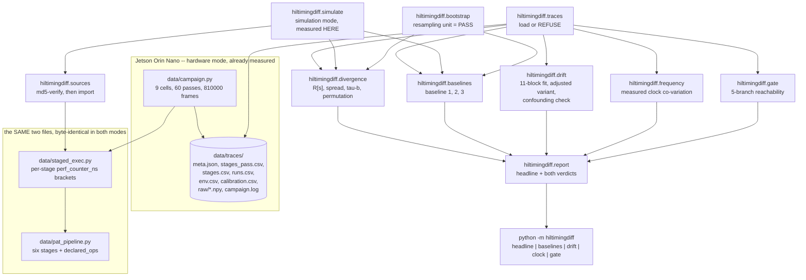
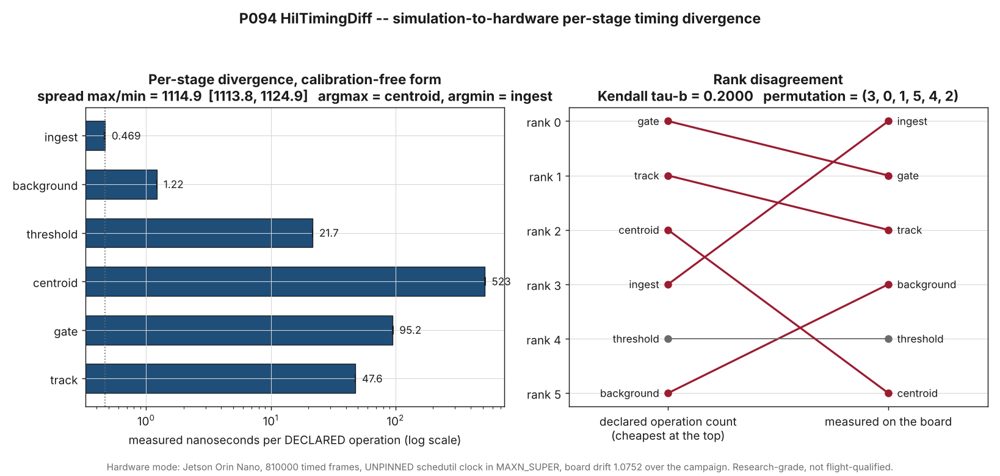
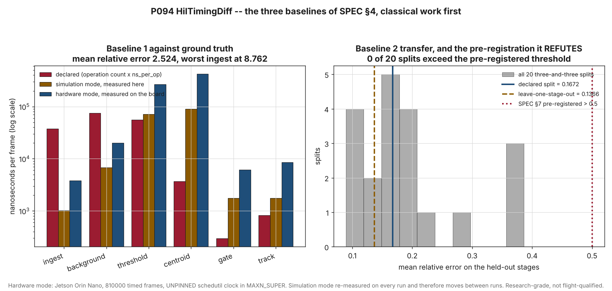
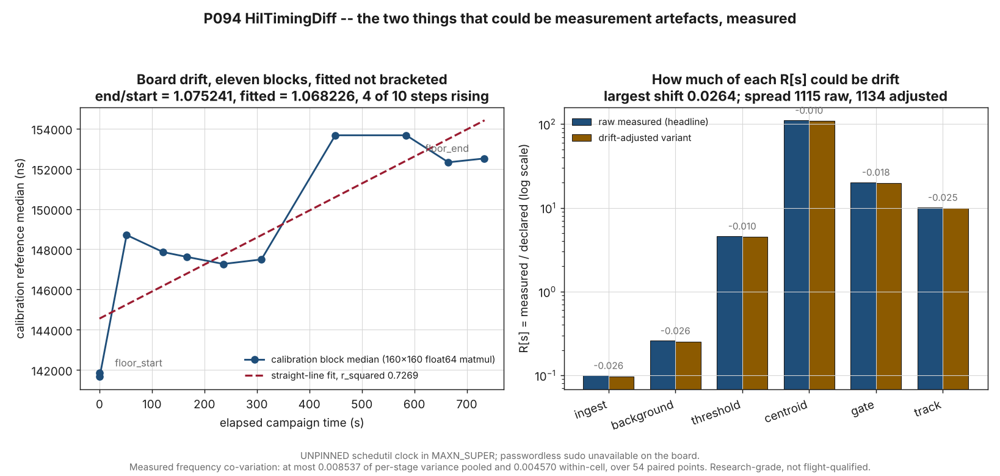

# hiltimingdiff

Per-stage timing divergence between the simulation-mode and hardware-mode execution of one PAT pipeline.


## The problem

You built a WCET budget for a six-stage pointing, acquisition and tracking
pipeline by reading operation counts off the source and scaling them, because
you cannot put every stage on the board. If that model's error is uniform
across stages, your budget is merely mis-scaled and the stage ordering it rests
on survives. If the error is stage-dependent, the ordering does not survive and
you have allocated your headroom to the wrong stage — and nothing in a hardware
-in-the-loop framework tells you which of those two situations you are in.

## What this does

- Runs **the same file** in both modes. `data/pat_pipeline.py` is imported, not
  re-implemented, and timed by `data/staged_exec.py` in both; both are
  byte-identical to the copies that executed on a Jetson Orin Nano, with md5
  sums pinned in three independent places and asserted before a frame is timed.
- Reports the **per-stage divergence ratio** `R[s]` with a bootstrap interval
  over 540 pass units, measured against 810000 timed hardware frames.
- Reports the **divergence spread** `max(R)/min(R)` — measured
  **1114.8633602088898**, 95% interval [1113.763384, 1124.917784] — which is
  the number that decides whether a schedulability ordering survives.
- Reports the **rank disagreement** as Kendall's tau-b, measured **0.2**, and
  as the explicit permutation **(3, 0, 1, 5, 4, 2)**: 5 of 6 stages change rank
  between the declared and measured orderings.
- Reports **how far a single measured scaling factor transfers** to a stage you
  never put on the board: 0.152250 mean relative error on three held-out
  stages, 0 of 20 three-and-three splits above 0.5.
- Reports the **board drift** (1.0752408447278534 over the campaign) as a
  drift-adjusted variant beside the raw figure, and the **measured** share of
  per-stage variance that co-varies with core frequency at an unpinned clock
  (at most 0.008537090338330722).

Every hardware figure is a figure at an **unpinned, schedutil-governed clock in
MAXN_SUPER**. Passwordless sudo was unavailable on the board, so neither the
governor nor the power mode could be pinned. That is stated here, with the
figures, and not in a limitations list.

## Who it is for

- You maintain a per-stage timing model of an on-board pipeline and want to
  know whether its error is uniform or stage-dependent.
- You are deciding which stage to move to an accelerator and the decision rests
  on a simulated per-stage cost.
- You need a per-stage figure with an interval whose resampling unit is
  defensible, and a written account of what the unpinned clock and the board
  drift could and could not have done to it.

## Who it is NOT for

- **You want one function timed well on one platform.** Use `pytest-benchmark`
  or `pyperf`. This product does not replace them and does not try to.
- **You want to know *why* a stage is slow.** This reports *that* a declared
  model is wrong about a stage and by how much. For the mechanism inside the
  stage, use `perf`, `ftrace`, `py-spy` or `scalene`.
- **You want board power, utilisation or thermal headroom.** Use NVIDIA's
  `tegrastats`. The thermal and frequency traces here exist to qualify the
  timing figures, not to characterise the board.
- **You want behavioural hardware-in-the-loop validation.** This compares
  *timing*, not outputs. A MATLAB/Simulink HIL workflow compares behaviour and
  this does not.
- **You want a figure you can put in a certification argument.** This is
  research-grade. See Limitations.
- **You want the result transferred to a different pipeline.** Every number
  here is about one six-stage PAT pipeline on one board. The *method* transfers;
  the numbers do not.

## Alternatives, honestly

| alternative | on PyPI | what it does better | use that instead when |
|---|---|---|---|
| `pytest-benchmark` | yes, 5.3.1 | statistically careful timing of a callable, with its own calibration and outlier handling | you need one function timed well on one platform |
| `pyperf` | yes, 2.11.0 | run-to-run benchmark comparison with proper warm-up and system tuning advice | you are comparing two revisions of the same code on the same machine |
| `yappi` | yes, 1.7.6 | per-call attribution inside a process, including threads | you are attributing cost inside one mode |
| `line-profiler` | yes, 5.1.0 | line-level cost inside a function | you know which stage is slow and want the line |
| `scalene` | yes, 2.4.0 | CPU, GPU and memory attribution with low overhead | you suspect the cost is allocation or GPU rather than arithmetic |
| `py-spy` | yes, 0.4.3 | sampling profile of a running process without instrumenting it | you cannot modify or restart the process |
| `cProfile` | stdlib | deterministic per-call profile with no install | a quick per-call breakdown is enough |
| `perf`, `ftrace` | no, Linux tools | kernel-level profile and trace, scheduler and cache events | you need to know *why* a stage is slow, not whether a model predicted it |
| NVIDIA `tegrastats` | no, ships with JetPack | board-level power, utilisation and thermal sampling | you need board resource figures, not per-stage conformance |
| MATLAB/Simulink HIL | no, commercial | model-in-loop against hardware-in-the-loop **output** comparison | you are validating behaviour, not timing conformance |

None of these answers "is my simulation's per-stage timing error uniform or
stage-dependent, and by how much, with an interval". That is the gap this fills.
Every PyPI name above was probed against `https://pypi.org/pypi/<name>/json` on
2026-11-16 and returned HTTP 200; `perf`, `tegrastats` and `simulink` returned
HTTP 404, which is why they are marked as not being PyPI packages.

## Install and first run

```bash
git clone https://github.com/OmAcharya-avtr/hiltimingdiff.git
cd hiltimingdiff
python -m venv .venv && source .venv/bin/activate
pip install -e ".[test]"
python -m pytest tests/ -q
python -m hiltimingdiff gate
```

The measured hardware campaign is committed under `data/traces/`, so a cold
clone has everything it needs and no check refuses for want of data.

`python -m hiltimingdiff gate` prints:

```
GATE BRANCH REACHABILITY -- SPEC §9
Measured at an unpinned schedutil-governed clock in MAXN_SUPER on a Jetson Orin Nano; the board drifted 7.52 per cent over the campaign.

           cell  n_frames  accept  no_candidate  low_score  area_out  border
      w48_dense     90000   18840          2640     240960     16920    8340
w64_sparse_rep1     90000    8100           420     462600      4020    1800
     w48_sparse     90000    4260          4080     244680      1740    2280
     w64_sparse     90000    7260           300     468840      5040     300
w64_sparse_rep3     90000    4680           300     492420      2280     180
      w96_dense     90000   63180            60     719160     75960   10920
     w96_sparse     90000   20100            60    1069020     12180    1260
      w64_dense     90000   40920           300     420000     35400    6960
w64_sparse_rep2     90000    7080           300     450180      4980    1800
          TOTAL    810000  174420          8460    4567860    158520   33840

  every branch fired at least once : True
  silent branches                  : none
  branches firing in EVERY cell    : accept, no_candidate, low_score, area_out, border
  per-frame acceptance rate        : 0.215333 (174420 of 810000 frames)

Candidate-level and frame-level counts are not a partition of the frames: low_score, area_out and border are counted per candidate, accept and no_candidate per frame.

Research-grade. Not flight-qualified, not certified, and not approved for operational aerospace use.
```

## A worked example

```python
from hiltimingdiff import (
    baseline_1, baseline_2, baseline_3, calibrate_ns_per_op,
    divergence, load_campaign, measure_simulation, pass_units,
)

campaign = load_campaign()            # the committed hardware campaign; refuses if absent
units = pass_units(campaign)          # 540 (cell, pass) units x 6 stages

# Simulation mode is MEASURED HERE, now, by the committed instrument over the
# committed pipeline file. Both are md5-verified before the first frame.
simulation = measure_simulation(campaign, passes=4)
ns_per_op = calibrate_ns_per_op(simulation)

result = divergence(units, ns_per_op)
print(f"spread   {result.spread:.4f}  {result.spread_interval.format(4)}")
print(f"tau-b    {result.tau_b:.4f}   permutation {result.permutation}")
print(f"argmax   {result.argmax}      argmin {result.argmin}")

second = baseline_2(units, simulation)
print(f"held-out transfer error {second.declared.mean_relative_error:.6f}")
print(f"resampling unit         {baseline_3(units).unit}")
print(f"baseline 1 mean error   {baseline_1(units, ns_per_op).mean_relative_error:.6f}")
```

Printed output, from a run on 2026-11-16 (the hardware-derived figures are
exact; the two that carry simulation-mode wall-clock readings are marked):

```
spread   1114.8634  1114.8634 [1113.7634, 1124.9178]
tau-b    0.2000   permutation (3, 0, 1, 5, 4, 2)
argmax   centroid      argmin ingest
held-out transfer error 0.165670          <- carries simulation-mode time
resampling unit         pass
baseline 1 mean error   2.558466          <- carries simulation-mode time
```

## Architecture



## Screenshots



The left panel is the calibration-free form of the divergence, in nanoseconds
per **declared** operation on a log scale: `ingest` costs 0.469 and `centroid`
costs 523, a factor of 1115 across six stages of one pipeline. Notice that the
bars are not within a factor of two of each other — if the declared model were
uniformly wrong they would be. The right panel is the rank disagreement: five
of the six lines cross, and the only stage that keeps its rank is `threshold`.



Left: the declared model (red) against simulation mode (amber) and the board
(blue), log scale. Notice that red is **above** blue for `ingest` and
`background` and far **below** it for `centroid`, `gate` and `track` — the
declared model is wrong in both directions, which is why no single scalar fixes
it. Right: the distribution of held-out transfer error over all twenty
three-and-three splits, with the pre-registered 0.5 threshold on the far right.
Notice that no split reaches it.



Left: the fixed calibration workload across all eleven blocks, with the
straight-line fit through it. Notice that the series is a **staircase**, not a
ramp: it jumps 4.97 per cent between the first two blocks and then plateaus, so
the linear fit explains only 0.7269 of the variation and under-reads the
end-to-start bracket. Right: the raw measured `R[s]` beside the drift-adjusted
variant, with the relative shift printed above each pair. Notice that every
shift is under 2.7 per cent, far too small to produce a spread of 1115.

## Validation evidence

Every figure below comes from a script in `validation/` that was executed on
2026-11-16 and exits 0 when re-run. Full detail, including the checks that are
falsified, is in [`validation/VALIDATION.md`](validation/VALIDATION.md).

| check | reference | result | tolerance |
|---|---|---|---|
| SPEC §7 primary: spread exceeds 3 | pre-registration committed 2026-11-15 | **CONFIRMED**, 1114.8633602088898, 95% interval [1113.763384, 1124.917784] | whole interval above 3 |
| SPEC §7 secondary: held-out transfer error exceeds 0.5 | pre-registration committed 2026-11-15 | **REFUTED**, 0.152250, interval [0.150838, 0.152653], 0 of 20 splits above 0.5 | whole interval below 0.5 |
| SPEC §7 mechanism: `threshold` is a cheap vectorised stage | pre-registration | **FALSIFIED**, 21.651754 ns/op against `background`'s 1.220703, a factor of 17.7 | pinned as a literal |
| SPEC §4 reason: a frame-unit bootstrap understates the interval | pre-registration | **FALSIFIED**, narrower on 2 of 6 stages and wider on 4, up to 15.03x | partition pinned as literals |
| SPEC §8: randomisation decorrelates order from dimension | pre-registration | **FALSIFIED**, `corr(order_index, W)` = 0.5011614417507341 Pearson, 0.5809475019311126 Spearman on midranks | pinned to full precision |
| Spearman rho against an independent implementation | `scipy.stats.spearmanr`, and `scipy.stats.rankdata(method="average")` | agree to 1e-12 on the campaign series and on 200 random tied series | 1e-12 |
| SPEC §8: ten calibration blocks | specification text | **WRONG**, the campaign wrote eleven, 22000 rows | exact count |
| SPEC §9: every gate branch fires | specification requirement | **SATISFIED**, all five fire in all nine cells, 810000 frames | at least once |
| board programs byte-identical to the board copies | coordinator md5 list | 4 of 4 match, hashed again at import | exact md5 |
| median total inside an independently derived quantile bound | quantile monotonicity + union bound, parsed from `campaign.log` | 9 of 9 cells inside | bound is not vacuous; 2 controls fire |
| tau-b against an independent implementation | `scipy.stats.kendalltau(variant="b")` | difference 0.000e+00; 0 disagreements over 200 tied rankings | 1e-12 |
| per-stage variance co-varying with core frequency | measured, not asserted | at most 0.008537090338330722 pooled, 0.004570282291641248 within-cell, 54 points | reported as a null with its sampling limit |
| drift-adjusted against raw divergence | 11-block fit over elapsed time | largest per-stage shift 0.026429729; spread 1114.863360209 raw, 1134.174468556 adjusted | raw is the headline |
| `pytest.approx` assertions depending on the hidden 1e-12 | whole suite re-run with a bare `rel=` made to raise | 0 of 105 call sites | plugin proved to fire |
| no tracked file carries an absolute path | 70 files scanned | 0 offenders | scanner proved to fire |
| `hiltimingdiff` free on PyPI | live probe with `numpy` and `pandas` as HTTP 200 controls | HTTP **404**, controls HTTP **200** | both controls must return 200 |

**The two refutations are the credible results here.** A pre-registration that
was published as refuted is better evidence than one that was confirmed, and
neither was retuned, softened or removed. One of them — baseline 2 — is a
classical baseline the specification expected to lose, and it won.

## API reference

<details>
<summary>Public surface, one line per entry, with units</summary>

| entry | returns |
|---|---|
| `load_campaign(directory=None)` | `Campaign`; raises `TraceDataAbsentError` naming what is absent |
| `pass_units(campaign)` | `PassUnits`: 540 units x 6 stages, hardware ns and declared ops |
| `measure_simulation(campaign, passes, frames=None, cells=None)` | `SimulationResult`; per-pass ns measured on this host |
| `calibrate_ns_per_op(result)` | `float`, ns per declared operation, one global scalar |
| `divergence(units, ns_per_op, ...)` | `Divergence`: `R[s]`, spread, tau-b, permutation, arg-extrema, all with pass-unit intervals |
| `baseline_1(units, ns_per_op)` | `Baseline1`: declared ns per stage and relative errors, dimensionless |
| `baseline_2(units, simulation, train=..., holdout=...)` | `Baseline2`: fitted `k`, held-out errors, leave-one-out, all 20 splits |
| `baseline_3(units, ...)` | `Baseline3`: median ns per stage with a **pass-unit** interval |
| `fit_drift(campaign)` | `DriftFit`: 11-block series, slope ns/s, `r_squared`, bracket and fitted ratios |
| `drift_comparison(campaign, units, ns_per_op)` | `DriftComparison`: raw and drift-adjusted divergence side by side |
| `confounding(campaign, units)` | `Confounding`: two separate regressions and `corr(order_index, W)` |
| `frequency_covariation(campaign, units)` | `FrequencyCovariation`: pooled and within-cell `r_squared` per stage |
| `gate_census(campaign)` | `GateCensus`: five branch counts per cell and in total |
| `build_headline(passes=..., resamples=...)` | `Headline`: everything above plus both pre-registration verdicts |
| `kendall_tau_b(first, second)` | `float`, tau-b; `nan` when either side is constant |
| `verify_source_identity()` | `dict` of md5 sums; raises `SourceIdentityError` on any mismatch |
| `MEASUREMENT_MODEL`, `SCOPE_LINE`, `RESEARCH_GRADE` | the three strings quoted verbatim on every surface |

</details>

## Limitations

- **One pipeline, one board, one campaign.** Every number is about a six-stage
  PAT pipeline on a Jetson Orin Nano, measured once over 734 seconds. The
  method transfers; the numbers do not.
- **The clock was not pinned and could not be.** Passwordless sudo was
  unavailable on the board, so the `schedutil` governor and `MAXN_SUPER` power
  mode stand as measured. The co-variation figure bounds what six point-in-time
  frequency reads per cell can detect, not what the clock did. A per-frame
  association with the instantaneous clock is invisible to that cadence.
- **The board drifted 7.52 per cent and the drift is a staircase, not a ramp.**
  The straight-line fit explains 0.7269 of the calibration reference's
  variation and under-reads the bracket. The drift-adjusted variant is an
  indication of magnitude, not a correction you should rely on.
- **Execution order is not orthogonal to frame dimension in this draw.**
  `corr(order_index, W)` is 0.5011614417507341 Pearson and 0.5809475019311126
  Spearman on tie-averaged midranks. The randomisation removed the systematic
  ascending-dimension ordering of the previous campaign; it did not achieve
  independence with nine cells and one draw.
- **One published figure was wrong and has been corrected.** The Spearman rho
  above was computed with ordinal ranks on a series with five tied values and
  read 0.5333333333333333. It is now computed on tie-averaged midranks and
  agrees with `scipy.stats.spearmanr`. The finding it supports is unchanged in
  direction and strengthened in magnitude. The account is in
  [`validation/VALIDATION.md`](validation/VALIDATION.md).
- **Simulation-mode figures move between runs.** They are wall-clock readings
  on a shared host. The spread, the Kendall statistic, the permutation and both
  arg-extrema do not depend on them at all; `R[s]` levels, `ns_per_op`, `k` and
  the transfer error do, and each is labelled where it appears.
- **Simulation mode must use the board's 1500-frame stack.** At a 150-frame
  stack the held-out transfer error rises to 0.431879..0.543503, which straddles
  the pre-registered 0.5 threshold inside a single three-repeat block.
  `stack_matches_campaign` records a mismatch; shortening the stack is not a
  cheaper version of the same measurement.
- **The instrument is not negligible for the cheapest stage.** About 3.0 per
  cent of the reported `ingest` time could be the empty-bracket cost. `ingest`
  holds 0.53 per cent of frame time, so this does not move the headline.
- **`stages.csv` and `raw/*.npy` are subsampled every third frame.** Any figure
  derived from them says so. The per-pass summaries are over every frame.
- **Dependency ceilings are a real cost.** `numpy>=2.5,<2.6` and
  `pandas>=3.0,<3.1` mean this product cannot take a release above those
  ceilings without a port, including a security release. The ceilings are
  numerical, not cosmetic: the bootstrap's index matrix comes from PCG64 at a
  fixed seed and every published interval endpoint depends on that stream.
- **`data/` is excluded from ruff.** The four measurement programs are
  committed byte for byte as they ran on the board; reformatting one would
  break the property SPEC §1 rests on. The linted scope is
  `src/ tests/ examples/ validation/`.
- **No git command was run by this build.** The ignore check in
  `validate_tree_hygiene.py` is an explicit pattern matcher, not
  `git check-ignore`. The latter is the authority and belongs to the release
  gate.
- **There is no learned component and there will not be one here.** The
  registry declares `ai_enabled: false`. A model fitted to the same
  measurements it would be scored against would add a second thing to trust and
  no honest information.
- **Research-grade.** Not flight-qualified, not certified, and not approved for
  operational aerospace use.

## Reproducing every number

```bash
python -m pytest tests/ -q --junit-xml=junit.xml

for script in validation/*.py; do
  case "$(basename "$script")" in _*) continue;; esac
  python "$script"
done

python examples/headline_divergence.py
python examples/baseline_transfer.py
python examples/drift_and_clock.py

python -m hiltimingdiff headline
python -m hiltimingdiff baselines
python -m hiltimingdiff drift
python -m hiltimingdiff clock
python -m hiltimingdiff gate

python -m ruff check src/ tests/ examples/ validation/
```

Hardware-derived figures reproduce exactly. Figures carrying `ns_per_op`, the
fitted `k`, or any simulation-mode time are wall-clock readings and move between
runs; each is labelled where it appears.

## Licence, citation, credits

Apache-2.0. See [`LICENSE`](LICENSE). Copyright 2026 OPTIMA Organisation.

Cite with [`CITATION.cff`](CITATION.cff).

This is under reserved rights obtained by OPTIMA Organisation.
