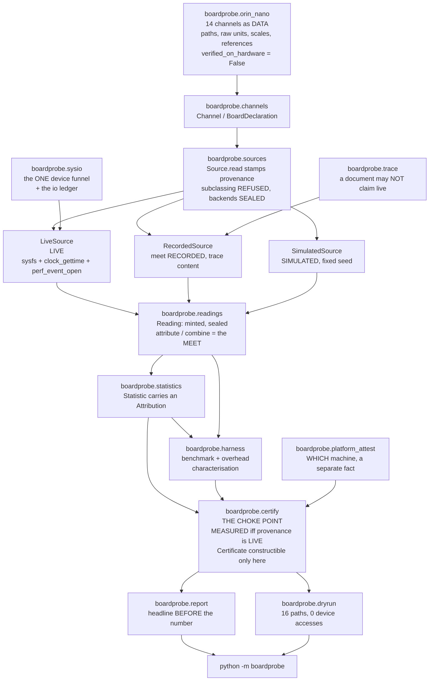
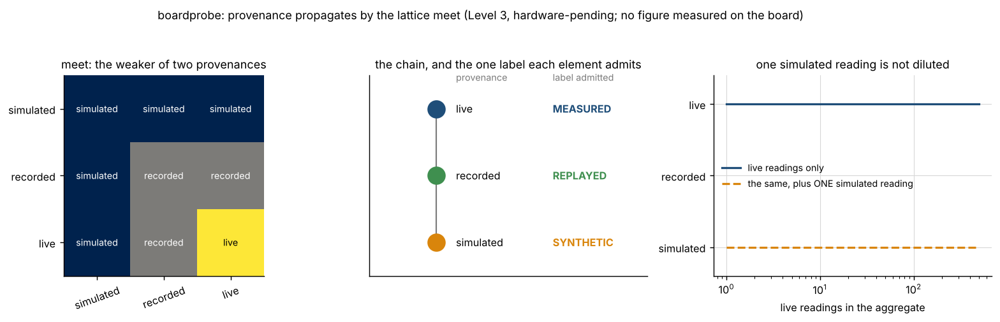
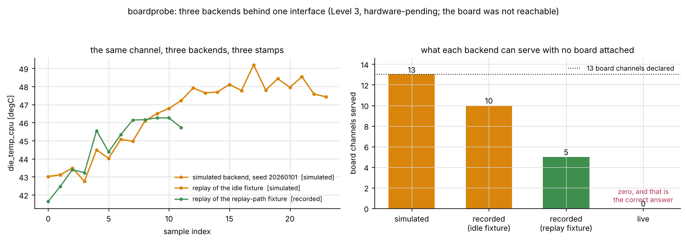
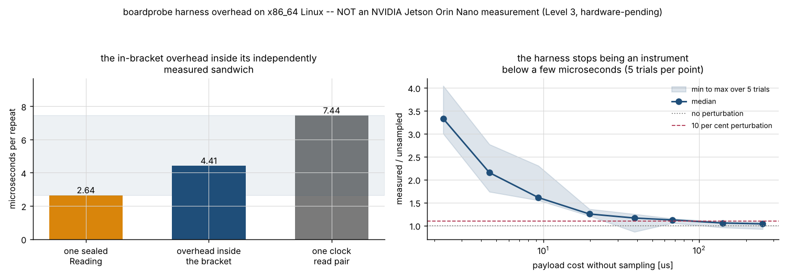
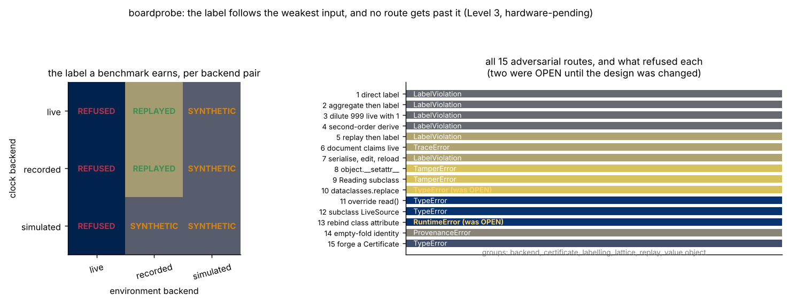

# boardprobe

A hardware abstraction layer whose readings carry their provenance through to the result.

**Status:** TESTING · **Class:** compact · **Validation level:** Level 3, hardware-pending · **AI:** no


> **Level 3, hardware-pending.** Level 4 requires measured timing and resource
> figures from an NVIDIA Jetson Orin Nano. The board was not reachable from the
> environment this package was built in, and **no figure in this repository was
> measured on the board.** Every declared sysfs path and counter name is taken
> from documentation and is UNVERIFIED on hardware. See
> [`validation/VALIDATION.md`](validation/VALIDATION.md) and
> [`docs/REQUIREMENTS.md`](docs/REQUIREMENTS.md).

## The problem

Your hardware-in-the-loop report says the control loop ran in 412 microseconds
at 48 °C on 4.9 watts. Three weeks later someone asks which of those three
numbers came off the board, and the answer is that the timing did, the
temperature came from a trace recorded in March, and the power came from the
simulator because the rail monitor was not bound that afternoon. Nothing in
the report distinguishes them, and the report is now worthless — not wrong,
worthless, which is a different and worse thing.

## What this does

- **Carries provenance in the value and propagates it through every derivation
  as a lattice meet.** Every reading is a sealed value object with its
  `Provenance` (`LIVE`, `RECORDED` or `SIMULATED`), its units, its timestamp
  and its source channel, across **14 declared channels** in the four source
  classes: monotonic clock, die temperature, rail power and performance
  counters. An aggregate is no better than its worst input:
  `LIVE ∧ SIMULATED = SIMULATED`. The laws — monotone, associative,
  commutative, idempotent, with identity `LIVE` and absorbing element
  `SIMULATED` — are checked over **1092 assignments exhaustively** and by
  Hypothesis, in `validation/validate_provenance_lattice_output.txt`.
- **Refuses to label a figure measured unless every input is live, at one
  choke point with no second path.** **15 adversarial routes attempted, 15
  refused**, in `validation/validate_adversarial_label_output.txt`. Two of
  them SUCCEEDED while that check was being written and the design was
  changed; both are documented, with the attack.
- **Three backends behind one interface, and the live one fails cleanly when
  the board is absent.** **13 of 13 board channels refuse with an actionable
  message** on a host without the board, which is the testable half of the
  live path and is measured in
  `validation/validate_backends_output.txt`.
- **A benchmark harness that characterises its own overhead.** The in-bracket
  overhead sits inside an independently measured sandwich — **2.740 ≤ 4.348 ≤
  7.685 µs**, both bounds held on **7 of 7** trials — and the perturbation
  curve says plainly that **below a few microseconds this harness is not an
  instrument**.
- **A dry-run mode whose claim is a measurement.** **16 named code paths
  exercised, 0 device accesses against the real filesystem root, 0 files
  added**, with the device-access ledger printed, in
  `validation/validate_dry_run_output.txt`.

## Who it is for

- Engineers who have to defend a hardware-in-the-loop figure in a review and
  be able to say which readings behind it came off the board.
- Anyone standing up a hardware-measured validation level and needing the
  discipline that makes the level mean something.
- Anyone building on top of a board's sensors who wants the provenance
  question answered once, in the type system, rather than in every report.

## Who it is not for

- **Anyone who wants to watch a Jetson's sensors.** Use `jtop` from
  `jetson-stats`. It is the right tool, it is mature, and this package does
  not try to be it. See the table below.
- Anyone who needs a certified or flight-qualified answer. This software is
  research-grade and is **not flight-qualified, not certified and not approved
  for operational aerospace use**.
- Anyone who needs this to work on a board today. The live reading path is
  structurally complete and has never been executed against a Jetson Orin
  Nano; every declared path is unverified. `docs/DEPLOYMENT.md` is the
  procedure for finding out what is wrong with it.
- Anyone benchmarking something that costs a few microseconds. The harness
  perturbs a 2.3 µs payload by a median factor of 3.33 on the build host, and
  says so rather than reporting the number.
- Anyone who wants a security boundary. The tamper seal detects mutation,
  mislabelling and forged documents. Code in the same process can import
  module-private state and forge it, and no design in Python can prevent that.
- Anyone wanting GPU, memory-bandwidth or per-core-load channels. Four source
  classes are declared and those are not among them.

## Alternatives, honestly

Every package below was verified to exist by fetching
`https://pypi.org/pypi/<name>/json` on 2026-11-11; the version is the one that
response reported. None of them is installed in the environment this package
was measured in, and **no number in this repository is compared against any of
them.**

| alternative | HTTP / version seen | what it does better | when to use this instead |
| --- | --- | --- | --- |
| **`jetson-stats`** (`jtop`) | 200 / 7.2.2 | **The right tool for watching a Jetson.** A curses dashboard and a Python API over every Orin sensor, maintained against L4T releases, covering GPU load, memory bandwidth, per-core frequency, fan and power mode — none of which this package declares. | when you need the provenance of a reading to survive into the figure you report, which `jtop` does not track; use `jtop` to look at the board and this to decide what a derived number may be called |
| **`psutil`** | 200 / 7.2.2 | cross-platform process and system metrics, CPU, memory, disk and network, enormously better tested than anything here | when the board's own thermal, rail and PMU channels are what you need, with a provenance stamp on each |
| **`py-cpuinfo`** | 200 / 9.0.0 | identifies the CPU and its features portably | when you need a channel table you can cite and retarget, not a CPU identification |
| **`pyperf`** | 200 / 2.11.0 | the serious Python benchmarking harness: calibration, multiple processes, statistics, JSON output, comparison tooling | for benchmarking Python code properly; use this when the benchmark's figures must carry hardware provenance, or combine them |
| **`pytest-benchmark`** | 200 / 5.3.1 | benchmarks inside a pytest suite, with regression tracking | the same |
| **`nvidia-ml-py`** | 200 / 13.615.71 | the NVML bindings: the authority on NVIDIA GPU telemetry | for GPU telemetry, which this package does not declare at all |
| **`Jetson.GPIO`** | 200 / 2.1.13 | the Jetson GPIO library | for driving pins; this package only reads |
| **`perf`** (the Linux tool, not a PyPI package) | — | the reference `perf_event_open` consumer: every event the kernel exposes, call graphs, scheduling | when you need four generalised counters tagged with provenance inside a Python harness rather than a profile |
| **`tegrastats`** (NVIDIA, on the board) | — | the vendor's one-line summary of RAM, CPU, GPU, thermals and rail power | always, to sanity-check this package's readings against the vendor's; this package reads the sysfs nodes directly because a human-readable line whose format changes between L4T releases is the worse adapter |

**The honest summary: `jtop` gives you a Jetson's sensors and this does not
give you anything `jtop` cannot read.** What this adds is provenance
propagation — the guarantee that a figure derived from a simulated reading
cannot be labelled a measurement — and nothing else. If that guarantee is not
what you need, use `jtop`.

## The one rule

Provenance is the type system here. The chain, weakest first:

```
SIMULATED  <  RECORDED  <  LIVE
```

`meet` is the greatest lower bound, and every derived figure carries the meet
of its inputs. Davey and Priestley, *Introduction to Lattices and Order*, 2nd
edition, Cambridge University Press 2002, chapter 2, definitions 2.1–2.8.

```
meet       simulated  recorded   live
---------  ---------  ---------  ---------
simulated  simulated  simulated  simulated
recorded   simulated  recorded   recorded
live       simulated  recorded   live
```

And exactly one element admits the `MEASURED` label:

```
provenance  label      what a reader may conclude
----------  ---------  -------------------------------------------------------
live        MEASURED   a device responded; the platform line says which device
recorded    REPLAYED   a device responded once, earlier, elsewhere
simulated   SYNTHETIC  nothing was measured; a generator produced the number
```

Both tables are printed by `python -m boardprobe provenance` and are the
output of `validation/validate_provenance_lattice.py`.

Five facts make the rule structural rather than conventional:

1. **A `Reading` cannot be constructed.** Its first field is a
   `dataclasses.InitVar` holding a module-private minting token; the single
   entry point is `boardprobe.readings.mint()`, called in-package only by
   `Source.read()` and `from_mapping()`.
2. **A backend cannot choose its readings' provenance.** `Source.read` stamps
   it from the backend's class, and `Source.__init_subclass__` refuses any
   subclass that defines `read`, `read_all`, `provenance` or `_stamp_ns`. The
   three concrete backends are sealed and cannot be subclassed at all.
3. **Provenance can only ever weaken.** A backend's provenance is
   `meet(class constant, instance floor)`, and `meet` has no inverse. A trace
   of generated numbers replays as `SIMULATED` even through the `RECORDED`
   backend, because `meet(RECORDED, SIMULATED) = SIMULATED`.
4. **Every reading carries a keyed BLAKE2b seal** over its own fields, checked
   before any derivation. `dataclass(frozen=True)` is not immutability —
   `object.__setattr__` walks straight past it, measured on this interpreter —
   so the seal is what makes mutation detectable.
5. **`Certificate` is constructible only by `certify()`**, which derives the
   label from the provenance rather than checking an argument against it.

## Architecture



The one structural rule in that diagram: there is no arrow into `report` or
`__main__` that does not pass through `certify`.

## Install and first run

```bash
git clone https://github.com/OmAcharya-avtr/boardprobe.git
cd boardprobe
python -m venv .venv && source .venv/bin/activate
pip install -e ".[dev]"
python -m pytest tests/ -q
python examples/provenance_lattice.py
```

Expected output of the suite:

```
291 passed
```

and of the example:

```
written: screenshots/provenance_lattice.png
meet table cells plotted: 9
dilution sizes: [1, 2, 5, 10, 20, 50, 100, 200, 500]
label with 500 live readings and one simulated: SYNTHETIC
```

That last line is the product in one sentence: five hundred live readings and
one simulated one aggregate to `SYNTHETIC`, and no amount of live data dilutes
the one.

## A worked example

```python
from boardprobe import (
    ORIN_NANO, Label, LiveSource, SimulatedSource,
    attest_platform, attribute, certify, label_for, summarise,
)

platform = attest_platform()
clock = LiveSource(ORIN_NANO)                      # serves the monotonic clock
sensors = SimulatedSource(ORIN_NANO, seed=770095)  # stands in for the board

# A figure from live readings alone: the label follows, and names the platform.
live = [clock.read("monotonic_clock") for _ in range(6)]
print(certify("clock", attribute(live), Label.MEASURED, platform).headline)

# The same figure with one simulated reading added.
mixed = attribute([*live, sensors.read("die_temp_cpu")])
print("provenance:", mixed.provenance, "| weakest:", mixed.weakest)
try:
    certify("mixed", mixed, Label.MEASURED, platform)
except Exception as error:
    print(error)

# And the aggregate it IS entitled to.
print(certify("mixed", mixed, label_for(mixed.provenance), platform).headline)
for statistic in summarise([sensors.read("die_temp_cpu") for _ in range(8)]):
    print(f"  {statistic.name:7s} {statistic.value:10.4f} {statistic.unit:6s} "
          f"{statistic.provenance}")
```

Its actual output, from a run on the build host — the first line is the
`MEASURED OFF-TARGET` form, which is the only form this host can produce:

```
MEASURED OFF-TARGET on unidentified x86_64 Linux (x86_64 Linux, via platform.machine() fallback; no device-tree model node); the declared target is 'NVIDIA Jetson Orin Nano' and this is 'unidentified x86_64 Linux'
provenance: simulated | weakest: ('die_temp_cpu',)
'mixed' cannot be labelled MEASURED: its inputs are simulated, which may only be labelled SYNTHETIC. MEASURED requires every contributing reading to be live. Offending channel(s) at simulated: die_temp_cpu (from source(s) simulated:seed=770095). Re-run the affected channel(s) against a live source, or label the figure SYNTHETIC.
SYNTHETIC (simulated over 7 readings on 2 channels; weakest channel(s): die_temp_cpu)
  count       8.0000 readings simulated
  mean       44.2853 degC   simulated
  sd          1.1721 degC   simulated
  min        42.5601 degC   simulated
  median     44.3599 degC   simulated
  p95        45.8599 degC   simulated
  max        46.0340 degC   simulated
```

The full three-backend version, with the same campaign producing three
different labels and nothing else changed, is
`validation/worked_example.py`; its output is
`validation/worked_example_output.txt`.

## CLI

```bash
python -m boardprobe channels --references
python -m boardprobe provenance
python -m boardprobe attest
python -m boardprobe sample --backend simulated --seed 3
python -m boardprobe sample --backend live
python -m boardprobe replay --samples 6
python -m boardprobe benchmark --repeats 200 --environment simulated
python -m boardprobe dry-run
```

A refused label is the product working, not an error: it is printed and the
command exits 0. A missing trace or an unreachable device where one was
required exits 1; a bad argument exits 2.

## Screenshots



Notice the right panel. The label does not degrade gradually as live data is
added — it changes at the first simulated reading and stays changed through
500 live ones.



Notice that the replay of the idle fixture traces the same curve as the
simulated generator, because the fixture was generated by that generator at a
declared seed — and the replay is still stamped `simulated`, not `recorded`,
because the document declares simulated content. And notice the right panel's
last bar: the live backend serves zero of thirteen board channels on a host
without the board, which is the correct answer.



Notice the right panel's median crossing the 10-per-cent line between 67 µs
(1.123) and 141 µs (1.056). Below that the harness is measuring itself as much
as the payload, and the figure to quote is the perturbation, not the duration.
Notice also the min-to-max band straddling 1.0 at the right-hand end: above
about 140 µs on this shared two-core host the perturbation is comparable with
the run-to-run noise, and the band is the honest statement of that.



Notice that the matrix is the lattice: the overall label is the meet of the
clock's provenance and the environment's. The live-environment column is
refused outright on this host because the board is absent.

## Validation evidence

Level 3, hardware-pending. Full evidence, with raw output beside every script,
in [`validation/VALIDATION.md`](validation/VALIDATION.md). **122 named checks,
0 failures.** Highlights, including the two that went against the product:

| check | reference | result | tolerance |
| --- | --- | --- | --- |
| the lattice laws | all 9 pairs and all 27 triples enumerated | commutative, associative, idempotent, identity, absorbing, monotone, greatest lower bound, absorption, distributive — all pass | exact |
| `meet_all` is the weakest element present | **1092 assignments** of length 1 to 6 | 0 disagreements | exact |
| the chain re-derived from its Hasse diagram | **Warshall's transitive closure**, mathematics the code does not use | 1092 assignments, 0 disagreements | exact |
| the propagation counted by **inclusion and exclusion** | `3ⁿ − 2ⁿ`, `2ⁿ − 1`, `1`, summing to `3ⁿ` | **9840 assignments for n = 1..8, 0 mismatches** | exact integer arithmetic |
| **the adversarial check** | 15 routes: direct, aggregated, diluted, second-order, replayed, document-claims-live, round-tripped, mutated, subclassed, `dataclasses.replace`, overriding backend, sealed-subclass, rebound class attribute, empty fold, forged certificate | **15 attempted, 15 refused, 0 succeeded** | — |
| **two routes that SUCCEEDED and were closed by a design change** | `dataclasses.replace(reading, provenance=LIVE)` and rebinding `SimulatedSource.backend_provenance` | both now refused; the attacks are documented in full | — |
| the harness overhead sandwich | `Reading cost ≤ in-bracket overhead ≤ clock pair cost`, both bounds independently measured | median **2.740 ≤ 4.348 ≤ 7.685 µs**; **7/7** and **7/7** trials | zero slack, structural inequalities |
| the simulated backend's reproducibility | two instances at seed 770095 | **14 of 14 channels bit-identical** | bit-exact |
| the live backend with no board attached | the real filesystem root | **13 of 13 channels refused, 0 served**, every refusal actionable | — |
| channels verified on hardware | the shipped table | **0 of 14**, asserted | — |
| the dry run | the device-access ledger and a tree snapshot | **16 paths, 0 device accesses, 0 files added** | — |
| negative controls | declared provenances, hand-known raw integers, declared plausibility windows | **21 declared; 13 must fire, 13 fired; 8 must not fire, 8 silent** | — |
| the millidegree scale dropped | true value 48.123 °C from a raw 48123 | **48123.0 °C**, ratio **1000.0**, outside the window | window (−40, 125) °C, declared not quoted |
| `pytest.approx` hidden default | the suite with the default forced off, and again with every `abs` forced to 0.0 | **0 of 291** depend on it; **0 of 291** rest on an absolute bound | — |
| tests, from junit XML | `testsuite` element against a count of `testcase` elements | **291 declared, 291 counted**, 0 failures, 0 errors, 0 skipped | — |
| working directories | `/`, `/tmp`, the product root, `validation/` and `examples/` | **48 runs, 0 non-zero exits** | — |
| git tracks no cache or build artifact | — | **STRUCTURALLY UNMEASURABLE** by a build agent on an uncommitted tree; reported as such, not passed | — |

## Benchmark results

**Every figure here is a container number.** Container: Python 3.13.18, numpy
2.5.3, 2 cores, 7.83 GiB, **x86_64 Linux**. The declared target is **aarch64**,
which is itself a limitation: even the instruction counts a working perf
adapter would report on the target are not comparable with anything here.
From `validation/validate_harness_output.txt`.

| quantity | µs on the build host |
| --- | --- |
| one sealed `Reading` | 2.652 |
| one clock read, measured independently | 4.035 |
| overhead inside the timed bracket | 4.337 |
| `reference_payload(2000)`, sampling off | 73.040 |
| `reference_payload(2000)`, sampling on | 79.678 |

A 200-repeat timing-only benchmark of `reference_payload(2000)`: mean
**80.522 µs**, sd **7.431 µs**, median **78.275 µs**, against a clock
resolution at this host's uptime of **4.547e-13 s** — the median duration is
**1.721e+08** times the resolution floor.

The perturbation ratio is **noisy, and that is reported rather than hidden**:
single trials on this host have come back below 1.0, which is not a negative
overhead but a statement that the perturbation is at the level of the
measurement noise for a 70 µs payload. `examples/harness_overhead.py` measures
the whole curve over five trials per point, and it is the figure to read. The
median ratio, against the median payload cost without sampling:

| payload without sampling [µs] | 2.28 | 4.51 | 9.29 | 19.75 | 38.41 | 67.38 | 141.42 | 255.46 |
| --- | --- | --- | --- | --- | --- | --- | --- | --- |
| perturbation, median of 5 | 3.330 | 2.153 | 1.610 | 1.252 | 1.165 | 1.123 | 1.056 | 1.037 |
| min over 5 | 3.001 | 1.736 | 1.549 | 1.211 | 0.864 | 1.054 | 0.957 | 0.922 |
| max over 5 | 4.044 | 2.769 | 2.304 | 1.360 | 1.251 | 1.152 | 1.083 | 1.082 |

The min row at 38 µs reads 0.864 and at 255 µs reads 0.922, and the max at
9 µs reads 2.304 against a median of 1.610. Those are not perturbations; they
are a shared two-core host descheduling the measuring process, and they are
left in rather than trimmed because they are the reason the median and the
band are reported instead of a single trial.

## API reference

<details>
<summary>The public surface, with units</summary>

**The lattice** — `boardprobe.provenance`

- `Provenance` — `SIMULATED` < `RECORDED` < `LIVE`.
- `meet(a, b) -> Provenance` — greatest lower bound; the propagation rule.
- `join(a, b) -> Provenance` — least upper bound. Provided so the laws are
  statable; **no derivation in this package ever joins provenances.**
- `meet_all(values) -> Provenance` — meet over a non-empty collection. Raises
  `ProvenanceError` on empty rather than returning the identity.
- `leq(a, b) -> bool`, `rank(p) -> int`, `IDENTITY`, `ABSORBING`, `ORDER`.

**Readings** — `boardprobe.readings`

- `mint(channel, value, unit, timestamp_ns, provenance, source_id, detail="") -> Reading`
  — the single minting entry point. `timestamp_ns` in integer nanoseconds.
- `Reading` — frozen, slotted, sealed; `.intact`, `.to_mapping()`.
- `verify(reading) -> Reading` — exact type check and seal check.
- `attribute(readings) -> Attribution` — the meet, with the weakest channels
  named.
- `combine(attributions) -> Attribution` — the meet across derivations.
- `from_mapping(payload, floor) -> Reading` — rebuilds from a document,
  forcing provenance down to `floor`.

**The choke point** — `boardprobe.certify`

- `Label` — `MEASURED`, `REPLAYED`, `SYNTHETIC`.
- `label_for(provenance) -> Label` — the total function; only `LIVE` maps to
  `MEASURED`.
- `certify(subject, attribution, label, platform) -> Certificate` — raises
  `LabelViolation` naming the offending channels.
- `Certificate.headline` — never a bare `MEASURED` off the declared target.
- `Certificate.is_hardware_measurement` — `LIVE` **and** on the declared
  target.

**The HAL** — `boardprobe.channels`, `boardprobe.orin_nano`

- `Channel(name, kind, unit, access, locator, scale, raw_unit, reference, verified_on_hardware)`
  — `locator` is relative, `scale` converts `raw_unit` to `unit`.
- `BoardDeclaration(model, channels, notes)`; `.channel(name)`,
  `.of_kind(kind)`, `.names`, `.verified_count`.
- `ORIN_NANO` — 14 channels, 0 verified on hardware.
- `RAIL_POWER_PAIRS` — power is derived, because the INA3221 driver exposes
  volts and amperes and not watts.

**Backends** — `boardprobe.sources`

- `LiveSource(declaration, root=Path("/"))` — raises `DeviceUnreachableError`
  per channel when the board is absent.
- `RecordedSource(declaration, trace)` — stamps
  `meet(RECORDED, trace.content_provenance)`.
- `SimulatedSource(declaration, seed=0)` — deterministic.
- `read_available(source, names) -> (readings, refusals)` — refusals returned,
  never dropped.
- `make_source(name, ...)`, `backend_names()`, `sealed_backends()`,
  `synthesise_trace(...)`.

**Aggregates** — `boardprobe.statistics`

- `summarise(readings) -> tuple[Statistic, ...]` — count, mean, sd (`ddof=1`,
  omitted at n = 1 rather than returned as `nan`), min, median, p95, max.
- `derive(name, value, unit, parts) -> Statistic` — meets the parts.
- `rail_power(voltage, current, name) -> Statistic` — volts × amperes, watts.

**The harness** — `boardprobe.harness`

- `benchmark(payload, name, clock, repeats=100, warmup=5, environment=None, ...) -> BenchmarkResult`
  — durations in seconds.
- `characterise_overhead(clock, repeats=400) -> OverheadReport` — all costs in
  seconds.
- `reference_payload(iterations=2000) -> Callable` — the declared payload.
- `timing_resolution_s(uptime_s=None) -> float` — one ulp at that magnitude.

**Dry run, platform, reports** — `dry_run(...)`, `attest_platform(root="/")`,
`render_certificate`, `render_readings`, `render_statistics`,
`render_channels`, `render_lattice`, `render_label_rules`,
`render_benchmark`, `render_overhead`, `format_table`.

</details>

## Hardware requirements

Two cores and a few tens of megabytes of resident memory. No GPU. The longest
script is `validation/probe_working_directories.py` at about 33 seconds, which
runs the whole validation suite four times by design; every other script
finishes in under 11 seconds.

The declared target is an NVIDIA Jetson Orin Nano Developer Kit running Jetson
Linux, with `kernel.perf_event_paranoid` at 1 or below for the performance
counters. `docs/DEPLOYMENT.md` is the procedure; none of it has been executed
on a board.

## Limitations

- **No figure in this repository was measured on an NVIDIA Jetson Orin Nano.**
  Not one. The board was not reachable from the environment this package was
  built in and never will be from it.
- **Every declared sysfs path, counter name, raw unit and scale is UNVERIFIED
  on hardware.** They are declared from the Linux kernel thermal and hwmon ABI
  documents, `clock_gettime(2)`, `perf_event_open(2)`,
  `Documentation/admin-guide/pm/cpufreq.rst` and the NVIDIA Jetson Linux
  Developer Guide, each cited per channel in `src/boardprobe/orin_nano.py`. Not
  one of those files was opened. `verified_on_hardware` is `False` on all 14
  channels.
- **The thermal-zone INDEX for a given zone name is not fixed by any
  document** and is the single most likely line in the channel table to be
  wrong on a particular L4T release. `docs/DEPLOYMENT.md` step 4 is how to
  discover the real indices.
- **The `perf_event_open` adapter's aarch64 syscall number, 241, has never
  been executed.** The x86_64 number, 298, was exercised only as a clean
  failure: the build host's virtual machine exposes no PMU and the syscall
  returns `-1 ENOENT`.
- **The live reading path has never run against the board.** Its refusal path
  has, on 13 of 13 board channels. The one live channel that does work on any
  Linux host is the monotonic clock, and a live reading of this host's clock is
  not a reading of a Jetson — which is why provenance and platform are kept as
  two separate facts and every certificate carries both.
- **`docs/DEPLOYMENT.md` and `docs/RECOVERY.md` have never been executed on
  the board.** Steps 1 to 3 of deployment were executed on the build host;
  everything from step 4 is written from documentation and should be expected
  to need correction.
- **The harness overhead figures are x86_64 figures and will not transfer.**
  They must be re-characterised on the board. And the harness is not an
  instrument below a few microseconds of payload: the measured perturbation is
  a median factor of 3.33 at a 2.3 µs payload, over five trials.
- **The committed trace fixtures contain no board data.** Both were
  synthesised in a container by `synthesise_trace` at declared seeds, and both
  say so in their own `origin` field, which is printed in every report built
  from them. The one that declares `recorded` content does so only because the
  `RECORDED` replay path needs a document to exercise; its numbers are not
  measurements of anything, and its `origin` says that in the file.
- **The tamper seal is not a security boundary.** It detects mutation,
  mislabelling and forged documents. The key is per-process module-private
  state, so code running in the same process can import it and forge a seal,
  and no design in Python can prevent that. The threat this product defends
  against is the realistic one: a figure derived from simulated or recorded
  data reaching a report that calls it a measurement, through ordinary use,
  ordinary refactoring or ordinary serialisation.
- **`mint()` lets its caller choose a provenance.** A caller who claims `LIVE`
  for a generated number has made a false statement at the source, and no type
  system can stop that. What this design guarantees is that a provenance once
  claimed cannot be strengthened, laundered through a derivation, or lost.
- **A `PlatformAttestation` can be constructed by hand** with
  `matches_target=True`. That is a false claim about which machine, not about
  provenance; every certificate records the attestation's own `source` string
  so the claim is legible.
- **Declared dependency ranges were measured at one version each, except
  `ruff`.** `numpy>=2.5,<2.6` was measured at 2.5.3 only. **numpy 2.5.4 exists
  on PyPI, is admitted by that ceiling, and was not tested**, because
  installing a second numpy would have required running `pip` against a shared
  pre-pinned interpreter this product is forbidden to modify. The ceiling is
  there because the two committed fixtures were written by numpy's PCG64
  stream and `tests/test_fixtures.py` re-synthesises and compares them value by
  value. `ruff` is the exception, measured clean at both 0.16.9 and 0.17.4. The
  tension is real: a pin below a future security release is a cost, not a free
  safety measure.
- **The tracked-file self-check is structurally unmeasurable by a build
  agent.** This product's tree is uncommitted while it is built — the mission's
  coordinator holds every commit — so `git ls-files` returns nothing and the
  check is reported as unmeasurable rather than passed on an empty set. What is
  measured instead is `git check-ignore -v --no-index` against every shipped
  fixture.
- **Four source classes are declared and no more.** No GPU channels, no memory
  bandwidth, no per-core load, no fan, no power mode. `jetson-stats` has all of
  those.
- **`sd` is omitted at n = 1 rather than returned as `nan`**, and an aggregate
  whose value is not representable as a float64 is refused by name rather than
  reported as infinity. Hypothesis found the second case:
  `numpy.mean([8.988465674311579e307, 8.98846567431158e307])` returns `inf`
  for a mean that is representable, because it sums before dividing. Every
  aggregate is now computed in `numpy.longdouble`. On a platform where
  `numpy.longdouble` is the same width as `numpy.double` that step is a no-op
  and the explicit refusal is what catches the case — a documented
  degradation, not a silent one.

## Reproducing every number

```bash
python -m pytest tests/ -q -p no:cacheprovider --junit-xml=junit.xml
python validation/validate_provenance_lattice.py
python validation/validate_adversarial_label.py
python validation/validate_independent_bound.py
python validation/validate_backends.py
python validation/validate_harness.py
python validation/validate_dry_run.py
python validation/validate_negative_controls.py
python validation/validate_approx_audit.py
python validation/worked_example.py
python validation/validate_cli.py
python validation/probe_working_directories.py
python examples/provenance_lattice.py
python examples/backend_comparison.py
python examples/harness_overhead.py
python examples/label_matrix.py
ruff check src/ tests/ examples/ validation/
```

Seeds are in `validation/_bootstrap.py`. Every script writes its raw output
beside itself as `validation/<script-name>_output.txt`, and every number above
names the file it came from.

## Safety

This software is **research-grade**. It is **not flight-qualified, not
certified and not approved for operational aerospace use.** It reads sensors
and labels numbers; it controls nothing, and no figure in it has been measured
on the hardware it targets.

## Licence

Apache-2.0. Copyright © 2026 OPTIMA Organisation. See [`LICENSE`](LICENSE).

## Citation

See [`CITATION.cff`](CITATION.cff).

## Credits

This is under reserved rights obtained by OPTIMA Organisation.
