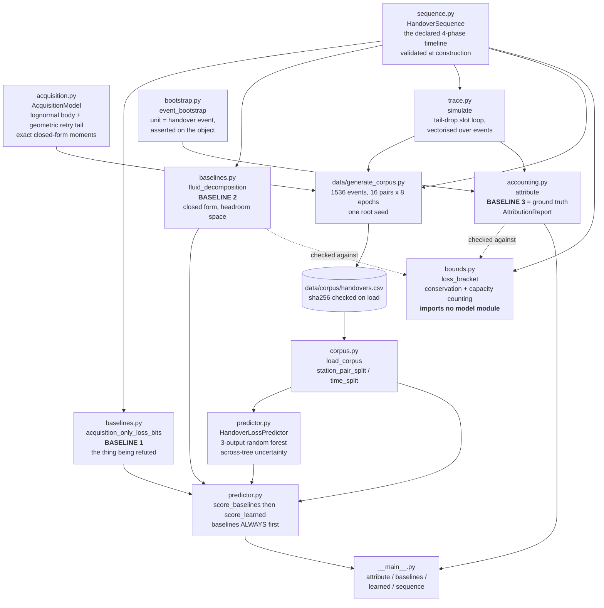
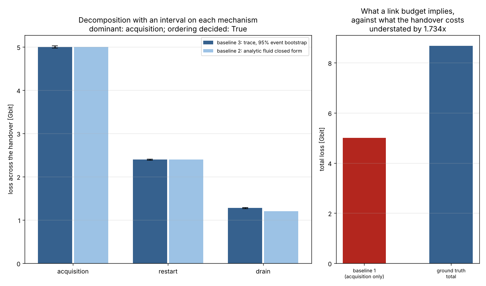
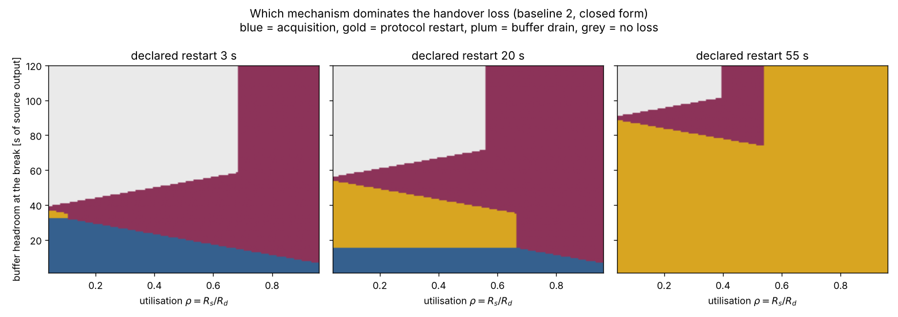
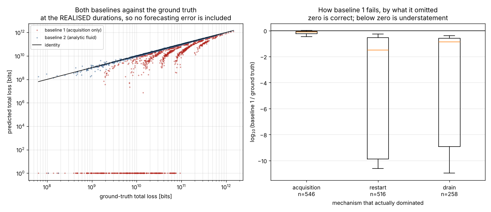
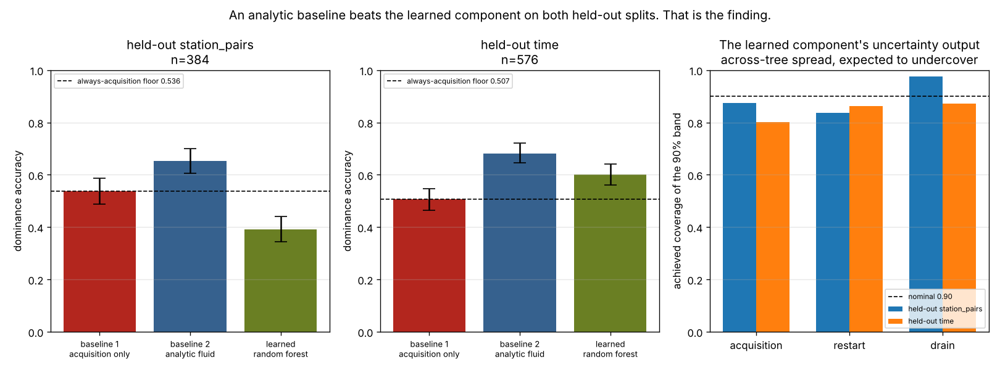

# handoverloss

Which mechanism dominates the data loss across an optical ground-station handover.

**Status:** TESTING · **Class:** medium · **Category:** optical-link-engineering · **AI:** yes


> **Validation level 2.** The evidence in this repository is agreement between a
> closed form, an independently derived bound and a simulated trace. **Nothing
> here is measured on hardware or on a real optical link**, and every number
> below is a property of this repository's own synthetic corpus and arithmetic.
> `data/corpus/handovers.csv` is generated by `data/generate_corpus.py` from one
> fixed seed and is hashed on every load. Every figure in this document comes
> from a script in `validation/` that was run after the last code change, and
> each one says which script.

This software is **research-grade**. It is **not flight-qualified, not certified,
and not approved for operational aerospace use.**

## The problem, in three sentences

A spacecraft hands its optical downlink from one ground station to another, and
somewhere between the last acknowledged frame at the outgoing station and the
first payload frame at the incoming one, data is lost that will never be
recovered. A network simulator will tell you the total, and a link budget will
tell you the acquisition time, and neither tells you the thing you actually have
to decide: whether the money goes on a faster pointing-acquisition-tracking
sequence, on a protocol that re-establishes its session faster, or on more
on-board buffer. Those are three different purchases, the loss has three
different mechanisms, and the total is the sum of all three.

## What this does

- **Decomposes the loss into three mechanisms with a bootstrap interval on
  each** — acquisition, protocol restart and buffer drain — and returns that
  decomposition as the API's actual return value, not a total. Measured on 512
  corpus events: acquisition **20.847705 Gbit** [16.005656, 26.229194], restart
  **8.575911 Gbit** [7.631991, 9.518379], drain **5.110302 Gbit** [3.772034,
  6.552979] (`validation/validate_decomposition_residual.py`).
- **Says whether the ordering is DECIDED**, not just which mechanism is largest.
  Two of six operating regimes report `dominance decided: False`, meaning the
  leading interval overlaps the runner-up's and those events rank the mechanisms
  without deciding them (same script).
- **Reports the decomposition residual as a number.** The three mechanisms are
  compared against an independent mass-conservation accounting of the same
  total: worst absolute residual **8.544922e-03 bits** over 1536 events, worst
  relative residual **1.161965e-12** on the 1320 events with a loss above 1e6
  bits, against a derived bound of 4.165621e-09
  (`validation/validate_baselines_against_truth.py`).
- **Brackets the total from mathematics the models do not use** —
  conservation and capacity counting alone. **0 of 1536** closed-form totals and
  **0 of 512** trace totals fall outside, and the bound is tight rather than
  vacuous: the lower bound binds on **72.4 per cent** of a 2000-point sweep
  (`validation/validate_independent_bound.py`).
- **Refutes the acquisition-only assumption at full strength.** Baseline 1
  credits the buffer with its entire free space and is the exact restriction of
  the closed-form model to its first phase — **400 of 400 bit-identical** on the
  shared term — and it still understates the ground-truth total over the
  corpus with a median baseline1/truth ratio of **3.332369e-01**, a factor of
  3.0009 (`examples/acquisition_only_refuted.py`).

## What this does that existing tools do not

Network simulators measure total loss across a handover. **None of them
decomposes it into the three mechanisms with an interval on each**, which is the
output that tells an operator whether to buy faster acquisition or more buffer.
The decomposition with per-mechanism intervals is what
`handoverloss.attribute` returns; the total is one field on it.

The point is not academic. On the corpus's slow-protocol regime the **per-event
modal dominant mechanism is `restart` (0.6190 of events)** while the
**mean-weighted dominant mechanism is `acquisition`**, because the mean is
carried by the largest-loss events. A tool reporting only an aggregate would
tell an operator with a slow session-re-establishment protocol to buy faster
pointing. This package prints both statistics for every regime.

## Who it is for

- An optical ground-station or mission-operations engineer deciding between a
  PAT upgrade, a protocol change and more on-board mass memory.
- Anyone who has a declared handover sequence and wants the loss in closed form,
  with the assumptions and the validity range written down.
- Anyone who wants an interval on a per-mechanism attribution, with the
  resampling unit stated and enforced.

## Who it is not for

- Anyone who needs a **measured** acquisition-time distribution for a specific
  terminal. There is none here. Take it from that terminal's own test campaign.
- Anyone who needs a full network-stack simulation with real protocol state
  machines, congestion control and retransmission. Use `simpy` or `ciw` and
  model the protocol properly.
- Anyone who needs a **flight-qualified or certified** tool. This is not one and
  will not become one.
- Anyone whose source is genuinely on-off or self-similar. The fluid model
  understates for such a source and the magnitude of the understatement here is
  measured only for unit-mean lognormal per-slot burstiness.
- Anyone expecting the learned component to be the useful part. On this corpus it
  loses to the closed form on both held-out splits. See the finding below.

## Alternatives, honestly

Every package named here was verified to exist on PyPI on 2026-11-19 by
`curl -s -o /dev/null -w '%{http_code}' https://pypi.org/pypi/<name>/json`; the
recorded HTTP code is in the table. A 404 means the package was not cited.

| Alternative | PyPI | What it does better | When to use this instead |
|---|---|---|---|
| `simpy` | 200 | A general discrete-event framework. Model the real protocol state machine, retransmission, multiple flows, anything. | When you want the three-way attribution with an interval on each, and a closed form you can differentiate, rather than a simulation you have to write. |
| `ciw` | 200 | A proper queueing-network simulator with established queueing-theory output analysis. | When the question is one buffer across one declared handover, and the answer you need is *which mechanism*, not a steady-state distribution. |
| `queueing-tool` | 200 | Network-level queueing simulation on a graph. | Same: this is a single-buffer, single-event decomposition, not a network. |
| `salabim` | 200 | Discrete-event simulation with animation, good for explaining a mechanism to a room. | When you need the numbers and the interval rather than the picture. |
| `statsmodels` | 200 | Serious statistical modelling and inference, far beyond a percentile bootstrap. | When you want the bootstrap already wired to the correct resampling unit and asserted on the returned object. |
| `arch` | 200 | Bootstrap methods including block and stationary bootstraps, properly implemented. | When the unit of independence is the handover event, which is what this package enforces; `arch` would be the right tool if you needed a block bootstrap *within* one trace. |
| `scikit-learn` | 200 | Everything about the learned component, and better. | The learned component here is a thin wrapper on `RandomForestRegressor`; its value is the comparison against the baselines, not the model. |

**If all you want is a total loss across an outage, you do not need this
package**: it is `max(0, R_s · T_outage − (B − q0))` and you can write it on a
napkin. This package exists for the decomposition and the interval.

## Install and first run

```bash
git clone https://github.com/OmAcharya-avtr/handoverloss.git
cd handoverloss
python -m venv .venv && source .venv/bin/activate
pip install -e ".[dev]"
python -m pytest tests/ -q
python examples/attribution_with_intervals.py
```

Expected output of the test run (the wall time varies; 6.3 to 10.1 s was measured
this session on two cores under contention from four other build agents):

```
222 passed in 6.75s
```

Expected output of the first example (abridged; the full text is the example's
own print):

```
  baseline 1 (acquisition only)  5.000000 Gbit
  baseline 2 total               8.600000 Gbit
  baseline 3 total               8.670474 Gbit
  acquisition    4.997641 Gbit  [4.972957, 5.022090]  share 0.5764
  restart        2.396580 Gbit  [2.382145, 2.410315]  share 0.2764
  drain          1.276253 Gbit  [1.262782, 1.290297]  share 0.1472
  resampling unit                handover event
  decomposition residual         -1.907349e-06 bits (tolerance 3.844316e-01)

figure written to screenshots/attribution_with_intervals.png
```

The corpus is committed, so no generation step is needed. To regenerate it:

```bash
python3 data/generate_corpus.py
```

```
wrote data/corpus/handovers.csv  (1536 events, 768905 bytes)
wrote data/corpus/manifest.json
sha256 3a0343a6c2c51a91eba0679856700f5495d8814c3bcdc94e6b710ba300c59706
dominance counts {'acquisition': 762, 'restart': 516, 'drain': 258}
acquisition times capped to the window: 12
generation seconds 8.119
```

## A worked example

Declare a handover and get all three baselines plus the independent bracket. The
numbers below are chosen so every term is checkable by hand; the derivation is in
`tests/test_baselines.py::test_fluid_decomposition_known_answer`.

```python
from handoverloss import (
    HandoverSequence, acquisition_only_loss_bits, attribute,
    fluid_decomposition, loss_bracket, simulate,
)
from handoverloss.trace import EventParameters
import numpy as np

sequence = HandoverSequence(
    source_rate_bps=2.0e8,        # 200 Mbit/s instrument stream
    downlink_rate_bps=1.0e9,      # 1 Gbit/s at the incoming station
    buffer_capacity_bits=3.2e10,  # 32 Gbit allocated to this stream
    initial_occupancy_bits=2.9e10,# 29 Gbit already buffered at the break
    acquisition_s=40.0,
    restart_s=12.0,
    ramp_s=60.0,
    horizon_s=700.0,
)

print(acquisition_only_loss_bits(sequence))        # baseline 1
print(fluid_decomposition(sequence).mechanisms)    # baseline 2, closed form

parameters = EventParameters.from_sequences([sequence] * 512)
trace = simulate(parameters, np.random.default_rng(96_096_2026))
report = attribute(trace, resamples=4000)          # baseline 3, ground truth
print("\n".join(report.lines()))
```

Actual output, from `validation/worked_example.py` run this session:

```
  derived: outage        52.0 s
  derived: headroom      3.000000e+09 bits = 15.0 s of source output
  derived: utilisation   0.2000

baseline 1 -- the assumption that acquisition time is the whole story
  loss                   5.000000e+09 bits = 5.000000 Gbit
  hand check: max(0, 2.0e8 * 40 - 3.0e9) = 5.0e9 bits

baseline 2 -- the analytic fluid decomposition, closed form
  acquisition            5.000000e+09 bits = 5.000000 Gbit
  restart                2.400000e+09 bits = 2.400000 Gbit
  drain                  1.200000e+09 bits = 1.200000 Gbit
  total                  8.600000e+09 bits = 8.600000 Gbit
  dominant               acquisition
  ramp drive             1.200000e+09 bits
  backlog drains         True
  sum residual           0.000000e+00 bits

  BASELINE 1 UNDERSTATES BASELINE 2 BY A FACTOR OF 1.720000 on this handover

the independently derived bracket on the total
  offered volume A       1.400000e+11 bits
  egress integral S      6.180000e+11 bits
  lower bound            0.000000e+00 bits
  upper bound (tail drop) 1.400000e+11 bits
  slack                  7.274181e-04 bits
  brackets the closed-form total: True

baseline 3 -- ground truth over simulated realisations, with intervals
  events                 : 512
  resampling unit        : handover event
  resamples / confidence : 4000 / 0.95
  total loss             : 8.670474 Gbit

  mechanism      loss [Gbit]    interval [Gbit]                share
  acquisition        4.997641   [   4.972957,    5.022090]    0.5764
  restart            2.396580   [   2.382145,    2.410315]    0.2764
  drain              1.276253   [   1.262782,    1.290297]    0.1472

  dominant               : acquisition
  dominance margin       : 0.299991 of the total
  dominance decided      : True (the leading interval IS disjoint from the runner-up's)
  conservation total     : 8.670474 Gbit
  decomposition residual : -1.907349e-06 bits (-2.200e-16 relative)
  residual tolerance     : 3.844316e-01 bits -> within tolerance: True

  ground truth / closed form: 1.008195
```

The hand arithmetic, for the reader who wants to check it:

```
headroom   = 3.2e10 - 2.9e10                   = 3.0e9  bits
L_acq      = 2.0e8 * 40 - 3.0e9                = 5.0e9  bits
L_rst      = 2.0e8 * 12          (buffer full) = 2.4e9  bits
ramp drive = (2.0e8)^2 * 60 / (2 * 1.0e9)      = 1.2e9  bits
L_drain    = 1.2e9               (buffer full) = 1.2e9  bits
total                                          = 8.6e9  bits
```

## Architecture



## Screenshots



The left panel's error bars are narrower than the gaps between the bars, so the
ordering of the three mechanisms is decided and not merely ranked. The right
panel is why the left one exists: the single number a link budget gives is
5.000000 Gbit against a ground-truth total of 8.670474 Gbit, and it cannot say
which mechanism to spend money on because it contains only one of them.



Which mechanism dominates, over buffer headroom and utilisation, at three
declared protocol-restart latencies. The regions move: at a 3 s restart the
picture is acquisition against drain and the restart mechanism is almost absent
(acquisition 0.1617, restart 0.0021, drain 0.4180 of the plane); at 55 s the
restart region takes most of it (restart 0.8231, drain 0.0998, acquisition
0.0000). Nothing about the total loss would have told an operator that.



Baseline 1 against the ground truth over all 1536 corpus events, at the realised
durations so no forecasting error is included. The blue cloud (baseline 2) sits
on the identity line; the red cloud (baseline 1) sits below it, often by orders
of magnitude. The right panel says why: where the restart or the drain dominated,
baseline 1 has no term for the mechanism that did the damage. Median
baseline1/truth is **7.635939e-01** where acquisition genuinely dominated
(n=546), **3.173818e-02** where restart did (n=516), and **1.346738e-01**
where drain did (n=258).



The finding. Baseline 2's bar is the tallest on both held-out splits, and on the
station-pair split its interval does not overlap the learned component's. The
dashed line is the always-acquisition floor, which is baseline 1's accuracy by
construction; on the station-pair split the learned component does not reach it.
The right panel is the uncertainty output's measured coverage against its nominal
0.90.

## Validation evidence

Full tables, including every check that failed before it was corrected, are in
`validation/VALIDATION.md`. The headline rows:

| Check | Reference | Result | Tolerance |
|---|---|---|---|
| Baseline 1 equals baseline 2's acquisition term | the derived identity | **400 / 400 bit-identical**, worst relative 0.000000e+00 | `8·eps` |
| Baseline 2's dominance agreement with the trace | baseline 3, realised durations | **0.983724** | ≥ 0.90 declared |
| Baseline 2's median total ratio | baseline 3 | **0.994247** (5th/95th pct 0.900798 / 1.072828) | [0.80, 1.20] declared |
| Decomposition residual, worst absolute over 1536 events | mass conservation | **8.544922e-03 bits** | per-event `4·slots·eps·(…)`, smallest 4.494728e-02 bits |
| Decomposition residual, worst relative on the 1320 events above 1e6 bits | mass conservation | **1.161965e-12** | derived `tolerance/loss` = 4.165621e-09 |
| Independent bracket contains baseline 2's total | conservation + capacity counting | **0 / 1536 outside** | conditioning-scaled slack |
| Independent bracket contains baseline 3's trace total | same | **0 / 512 outside** | same |
| Lower bound binds on the swept envelope | 2000 random handovers | **1448 / 2000 = 0.724000** | ≥ 0.05 declared |
| Acquisition moments, closed form vs quadrature | 512-node Gauss-Legendre | worst relative **6.695914e-15** | 1e-9 |
| Acquisition moments, closed form vs Monte Carlo | 200 000 draws | worst z **+1.4049**, 0 / 5 outside 4σ | 4 standard errors, derived |
| **FAILED, then corrected:** normal quantile approximation | 200 000-draw quantile | **overstates by 2.032448×**, understates by up to 14.2 % | implementation replaced, not the check |
| **FAILED, then corrected:** relative residual over all events | mass conservation | **1.632690e-03**, an artefact of 216 zero-loss denominators | criterion corrected |
| **FAILED, then corrected:** a literal 1e-12 residual criterion | — | failed at 1.161965e-12 | criterion replaced by the derived bound |
| Negative controls, must fire | the TRUE value in every case | **11 / 11 fired** (plus 2 / 2 on the bound) | — |
| Negative controls, must NOT fire | — | **3 / 3 silent** (plus 1 / 1 on the bound) | — |
| Slot-level bootstrap narrows the interval | derived `1/sqrt(10)` | width ratio **0.314950** against 0.316228 | — |
| `pytest.approx` assertions depending on the hidden `abs=1e-12` | plugin-instrumented re-run | **0 of 50 `rel=` sites** | — |
| Hypothesis counterexamples found and pinned | — | **2**, both real defects, both fixed | — |
| **Benchmark: held-out station pairs** | baseline 3 | baseline 1 0.536458, **baseline 2 0.653646**, learned 0.390625 | 95 % event bootstrap |
| **Benchmark: held-out time** | baseline 3 | baseline 1 0.506944, **baseline 2 0.682292**, learned 0.600694 | 95 % event bootstrap |

### Which baseline won

**Baseline 2, the analytic fluid closed form, beats the learned component on
both held-out splits**, and on the station-pair split the two 95 per cent
intervals are disjoint: `[0.606771, 0.700521]` against `[0.343750, 0.440104]`.
On that split the learned component does not even reach baseline 1's
always-acquisition floor of 0.536458.

**That is the finding and it is published as such.** It was not retuned away and
the learned component was not removed; a reader needs both numbers to know what
the learned component bought, which here is nothing on one split and less than
the closed form on the other. Hyperparameters were selected by three-fold
grouped cross-validation over station pairs on the **training side only**, and
all six candidates fell within 0.017361 of each other, so the weakness is
structural and not a tuning matter.

**What the finding does not support.** This corpus is generated by a mechanism
baseline 2 nearly reproduces in closed form, so a closed-form win here is close
to the best case for the closed form and says nothing about measured handover
data. The honest statement is the narrow one: when the handover sequence is
known and the source is close to constant-rate, the closed form is the better
predictor, and a forest fitted on sixteen station configurations does not beat
it.

## API reference

<details>
<summary>Public surface, one line each, with units</summary>

**`handoverloss.sequence`**

- `HandoverSequence(source_rate_bps, downlink_rate_bps, buffer_capacity_bits, initial_occupancy_bits, acquisition_s, restart_s, ramp_s, horizon_s)` — the declared handover; validates every bound at construction. bit/s, bits, s.
- `HandoverSequence.outage_s` → s · `.headroom_bits` → bits · `.headroom_s` → s · `.utilisation` → dimensionless.
- `HandoverSequence.phase_of(t_s)` → `Phase`; `.egress_rate_bps(t_s)` → bit/s.
- `MECHANISMS` → `("acquisition", "restart", "drain")`, the fixed column order.

**`handoverloss.acquisition`**

- `AcquisitionModel(median_s, log_sigma, abort_probability, attempt_window_s)` — lognormal body with a geometric retry tail. s, dimensionless.
- `.sample(size, rng)` → s, float64 array · `.moments()` → `(mean s, sd s)`, closed form · `.moments_quadrature(points)` → the same by quadrature · `.quantile(level, size, seed)` → s.

**`handoverloss.baselines`**

- `acquisition_only_loss_bits(sequence, acquisition_s=None)` → bits. **Baseline 1.**
- `fluid_decomposition(sequence)` → `FluidDecomposition`. **Baseline 2**, closed form.
- `fluid_decomposition_array(...)` → `(n, 3)` bits, vectorised.
- `ramp_drive_bits(sequence)` → bits, the step-3 integral.

**`handoverloss.trace`**

- `EventParameters(...)` / `EventParameters.from_sequences(list)` — per-event arrays, validated elementwise.
- `simulate(parameters, rng, slot_seconds=0.25, burst_log_sigma=0.45, service_log_sigma=0.12)` → `TraceResult`.
- `TraceResult.dropped_bits` → `(n, 3)` bits · `.conservation_total_bits` → `(n,)` bits, the independent accounting · `.dominant_names()` → list of str.

**`handoverloss.accounting`**

- `attribute(trace, resamples=4000, confidence=0.95, rng=None)` → `AttributionReport`. **Baseline 3.**
- `AttributionReport.mechanisms` → three `MechanismShare` · `.dominant` → str · `.dominance_is_decided` → bool · `.residual_bits` / `.residual_tolerance_bits` → bits · `.resampling_unit` → asserted str · `.ranked()` · `.lines()`.
- `residual_tolerance_bits(produced, delivered, dropped, slots)` → bits.

**`handoverloss.bootstrap`**

- `event_bootstrap(values, statistic, resamples=4000, confidence=0.95, rng=None)` → `BootstrapInterval`; resamples the FIRST axis only.
- `RESAMPLING_UNIT` → `"handover event"`, asserted on every interval.

**`handoverloss.bounds`**

- `loss_bracket(offered_bits, downlink_rate_bps, outage_s, ramp_s, horizon_s, buffer_capacity_bits, initial_occupancy_bits)` → `LossBracket`. bits, bit/s, s.
- `max_service_bits(downlink_rate_bps, outage_s, ramp_s, horizon_s)` → bits.
- `bracket_slack_bits(offered, service, capacity, occupancy)` → bits, conditioning-scaled.

**`handoverloss.corpus`**

- `load_corpus(csv_path, manifest_path, verify_hash=True)` → `Corpus`; raises `CorpusAbsentError` naming the generator.
- `station_pair_split(corpus, held_out_pairs=4)` / `time_split(corpus, held_out_epochs=3)` → `Split`.
- `check_feature_causality()` → list of offending feature names; empty when the restriction holds.

**`handoverloss.predictor`**

- `HandoverLossPredictor(n_estimators=300, max_depth=20, min_samples_leaf=2, random_state=96096)`; `.fit(features, targets_bits)`; `.predict(features, confidence=0.90)` → `Prediction` with `.loss_bits`, `.low_bits`, `.high_bits`, `.log_sd` (the uncertainty output), `.dominance_confidence`.
- `score_baselines(corpus, split, ...)` → list of `PredictorScore`; `score_learned(corpus, split, ...)` → `(score, prediction, model)`.

**CLI** — `python -m handoverloss {attribute,baselines,learned,sequence}`; `--help` on each.

</details>

## Limitations

**On what the evidence is.**

- **Validation level 2. No hardware, no measured optical link, no measured
  handover, no measured acquisition time.** Every number here describes this
  repository's own synthetic corpus and arithmetic. The sources cited throughout
  establish the *form* of the models; **not one numeric parameter value in this
  repository is a measurement reported by any of them.**
- **The corpus is generated by a mechanism baseline 2 nearly reproduces.** The
  closed form's win over the learned component is therefore close to its best
  case and does not generalise to measured data.
- **One accounting window (700 s) and one slot width (0.25 s).** The slot-width
  discretisation term is measured (median relative +8.514534e-04) but not varied.
- **One regime cell is empty.** `rho > 0.75` combined with a headroom above 120 s
  contains 0 of 1536 events, because the generator draws the buffer capacity
  independently of the source rate. It is reported as structurally unmeasurable.
- **216 of 1536 events have zero loss.** Ratios and relative residuals computed
  over them are meaningless and the validation scripts restrict such figures to
  the 1320 events with a loss above 1e6 bits, saying so.

**On the models.**

- **The fluid model assumes a constant-rate source.** It cannot produce loss from
  a burst arriving at a non-full buffer, so it understates for a bursty source.
  Measured here for unit-mean lognormal per-slot burstiness only; the median
  burstiness term is exactly 0 because the buffer is usually saturated anyway,
  but the worst case over 512 events is a relative 3.697603.
- **The egress ramp is linear.** True slow start is concave in its envelope over
  its first phase, which would give a larger drain term; a convex ramp a smaller
  one. The linear form is a declared choice between those two.
- **`R_s >= R_d` makes the drain term horizon-dependent.** The closed form then
  takes its second branch and the answer is no longer a property of the handover
  alone. `FluidDecomposition.drains` is false in that case and says so.
- **`peak_occupancy_bits` is a diagnostic and carries an occupancy-space
  cancellation** that the three loss terms do not, because those are computed in
  headroom space.
- **The restart phase is modelled as pure dead time.** A protocol that delivers
  at a reduced rate during re-establishment is not represented.
- **No retransmission and no recovery.** Dropped data is gone.
- **Make-before-break is only partly modelled.** `T_acq = 0` is accepted and
  gives zero acquisition loss, but a real make-before-break handover also removes
  the restart dead time, which this model does not do automatically.

**On the statistics.**

- **Percentile bootstrap, not BCa.** The statistics here are sums and means of
  non-negative per-event volumes, for which the percentile interval is adequate
  and the acceleration estimate would add a jackknife pass for no change a reader
  would act on. A declared choice.
- **The learned component's uncertainty output undercovers.** 0.846065 against a
  nominal 0.900000 on held-out time. The across-tree spread captures model
  uncertainty and not the irreducible noise of the handover, and the jackknife
  corrections of Wager, Hastie and Efron 2014 are **not** applied. Use the
  measured coverage.
- **`dominance_confidence` is a vote share, not a calibrated probability.** Below
  0.5 the model's accuracy is 0.131868 to 0.555556 on held-out time, worse than
  the base rate. Its measured reliability table is in `MODEL_CARD.md`.
- **Below 5 events `event_bootstrap` refuses.** Between 5 and about 30 it returns
  an interval that undercovers for a skewed statistic; `n_events` on the object is
  how a caller sees that it is thin.

**On the build.**

- **No dependency range was tested at both ends except `ruff`.** The build
  environment is a shared pre-pinned interpreter this product is forbidden to run
  `pip` against, so a second version of numpy, scipy, scikit-learn, pytest,
  hypothesis or matplotlib could not be installed. Every range is bounded at the
  single version it was measured at — numpy 2.5.3, scipy 1.18.1,
  scikit-learn 1.9.1 — widened only to the patch floor the code plainly supports.
  `ruff` is clean under both 0.16.9 and 0.17.5.
- **Those ceilings are a real cost, not a free safety measure.** The product
  cannot take a future security release of numpy, scipy or scikit-learn without a
  port and a re-measurement. The tension is recorded here rather than resolved by
  removing the ceiling, because the committed corpus is byte-pinned by its sha256
  and `tests/test_regressions.py` pins the figures that corpus produces, so a
  change to numpy's PCG64 stream would invalidate every published number.
- **Measured on 2 CPU cores under contention from four other concurrent build
  agents.** The timings in `validation/VALIDATION.md` are single readings with
  their band stated. No test or validation script asserts a relationship between
  two wall-clock readings; the one timing assertion is a direction, `elapsed > 0`.

## Reproducing every number

From a cold clone, in this order. Every figure in `README.md`,
`validation/VALIDATION.md`, `MODEL_CARD.md` and `DATASET_CARD.md` comes from one
of these commands.

```bash
python3 -m pytest tests/ -q -p no:cacheprovider --junit-xml=junit.xml
ruff check src/ tests/ examples/ validation/ data/

python3 data/generate_corpus.py

python3 validation/validate_baselines_against_truth.py
python3 validation/validate_acquisition_model.py
python3 validation/validate_decomposition_residual.py
python3 validation/validate_independent_bound.py
python3 validation/validate_learned_vs_baselines.py
python3 validation/validate_negative_controls.py
python3 validation/validate_approx_audit.py
python3 validation/validate_tree_hygiene.py
python3 validation/worked_example.py
python3 validation/probe_working_directories.py

python3 examples/attribution_with_intervals.py
python3 examples/dominance_map.py
python3 examples/acquisition_only_refuted.py
python3 examples/learned_vs_baselines.py
```

Seeds, each declared in exactly one place: corpus root seed `96_096_2026`
(`data/generate_corpus.py::ROOT_SEED`); forest `random_state=96096`
(`handoverloss.predictor`); analysis and bootstrap `96096`, negative controls
`5150`, trace `96_096_2026` (`validation/_bootstrap.py`).

Every script under `validation/` and `examples/` runs from any working
directory; `validation/probe_working_directories.py` executes each one from the
filesystem root, the system temporary directory, the product root and
`validation/`, and requires the same exit status from all four.

## Licence

Apache-2.0. © 2026 OPTIMA Organisation. See `LICENSE`.

## Citation

See `CITATION.cff`.

## References

- Hemmati, H. (editor), *Deep Space Optical Communications*, JPL Deep-Space
  Communications and Navigation Series, Wiley, 2006 — acquisition, tracking and
  pointing as a distinct phase.
- Kaushal, H. and Kaddoum, G., "Optical Communication in Space: Challenges and
  Mitigation Techniques", *IEEE Communications Surveys and Tutorials*, volume 19,
  number 1, pages 57–96, 2017.
- Andrews, L. C. and Phillips, R. L., *Laser Beam Propagation through Random
  Media*, second edition, SPIE Press, 2005 — scintillation and fade statistics.
- Kim, I. I., McArthur, B. and Korevaar, E., "Comparison of laser beam
  propagation at 785 nm and 1550 nm in fog and haze for optical wireless
  communications", *Proceedings of SPIE*, volume 4214, pages 26–37, 2001.
- CCSDS 141.0-B-1, *Optical Communications Physical Layer*, Recommended
  Standard, Blue Book, 2019; CCSDS 142.0-B-1, *Optical Communications Coding and
  Synchronization*, Recommended Standard, Blue Book, 2019.
- CCSDS 727.0-B-5, *CCSDS File Delivery Protocol (CFDP)*, Recommended Standard,
  Blue Book, 2020 — a transport session that must be re-established after an
  outage.
- Allman, M., Paxson, V. and Blanton, E., RFC 5681, *TCP Congestion Control*,
  IETF, 2009, section 3.1 — the slow-start structure the linear ramp abstracts.
- Anick, D., Mitra, D. and Sondhi, M. M., "Stochastic theory of a data-handling
  system with multiple sources", *Bell System Technical Journal*, volume 61,
  number 8, pages 1871–1894, 1982 — the finite-buffer fluid formulation.
- Kleinrock, L., *Queueing Systems, Volume 1: Theory*, Wiley, 1975, chapter 2 —
  Lindley's recursion. Reich, E., "On the integrodifferential equation of Takacs
  I", *Annals of Mathematical Statistics*, volume 29, number 2, pages 563–570,
  1958.
- Cruz, R. L., "A calculus for network delay, Part I: Network elements in
  isolation", *IEEE Transactions on Information Theory*, volume 37, number 1,
  pages 114–131, 1991; Le Boudec, J.-Y. and Thiran, P., *Network Calculus*,
  Springer LNCS 2050, 2001 — the arrival-curve style of the independent bound.
- Aitchison, J. and Brown, J. A. C., *The Lognormal Distribution*, Cambridge
  University Press, 1957 — the lognormal body and its truncated moments.
- Efron, B. and Tibshirani, R. J., *An Introduction to the Bootstrap*, Chapman
  and Hall, 1993; Davison, A. C. and Hinkley, D. V., *Bootstrap Methods and
  their Application*, Cambridge University Press, 1997, section 8.2; Field, C. A.
  and Welsh, A. H., "Bootstrapping clustered data", *Journal of the Royal
  Statistical Society, Series B*, volume 69, number 3, pages 369–390, 2007 — the
  resampling unit.
- Breiman, L., "Random Forests", *Machine Learning*, volume 45, number 1, pages
  5–32, 2001; Wager, S., Hastie, T. and Efron, B., "Confidence intervals for
  random forests", *Journal of Machine Learning Research*, volume 15, pages
  1625–1651, 2014.

## Credits

This is under reserved rights obtained by OPTIMA Organisation.
