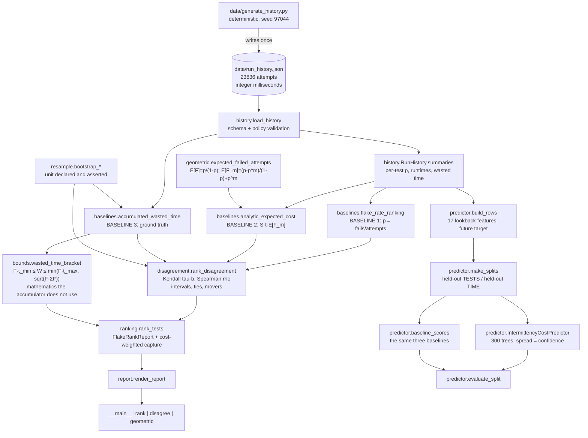
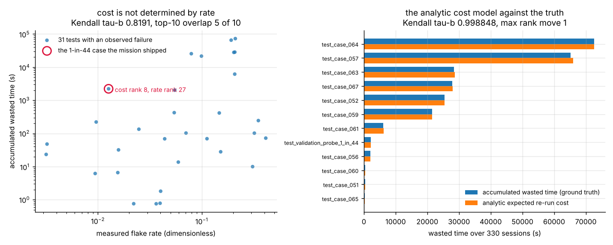
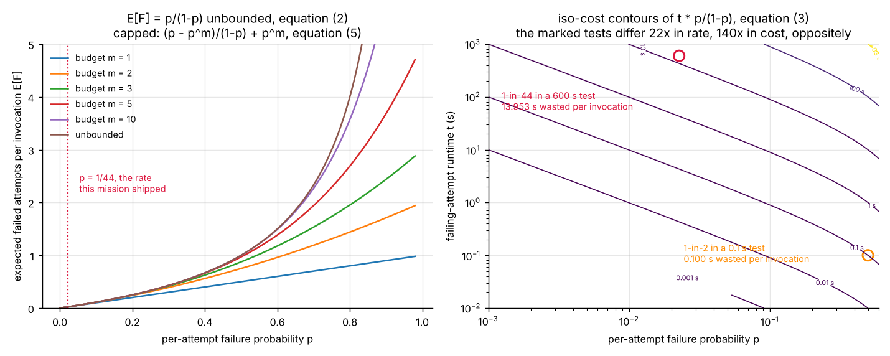
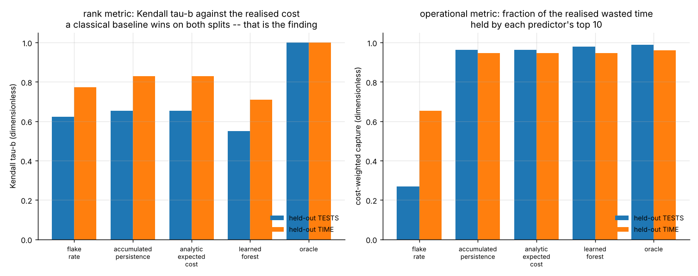

# flakerank

Ranks intermittently failing tests by the cost of their intermittency, and
reports how far that ranking disagrees with ranking by flake rate.


## The headline, measured

Over the committed run history — 72 tests, 330 CI sessions, 23836 recorded
attempts, 1417 of them failures, 253493.035 s of wasted re-run time — the cost
ranking and the flake-rate ranking disagree by:

| quantity | measured | from |
|---|---|---|
| **Kendall tau-b, ground-truth cost against flake rate** | **0.8191244239631337** | `validation/validate_disagreement.py` |
| its 95 % interval, 2000 resamples of 72 tests | [0.7375535244988303, 0.8992828376783003] | same |
| Spearman rho, same pair | 0.947669374556353 | same |
| largest rank move | 21 positions of 72 | same |
| **top-10 overlap between the two rankings** | **5 of 10** | same |
| **of the waste that actually happened, the fraction in the flake-rate top 10** | **0.7916781500525251** | same |
| the same fraction for the analytic cost top 10 | 0.9936751713908036 | same |
| the best any top 10 could hold | 0.9936751713908036 | same |

Half of what a flake-rate dashboard would put in its top ten are not the ten
tests that cost the most. On the forecasting task the gap is wider still: over a
30-session horizon the flake-rate ranking's top ten holds **0.269353** of the
realised waste where the analytic cost model's holds **0.961962**
(`validation/validate_learned_model.py`).

## The problem

A flaky-test dashboard tells you a test failed 3 times in 400 runs and first did
so on the 12th of last month. It cannot tell you whether to fix that one or the
other one that failed 60 times in 400, because the cost of a flake is the
machine time its re-runs waste, and that is the rate multiplied by the runtime.
A 1-in-44 failure in a ten-minute integration test wastes about 14 seconds every
time the suite runs and scores 0.023 on the dashboard; a 1-in-2 failure in a
tenth-of-a-second unit test wastes 0.1 seconds and scores 0.5. The dashboard
puts the second one 22 times higher and the true ordering is the other way round
by a factor of 139.53488372093022.

## What this does

- **Puts a cost interval on a flake rate.** Expected wasted re-run time per
  test, from the closed-form geometric re-run count, plus the accumulated truth
  with a percentile bootstrap interval whose resampling unit is the session —
  declared on the returned object and asserted before it is returned. Over the
  committed history: 253493.035 s wasted, interval [221006.758, 285213.185] s
  from 2000 resamples of 330 sessions. From
  `validation/validate_baselines.py`.
- **Measures how far the two rankings disagree, as a named and cited rank
  statistic with an interval.** Kendall tau-b with the tie correction of Kendall
  (1945) and Spearman rho from midranks, each with a bootstrap interval over
  tests, the full tie structure, and the identity of the tests that move most.
  Measured 0.8191244239631337 [0.7375535, 0.8992828]. Cross-checked against
  `scipy.stats`, an independently written implementation, to a worst relative
  difference of 1.355e-16.
- **Derives the geometric re-run count in closed form, and refuses to diverge
  quietly.** `E[F] = p/(1-p)` unbounded and `E[F_m] = (p - p^m)/(1-p) + p^m`
  under a retry budget, derived in `src/flakerank/geometric.py` with five
  stated validity limits. At `p = 1` the unbounded form raises `ValueError`
  naming the two ways out rather than returning `inf`, because `inf` in a
  ranking sorts a permanently broken test above every real flake. Checked
  against a Monte Carlo of the retry process itself: **0 of 36 cells outside 4
  standard errors, worst 2.484 sigma**.
- **Brackets its own accumulator with mathematics the accumulator does not
  use.** A counting-plus-order-statistics bracket and a Cauchy–Schwarz upper
  bound, with a slack that follows the conditioning of the bound expression.
  The bracket holds over 6 session windows and on 200 of 200 random synthetic
  histories, with a worst slack-to-width ratio of 1.179e-12, so the slack is
  demonstrably not what makes the check pass.
- **Reads no clock anywhere.** 41 Python files parsed with `ast`; 0 imports of
  `time`, `timeit`, `datetime` or `resource`, 0 reads of `perf_counter` or any
  sibling, 0 shell or `/proc` routes to one. Every number this product asserts
  on is an integer number of milliseconds from a committed history generated
  once by a deterministic script. From `validation/validate_no_live_timing.py`.

## Why it reads no clock

A product about intermittency whose own checks are intermittent has refuted
itself before a reader reaches the first number.

The mission this product was built in lost a whole product to checks that
compared two wall-clock readings on a shared two-core runner; five intermittent
failures and a sixth caught in flight all traced to that one class. The same
mission separately shipped a 1-in-44 intermittent self-inflicted failure in a
validation probe that any number of agreeing serial verifications was blind to.
That second failure is why this product exists, and the committed history pins a
test at exactly `p = 1/44` with a 600-second runtime, named for it. In the
history that test ranks **8th of 72 by cost and 27th of 72 by flake rate**.

## What this does NOT claim

- **It does not tell you which flake to delete.** The most expensive flake is
  often the one guarding the most expensive failure. The 1-in-44 case that
  motivated this product was a real defect, not a nuisance.
- **It does not measure the whole cost of a flake.** There is the engineer who
  re-reads the log, the release that was held, and the real failure dismissed as
  "probably flaky". This measures the machine seconds, because those are the
  part a run history records.
- **It does not model retry dependence.** Attempts are taken as independent. A
  failure caused by a leaked file or an exhausted port makes the next attempt
  more likely to fail, which makes the analytic cost an **under**-estimate.
- **It has never seen a real CI system.** Everything here is measured on a
  synthetic generator; see `DATASET_CARD.md`.

## Who it is for

- Someone with a list of flaky tests and a finite amount of time, who has to
  decide which one to fix first and wants the decision defended by a number
  rather than by a rate.
- Someone who needs to say what a flaky test is costing, with an interval, to
  someone who will ask where the interval came from.
- Someone who suspects their CI dashboard is ranking by the wrong thing and
  wants to measure by how much.

## Who it is NOT for

- **Anyone who wants flaky tests to stop failing CI.** `pytest-rerunfailures`
  and `flaky` are the right tools and this one is their complement: it measures
  what the retries cost.
- **Anyone who wants flaky tests detected.** This takes a run history as input
  and does not produce one. `pytest-flakefinder` and `pytest-repeat` find the
  flakes; bring their output here.
- **Anyone who needs a guarantee.** Every figure is a point estimate with a
  bootstrap interval under a stated independence assumption known to be
  optimistic.
- **Anyone auditing a language or framework other than a run history.** The
  input is the `flakerank.history/1` schema and nothing else; there is no
  pytest plugin, no JUnit reader and no CI integration.
- **Anyone who needs the learned model to be the answer.** On the committed
  history a classical baseline matches or beats it. See below.

## Alternatives, honestly

Every version was read from the PyPI JSON API on 2026-11-19 and the HTTP status
recorded; only packages that returned 200 are listed.

| Tool | Version | What it does better | When to use it instead of this |
|---|---|---|---|
| `pytest-rerunfailures` | 16.7 | re-runs failing tests so a flaky one passes | you want CI to survive a known flaky test — note it **creates** the cost this tool measures |
| `flaky` | 3.8.1 | the same, as a per-test decorator with pass/run thresholds | the flakiness is known, accepted and documented |
| `pytest-flakefinder` | 1.1.0 | repeats tests within a budget to expose flakiness | you need to **find** flaky tests; this tool starts after that |
| `pytest-repeat` | 0.9.4 | runs each test N times | you want a repeat count and nothing else |
| `pytest-randomly` | 5.1.0 | randomises test order and reseeds RNGs per test | you suspect order dependence rather than intermittency |
| `pytest-split` | 0.11.0 | splits a suite into equal-duration groups from recorded test durations | you want to shorten wall-clock CI time by parallelising, not to rank flakes |
| `pytest-json-report` | 1.5.0 | writes a machine-readable report of a pytest run, durations included | you need to **produce** a run history; its output is the kind of input this tool wants |
| `junitparser` | 5.0.3 | reads and writes JUnit XML | you need to parse CI output; this tool deliberately ships no reader |

None of these puts a **cost interval** on a flake rate, so none of them can say
which flake is worth fixing first, and none reports how far a cost ranking
disagrees with a rate ranking. That is the whole of the difference.

## Install and first run

```bash
git clone https://github.com/OmAcharya-avtr/flakerank.git
cd flakerank
python -m venv .venv && source .venv/bin/activate
pip install -e ".[dev]"
python -m pytest tests/ -q
python examples/geometric_rerun_cost.py
```

`python -m pytest tests/ -q` prints:

```
........................................................................ [ 27%]
........................................................................ [ 55%]
........................................................................ [ 83%]
...........................................                              [100%]
259 passed in 5.54s
```

The trailing duration is a wall-clock reading and will differ on your machine.
It is the only one anywhere near this repository, it comes from pytest and not
from this product, and nothing here asserts on it.

`python examples/geometric_rerun_cost.py` ends with:

```
the two tests marked on the right panel:
  1-in-44 in a 600 s test: 13.953488372093023 s wasted per invocation
  1-in-2 in a 0.1 s test : 0.1 s wasted per invocation
  cost ratio             : 139.53488372093022
  flake-rate ratio       : 22.0, the other way round

the divergence at p = 1 is raised, never returned as inf:
  expected_failed_attempts(1.0) -> ValueError: expected failed attempts diverges at failure_probability = 1...
  expected_failed_attempts(1.0, retry_budget=3) -> 3.0

figure written to screenshots/geometric_rerun_cost.png
```

## A worked example

```python
from flakerank.history import load_history
from flakerank.ranking import rank_tests

history = load_history("data/run_history.json")
report = rank_tests(history, resamples=2000, seed=97044, top_k=10)

print(f"tests                 {report.n_tests}")
print(f"wasted seconds        {report.truth.total_seconds:.3f}")
print(f"  interval            [{report.truth.total_interval.low:.3f}, "
      f"{report.truth.total_interval.high:.3f}]")
print(f"  resampling unit     {report.truth.resampling_unit}")
print(f"tau-b truth vs rate   {report.truth_vs_rate.tau_b:.10f}")
print(f"  interval            [{report.truth_vs_rate.tau_b_interval.low:.7f}, "
      f"{report.truth_vs_rate.tau_b_interval.high:.7f}]")
print(f"top-10 overlap        {report.truth_vs_rate.top_k_overlap} of 10")
print(f"capture by rate       {report.capture_by_rate:.10f}")
print(f"capture by analytic   {report.capture_by_analytic:.10f}")
for mover in report.truth_vs_rate.movers[:3]:
    print(f"  {mover.name:<42} cost rank {mover.rank_x:>3}  "
          f"rate rank {mover.rank_y:>3}  move {mover.displacement:+d}")
```

prints:

```
tests                 72
wasted seconds        253493.035
  interval            [221006.758, 285213.185]
  resampling unit     session
tau-b truth vs rate   0.8191244240
  interval            [0.7375535, 0.8992828]
top-10 overlap        5 of 10
capture by rate       0.7916781501
capture by analytic   0.9936751714
  unit/test_case_066                         cost rank  25  rate rank   4  move +21
  soak/test_validation_probe_1_in_44         cost rank   8  rate rank  27  move -19
  regression/test_case_069                   cost rank  17  rate rank   1  move +16
```

## Architecture



## Screenshots



Notice that the points are spread vertically at every flake rate: the rate does
not determine the cost, and the most expensive test in the suite is not the
flakiest. The circled point is the 1-in-44 case — 8th by cost, 27th by rate. The
right panel shows the analytic cost model against the ground truth over the top
12 tests; the bars are nearly identical, which is the Kendall tau-b of
0.9988479262672811 drawn.



Notice on the left that `E[F] = p/(1-p)` runs away as `p → 1` while every capped
curve stays finite and reaches exactly its own budget. On the right, the
iso-cost contours are hyperbolas: a given amount of wasted time is reached
either by a frequent failure in a fast test or by a rare failure in a slow one,
and the two marked tests sit two contours apart in the opposite order to their
flake rates.



Notice that the left panel — the rank metric — has a classical baseline winning
on both splits. That is the finding, drawn rather than hidden. On the right, the
flake-rate bar is short because the rate does not know how long a test takes.

## Validation evidence

Full tables, with every reference, in `validation/VALIDATION.md`. **146 checks,
0 failures, 30 of 30 negative controls fired, 11 of 11 controls that must stay
silent stayed silent.** Including the ones where a baseline won.

| check | reference | result | tolerance |
|---|---|---|---|
| `E[F_3]` at `p = 1/4` | hand arithmetic, `(p-p³)/(1-p)+p³ = 0.328125` | 0.328125 | 1e-15 absolute |
| closed form against a division-free recursion, 30 cells | `E[F_m] = p(1+E[F_{m-1}])` | worst relative difference 1.493e-16 | 1e-12 relative |
| closed form against a Monte Carlo of the retry process, 36 cells | 20000 simulated invocations per cell | 0 outside 4 s.e., worst 2.484 sigma | 4 standard errors, declared in advance |
| tau-b and rho against `scipy.stats` | an independently written implementation | worst relative difference 1.355e-16 and 1.172e-16 | 1e-12 relative |
| tau-b, ground truth against flake rate | Kendall (1938, 1945) | 0.8191244239631337 [0.7375535, 0.8992828] | 2000 resamples of 72 tests |
| tau-b, ground truth against the analytic model | same | 0.9988479262672811, max rank move 1 of 72 | same |
| the bracket holds, 6 windows + 200 synthetic histories | counting, order statistics, Cauchy–Schwarz | 206 of 206 | slack 4·F·eps·Σ\|t\|, worst slack/width 1.179e-12 |
| per-test interval covers the generator's expectation | generator ground truth | 30 of 31 tests with a failure; 38 of 41 without | declared floor 0.70 |
| **the analytic baseline beats the learned forest** | both scored on the same held-out rows | baselines hold 6.67 of 8 metric-split cells | — |
| no clock is read | `ast` parse of 41 files | 0 offenders on 3 screens | — |
| no `pytest.approx` relies on the hidden 1e-12 default | static scan of 116 calls + the suite re-run under a strict plugin | 0 of 116; suite passes | — |
| every script runs from 4 working directories | pristine copy, 4 directories | 11 of 11 scripts, exit 0 from all four | — |

## Which baseline won

**A classical baseline.** Counted over the two held-out splits and the four
metrics a baseline and the model can both be scored on, with an exact draw
counted as a shared cell rather than a win:

| predictor | share of 8 cells | outright wins |
|---|---|---|
| analytic expected cost | 2.83 | 2 |
| flake rate | 2.00 | 2 |
| accumulated persistence | 1.83 | 1 |
| learned forest | 1.33 | 1 |

The learned forest's three largest feature importances are the analytic cost
(0.3399693389703807), the accumulated wasted time (0.32644603859189514) and a
transform of the latter (0.2818601186220956) — the baselines' own outputs. A
forest whose signal is a closed form it was handed is not adding a model.

The result is published as the finding. It was not retuned away, and the model
was not denied features the baselines had in order to lose. Full tables in
`MODEL_CARD.md`.

## API reference

<details>
<summary>Public surface, one line each, with units</summary>

**`flakerank.geometric`**

- `expected_attempts_to_first_pass(p) -> float` — `1/(1-p)`, dimensionless count; raises at `p = 1`.
- `expected_failed_attempts(p, retry_budget=None) -> float` — `p/(1-p)` or `(p-p^m)/(1-p)+p^m`, dimensionless; raises at `p = 1` with no budget.
- `expected_wasted_seconds(p, failing_attempt_seconds, retry_budget=None, invocations=1) -> float` — seconds.
- `expected_attempts_by_recursion(p, iterations=200) -> float` — independent cross-check, dimensionless.
- `expected_failed_attempts_by_recursion(p, retry_budget) -> float` — division-free cross-check, dimensionless.
- `failure_probability_for_expected_attempts(expected_attempts) -> float` — the exact inverse, dimensionless.

**`flakerank.history`**

- `load_history(path) -> RunHistory` — reads and validates a `flakerank.history/1` file.
- `history_sha256(path) -> str` — 64 hex characters.
- `RunHistory.summaries(minimum_attempts=1) -> tuple[TestSummary, ...]` — per-test measurements; durations in seconds.
- `RunHistory.session_window(start, stop) -> RunHistory` — sessions in `[start, stop)`.
- `RunHistory.restrict_tests(indices) -> RunHistory`.
- `RunHistory.session_wasted_seconds() -> ndarray` — seconds per session.
- `TestSummary.cost_runtime_seconds -> float` — the failing-attempt mean, or the overall mean where no failure was observed.

**`flakerank.baselines`**

- `flake_rate_ranking(summaries) -> Ranking` — baseline 1, dimensionless scores.
- `analytic_expected_cost(summaries, retry_budget) -> Ranking` — baseline 2, seconds.
- `accumulated_wasted_time(history, ...) -> GroundTruthCost` — baseline 3, seconds, with session-bootstrap intervals.
- `GroundTruthCost.require_resampling_unit(expected) -> GroundTruthCost` — raises on a unit disagreement.

**`flakerank.disagreement`**

- `kendall_tau_b(x, y) -> float` — dimensionless, in `[-1, 1]`.
- `spearman_rho(x, y) -> float` — dimensionless, in `[-1, 1]`.
- `midranks(values) -> ndarray` — 1-based midranks.
- `rank_disagreement(names, x, y, ...) -> RankDisagreement` — both statistics, both intervals, ties, movers, top-k overlap.

**`flakerank.bounds`**

- `wasted_time_bracket(history, accumulated_seconds) -> BoundBracket` — seconds; `.brackets` is the verdict.

**`flakerank.resample`**

- `bootstrap_statistic_interval(units, statistic, *, resampling_unit, ...) -> BootstrapInterval`.
- `bootstrap_mean_interval(units, *, resampling_unit, total=False, ...) -> BootstrapInterval`.
- `BootstrapInterval.require_resampling_unit(expected) -> BootstrapInterval`.

**`flakerank.predictor`**

- `build_rows(history, *, origins, lookback, horizon, minimum_attempts=8) -> DatasetSplit`.
- `make_splits(rows, *, train_origins, time_origins, holdout_fraction=0.30, seed=97044) -> dict`.
- `IntermittencyCostPredictor.fit(split)` / `.predict(split) -> PredictionWithConfidence`.
- `baseline_scores(split, *, horizon, lookback) -> dict` — the three baselines on the same rows.
- `evaluate_split(name, split, score, *, seconds_scale, prediction=None, top_k=10) -> SplitScore`.

**`flakerank.ranking` and `flakerank.report`**

- `rank_tests(history, ...) -> FlakeRankReport` — the three baselines, the three pairwise disagreements, the bracket, the capture figures.
- `cost_capture(scores, truth_seconds, names, top_k) -> float` — dimensionless fraction.
- `render_report(report, count=10, movers=10) -> str`.

**CLI** — `python -m flakerank rank | disagree | geometric`

</details>

## Limitations

1. **Attempts are assumed independent.** Real retries are frequently not: a
   leaked file, an exhausted port or a poisoned cache makes the next attempt
   more likely to fail, and an infrastructure outage makes whole batches fail
   together. Positive dependence makes the analytic cost an **under**-estimate.
   There is no parameter for it and the product does not estimate one.
2. **`p` is assumed stationary.** A test whose rate changes after an
   infrastructure migration has no single `p`, and the pooled estimate
   describes neither regime. The committed history contains a deliberate regime
   change for 10 of 72 tests, and the learned model's interval coverage drops
   from 0.909 to 0.830 across it.
3. **A test with no observed failure gets an interval of exactly `[0, 0]`.**
   That is a correct statement about the resampling distribution and a
   misleading statement about the test, whose true rate is only bounded above.
   Of the 41 never-failing tests in the committed history, 3 have a true
   expected wasted time above zero. The product does not compute the upper
   bound on the rate that would be the honest answer.
4. **The order-statistic bracket is as wide as the duration spread.** On a
   history spanning 0.011 s to 1848.115 s a doubled accumulator total still
   fits inside it; a tenfold total does not. The bound catches structural errors
   and not every multiplicative one, which is why `validation/validate_bounds.py`
   also runs its controls on a near-constant-duration history where the bracket
   is exact.
5. **The bootstrap of a rank correlation is not bias-corrected.** A resample
   that draws the same test twice creates an artificial tie, inflating the tie
   counts and biasing tau-b upward. The interval is better read as a width than
   as a calibrated coverage statement.
6. **The percentile bootstrap is uncorrected for skew.** The wasted-time total
   is strongly right-skewed. BCa would be better and needs an acceleration
   estimate this product does not compute.
7. **The confidence output is epistemic only.** It is the spread across trees,
   not a predictive interval, and it excludes the irreducible
   session-to-session variation of a Bernoulli failure process. On 47 of 88
   held-out-TESTS rows the ensemble mean lies outside its own nominal interval,
   because that interval has collapsed to a point.
8. **The analytic cost falls back to the overall attempt mean for a test with
   no observed failure.** Such a test has `p = 0` so its analytic cost is zero
   either way, but the substitution is a real approximation and is named in
   `TestSummary.cost_runtime_seconds`.
9. **No real CI data anywhere.** The whole repository is measured on a synthetic
   generator; see `DATASET_CARD.md`. Carrying a figure from here into a claim
   about a real test suite is unsupported.
10. **No CI integration.** There is no pytest plugin, no JUnit XML reader and no
    GitHub Actions step. The input is the `flakerank.history/1` schema, and
    producing one from a real system is left to the reader.
11. **The declared dependency ranges were not exercised at both ends.** The
    build guide asks for the suite and the committed validation output to be
    compared at the floor and the ceiling of each declared range. The build
    agent for this product is forbidden from running `pip` at all, because a
    concurrent install mutated numpy mid-build in an earlier batch of this
    mission. The declared ranges are the minor series that was measured, which
    is narrower than a floor with no ceiling and weaker than a measured range.
12. **The dependency ceilings are a real cost.** This product cannot take a
    future security release of numpy, scipy or scikit-learn without a port. The
    tension is recorded here rather than resolved by removing the ceiling.
13. **`tau_b` returns 0.0 where `scipy` returns `NaN`**, for a vector that is
    entirely tied. The convention is declared, pinned in
    `tests/test_regressions.py`, and is the only place the two implementations
    differ.

## Reproducing every number

```bash
cd products/P097

# the suite, counted from the junit XML and never from pytest stdout
python3 -m pytest tests/ -q -p no:cacheprovider --junit-xml=junit.xml
ruff check src/ tests/

# the data, regenerated deterministically from seed 97044
python3 data/generate_history.py

# the evidence
python3 validation/validate_geometric.py
python3 validation/validate_history.py
python3 validation/validate_baselines.py
python3 validation/validate_bounds.py
python3 validation/validate_disagreement.py
python3 validation/validate_learned_model.py
python3 validation/validate_no_live_timing.py
python3 validation/validate_approx_audit.py
python3 validation/validate_tree_hygiene.py
python3 validation/probe_working_directories.py

# the figures
python3 examples/cost_versus_rate.py
python3 examples/geometric_rerun_cost.py
python3 examples/model_against_baselines.py

# the headline, on one screen
python3 -m flakerank disagree
```

Every script anchors on `__file__` and runs from any working directory. Every
stochastic step uses `numpy.random.default_rng` at seed **97044**, the one seed
declared in `data/generate_history.py`, `validation/_bootstrap.py`,
`examples/_bootstrap.py` and `tests/_support.py`.

## Safety

This software is **research-grade**. It is **not flight-qualified, not
certified and not approved for operational aerospace use.**

## Licence

Apache-2.0. © 2026 OPTIMA Organisation. See `LICENSE`.

## Citation

See `CITATION.cff`.

## Credits

This is under reserved rights obtained by OPTIMA Organisation.
