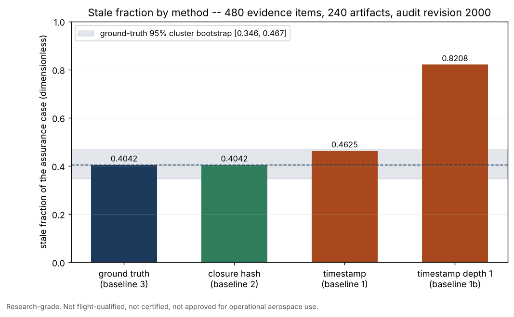
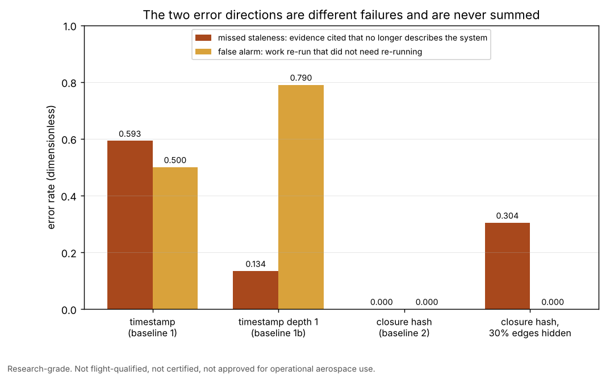
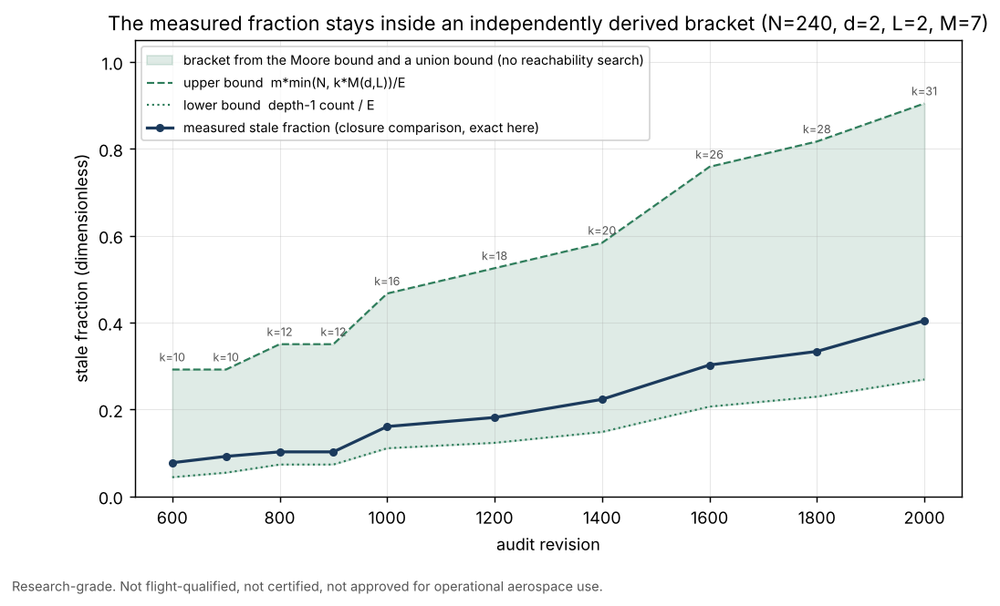
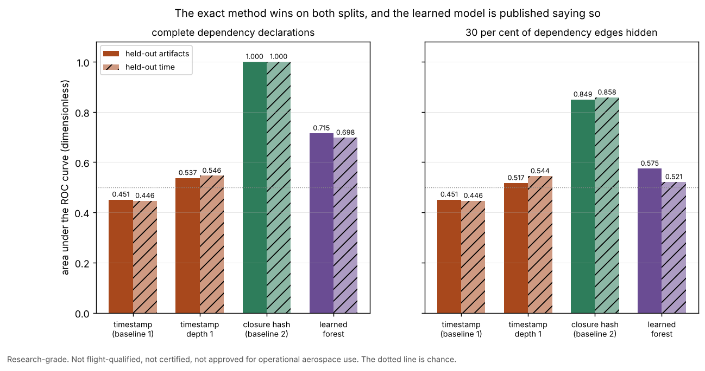

# evidencestale

Measures how much of an assurance case rests on evidence whose subject has changed.


## The problem

An assurance case says a claim holds because a particular test report, analysis
or review supports it. Months later the configuration that test ran against has
been edited, the model that analysis used has been regenerated, and nobody knows
which of the four hundred cited items still describe the system they describe.
The traceability matrix still shows a link, and the link is now a lie.

## What this does

- Computes the **stale fraction** of an assurance case: the share of evidence
  items whose subject's dependency closure has changed since the evidence was
  produced. Measured on the committed corpus: **0.404167**, 194 of 480 items,
  95 % cluster bootstrap [0.345833, 0.466667] (`validate_baselines.py`).
- Reports the **two error directions of a timestamp comparison separately**,
  because they are different failures: on the same corpus a
  modification-revision comparison misses 115 of 194 truly stale items and
  raises 143 false alarms on 286 truly current ones, while reporting an
  aggregate stale fraction of 0.462500 against a true 0.404167 — an aggregate
  error of +0.058333 that hides a per-item agreement of 0.462500
  (`validate_baselines.py`).
- Computes staleness **exactly** by comparing SHA-256 digests over the
  dependency closure: 0 missed, 0 false alarms, agreement 1.000000 on 480
  items, and the same on a corpus whose dependency graph contains a cycle
  (`validate_baselines.py`).
- Brackets the stale fraction with a bound derived from **counting arguments
  the implementation does not use** — the Moore bound plus a union bound over
  the changed artifacts: measured 0.404167 inside [0.268750, 0.904167], holding
  and informative at 10 of 10 audit revisions (`validate_bound_bracket.py`).
- Benchmarks a **learned staleness-risk model with a confidence output** on
  held-out artifacts and held-out time separately, and publishes the result:
  area under the ROC curve 0.7152 and 0.6977 against the exact method's 1.0000
  on both splits (`validate_learned_model.py`).

## What this does that existing tools do not

A traceability tool checks that a link **exists** between a claim and its
evidence. This checks whether the link is still **true**, which is the question
an audit actually asks. The distinction is not rhetorical: on the committed
corpus a method that checks only the subject artifact's modification revision
agrees with the truth on 46.25 per cent of items, and a method that follows the
dependency closure agrees on 100 per cent.

## Who it is for

- Someone maintaining an assurance or safety case across changes, who needs to
  know which cited evidence to re-examine and which to leave alone.
- Someone deciding whether a timestamp-based staleness check is good enough,
  who wants the error rates in both directions rather than an accuracy figure.
- Someone building a dependency-aware evidence index who wants a small, read-
  only reference implementation and a corpus whose answers are known by
  construction.

## Who it is not for

- Anyone needing a certified or qualified tool. This is research-grade software
  and nothing in it is approved for operational use.
- Anyone needing dependency **discovery**. The dependency graph here is
  declared, not discovered from a build system or toolchain. Discovery is the
  hard part of applying any of this and is out of scope.
- Anyone needing a full assurance-case editor, a GSN renderer, or coverage of
  GSN modules, contracts, away goals or confidence arguments. None of those is
  modelled; see Limitations.
- Anyone who wants the learned model. Where the dependency declarations are
  complete the exact method in the same package is strictly better, and this
  repository says so.

## Alternatives, honestly

Every package named below was checked to exist on PyPI on 2026-11-19 by
`curl -s -o /dev/null -w '%{http_code}' https://pypi.org/pypi/<name>/json`; each
returned HTTP 200. `evidencestale` itself returned 404 on the same probe.

| alternative | what it does better | when to use this instead |
|---|---|---|
| `doorstop` | a real requirements-management tool: items, links, reviews, and its own fingerprint-based suspect-link detection, in a workflow people actually use | when you want the stale fraction of an existing case as a measurement, with both error directions and a bound, rather than a managed document tree |
| `strictdoc` | authoring and checking requirements documents with traceability, with exporters and a web interface | when the question is "how much of this rests on changed evidence", not "is this document well formed" |
| `reqif`, `pyreqif` | read and write ReqIF, the interchange format real tools exchange | when you already have a graph and a change history and need the staleness measurement over them |
| `dvc` | content-addressed versioning of data and models, with pipeline staleness over a real dependency graph, at repository scale | when the subject is an assurance case rather than a pipeline, and when you need the per-item error directions against a known ground truth |
| `snakemake` | a workflow manager that re-runs a rule when its inputs change, over real files | when you want to measure the error of a staleness rule rather than act on one |
| `networkx` | every graph algorithm, maintained, fast, general | when you want the closure semantics tied to a staleness definition with a cycle policy and an actionable error on malformed input; use `networkx` for anything else graph-shaped |
| `sphinx-needs` | requirement and evidence objects embedded in documentation, with links and filters | when you need the measurement rather than the documentation |

If you want a maintained requirements tool with suspect-link detection, use
`doorstop`. This repository is a measurement instrument and a corpus, not a
replacement for one.

## Install and first run

```bash
git clone https://github.com/OmAcharya-avtr/evidencestale.git
cd evidencestale
python -m venv .venv && source .venv/bin/activate
pip install -e ".[test]"
python -m pytest tests/ -q
python examples/stale_fraction_report.py
```

The suite prints:

```
213 passed in 20.88s
```

The count is from the junit XML, not from this line: a suite that collects zero
tests also prints success. The elapsed figure varies with load on a shared
runner: 12.13 s, 19.74 s and 20.88 s were all measured this session. No test or
script in this repository asserts a relationship between two live wall-clock
readings.

and `examples/stale_fraction_report.py` ends with:

```
BASELINE 2 -- content-hash comparison over the dependency closure
  missed staleness : 0 of 194
  false alarms     : 0 of 286
  agreement        : 1.000000

This software is research-grade. It is not flight-qualified, not certified and not approved for operational aerospace use.

figure written to screenshots/stale_fraction.png
```

## A worked example

```python
from evidencestale import load_corpus
from evidencestale.baselines import (
    baseline_closure_hash, baseline_timestamp, ground_truth,
)
from evidencestale.bootstrap import bootstrap_stale_fraction
from evidencestale.metrics import error_directions

corpus = load_corpus("data/corpus_layered.json")
items, history, audit = corpus.evidence, corpus.history, corpus.evaluation_time

truth = ground_truth(items, history, corpus.true_graph, audit)
closure = baseline_closure_hash(items, history, corpus.true_graph, audit)
stamp = baseline_timestamp(items, history, corpus.true_graph, audit)

print(f"stale fraction, ground truth : {truth.stale_fraction:.6f}")
print(f"stale fraction, closure hash : {closure.stale_fraction:.6f}")
print(f"stale fraction, timestamp    : {stamp.stale_fraction:.6f}")

for name, verdicts in (("closure hash", closure), ("timestamp", stamp)):
    errors = error_directions(verdicts.as_array(), truth.as_array())
    print(
        f"{name:<13} missed {errors.false_negative:>3} of {errors.actually_stale}"
        f"  false alarms {errors.false_positive:>3} of {errors.actually_current}"
        f"  agreement {errors.agreement:.6f}"
    )

interval = bootstrap_stale_fraction(
    truth.as_array(), corpus.subjects(), unit="cluster", resamples=2000, seed=980098
)
print(f"95% cluster bootstrap: [{interval.low:.6f}, {interval.high:.6f}]")
```

Printed output:

```
stale fraction, ground truth : 0.404167
stale fraction, closure hash : 0.404167
stale fraction, timestamp    : 0.462500
closure hash  missed   0 of 194  false alarms   0 of 286  agreement 1.000000
timestamp     missed 115 of 194  false alarms 143 of 286  agreement 0.462500
95% cluster bootstrap: [0.345833, 0.466667]
```

Note that `unit` has no default. A bootstrap whose resampling unit is not stated
is not a reported interval, so passing one is required.

## Architecture

```mermaid
flowchart TD
    corpus["data/corpus_layered.json<br/>240 artifacts, 249 edges,<br/>250 events, 480 evidence items"]
    corpus --> loader["corpus.load_corpus<br/>schema and subset validation"]
    loader --> graph["graph.DependencyGraph<br/>closure, impacted, cycles<br/>O(V+E) per node"]
    loader --> replay["replay.ChangeHistory<br/>contents_at, modified_at,<br/>changed_between"]
    loader --> case["model.AssuranceCase<br/>GSN nodes and links"]

    replay --> b3["baselines.ground_truth<br/>baseline 3, the truth"]
    graph --> b3
    replay --> b1["baselines.baseline_timestamp<br/>baseline 1 and 1b"]
    graph --> b2["baselines.baseline_closure_hash<br/>baseline 2"]
    replay --> b2
    hash["hashing.content_hash<br/>SHA-256, FIPS 180-4"] --> b2

    b3 --> metrics["metrics.error_directions<br/>missed staleness, false alarms"]
    b1 --> metrics
    b2 --> metrics
    b3 --> boot["bootstrap.bootstrap_stale_fraction<br/>unit: cluster or item"]
    metrics --> report["report.build_report<br/>stale fraction, goal-weighted"]
    boot --> report
    case --> report

    graph --> features["features.feature_matrix<br/>12 graph and churn features"]
    replay --> features
    features --> learned["learned.StalenessRiskModel<br/>forest, probability + spread"]
    b3 --> bench["benchmark.run_benchmark<br/>held-out artifacts and time"]
    learned --> bench
    b1 --> bench
    b2 --> bench

    replay --> bound["bounds.stale_fraction_bracket<br/>Moore + union, counts only"]
    b3 --> bound
    report --> cli["__main__: report / bracket / benchmark"]
    bench --> cli
    bound --> cli
```

## Screenshots



The closure comparison sits exactly on the ground truth. Notice that the plain
timestamp baseline's bar is close to the truth while its per-item agreement is
0.4625 — its two error directions partly cancel in the aggregate.



The depth-1 timestamp variant trades missed staleness (0.1340) for false alarms
(0.7902) rather than removing either. The closure comparison has a zero bar in
both directions until 30 per cent of the dependency edges are hidden, at which
point it acquires a missed-staleness bar and still no false alarms.



The measured fraction stays inside a bracket computed from four integers, with
no reachability search. The `k=` annotations are the change count; the upper
bound rises towards 1 as `k` grows, which is a property of the bound.



The exact method reaches 1.0000 on both splits. The learned model beats the
timestamp baseline and loses to the exact method, on complete declarations and
on incomplete ones.

## Validation evidence

Full detail in [`validation/VALIDATION.md`](validation/VALIDATION.md). Every
number below comes from the named script, run on 2026-11-19, with raw output
committed beside it.

| check | reference | result | tolerance |
|---|---|---|---|
| stale fraction, ground truth | `validate_baselines.py` | 0.404167 (194 of 480) | exact counts |
| closure comparison against ground truth, 480 items | `validate_baselines.py` | 0 missed, 0 false alarms, agreement 1.000000 | item-by-item identity |
| the two stale fractions agree | `validate_baselines.py` | difference 0.000000e+00 | 8.881784e-16, from the conditioning of one division |
| closure comparison on a CYCLIC graph, 12 items | `validate_baselines.py` | agrees on all 12; cycle `('c00','c01','c02')` reported | item-by-item identity |
| **baseline 1 missed staleness** | `validate_baselines.py` | **115 of 194, rate 0.592784** | exact counts |
| **baseline 1 false alarms** | `validate_baselines.py` | **143 of 286, rate 0.500000** | exact counts |
| baseline 1b missed / false alarms | `validate_baselines.py` | 26 of 194 (0.134021) / 226 of 286 (0.790210) | exact counts |
| exactness condition: 75 of 249 edges hidden | `validate_baselines.py` | 59 of 194 missed (0.304124), 0 false alarms | exact counts |
| exactness condition: digest collision bound | `validate_corpus_pin.py` | 3.206437e-73 over 37128 pairs | union bound, random-oracle model |
| exactness condition: depth limit | `validate_corpus_pin.py` | deepest closure 2 levels against a limit of 64 | never bound |
| independent bracket, headline | `validate_bound_bracket.py` | 0.268750 ≤ 0.404167 ≤ 0.904167 | 8.881784e-16 per endpoint |
| independent bracket over 10 audit revisions | `validate_bound_bracket.py` | holds 10 of 10, informative 10 of 10 | as above |
| Moore bound against 8 hand values | `validate_bound_bracket.py` | 8 of 8 agree | exact integers |
| negative controls | `validate_negative_controls.py` | 8 of 8 must-fire fired, 6 of 6 must-stay-silent silent | exact counts |
| injected rate recovered | `validate_negative_controls.py` | true +0.218750, measured +0.218750, difference 0.000000e+00 | 8.881784e-16 |
| **baseline 2 AUC, held-out artifacts / time** | `validate_learned_model.py` | **1.0000 / 1.0000** | — |
| learned model AUC, held-out artifacts / time | `validate_learned_model.py` | 0.7152 / 0.6977 | — |
| **the baseline won** | `validate_learned_model.py` | exact method beats the model on both splits and both views | published as winning |
| degraded baseline 2 vs model, edges hidden | `validate_learned_model.py` | 0.8495 / 0.8578 against 0.5745 / 0.5211 | — |
| confidence output, top band | `validate_learned_model.py` | agreement FALLS to 0.647059 in the sparse [0.9, 1.0] band of 17 items | reported, not smoothed |
| `pytest.approx` hidden-default audit | `validate_approx_audit.py` | 0 of 41 calls depend on the default; suite passes with it forbidden | two independent measurements |
| committed corpus digests | `validate_corpus_pin.py` | both match the manifest | SHA-256 |
| committed labels vs replayed truth | `validate_corpus_pin.py` | 0 of 480 disagree | item-by-item identity |
| four-directory probe | `probe_working_directories.py` | every script exits 0 from all four, same status from all four | exact |
| tree hygiene | `validate_tree_hygiene.py` | 0 artifacts added by the run; nothing a cold clone carries is one | snapshot difference |

### The checks that did not go the easy way

- **The baseline won, and it is published as winning.** The learned model loses
  to the closure comparison on both splits and also loses in the one case where
  it could have helped. It is still in the repository, with the result stated in
  `MODEL_CARD.md`.
- **A declared constant was wrong and a check caught it.** The cyclic corpus
  declared a maximum impact depth of 4; the measured depth is 5, and
  `validate_corpus_pin.py` failed until the declaration was corrected to 6.
- **A control was overstated and was weakened to the truth.** Control 1 of
  `validate_negative_controls.py` first claimed the timestamp baseline misses
  every newly stale item. It misses 102 of 105; the other 3 are items whose own
  subject was written. The control now asserts the structural claim — 0 of the
  68 items made stale only through a dependency are newly flagged.
- **The bracket's own lower bound was wrong at 6 of 10 revisions** before it was
  fixed to use a per-item change set. See `validation/VALIDATION.md` section 5.
- **The confidence output is not monotone.** Agreement falls in the top band.

## API reference

<details>
<summary>Public surface, with units</summary>

| function or class | returns | units |
|---|---|---|
| `load_corpus(path)` | `Corpus` | — |
| `DependencyGraph.closure(node, depth_limit=64)` | `frozenset[str]` | artifacts; `O(V_r + E_r)` |
| `DependencyGraph.closure_depth(node, depth_limit=64)` | `int` | breadth-first levels |
| `DependencyGraph.impacted(changed, depth_limit=64)` | `frozenset[str]` | artifacts, reversed graph |
| `DependencyGraph.cycles()` | `tuple[tuple[str, ...], ...]` | components of size > 1, plus self-loops |
| `DependencyGraph.is_acyclic()` | `bool` | — |
| `DependencyGraph.max_out_degree_of_impact_graph()` | `int` | dependents |
| `ChangeHistory.contents_at(time)` | `dict[str, str]` | content at a revision |
| `ChangeHistory.modified_at(time)` | `dict[str, int]` | revision index |
| `ChangeHistory.changed_between(start, end)` | `frozenset[str]` | artifacts, value-based |
| `content_hash(content)` | `str` | 64 hex characters, SHA-256 |
| `collision_probability_bound(n)` | `float` | probability, union bound |
| `baseline_timestamp(items, history, graph, t)` | `StalenessVerdicts` | baseline 1 |
| `baseline_timestamp_depth1(items, history, graph, t)` | `StalenessVerdicts` | baseline 1b |
| `baseline_closure_hash(items, history, graph, t)` | `StalenessVerdicts` | baseline 2 |
| `ground_truth(items, history, true_graph, t)` | `StalenessVerdicts` | baseline 3 |
| `StalenessVerdicts.stale_fraction` | `float` | dimensionless, the headline |
| `error_directions(predicted, truth)` | `ErrorDirections` | counts and two rates |
| `roc_auc(scores, truth)` | `float` | dimensionless, `nan` if one class |
| `brier_score(probabilities, truth)` | `float` | dimensionless |
| `bootstrap_stale_fraction(stale, groups, *, unit, ...)` | `BootstrapInterval` | dimensionless; `unit` required |
| `moore_bound(d, L, cap=None)` | `int` | nodes |
| `stale_fraction_bracket(items, changed_by_item, deps, *, ...)` | `StaleFractionBracket` | dimensionless |
| `feature_matrix(items, history, graph, t)` | `ndarray (n, 12)` | see `MODEL_CARD.md` |
| `StalenessRiskModel.fit(features, labels)` | `self` | — |
| `StalenessRiskModel.predict_with_confidence(features)` | `RiskPrediction` | probability, spread, confidence |
| `artifact_splits(groups, n_splits=5)` | `list[Split]` | grouped folds |
| `time_splits(produced_at, quantiles)` | `list[Split]` | forward chaining |
| `run_benchmark(corpus, declarations, ...)` | `BenchmarkResult` | — |
| `build_report(corpus, declarations, ...)` | `StalenessReport` | — |
| `render_report(report)` | `str` | — |

</details>

Command line:

```bash
python -m evidencestale report      --corpus data/corpus_layered.json --declarations complete
python -m evidencestale bracket     --corpus data/corpus_layered.json
python -m evidencestale benchmark   --corpus data/corpus_layered.json --declarations partial
```

## Equations and their sources

| quantity | expression | source | units | validity |
|---|---|---|---|---|
| dependency closure | reachability from a node along declared dependency edges | Cormen, Leiserson, Rivest and Stein, *Introduction to Algorithms*, 4th edition, MIT Press, 2022, elementary graph algorithms | artifacts | any directed graph, cycles included; `O(V_r + E_r)` |
| strongly connected component, used only through its reachability consequence | mutual reachability | Tarjan, "Depth-first search and linear graph algorithms", *SIAM Journal on Computing* 1(2):146–160, 1972 | artifacts | any directed graph |
| content identity | SHA-256 digest of the UTF-8 encoding | FIPS PUB 180-4, *Secure Hash Standard*, NIST, August 2015 | 256-bit digest | no adversarial content |
| digest over a set of digests | sorted concatenation, then SHA-256 | Merkle, "A Digital Signature Based on a Conventional Encryption Function", *CRYPTO '87*, LNCS 293, 369–378, 1988 | 256-bit digest | — |
| collision bound | `n(n-1)/2 * 2^-256` | pairwise union bound under a random-oracle model of the digest | probability | non-adversarial; a bound on the model, not on SHA-256 |
| Moore bound | `1 + d + d^2 + ... + d^L` | standard degree–diameter counting argument; see Bollobás, *Modern Graph Theory*, Springer, 1998 | nodes | out-degree at most `d`, distance at most `L` |
| percentile bootstrap interval | quantiles of the resampled statistic | Efron and Tibshirani, *An Introduction to the Bootstrap*, Chapman and Hall, 1993, chapters 13–14; chapter 8 for the cluster form | dimensionless | enough independent units; not BCa |
| area under the ROC curve | Mann–Whitney U with mid-ranked ties | Bamber, "The area above the ordinal dominance graph and the area below the receiver operating characteristic graph", *Journal of Mathematical Psychology* 12(4):387–415, 1975 | dimensionless | both classes present |
| Brier score | mean squared error of probabilistic forecasts | Brier, "Verification of forecasts expressed in terms of probability", *Monthly Weather Review* 78(1):1–3, 1950 | dimensionless | forecasts in [0, 1] |

Assurance-case vocabulary and structure:

- Assurance Case Working Group, *Goal Structuring Notation Community Standard*,
  Version 3, Safety-Critical Systems Club, 2021 — the node types `Goal`,
  `Strategy`, `Solution`, `Context`, `Assumption`, `Justification` and the link
  types `SupportedBy` and `InContextOf`.
- Kelly and McDermid, "The Goal Structuring Notation — A Safety Argument
  Notation", *Proceedings of the DSN 2004 Workshop on Assurance Cases*, 2004 —
  the notation's published description.
- ISO/IEC/IEEE 15026-2:2022, *Systems and software engineering — Systems and
  software assurance — Part 2: Assurance case* — the claim / argument /
  evidence decomposition.
- Kelly and McDermid, "A Systematic Approach to Safety Case Maintenance",
  *Reliability Engineering and System Safety* 71(3):271–284, 2001 — the problem
  this product measures: that a change to the system invalidates parts of an
  existing argument and the affected parts must be identified rather than
  assumed.
- DO-178C, *Software Considerations in Airborne Systems and Equipment
  Certification*, RTCA, 2011 — the requirement for bidirectional traceability
  between requirements, design, code and verification results, which is the
  direction the dependency edges here run in.

No clause, section, table or page number is cited from any standard, because
none was consulted at that granularity for this build.

## Limitations

1. **Research-grade. Not flight-qualified, not certified, not approved for
   operational aerospace use.** No part of this measures compliance with any
   standard named above.
2. **What is modelled of GSN, and what is not.** Modelled: the six node types
   and two link types listed above, the restriction that a link originates at a
   `Goal` or `Strategy`, and the restriction that a `Solution` is a leaf. **Not
   modelled:** GSN modules, contracts, away goals, undeveloped entities,
   public and private visibility, the pattern language, confidence arguments,
   and every process requirement of every standard cited. The product measures
   one property of one structure.
3. **The dependency graph is declared, not discovered.** Everything rests on
   that declaration being complete, and when it is not, the exact method stops
   being exact: with 75 of 249 edges hidden it misses 59 of 194 truly stale
   items. The `partial` view is a model of imperfect discovery, not a
   measurement of any real discovery tool's recall.
4. **"Exact" is conditional, and the three conditions are measured, not
   assumed.** Complete declarations; no digest collision (bound 3.206437e-73
   over 37128 pairs, under a random-oracle model of SHA-256 and with no
   adversary); and the closure depth limit not binding (deepest closure 2
   levels against a limit of 64). It is exact in exact arithmetic, and the two
   stale fractions agree to within rounding — measured difference 0.0.
5. **Staleness is value-based.** A change that produces byte-identical content
   is not a change here, and a rebuild that only bumps a modification time is
   not a change. That is deliberate — the evidence still describes the artifact
   it describes — and it is the reason a touched-but-unchanged file is counted
   as a timestamp false alarm rather than a true positive.
6. **The upper bound is only informative for a small change count.** It reaches
   1 as soon as `k * M(d, L) >= E / m`, that is at `k >= 34.29` on this corpus.
   It is informative at all 10 audit revisions on the shipped grid and would be
   vacuous — still true, but constraining nothing — on a corpus with more
   changed artifacts.
7. **The confidence output is not monotone in accuracy.** Agreement rises
   across the four bands with at least 20 items and falls to 0.647059 in the
   sparse top band of 17. A forest's vote margin is not a calibrated
   probability. Do not filter on high confidence.
8. **The learned model loses, and the reason is structural.** It cannot beat an
   exact method, and in the incomplete-declaration case the features it has are
   features of the incomplete graph, so it degrades with the exact method
   rather than compensating for it. See `MODEL_CARD.md`.
9. **The corpus is synthetic** and its rates were chosen so that both error
   directions are measurable and the bound is informative. They estimate no
   real process. Evidence production is concentrated in revisions 1..600 of
   2000, so the `age` feature spans only 1400..1999. See `DATASET_CARD.md`.
10. **The bias-corrected and accelerated bootstrap is not implemented**, only
    the percentile interval.
11. **Dependency bounds were not verified at both ends of every range.** The
    build agent for this product is forbidden from running `pip`, so the suite
    could not be installed at the floor and the ceiling of each declared range.
    The declared ranges are the minor series measured — numpy 2.5.3,
    scipy 1.18.1, scikit-learn 1.9.1 — which is narrower than a floor with no
    ceiling and weaker than a measured range.
12. **The ceilings have a cost.** `scikit-learn>=1.9,<1.10` means this product
    cannot take a later security release without a port. That tension is real
    and is recorded here rather than resolved by removing the ceiling. No model
    is serialised, so the ceiling is for the published metrics rather than for
    an unpickling hazard.
13. **Complexity is stated, not optimised.** `all_closures` is `O(V * (V + E))`
    in the worst case. At 240 artifacts and 249 edges that is immaterial; at
    repository scale it would not be.
14. **No timing relationship between two live wall-clock measurements is
    asserted anywhere.** Where a time is checked it is a direction or a bound
    against a declared budget, with the measured value published.

## Reproducing every number

```bash
python data/generate_corpus.py                      # regenerates the committed corpora
python -m pytest tests/ -q -p no:cacheprovider --junit-xml=junit.xml
ruff check src/ tests/
python validation/validate_approx_audit.py
python validation/validate_baselines.py
python validation/validate_bound_bracket.py
python validation/validate_corpus_pin.py
python validation/validate_learned_model.py
python validation/validate_negative_controls.py
python validation/validate_tree_hygiene.py
python validation/probe_working_directories.py
python examples/stale_fraction_report.py
python examples/error_directions.py
python examples/bound_bracket.py
python examples/learned_vs_closure.py
```

Every script anchors on `__file__` and changes directory to the repository
root, so each runs from any working directory. Seeds: 980098 everywhere — the
corpus generator, the bootstrap and the forest's `random_state`.

Measured on Python 3.13.18, numpy 2.5.3, scipy 1.18.1, scikit-learn 1.9.1,
pytest 9.1.1, hypothesis 6.170.15, ruff 0.16.9, matplotlib 3.11.2, x86_64 Linux,
2 cores shared by five concurrent builds.

## Licence

Apache-2.0. © 2026 OPTIMA Organisation. See [`LICENSE`](LICENSE).

## Citation

See [`CITATION.cff`](CITATION.cff).

## Credits

This is under reserved rights obtained by OPTIMA Organisation.
