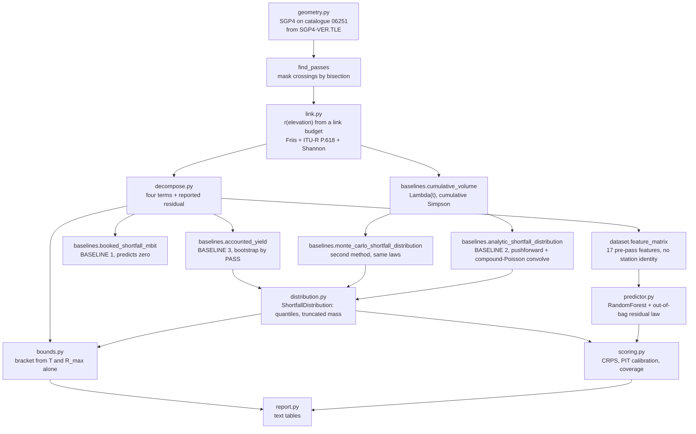
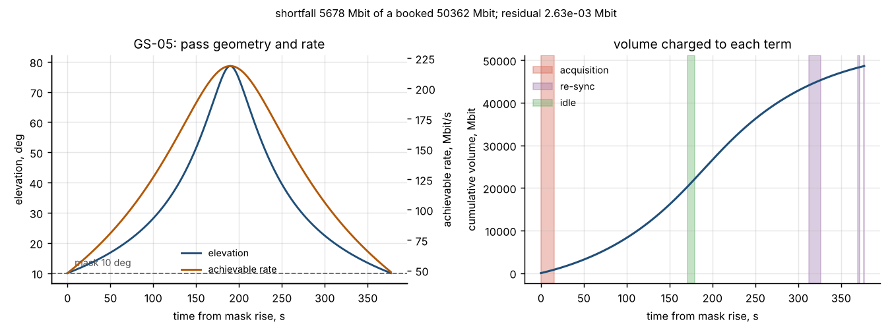
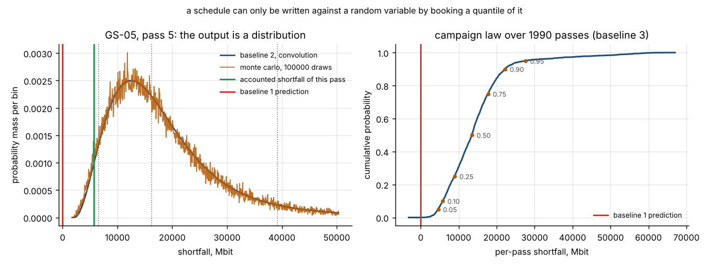
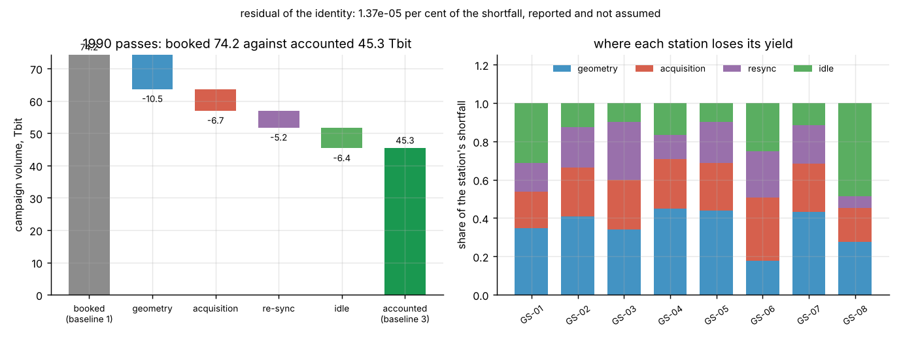
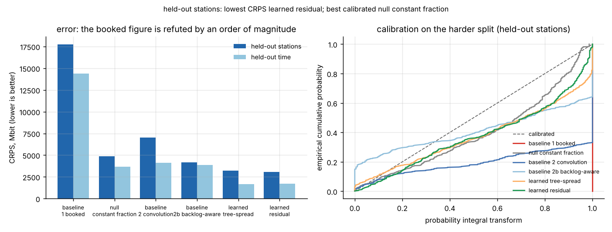

# passyield

Data-yield shortfall of a ground-station contact against its booking, as a distribution.


**Status: TESTING.** Research-grade software. **Not flight-qualified, not
certified and not approved for operational aerospace use.**

## The problem

A contact schedule books a window and a rate, and the booking is a point: so
many seconds above the mask, so many megabits per second, multiply. The pass
then spends time slewing and acquiring, loses lock and re-acquires, and runs
dry when the onboard queue is shorter than the window — and the operations
report says what arrived, after the fact, also as a point. Nobody hands the
scheduler the thing it would actually need, which is the **distribution** of
the shortfall, so the next schedule books the same optimistic number again.

## What this does

- **Decomposes one pass's shortfall into four terms** — geometry,
  acquisition, re-synchronisation and idle — with the closing error of the
  identity reported as a number on every result. Over the committed 1990-pass
  campaign the median relative residual is **1.46e-08** and the 95th
  percentile is **3.89e-07** (`validation/validate_decomposition.py`).
- **Returns the shortfall as a distribution with its quantiles**, not a point.
  The analytic law is a mass-preserving pushforward and a compound-Poisson
  convolution over the SGP4 pass geometry, cross-checked against a direct
  Monte Carlo of the same laws: **161 quantile comparisons, 0 outside the
  derived tolerance**, worst disagreement 7.06 grid steps
  (`validation/validate_convolution.py`).
- **Brackets every answer with mathematics the estimators do not use.**
  `Y_nom - R_max*T <= S <= Y_nom`, from the pass duration and the waveform's
  rate ceiling alone: **1990 of 1990** accounted shortfalls inside, **394 of
  394** quantiles of both methods inside, and **7 of 7** negative controls
  fired (`validation/validate_bounds.py`).
- **Takes the geometry from a published element set and checks it against the
  propagator's own published reference.** Catalogue object 06251 from the
  official SGP4 verification file, propagated against `tcppver.out` to a worst
  disagreement of **7.27e-09 km** in position over 25 epochs spanning 48 hours
  (`validation/validate_geometry.py`).
- **Benchmarks a learned per-pass predictor on held-out stations and held-out
  time separately.** The booked figure is refuted by **5.7x** on stations and
  **8.5x** on time in CRPS; a trivial null beats the specified analytic
  baseline on both splits; and on the harder split the null is **better
  calibrated** than the learned model (`validation/validate_learned.py`).

## Who it's for

- Someone sizing a ground-station network who needs the shortfall as a
  bookable quantile and not as an average.
- Someone writing a contact scheduler who wants to know which term of the
  shortfall their next change actually moves.
- Someone who wants a worked, checked example of a compound-Poisson
  convolution over a real orbit propagation, with the discretisation error
  measured rather than asserted.

## Who it's not for

- Anyone needing operational orbit determination. The propagation is SGP4 from
  a single element set over 60 days, which is a documented over-extension for
  a reproducible campaign and not an accuracy claim.
- Anyone needing a modulation-and-coding staircase, rain-fade time series,
  antenna patterns or ITRF-grade frames. None of those is modelled.
- Anyone needing a scheduler. This measures a distribution; what you do with
  it is outside the package.
- Anyone needing results about real ground stations. The eight stations and
  the whole event timeline are **synthetic and declared as such**; only the
  orbit is real.

## Alternatives, honestly

Every package below was verified to exist by
`curl -s -o /dev/null -w '%{http_code}' https://pypi.org/pypi/<name>/json`
on 2026-11-19; the recorded code is in the table. `passyield` itself returned
404 on 2026-11-10 and again on 2026-11-19, which is why the name is free.

| alternative | PyPI | what it does better | when to use that instead |
|---|---|---|---|
| `sgp4` | 200 | the propagation itself, and it is the reference transliteration of Vallado et al. (2006) | always for propagation — **this product depends on it rather than competing with it** |
| `skyfield` | 200 | a far more complete astronomy stack: proper frames, ephemerides, rise/set events, topocentric geometry with refraction | you want pass geometry and nothing else, or you need frames better than a GMST rotation |
| `pyorbital` | 200 | operational pass prediction for Earth-observation ground segments, with TLE handling | you want pass windows for a real ground segment and no yield model |
| `ephem` | 200 | long-established, fast rise/set and observer geometry | you want simple visibility windows with no dependency on numpy's version |
| `poliastro` | 200 | full astrodynamics: orbit propagation, manoeuvres, perturbations | you are doing orbit mechanics rather than link accounting |
| `satmad` | 200 | satellite mission analysis and design, including access intervals | you want a broader mission-analysis toolkit |
| `beyond` | 200 | flight-dynamics library with propagators and frames | you need a frames and propagators library rather than a measurement |

**What none of them does**, and the only reason this exists: feed the measured
nominal-versus-realised shortfall back as a distribution, decomposed, with the
decomposition's residual reported and the whole thing bracketed by
independent mathematics. The alternatives give you the window; the operations
tool gives you the delivered volume; neither gives you the law of the
difference.

## Install and first run

```bash
git clone https://github.com/OmAcharya-avtr/passyield.git
cd passyield
python -m venv .venv && source .venv/bin/activate
pip install -e ".[dev]"
python -m pytest tests/ -q
python -m passyield decompose --pass-id 5
```

The test run prints `284 passed`, and the decomposition prints:

```
pass decomposition -- station GS-05
  window duration, s               376.969
  active duration, s               336.687
  nominal (booked), Mbit         50361.605
  window capacity, Mbit          48640.227
  realised, Mbit                 44683.787
  realised / capacity             0.918659

  SHORTFALL, Mbit                 5677.817   share, per cent
    geometry                      1721.377    30.318
    acquisition                    804.983    14.178
    re-sync                       1337.233    23.552
    idle                          1814.222    31.953
    residual (reported)          2.634e-03     0.000

  acquisition truncated       False
  largest mask clamp, deg        3.780e-06
  Simpson nodes per interval            33
  Simpson nodes per window             513

baseline 1 predicts a shortfall of 0.0 Mbit
```

## A worked example

```python
from passyield.baselines import analytic_shortfall_distribution, fit_event_model
from passyield.bounds import inside, shortfall_bracket
from passyield.dataset import events_of, load_passes, station_by_name, window_of
from passyield.decompose import decompose_pass
from passyield.geometry import satellite
from passyield.link import DEFAULT_BUDGET

record = load_passes()                       # the committed per-pass record
row = next(r for r in record if r.pass_id == 5)
satrec = satellite()                         # SGP4 on a published element set
station = station_by_name(row.station)
window = window_of(row)

# Baseline 3: what the record accounts for, decomposed.
item = decompose_pass(satrec, station, window, events_of(row))

# Baseline 2: the analytic law of the shortfall, as a DISTRIBUTION.
model = fit_event_model(...)                 # measured laws from the record
law = analytic_shortfall_distribution(
    satrec, station, window, model, item.nominal_bits, item.capacity_bits
)

# An independent bracket, from the pass duration and the rate ceiling alone.
bracket = shortfall_bracket(
    item.nominal_bits, item.window_duration_s, DEFAULT_BUDGET.max_rate_mbit_s
)
```

Its output, from `validation/worked_example_output.txt`:

```
passes in the committed record        : 1990
pass_id                               : 5
station                               : GS-05
window duration, s                    : 376.969
peak elevation, deg                   : 78.600

booked volume (baseline 1), Mbit      : 50361.605
window capacity, Mbit                 : 48640.227
accounted realised volume, Mbit       : 44683.787
accounted shortfall, Mbit             : 5677.817

baseline 1's predicted shortfall, Mbit: 0.0

the decomposition, Mbit:
  geometry                            : 1721.377
  acquisition                         : 804.983
  re-sync                             : 1337.233
  idle                                : 1814.222
  residual (REPORTED, not assumed)    : 2.634433e-03
  sum of the four terms               : 5677.815

the analytic law of the shortfall -- the headline output is this, not a
point number:
  method                              : numerical-convolution
  grid step, Mbit                     : 47.5002
  quantile discretisation, Mbit       : 23.7501
  truncated mass                      : 1.622829e-02
  mean, Mbit                          : 17905.871

  quantile 0.05, Mbit                  : 6590.887
  quantile 0.25, Mbit                  : 11285.299
  quantile 0.50, Mbit                  : 16193.871
  quantile 0.75, Mbit                  : 23083.108
  quantile 0.95, Mbit                  : 39167.273

independent bracket, Mbit             : [-43880.693, 50361.605]
the accounted shortfall is inside it  : True
the median of the law is inside it    : True
```

## Architecture



## Screenshots



One contact. The left panel is elevation and the achievable rate against time
from mask rise; notice that the rate is not flat, which is why a booked
constant rate over-states the window. The right panel is the cumulative
volume with the three loss intervals shaded, so each term of the
decomposition is visible as an area.



The headline output. The left panel is the analytic law of one pass's
shortfall with the Monte Carlo of the same laws over it, the accounted
shortfall as a green line and baseline 1's prediction of zero as a red one at
the origin. The right panel is the campaign law over 1990 passes with the
reported quantiles marked; notice that baseline 1's prediction sits at the
extreme left of it.



Where the campaign's 28.8 Tbit of shortfall goes. The left panel is the
waterfall from booked to accounted; the right panel is each station's own
split, which is where a held-out station's difficulty comes from: GS-08 loses
48.6 per cent of its shortfall to idle time and only 6.0 per cent to re-sync,
while GS-03 loses 30.4 per cent to re-sync and 9.9 per cent to idle. Those two
are the held-out stations, and they are the two extremes of the catalogue by
design.



Left: CRPS on both splits, lower better; the booked figure is off the scale of
the others. Right: calibration on the harder split. Notice that the trivial
null's calibration curve is closer to the diagonal than the learned model's,
which is the finding in section 4 of the validation evidence.

## Validation evidence

Full tables, with the script and output file for every number, are in
[`validation/VALIDATION.md`](validation/VALIDATION.md). The headlines,
including the ones that are not flattering:

| check | reference | result | tolerance |
|---|---|---|---|
| SGP4 against the official `tcppver.out`, catalogue 06251, 25 epochs | Vallado et al. (2006), AIAA 2006-6753 | worst **7.266e-09 km**, **6.894e-10 km/s** | 1e-7, the file's printed resolution |
| decomposition identity residual over 1990 passes | the identity in `SPEC.md` section 2 | median **1.464e-08**, p95 **3.889e-07**, worst **8.706e-04** relative | suite tolerance 1e-5 |
| the residual is the saturation kink, not general quadrature error | `min(eta_max, ...)` is only C0 there | mean `|rho|` **220.3x** larger on saturating passes | ratio above 10 |
| convolution against a direct Monte Carlo, 24 passes, 200000 draws | the same laws, two methods | **0 of 161** quantiles outside; worst 7.06 grid steps | derived from the convolution stage count |
| independent bracket over the whole campaign | `0 <= Y_real <= R_max*T` | **0 of 1990** outside; **0 of 394** quantiles outside | slack `8*eps*max(operands)` |
| negative controls | anchored on the true value | **7 of 7 fired**, **2 of 2 silent** | both directions asserted |
| **the specified baseline 2 is beaten by a trivial null on both splits** | CRPS, Gneiting & Raftery (2007) | null **4891.64** against baseline 2 **7014.63** on stations; **3685.53** against **4102.21** on time | reported, not retuned |
| **the trivial null is better calibrated than the learned model on held-out stations** | PIT Kolmogorov distance | null **0.1961** against learned **0.2410** | reported, not retuned |
| the learned model has the lowest CRPS on both splits | CRPS | **3086.86 Mbit** on stations, **1701.40** on time | against baseline 1's 17732.36 and 14380.29 |
| `pytest.approx` hidden-default audit | the 1e-12 absolute default | **80 of 80** calls pass `abs=`; **0** assertions depend on the default; suite re-run under a plugin that forbids it exits 0 | measured, not read |
| working-directory probe | the release gate runs scripts with `cwd=validation/` | **14 of 14** scripts exit 0 from all four directories | identical exit status required |

## API reference

<details>
<summary>Public surface, one line each, with units</summary>

**`passyield.geometry`**
- `satellite() -> Satrec` — the propagator for the committed element set.
- `GroundStation(name, latitude_deg, longitude_deg, altitude_m, mask_deg, gain_over_temperature_db, zenith_attenuation_db)` — a station; mask at least 10 degrees.
- `gmst_rad(jd, fr) -> ndarray` — IAU-1982 Greenwich Mean Sidereal Time, radians.
- `teme_to_ecef(position_teme_km, jd, fr) -> ndarray` — pole rotation, km.
- `topocentric(position_ecef_km, station) -> (elevation_deg, azimuth_deg, slant_range_km)`.
- `topocentric_profile(satrec, station, window, offsets_s)` — the same, at offsets from mask rise.
- `slant_range_spherical_km(elevation_deg, altitude_km) -> ndarray` — the independent closed form, km.
- `find_passes(satrec, station, start_jd, start_fr, span_days, coarse_step_s=10.0, refine_iterations=40) -> list[PassWindow]`.

**`passyield.link`**
- `LinkBudget(eirp_dbw, frequency_hz, bandwidth_mhz, implementation_margin_db, max_spectral_efficiency_bits_per_hz)`; `.max_rate_mbit_s` is `B * eta_max` in Mbit/s.
- `free_space_loss_db(slant_range_km, wavelength_m) -> ndarray` — Friis (1946), dB.
- `slant_attenuation_db(elevation_deg, zenith_attenuation_db) -> ndarray` — ITU-R P.618 secant law, dB; **raises below 10 degrees**.
- `carrier_to_noise_density_dbhz(...) -> ndarray` — dB-Hz.
- `rate_mbit_s(elevation_deg, slant_range_km, gain_over_temperature_db, zenith_attenuation_db, budget) -> ndarray` — Mbit/s.

**`passyield.decompose`**
- `PassEvents(acquisition_s, resync_intervals_s, idle_intervals_s)` — the operator timeline, seconds.
- `normalise_intervals(...)` — clip and disjointify under the declared priority.
- `integrate_rate_mbit(...) -> (volume_mbit, max_mask_clamp_deg)` — composite Simpson.
- `simpson_error_scale(interval_s, nodes) -> float` — the `(b-a)h^4/180` factor.
- `nominal_rate_mbit_s(...) -> float` — baseline 1's booked rate, Mbit/s.
- `decompose_pass(satrec, station, window, events, options) -> Decomposition` — the four terms and the reported residual, Mbit.

**`passyield.distribution`**
- `ShortfallDistribution` — `.quantile(level)`, `.quantiles(levels)`, `.interval(coverage)`, `.cdf(value_mbit)`, `.mean_mbit()`, `.standard_deviation_mbit()`, `.grid_step_mbit`, `.quantile_discretisation_mbit()`, `.truncated_mass`, `.resampling_unit`, all in Mbit.
- `distribution_from_samples(samples_mbit, grid_mbit, method, resampling_unit)`.
- `uniform_grid(low_mbit, high_mbit, bins) -> ndarray`.

**`passyield.baselines`**
- `booked_shortfall_mbit() -> float` — baseline 1. Zero.
- `fit_event_model(...) -> EventModel` — method of moments, seconds.
- `cumulative_volume(...) -> (offsets_s, Lambda_mbit)`.
- `analytic_shortfall_distribution(..., deterministic_idle_s=None) -> ShortfallDistribution` — baseline 2, and 2b when the dry time is given.
- `backlog_dry_time_s(...) -> float` — the pre-pass dry time, seconds.
- `monte_carlo_shortfall_distribution(..., seed, draws) -> ShortfallDistribution` — the second method.
- `accounted_yield(decompositions, seed, resamples, confidence) -> AccountedYield` — baseline 3; `.resampling_unit == "pass"`.

**`passyield.bounds`**
- `shortfall_bracket(nominal_bits, window_duration_s, max_rate_mbit_s) -> (low, high)` — Mbit.
- `capacity_bracket(window_duration_s, min_rate_mbit_s, max_rate_mbit_s) -> (low, high)` — Mbit.
- `bracket_slack_mbit(*operands) -> float`, `inside(value, bracket) -> bool`.

**`passyield.predictor`**
- `PassYieldPredictor(settings).fit(features, realised_fraction)`.
- `.predict_fraction(features) -> ndarray` — dimensionless.
- `.predict_ensemble(features, mode) -> ndarray` — `mode` in `("tree-spread", "residual")`.
- `.predict_shortfall_ensemble(features, nominal_mbit, capacity_mbit, mode) -> ndarray` — Mbit.
- `.out_of_bag_residuals`, `.feature_importance()`.

**`passyield.scoring`**
- `crps_ensemble(ensemble_mbit, observation_mbit) -> float`, `crps_mean(...)` — Mbit.
- `pit_value`, `pit_values`, `pit_calibration_error` — dimensionless.
- `interval_coverage(lower_mbit, upper_mbit, observations_mbit) -> float`.
- `mean_absolute_error`, `root_mean_square_error` — Mbit.

**`passyield.dataset`**
- `load_passes(path=None) -> list[PassRow]`, `write_passes`, `file_digest`.
- `window_of(row)`, `events_of(row)`, `station_by_name(name)`.
- `feature_matrix(rows)`, `target_vector(rows)`.
- `station_split(rows, holdout)`, `time_split(rows, holdout_fraction)`.

**CLI** — `python -m passyield {decompose,distribution,accounted}`.

</details>

## Limitations

Real ones, in the order a user would hit them.

1. **Baseline 2, as the specification names it, is beaten by a trivial null on
   both splits.** CRPS 7014.63 against 4891.64 on held-out stations and
   4102.21 against 3685.53 on held-out time. The cause is diagnosed: its idle
   law is unconditional while the record's idle time is driven by the onboard
   backlog, a pre-pass quantity. The strengthened variant 2b uses it and is
   better on both splits, but it is not uniformly better than the null either.
   The specified form is kept and published as measured.
2. **On the worst pass, 62.6 per cent of baseline 2's own law is physically
   impossible.** The convolution treats the three losses as independent and
   additive, but inside one window the intervals must be disjoint. The
   probability placed above the window capacity is reported as
   `truncated_mass` on every returned distribution; its median over the
   campaign is 2.07e-02. Read the quantiles of a distribution whose
   `truncated_mass` is large with that in mind.
3. **The learned model's uncertainty output is not calibrated on a held-out
   station.** PIT Kolmogorov distance 0.2410 and 80 per cent interval coverage
   0.6344 against a nominal 0.80. On held-out time it reaches 0.0345 and
   0.8052, which is usable. A scheduler booking a quantile for a station the
   model never trained on should use the null's interval, which measured
   0.1961 and 0.7185, or widen the learned one by an amount this product does
   not estimate.
4. **The rate model is a capacity envelope, not a modcod staircase.** A real
   DVB-S2 or CCSDS downlink steps between discrete modulation and coding
   schemes with hysteresis at the switch points, so its true rate-versus-
   elevation curve is a staircase under this envelope. That would add a
   further operator-independent component to the shortfall which this product
   does not model.
5. **The decomposition residual is dominated by a kink and not by smoothness.**
   `min(eta_max, ...)` makes the rate profile only C0 at the saturation point,
   so the C4 composite-Simpson error bound does not hold there. Mean `|rho|`
   is 220.3 times larger on the passes that saturate. Refining the grid from
   33/513 to 513/8193 nodes takes the worst pass's residual from 5.065 Mbit to
   -0.0589 Mbit, so a user who needs a tighter identity can pay for it with
   `DecompositionOptions`.
6. **One element set over 60 days.** SGP4 is a mean-elements model whose
   accuracy against a TLE degrades over days, and real element sets are
   refreshed on roughly that cadence. Propagating one for 60 days is a
   deliberate, documented over-extension to make the campaign reproducible
   from two committed lines. The pass windows are therefore internally
   consistent and not an orbit-determination claim.
7. **The frame is a GMST rotation, not ITRF.** Polar motion, the equation of
   the equinoxes and UT1-UTC are neglected. Measured cost: under 1e-5 degrees
   of elevation, worth 2.323e-05 Mbit/s, which is 9.292e-08 of the rate
   ceiling. Refraction is also not applied, which at 10 degrees is about 0.09
   degrees of apparent lift.
8. **The eight stations and the whole event timeline are synthetic.** Only the
   orbit is real and published. No figure in this repository is a measurement
   of any real ground station, network or mission.
9. **The dependency ranges were not run at both ends.** The build guide asks
   for the suite and the committed validation output to be compared at the
   floor and the ceiling of each declared range in an isolated environment.
   `pip` is forbidden to build agents in this batch, after a concurrent
   install mutated numpy mid-build on another day, so that was not done. The
   declared ranges are the minor series that was measured — narrower than a
   floor with no ceiling and weaker than a measured range.
10. **The ceilings are a real cost.** `numpy<2.6`, `scipy<1.19`,
    `scikit-learn<1.10` and `sgp4<2.28` mean this product cannot take a future
    security release in any of them without a port. The tension is recorded
    rather than resolved by removing the ceiling. The `scikit-learn` ceiling
    is about the numbers and not about a file format: this product serialises
    no model, and `.gitignore` carries patterns for serialised models so that
    a future change cannot add one silently.
11. **Compute budget.** Measured on two cores shared with four other builds:
    the whole test suite 6.2 s, the 300-tree forest fit about 2.5 s, the
    200000-draw Monte Carlo under a second per pass, the whole validation set
    under two minutes, and the campaign generator 13 s. The working-directory
    probe runs 14 scripts four times each and is the longest single script at
    about 115 s. No number in this repository is a comparison between two live
    wall-clock measurements.

## Reproducing every number

```bash
# the record itself, from two committed TLE lines and one seed
python data/generate_passes.py

# the evidence, in the order the release gate runs it
python validation/probe_working_directories.py
python validation/validate_approx_audit.py
python validation/validate_bounds.py
python validation/validate_convolution.py
python validation/validate_decomposition.py
python validation/validate_geometry.py
python validation/validate_learned.py
python validation/validate_link.py
python validation/validate_record.py
python validation/validate_tree_hygiene.py
python validation/worked_example.py

# the figures
python examples/pass_geometry.py
python examples/shortfall_distribution.py
python examples/decomposition_waterfall.py
python examples/learned_vs_baselines.py

# the suite and the lint, with the test count taken from the XML
python -m pytest tests/ -q -p no:cacheprovider --junit-xml=junit.xml
ruff check src/ tests/ examples/ validation/ data/
```

Every script runs from any working directory. Seeds: `99099` for every
validation script, example and test; `990099` for the campaign generator, which
is recorded in `data/manifest.json`.

## Licence

Apache-2.0. Copyright (c) 2026 OPTIMA Organisation. See
[`LICENSE`](LICENSE).

## Citation

See [`CITATION.cff`](CITATION.cff).

Principal references, all real and verifiable:

- Vallado, D. A., Crawford, P., Hujsak, R. and Kelso, T. S. (2006),
  "Revisiting Spacetrack Report #3", AIAA/AAS Astrodynamics Specialist
  Conference, AIAA 2006-6753.
- Vallado, D. A. (2013), "Fundamentals of Astrodynamics and Applications",
  4th edition, Microcosm Press.
- Friis, H. T. (1946), "A Note on a Simple Transmission Formula", Proceedings
  of the IRE 34(5), 254-256.
- Shannon, C. E. (1948), "A Mathematical Theory of Communication", Bell System
  Technical Journal 27, 379-423 and 623-656.
- ITU-R Recommendation P.618, propagation data and prediction methods for
  Earth-space telecommunication systems; ITU-R P.676 for gaseous attenuation.
- Maral, G., Bousquet, M. and Sun, Z. (2020), "Satellite Communications
  Systems", 6th edition, Wiley.
- Ippolito, L. J. (2017), "Satellite Communications Systems Engineering",
  2nd edition, Wiley.
- Efron, B. (1979), "Bootstrap Methods: Another Look at the Jackknife", Annals
  of Statistics 7(1), 1-26.
- Gneiting, T. and Raftery, A. E. (2007), "Strictly Proper Scoring Rules,
  Prediction, and Estimation", Journal of the American Statistical Association
  102(477), 359-378.
- Gneiting, T., Balabdaoui, F. and Raftery, A. E. (2007), "Probabilistic
  Forecasts, Calibration and Sharpness", Journal of the Royal Statistical
  Society B 69(2), 243-268.
- Dawid, A. P. (1984), "Statistical Theory: The Prequential Approach", Journal
  of the Royal Statistical Society A 147(2), 278-292.
- Lewis, P. A. W. and Shedler, G. S. (1979), "Simulation of nonhomogeneous
  Poisson processes by thinning", Naval Research Logistics Quarterly 26(3),
  403-413.
- Strobl, C., Boulesteix, A.-L., Zeileis, A. and Hothorn, T. (2007), "Bias in
  random forest variable importance measures", BMC Bioinformatics 8, 25.

## Credits

This is under reserved rights obtained by OPTIMA Organisation.
