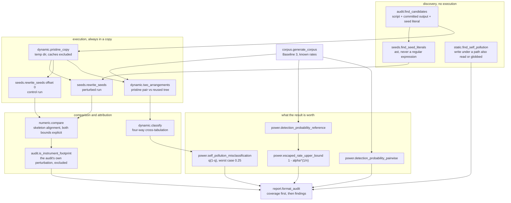
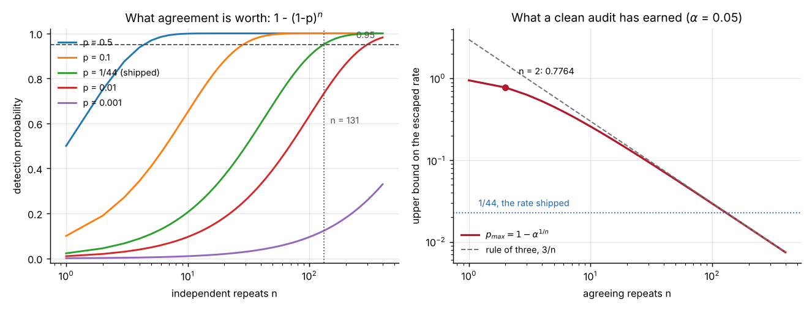
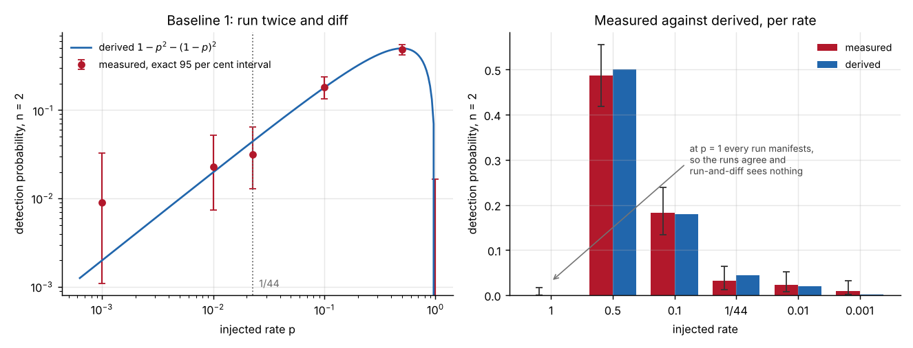
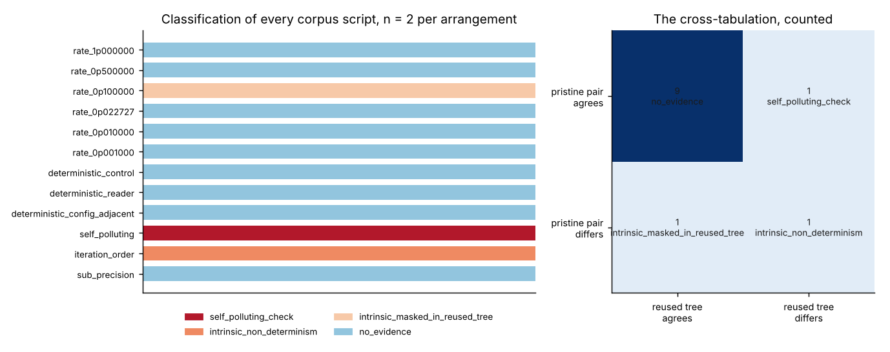
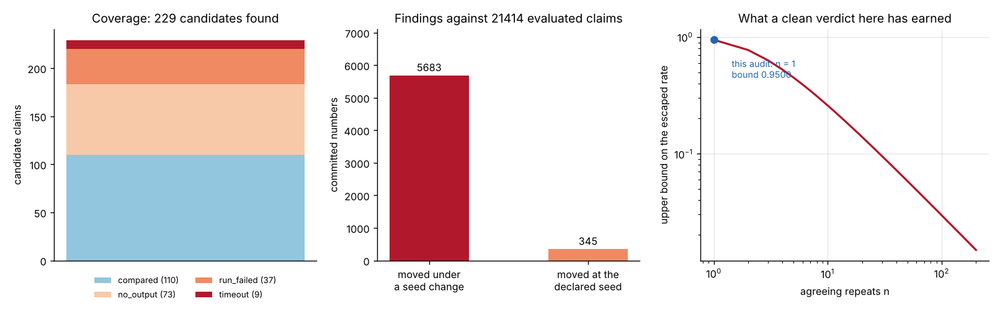

# seedaudit

Audits a repository's own reproducibility claims and states the detection power
of its own sampling.


## The headline, measured

Run over `products/` and `scripts/` of the repository this product was built
in — 3564 Python files, 229 candidate claims, every one attempted:

| quantity | measured |
|---|---|
| **committed numbers claimed reproducible that MOVE under a seed change** | **5683** |
| scripts contributing at least one | 103, across 31 products |
| committed numbers that move with the seed **held at its declared value** | **345** |
| scripts contributing at least one of those | 46, across 19 products |
| of those 345, sitting on a line with a wall-clock duration marker | 88 |
| numbers excluded as the audit's **own** perturbation echoed back | 45 |
| committed numeric tokens across all candidates | 43321 |
| tokens the comparison actually evaluated | 21414 |
| candidates compared / no output / failed to run / timed out | 110 / 73 / 37 / 9 |
| self-pollution screen: files flagged, findings, files parsed | 53, 275, 3564 |
| escaped-rate upper bound on the repeat axis, one run per arrangement | 0.95 |

Every figure comes from `validation/validate_repository_audit.py`, whose
itemised evidence is committed at `validation/repository_findings.json` and is
pinned as literals — per-script counts and a sha256 digest over every item's
before and after value — by `validation/validate_repository_findings.py`.

**`products/P094/` is excluded** because another agent was writing it
concurrently, so any number from it would not be reproducible by a reader.
**`products/P100/` — this product — is excluded** from its own repository scan,
because a tool scanning its own tree while it is being written is the class it
exists to detect; it is audited separately and deliberately in
`validation/validate_self_audit.py`, which publishes 17 self-pollution findings
against 6 of this product's own files.

## The problem

A reproducibility checker runs a script twice, sees the same answer and reports
"reproducible". At an intermittency rate of 1 in 44 — the rate the project this
tool was built for actually shipped — two runs detect the defect with
probability **0.044421487603305776**, so agreement is the *expected* outcome
and carries almost no information. The honest statement after two agreeing runs
is not zero; it is that the rate could be as high as **0.7763932022500211** at
95 per cent confidence, and reaching 95 per cent detection at 1 in 44 takes
**131** independent repeats.

## What this does

- **States the detection power of its own sampling in closed form**, in both
  designs that exist: `1 - (1-p)^n` when each run is compared against a
  committed reference, and `1 - p^n - (1-p)^n` when runs are compared only
  against each other. The two differ by exactly `p^n`, which is 0.25 of the
  answer at `p = 0.5, n = 2`. Every clean verdict carries
  `p_max = 1 - alpha^(1/n)`, the Clopper–Pearson upper bound on the rate that
  could have escaped. From `validation/validate_power_model.py`.
- **Finds committed numbers that move when only the random seed changes.** Each
  candidate script is executed twice in two separate pristine copies: once with
  every seed literal rewritten and once with them left alone. A number that
  moves in the first and not the second is seed-attributable.
  Over this repository: **5683** moved, net of **45** excluded as the audit's
  own footprint, against **21414** evaluated tokens.
- **Separates the self-polluting-check class from ordinary non-determinism** by
  running a script twice in two *pristine* copies and twice in *one reused*
  tree, and cross-tabulating the two answers. A verdict that changes between
  pristine runs is intrinsic; one that changes only in the reused tree is a
  check whose own execution created the condition it tests.
  Measured against the injected corpus the classifier fires on the deliberately
  self-polluting check; its **own worst-case error rate is 0.25 for every
  repeat budget from 2 upwards**, derived in closed form after a run of the
  example produced one.
- **Measures its own detection power against ground truth.** A corpus with
  non-determinism injected at known rates from 1.0 down to 0.001 is generated
  by a committed generator, and the audit's power is measured per rate with
  bootstrap and exact intervals. 1320 independent processes per rate and 4400 at 1 in 44; every Clopper–Pearson
  interval covers its injected rate, and the derived detection power lies inside
  the family-wise interval on **24 of 24** cells for both designs.
- **Reports its own coverage as a number, never as an implication.** How many
  candidates were found, attempted, compared, timed out, failed to run and
  produced no evaluable output, plus what was excluded and why.
  Of 229 candidates, **110** were compared, **73** produced no evaluable output,
  **37** failed to run and **9** timed out. A candidate that produces no output
  is reported as unevaluable, never as clean.

## What this does NOT claim

A number that moves under a seed change is **not automatically a defect.** A
Monte Carlo estimate quoted at a declared seed is reproducible at that seed, and
its moving under a different seed is the expected behaviour of a stochastic
estimate. What the finding establishes is narrower and still useful: that number
is **a property of the seed, not of the system**, so any sentence that reads it
as a property of the system is unsupported by a single-seed run and needs a seed
sweep with an interval.

The genuinely defective class is the other one: a number that moves with the
seed **held fixed**. That number is not reproducible at all.

## Who it is for

- Someone maintaining a repository that commits numeric evidence — validation
  outputs, benchmark tables, regression fixtures — and wants to know which of
  those numbers are properties of a seed.
- Someone who has to say, in writing, what a clean reproducibility run means,
  and does not want to say "zero" when they have not earned it.
- Someone chasing an intermittent failure who needs to know how many repeats
  would actually be enough.

## Who it is NOT for

- **Anyone checking a build for byte-for-byte reproducibility.** Use
  `reprotest` and `diffoscope`. This tool does not vary build paths, locales,
  timezones or filesystem ordering, and it does not compare binaries.
- **Anyone who wants flaky tests to stop failing CI.** `pytest-rerunfailures`
  and `flaky` are the right tools and this one is their opposite: it exists to
  find the flakiness and count it.
- **Anyone needing a guarantee.** Every verdict here is a bound at a stated
  confidence, from a stated number of runs, under a stated independence
  assumption that is known to be optimistic.
- **Anyone auditing a language other than Python.** The seed rewriter and the
  static screen are Python syntax trees and nothing else.
- **Anyone who needs the audit to resolve a seed through an import.** The
  candidate rule reads the script's own source; a seed declared in an imported
  module is not found. The size of that blind spot is measured in *Limitations*.

## Alternatives, honestly

Every version was read from the PyPI JSON API on 2026-11-16.

| Tool | Version | What it does better | When to use it instead of this |
|---|---|---|---|
| `reprotest` | 0.7.33 | varies build environment along declared axes — path, locale, timezone, filesystem order, user — and rebuilds | you are checking a **build** for reproducibility across environment variation |
| `diffoscope` | 339 | recursive, content-aware diff of archives, binaries, PDFs, filesystem images | you have two artifacts and need to know **where inside them** they differ |
| `pytest-randomly` | 5.1.0 | randomises test order and reseeds `random`, `numpy.random` and `faker` per test | you want order-dependence and seed-dependence surfaced **inside a pytest suite** |
| `pytest-rerunfailures` | 16.7 | re-runs failing tests so flaky ones pass | you want CI to survive a known flaky test — note this **suppresses** the signal this tool looks for |
| `flaky` | 3.8.1 | the same, as a per-test decorator with pass/run thresholds | the flakiness is known, accepted and documented |
| `pytest-repeat` | 0.9.4 | runs each test N times | you want a repeat count and nothing else |
| `pytest-flakefinder` | 1.1.0 | repeats tests within a time budget to expose flakiness | you want repeats bounded by wall-clock rather than by count |

None of these states a detection power or an escaped-rate bound, and none
detects the self-polluting-check class, because none runs a check in a pristine
copy and in a reused tree and compares the two verdicts against each other.

## Install and first run

```bash
git clone https://github.com/OmAcharya-avtr/seedaudit.git
cd seedaudit
python -m venv .venv && source .venv/bin/activate
pip install -e ".[dev]"
python -m pytest tests/ -q
python examples/power_table.py
```

`python -m pytest tests/ -q` prints:

```
........................................................................ [ 39%]
........................................................................ [ 79%]
.....................................                                    [100%]
181 passed in 6.73s
```

The trailing duration is a wall-clock reading and will differ on your machine.
It is flagged rather than trimmed because this product's audit of the
repository it was built in counts **88** such readings committed elsewhere as
reproducible evidence, and a tool that did the same thing silently would have
nothing to say about them.

`python examples/power_table.py` ends with:

```
p = 1/44 = 0.022727272727272728 is the rate this mission actually shipped.
run-twice-and-diff detection power     : 0.04442148760330579
run-twice against a committed reference: 0.04493801652892562
repeats needed for 95 per cent detection: 131
escaped-rate upper bound after 2 agreeing runs: 0.7763932022500211

figure written to screenshots/detection_power.png
```

## A worked example

```python
from seedaudit.power import (
    detection_probability_pairwise,
    escaped_rate_upper_bound,
    repeats_for_detection,
    self_pollution_misclassification,
    worst_case_misclassification,
)

# You ran your test suite twice. It agreed. What have you established?
runs = 2
print("escaped-rate upper bound:", escaped_rate_upper_bound(runs, 0.05))

# You want to catch a 1-in-44 intermittent failure 95 times out of 100.
rate = 1.0 / 44.0
needed = repeats_for_detection(rate, 0.95)
print("repeats needed:", needed)
print("power at 2 repeats:", detection_probability_pairwise(rate, 2))
print("power at", needed, "repeats:", detection_probability_pairwise(rate, needed))

# Your two-arrangement run said "self-polluting". How often is that wrong for a
# script that is merely non-deterministic?
print("misclassification at p=0.5, n=2:", self_pollution_misclassification(0.5, 2))
print("worst case at n=2 :", worst_case_misclassification(2))
print("worst case at n=20:", worst_case_misclassification(20))
print("worst case, 3 independent trials:", worst_case_misclassification(2, 3))
```

Real output:

```
escaped-rate upper bound: 0.7763932022500211
repeats needed: 131
power at 2 repeats: 0.04442148760330579
power at 131 repeats: 0.9507884480560611
misclassification at p=0.5, n=2: 0.25
worst case at n=2 : 0.25
worst case at n=20: 0.25
worst case, 3 independent trials: 0.015625
```

Two agreeing runs are consistent with a defect that manifests on more than
three quarters of executions. And more runs *per arrangement* do not make the
self-pollution classifier safer — only independent repetitions of the whole
experiment do.

## Architecture



## Screenshots



The left panel is the product's premise. At `p = 1/44` the curve is still below
0.05 at two repeats and does not cross 0.95 until `n = 131`. The right panel is
what a clean audit has actually earned: after two agreeing runs the escaped rate
could still be 0.776, and the bound only falls below the shipped rate of 1/44
past `n = 131`. Produced by `examples/power_table.py`.



Baseline 1 measured against ground truth. The left panel plots the measured
detection power of run-twice-and-diff at each injected rate against the closed
form, with exact intervals; a measurement of exactly zero is drawn as a bar from
the axis floor to its upper bound, because a percentile bootstrap is degenerate
there and an exact interval is not. The right panel is the same data as bars:
note the leftmost pair, where an injected rate of **1.0** gives a measured and a
derived detection probability of **0** — when every run manifests, every run
agrees, and a design with no committed reference sees nothing at all. Produced by
`examples/injected_corpus_power.py`.



Every script of the injected corpus classified by the two-arrangement runner at
two runs per arrangement, with the cross-tabulation counted on the right. The
deliberately self-polluting check is the dark red row. Produced by
`examples/arrangement_classifier.py`.



The audit of this repository, with its coverage on the left so the findings in
the middle have a denominator. The right panel marks what this audit actually
earned on the repeat axis: one run per arrangement, so the escaped-rate bound is
**0.95** and the audit says so rather than implying zero. Produced by
`examples/repository_audit_coverage.py` from the committed evidence.

## Validation evidence

Full detail, including every failed and weak check, is in
`validation/VALIDATION.md`. The table below is the summary; every row names the
script it came from.

| check | script | result |
|---|---|---|
| closed forms against Monte Carlo, 200000 audits per cell, 24 cells | `validate_power_model.py` | **PASS**, worst standardised deviation **3.3018** |
| closed form inside a two-term inclusion-exclusion bracket | `validate_power_model.py` | **PASS**, 16 of 16 cells; degenerate at `n = 2` and said so |
| closed form inside the exponential bracket from `log(1-p)` | `validate_power_model.py` | **PASS**, 30 of 30 cells |
| `p_min` and `p_max` agree over 11 budgets | `validate_power_model.py` | **PASS**, worst absolute disagreement **0.0** |
| corpus calibration, 6 injected rates, family-wise Clopper–Pearson | `validate_injected_corpus.py` | **PASS**, 6 of 6 cover |
| derived detection power inside the family-wise interval, both designs | `validate_injected_corpus.py` | **PASS**, 24 of 24 and 24 of 24 |
| **Baseline 1 at p = 1/44**, measured against derived 0.044421487603305776 | `validate_injected_corpus.py` | **measured 0.05136363636363636**, exact interval [0.038016626326467684, 0.06747655439900632], derived inside |
| dynamic false-positive rate on the deterministic negative controls | `validate_injected_corpus.py` | **0.0** (0 of 3) |
| static false-positive rate on the same controls | `validate_injected_corpus.py` | **0.0** (0 of 3) — **refutes** the pre-registered expectation of a non-zero rate |
| the two-arrangement classifier fires on the self-polluting check | `validate_injected_corpus.py` | **control FIRED** |
| a numeric-only comparison is blind to an iteration-order change | `validate_injected_corpus.py` | **PASS**, 0 moved numbers, structural change seen |
| a text comparison misses a sub-precision change, a numeric one catches it | `validate_injected_corpus.py` | **PASS**, 0 against 1 |
| `pytest.approx` calls relying on the hidden `abs=1e-12` default | `validate_approx_audit.py` | **0 of 38**, suite passes with the default forbidden, both controls fire |
| the audit's own headline on a bounded 24-candidate subset, run twice | `validate_self_audit.py` | **identical**: 124 and 124, same coverage, same script set |
| the audit over a fixture, run twice | `validate_self_audit.py` | **identical reports** |
| the pinned finding set against the committed evidence | `validate_repository_findings.py` | **PASS**, 26 checks, digests match |
| running the hygiene script adds no cache or bytecode file | `validate_tree_hygiene.py` | **PASS**, 0 added |
| no tracked text file carries an absolute home or temp path | `validate_tree_hygiene.py` | **PASS**, 0 occurrences |
| every script returns the same exit status from four working directories | `probe_working_directories.py` | **PASS**, 11 scripts × 4 directories, all exit 0, and the probe changed no committed output file but its own |

**The weak one, named:** the worst Monte Carlo deviation is **3.3018** standard
errors. Over 48 comparisons a maximum above 3.3 has probability about 0.045, so
it is inside expectation and it is the weakest agreement in the set. The
four-standard-error criterion was declared before the run and was not moved.

**The refuted one, named:** `SPEC.md` section 8 predicted a non-zero static
false-positive rate on the negative controls. It is **0.0**. The screen is more
precise than the prediction: `deterministic_config_adjacent.py` reads a *file*
in the directory it writes to and does not *enumerate* that directory, and a
write beside a file that was read is not containment under a scan root. The
screen was not changed to produce that result; the prediction was wrong.

## API reference

<details>
<summary><code>seedaudit.power</code> — the closed-form detection power</summary>

| Function | Returns |
|---|---|
| `detection_probability_reference(p, n)` | `1 - (1-p)^n`, dimensionless, for a design with a committed reference |
| `detection_probability_pairwise(p, n)` | `1 - p^n - (1-p)^n`, dimensionless, for run-and-diff with no reference |
| `smallest_detectable_rate(n, alpha)` | `1 - alpha^(1/n)`, the smallest rate caught with probability `1-alpha` |
| `escaped_rate_upper_bound(n, alpha)` | the same expression as a different claim: the upper bound on `p` after `n` agreeing runs |
| `repeats_for_detection(p, power)` | smallest integer `n` reaching that detection probability |
| `repeats_for_escaped_rate_bound(p_max, alpha)` | smallest `n` whose clean-audit bound is at or below `p_max` |
| `union_bound_reference(p, n)` | `min(1, n*p)`, first-order inclusion-exclusion |
| `bonferroni_bracket_reference(p, n)` | two-term inclusion-exclusion bracket, degenerate at `n = 2` |
| `exponential_bracket_reference(p, n)` | bracket from `-p/(1-p) <= log(1-p) <= -p` |
| `seed_axis_detection(population, sensitive, draws)` | hypergeometric detection on the seed axis, which is not the repeat axis |
| `agreement_probability(p, n)` | `p^n + (1-p)^n`, the complement of pairwise detection |
| `self_pollution_misclassification(p, n, trials)` | `(q(1-q))^trials` with `q = p^n + (1-p)^n` |
| `worst_case_misclassification(n, trials)` | `0.25^trials` for every `n >= 2`; more runs per arrangement do not help |
| `worst_case_misclassification_rate(n)` | the rate at which the classifier is worst |
| `monte_carlo_detection(p, n, trials, rng)` | simulated estimates and standard errors for both designs |
| `bootstrap_interval(indicators, rng, resamples, confidence)` | `(point, lower, upper)`, percentile bootstrap over audits |

</details>

<details>
<summary><code>seedaudit.numeric</code>, <code>seedaudit.seeds</code>, <code>seedaudit.static</code></summary>

| Function | Returns |
|---|---|
| `numeric.numeric_tokens(line, line_number)` | every numeric token with its text, value and position |
| `numeric.skeleton(line)` | the line with every number replaced by `<#>` |
| `numeric.changed(before, after, rel_tol, abs_tol)` | whether a value moved; both bounds explicit, both default to 0 |
| `numeric.compare(reference, candidate, rel_tol, abs_tol)` | moved numbers, compared-token count and structural change |
| `seeds.find_seed_literals(source)` | rewritable seed literals plus every unresolved seed position |
| `seeds.rewrite_seeds(source, perturbation)` | the source with each seed literal shifted, and the scan |
| `static.path_uses(source)` | every read, glob and write path use, as segment tuples |
| `static.is_under(root, path)` | whether a path can lie inside a root, wildcards matching anything |
| `static.is_informative(expr)` | whether an expression can carry a containment claim at all |
| `static.path_use_coverage(source)` | counts of informative and vacuous path uses |
| `static.find_self_pollution(source)` | writes landing under a path the same script reads or globs |

</details>

<details>
<summary><code>seedaudit.dynamic</code>, <code>seedaudit.corpus</code>, <code>seedaudit.audit</code></summary>

| Function | Returns |
|---|---|
| `dynamic.pristine_copy(source)` | context manager yielding `(copy, home)` in a temporary directory |
| `dynamic.run_once(source, script, artifact, timeout, transform, ...)` | one `RunResult` from a fresh copy |
| `dynamic.repeat_runs(source, script, repeats, ...)` | one `RunResult` per repeat, each in its own copy |
| `dynamic.two_arrangements(source, script, ...)` | pristine pair, reused tree, classification and escaped-rate bound |
| `dynamic.classify(pristine_agree, reused_agree)` | one of four labels |
| `corpus.generate_corpus(destination, rates)` | the injected corpus and its declared references |
| `corpus.manifestation_indicators(corpus, name, reference, runs, timeout)` | per-run 0/1 manifestation array |
| `corpus.block_detection(indicators, repeats)` | per-audit detection for both designs, over disjoint blocks |
| `audit.find_candidates(repo_root, roots, exclusions)` | every script whose committed output is a seed-dependent claim |
| `audit.audit_claim(repo_root, candidate, timeout, perturbation, ...)` | the perturbed run, the control, and the attribution |
| `audit.is_instrument_footprint(moved, declared_seeds, perturbation)` | whether a moved number is the audit's own perturbation |
| `audit.static_scan(repo_root, roots, exclusions)` | findings by file, parse failures, and the files-parsed count |
| `audit.audit_repository(repo_root, ...)` | the whole audit, with coverage reported as a number |

</details>

## Command line

```
python -m seedaudit power          # the closed-form table; no execution at all
python -m seedaudit static  ROOT   # the self-pollution screen over a tree
python -m seedaudit arrangements ROOT SCRIPT --artifact FILE
python -m seedaudit corpus --runs N --repeats K
python -m seedaudit audit   ROOT --workers 2 --timeout 75 --deadline 6000
```

A finding is not an error: every subcommand exits 0 when it produced its
report. A tool that exited non-zero on a finding would push a user towards not
running it.

## Limitations

**A moved number is not automatically a defect.** See *What this does NOT
claim*. The headline counts numbers that are properties of a seed; whether that
matters depends on what each one is quoted as.

**The repeat axis of the repository audit is sampled once per arrangement.** Its
escaped-rate upper bound is therefore **0.95** — nearly uninformative. The audit
says so with every result rather than implying zero. Raising it costs linear
time: the bound is `1 - 0.05^(1/n)`, so 0.1 needs 29 runs per candidate and 0.03
needs 99.

**Independence across repeats is assumed and is optimistic.** Repeats share a
warm filesystem cache and a shared machine; the mitigation is a fresh subprocess
in a fresh pristine copy with a fresh hash seed, and the residual correlation is
not zero and is not estimated. The true power is **lower** than the formula and
`p_max` is therefore **optimistic**, which is the direction that matters.

**The self-pollution classifier is wrong up to 25 per cent of the time, at every
repeat budget.** `q(1-q)` with `q = p^n + (1-p)^n` peaks at 0.25 whenever `q`
can reach 0.5, which it does for every `n >= 2`. More runs per arrangement only
move the rate at which it is worst. Only independent repetitions of the whole
experiment help: 0.25, 0.0625, 0.015625 for one, two and three trials. This was
found by running the tool, not by reasoning about it.

**The candidate rule misses a seed declared in an imported module.** It reads
the script's own source. Measured on this repository: **72 of 565** scripts with
a committed output declare no seed of their own while a sibling `_module` does —
**0.127434** of them. Resolving an imported constant would require the audit to
execute or import the code it is auditing, which is a different and larger
design. From `validate_self_audit.py`.

**37 candidates failed to run and 9 timed out** in a pristine copy at a 75 s
limit. Those 46 claims are reported as unevaluable, not as clean. A product
whose validation script does not run from a pristine copy of its own directory
is itself a finding, but this audit does not separate that from a missing
input, and it does not try to.

**73 candidates produced no output file** and are likewise unevaluable. The
committed artifact is deleted inside the copy before each run, so a script that
does not rewrite it is reported rather than compared against itself — but that
deletion can itself change a hygiene scanner's verdict. It applies identically
to the control run, so it cannot reach the headline.

**The static screen is a screen.** It has no execution order and no
reachability: a write guarded by a branch that never runs still counts. It
reported **3** vacuous path uses in this product's own 174, which it is blind
to, and it over-flags by construction. `seedaudit.dynamic` is the confirmation
and the product reports both, never only one.

**The skeleton placeholder is `<#>`.** A report line that literally contains
`<#>` is treated as though it held a number there. The effect is on line
alignment only, never on whether a numeric token is read as a number. The first
version used a NUL-delimited placeholder, which made every committed output a
binary file.

**The duration marker is a line-local keyword test, not a semantic claim.** A
table row whose unit lives in a column header elsewhere carries no marker, so
the unmarked count — 257 of 345 — is an **upper** bound on the non-timing
findings, never a lower one.

**The `.gitignore` check is re-implemented, not delegated.** The build agent for
this product is forbidden from running `git`, so `validate_tree_hygiene.py`
re-implements the subset of ignore matching it needs. It does not cover
`core.excludesFile`, `.git/info/exclude`, per-directory `.gitignore` files below
this product, or the index. **Release-gate check 9 is the authoritative check
and this one does not replace it.**

**The suite has not been run at both ends of every declared dependency range.**
The build guide asks for the suite and the committed validation output to be
compared at the floor and ceiling of each range in an isolated environment. That
was not done, and the declared ranges are the minor series actually measured —
narrower than a floor with no ceiling, and weaker than a measured range.

**A pin below a future security release is a real cost.** This product cannot
take such a release without a port. The tension is recorded rather than resolved
by removing the ceiling.

**The audited corpus is a live repository that other agents were writing to.**
`products/P094/` is excluded for exactly that reason. The full-corpus audit is a
**single** measurement; its between-run variation is measured on a bounded
24-candidate subset, where it was zero, and is not measured at full size.

**Compute budget.** The full repository audit took **3337.1 s** on two cores
with a 75 s per-run limit and two workers. The injected-corpus validation runs
11000 subprocesses. Everything else finishes in seconds.

**Python only.** The seed rewriter and the static screen are Python syntax trees.

## Reproducing every number

From a cold clone, in this order. Every number in `README.md` and
`validation/VALIDATION.md` comes from one of these.

```bash
pip install -e ".[dev]"

# the test counts in the badge and in VALIDATION.md
python -m pytest tests/ -q --junitxml=junit.xml

# the closed-form table, the Monte Carlo check and both brackets  (~1 min)
python validation/validate_power_model.py

# Baseline 1, Baseline 3, the negative controls and the corpus   (~6 min)
python validation/validate_injected_corpus.py

# the pytest.approx hidden-default audit and its two controls
python validation/validate_approx_audit.py

# this product audited by this product, and the subset reproducibility (~12 min)
python validation/validate_self_audit.py

# the repository audit itself. THIS TAKES ABOUT AN HOUR and writes
# validation/repository_findings.json
python validation/validate_repository_audit.py

# the pinned finding set, re-verified from that evidence, in under a second
python validation/validate_repository_findings.py

# tree hygiene and the four-working-directory probe
python validation/validate_tree_hygiene.py
python validation/probe_working_directories.py

# the four screenshots
python examples/power_table.py
python examples/injected_corpus_power.py
python examples/arrangement_classifier.py
python examples/repository_audit_coverage.py

# ruff under both installed versions
ruff check src/ tests/ examples/ validation/
python -m ruff check src/ tests/ examples/ validation/
```

`validate_injected_corpus.py` and `examples/injected_corpus_power.py` draw from
the operating system's entropy by design, so their measured figures move between
runs; the derived values they are compared against do not. Everything else is
deterministic under the single declared seed `1000044`.

## Safety statement

This software is **research-grade**. It is **not flight-qualified**, **not
certified** and **not approved for operational aerospace use**. Every verdict it
produces is a bound at a stated confidence from a stated number of runs, under
an independence assumption that is known to be optimistic in the direction that
matters.

## Licence and citation

Apache-2.0. See `LICENSE`. Copyright © 2026 OPTIMA Organisation.
Citation metadata is in `CITATION.cff`.

## Credits

This is under reserved rights obtained by OPTIMA Organisation.
